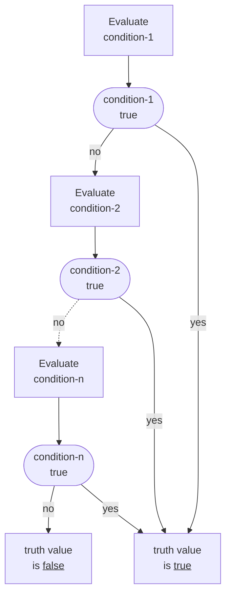
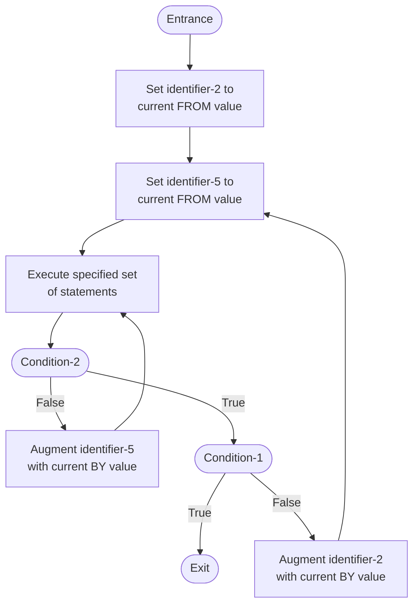
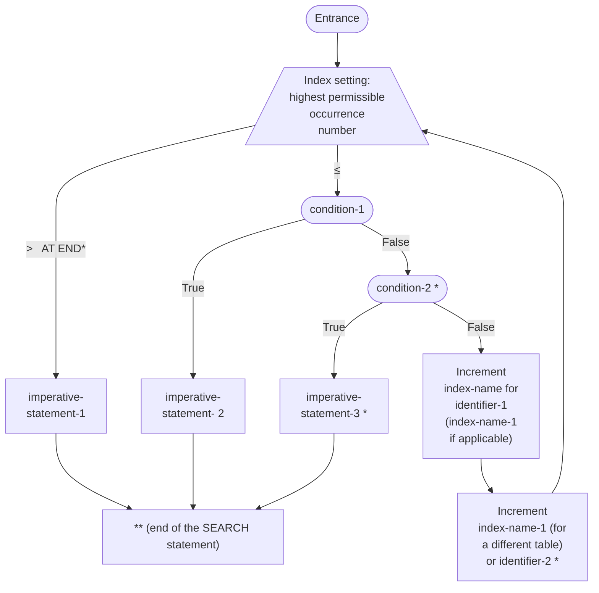

# Preface

> **This section is NOT part of American National Standard X3.23-1985.** It is supplied by the publisher of this
> transcription. Every other word in this file is a transcription of the standard and of its two amendments; where
> this file adds editorial matter it is marked as such, as here.

This document is a transcription of **American National Standard X3.23-1985, *American National Standard for
Information Systems — Programming Language — COBOL*** (now ANSI INCITS 23-1985 (R2001)), together with its two
amendments: **ANSI X3.23a-1989, *Intrinsic Function Module for COBOL***, and **ANSI X3.23b-1993, *Correction Amendment
for COBOL***. **The text of the standard is kept current with every amendment applied in place**: Amendment 1 first,
then Amendment 2, in the order Amendment 2's own preamble prescribes, so the base text reads as the amended standard
("amended third Standard COBOL", in Amendment 2's words). Each amendment is also transcribed in full under its own
heading (`AMENDMENT 1` and `AMENDMENT 2`), as it was published, as the record of what it changed; Amendment 1's
Section A, the Intrinsic Function module, is held there once. The standard is reproduced under the permission it
grants on its own page 3 (PDF page 3), in the CODASYL acknowledgment:

> Any organization interested in reproducing the COBOL standard and specifications in whole or in part, using ideas
> from this document as the basis for an instruction manual or for any other purpose, is free to do so. However, all
> such organizations are requested to reproduce the following acknowledgment paragraphs in their entirety as part of
> the preface to any such publication […]

The acknowledgment paragraphs are accordingly reproduced here **in their entirety**, exactly as printed. They also
appear in position in the transcription of PDF page 3.

---

COBOL is an industry language and is not the property of any company or group of companies, or of any organization or
group of organizations.

No warranty, expressed or implied, is made by any contributor or by the CODASYL COBOL Committee as to the accuracy and
functioning of the programming system and language. Moreover, no responsibility is assumed by any contributor, or by the
committee, in connection therewith

The authors and copyright holders of the copyrighted materials used herein

FLOW-MATIC (trademark of Sperry Rand Corporation), Programming for the UNIVAC (R) I and II, Data Automation Systems
copyrighted 1958, 1959, by Sperry Rand Corporation; IBM Commercial Translater Form No F 28-8013, copyrighted 1959 by
IBM; FACT, DSI 27A5260-2760, copyrighted 1960 by Minneapolis-Honeywell

have specifically authorized the use of this material in whole or in part, in the COBOL specifications Such
authorization extends to the reproduction and use of COBOL specifications in programming manuals or similar
publications.

---

> **About this transcription.** American National Standard X3.23-1985 and its amendments are the authoritative text;
> where this transcription and the published standard differ, **the published standard governs**. This transcription
> is the most accurate version of the specification its maintainers can make, and it is kept current: **every change
> Amendment 1 and Amendment 2 make to the text is applied in place**, and an evident misprint (a misspelling, a damaged
> letter, a real word printed for another, an operand the rule's own sense shows is the wrong one) is corrected; a
> wording that is the standard's deliberate requirement, however odd, stays as printed. **Every modification is
> attributed**: a ⚠ note where it is made quotes what the printed page prints and names the source of the change (the
> amendment, its change row and its page, or the sense and the evidence for it), and the **Errata** at the end of this
> document lists it with its page, so each reads as an update and can be traced to, or reversed against, the printed
> page. The words, the punctuation and the spelling are otherwise transcribed as printed. The acknowledgment is never
> corrected (the acknowledgment above omits two periods because the printed page does).
>
> **The pages are kept.** The source is a scan, and the transcription was made and reconciled page by page against
> the rendered page, so each `## Page N` heading opens the text of PDF page N. The printed folios (`VI-21`, `XVII-3`)
> stay where the page prints them. The page furniture that is not the standard's (the reseller's per-copy stamp) is
> removed. The scan prints folios X-11 and X-12 twice (PDF pages 525-526 and 527-528); both copies
> are transcribed, and the repeat is marked with a comment where it begins. The scan also lacks four printed
> pages of the Report Writer module, folios XIII-30, XIII-31, XIII-54 and XIII-55. Until they are obtained, each gap
> holds a **reconstruction**: editorial text, not the standard's words, between a `> ⚠ **RECONSTRUCTED — not printed
> in our copy (folios …).**` note, which names its sources and its confidence, and a `> ⚠ **END RECONSTRUCTED …**`
> note. The printed pages' verbatim text will replace each one.
>
> **Notation.** A key word the standard underlines is underlined (`<u>…</u>`, or the drawn underline of a general
> format); the general formats are drawn as the printed page draws them, in the house style
> (`docs/rearchitecture/spec-reconciliation/FIGURE-STYLE.md`). The standard encloses every specification unique to
> level 2 of a module (the high level) in a box (Section I, 1.3; Section IV, 1). The box is drawn as its two sides,
> double lines, wherever it falls: in a general format as `║` columns beside the rows it holds, and in prose as a `║`
> at each end of the boxed text. A boxed heading, paragraph, rule or list item opens and closes with `║`
> (`║(4) Any necessary conversion …║`), a boxed table row opens in its first cell and closes in its last, and a box
> around words inside a sentence encloses those words (`opened in the output ║or extend║ mode`). Where a box holds
> several paragraphs, each of them opens and closes with `║`. A box never nests, so every `║` that opens a box is
> followed by the one that closes it. The amendments draw boxes the same way.

# Front matter: title, foreword, preface and contents

## Page 1

***ANSI INCITS 23-1985 (R2001)***

(formerly ANSI X3.23-1985 (R2001))

> ADOPTED FOR USE BY
> THE FEDERAL GOVERNMENT
>
> **FIPS**
>
> **PUB 21-4**
>
> SEE NOTICE ON INSIDE

# American National Standard

*for Information Systems -*
*Programming Language -*
*COBOL*

---

**Developed by**

**incits**<sup>SM</sup>

*Where **IT** all begins*

Approved American National Standard

**ANSI**

## Page 2

<!-- This page is intentionally blank; it contains no text other than the omitted licence stamp. -->

## Page 3

ANSI®
X3.23-1985
**Revision of**
**ANSI X3.23-1974**

# American National Standard for Information Systems –

# Programming Language – COBOL

Secretariat

**Computer and Business Equipment Manufacturers Association**

Approved September 10, 1985

**American National Standards Institute, Inc**

## <u>ACKNOWLEDGMENT</u>

Any organization interested in reproducing the COBOL standard and specifications in whole or in part, using ideas from this document as the basis for an instruction manual or for any other purpose, is free to do so. However, all such organizations are requested to reproduce the following acknowledgment paragraphs in their entirety as part of the preface to any such publication (any organization using a short passage from this document, such as in a book review, is requested to mention "COBOL" in acknowledgment of the source, but need not quote the acknowledgment):

> COBOL is an industry language and is not the property of any company or group of companies, or of any organization or group of organizations.
>
> No warranty, expressed or implied, is made by any contributor or by the CODASYL COBOL Committee as to the accuracy and functioning of the programming system and language. Moreover, no responsibility is assumed by any contributor, or by the committee, in connection therewith
>
> The authors and copyright holders of the copyrighted materials used herein
>
> > FLOW-MATIC (trademark of Sperry Rand Corporation), Programming for the UNIVAC (R) I and II, Data Automation Systems copyrighted 1958, 1959, by Sperry Rand Corporation; IBM Commercial Translater Form No F 28-8013, copyrighted 1959 by IBM; FACT, DSI 27A5260-2760, copyrighted 1960 by Minneapolis-Honeywell
>
> have specifically authorized the use of this material in whole or in part, in the COBOL specifications Such authorization extends to the reproduction and use of COBOL specifications in programming manuals or similar publications.

## Page 4

# American National Standard

Approval of an American National Standard requires review by ANSI that the requirements for due process, consensus, and other criteria for approval have been met by the standards developer.

Consensus is established when, in the judgment of the ANSI Board of Standards Review, substantial agreement has been reached by directly and materially affected interests. Substantial agreement means much more than a simple majority, but not necessarily unanimity. Consensus requires that all views and objections be considered, and that a concerted effort be made toward their resolution.

The use of American National Standards is completely voluntary; their existence does not in any respect preclude anyone, whether he has approved the standards or not, from manufacturing, marketing, purchasing, or using products, processes, or procedures not conforming to the standards.

The American National Standards Institute does not develop standards and will in no circumstances give an interpretation of any American National Standard. Moreover, no person shall have the right or authority to issue an interpretation of an American National Standard in the name of the American National Standards Institute. Requests for interpretations should be addressed to the secretariat or sponsor whose name appears on the title page of this standard.

**CAUTION NOTICE:** This American National Standard may be revised or withdrawn at any time. The procedures of the American National Standards Institute require that action be taken periodically to reaffirm, revise, or withdraw this standard. Purchasers of American National Standards may receive current information on all standards by calling or writing the American National Standards Institute.

Published by

**American National Standards Institute**
**11 West 42nd Street, New York, New York 10036**

Copyright ©1985 by Information Technology Industry Council (ITI)
All rights reserved.

No part of this publication may be reproduced in any form, in an electronic retrieval system or otherwise, without prior written permission of ITI, 1250 Eye Street NW, Washington, DC 20005.

Printed in the United States of America

## Page 5

# Foreword

(This Foreword is not part of American National Standard X3.23-1985.)

This standard is a revision of American National Standard for Programming Language COBOL, ANSI X3 23-1974 The language specifications contained in this standard were drawn from both ANSI X3 23-1974 and the CODASYL COBOL Journal of Development Like its predecessors, this document provides specifications for both the form and interpretation of programs expressed in COBOL. It is intended to provide a high degree of machine independence in such programs in order to permit their use on a variety of automatic data processing systems

Technical Committee X3J4 on COBOL was responsible for the preparation of a revision of ANSI X3.23-1974 In performing this task, Technical Committee X3J4 held three public review and comment periods in which comments on the draft proposed revision were received from the data processing community. Technical Committee X3J4 reviewed and responded to all comments received during these public review periods In April 1985, Technical Committee X3J4 approved the final version of the draft proposed COBOL standard

Accredited Standards Committee on Information Processing Systems, X3, approved the draft proposed COBOL standard for submittal to ANSI as the revised American National Standard for the programming language COBOL in August 1985. The draft proposed COBOL standard was approved as an American National Standard by the American National Standards Institute on September 10, 1985.

This standard was processed and approved for submittal to ANSI by the Accredited Standards Committee on Information Processing Systems, X3. Committee approval of this standard does not necessarily imply that all committee members voted for its approval At the time it approved this standard, the X3 Committee had the following members·

Edward Lohse, Chair
Catherine A. Kachurik, Administrative Secretary

| *Organization Represented* | *Name of Representative* |
|---|---|
| American Library Association | Paul Peters |
| American Nuclear Society | Geraldine C. Main<br>D. R. Vondy (Alt) |
| AMP Incorporated | Patrick E. Lannan<br>Edward Kelly (Alt) |
| Association of American Railroads | R. A. Petrash |
| Association for Computing Machinery | Kenneth Magel<br>Jon A. Meads (Alt) |
| Association of the Institute for Certification of Computer Professionals | Thomas M. Kurihara<br>Ardyn E. Dubnow (Alt) |
| AT&T Corporation | Henry L. Marchese<br>Richard Gibson (Alt) |
| AT&T Information Systems | Herbert V. Bertine<br>Paul D. Bartoli (Alt)<br>Stuart H Garland (Alt) |
| Burroughs Corporation | Ira R. Purchis<br>Stanley Fenner (Alt) |
| Control Data Corporation | Charles E. Cooper<br>Keith Lucke (Alt) |
| Cooperating Users of Burroughs Equipment | Thomas Easterday<br>Donald Miller (Alt) |
| Data General Corporation | John Pilat<br>Lyman Chapin (Alt) |
| Data Processing Management Association | Christian G. Meyer |
| Digital Equipment Computer Users Society | William Hancock |
| Digital Equipment Corporation | Gary S. Robinson<br>Delbert L. Shoemaker (Alt) |
| General Electric Company | William R Kruesi |

i

## Page 6

| *Organization Represented* | *Name of Representative* |
|---|---|
| General Services Administration | William C. Rinehuls |
| | Larry L. Jackson (Alt) |
| GUIDE International | Frank Kishenbaum |
| | Thomas F O'Leary, Jr (Alt) |
| Harris Corporation | Sam Mathan |
| | Rajiv Sinha (Alt) |
| Hewlett-Packard | Donald C. Loughry |
| Honeywell Information Systems | Thomas J. McNamara |
| | David M. Taylor (Alt) |
| IBM Corporation | Mary Anne Gray |
| | Robert H Follett (Alt) |
| IEEE Computer Society | Sava I. Sherr |
| | David Gelperin (Alt) |
| | Thomas A. Varetoni (Alt) |
| Lawrence Berkeley Laboratory | David F. Stevens |
| | John S. Colonias (Alt) |
| Moore Business Forms | Delmer H. Oddy |
| National Bureau of Standards | Robert E. Rountree |
| | James H. Burrows (Alt) |
| National Communications System | Marshall L. Cain |
| | George W White (Alt) |
| NCR Corporation | Thomas W. Kern |
| | A. R. Daniels (Alt) |
| Perkin-Elmer Corporation | Christopher Beling |
| | Russ Lombardo (Alt) |
| Prime Computer, Inc | Andrew F. Burlingame |
| | Jacqueline Barbour (Alt) |
| Recognition Technology Users Association | Herbert F. Schantz |
| | G. W. Wetzel (Alt) |
| SHARE, Inc | Thomas B. Steel |
| | Daniel Schuster (Alt) |
| Sperry Corporation | Marvin W. Bass |
| | Jeanne G Smith (Alt) |
| Texas Instruments, Inc | Presley Smith |
| | Richard F Trow, Jr (Alt) |
| 3M Company | J. Wade Van Valkenburg |
| | Ray Smith (Alt) |
| Travelers Insurance Companies, Inc. | Joseph T. Brophy |
| U.S. Department of Defense | Fred Virtue |
| | Belkis Leong-Hong (Alt) |
| VIM | Chris Tanner |
| | Madeleine Sparks (Alt) |
| Wang Laboratories, Inc. | Marsha Hayek |
| | Joseph St. Amand (Alt) |
| Xerox Corporation | John L Wheeler |
| | Arthur R. Machell (Alt) |

## Page 7

# Preface

> ⚠ **CORRECTED — see the Errata (C1).** The standard prints `This document piovides the definition` (page 7): a damaged letter on the printed page, which the transcription had reproduced. Corrected to `provides`. Amendment 2 has since replaced the Preface this sentence opened with its own (C177): the correction is kept as the record of the printed page.

This amendment, the second to the document entitled *American National Standard for Information Systems – Programming Language – COBOL,* ANSI X3.23-1985, ISO 1989:1985, presents correction of errors and clarification of ambiguities in *Programming Language COBOL.*

The first amendment to ANSI X3.23-1985, ISO 1989:1985, entitled, *American National Standard for Information Systems – Programming Language – Intrinsic Function Module for COBOL*, ANSI X3.23a-1989 and *Programming Languages – COBOL – Amendment 1: Intrinsic Function Module*, ISO 1989/Amendment 1, must be applied to ANSI X3.23-1985 (or ISO 1989:1985) before applying the corrections identified in this second amendment.

Within this document:

– "First Standard COBOL" refers to ANSI X3.23-1968, ISO R-1989:1972.

– "Second Standard COBOL" refers to ANSI X3.23-1974, ISO 1989:1978, which superseded first Standard COBOL.

– "Third Standard COBOL" refers to ANSI COBOL X3.23-1985, ISO 1989:1985, which superseded second Standard COBOL.

– Both "Amendment 1" and "Intrinsic Function Amendment" refer to ANSI X3.23a-1989, ISO 1989:1985/Amd.1:1992.

– Both "Amendment 2" and "Correction Amendment" refer to ANSI X3.23b-1993, ISO 1989:1985/Amd.2:1993.

– "Amended third Standard COBOL" refers to third Standard COBOL updated first with the content of amendment 1 and then with the content of amendment 2. The terms "Standard COBOL" and "COBOL" also refer to amended third Standard COBOL.

> ⚠ **CORRECTED — see the Errata (C177).** The standard prints `This document provides the definition of the programming language features that make up American National Standard X3.23-1985. Within this document, the following terms are used: First, Second and Third Standard COBOL (the 1985 Preface)` (page 7). Amendment 2 (ANSI X3.23b-1993), its change for page Preface (page 913, folio B-1), applied in place: "Replace with preface from page iv of this document" (page 912): the Preface's text and its list of terms; the list of the members of X3J4 that follows it is not the Preface's and stays (kb/Work PB5045). Corrected to `This amendment, the second to the document ... (the preface of Amendment 2, page iv, above)`.

## Page 8

Technical Committee X3J4 on COBOL, which developed this standard, had the following members

D. R. Warren, Chair
L. V. Willis, Past Chair
J. T. Panttaja, Past Chair
J. Couperus, Past Chair
L. Skidmore, Vice-Chair
P A. Beard, Secretary
M V Vickers,
  International Representative

| | |
|---|---|
| G. F Archer | C. A. Johnson |
| G. N. Baird | L. A. Johnson |
| J. R Brieschke | S. D. Klute |
| J. M. Buttler | P. L'Allier |
| D. Caraway | J A. Machemehl |
| J. H Ciminski | M. J. Maddison |
| J. S. Cousins | L. K. Madison |
| D. Curry | B. Mathias |
| J. W. Curtis | R. McKenzie |
| M. D. Dent | B. Miller |
| J J. Edwards | R L. Miller |
| B. L. Gaarder | B. R. Nelson |
| M P Gerbauckas | J. R. Peters |
| J. Garfunkel | A. O. Reimann |
| G. Gloss | J. A. Rodriguez |
| H. Gordon | M. E. Sanders |
| W Haccou | D A. Schricker |
| P B. Hall | F. D. Shea |
| R B. Hally | J. A Twentier |
| K Howard | B. J. Verastegui |
| A. Jackson | A. E. Vermilion |

Others who contributed to the work on the revision were as follows.

| | |
|---|---|
| R. M. Barton | S. Ng |
| B. Cagle | W R. Osborne |
| M Candela | P. Olshansky |
| D. W. Christensen | B. M. Reynolds |
| M. M. Cook | M. J. Smith |
| D. M. Dougherty | K Spence |
| A. L Forsyth | G. Stephens |
| A. N Gordon | W. P. Storey |
| G. K Haas | R. A. Surtees |
| N. W Hubacker | R. H. Thompson |
| C. S. Hansen | P A Trapp |
| D. Last | J. M. Walker |
| M J. Lee | J. F. Walton |
| B. W. McCormick | D. Whalen |
| O. Newmann | E. G. Williams |

## Page 9

# Contents

<u>SECTION I:  INTRODUCTORY INFORMATION</u>

Chapter 1:  Introduction to the Standard

| | | |
|---|---|---|
| 1.1 | Scope and Purpose ................................................ | I-1 |
| 1.2 | Structure of Language Specifications ........................... | I-1 |
| 1.3 | Organization of Document ......................................... | I-3 |
| 1.4 | How to Use the Standard .......................................... | I-3 |
| 1.5 | Definition of an Implementation of Standard COBOL .............. | I-6 |
| 1.6 | Definition of a Conforming Source Program ...................... | I-9 |
| 1.7 | Relationship of a Conforming Program to a Conforming Implementation ................................................ | I-9 |

Chapter 2:  Summary of Elements by Module

| | | |
|---|---|---|
| 2.1 | General Description .............................................. | I-10 |
| 2.2 | Summary of Elements in the Nucleus Module ...................... | I-11 |
| 2.3 | Summary of Elements in the Sequential I-O Module ............... | I-19 |
| 2.4 | Summary of Elements in the Relative I-O Module ................. | I-22 |
| 2.5 | Summary of Elements in the Indexed I-O Module .................. | I-25 |
| 2.6 | Summary of Elements in the Inter-Program Communication Module .. | I-28 |
| 2.7 | Summary of Elements in the Sort-Merge Module ................... | I-30 |
| 2.8 | Summary of Elements in the Source Text Manipulation Module ..... | I-32 |
| 2.9 | Summary of Elements in the Report Writer Module ................ | I-33 |
| 2.10 | Summary of Elements in the Communication Module ................ | I-36 |
| 2.11 | Summary of Elements in the Debug Module ........................ | I-38 |
| 2.12 | Summary of Elements in the Segmentation Module ................. | I-39 |

Chapter 3:  Summary of Elements by COBOL Division

| | | |
|---|---|---|
| 3.1 | General Description .............................................. | I-40 |
| 3.2 | Summary of Elements in Language Concepts ....................... | I-41 |
| 3.3 | Summary of Elements in Identification Division ................. | I-44 |
| 3.4 | Summary of Elements in Environment Division .................... | I-45 |
| 3.5 | Summary of Elements in Data Division ........................... | I-48 |
| 3.6 | Summary of Elements in Procedure Division ...................... | I-53 |

i

## Page 10

<u>SECTION II: CONCEPTS</u>

| | | |
|---|---|---|
| 1. | Introduction ............................................................. | II-1 |
| 2. | Files ...................................................................... | II-1 |
| 3. | Report Writer ........................................................... | II-8 |
| 4. | Table Handling .......................................................... | II-12 |
| 5. | Shared Memory Area ................................................... | II-17 |
| 6. | Program and Run Unit Organization and Communication ............ | II-18 |
| 7. | Communication Facility ............................................... | II-28 |
| 8. | Intrinsic Function Facility .......................................... | II-36 |

> ⚠ **CORRECTED — see the Errata (C36).** The standard prints `| 7. | Communication Facility ... | II-28 |` (page 10). Amendment 1 (ANSI X3.23a-1989), Addendum 1, its change for page ii (page 831, folio A-1), applied in place: "Add the following after the entry for section II, paragraph 7" (kb/Work PB5045). Corrected to `| 8. | Intrinsic Function Facility ... | II-36 |`.

<u>SECTION III: GLOSSARY</u>

| | | |
|---|---|---|
| 1. | Introduction ............................................................. | III-1 |
| 2. | Definitions .............................................................. | III-1 |

<u>SECTION IV: OVERALL LANGUAGE CONSIDERATION</u>

| | |
|---|---|
| Chapter 1: Introduction .................................................. | IV-1 |
| Chapter 2: Notation Used in Formats .................................. | IV-1 |
| Chapter 3: Rules ........................................................... | IV-3 |

Chapter 4: Language Concepts

| | | |
|---|---|---|
| 4.1 | Character Set ............................................................ | IV-4 |
| 4.2 | Language Structure ..................................................... | IV-4 |
| 4.3 | Concept of Computer Independent Data Description ............... | IV-13 |
| 4.4 | Explicit and Implicit Specifications ................................ | IV-25 |
| 4.5 | External Switch .......................................................... | IV-28 |

Chapter 5: A COBOL Source Program

| | | |
|---|---|---|
| 5.1 | Introduction ............................................................. | IV-29 |
| 5.2 | Organization ............................................................. | IV-29 |
| 5.3 | Structure ................................................................. | IV-29 |

Chapter 6: Divisions

| | | |
|---|---|---|
| 6.1 | Identification Division ............................................... | IV-30 |
| 6.2 | Environment Division ................................................... | IV-31 |
| 6.3 | Data Division ............................................................ | IV-33 |
| 6.4 | Procedure Division ...................................................... | IV-35 |

| | |
|---|---|
| Chapter 7: Reference Format ............................................. | IV-41 |
| Chapter 8: COBOL Reserved Words ...................................... | IV-45 |

| | |
|---|---|
| <u>SECTION V: COMPOSITE LANGUAGE SKELETON</u> ............................ | V-1 |

ii

## Page 11

<u>SECTION VI:  NUCLEUS MODULE</u>

Chapter 1:  Introduction to the Nucleus Module

| | | |
|---|---|---|
| 1.1 | Function .................................................. | VI-1 |
| 1.2 | Level Characteristics ..................................... | VI-1 |
| 1.3 | Restrictions on Overall Language .......................... | VI-1 |

> ⚠ **CORRECTED — see the Errata (C37).** The standard prints `Level Restrictions on Overall Language` (page 11). Amendment 1 (ANSI X3.23a-1989), Addendum 1, its change for page iii (page 831, folio A-1), applied in place: "Change the entry for section VI, paragraph 1.3 to read" (kb/Work PB5045). Corrected to `Restrictions on Overall Language`.

Chapter 2:  A COBOL Source Program

| | | |
|---|---|---|
| 2.1 | General Description ....................................... | VI-3 |
| 2.2 | Organization .............................................. | VI-3 |
| 2.3 | Structure ................................................. | VI-3 |
| 2.4 | End Program Header ........................................ | VI-5 |

Chapter 3:  Identification Division in the Nucleus Module

| | | |
|---|---|---|
| 3.1 | General Description ....................................... | VI-6 |
| 3.2 | Organization .............................................. | VI-6 |
| 3.3 | The PROGRAM-ID Paragraph .................................. | VI-7 |
| 3.4 | The DATE-COMPILED Paragraph ............................... | VI-8 |

Chapter 4:  Environment Division in the Nucleus Module

| | | |
|---|---|---|
| 4.1 | General Description ....................................... | VI-9 |
| 4.2 | Configuration Section ..................................... | VI-9 |
| 4.3 | The SOURCE-COMPUTER Paragraph ............................. | VI-10 |
| 4.4 | The OBJECT-COMPUTER Paragraph ............................. | VI-11 |
| 4.5 | The SPECIAL-NAMES Paragraph ............................... | VI-13 |

Chapter 5:  Data Division in the Nucleus Module

| | | |
|---|---|---|
| 5.1 | General Description ....................................... | VI-18 |
| 5.2 | Working-Storage Section ................................... | VI-18 |
| 5.3 | The Data Description Entry ................................ | VI-20 |
| 5.4 | The BLANK WHEN ZERO Clause ................................ | VI-22 |
| 5.5 | The Data-Name or FILLER Clause ............................ | VI-23 |
| 5.6 | The JUSTIFIED Clause ...................................... | VI-24 |
| 5.7 | Level-Number .............................................. | VI-25 |
| 5.8 | The OCCURS Clause ......................................... | VI-26 |
| 5.9 | The PICTURE Clause ........................................ | VI-29 |
| 5.10 | The REDEFINES Clause ..................................... | VI-38 |
| 5.11 | The RENAMES Clause ....................................... | VI-40 |
| 5.12 | The SIGN Clause .......................................... | VI-42 |
| 5.13 | The SYNCHRONIZED Clause .................................. | VI-44 |
| 5.14 | The USAGE Clause ......................................... | VI-46 |
| 5.15 | The VALUE Clause ......................................... | VI-48 |

iii

## Page 12

Chapter 6:  Procedure Division in the Nucleus Module

| | | |
|---|---|---|
| 6.1 | General Description ........................................... | VI-51 |
| 6.2 | Arithmetic Expressions ........................................ | VI-51 |
| 6.3 | Conditional Expressions ....................................... | VI-54 |
| 6.4 | Common Options and Rules for Statements ....................... | VI-67 |
| 6.5 | The ACCEPT Statement .......................................... | VI-71 |
| 6.6 | The ADD Statement ............................................. | VI-73 |
| 6.7 | The ALTER Statement ........................................... | VI-75 |
| 6.8 | The COMPUTE Statement ......................................... | VI-76 |
| 6.9 | The CONTINUE Statement ........................................ | VI-77 |
| 6.10 | The DISPLAY Statement ......................................... | VI-78 |
| 6.11 | The DIVIDE Statement .......................................... | VI-80 |
| 6.12 | The ENTER Statement ........................................... | VI-83 |
| 6.13 | The EVALUATE Statement ........................................ | VI-84 |
| 6.14 | The EXIT Statement ............................................ | VI-88 |
| 6.15 | The GO TO Statement ........................................... | VI-89 |
| 6.16 | The IF Statement .............................................. | VI-90 |
| 6.17 | The INITIALIZE Statement ...................................... | VI-92 |
| 6.18 | The INSPECT Statement ......................................... | VI-94 |
| 6.19 | The MOVE Statement ............................................ | VI-103 |
| 6.20 | The MULTIPLY Statement ........................................ | VI-107 |
| 6.21 | The PERFORM Statement ......................................... | VI-109 |
| 6.22 | The SEARCH Statement .......................................... | VI-122 |
| 6.23 | The SET Statement ............................................. | VI-127 |
| 6.24 | The STOP Statement ............................................ | VI-130 |
| 6.25 | The STRING Statement .......................................... | VI-131 |
| 6.26 | The SUBTRACT Statement ........................................ | VI-134 |
| 6.27 | The UNSTRING Statement ........................................ | VI-136 |

Chapter 7:  Debugging in the Nucleus Module

| | | |
|---|---|---|
| 7.1 | General Description ........................................... | VI-141 |
| 7.2 | Compile Time Switch ........................................... | VI-141 |
| 7.3 | Debugging Lines ............................................... | VI-141 |

<u>SECTION VII:  SEQUENTIAL I-O MODULE</u>

Chapter 1:  Introduction to the Sequential I-O Module

| | | |
|---|---|---|
| 1.1 | Function ...................................................... | VII-1 |
| 1.2 | Level Characteristics ......................................... | VII-1 |
| 1.3 | Language Concepts ............................................. | VII-1 |

Chapter 2:  Environment Division in the Sequential I-O Module

| | | |
|---|---|---|
| 2.1 | Input-Output Section .......................................... | VII-6 |
| 2.2 | The FILE-CONTROL Paragraph .................................... | VII-7 |
| 2.3 | The File Control Entry ........................................ | VII-7 |
| 2.4 | The ACCESS MODE Clause ........................................ | VII-9 |
| 2.5 | The FILE STATUS Clause ........................................ | VII-10 |
| 2.6 | The ORGANIZATION IS SEQUENTIAL Clause ......................... | VII-11 |
| 2.7 | The PADDING CHARACTER Clause .................................. | VII-12 |
| 2.8 | The RECORD DELIMITER Clause ................................... | VII-13 |

iv

## Page 13

Chapter 2:  Environment Division in the Sequential I-O Module (Continued)

| | | |
|---|---|---|
| 2.9 | The RESERVE Clause ............................................. | VII-14 |
| 2.10 | The I-O-CONTROL Paragraph ...................................... | VII-15 |
| 2.11 | The MULTIPLE FILE TAPE Clause .................................. | VII-16 |
| 2.12 | The RERUN Clause ............................................... | VII-17 |
| 2.13 | The SAME Clause ................................................ | VII-19 |

Chapter 3:  Data Division in the Sequential I-O Module

| | | |
|---|---|---|
| 3.1 | File Section ................................................... | VII-21 |
| 3.2 | The File Description Entry ..................................... | VII-22 |
| 3.3 | The BLOCK CONTAINS Clause ...................................... | VII-23 |
| 3.4 | The CODE-SET Clause ............................................ | VII-24 |
| 3.5 | The DATA RECORDS Clause ........................................ | VII-25 |
| 3.6 | The LABEL RECORDS Clause ....................................... | VII-26 |
| 3.7 | The LINAGE Clause .............................................. | VII-27 |
| 3.8 | The RECORD Clause .............................................. | VII-30 |
| 3.9 | The VALUE OF Clause ............................................ | VII-33 |

Chapter 4:  Procedure Division in the Sequential I-O Module

| | | |
|---|---|---|
| 4.1 | General Description ............................................ | VII-34 |
| 4.2 | The CLOSE Statement ............................................ | VII-35 |
| 4.3 | The OPEN Statement ............................................. | VII-39 |
| 4.4 | The READ Statement ............................................. | VII-44 |
| 4.5 | The REWRITE Statement .......................................... | VII-48 |
| 4.6 | The USE Statement .............................................. | VII-50 |
| 4.7 | The WRITE Statement ............................................ | VII-52 |

<u>SECTION VIII:  RELATIVE I-O MODULE</u>

Chapter 1:  Introduction to the Relative I-O Module

| | | |
|---|---|---|
| 1.1 | Function ....................................................... | VIII-1 |
| 1.2 | Level Characteristics .......................................... | VIII-1 |
| 1.3 | Language Concepts .............................................. | VIII-1 |

Chapter 2:  Environment Division in the Relative I-O Module

| | | |
|---|---|---|
| 2.1 | Input-Output Section ........................................... | VIII-8 |
| 2.2 | The FILE-CONTROL Paragraph ..................................... | VIII-8 |
| 2.3 | The File Control Entry ......................................... | VIII-8 |
| 2.4 | The ACCESS MODE Clause ......................................... | VIII-10 |
| 2.5 | The ORGANIZATION IS RELATIVE Clause ............................ | VIII-12 |
| 2.6 | The I-O-CONTROL Paragraph ...................................... | VIII-13 |

Chapter 3:  Data Division in the Relative I-O Module

| | | |
|---|---|---|
| 3.1 | File Section ................................................... | VIII-14 |
| 3.2 | The File Description Entry ..................................... | VIII-14 |

v

## Page 14

Chapter 4: Procedure Division in the Relative I-O Module

| | | |
|---|---|---|
| 4.1 | General Description ............................................ | VIII-16 |
| 4.2 | The CLOSE Statement ............................................ | VIII-17 |
| 4.3 | The DELETE Statement ........................................... | VIII-19 |
| 4.4 | The OPEN Statement ............................................. | VIII-21 |
| 4.5 | The READ Statement ............................................. | VIII-26 |
| 4.6 | The REWRITE Statement .......................................... | VIII-30 |
| 4.7 | The START Statement ............................................ | VIII-33 |
| 4.8 | The USE Statement .............................................. | VIII-35 |
| 4.9 | The WRITE Statement ............................................ | VIII-37 |

<u>SECTION IX: INDEXED I-O MODULE</u>

Chapter 1: Introduction to the Indexed I-O Module

| | | |
|---|---|---|
| 1.1 | Function ....................................................... | IX-1 |
| 1.2 | Level Characteristics .......................................... | IX-1 |
| 1.3 | Language Concepts .............................................. | IX-1 |

Chapter 2: Environment Division in the Indexed I-O Module

| | | |
|---|---|---|
| 2.1 | Input-Output Section ........................................... | IX-8 |
| 2.2 | The FILE-CONTROL Paragraph ..................................... | IX-8 |
| 2.3 | The File Control Entry ......................................... | IX-8 |
| 2.4 | The ACCESS MODE Clause ......................................... | IX-10 |
| 2.5 | The ALTERNATE RECORD KEY Clause ................................ | IX-11 |
| 2.6 | The ORGANIZATION IS INDEXED Clause ............................. | IX-13 |
| 2.7 | The RECORD KEY Clause .......................................... | IX-14 |
| 2.8 | The I-O-CONTROL Paragraph ...................................... | IX-15 |

Chapter 3: Data Division in the Indexed I-O Module

| | | |
|---|---|---|
| 3.1 | File Section ................................................... | IX-16 |
| 3.2 | The File Description Entry ..................................... | IX-16 |

Chapter 4: Procedure Division in the Indexed I-O Module

| | | |
|---|---|---|
| 4.1 | General Description ............................................ | IX-18 |
| 4.2 | The CLOSE Statement ............................................ | IX-19 |
| 4.3 | The DELETE Statement ........................................... | IX-21 |
| 4.4 | The OPEN Statement ............................................. | IX-23 |
| 4.5 | The READ Statement ............................................. | IX-28 |
| 4.6 | The REWRITE Statement .......................................... | IX-33 |
| 4.7 | The START Statement ............................................ | IX-36 |
| 4.8 | The USE Statement .............................................. | IX-39 |
| 4.9 | The WRITE Statement ............................................ | IX-41 |

vi

## Page 15

<u>SECTION X: INTER-PROGRAM COMMUNICATION MODULE</u>

Chapter 1: Introduction to the Inter-Program Communication Module

| | | |
|---|---|---|
| 1.1 | Function ............................................................ | X-1 |
| 1.2 | Level Characteristics ............................................... | X-1 |
| 1.3 | Language Concepts ................................................... | X-1 |

Chapter 2: Nested Source Programs

| | | |
|---|---|---|
| 2.1 | General Description ................................................. | X-8 |
| 2.2 | Organization ........................................................ | X-8 |
| 2.3 | Structure ........................................................... | X-8 |
| 2.4 | Initial State of a Program .......................................... | X-10 |
| 2.5 | End Program Header .................................................. | X-11 |

Chapter 3: Identification Division in the Inter-Program Communication Module

| | | |
|---|---|---|
| 3.1 | The PROGRAM-ID Paragraph and Nested Source Programs ............ | X-12 |

Chapter 4: Data Division in the Inter-Program Communication Module

| | | |
|---|---|---|
| 4.1 | Linkage Section ..................................................... | X-13 |
| 4.2 | The File Description Entry in the Inter-Program Communication Module ........................................ | X-15 |
| 4.3 | The Data Description Entry in the Inter-Program Communication Module ........................................ | X-19 |
| 4.4 | The Report Description Entry in the Inter-Program Communication Module ........................................ | X-22 |
| 4.5 | The EXTERNAL Clause ................................................. | X-23 |
| 4.6 | The GLOBAL Clause ................................................... | X-24 |

Chapter 5: Procedure Division in the Inter-Program Communication Module

| | | |
|---|---|---|
| 5.1 | The Procedure Division Header ....................................... | X-25 |
| 5.2 | The CALL Statement .................................................. | X-27 |
| 5.3 | The CANCEL Statement ................................................ | X-31 |
| 5.4 | The EXIT PROGRAM Statement .......................................... | X-33 |
| 5.5 | The USE Statement ................................................... | X-34 |
| 5.6 | The USE BEFORE REPORTING Statement .................................. | X-35 |

<u>SECTION XI: SORT-MERGE MODULE</u>

Chapter 1: Introduction to the Sort-Merge Module

| | | |
|---|---|---|
| 1.1 | Function ............................................................ | XI-1 |
| 1.2 | Language Concepts ................................................... | XI-1 |

vii

## Page 16

Chapter 2: Environment Division in the Sort-Merge Module

| | | |
|---|---|---|
| 2.1 | Input-Output Section ............................................ | XI-2 |
| 2.2 | The FILE-CONTROL Paragraph ...................................... | XI-2 |
| 2.3 | The File Control Entry .......................................... | XI-2 |
| 2.4 | The I-O-CONTROL Paragraph ....................................... | XI-3 |
| 2.5 | The SAME RECORD/SORT/SORT-MERGE AREA Clause .................... | XI-4 |

Chapter 3: Data Division in the Sort-Merge Module

| | | |
|---|---|---|
| 3.1 | File Section .................................................... | XI-6 |
| 3.2 | The Sort-Merge File Description Entry ........................... | XI-7 |

Chapter 4: Procedure Division in the Sort-Merge Module

| | | |
|---|---|---|
| 4.1 | The MERGE Statement ............................................. | XI-8 |
| 4.2 | The RELEASE Statement ........................................... | XI-13 |
| 4.3 | The RETURN Statement ............................................ | XI-14 |
| 4.4 | The SORT Statement .............................................. | XI-16 |

<u>SECTION XII: SOURCE TEXT MANIPULATION MODULE</u>

Chapter 1: Introduction to the Source Text Manipulation Module

| | | |
|---|---|---|
| 1.1 | Function ........................................................ | XII-1 |
| 1.2 | Level Characteristics ........................................... | XII-1 |

| | | |
|---|---|---|
| Chapter 2: | The COPY Statement .............................................. | XII-2 |
| Chapter 3: | The REPLACE Statement ........................................... | XII-6 |

<u>SECTION XIII: REPORT WRITER MODULE</u>

Chapter 1: Introduction to the Report Writer Module

| | | |
|---|---|---|
| 1.1 | Function ........................................................ | XIII-1 |
| 1.2 | Language Concepts ............................................... | XIII-1 |

Chapter 2: Environment Division in the Report Writer Module

| | | |
|---|---|---|
| 2.1 | Input-Output Section ............................................ | XIII-3 |
| 2.2 | The FILE-CONTROL Paragraph ...................................... | XIII-3 |
| 2.3 | The File Control Entry .......................................... | XIII-3 |
| 2.4 | The I-O-CONTROL Paragraph ....................................... | XIII-5 |

Chapter 3: Data Division in the Report Writer Module

| | | |
|---|---|---|
| 3.1 | File Section..................................................... | XIII-6 |
| 3.2 | The File Description Entry....................................... | XIII-7 |
| 3.3 | The REPORT Clause................................................ | XIII-9 |
| 3.4 | Report Section................................................... | XIII-10 |
| 3.5 | The Report Description Entry..................................... | XIII-11 |
| 3.6 | The CODE Clause.................................................. | XIII-14 |

viii

## Page 17

Chapter 3: Data Division in the Report Writer Module (Continued)

| | | |
|---|---|---|
| 3.7 | The CONTROL Clause............................................... | XIII-15 |
| 3.8 | The PAGE Clause ................................................ | XIII-17 |
| 3.9 | The Report Group Description Entry ............................. | XIII-20 |
| 3.10 | Presentation Rules Tables ...................................... | XIII-24 |
| 3.11 | The COLUMN NUMBER Clause ........................................ | XIII-42 |
| 3.12 | The Data-Name Clause ........................................... | XIII-43 |
| 3.13 | The GROUP INDICATE Clause ...................................... | XIII-44 |
| 3.14 | Level-Number ................................................... | XIII-45 |
| 3.15 | The LINE NUMBER Clause ......................................... | XIII-46 |
| 3.16 | The NEXT GROUP Clause .......................................... | XIII-48 |
| 3.17 | The SIGN Clause ................................................ | XIII-49 |
| 3.18 | The SOURCE Clause .............................................. | XIII-51 |
| 3.19 | The SUM Clause ................................................. | XIII-52 |
| 3.20 | The TYPE Clause ................................................ | XIII-55 |
| 3.21 | The USAGE Clause ............................................... | XIII-60 |
| 3.22 | The VALUE Clause ............................................... | XIII-61 |

> ⚠ **CORRECTED — see the Errata (C2).** The standard prints `Presentation Rules _ables` (page 17): a damaged letter on the printed page, which the transcription had reproduced. Corrected to `Tables`.

Chapter 4: Procedure Division in the Report Writer Module

| | | |
|---|---|---|
| 4.1 | General Description ............................................ | XIII-62 |
| 4.2 | The CLOSE Statement ............................................ | XIII-63 |
| 4.3 | The GENERATE Statement ......................................... | XIII-66 |
| 4.4 | The INITIATE Statement ......................................... | XIII-69 |
| 4.5 | The OPEN Statement ............................................. | XIII-70 |
| 4.6 | The SUPPRESS Statement ......................................... | XIII-74 |
| 4.7 | The TERMINATE Statement ........................................ | XIII-75 |
| 4.8 | The USE AFTER EXCEPTION/ERROR PROCEDURE Statement .............. | XIII-76 |
| 4.9 | The USE BEFORE REPORTING Statement ............................. | XIII-78 |

<u>SECTION XIV: COMMUNICATION MODULE</u>

Chapter 1: Introduction to the Communication Module

| | | |
|---|---|---|
| 1.1 | Function ....................................................... | XIV-1 |
| 1.2 | Level Characteristics .......................................... | XIV-1 |

Chapter 2: Data Division in the Communication Module

| | | |
|---|---|---|
| 2.1 | Communication Section .......................................... | XIV-2 |
| 2.2 | The Communication Description Entry ............................ | XIV-3 |

Chapter 3: Procedure Division in the Communication Module

| | | |
|---|---|---|
| 3.1 | The ACCEPT MESSAGE COUNT Statement ............................. | XIV-17 |
| 3.2 | The DISABLE Statement .......................................... | XIV-18 |
| 3.3 | The ENABLE Statement ........................................... | XIV-20 |
| 3.4 | The PURGE Statement ............................................ | XIV-22 |
| 3.5 | The RECEIVE Statement .......................................... | XIV-23 |
| 3.6 | The SEND Statement ............................................. | XIV-26 |

ix

## Page 18

<u>SECTION XV:  DEBUG MODULE</u>

Chapter 1:  Introduction to the Debug Module

| | | |
|---|---|---|
| 1.1 | Function ........................................................ | XV-1 |
| 1.2 | Level Characteristics ........................................... | XV-1 |
| 1.3 | Language Concepts ............................................... | XV-1 |

Chapter 2:  Environment Division in the Debug Module

| | | |
|---|---|---|
| 2.1 | The WITH DEBUGGING MODE Clause .................................. | XV-3 |

Chapter 3:  Procedure Division in the Debug Module

| | | |
|---|---|---|
| 3.1 | General Description ............................................. | XV-4 |
| 3.2 | The USE FOR DEBUGGING Statement ................................. | XV-5 |

<u>SECTION XVI:  SEGMENTATION MODULE</u>

Chapter 1:  Introduction to the Segmentation Module

| | | |
|---|---|---|
| 1.1 | Function ........................................................ | XVI-1 |
| 1.2 | Level Characteristics ........................................... | XVI-1 |
| 1.3 | Scope ........................................................... | XVI-1 |
| 1.4 | Organization .................................................... | XVI-1 |
| 1.5 | Segmentation Classification ..................................... | XVI-2 |
| 1.6 | Segmentation Control ............................................ | XVI-3 |

Chapter 2:  Environment Division in the Segmentation Module

| | | |
|---|---|---|
| 2.1 | Configuration Section ........................................... | XVI-4 |
| 2.2 | The OBJECT-COMPUTER Paragraph ................................... | XVI-4 |
| 2.3 | The SEGMENT-LIMIT Clause ........................................ | XVI-5 |

Chapter 3:  Procedure Division in the Segmentation Module

| | | |
|---|---|---|
| 3.1 | General Description ............................................. | XVI-6 |
| 3.2 | Segment-Numbers ................................................. | XVI-7 |
| 3.3 | Restrictions on Program Flow .................................... | XVI-8 |

<u>SECTION A: INTRINSIC FUNCTION MODULE</u>

Chapter 1:  Introduction to the Intrinsic Function Module

| | | |
|---|---|---|
| 1.1 | Purpose of Intrinsic Function Module . . . . . . . . . . . . . . . . . . . . . . | A-27 |
| 1.2 | Function-Name . . . . . . . . . . . . . . . . . . . . . . . . . . . . . . . . . . . . . . . . | A-27 |

Chapter 2:  General Description

| | | |
|---|---|---|
| 2.1 | Function Definition and Returned Value | A-27 |
| 2.2 | Arguments | A-28 |
| 2.3 | Types of Functions | A-29 |
| 2.4 | Definitions of Functions | A-29 |
| 2.5 | ACOS | A-33 |
| 2.6 | ANNUITY | A-34 |
| 2.7 | ASIN | A-35 |
| 2.8 | ATAN | A-36 |
| 2.9 | CHAR | A-37 |
| 2.10 | COS | A-38 |
| 2.11 | CURRENT-DATE | A-39 |
| 2.12 | DATE-OF-INTEGER | A-41 |
| 2.13 | DAY-OF-INTEGER | A-42 |
| 2.14 | FACTORIAL | A-43 |
| 2.15 | INTEGER | A-44 |
| 2.16 | INTEGER-OF-DATE | A-45 |
| 2.17 | INTEGER-OF-DAY | A-46 |
| 2.18 | INTEGER-PART | A-47 |
| 2.19 | LENGTH | A-48 |
| 2.20 | LOG | A-49 |
| 2.21 | LOG10 | A-50 |
| 2.22 | LOWER-CASE | A-51 |
| 2.23 | MAX | A-52 |
| 2.24 | MEAN | A-53 |
| 2.25 | MEDIAN | A-54 |
| 2.26 | MIDRANGE | A-55 |
| 2.27 | MIN | A-56 |
| 2.28 | MOD | A-57 |
| 2.29 | NUMVAL | A-58 |
| 2.30 | NUMVAL-C | A-59 |
| 2.31 | ORD | A-60 |
| 2.32 | ORD-MAX | A-61 |
| 2.33 | ORD-MIN | A-62 |
| 2.34 | PRESENT-VALUE | A-63 |
| 2.35 | RANDOM | A-64 |
| 2.36 | RANGE | A-65 |
| 2.37 | REM | A-66 |
| 2.38 | REVERSE | A-67 |
| 2.39 | SIN | A-68 |
| 2.40 | SQRT | A-69 |
| 2.41 | STANDARD-DEVIATION | A-70 |
| 2.42 | SUM | A-71 |
| 2.43 | TAN | A-72 |
| 2.44 | UPPER-CASE | A-73 |
| 2.45 | VARIANCE | A-74 |
| 2.46 | WHEN-COMPILED | A-75 |

> ⚠ **CORRECTED — see the Errata (C178).** The standard prints `3.3 Restrictions on Program Flow ... XVI-8 (the last entry for the Segmentation module)` (page 18). Amendment 2 (ANSI X3.23b-1993), its change for page x (page 913, folio B-1), applied in place: "Add the following after the last entry for the Segmentation module in the table of contents", its entries continuing on page 914 (folio B-2) (kb/Work PB5045). Corrected to `SECTION A: INTRINSIC FUNCTION MODULE, Chapter 1 (1.1, 1.2) and Chapter 2 (2.1 to 2.46), above`.

x

## Page 19

<u>SECTION XVII: APPENDICES</u>

<u>APPENDIX A: THE HISTORY OF COBOL</u>

Chapter 1: The Development of COBOL

| | | |
|---|---|---|
| 1.1 | Organization of COBOL Effort .................................... | XVII-1 |
| 1.2 | The COBOL Maintenance Committee ................................ | XVII-1 |
| 1.3 | The COBOL Committee ............................................. | XVII-2 |
| 1.4 | The Programming Language Committee .............................. | XVII-2 |
| 1.5 | The CODASYL COBOL Committee ..................................... | XVII-2 |

Chapter 2: The Evolution of CODASYL COBOL

| | | |
|---|---|---|
| 2.1 | COBOL-60 ........................................................ | XVII-3 |
| 2.2 | COBOL-61 ........................................................ | XVII-3 |
| 2.3 | COBOL-61 Extended ............................................... | XVII-3 |
| 2.4 | COBOL, Edition 1965 ............................................. | XVII-3 |
| 2.5 | CODASYL COBOL Journal of Development 1968 ....................... | XVII-4 |
| 2.6 | CODASYL COBOL Journal of Development 1969 ....................... | XVII-4 |
| 2.7 | CODASYL COBOL Journal of Development 1970 ....................... | XVII-5 |
| 2.8 | CODASYL COBOL Journal of Development 1973 ....................... | XVII-5 |
| 2.9 | CODASYL COBOL Journal of Development 1976 ....................... | XVII-6 |
| 2.10 | CODASYL COBOL Journal of Development 1978 ....................... | XVII-7 |
| 2.11 | CODASYL COBOL Journal of Development 1981 ....................... | XVII-8 |
| 2.12 | CODASYL COBOL Journal of Development 1984 ....................... | XVII-9 |

Chapter 3: The Standardization of COBOL

| | | |
|---|---|---|
| 3.1 | Initial Standardization Effort .................................. | XVII-11 |
| 3.2 | USA Standard COBOL 1968 ......................................... | XVII-11 |
| 3.3 | American National Standard COBOL 1974 ........................... | XVII-12 |
| 3.4 | American National Standard COBOL 1985 ........................... | XVII-12 |
| 3.5 | American National Standard COBOL 1985, Addendum 1 ............... | XVII-13 |
| 3.6 | American National Standard COBOL 1985, Amendment 2 .............. | XVII-13 |

> ⚠ **CORRECTED — see the Errata (C38).** The standard prints `| 3.4 | American National Standard COBOL 1985 ... | XVII-12 |` (page 19). Amendment 1 (ANSI X3.23a-1989), Addendum 1, its change for page xi (page 831, folio A-1), applied in place: "Add the following after the entry for 3.4" (kb/Work PB5045). Corrected to `| 3.5 | American National Standard COBOL 1985, Addendum 1 ... | XVII-13 |`.

> ⚠ **CORRECTED — see the Errata (C179).** The standard prints `3.5 American National Standard COBOL 1985, Addendum 1 ... XVII-13` (page 19). Amendment 2 (ANSI X3.23b-1993), its change for page xi (A-1) (page 915, folio B-3), applied in place: "Add the following after the entry for 3.5" (kb/Work PB5045). Corrected to `3.6 American National Standard COBOL 1985, Amendment 2 ... XVII-13`.

Chapter 4: International Standardization of COBOL

| | | |
|---|---|---|
| 4.1 | ISO Recommendation R-1989-1972 for COBOL ....................... | XVII-14 |
| 4.2 | ISO Standard 1989-1978 for COBOL ................................ | XVII-14 |
| 4.3 | ISO Standard 1989-1985 for COBOL ................................ | XVII-15 |
| 4.4 | ISO 1989:1985/Amd.1:1992 ........................................ | XVII-15 |
| 4.5 | ISO 1989:1985/Amd.2:1994 ........................................ | XVII-15 |

> ⚠ **CORRECTED — see the Errata (C39).** The standard prints `| 4.3 | ISO Standard 1989-1985 for COBOL ... | XVII-15 |` (page 19). Amendment 1 (ANSI X3.23a-1989), Addendum 1, its change for page xi (page 831, folio A-1), applied in place: "Add the following after the entry for 4.3" (kb/Work PB5045). Corrected to `| 4.4 | ISO Standard 1989-1985 for COBOL, Addendum 1 ... | XVII-15 |`.

> ⚠ **CORRECTED — see the Errata (C180).** The standard prints `4.4 ISO Standard 1989-1985 for COBOL, Addendum 1 ... XVII-15` (page 19). Amendment 2 (ANSI X3.23b-1993), its change for page xi (A-1) (page 915, folio B-3), applied in place: "Replace the entry for 4.4 with the following" (kb/Work PB5045). Corrected to `4.4 ISO 1989:1985/Amd.1:1992 ... XVII-15 ¶ 4.5 ISO 1989:1985/Amd.2:1994 ... XVII-15`.

<u>APPENDIX B: DIFFERENCES BETWEEN SECOND AND THIRD STANDARD COBOL</u>

Chapter 1: Summary of Differences Between Second and Third Standard COBOL ........................................... XVII-16

| | | |
|---|---|---|
| 1.1 | Summary of Differences in Language Concepts ..................... | XVII-17 |
| 1.2 | Summary of Differences in Identification Division ............... | XVII-20 |
| 1.3 | Summary of Differences in Environment Division .................. | XVII-21 |
| 1.4 | Summary of Differences in Data Division ......................... | XVII-25 |
| 1.5 | Summary of Differences in Procedure Division .................... | XVII-30 |
| 1.6 | Additional Summary of Differences ............................... | XVII-41 |

xi

## Page 20

Chapter 2: Substantive Changes

| | | |
|---|---|---|
| 2.1 | Substantive Changes Not Affecting Existing Programs (Third Standard COBOL) ............ | XVII-42 |
| 2.1A | Substantive Changes Not Affecting Existing Programs (Intrinsic Function Amendment) ... | XVII-50 |
| 2.1B | Substantive Changes Not Affecting Existing Programs (Correction Amendment) ............ | XVII-50 |
| 2.2 | Substantive Changes Potentially Affecting Existing Programs (Third Standard COBOL) .... | XVII-51 |
| 2.2A | Substantive Changes Potentially Affecting Existing Programs (Intrinsic Function Amendment) | XVII-80 |
| 2.2B | Substantive Changes Potentially Affecting Existing Programs (Correction Amendment) .... | XVII-80 |

> ⚠ **CORRECTED — see the Errata (C181).** The standard prints `2.1 Substantive Changes Not Affecting Existing Programs ... XVII-42 ¶ 2.2 Substantive Changes Potentially Affecting Existing Programs ... XVII-51` (page 20). Amendment 2 (ANSI X3.23b-1993), its change for page xii (page 915, folio B-3), applied in place: "Replace the entries for 2.1 and 2.2 with the following" (kb/Work PB5045). Corrected to `2.1, 2.1A, 2.1B, 2.2, 2.2A, 2.2B (above)`.

<u>APPENDIX C: LANGUAGE ELEMENT LISTS</u>

| | | |
|---|---|---|
| Chapter 1: | Obsolete Language Element List ........................... | XVII-81 |
| Chapter 2: | Implementor-Defined Language Element List ................ | XVII-87 |
| Chapter 3: | Hardware Dependent Language Element List ................. | XVII-94 |
| Chapter 4: | Undefined Language Element List .......................... | XVII-96 |

<u>INDEX</u> ............................................................ XVIII-1

xii

# SECTION I: INTRODUCTORY INFORMATION

## Page 21

# American National Standard for Information Systems –

# Programming Language – COBOL

## <u>SECTION I: INTRODUCTORY INFORMATION</u>

## 1. <u>INTRODUCTION TO THE STANDARD</u>

### 1.1 SCOPE AND PURPOSE

The scope of this standard is to specify both the form and interpretation of programs expressed in COBOL. Its purpose is to promote a high degree of machine independence in such programs in order to permit their use on a variety of automatic data processing systems.

### 1.2 STRUCTURE OF LANGUAGE SPECIFICATIONS

The organization of COBOL specifications in this standard is based on a functional processing module concept. The standard defines 12 functional processing modules: Nucleus, Sequential I-O, Relative I-O, Indexed I-O, Inter-Program Communication, Sort-Merge, Source Text Manipulation, Report Writer, Communication, Debug, Segmentation, and Intrinsic Function. Nine of the modules have the elements within the module divided into level 1 elements and level 2 elements. Level 1 elements of a module are a subset of level 2 elements of the same module. Three of the modules contain only level 1 elements.

> ⚠ **CORRECTED — see the Errata (C40).** The standard prints `The standard defines 11 functional processing modules: Nucleus, Sequential I-O, Relative I-O, Indexed I-O, Inter-Program Communication, Sort-Merge, Source Text Manipulation, Report Writer, Communication, Debug, and Segmentation.` (page 21, folio I-1). Amendment 1 (ANSI X3.23a-1989), Addendum 1, its change for page I-1 (page 831, folio A-1), applied in place: "Paragraph 1.2, first paragraph, second sentence, change to read" (kb/Work PB5045). Corrected to the text above.

> ⚠ **CORRECTED — see the Errata (C41).** The standard prints `Two of the modules contain only level 1 elements.` (page 21, folio I-1). Amendment 1 (ANSI X3.23a-1989), Addendum 1, its change for page I-1 (page 831, folio A-1), applied in place: "Paragraph 1.2, first paragraph, last sentence, change to read" (kb/Work PB5045). Corrected to `Three of the modules contain only level 1 elements.`.

The Nucleus module contains the language elements for internal processing of data within the basic structure of the four divisions of a program. The Nucleus also contains the language elements for the definition and access of tables. The elements of the Nucleus are divided into two levels. Nucleus level 1 supplies elements that perform basic internal operations, i.e., the more elementary options of the various clauses and verbs. Nucleus level 2 provides elements for more extensive and sophisticated internal processing capabilities.

The Sequential I-O module contains the language elements for the definition and access of sequentially organized files. The elements of the Sequential I-O module are divided into two levels. Sequential I-O level 1 provides elements for the basic facilities of definition and access of sequential files. Sequential I-O level 2 provides elements for the complete facilities of definition and access of sequential files.

I-1

## Page 22

Introduction

The Relative I-O module contains the language elements for the definition and access of mass storage files in which records are identified by relative record numbers. The elements of the Relative I-O module are divided into two levels. Relative I-O level 1 provides elements for the basic facilities of definition and access of relative files. Relative I-O level 2 provides elements for more complete facilities, including the capability of accessing the file both randomly and sequentially in the same COBOL program.

The Indexed I-O module contains the language elements for the definition and access of mass storage files in which records are identified by the value of a key and accessed through an index. The elements of the Indexed I-O module are divided into two levels. Indexed I-O level 1 provides elements for the basic facilities of definition and access of indexed files. Indexed I-O level 2 provides elements for more complete facilities, including alternate keys and the capability of accessing the file both randomly and sequentially in the same COBOL program.

The Inter-Program Communication module contains the language elements which enable a program to communicate with one or more other programs. The elements of the Inter-Program Communication module are divided into two levels. Inter-Program Communication level 1 provides elements for the transfer of control to another program known at compile time; it also provides for the access of certain common data items by both programs. Inter-Program Communication level 2 provides elements for the transfer of control to another program not identified at compile time; it also provides for the nesting of programs within other programs.

The Sort-Merge module contains the language elements for the ordering of one or more files. The Sort-Merge module also contains the language elements for the combining of two or more identically ordered files. Optionally, a user may apply some special processing to each of the individual records by input or output procedures. The Sort-Merge module contains only level 1 elements.

The Source Text Manipulation module contains the language elements for the insertion and replacement of source program text as part of the compilation of the source program. The elements of the Source Text Manipulation module are divided into two levels. Source Text Manipulation level 1 provides the facility for copying text from a single library into the source program. Source Text Manipulation level 2 provides the additional capability of replacing library text during the copying process, specifying more than one COBOL library at compile time, and replacing source program text.

The Report Writer module contains the language elements for the semi-automatic production of printed reports. The Report Writer module contains only level 1 elements.

The Communication module contains the language elements to access, process, and create messages or portions thereof, and to communicate through a message control system with communication devices. The elements of the Communication module are divided into two levels. Communication level 1 provides elements for the basic facilities to send or receive complete messages. Communication level 2 provides elements for a more sophisticated facility including the capability to send or receive segments of a message.

I-2

## Page 23

Introduction

The Debug module provides a means by which the user can specify his debugging algorithm -- the conditions under which data or procedure items are monitored during execution of the program. The elements or the Debug module are divided into two levels. Debug module level 1 provides a basic debugging capability, including the ability to specify selective or full paragraph monitoring. Debug module level 2 provides the full COBOL debugging capability.

The Segmentation module provides for the overlaying at object time of Procedure Division sections. The elements of the Segmentation module are divided into two levels. Segmentation level 1 provides for section segment-numbers and fixed segment limits. Segmentation level 2 adds the capability for varying the segment limit.

The Intrinsic Function module provides the capability to reference a data item whose value is derived automatically at the time of reference during the execution of the object program. The Intrinsic Function module contains only level 1 elements.

> ⚠ **CORRECTED — see the Errata (C42).** The standard prints `Segmentation level 2 adds the capability for varying the segment limit.` (page 23, folio I-3). Amendment 1 (ANSI X3.23a-1989), Addendum 1, its change for page I-3 (page 831, folio A-1), applied in place: "Paragraph 1.2, add the following paragraph after the last paragraph" (kb/Work PB5045). Corrected to the text above.

## 1.3 ORGANIZATION OF DOCUMENT

This document is divided into nineteen sections. Section I is composed of the introduction, a summary of elements by module, and a summary of elements by COBOL division. Section II presents concepts pertaining to the use and organization of features within the COBOL language. Section III is composed of a glossary defining terms in accordance with their meaning in COBOL.

> ⚠ **CORRECTED — see the Errata (C43).** The standard prints `This document is divided into eighteen sections.` (page 23, folio I-3). Amendment 1 (ANSI X3.23a-1989), Addendum 1, its change for page I-3 (page 832, folio A-2), applied in place: "Paragraph 1.3, first paragraph, first sentence, change to read: '...into nineteen sections.'" (kb/Work PB5045). Corrected to `This document is divided into nineteen sections.`.

Section IV contains a presentation of overall language considerations. Section V contains a composite language skeleton.

Sections VI through XVI and section A contain specifications for the twelve functional processing modules. Within these sections, specifications unique to level 2 of the modules are enclosed in boxes.

> ⚠ **CORRECTED — see the Errata (C44).** The standard prints `Sections VI through XVI contain specifications for the eleven functional processing modules.` (page 23, folio I-3). Amendment 1 (ANSI X3.23a-1989), Addendum 1, its change for page I-3 (page 832, folio A-2), applied in place: "Paragraph 1.3, third paragraph, first sentence, change to read: 'Sections VI through XVI and section A contain specifications for the twelve functional...'" (kb/Work PB5045). Corrected to `Sections VI through XVI and section A contain specifications for the twelve functional processing modules.`.

Sections II through XVI and section A comprise the detailed specifications of Standard COBOL.

> ⚠ **CORRECTED — see the Errata (C45).** The standard prints `Sections II through XVI comprise the detailed specifications of Standard COBOL.` (page 23, folio I-3). Amendment 1 (ANSI X3.23a-1989), Addendum 1, its change for page I-3 (page 832, folio A-2), applied in place: "Paragraph 1.3, fourth paragraph, change to read: 'Sections II through XVI and section A comprise the detailed...'" (kb/Work PB5045). Corrected to `Sections II through XVI and section A comprise the detailed specifications of Standard COBOL.`.

Section XVII contains the appendices to the document. Section XVIII contains the index for the document.

## 1.4 HOW TO USE THE STANDARD

It is envisioned that the standard will be examined from several different viewpoints. In addition to the table of contents and the index, the summary of elements by module and the summary of elements by COBOL division are also intended to serve as a key to the standard.

Determination of the content of any level within a module is made from the summary of elements beginning on page I-10. This list contains a detailed breakdown of each element of Standard COBOL within a given module. For example, to ascertain the content of level 1 of the Sequential I-O module, reference is made to that module within the summary of elements by module (see page I-19). There will be found a list of COBOL elements including overall language considerations, Environment Division entries, Data Division entries, and Procedure Division verbs that pertain to the Sequential I-O module.

Determination of the modules and levels within modules in which a specific language feature appears is made from the summary of elements by COBOL division beginning on page I-40. This list shows in detail all elements of Standard

I-3

## Page 24

Introduction

COBOL and their occurrences within the various modules. Those elements which are not completely contained within one level of a module are shown in sufficient detail to specify the location of each subelement. For example, the READ statement appears in level 1 of the Sequential I-O module, the Relative I-O module, and the Indexed I-O module. Because certain phrases of the READ statement appear only in level 2 of these modules; the subelements of the READ statement are listed separately (see page I-59).

The schematic diagram on page I-5 is a graphic representation of the 12 functional processing modules forming the content of Standard COBOL. This schematic diagram shows the hierarchy of levels within each functional processing module. Within the schematic diagram a shorthand notation (such as 2 INX 0,2) indicates the hierarchical position of any level within the functional processing module as well as the number of levels into which the elements of the module have been divided. This shorthand notation is composed of, from left to right, a one-digit number indicating the level's position in the hierarchy, a three-character module abbreviation, and a two-digit number indicating the minimum and maximum levels of the module to which the level belongs. The number zero indicates a null level for the lowest level within a module. For example, 2 INX 0,2 indicates that this level is the second non-null level (level 2) of the Indexed I-O module which contains a null level and two non-null levels (level 1 and level 2). 2 NUC 1,2 indicates that this level is the second non-null level of the Nucleus module which contains two non-null levels (level 1 and level 2).

> ⚠ **CORRECTED — see the Errata (C46).** The standard prints `is a graphic representation of the 11 functional processing modules` (page 24, folio I-4). Amendment 1 (ANSI X3.23a-1989), Addendum 1, its change for page I-4 (page 832, folio A-2), applied in place: "Paragraph 1.4, fourth paragraph, first sentence, change to read: '...representation of the 12 functional processing modules...'" (kb/Work PB5045). Corrected to `is a graphic representation of the 12 functional processing modules`.

The three-character module abbreviations are as follows:

| | |
|---|---|
| NUC | Nucleus |
| SEQ | Sequential I-O |
| REL | Relative I-O |
| INX | Indexed I-O |
| IPC | Inter-Program Communication |
| SRT | Sort-Merge |
| STM | Source Text Manipulation |
| RPW | Report Writer |
| COM | Communication |
| DEB | Debug |
| SEG | Segmentation |
| ITR | Intrinsic Function |

> ⚠ **CORRECTED — see the Errata (C47).** The standard prints `| SEG | Segmentation |` (page 24, folio I-4). Amendment 1 (ANSI X3.23a-1989), Addendum 1, its change for page I-4 (page 832, folio A-2), applied in place: "Paragraph 1.4, fifth paragraph, add to the list: ITR Intrinsic Function" (kb/Work PB5045). Corrected to `| SEG | Segmentation | ¶ | ITR | Intrinsic Function |`.

I-4

## Page 25

Introduction

<table>
<tr>
<th rowspan="2" colspan="2"></th>
<th colspan="7">REQUIRED MODULES<br>(Required in Subsets)</th>
<th colspan="5">OPTIONAL MODULES<br>(Not Required in Subsets)</th>
</tr>
<tr>
<th>Nucleus</th>
<th>Sequential<br>I-O</th>
<th>Relative<br>I-O</th>
<th>Indexed<br>I-O</th>
<th>Inter-Program<br>Communication</th>
<th>Sort-Merge</th>
<th>Source Text<br>Manipulation</th>
<th>Report<br>Writer</th>
<th>Communication</th>
<th>Debug</th>
<th>Segmentation</th>
<th>Intrinsic<br>Function</th>
</tr>
<tr>
<td rowspan="3">COBOL SUBSETS</td>
<td>High</td>
<td>2 NUC 1,2</td>
<td>2 SEQ 1,2</td>
<td>2 REL 0,2</td>
<td>2 INX 0,2</td>
<td>2 IPC 1,2</td>
<td>1 SRT 0,1</td>
<td>2 STM 0,2</td>
<td rowspan="3">1 RPW 0,1</td>
<td rowspan="2">2 COM 0,2</td>
<td rowspan="2">2 DEB 0,2</td>
<td rowspan="2">2 SEG 0,2</td>
<td rowspan="3">1 ITR 0,1</td>
</tr>
<tr>
<td>Intermediate</td>
<td>1 NUC 1,2</td>
<td>1 SEQ 1,2</td>
<td>1 REL 0,2</td>
<td>1 INX 0,2</td>
<td>1 IPC 1,2</td>
<td>1 SRT 0,1</td>
<td>1 STM 0,2</td>
</tr>
<tr>
<td>Minimum</td>
<td>1 NUC 1,2</td>
<td>1 SEQ 1,2</td>
<td>Null</td>
<td>Null</td>
<td>1 IPC 1,2</td>
<td>Null</td>
<td>Null</td>
<td>1 COM 0,2</td>
<td>1 DEB 0,2</td>
<td>1 SEG 0,2</td>
</tr>
</table>

> ⚠ **CORRECTED — see the Errata (C48).** The standard prints `OPTIONAL MODULES (Not Required in Subsets): Report Writer, Communication, Debug, Segmentation` (page 25, folio I-5). Amendment 1 (ANSI X3.23a-1989), Addendum 1, its change for page I-5 (page 832, folio A-2), applied in place: "Change diagram to include the Intrinsic Function module as shown on the next page of this addendum" (the diagram of page 833, folio A-3: an Intrinsic Function column, 1 ITR 0,1, spanning the three subsets) (kb/Work PB5045). Corrected to `OPTIONAL MODULES (Not Required in Subsets): Report Writer, Communication, Debug, Segmentation, Intrinsic Function (1 ITR 0,1)`.

I-5

## Page 26

Implementation Definition

## 1.5 DEFINITION OF AN IMPLEMENTATION OF STANDARD COBOL

This document provides a definition of the language features that comprise Standard COBOL. Standard COBOL consists of 12 modules, seven of which are required and five of which are optional. (It is the intention of X3J4 to require the Intrinsic Function module in the next complete revision of Standard COBOL.) Paragraph 1.5 and its subparagraphs identify the criteria which must be met in order for a valid claim to be made that an implementation conforms to Standard COBOL.

> ⚠ **CORRECTED — see the Errata (C49).** The standard prints `Standard COBOL consists of 11 modules, seven of which are required and four of which are optional.` (page 26, folio I-6). Amendment 1 (ANSI X3.23a-1989), Addendum 1, its change for page I-6 (page 834, folio A-4), applied in place: "Paragraph 1.5, second sentence, change 'consists of 11 modules, seven of which are required and four of which are optional.' to ..." (kb/Work PB5045). Corrected to `Standard COBOL consists of 12 modules, seven of which are required and five of which are optional. (It is the intention of X3J4 to require the Intrinsic Function module in the next complete revision of Standard COBOL.)`.

### 1.5.1 Definition of Subsets

The three subsets of Standard COBOL are: the high subset, the intermediate subset, and the minimum subset. Each subset is composed of a level of the seven required modules: Nucleus, Sequential I-O, Relative I-O, Indexed I-O, Inter-Program Communication, Sort-Merge, and Source Text Manipulation. In terms of the schematic diagram on page I-5, a subset of Standard COBOL is represented by one of the three horizontal rows within the required module columns. The five optional modules (Report Writer, Communication, Debug, Segmentation, and Intrinsic Function) are not required in the three subsets of Standard COBOL.

> ⚠ **CORRECTED — see the Errata (C50).** The standard prints `The four optional modules (Report Writer, Communication, Debug, and Segmentation) are not required` (page 26, folio I-6). Amendment 1 (ANSI X3.23a-1989), Addendum 1, its change for page I-6 (page 834, folio A-4), applied in place: "Paragraph 1.5.1, first paragraph, last sentence, change to read: 'The five optional modules (Report Writer, Communication, Debug, Segmentation, and Intrinsic Function) are not...'" (kb/Work PB5045). Corrected to `The five optional modules (Report Writer, Communication, Debug, Segmentation, and Intrinsic Function) are not required`.

The high subset of Standard COBOL is composed of all language elements of the highest level of all required modules, that is:

- Level 2 elements from Nucleus, Sequential I-O, Relative I-O, Indexed I-O, Inter-Program Communication, and Source Text Manipulation

- Level 1 elements from Sort-Merge

The intermediate subset of Standard COBOL is composed of all language elements of level 1 of all required modules, that is:

- Level 1 elements from Nucleus, Sequential I-O, Relative I-O, Indexed I-O, Inter-Program Communication, Sort-Merge, and Source Text Manipulation

The minimum subset of Standard COBOL is composed of all language elements of level 1 of the Nucleus, Sequential I-O, and Inter-Program Communication modules.

### 1.5.2 Definition of a Conforming Implementation

A conforming implementation of Standard COBOL must fully support any of the three subsets defined in paragraph 1.5.1 above and may include none, all, or any combination of the levels of the optional modules.

A conforming implementation of a given subset of Standard COBOL must fully support all the language elements of that subset except as qualified in paragraph 1.5.2.5 on page I-8.

A conforming implementation of a given level of an optional module of Standard COBOL must fully support all the language elements of that level of the optional module except as qualified in paragraph 1.5.2.5 on page I-8.

Furthermore, any implementation must also meet the requirements of paragraphs 1.5.2.1 through 1.5.2.4.

I-6

## Page 27

Implementation Definition

1.5.2.1 Substitute or Additional Language Elements

An implementation must not require the inclusion of substitute or additional language elements in the source program in order to accomplish a function identical to that of a Standard COBOL language element. Additionally, throughout the Standard COBOL specification there are certain language elements whose syntax or function is specified to be, in part, implementor defined (see page XVII-87, Implementor-Defined Language Element List). While the implementor specifies the constraints on that portion of each element's syntax or rules that is indicated in Standard COBOL to be implementor defined, such constraints must not include any requirements for the inclusion in the source program of substitute or additional language elements.

1.5.2.2 Acceptance of Standard Language Elements

An implementation must accept the syntax and provide the function for all Standard COBOL language elements as specified in a given level of a module which is claimed as being included in the implementation, except those language elements dependent on specific hardware components which are specifically exempted by paragraph 1.5.2.5.1 on page I-8. When an implementation supports the syntax of Standard COBOL language elements from a given level of a module other than that for which support is claimed, that implementation must provide the function specified in Standard COBOL for that syntax or identify those language elements as nonstandard extensions (see paragraph 1.5.2.5.2 on page I-8).

1.5.2.3 Obsolete Language Elements

Obsolete language elements are identified as language elements in Standard COBOL which will be deleted from the next revision of Standard COBOL (see page XVII-81, Obsolete Language Element List). Obsolete language elements have been neither enhanced nor modified during the preparation of Standard COBOL. The interaction between obsolete language elements and other language elements is undefined unless otherwise specified in Standard COBOL. Language elements to be deleted from Standard COBOL will first be identified as obsolete language elements prior to being deleted.

A conforming implementation of Standard COBOL is required to support obsolete language elements of the subset and levels of optional modules for which support is claimed. Documentation associated with an implementation must identify all obsolete language elements in the implementation.

A conforming implementation of Standard COBOL must provide a warning mechanism, which optionally may be invoked by the user at compile time to indicate, if appropriate, that a program contains obsolete language elements (see page XVII-81).

1.5.2.4 Externally Provided Functions

If any function is provided outside the source program that accomplishes a function specified by a Standard COBOL language element contained in a given level of a module which is claimed as being included in an implementation, then the implementation must not require the specification of the external function in place of, or in addition to, that Standard COBOL language element.

I-7

## Page 28

Implementation Definition

An implementation may require specifications outside the source program to interface with the operating environment to support functions specified in a source program.

### 1.5.2.5 Qualifications

The following qualifications apply to an implementation of the Standard COBOL specifications:

#### 1.5.2.5.1 Hardware Dependent Language Elements

There are certain language elements which pertain to specific types of hardware components (see page XVII-94, Hardware Dependent Language Element List). In order for an implementation to meet the requirements for this Standard COBOL, the implementor must specify the hardware components that the implementation supports. Furthermore, when support is claimed for a specific hardware component, all language elements that pertain to that component must be implemented if the module in which they appear is included in the implementation. Language elements that pertain to specific hardware components for which support is not claimed need not be implemented. The absence of such elements from an implementation of Standard COBOL must be specified.

#### 1.5.2.5.2 Extension Language Elements

An implementation that includes language elements in addition to the subset and levels of optional modules for which support is claimed meets the requirements of Standard COBOL. This is true even though it may imply the extension of the list of reserved words by the implementor, and thereby may prevent proper translation of some programs that meet the requirements of Standard COBOL.

Documentation associated with an implementation must identify any standard extensions (language elements not defined in the supported subset or supported levels of optional modules but defined elsewhere in Standard COBOL) or nonstandard extensions (language elements or functions not defined in Standard COBOL) that are included in the implementation.

A conforming implementation of Standard COBOL must provide a warning mechanism, which optionally may be invoked by the user at compile time to indicate, if appropriate, that a program contains nonstandard extensions that are included in the implementation. This warning mechanism is required to flag only extensions that are syntactically distinguishable.

> ⚠ **CORRECTED — see the Errata (C182).** The standard prints `that a program contains nonstandard extensions that are included in the implementation.` (page 28, folio I-8). Amendment 2 (ANSI X3.23b-1993), its change for page I-8 (page 915, folio B-3), applied in place: "Paragraph 1.5.2.5.2 entitled Extension Language Elements, last paragraph, add the following as the new last sentence" (kb/Work PB5045). Corrected to `that a program contains nonstandard extensions that are included in the implementation. This warning mechanism is required to flag only extensions that are syntactically distinguishable.`.

#### 1.5.2.5.3 Reserved Words

An implementation of Standard COBOL must recognize as reserved words all of the COBOL reserved words occurring in the specifications of the seven required modules and the five optional modules. (See page IV-45, COBOL Reserved Words.)

> ⚠ **CORRECTED — see the Errata (C51).** The standard prints `An implementation of Standard COBOL must recognize as reserved words all of the COBOL reserved words occurring in the specification of the seven required modules and the four optional modules. (See page IV-45, COBOL Reserved Words.)` (page 28, folio I-8). Amendment 1 (ANSI X3.23a-1989), Addendum 1, its change for page I-8 (page 834, folio A-4), applied in place: "Paragraph 1.5.2.5.3, change to read" (kb/Work PB5045). Corrected to the text above.

> ⚠ **CORRECTED — see the Errata (C183).** The standard prints `An implementation of Standard COBOL must recognize ... the four optional modules. (See page IV-45, COBOL Reserved Words.) (as printed; Amendment 1 changed it first, C51)` (page 28, folio I-8). Amendment 2 (ANSI X3.23b-1993), its change for page I-8 (page 915, folio B-3), applied in place: "Paragraph 1.5.2.5.3 entitled Reserved Words, change to read"; the paragraph as Amendment 1 changed it (C51) is replaced (kb/Work PB5045). Corrected to `An implementation of Standard COBOL must recognize as reserved words all of the COBOL reserved words occurring in the specifications of the seven required modules and the five optional modules. (See page IV-45, COBOL Reserved Words.)`.

#### 1.5.2.5.4 Character Substitution

The definition of the COBOL character set on page III-3 presents the complete COBOL character set for Standard COBOL. When an implementation does not provide for a graphic representation for all the COBOL character set, substitute graphics may be specified by the implementor to replace the characters not represented.

I-8

## Page 29

Conforming Source Program

1.5.2.5.5 The ENTER Statement

An implementation of Standard COBOL may include the ENTER statement or not, at the option of the implementor.

1.6 DEFINITION OF A CONFORMING SOURCE PROGRAM

A conforming source program is one which does not violate the explicitly stated provisions and specifications of Standard COBOL. In order for a source program to conform to Standard COBOL, it must not include any language elements not specified in this standard. The execution of a program, the source text of which conforms to Standard COBOL, is predictable only to the extent defined in this standard. The results of violating the formats or rules of Standard COBOL are undefined unless otherwise specified in this standard.

In order for a source program to conform to a specified subset of Standard COBOL, it must include only language elements of that subset.

There are, in Standard COBOL, situations in which the results of executing a statement are undefined or unpredictable (see page XVII-96, Undefined Language Element List). A COBOL source program which allows this to happen may nevertheless be a conforming program, although the resultant execution is not defined by Standard COBOL.

1.7 RELATIONSHIP OF A CONFORMING PROGRAM TO A CONFORMING IMPLEMENTATION

The translation of a conforming source program by a conforming implementation and the subsequent execution of the resultant object program is defined only to the extent specified in Standard COBOL. However, the preceding statement does not imply that the program will be translated or executed successfully; translation and execution depends on other factors, such as the use of implementor-defined language elements, the logical correctness of the program, and the data upon which the program operates.

In general, Standard COBOL specifies no upper limit on such things as the number of statements in a program and the number of operands permitted in certain statements. It is recognized that these limits will vary from one implementation of Standard COBOL to another and may prevent the successful translation of some programs that meet the requirements of Standard COBOL.

I-9

## Page 30

Element Summary by Module

## 2. <u>SUMMARY OF ELEMENTS BY MODULE</u>

### 2.1 GENERAL DESCRIPTION

This chapter contains a summary of all elements in Standard COBOL organized according to the functional processing modules.

The column titled "LEVEL 1" specifies the level 1 elements of the module. The column titled "LEVEL 2" specifies the level 2 elements of the module.

The letter X in a column indicates the presence of the specified element within the specified level of the module. The letter N in a column indicates the absence of the specified element from the specified level of the module. The letter Z in a column indicates the presence of the specified element within the specified level of the module; however this element is an obsolete element in Standard COBOL because it is to be deleted from the next revision of Standard COBOL.

The following is a list of the summary of elements by module shown on pages I-11 through I-39.

- Pages I-11 through I-18: Summary of elements in the Nucleus module
- Pages I-19 through I-21: Summary of elements in the Sequential I-O module
- Pages I-22 through I-24: Summary of elements in the Relative I-O module
- Pages I-25 through I-27: Summary of elements in the Indexed I-O module
- Pages I-28 and I-29: Summary of elements in the Inter-Program Communication module
- Pages I-30 and I-31: Summary of elements in the Sort-Merge module
- Page I-32: Summary of elements in the Source Text Manipulation module
- Pages I-33 through I-35: Summary of elements in the Report Writer module
- Pages I-36 and I-37: Summary of elements in the Communication module
- Page I-38: Summary of elements in the Debug module
- Page I-39: Summary of elements in the Segmentation module
- Page I-39: Summary of elements in the Intrinsic Function module

> ⚠ **CORRECTED — see the Errata (C52).** The standard prints `- Page I-39: Summary of elements in the Segmentation module` (page 30, folio I-10). Amendment 1 (ANSI X3.23a-1989), Addendum 1, its change for page I-10 (page 834, folio A-4), applied in place: "Paragraph 2.1, last paragraph, add the following to the list" (kb/Work PB5045). Corrected to `- Page I-39: Summary of elements in the Intrinsic Function module`.

I-10

## Page 31

Nucleus Element Summary

<u>SUMMARY OF ELEMENTS IN THE NUCLEUS MODULE</u>

| ELEMENT | LEVEL 1 | LEVEL 2 |
|---|---|---|
| <u>LANGUAGE CONCEPTS</u> | | |
| <u>Character Set</u> | | |
| &nbsp;Characters used in words 0-9 A-Z - (hyphen) ................. | X | X |
| &nbsp;Characters used in punctuation " ( ) . , ; space ............ | X | X |
| &nbsp;Characters used in punctuation : (colon) .................... | N | X |
| &nbsp;Characters used in editing B + - . , Z \* $ 0 CR DB / ........ | X | X |
| &nbsp;Characters used in arithmetic operations + - \* / \*\* ......... | N | X |
| &nbsp;Characters used in relation conditions = &gt; &lt; &gt;= &lt;= .......... | X | X |
| &nbsp;Characters used in subscripting + - ......................... | X | X |
| &nbsp;Single character substitution allowed ....................... | X | X |
| &nbsp;Double character substitution allowed ....................... | Z | Z |
| <u>Separators</u> | | |
| &nbsp;" ( ) . , ; space ........................................... | X | X |
| &nbsp;: (colon) ................................................... | N | X |
| <u>Character-Strings</u> | | |
| &nbsp;COBOL words | | |
| &nbsp;&nbsp;Maximum of 30 characters .................................... | X | X |
| &nbsp;&nbsp;User-defined words | | |
| &nbsp;&nbsp;&nbsp;Alphabet-name ............................................... | X | X |
| &nbsp;&nbsp;&nbsp;Class-name .................................................. | X | X |
| &nbsp;&nbsp;&nbsp;Condition-name .............................................. | N | X |
| &nbsp;&nbsp;&nbsp;Data-name ................................................... | X | X |
| &nbsp;&nbsp;&nbsp;Index-name .................................................. | X | X |
| &nbsp;&nbsp;&nbsp;Level-number ................................................ | X | X |
| &nbsp;&nbsp;&nbsp;Mnemonic-name ............................................... | X | X |
| &nbsp;&nbsp;&nbsp;Paragraph-name .............................................. | X | X |
| &nbsp;&nbsp;&nbsp;Program-name ................................................ | X | X |
| &nbsp;&nbsp;&nbsp;Routine-name ................................................ | Z | Z |
| &nbsp;&nbsp;&nbsp;Section-name ................................................ | X | X |
| &nbsp;&nbsp;&nbsp;Symbolic-character .......................................... | N | X |
| &nbsp;&nbsp;System-names | | |
| &nbsp;&nbsp;&nbsp;Computer-name ............................................... | X | X |
| &nbsp;&nbsp;&nbsp;Implementor-name ............................................ | X | X |
| &nbsp;&nbsp;&nbsp;Language-name ............................................... | Z | Z |
| &nbsp;&nbsp;Reserved words | | |
| &nbsp;&nbsp;&nbsp;Required words .............................................. | X | X |
| &nbsp;&nbsp;&nbsp;&nbsp;Key words ................................................... | X | X |
| &nbsp;&nbsp;&nbsp;&nbsp;Special character words | | |
| &nbsp;&nbsp;&nbsp;&nbsp;&nbsp;Arithmetic operators + - \* / \*\* ............................. | N | X |
| &nbsp;&nbsp;&nbsp;&nbsp;&nbsp;Arithmetic operators used in subscripting + - ............... | X | X |
| &nbsp;&nbsp;&nbsp;&nbsp;&nbsp;Relation characters = &gt; &lt; &gt;= &lt;= ................................ | X | X |
| &nbsp;&nbsp;&nbsp;&nbsp;Optional words .............................................. | X | X |

I-11

## Page 32

Nucleus Element Summary

<u>SUMMARY OF ELEMENTS IN THE NUCLEUS MODULE</u>

| ELEMENT | LEVEL 1 | LEVEL 2 |
|---|---|---|
| <u>Character-Strings (Continued)</u> | | |
| &nbsp;&nbsp;&nbsp;&nbsp;Special purpose words | | |
| &nbsp;&nbsp;&nbsp;&nbsp;&nbsp;Figurative constants | | |
| &nbsp;&nbsp;&nbsp;&nbsp;&nbsp;&nbsp;ZERO, SPACE, HIGH-VALUE, LOW-VALUE, QUOTE ................ | X | X |
| &nbsp;&nbsp;&nbsp;&nbsp;&nbsp;&nbsp;&nbsp;ALL option ............................................ | N | X |
| &nbsp;&nbsp;&nbsp;&nbsp;&nbsp;&nbsp;ZEROS, ZEROES, SPACES, HIGH-VALUES, LOW-VALUES, QUOTES ... | X | X |
| &nbsp;&nbsp;&nbsp;&nbsp;&nbsp;ALL option ............................................ | N | X |
| &nbsp;&nbsp;&nbsp;&nbsp;&nbsp;&nbsp;&nbsp;&nbsp;Symbolic-character ...................................... | N | X |
| &nbsp;&nbsp;&nbsp;&nbsp;&nbsp;ALL option .......................................... | N | X |
| &nbsp;ALL literal ............................................. | N | X |
| &nbsp;&nbsp;Literals | | |
| &nbsp;&nbsp;Numeric literals: 1 through 18 digits ....................... | X | X |
| &nbsp;Nonnumeric literals: 1 through 160 characters ............... | X | X |
| &nbsp;PICTURE character-string ...................................... | X | X |
| <u>Comment-entries</u> ............................................... | Z | Z |
| &nbsp;<u>Uniqueness of Reference</u> | | |
| &nbsp;&nbsp;Qualification | | |
| &nbsp;&nbsp;&nbsp;&nbsp;&nbsp;No qualification permitted; names must be unique if referenced ................................................ | X | N |
| &nbsp;&nbsp;50 qualifiers ............................................... | N | X |
| &nbsp;Subscripting | | |
| &nbsp;&nbsp;3 levels of subscripts ...................................... | X | N |
| &nbsp;&nbsp;7 levels of subscripts ...................................... | N | X |
| &nbsp;&nbsp;Subscripting with a literal ................................. | X | X |
| &nbsp;&nbsp;Subscripting with a data-name ............................... | X | X |
| &nbsp;&nbsp;Subscripting with an index-name ............................. | X | X |
| &nbsp;&nbsp;Relative subscripting ....................................... | X | X |
| &nbsp;Reference modification ........................................ | N | X |
| <u>Reference Format</u> | | |
| &nbsp;Sequence number ............................................... | X | X |
| &nbsp;Continuation of lines | | |
| &nbsp;&nbsp;Continuation of nonnumeric literal .......................... | X | X |
| &nbsp;&nbsp;Continuation of COBOL word, numeric literal, PICTURE character-string ................................ | N | X |
| &nbsp;Blank lines ................................................... | X | X |
| &nbsp;Comment lines | | |
| &nbsp;&nbsp;Asterisk (\*) comment line ................................... | X | X |
| &nbsp;&nbsp;Slant (/) comment line ...................................... | X | X |
| &nbsp;Debugging line with D in indicator area ....................... | X | X |
| <u>Source Program Structure</u> | | |
| &nbsp;Identification Division required .............................. | X | X |
| &nbsp;Environment Division optional ................................. | X | X |
| &nbsp;Data Division optional ........................................ | X | X |
| &nbsp;Procedure Division optional ................................... | X | X |
| &nbsp;End program header ............................................ | N | X |

> ⚠ **CORRECTED — see the Errata (C53).** The standard prints `| &nbsp;Reference modification ........................................ | N | X |` (page 32, folio I-12). Amendment 1 (ANSI X3.23a-1989), Addendum 1, its change for page I-12 (page 834, folio A-4), applied in place: "Change the entry for 'Reference modification' to 'Reference-modifier'" (kb/Work PB5045). Corrected to `Reference-modifier`.

> ⚠ **CORRECTED — see the Errata (C54).** The standard prints `| &nbsp;&nbsp;Asterisk (8) comment line ................................... | X | X |` (page 32, folio I-12). Amendment 1 (ANSI X3.23a-1989), Addendum 1, its change for page I-12 (T) (page 834, folio A-4), applied in place: "Under 'Reference Format', change 'Asterisk (8) comment line' to 'Asterisk (\*) comment line'", a typographical error (kb/Work PB5045). Corrected to `Asterisk (*) comment line`.

> ⚠ **CORRECTED — see the Errata (C184).** The standard prints `Reference modification (as printed; Amendment 1 changed it to Reference-modifier, C53)` (page 32, folio I-12). Amendment 2 (ANSI X3.23b-1993), its change for page I-12 (A-4) (page 915, folio B-3), applied in place: "Change the entry for 'Reference-modifier' to 'Reference modification'": Amendment 2 restores the printed entry Amendment 1 changed (C53) (kb/Work PB5045). Corrected to `Reference modification`.

I-12

## Page 33

Nucleus Element Summary

<u>SUMMARY OF ELEMENTS IN THE NUCLEUS MODULE</u>

| ELEMENT | LEVEL 1 | LEVEL 2 |
|---|---|---|
| <u>IDENTIFICATION DIVISION</u> | | |
| &nbsp;PROGRAM-ID paragraph | X | X |
| &nbsp;&nbsp;Program-name | X | X |
| &nbsp;AUTHOR paragraph | Z | Z |
| &nbsp;INSTALLATION paragraph | Z | Z |
| &nbsp;DATE-WRITTEN paragraph | Z | Z |
| &nbsp;DATE-COMPILED paragraph | N | Z |
| &nbsp;SECURITY paragraph | Z | Z |
| <u>ENVIRONMENT DIVISION</u> | | |
| <u>Configuration Section</u> | X | X |
| &nbsp;SOURCE-COMPUTER paragraph | X | X |
| &nbsp;&nbsp;Computer-name | X | X |
| &nbsp;&nbsp;WITH DEBUGGING MODE clause | X | X |
| &nbsp;OBJECT-COMPUTER paragraph | X | X |
| &nbsp;&nbsp;Computer-name | X | X |
| &nbsp;&nbsp;MEMORY SIZE clause | Z | Z |
| &nbsp;&nbsp;PROGRAM COLLATING SEQUENCE clause | X | X |
| &nbsp;SPECIAL-NAMES paragraph | X | X |
| &nbsp;&nbsp;ALPHABET clause | X | X |
| &nbsp;&nbsp;&nbsp;STANDARD-1 option | X | X |
| &nbsp;&nbsp;&nbsp;STANDARD-2 option | X | X |
| &nbsp;&nbsp;&nbsp;NATIVE option | X | X |
| &nbsp;&nbsp;&nbsp;Implementor-name option | X | X |
| &nbsp;&nbsp;&nbsp;Literal option | N | X |
| &nbsp;&nbsp;CLASS clause | X | X |
| &nbsp;&nbsp;CURRENCY SIGN clause | X | X |
| &nbsp;&nbsp;DECIMAL-POINT clause | X | X |
| &nbsp;&nbsp;Implementor-name clause | X | X |
| &nbsp;&nbsp;&nbsp;IS mnemonic-name option | X | X |
| &nbsp;&nbsp;&nbsp;ON STATUS IS condition-name option | X | X |
| &nbsp;&nbsp;&nbsp;OFF STATUS IS condition-name option | X | X |
| &nbsp;&nbsp;SYMBOLIC CHARACTERS clause | N | X |
| <u>DATA DIVISION</u> | | |
| <u>Working-Storage Section</u> | X | X |
| Record description entry | X | X |
| 77 level description entry | X | X |
| Data description entry | X | X |
| &nbsp;BLANK WHEN ZERO clause | X | X |
| &nbsp;Data-name clause | X | X |
| &nbsp;FILLER clause | X | X |
| &nbsp;JUSTIFIED clause | X | X |
| &nbsp;Level-number clause | X | X |
| &nbsp;&nbsp;01 through 49; level-number may be 1 or 2 digits | X | X |
| &nbsp;&nbsp;66 | N | X |
| &nbsp;&nbsp;77 | X | X |
| &nbsp;&nbsp;88 | N | X |

I-13

## Page 34

Nucleus Element Summary

## <u>SUMMARY OF ELEMENTS IN THE NUCLEUS MODULE</u>

| ELEMENT | LEVEL 1 | LEVEL 2 |
|---|---|---|
| OCCURS clause | X | X |
| &nbsp;Integer TIMES | X | X |
| &nbsp;ASCENDING/DESCENDING KEY phrase | N | X |
| &nbsp;INDEXED BY phrase | X | X |
| &nbsp;Integer-1 TO integer-2 TIMES DEPENDING ON phrase | N | X |
| PICTURE clause | X | X |
| &nbsp;Character-string has a maximum of 30 characters | X | X |
| &nbsp;Data characters X 9 A | X | X |
| &nbsp;Operational symbols S V P | X | X |
| &nbsp;Nonfloating insertion characters B + - . , $ 0 CR DB / | X | X |
| &nbsp;Replacement or floating insertion characters $ + - Z \* | X | X |
| &nbsp;Currency sign substitution | X | X |
| &nbsp;Decimal point substitution | X | X |
| REDEFINES clause | X | X |
| &nbsp;May not be nested | X | N |
| &nbsp;May be nested | N | X |
| RENAMES clause | N | X |
| SIGN clause | X | X |
| SYNCHRONIZED clause | X | X |
| USAGE clause | X | X |
| &nbsp;BINARY | X | X |
| &nbsp;COMPUTATIONAL | X | X |
| &nbsp;DISPLAY | X | X |
| &nbsp;INDEX | X | X |
| &nbsp;PACKED-DECIMAL | X | X |
| VALUE clause | X | X |
| &nbsp;Literal | X | X |
| &nbsp;Literal series | N | X |
| &nbsp;Literal-1 THROUGH literal-2 | N | X |
| &nbsp;Literal range series | N | X |

<u>PROCEDURE DIVISION</u>

| ELEMENT | LEVEL 1 | LEVEL 2 |
|---|---|---|
| Arithmetic expression | N | X |
| &nbsp;Binary arithmetic operators + - \* / \*\* | N | X |
| &nbsp;Unary arithmetic operators + - | N | X |
| Conditional expressions | X | X |
| &nbsp;Simple condition | X | X |
| &nbsp;&nbsp;Relation condition | X | X |
| &nbsp;&nbsp;&nbsp;Relational operators | X | X |
| &nbsp;&nbsp;&nbsp;&nbsp;[NOT] GREATER THAN | X | X |
| &nbsp;&nbsp;&nbsp;&nbsp;[NOT] &gt; | X | X |
| &nbsp;&nbsp;&nbsp;&nbsp;[NOT] LESS THAN | X | X |
| &nbsp;&nbsp;&nbsp;&nbsp;[NOT] &lt; | X | X |
| &nbsp;&nbsp;&nbsp;&nbsp;[NOT] EQUAL TO | X | X |
| &nbsp;&nbsp;&nbsp;&nbsp;[NOT] = | X | X |
| &nbsp;&nbsp;&nbsp;&nbsp;GREATER THAN OR EQUAL TO | X | X |
| &nbsp;&nbsp;&nbsp;&nbsp;&gt;= | X | X |
| &nbsp;&nbsp;&nbsp;&nbsp;LESS THAN OR EQUAL TO | X | X |
| &nbsp;&nbsp;&nbsp;&nbsp;&lt;= | X | X |
| &nbsp;&nbsp;&nbsp;Comparison of numeric operands | X | X |

I-14

## Page 35

Nucleus Element Summary

<u>SUMMARY OF ELEMENTS IN THE NUCLEUS MODULE</u>

| ELEMENT | LEVEL 1 | LEVEL 2 |
|---|---|---|
| Conditional expressions (continued) | | |
| &nbsp;Simple condition (continued) | | |
| &nbsp;&nbsp;&nbsp;Comparison of nonnumeric operands | X | X |
| &nbsp;&nbsp;&nbsp;Comparison of index-names and/or index data items | X | X |
| &nbsp;&nbsp;Class condition | X | X |
| &nbsp;&nbsp;&nbsp;NUMERIC | X | X |
| &nbsp;&nbsp;&nbsp;ALPHABETIC | X | X |
| &nbsp;&nbsp;&nbsp;ALPHABETIC-LOWER | X | X |
| &nbsp;&nbsp;&nbsp;ALPHABETIC-UPPER | X | X |
| &nbsp;&nbsp;&nbsp;Class-name | X | X |
| &nbsp;&nbsp;Condition-name condition | N | X |
| &nbsp;&nbsp;Sign condition | N | X |
| &nbsp;&nbsp;Switch-status condition | X | X |
| &nbsp;Complex condition | N | X |
| &nbsp;&nbsp;Logical operators AND OR NOT | N | X |
| &nbsp;&nbsp;Negated condition | N | X |
| &nbsp;&nbsp;Combined condition | N | X |
| &nbsp;&nbsp;Parenthesized conditions | X | X |
| &nbsp;Abbreviated combined relation conditions | N | X |
| Arithmetic statements | X | X |
| &nbsp;Arithmetic operands limited to 18 digits | X | X |
| &nbsp;Composite of operands limited to 18 digits | X | X |
| ACCEPT statement | X | X |
| &nbsp;Identifier | X | X |
| &nbsp;Only one transfer of data | X | N |
| &nbsp;No restriction on number of transfers of data | N | X |
| &nbsp;FROM mnemonic-name phrase | N | X |
| &nbsp;FROM DATE/DAY/DAY-OF-WEEK/TIME phrase | N | X |
| ADD statement | X | X |
| &nbsp;Identifier/literal | X | X |
| &nbsp;Identifier/literal series | X | X |
| &nbsp;TO identifier | X | X |
| &nbsp;TO identifier series | X | X |
| &nbsp;TO identifier/literal GIVING identifier | X | X |
| &nbsp;TO identifier/literal GIVING identifier series | X | X |
| &nbsp;ROUNDED phrase | X | X |
| &nbsp;ON SIZE ERROR phrase | X | X |
| &nbsp;NOT ON SIZE ERROR phrase | X | X |
| &nbsp;END-ADD phrase | X | X |
| &nbsp;CORRESPONDING phrase | N | X |
| ALTER statement | Z | Z |
| &nbsp;Only one procedure-name | Z | N |
| &nbsp;Procedure-name series | N | Z |
| COMPUTE statement | N | X |
| &nbsp;Arithmetic expression | N | X |
| &nbsp;Identifier series | N | X |
| &nbsp;ROUNDED phrase | N | X |
| &nbsp;ON SIZE ERROR phrase | N | X |
| &nbsp;NOT ON SIZE ERROR phrase | N | X |
| &nbsp;END-COMPUTE phrase | N | X |

I-15

## Page 36

Nucleus Element Summary

<u>SUMMARY OF ELEMENTS IN THE NUCLEUS MODULE</u>

| ELEMENT | LEVEL 1 | LEVEL 2 |
|---|---|---|
| CONTINUE statement | X | X |
| DISPLAY statement | X | X |
| &nbsp;Only one transfer of data | X | N |
| &nbsp;No restriction on number of transfers of data | N | X |
| &nbsp;Identifier/literal | X | X |
| &nbsp;Identifier/literal series | X | X |
| &nbsp;UPON mnemonic-name phrase | N | X |
| &nbsp;WITH NO ADVANCING phrase | N | X |
| DIVIDE statement | X | X |
| &nbsp;BY identifier/literal | X | X |
| &nbsp;INTO identifier | X | X |
| &nbsp;INTO identifier series | X | X |
| &nbsp;GIVING identifier | X | X |
| &nbsp;GIVING identifier series | X | X |
| &nbsp;ROUNDED phrase | X | X |
| &nbsp;REMAINDER phrase | N | X |
| &nbsp;ON SIZE ERROR phrase | X | X |
| &nbsp;NOT ON SIZE ERROR phrase | X | X |
| &nbsp;END-DIVIDE phrase | X | X |
| ENTER statement | Z | Z |
| EVALUATE statement | N | X |
| &nbsp;Identifier/literal | N | X |
| &nbsp;Arithmetic expression | N | X |
| &nbsp;Conditional expression | N | X |
| &nbsp;TRUE/FALSE | N | X |
| &nbsp;&nbsp;ALSO phrase | N | X |
| &nbsp;WHEN phrase | N | X |
| &nbsp;&nbsp;ALSO phrase | N | X |
| &nbsp;WHEN OTHER phrase | N | X |
| &nbsp;END-EVALUATE phrase | N | X |
| EXIT statement | X | X |
| GO TO statement | X | X |
| &nbsp;Procedure-name is required | X | N |
| &nbsp;Procedure-name is optional | N | Z |
| &nbsp;DEPENDING ON phrase | X | X |
| IF statement | X | X |
| &nbsp;Only imperative statements | X | N |
| &nbsp;Imperative and/or conditional statements | N | X |
| &nbsp;Nested IF statements | X | X |
| &nbsp;THEN optional word | X | X |
| &nbsp;NEXT SENTENCE phrase | X | X |
| &nbsp;ELSE phrase | X | X |
| &nbsp;END-IF phrase | X | X |
| INITIALIZE statement | N | X |
| &nbsp;Identifier series | N | X |
| &nbsp;REPLACING phrase | N | X |
| &nbsp;REPLACING series | N | X |

I-16

## Page 37

Nucleus Element Summary

# <u>SUMMARY OF ELEMENTS IN THE NUCLEUS MODULE</u>

| ELEMENT | LEVEL 1 | LEVEL 2 |
|---|---|---|
| INSPECT statement | X | X |
| &nbsp;Only single character data item | X | N |
| &nbsp;Multi-character data item | N | X |
| &nbsp;TALLYING phrase | X | X |
| &nbsp;&nbsp;BEFORE/AFTER phrase | X | X |
| &nbsp;&nbsp;BEFORE/AFTER phrase series | N | X |
| &nbsp;TALLYING phrase series | N | X |
| &nbsp;REPLACING phrase | X | X |
| &nbsp;&nbsp;BEFORE/AFTER phrase | X | X |
| &nbsp;&nbsp;BEFORE/AFTER phrase series | N | X |
| &nbsp;REPLACING phrase series | N | X |
| &nbsp;TALLYING and REPLACING phrases | X | X |
| &nbsp;CONVERTING phrase | N | X |
| MOVE statement | X | X |
| &nbsp;TO identifier | X | X |
| &nbsp;TO identifier series | X | X |
| &nbsp;De-editing of numeric edited items | N | X |
| &nbsp;CORRESPONDING phrase | N | X |
| MULTIPLY statement | X | X |
| &nbsp;BY identifier | X | X |
| &nbsp;BY identifier series | X | X |
| &nbsp;GIVING identifier | X | X |
| &nbsp;GIVING identifier series | X | X |
| &nbsp;ROUNDED phrase | X | X |
| &nbsp;ON SIZE ERROR phrase | X | X |
| &nbsp;NOT ON SIZE ERROR phrase | X | X |
| &nbsp;END-MULTIPLY phrase | X | X |
| PERFORM statement | X | X |
| &nbsp;Procedure-name is optional | X | X |
| &nbsp;THROUGH procedure-name phrase | X | X |
| &nbsp;Imperative-statement option | X | X |
| &nbsp;END-PERFORM phrase | X | X |
| &nbsp;TIMES phrase | X | X |
| &nbsp;UNTIL phrase | X | X |
| &nbsp;&nbsp;TEST BEFORE/AFTER phrase | N | X |
| &nbsp;VARYING phrase | N | X |
| &nbsp;&nbsp;TEST BEFORE/AFTER phrase | N | X |
| &nbsp;&nbsp;AFTER phrase | N | X |
| &nbsp;&nbsp;&nbsp;At least 6 AFTER phrases permitted | N | X |
| SEARCH statement | N | X |
| &nbsp;VARYING phrase | N | X |
| &nbsp;AT END phrase | N | X |
| &nbsp;WHEN phrase | N | X |
| &nbsp;WHEN phrase series | N | X |
| &nbsp;END-SEARCH phrase | N | X |
| SEARCH ALL statement | N | X |
| &nbsp;AT END phrase | N | X |
| &nbsp;WHEN phrase | N | X |
| &nbsp;END-SEARCH phrase | N | X |

I-17

## Page 38

Nucleus Element Summary

<u>SUMMARY OF ELEMENTS IN THE NUCLEUS MODULE</u>

| ELEMENT | LEVEL 1 | LEVEL 2 |
|---|---|---|
| SET statement ........................................... | X | X |
| &nbsp;Index-name/identifier TO ................................ | X | X |
| &nbsp;Index-name UP BY/DOWN BY ................................ | X | X |
| &nbsp;Mnemonic-name TO ON/OFF ................................. | X | X |
| &nbsp;Condition-name TO TRUE .................................. | N | X |
| STOP statement .......................................... | X | X |
| &nbsp;RUN ..................................................... | X | X |
| &nbsp;Literal ................................................. | Z | Z |
| STRING statement ........................................ | N | X |
| &nbsp;DELIMITED BY series ..................................... | N | X |
| &nbsp;WITH POINTER phrase ..................................... | N | X |
| &nbsp;ON OVERFLOW phrase ...................................... | N | X |
| &nbsp;NOT ON OVERFLOW phrase .................................. | N | X |
| &nbsp;END-STRING phrase ....................................... | N | X |
| SUBTRACT statement ...................................... | X | X |
| &nbsp;Identifier/literal ...................................... | X | X |
| &nbsp;Identifier/literal series ............................... | X | X |
| &nbsp;FROM identifier ......................................... | X | X |
| &nbsp;FROM identifier series .................................. | X | X |
| &nbsp;GIVING identifier ....................................... | X | X |
| &nbsp;GIVING identifier series ................................ | X | X |
| &nbsp;ROUNDED phrase .......................................... | X | X |
| &nbsp;ON SIZE ERROR phrase .................................... | X | X |
| &nbsp;NOT ON SIZE ERROR phrase ................................ | X | X |
| &nbsp;END-SUBTRACT phrase ..................................... | X | X |
| &nbsp;CORRESPONDING phrase .................................... | N | X |
| UNSTRING statement ...................................... | N | X |
| &nbsp;DELIMITED BY phrase ..................................... | N | X |
| &nbsp;DELIMITER IN phrase ..................................... | N | X |
| &nbsp;COUNT IN phrase ......................................... | N | X |
| &nbsp;WITH POINTER phrase ..................................... | N | X |
| &nbsp;TALLYING phrase ......................................... | N | X |
| &nbsp;ON OVERFLOW phrase ...................................... | N | X |
| &nbsp;NOT ON OVERFLOW phrase .................................. | N | X |
| &nbsp;END-UNSTRING phrase ..................................... | N | X |

I-18

## Page 39

Sequential I-O Element Summary

<u>SUMMARY OF ELEMENTS IN THE SEQUENTIAL I-O MODULE</u>

| <u>ELEMENT</u> | <u>LEVEL 1</u> | <u>LEVEL 2</u> |
|---|---|---|
| <u>LANGUAGE CONCEPTS</u> | | |
| User-defined words | | |
| &nbsp;File-name ........................................................ | X | X |
| &nbsp;Record-name ...................................................... | X | X |
| Reserved words | | |
| &nbsp;Special register LINAGE-COUNTER ................................. | N | X |
| I-O status ......................................................... | X | X |
| <u>ENVIRONMENT DIVISION</u> | | |
| <u>Input-Output Section</u> | | |
| FILE-CONTROL paragraph ............................................. | X | X |
| &nbsp;File control entry ............................................... | X | X |
| &nbsp;&nbsp;SELECT clause .................................................... | X | X |
| &nbsp;&nbsp;&nbsp;OPTIONAL phrase ................................................. | N | X |
| &nbsp;&nbsp;&nbsp;&nbsp;Input, I-O, and extend files only .............................. | N | X |
| &nbsp;&nbsp;ACCESS MODE IS SEQUENTIAL clause ................................. | X | X |
| &nbsp;&nbsp;ASSIGN clause .................................................... | X | X |
| &nbsp;&nbsp;&nbsp;Implementor-name ................................................ | X | X |
| &nbsp;&nbsp;&nbsp;Literal ......................................................... | X | X |
| &nbsp;&nbsp;FILE STATUS clause ............................................... | X | X |
| &nbsp;&nbsp;ORGANIZATION IS SEQUENTIAL clause ................................ | X | X |
| &nbsp;&nbsp;PADDING CHARACTER clause ......................................... | N | X |
| &nbsp;&nbsp;RECORD DELIMITER clause .......................................... | N | X |
| &nbsp;&nbsp;RESERVE AREA clause .............................................. | N | X |
| I-O-CONTROL paragraph .............................................. | X | X |
| &nbsp;MULTIPLE FILE TAPE clause ........................................ | N | Z |
| &nbsp;RERUN clause ..................................................... | Z | Z |
| &nbsp;SAME AREA clause ................................................. | X | X |
| &nbsp;SAME RECORD AREA clause .......................................... | N | X |
| <u>DATA DIVISION</u> | | |
| <u>File Section</u> | | |
| File description entry ............................................. | X | X |
| &nbsp;FD level indicator ............................................... | X | X |
| &nbsp;BLOCK CONTAINS clause ............................................ | X | X |
| &nbsp;&nbsp;Integer RECORDS/CHARACTERS ....................................... | X | X |
| &nbsp;&nbsp;Integer-1 TO integer-2 RECORDS/CHARACTERS ........................ | N | X |
| &nbsp;CODE-SET clause .................................................. | X | X |
| &nbsp;DATA RECORDS clause .............................................. | Z | Z |
| &nbsp;LABEL RECORDS clause ............................................. | Z | Z |
| &nbsp;LINAGE clause .................................................... | N | X |
| &nbsp;&nbsp;FOOTING phrase ................................................... | N | X |
| &nbsp;&nbsp;TOP phrase ....................................................... | N | X |
| &nbsp;&nbsp;BOTTOM phrase .................................................... | N | X |
| &nbsp;RECORD clause .................................................... | X | X |
| &nbsp;&nbsp;Integer-1 CHARACTERS ............................................. | X | X |
| &nbsp;&nbsp;VARYING IN SIZE phrase ........................................... | N | X |
| &nbsp;&nbsp;&nbsp;FROM integer-2 TO integer-3 CHARACTERS .......................... | N | X |
| &nbsp;&nbsp;&nbsp;DEPENDING ON phrase ............................................. | N | X |
| &nbsp;&nbsp;Integer-4 TO integer-5 CHARACTERS ................................ | X | X |

I-19

## Page 40

Sequential I-O Element Summary

<u>SUMMARY OF ELEMENTS IN THE SEQUENTIAL I-O MODULE</u>

| <u>ELEMENT</u> | <u>LEVEL 1</u> | <u>LEVEL 2</u> |
|---|---|---|
| File description entry (continued) | | |
| &nbsp;VALUE OF clause ................................................ | Z | Z |
| &nbsp;&nbsp;Implementor-name IS literal ....................................... | Z | Z |
| &nbsp;&nbsp;Implementor-name IS literal series ............................... | Z | Z |
| &nbsp;&nbsp;Implementor-name IS data-name .................................. | N | Z |
| &nbsp;&nbsp;Implementor-name IS data-name series .......................... | N | Z |
| Record description entry .......................................... | X | X |
| | | |
| <u>PROCEDURE DIVISION</u> | | |
| Declarative procedures ............................................. | X | X |
| &nbsp;DECLARATIVES ...................................................... | X | X |
| &nbsp;END DECLARATIVES ................................................ | X | X |
| CLOSE statement ...................................................... | X | X |
| &nbsp;File-name ............................................................ | X | X |
| &nbsp;File-name series ..................................................... | X | X |
| &nbsp;REEL/UNIT phrase .................................................. | X | X |
| &nbsp;&nbsp;FOR REMOVAL phrase ............................................. | N | X |
| &nbsp;WITH NO REWIND/LOCK phrase .................................. | N | X |
| OPEN statement ....................................................... | X | X |
| &nbsp;File-name ............................................................ | X | X |
| &nbsp;File-name series ..................................................... | X | X |
| &nbsp;INPUT phrase .......................................................... | X | X |
| &nbsp;&nbsp;WITH NO REWIND phrase .......................................... | N | X |
| &nbsp;&nbsp;REVERSED phrase .................................................. | N | Z |
| &nbsp;OUTPUT phrase ...................................................... | X | X |
| &nbsp;&nbsp;WITH NO REWIND phrase .......................................... | N | X |
| &nbsp;I-O phrase .............................................................. | X | X |
| &nbsp;EXTEND phrase ....................................................... | N | X |
| &nbsp;INPUT, OUTPUT, and I-O series ................................... | X | X |
| &nbsp;EXTEND series ........................................................ | N | X |
| READ statement ....................................................... | X | X |
| &nbsp;NEXT phrase ........................................................... | N | X |
| &nbsp;INTO phrase ........................................................... | X | X |
| &nbsp;AT END phrase ....................................................... | X | X |
| &nbsp;NOT AT END phrase ................................................. | X | X |
| &nbsp;END-READ phrase .................................................... | X | X |
| REWRITE statement .................................................. | X | X |
| &nbsp;FROM phrase ......................................................... | X | X |
| &nbsp;END-REWRITE phrase ............................................... | X | X |
| USE statement .......................................................... | X | X |
| &nbsp;EXCEPTION/ERROR PROCEDURE phrase ........................... | X | X |
| &nbsp;&nbsp;ON file-name ........................................................ | X | X |
| &nbsp;&nbsp;ON file-name series ................................................ | N | X |
| &nbsp;&nbsp;ON INPUT ............................................................ | X | X |
| &nbsp;&nbsp;ON OUTPUT .......................................................... | X | X |
| &nbsp;&nbsp;ON I-O ................................................................ | X | X |
| &nbsp;&nbsp;ON EXTEND ........................................................... | N | X |

I-20

## Page 41

Sequential I-O Element Summary

<u>SUMMARY OF ELEMENTS IN THE SEQUENTIAL I-O MODULE</u>

| ELEMENT | LEVEL 1 | LEVEL 2 |
|---|---|---|
| WRITE statement ........................................................ | X | X |
| &nbsp;FROM phrase ........................................................ | X | X |
| &nbsp;BEFORE/AFTER ADVANCING phrase ................................. | X | X |
| &nbsp;&nbsp;Integer LINE/LINES ............................................ | X | X |
| &nbsp;&nbsp;Identifier LINE/LINES ......................................... | X | X |
| &nbsp;&nbsp;Mnemonic-name .................................................. | N | X |
| &nbsp;&nbsp;PAGE ............................................................... | X | X |
| &nbsp;AT END-OF-PAGE/EOP phrase ..................................... | N | X |
| &nbsp;NOT AT END-OF-PAGE/EOP phrase ............................... | N | X |
| &nbsp;END-WRITE phrase ................................................. | X | X |

I-21

## Page 42

Relative I-O Element Summary

## <u>SUMMARY OF ELEMENTS IN THE RELATIVE I-O MODULE</u>

| ELEMENT | LEVEL 1 | LEVEL 2 |
|---|---|---|
| <u>LANGUAGE CONCEPTS</u> | | |
| User-defined words | | |
| &nbsp;File-name ................................................ | X | X |
| &nbsp;Record-name .............................................. | X | X |
| I-O status ............................................... | X | X |
| <u>ENVIRONMENT DIVISION</u> | | |
| <u>Input-Output Section</u> | | |
| FILE-CONTROL paragraph ................................... | X | X |
| &nbsp;File control entry ....................................... | X | X |
| &nbsp;&nbsp;SELECT clause ............................................ | X | X |
| &nbsp;&nbsp;&nbsp;OPTIONAL phrase .......................................... | N | X |
| &nbsp;&nbsp;&nbsp;&nbsp;Input, I-O, and extend files only ........................ | N | X |
| &nbsp;&nbsp;ACCESS MODE clause ....................................... | X | X |
| &nbsp;&nbsp;&nbsp;SEQUENTIAL ............................................... | X | X |
| &nbsp;&nbsp;&nbsp;RANDOM ................................................... | X | X |
| &nbsp;&nbsp;&nbsp;DYNAMIC .................................................. | N | X |
| &nbsp;&nbsp;&nbsp;RELATIVE KEY phrase ...................................... | X | X |
| &nbsp;&nbsp;ASSIGN clause ............................................ | X | X |
| &nbsp;&nbsp;&nbsp;Implementor-name ......................................... | X | X |
| &nbsp;&nbsp;&nbsp;Literal .................................................. | X | X |
| &nbsp;&nbsp;FILE STATUS clause ....................................... | X | X |
| &nbsp;&nbsp;ORGANIZATION IS RELATIVE clause .......................... | X | X |
| &nbsp;&nbsp;RESERVE AREA clause ...................................... | N | X |
| I-O-CONTROL paragraph .................................... | X | X |
| &nbsp;RERUN clause ............................................. | Z | Z |
| &nbsp;SAME AREA clause ......................................... | X | X |
| &nbsp;SAME RECORD AREA clause .................................. | N | X |
| <u>DATA DIVISION</u> | | |
| <u>File Section</u> | | |
| File description entry ................................... | X | X |
| &nbsp;FD level indicator ....................................... | X | X |
| &nbsp;BLOCK CONTAINS clause .................................... | X | X |
| &nbsp;&nbsp;Integer RECORDS/CHARACTERS ............................... | X | X |
| &nbsp;&nbsp;Integer-1 TO integer-2 RECORDS/CHARACTERS ................ | N | X |
| &nbsp;DATA RECORDS clause ...................................... | Z | Z |
| &nbsp;LABEL RECORDS clause ..................................... | Z | Z |
| &nbsp;RECORD clause ............................................ | X | X |
| &nbsp;&nbsp;Integer-1 CHARACTERS ..................................... | X | X |
| &nbsp;&nbsp;VARYING IN SIZE phrase ................................... | N | X |
| &nbsp;&nbsp;&nbsp;FROM integer-2 TO integer-3 CHARACTERS ................... | N | X |
| &nbsp;&nbsp;&nbsp;DEPENDING ON phrase ...................................... | N | X |
| &nbsp;&nbsp;Integer-4 TO integer-5 CHARACTERS ........................ | X | X |
| &nbsp;VALUE OF clause .......................................... | Z | Z |
| &nbsp;&nbsp;Implementor-name IS literal .............................. | Z | Z |
| &nbsp;&nbsp;Implementor-name IS literal series ....................... | Z | Z |
| &nbsp;&nbsp;Implementor-name IS data-name ............................ | N | Z |
| &nbsp;&nbsp;Implementor-name IS data-name series ..................... | N | Z |
| Record description entry ................................. | X | X |

I-22

## Page 43

Relative I-O Element Summary

# <u>SUMMARY OF ELEMENTS IN THE RELATIVE I-O MODULE</u>

| ELEMENT | LEVEL 1 | LEVEL 2 |
|---|---|---|
| <u>PROCEDURE DIVISION</u> | | |
| Declarative procedures | X | X |
| &nbsp;DECLARATIVES | X | X |
| &nbsp;END DECLARATIVES | X | X |
| CLOSE statement | X | X |
| &nbsp;File-name | X | X |
| &nbsp;File-name series | X | X |
| &nbsp;WITH LOCK phrase | N | X |
| DELETE statement | X | X |
| &nbsp;INVALID KEY phrase | X | X |
| &nbsp;NOT INVALID KEY phrase | X | X |
| &nbsp;END-DELETE phrase | X | X |
| OPEN statement | X | X |
| &nbsp;File-name | X | X |
| &nbsp;File-name series | X | X |
| &nbsp;INPUT phrase | X | X |
| &nbsp;OUTPUT phrase | X | X |
| &nbsp;I-O phrase | X | X |
| &nbsp;EXTEND phrase | N | X |
| &nbsp;INPUT, OUTPUT, and I-O series | X | X |
| &nbsp;EXTEND series | N | X |
| READ statement | X | X |
| &nbsp;NEXT phrase | N | X |
| &nbsp;INTO phrase | X | X |
| &nbsp;AT END phrase | X | X |
| &nbsp;NOT AT END phrase | X | X |
| &nbsp;INVALID KEY phrase | X | X |
| &nbsp;NOT INVALID KEY phrase | X | X |
| &nbsp;END-READ phrase | X | X |
| REWRITE statement | X | X |
| &nbsp;FROM phrase | X | X |
| &nbsp;INVALID KEY phrase | X | X |
| &nbsp;NOT INVALID KEY phrase | X | X |
| &nbsp;END-REWRITE phrase | X | X |
| START statement | N | X |
| &nbsp;KEY phrase | N | X |
| &nbsp;&nbsp;EQUAL TO | N | X |
| &nbsp;&nbsp;= | N | X |
| &nbsp;&nbsp;GREATER THAN | N | X |
| &nbsp;&nbsp;&gt; | N | X |
| &nbsp;&nbsp;NOT LESS THAN | N | X |
| &nbsp;&nbsp;NOT &lt; | N | X |
| &nbsp;&nbsp;GREATER THAN OR EQUAL TO | N | X |
| &nbsp;&nbsp;&gt;= | N | X |
| &nbsp;INVALID KEY phrase | N | X |
| &nbsp;NOT INVALID KEY phrase | N | X |
| &nbsp;END-START phrase | N | X |

I-23

## Page 44

Relative I-O Element Summary

<u>SUMMARY OF ELEMENTS IN THE RELATIVE I-O MODULE</u>

| ELEMENT | LEVEL 1 | LEVEL 2 |
|---|---|---|
| USE statement ........................................................ | X | X |
| &nbsp;EXCEPTION/ERROR PROCEDURE phrase .................................. | X | X |
| &nbsp;&nbsp;ON file-name .................................................... | X | X |
| &nbsp;&nbsp;ON file-name series ............................................. | N | X |
| &nbsp;&nbsp;ON INPUT ........................................................ | X | X |
| &nbsp;&nbsp;ON OUTPUT ....................................................... | X | X |
| &nbsp;&nbsp;ON I-O .......................................................... | X | X |
| &nbsp;&nbsp;ON EXTEND ....................................................... | N | X |
| WRITE statement ...................................................... | X | X |
| &nbsp;FROM phrase ........................................................ | X | X |
| &nbsp;INVALID KEY phrase ................................................. | X | X |
| &nbsp;NOT INVALID KEY phrase ............................................. | X | X |
| &nbsp;END-WRITE phrase ................................................... | X | X |

I-24

## Page 45

Indexed I-O Element Summary

# <u>SUMMARY OF ELEMENTS IN THE INDEXED I-O MODULE</u>

| ELEMENT | LEVEL 1 | LEVEL 2 |
|---|---|---|
| <u>LANGUAGE CONCEPTS</u> | | |
| User-defined words | | |
| &nbsp;File-name | X | X |
| &nbsp;Record-name | X | X |
| I-O status | X | X |
| <u>ENVIRONMENT DIVISION</u> | | |
| <u>Input-Output Section</u> | | |
| FILE-CONTROL paragraph | X | X |
| &nbsp;File control entry | X | X |
| &nbsp;&nbsp;SELECT clause | X | X |
| &nbsp;&nbsp;&nbsp;OPTIONAL phrase | N | X |
| &nbsp;&nbsp;&nbsp;&nbsp;Input, I-O, and extend files only | N | X |
| &nbsp;&nbsp;ACCESS MODE clause | X | X |
| &nbsp;&nbsp;&nbsp;SEQUENTIAL | X | X |
| &nbsp;&nbsp;&nbsp;RANDOM | X | X |
| &nbsp;&nbsp;&nbsp;DYNAMIC | N | X |
| &nbsp;&nbsp;ALTERNATE RECORD KEY clause | N | X |
| &nbsp;&nbsp;&nbsp;WITH DUPLICATES phrase | N | X |
| &nbsp;&nbsp;ASSIGN clause | X | X |
| &nbsp;&nbsp;&nbsp;Implementor-name | X | X |
| &nbsp;&nbsp;&nbsp;Literal | X | X |
| &nbsp;&nbsp;FILE STATUS clause | X | X |
| &nbsp;&nbsp;ORGANIZATION IS INDEXED clause | X | X |
| &nbsp;&nbsp;RECORD KEY clause | X | X |
| &nbsp;&nbsp;RESERVE AREA clause | N | X |
| I-O-CONTROL paragraph | X | X |
| &nbsp;RERUN clause | Z | Z |
| &nbsp;SAME AREA clause | X | X |
| &nbsp;SAME RECORD AREA clause | N | X |
| <u>DATA DIVISION</u> | | |
| <u>File Section</u> | | |
| File description entry | X | X |
| &nbsp;FD level indicator | X | X |
| &nbsp;BLOCK CONTAINS clause | X | X |
| &nbsp;&nbsp;Integer RECORDS/CHARACTERS | X | X |
| &nbsp;&nbsp;Integer-1 TO integer-2 RECORDS/CHARACTERS | N | X |
| &nbsp;DATA RECORDS clause | Z | Z |
| &nbsp;LABEL RECORDS clause | Z | Z |
| &nbsp;RECORD clause | X | X |
| &nbsp;&nbsp;Integer-1 CHARACTERS | X | X |
| &nbsp;&nbsp;VARYING IN SIZE phrase | N | X |
| &nbsp;&nbsp;&nbsp;FROM integer-2 TO integer-3 CHARACTERS | N | X |
| &nbsp;&nbsp;&nbsp;DEPENDING ON phrase | N | X |
| &nbsp;&nbsp;Integer-4 TO integer-5 CHARACTERS | X | X |

I-25

## Page 46

Indexed I-O Element Summary

<u>SUMMARY OF ELEMENTS IN THE INDEXED I-O MODULE</u>

| ELEMENT | LEVEL 1 | LEVEL 2 |
|---|---|---|
| File description entry (continued) | | |
| &nbsp;VALUE OF clause | Z | Z |
| &nbsp;&nbsp;Implementor-name IS literal | Z | Z |
| &nbsp;&nbsp;Implementor-name IS literal series | Z | Z |
| &nbsp;&nbsp;Implementor-name IS data-name | N | Z |
| &nbsp;&nbsp;Implementor-name IS data-name series | N | Z |
| Record description entry | X | X |
| <u>PROCEDURE DIVISION</u> | | |
| Declarative procedures | X | X |
| &nbsp;DECLARATIVES | X | X |
| &nbsp;END DECLARATIVES | X | X |
| CLOSE statement | X | X |
| &nbsp;File-name | X | X |
| &nbsp;File-name series | X | X |
| &nbsp;WITH LOCK phrase | N | X |
| DELETE statement | X | X |
| &nbsp;INVALID KEY phrase | X | X |
| &nbsp;NOT INVALID KEY phrase | X | X |
| &nbsp;END-DELETE phrase | X | X |
| OPEN statement | X | X |
| &nbsp;File-name | X | X |
| &nbsp;File-name series | X | X |
| &nbsp;INPUT phrase | X | X |
| &nbsp;OUTPUT phrase | X | X |
| &nbsp;I-O phrase | X | X |
| &nbsp;EXTEND phrase | N | X |
| &nbsp;INPUT, OUTPUT, and I-O series | X | X |
| &nbsp;EXTEND series | N | X |
| READ statement | X | X |
| &nbsp;NEXT phrase | N | X |
| &nbsp;INTO phrase | X | X |
| &nbsp;AT END phrase | X | X |
| &nbsp;NOT AT END phrase | X | X |
| &nbsp;KEY phrase | N | X |
| &nbsp;INVALID KEY phrase | X | X |
| &nbsp;NOT INVALID KEY phrase | X | X |
| &nbsp;END-READ phrase | X | X |
| REWRITE statement | X | X |
| &nbsp;FROM phrase | X | X |
| &nbsp;INVALID KEY phrase | X | X |
| &nbsp;NOT INVALID KEY phrase | X | X |
| &nbsp;END-REWRITE phrase | X | X |

I-26

## Page 47

Indexed I-O Element Summary

# <u>SUMMARY OF ELEMENTS IN THE INDEXED I-O MODULE</u>

| ELEMENT | LEVEL 1 | LEVEL 2 |
|---|---|---|
| START statement | N | X |
| &nbsp;KEY phrase | N | X |
| &nbsp;&nbsp;EQUAL TO | N | X |
| &nbsp;&nbsp;= | N | X |
| &nbsp;&nbsp;GREATER THAN | N | X |
| &nbsp;&nbsp;&gt; | N | X |
| &nbsp;&nbsp;NOT LESS THAN | N | X |
| &nbsp;&nbsp;NOT &lt; | N | X |
| &nbsp;&nbsp;GREATER THAN OR EQUAL TO | N | X |
| &nbsp;&nbsp;&gt;= | N | X |
| &nbsp;INVALID KEY phrase | N | X |
| &nbsp;NOT INVALID KEY phrase | N | X |
| &nbsp;END-START phrase | N | X |
| USE statement | X | X |
| &nbsp;EXCEPTION/ERROR PROCEDURE phrase | X | X |
| &nbsp;&nbsp;ON file-name | X | X |
| &nbsp;&nbsp;ON file-name series | N | X |
| &nbsp;&nbsp;ON INPUT | X | X |
| &nbsp;&nbsp;ON OUTPUT | X | X |
| &nbsp;&nbsp;ON I-O | X | X |
| &nbsp;&nbsp;ON EXTEND | N | X |
| WRITE statement | X | X |
| &nbsp;FROM phrase | X | X |
| &nbsp;INVALID KEY phrase | X | X |
| &nbsp;NOT INVALID KEY phrase | X | X |
| &nbsp;END-WRITE phrase | X | X |

I-27

## Page 48

Inter-Program Communication Element Summary

<u>SUMMARY OF ELEMENTS IN THE INTER-PROGRAM COMMUNICATION MODULE</u>

| ELEMENT | LEVEL 1 | LEVEL 2 |
|---|---|---|
| <u>LANGUAGE CONCEPTS</u> | | |
| Source program structure | | |
| &nbsp;Nested source programs | N | X |
| <u>IDENTIFICATION DIVISION</u> | | |
| PROGRAM-ID paragraph | | |
| &nbsp;COMMON clause | N | X |
| &nbsp;INITIAL clause | N | X |
| <u>DATA DIVISION</u> | | |
| <u>File Section</u> | | |
| &nbsp;File description entry (FD level indicator) | | |
| &nbsp;&nbsp;EXTERNAL clause | N | X |
| &nbsp;&nbsp;GLOBAL clause | N | X |
| &nbsp;Data description entry (level-number 01) | | |
| &nbsp;&nbsp;GLOBAL clause | N | X |
| <u>Working-Storage Section</u> | | |
| &nbsp;Data description entry (level-number 01) | | |
| &nbsp;&nbsp;EXTERNAL clause | N | X |
| &nbsp;&nbsp;GLOBAL clause | N | X |
| <u>Linkage Section</u> | X | X |
| &nbsp;Record description entry | X | X |
| &nbsp;77 level description entry | X | X |
| <u>Report Section</u> | | |
| &nbsp;Report description entry (RD level indicator) | | |
| &nbsp;&nbsp;GLOBAL clause | N | X |
| <u>PROCEDURE DIVISION</u> | | |
| Procedure Division header | | |
| &nbsp;USING phrase | X | X |
| &nbsp;&nbsp;At least 5 operands permitted | X | N |
| &nbsp;&nbsp;No limit on number of operands permitted | N | X |
| CALL statement | X | X |
| &nbsp;Literal | X | X |
| &nbsp;Identifier | N | X |
| &nbsp;USING phrase | X | X |
| &nbsp;&nbsp;Identifier | X | X |
| &nbsp;&nbsp;&nbsp;At least 5 operands permitted | X | N |
| &nbsp;&nbsp;&nbsp;No limit on number of operands permitted | N | X |
| &nbsp;&nbsp;BY REFERENCE phrase | N | X |
| &nbsp;&nbsp;BY CONTENT phrase | N | X |
| &nbsp;ON OVERFLOW phrase | N | X |
| &nbsp;ON EXCEPTION phrase | N | X |
| &nbsp;NOT ON EXCEPTION phrase | N | X |
| &nbsp;END-CALL phrase | X | X |
| CANCEL statement | N | X |
| &nbsp;Literal | N | X |
| &nbsp;Identifier | N | X |
| EXIT PROGRAM statement | X | X |

I-28

## Page 49

Inter-Program Communication Element Summary

## <u>SUMMARY OF ELEMENTS IN THE INTER-PROGRAM COMMUNICATION MODULE</u>

| ELEMENT | LEVEL 1 | LEVEL 2 |
|---|---|---|
| USE statement | | |
| &nbsp;EXCEPTION/ERROR PROCEDURE phrase | | |
| &nbsp;&nbsp;GLOBAL phrase ................................................... | N | X |
| USE BEFORE REPORTING statement | | |
| &nbsp;GLOBAL phrase .................................................... | N | X |

I-29

## Page 50

Sort-Merge Element Summary

<u>SUMMARY OF ELEMENTS IN THE SORT-MERGE MODULE</u>

| <u>ELEMENT</u> | <u>LEVEL 1</u> |
|---|---|
| <u>LANGUAGE ELEMENTS</u> | |
| User-defined words | |
| &nbsp;File-name ........................................................ | X |
| &nbsp;Record-name ...................................................... | X |
| | |
| <u>ENVIRONMENT DIVISION</u> | |
| <u>Input-Output Section</u> | |
| FILE-CONTROL paragraph ............................................. | X |
| &nbsp;File control entry ............................................... | X |
| &nbsp;&nbsp;SELECT clause ................................................... | X |
| &nbsp;&nbsp;ASSIGN clause ................................................... | X |
| &nbsp;&nbsp;&nbsp;Implementor-name .............................................. | X |
| &nbsp;&nbsp;&nbsp;Literal ....................................................... | X |
| I-O-CONTROL paragraph .............................................. | X |
| &nbsp;SAME SORT/SORT-MERGE AREA clause ................................. | X |
| &nbsp;SAME RECORD AREA clause .......................................... | X |
| | |
| <u>DATA DIVISION</u> | |
| <u>File Section</u> | |
| Sort-merge file description entry ................................. | X |
| &nbsp;SD level indicator ............................................... | X |
| &nbsp;DATA RECORDS clause .............................................. | Z |
| &nbsp;RECORD clause .................................................... | X |
| &nbsp;&nbsp;Integer-1 CHARACTERS ............................................ | X |
| &nbsp;&nbsp;VARYING IN SIZE phrase .......................................... | X |
| &nbsp;&nbsp;&nbsp;FROM integer-2 TO integer-3 CHARACTERS ........................ | X |
| &nbsp;&nbsp;&nbsp;DEPENDING ON phrase ........................................... | X |
| &nbsp;&nbsp;Integer-4 TO integer-5 CHARACTERS ............................... | X |
| Record description entry .......................................... | X |
| | |
| <u>PROCEDURE DIVISION</u> | |
| MERGE statement .................................................... | X |
| &nbsp;ASCENDING/DESCENDING KEY phrase .................................. | X |
| &nbsp;COLLATING SEQUENCE phrase ........................................ | X |
| &nbsp;USING phrase ..................................................... | X |
| &nbsp;OUTPUT PROCEDURE phrase .......................................... | X |
| &nbsp;&nbsp;Procedure-name .................................................. | X |
| &nbsp;GIVING phrase .................................................... | X |
| RELEASE statement .................................................. | X |
| &nbsp;FROM phrase ...................................................... | X |
| RETURN statement ................................................... | X |
| &nbsp;INTO phrase ...................................................... | X |
| &nbsp;AT END phrase .................................................... | X |
| &nbsp;NOT AT END phrase ................................................ | X |
| &nbsp;END-RETURN phrase ................................................ | X |

I-30

## Page 51

Sort-Merge Element Summary

<u>SUMMARY OF ELEMENTS IN THE SORT-MERGE MODULE</u>

| ELEMENT | LEVEL 1 |
|---|---|
| SORT statement ........................................................ | X |
| &nbsp;ASCENDING/DESCENDING KEY phrase ...................................... | X |
| &nbsp;DUPLICATES phrase .................................................... | X |
| &nbsp;COLLATING SEQUENCE phrase ............................................ | X |
| &nbsp;INPUT PROCEDURE phrase ............................................... | X |
| &nbsp;&nbsp;Procedure-name ...................................................... | X |
| &nbsp;USING phrase ......................................................... | X |
| &nbsp;OUTPUT PROCEDURE phrase .............................................. | X |
| &nbsp;&nbsp;Procedure-name ...................................................... | X |
| &nbsp;GIVING phrase ........................................................ | X |

I-31

## Page 52

Source Text Manipulation Element Summary

## <u>SUMMARY OF ELEMENTS IN THE SOURCE TEXT MANIPULATION MODULE</u>

| ELEMENT | LEVEL 1 | LEVEL 2 |
|---|---|---|
| <u>LANGUAGE CONCEPTS</u> | | |
| Character set | | |
| &nbsp;Characters used in punctuation = | N | X |
| User-defined words | | |
| &nbsp;Library-name | N | X |
| &nbsp;Text-name | X | X |
| <u>ALL DIVISIONS</u> | | |
| COPY statement | X | X |
| &nbsp;OF/IN library-name phrase | N | X |
| &nbsp;REPLACING phrase | N | X |
| &nbsp;&nbsp;Pseudo-text | N | X |
| &nbsp;&nbsp;Identifier | N | X |
| &nbsp;&nbsp;Literal | N | X |
| &nbsp;&nbsp;Word | N | X |
| REPLACE statement | N | X |
| &nbsp;Pseudo-text BY pseudo-text | N | X |
| &nbsp;OFF | N | X |

I-32

## Page 53

Report Writer Element Summary

<u>SUMMARY OF ELEMENTS IN THE REPORT WRITER MODULE</u>

| <u>ELEMENT</u> | <u>LEVEL 1</u> |
|---|---|
| <u>LANGUAGE CONCEPTS</u> | |
| User-defined words | |
| &nbsp;File-name ............................................................ | X |
| &nbsp;Report-name .......................................................... | X |
| Reserved words | |
| &nbsp;Special registers | |
| &nbsp;&nbsp;LINE-COUNTER ....................................................... | X |
| &nbsp;&nbsp;PAGE-COUNTER ....................................................... | X |
| | |
| <u>ENVIRONMENT DIVISION</u> | |
| <u>Input-Output Section</u> | |
| FILE-CONTROL paragraph ................................................. | X |
| &nbsp;File control entry ................................................... | X |
| &nbsp;&nbsp;SELECT clause ...................................................... | X |
| &nbsp;&nbsp;&nbsp;OPTIONAL phrase .................................................. | X |
| &nbsp;&nbsp;&nbsp;&nbsp;Extend files only .............................................. | X |
| &nbsp;&nbsp;ACCESS MODE IS SEQUENTIAL clause ................................... | X |
| &nbsp;&nbsp;ASSIGN clause ...................................................... | X |
| &nbsp;&nbsp;&nbsp;Implementor-name ................................................. | X |
| &nbsp;&nbsp;&nbsp;Literal .......................................................... | X |
| &nbsp;&nbsp;FILE STATUS clause ................................................. | X |
| &nbsp;&nbsp;ORGANIZATION IS SEQUENTIAL clause .................................. | X |
| &nbsp;&nbsp;PADDING CHARACTER clause ........................................... | X |
| &nbsp;&nbsp;RECORD DELIMITER clause ............................................ | X |
| &nbsp;&nbsp;RESERVE AREA clause ................................................ | X |
| I-O-CONTROL paragraph .................................................. | X |
| &nbsp;MULTIPLE FILE TAPE clause ............................................ | Z |
| &nbsp;SAME AREA clause ..................................................... | X |
| | |
| <u>DATA DIVISION</u> | |
| <u>File Section</u> | |
| File description entry ................................................. | X |
| &nbsp;FD level indicator ................................................... | X |
| &nbsp;BLOCK CONTAINS clause ................................................ | X |
| &nbsp;&nbsp;Integer RECORDS/CHARACTERS ......................................... | X |
| &nbsp;&nbsp;Integer-1 TO integer-2 RECORDS/CHARACTERS .......................... | X |
| &nbsp;CODE-SET clause ...................................................... | X |
| &nbsp;LABEL RECORDS clause ................................................. | Z |
| &nbsp;RECORD clause ........................................................ | X |
| &nbsp;&nbsp;Integer-1 CHARACTERS ............................................... | X |
| &nbsp;&nbsp;Integer-4 TO integer-5 CHARACTERS .................................. | X |
| &nbsp;REPORT clause ........................................................ | X |
| &nbsp;VALUE OF clause ...................................................... | Z |
| &nbsp;&nbsp;Implementor-name IS literal ........................................ | Z |
| &nbsp;&nbsp;Implementor-name IS literal series ................................. | Z |
| &nbsp;&nbsp;Implementor-name IS data-name ...................................... | Z |
| &nbsp;&nbsp;Implementor-name IS data-name series ............................... | Z |

I-33

## Page 54

Report Writer Element Summary

<u>SUMMARY OF ELEMENTS IN THE REPORT WRITER MODULE</u>

| ELEMENT | LEVEL 1 |
|---|---|
| <u>Report Section</u> | |
| Report description entry | X |
| &nbsp;RD level indicator | X |
| &nbsp;CODE clause | X |
| &nbsp;CONTROL clause | X |
| &nbsp;PAGE clause | X |
| Report group description entry | X |
| &nbsp;BLANK WHEN ZERO clause | X |
| &nbsp;COLUMN NUMBER clause | X |
| &nbsp;Data-name clause | X |
| &nbsp;GROUP INDICATE clause | X |
| &nbsp;JUSTIFIED clause | X |
| &nbsp;Level-number clause | X |
| &nbsp;&nbsp;01 through 49; one or two digit representation | X |
| &nbsp;LINE NUMBER clause | X |
| &nbsp;NEXT GROUP clause | X |
| &nbsp;PICTURE clause | X |
| &nbsp;SIGN clause | X |
| &nbsp;SOURCE clause | X |
| &nbsp;SUM clause | X |
| &nbsp;TYPE clause | X |
| &nbsp;USAGE clause | X |
| &nbsp;&nbsp;DISPLAY | X |
| &nbsp;VALUE clause | X |
| &nbsp;&nbsp;Literal | X |
| | |
| <u>PROCEDURE DIVISION</u> | |
| Declarative procedures | X |
| &nbsp;DECLARATIVES | X |
| &nbsp;END DECLARATIVES | X |
| CLOSE statement | X |
| &nbsp;REEL/UNIT phrase | X |
| &nbsp;&nbsp;FOR REMOVAL phrase | X |
| &nbsp;WITH NO REWIND/LOCK phrase | X |
| GENERATE statement | X |
| &nbsp;Data-name | X |
| &nbsp;Report-name | X |
| INITIATE statement | X |
| OPEN statement | X |
| &nbsp;OUTPUT phrase | X |
| &nbsp;WITH NO REWIND phrase | X |
| &nbsp;EXTEND phrase | X |
| SUPPRESS statement | X |
| TERMINATE statement | X |

I-34

## Page 55

Report Writer Element Summary

<u>SUMMARY OF ELEMENTS IN THE REPORT WRITER MODULE</u>

| ELEMENT | LEVEL 1 |
|---|---|
| USE statement ............................................................. | X |
| &nbsp;EXCEPTION/ERROR PROCEDURE phrase ........................................ | X |
| &nbsp;&nbsp;ON file-name ............................................................. | X |
| &nbsp;&nbsp;ON file-name series ...................................................... | X |
| &nbsp;&nbsp;ON OUTPUT ................................................................ | X |
| &nbsp;&nbsp;ON EXTEND ................................................................ | X |
| &nbsp;BEFORE REPORTING phrase ................................................. | X |

I-35

## Page 56

Communication Element Summary

<u>SUMMARY OF ELEMENTS IN THE COMMUNICATION MODULE</u>

| <u>ELEMENT</u> | <u>LEVEL 1</u> | <u>LEVEL 2</u> |
|---|---|---|
| <u>LANGUAGE CONCEPTS</u> | | |
| User-defined words | | |
| &nbsp;Cd-name | X | X |
| | | |
| <u>DATA DIVISION</u> | | |
| <u>Communication Section</u> | | |
| Communication description entry | X | X |
| &nbsp;CD level indicator | X | X |
| &nbsp;FOR INPUT clause | X | X |
| &nbsp;&nbsp;INITIAL phrase | N | X |
| &nbsp;&nbsp;END KEY clause | X | X |
| &nbsp;&nbsp;MESSAGE COUNT clause | X | X |
| &nbsp;&nbsp;MESSAGE DATE clause | X | X |
| &nbsp;&nbsp;MESSAGE TIME clause | X | X |
| &nbsp;&nbsp;SYMBOLIC QUEUE clause | X | X |
| &nbsp;&nbsp;SYMBOLIC SOURCE clause | X | X |
| &nbsp;&nbsp;SYMBOLIC SUB-QUEUE-1 clause | N | X |
| &nbsp;&nbsp;SYMBOLIC SUB-QUEUE-2 clause | N | X |
| &nbsp;&nbsp;SYMBOLIC SUB-QUEUE-3 clause | N | X |
| &nbsp;&nbsp;STATUS KEY clause | X | X |
| &nbsp;&nbsp;TEXT LENGTH clause | X | X |
| &nbsp;&nbsp;Data-name series | N | X |
| &nbsp;FOR OUTPUT clause | X | X |
| &nbsp;&nbsp;DESTINATION COUNT clause | X | X |
| &nbsp;&nbsp;&nbsp;Must be one | X | N |
| &nbsp;&nbsp;&nbsp;Must be one or greater | N | X |
| &nbsp;&nbsp;DESTINATION TABLE clause | N | X |
| &nbsp;&nbsp;&nbsp;INDEXED BY phrase | N | X |
| &nbsp;&nbsp;ERROR KEY clause | X | X |
| &nbsp;&nbsp;SYMBOLIC DESTINATION clause | X | X |
| &nbsp;&nbsp;STATUS KEY clause | X | X |
| &nbsp;&nbsp;TEXT LENGTH clause | X | X |
| &nbsp;FOR I-O clause | X | X |
| &nbsp;&nbsp;INITIAL phrase | N | X |
| &nbsp;&nbsp;END KEY clause | X | X |
| &nbsp;&nbsp;MESSAGE DATE clause | X | X |
| &nbsp;&nbsp;MESSAGE TIME clause | X | X |
| &nbsp;&nbsp;STATUS KEY clause | X | X |
| &nbsp;&nbsp;SYMBOLIC TERMINAL clause | X | X |
| &nbsp;&nbsp;TEXT LENGTH clause | X | X |
| &nbsp;&nbsp;Data-name series | N | X |
| Record description entry | X | X |

I-36

## Page 57

Communication Element Summary

<u>SUMMARY OF ELEMENTS IN THE COMMUNICATION MODULE</u>

| ELEMENT | LEVEL 1 | LEVEL 2 |
|---|---|---|
| <u>PROCEDURE DIVISION</u> | | |
| ACCEPT MESSAGE COUNT statement .................................. | X | X |
| DISABLE statement ............................................... | N | X |
| &nbsp;INPUT phrase .................................................. | N | X |
| &nbsp;&nbsp;TERMINAL phrase ............................................. | N | X |
| &nbsp;I-O TERMINAL phrase ........................................... | N | X |
| &nbsp;OUTPUT phrase ................................................. | N | X |
| &nbsp;WITH KEY phrase ............................................... | N | Z |
| ENABLE statement ................................................ | N | X |
| &nbsp;INPUT phrase .................................................. | N | X |
| &nbsp;&nbsp;TERMINAL phrase ............................................. | N | X |
| &nbsp;I-O TERMINAL phrase ........................................... | N | X |
| &nbsp;OUTPUT phrase ................................................. | N | X |
| &nbsp;WITH KEY phrase ............................................... | N | Z |
| PURGE statement ................................................. | N | X |
| RECEIVE statement ............................................... | X | X |
| &nbsp;MESSAGE phrase ................................................ | X | X |
| &nbsp;SEGMENT phrase ................................................ | N | X |
| &nbsp;INTO identifier ............................................... | X | X |
| &nbsp;NO DATA phrase ................................................ | X | X |
| &nbsp;WITH DATA phrase .............................................. | X | X |
| &nbsp;END-RECEIVE phrase ............................................ | X | X |
| SEND statement .................................................. | X | X |
| &nbsp;FROM identifier (portion of a message) ........................ | N | X |
| &nbsp;FROM identifier (complete message) ............................ | X | X |
| &nbsp;WITH identifier phrase ........................................ | N | X |
| &nbsp;WITH ESI phrase ............................................... | N | X |
| &nbsp;WITH EMI phrase ............................................... | X | X |
| &nbsp;WITH EGI phrase ............................................... | X | X |
| &nbsp;BEFORE/AFTER ADVANCING phrase ................................. | X | X |
| &nbsp;&nbsp;Integer-1 LINE/LINES ........................................ | X | X |
| &nbsp;&nbsp;Identifier LINE/LINES ....................................... | X | X |
| &nbsp;&nbsp;Mnemonic-name ............................................... | N | X |
| &nbsp;&nbsp;PAGE ........................................................ | X | X |
| &nbsp;REPLACING LINE ................................................ | N | X |

I-37

## Page 58

Debug Element Summary

## <u>SUMMARY OF ELEMENTS IN THE DEBUG MODULE</u>

| ELEMENT | LEVEL 1 | LEVEL 2 |
|---|---|---|
| <u>LANGUAGE CONCEPTS</u> | | |
| Reserved words | | |
| &nbsp;Special register DEBUG-ITEM .................................... | Z | Z |
| | | |
| <u>ENVIRONMENT DIVISION</u> | | |
| <u>Configuration Section</u> | | |
| &nbsp;SOURCE-COMPUTER paragraph | | |
| &nbsp;&nbsp;WITH DEBUGGING MODE clause .................................... | Z | Z |
| | | |
| <u>PROCEDURE DIVISION</u> | | |
| Declarative procedures ........................................... | Z | Z |
| &nbsp;DECLARATIVES ................................................... | Z | Z |
| &nbsp;END DECLARATIVES ............................................... | Z | Z |
| USE FOR DEBUGGING statement ...................................... | Z | Z |
| &nbsp;Procedure-name ................................................. | Z | Z |
| &nbsp;ALL PROCEDURES ................................................. | Z | Z |
| &nbsp;ALL REFERENCES OF identifier-1 ................................. | N | Z |
| &nbsp;Cd-name ........................................................ | N | Z |
| &nbsp;File-name ...................................................... | N | Z |

I-38

## Page 59

Segmentation Element Summary

<u>SUMMARY OF ELEMENTS IN THE SEGMENTATION MODULE</u>

| ELEMENT | LEVEL 1 | LEVEL 2 |
|---|---|---|
| <u>LANGUAGE CONCEPTS</u> | | |
| User-defined words | | |
| &nbsp;Segment-number ................................................ | Z | Z |
| <u>ENVIRONMENT DIVISION</u> | | |
| OBJECT-COMPUTER paragraph | | |
| &nbsp;SEGMENT-LIMIT clause ........................................... | N | Z |
| <u>PROCEDURE DIVISION</u> | | |
| Segment-numbers 0 through 49 for permanent segments ............ | Z | Z |
| Segment-numbers 50 through 99 for independent segments ......... | Z | Z |
| All sections with the same segment-number must<br>&nbsp;&nbsp;&nbsp;be together in the source program ........................... | Z | N |
| Sections with the same segment-number need not be<br>&nbsp;&nbsp;&nbsp;physically contiguous in the source program ................. | N | Z |

<u>SUMMARY OF ELEMENTS IN THE INTRINSIC FUNCTION MODULE</u>

| ELEMENT | LEVEL 1 |
|---|---|
| <u>LANGUAGE CONCEPTS</u> | |
| <u>Character-Strings</u> | |
| COBOL words | |
| Function-name | X |
| <u>Uniqueness of Reference</u> | |
| Function-Identifier | X |
| <u>PROCEDURE DIVISION</u> | |
| ACOS function | X |
| ANNUITY function | X |
| ASIN function | X |
| ATAN function | X |
| CHAR function | X |
| COS function | X |
| CURRENT-DATE function | X |
| DATE-OF-INTEGER function | X |
| DAY-OF-INTEGER function | X |
| FACTORIAL function | X |
| INTEGER function | X |
| INTEGER-OF-DATE function | X |
| INTEGER-OF-DAY function | X |
| INTEGER-PART function | X |
| LENGTH function | X |
| LOG function | X |
| LOG10 function | X |
| LOWER-CASE function | X |
| MAX function | X |
| MEAN function | X |
| MEDIAN function | X |
| MIDRANGE function | X |
| MIN function | X |
| MOD function | X |
| NUMVAL function | X |
| NUMVAL-C function | X |
| ORD function | X |
| ORD-MAX function | X |
| ORD-MIN function | X |
| PRESENT-VALUE function | X |
| RANDOM function | X |
| RANGE function | X |
| REM function | X |
| REVERSE function | X |
| SIN function | X |
| SQRT function | X |
| STANDARD-DEVIATION function | X |
| SUM function | X |
| TAN function | X |
| UPPER-CASE function | X |
| VARIANCE function | X |
| WHEN-COMPILED function | X |

> ⚠ **CORRECTED — see the Errata (C55).** The standard prints `SUMMARY OF ELEMENTS IN THE SEGMENTATION MODULE (the last list of page I-39)` (page 59, folio I-39). Amendment 1 (ANSI X3.23a-1989), Addendum 1, its change for page I-39 (page 834, folio A-4), applied in place: "After the Segmentation module list, add the Intrinsic Function module list shown on the next page of this addendum" (page 835, folio A-5) (kb/Work PB5045). Corrected to `SUMMARY OF ELEMENTS IN THE INTRINSIC FUNCTION MODULE (the list above)`.

I-39

## Page 60

Element Summary by COBOL Division

## 3. <u>SUMMARY OF ELEMENTS BY COBOL DIVISION</u>

### 3.1 GENERAL DESCRIPTION

This chapter contains a summary of all elements in Standard COBOL organized according to the COBOL divisions.

The column titled "MODULE" specifies the module and the level within that module for an element of Standard COBOL. The module is specified by a three-character module abbreviation as shown in the following table.

| <u>Abbreviation</u> | <u>Meaning</u> |
|---|---|
| NUC | Nucleus |
| SEQ | Sequential I-O |
| REL | Relative I-O |
| INX | Indexed I-O |
| IPC | Inter-Program Communication |
| SRT | Sort-Merge |
| STM | Source Text Manipulation |
| RPW | Report Writer |
| COM | Communication |
| DEB | Debug |
| SEG | Segmentation |
| ITR | Intrinsic Function |

> ⚠ **CORRECTED — see the Errata (C56).** The standard prints `SEG Segmentation` (page 60, folio I-40). Amendment 1 (ANSI X3.23a-1989), Addendum 1, its change for page I-40 (page 836, folio A-6), applied in place: "Paragraph 3.1, second paragraph, add the following to the list: ITR Intrinsic Function" (kb/Work PB5045). Corrected to `SEG Segmentation ¶ ITR Intrinsic Function`.

The level of an element within the module is indicated by the number preceding the three-character abbreviation of the module. For example, 2 NUC indicates that the element is a level 2 element within the Nucleus and 1 INX indicates that the element is a level 1 element within the Indexed I-O module. The letter Z follows the three-character abbreviation of the module if the element is an obsolete element in Standard COBOL that is to be deleted from the next revision of Standard COBOL.

The following is a list of the summary of elements by COBOL division shown on pages I-41 through I-63.

- Pages I-41 through I-43: Summary of elements in language concepts
- Page I-44: Summary of elements in Identification Division
- Pages I-45 through I-47: Summary of elements in Environment Division
- Pages I-48 through I-52: Summary of elements in Data Division
- Pages I-53 through I-63: Summary of elements in Procedure Division

I-40

## Page 61

Language Concepts Element Summary

<u>SUMMARY OF ELEMENTS IN LANGUAGE CONCEPTS</u>

| ELEMENT | MODULE |
|---|---|
| <u>LANGUAGE CONCEPTS</u> | |
| <u>Character Set</u> | |
| &nbsp;Characters used in words 0-9 A-Z - (hyphen) .......................... | 1 NUC |
| &nbsp;Characters used in punctuation " ( ) . , ; space ..................... | 1 NUC |
| &nbsp;Characters used in punctuation : (colon) ............................. | 2 NUC |
| &nbsp;Characters used in punctuation = ..................................... | 2 STM |
| &nbsp;Characters used in editing B + - . , Z \* $ 0 CR DB / ................ | 1 NUC |
| &nbsp;Characters used in arithmetic operations + - \* / \*\* ................. | 2 NUC |
| &nbsp;Characters used in relation conditions = &gt; &lt; &gt;= &lt;= .................. | 1 NUC |
| &nbsp;Characters used in subscripting + - .................................. | 1 NUC |
| &nbsp;Single character substitution allowed ................................ | 1 NUC |
| &nbsp;Double character substitution allowed ................................ | 1 NUC Z |
| <u>Separators</u> | |
| &nbsp;" ( ) . , ; space ...................................................... | 1 NUC |
| &nbsp;: (colon) .............................................................. | 2 NUC |
| <u>Character-Strings</u> | |
| &nbsp;COBOL words | |
| &nbsp;&nbsp;Maximum of 30 characters ............................................. | 1 NUC |
| &nbsp;&nbsp;User-defined words | |
| &nbsp;&nbsp;&nbsp;Alphabet-name ........................................................ | 1 NUC |
| &nbsp;&nbsp;&nbsp;Cd-name .............................................................. | 1 COM |
| &nbsp;&nbsp;&nbsp;Class-name ........................................................... | 1 NUC |
| &nbsp;&nbsp;&nbsp;Condition-name ....................................................... | 2 NUC |
| &nbsp;&nbsp;&nbsp;Data-name ............................................................ | 1 NUC |
| &nbsp;&nbsp;&nbsp;File-name ............................................................ | 1 SEQ |
| | 1 REL |
| | 1 INX |
| | 1 SRT |
| | 1 RPW |
| &nbsp;&nbsp;&nbsp;Index-name ........................................................... | 1 NUC |
| &nbsp;&nbsp;&nbsp;Level-number ......................................................... | 1 NUC |
| &nbsp;&nbsp;&nbsp;Library-name ......................................................... | 2 STM |
| &nbsp;&nbsp;&nbsp;Mnemonic-name ........................................................ | 1 NUC |
| &nbsp;&nbsp;&nbsp;Paragraph-name ....................................................... | 1 NUC |
| &nbsp;&nbsp;&nbsp;Program-name ......................................................... | 1 NUC |
| &nbsp;&nbsp;&nbsp;Record-name .......................................................... | 1 SEQ |
| | 1 REL |
| | 1 INX |
| | 1 SRT |
| &nbsp;&nbsp;&nbsp;Report-name .......................................................... | 1 RPW |
| &nbsp;&nbsp;&nbsp;Routine-name ......................................................... | 1 NUC Z |
| &nbsp;&nbsp;&nbsp;Section-name ......................................................... | 1 NUC |
| &nbsp;&nbsp;&nbsp;Segment-number ....................................................... | 1 SEG Z |
| &nbsp;&nbsp;&nbsp;Symbolic-character ................................................... | 2 NUC |
| &nbsp;&nbsp;&nbsp;Text-name ............................................................ | 1 STM |

> ⚠ **CORRECTED — see the Errata (C57).** The standard prints `| &nbsp;Characters used in punctuation = ..................................... | 1 STM |` (page 61, folio I-41). Amendment 1 (ANSI X3.23a-1989), Addendum 1, its change for page I-41 (T) (page 836, folio A-6), applied in place: "Under 'Character Set', change entry in MODULE column for 'Characters used in punctuation =' from '1 STM' to '2 STM'", a typographical error (kb/Work PB5045). Corrected to `| &nbsp;Characters used in punctuation = ..................................... | 2 STM |`.

I-41

## Page 62

Language Concepts Element Summary

## <u>SUMMARY OF ELEMENTS IN LANGUAGE CONCEPTS</u>

| <u>ELEMENT</u> | <u>MODULE</u> |
|---|---|
| <u>Character-Strings (Continued)</u> | |
| &nbsp;COBOL words (continued) | |
| &nbsp;&nbsp;System-names | |
| &nbsp;&nbsp;&nbsp;Computer-name | 1 NUC |
| &nbsp;&nbsp;&nbsp;Implementor-name | 1 NUC |
| &nbsp;&nbsp;&nbsp;Language-name | 1 NUC Z |
| &nbsp;&nbsp;Reserved words | |
| &nbsp;&nbsp;&nbsp;Required words | 1 NUC |
| &nbsp;&nbsp;&nbsp;&nbsp;Key words | 1 NUC |
| &nbsp;&nbsp;&nbsp;&nbsp;Special character words | |
| &nbsp;&nbsp;&nbsp;&nbsp;&nbsp;Arithmetic operators &nbsp;+ - \* / \*\* | 2 NUC |
| &nbsp;&nbsp;&nbsp;&nbsp;&nbsp;Arithmetic operators used in subscripting &nbsp;+ - | 1 NUC |
| &nbsp;&nbsp;&nbsp;&nbsp;&nbsp;Relation characters &nbsp;= &gt; &lt; &gt;= &lt;= | 1 NUC |
| &nbsp;&nbsp;&nbsp;Optional words | 1 NUC |
| &nbsp;&nbsp;&nbsp;Special purpose words | |
| &nbsp;&nbsp;&nbsp;&nbsp;Figurative constants | |
| &nbsp;&nbsp;&nbsp;&nbsp;&nbsp;ZERO, SPACE, HIGH-VALUE, LOW-VALUE, QUOTE | 1 NUC |
| &nbsp;&nbsp;&nbsp;&nbsp;&nbsp;&nbsp;ALL option | 2 NUC |
| &nbsp;&nbsp;&nbsp;&nbsp;&nbsp;ZEROS, ZEROES, SPACES, HIGH-VALUES, LOW-VALUES, QUOTES | 1 NUC |
| &nbsp;&nbsp;&nbsp;&nbsp;&nbsp;&nbsp;ALL option | 2 NUC |
| &nbsp;&nbsp;&nbsp;&nbsp;&nbsp;Symbolic-character | 2 NUC |
| &nbsp;&nbsp;&nbsp;&nbsp;&nbsp;&nbsp;All option | 2 NUC |
| &nbsp;&nbsp;&nbsp;&nbsp;&nbsp;All literal | 2 NUC |
| &nbsp;&nbsp;&nbsp;&nbsp;Special registers | |
| &nbsp;&nbsp;&nbsp;&nbsp;&nbsp;LINAGE-COUNTER | 2 SEQ |
| &nbsp;&nbsp;&nbsp;&nbsp;&nbsp;LINE-COUNTER | 1 RPW |
| &nbsp;&nbsp;&nbsp;&nbsp;&nbsp;PAGE-COUNTER | 1 RPW |
| &nbsp;&nbsp;&nbsp;&nbsp;&nbsp;DEBUG-ITEM | 1 DEB Z |
| &nbsp;&nbsp;Function-names ............................................. | 1 ITR |
| &nbsp;Literals | |
| &nbsp;&nbsp;Numeric literals: &nbsp;1 through 18 digits | 1 NUC |
| &nbsp;&nbsp;Nonnumeric literals: &nbsp;1 through 160 characters | 1 NUC |
| &nbsp;PICTURE character-strings | 1 NUC |
| &nbsp;Comment-entries | 1 NUC Z |
| | |
| <u>Uniqueness of Reference</u> | |
| &nbsp;Qualification | |
| &nbsp;&nbsp;No qualification permitted; names must be unique if referenced | 1 NUC |
| &nbsp;&nbsp;50 qualifiers | 2 NUC |
| &nbsp;Subscripting | |
| &nbsp;&nbsp;3 levels of subscripts | 1 NUC |
| &nbsp;&nbsp;7 levels of subscripts | 2 NUC |
| &nbsp;&nbsp;Subscripting with a literal | 1 NUC |
| &nbsp;&nbsp;Subscripting with a data-name | 1 NUC |
| &nbsp;&nbsp;Subscripting with an index-name | 1 NUC |
| &nbsp;&nbsp;Relative subscripting | 1 NUC |
| &nbsp;Function-identifier | 1 ITR |
| &nbsp;Reference modification | 2 NUC |

> ⚠ **CORRECTED — see the Errata (C58).** The standard prints `Literals` (page 62, folio I-42). Amendment 1 (ANSI X3.23a-1989), Addendum 1, its change for page I-42 (page 836, folio A-6), applied in place: "Add the following before the entry for 'Literals'; align the word 'Function-names' one position to the right of the word 'Literals': Function-names ... 1 ITR" (kb/Work PB5045). Corrected to `Function-names ... 1 ITR ¶ Literals`.

> ⚠ **CORRECTED — see the Errata (C59).** The standard prints `| &nbsp;Reference modification | 2 NUC |` (page 62, folio I-42). Amendment 1 (ANSI X3.23a-1989), Addendum 1, its change for page I-42 (page 836, folio A-6), applied in place: "Change the entry for 'Reference modification' to 'Reference-modifier'" (kb/Work PB5045). Corrected to `| &nbsp;Reference-modifier | 2 NUC |`.

> ⚠ **CORRECTED — see the Errata (C60).** The standard prints `Reference-modifier` (page 62, folio I-42). Amendment 1 (ANSI X3.23a-1989), Addendum 1, its change for page I-42 (page 836, folio A-6), applied in place: "Add the following before the entry for 'Reference-modifier'; align the word 'Function-identifier' with the word 'Reference-modifier': Function-identifier ... 1 ITR" (kb/Work PB5045). Corrected to `Function-identifier ... 1 ITR ¶ Reference-modifier`.

> ⚠ **CORRECTED — see the Errata (C185).** The standard prints `Reference modification (as printed; Amendment 1 changed it to Reference-modifier, C59)` (page 62, folio I-42). Amendment 2 (ANSI X3.23b-1993), its change for page I-42 (A-6) (page 915, folio B-3), applied in place: "Change the entry for 'Reference-modifier' to 'Reference modification'": Amendment 2 restores the printed entry Amendment 1 changed (C59) (kb/Work PB5045). Corrected to `Reference modification`.

I-42

## Page 63

Language Concepts Element Summary

# <u>SUMMARY OF ELEMENTS IN LANGUAGE CONCEPTS</u>

| ELEMENT | MODULE |
|---|---|
| <u>Reference Format</u> | |
| &nbsp;Sequence number ........................................................ | 1 NUC |
| &nbsp;Continuation of lines | |
| &nbsp;&nbsp;Continuation of nonnumeric literal .................................... | 1 NUC |
| &nbsp;&nbsp;Continuation of COBOL word, numeric literal, PICTURE character-string ........................................... | 2 NUC |
| &nbsp;Blank lines ........................................................... | 1 NUC |
| &nbsp;Comment lines | |
| &nbsp;&nbsp;Asterisk (\*) comment line ............................................. | 1 NUC |
| &nbsp;&nbsp;Slant (/) comment line ................................................ | 1 NUC |
| &nbsp;Debugging line with D in indicator area ............................... | 1 NUC |
| <u>Source Program Structure</u> | |
| &nbsp;Identification Division required ...................................... | 1 NUC |
| &nbsp;Environment Division optional ......................................... | 1 NUC |
| &nbsp;Data Division optional ................................................ | 1 NUC |
| &nbsp;Procedure Division optional ........................................... | 1 NUC |
| &nbsp;End program header .................................................... | 2 NUC |
| &nbsp;Nested source program ................................................. | 2 IPC |

I-43

## Page 64

Identification Division Element Summary

## <u>SUMMARY OF ELEMENTS IN IDENTIFICATION DIVISION</u>

| ELEMENT | MODULE |
|---|---|
| <u>IDENTIFICATION DIVISION</u> | |
| PROGRAM-ID paragraph | 1 NUC |
| &nbsp;Program-name | 1 NUC |
| &nbsp;COMMON clause | 2 IPC |
| &nbsp;INITIAL clause | 2 IPC |
| AUTHOR paragraph | 1 NUC Z |
| INSTALLATION paragraph | 1 NUC Z |
| DATE-WRITTEN paragraph | 1 NUC Z |
| DATE-COMPILED paragraph | 2 NUC Z |
| SECURITY paragraph | 1 NUC Z |
| <u>Source Text Manipulation in Identification Division</u> | |
| COPY statement | 1 STM |
| &nbsp;OF/IN library-name | 2 STM |
| &nbsp;REPLACING phrase | 2 STM |
| &nbsp;&nbsp;Pseudo-text | 2 STM |
| &nbsp;&nbsp;Identifier | 2 STM |
| &nbsp;&nbsp;Literal | 2 STM |
| &nbsp;&nbsp;Word | 2 STM |
| REPLACE statement | 2 STM |
| &nbsp;Pseudo-text BY pseudo-text | 2 STM |
| &nbsp;OFF | 2 STM |

I-44

## Page 65

Environment Division Element Summary

## <u>SUMMARY OF ELEMENTS IN ENVIRONMENT DIVISION</u>

| ELEMENT | MODULE |
|---|---|
| <u>ENVIRONMENT DIVISION</u> | |
| <u>Configuration Section</u> | 1 NUC |
| &nbsp;SOURCE-COMPUTER paragraph | 1 NUC |
| &nbsp;&nbsp;Computer-name | 1 NUC |
| &nbsp;&nbsp;WITH DEBUGGING MODE clause | 1 NUC |
| | 1 DEB Z |
| &nbsp;OBJECT-COMPUTER paragraph | 1 NUC |
| &nbsp;&nbsp;Computer-name | 1 NUC |
| &nbsp;&nbsp;MEMORY SIZE clause | 1 NUC Z |
| &nbsp;&nbsp;PROGRAM COLLATING SEQUENCE clause | 1 NUC |
| &nbsp;&nbsp;SEGMENT-LIMIT clause | 2 SEG Z |
| &nbsp;SPECIAL-NAMES paragraph | 1 NUC |
| &nbsp;&nbsp;ALPHABET clause | 1 NUC |
| &nbsp;&nbsp;&nbsp;STANDARD-1 option | 1 NUC |
| &nbsp;&nbsp;&nbsp;STANDARD-2 option | 1 NUC |
| &nbsp;&nbsp;&nbsp;NATIVE option | 1 NUC |
| &nbsp;&nbsp;&nbsp;Implementor-name option | 1 NUC |
| &nbsp;&nbsp;&nbsp;Literal option | 2 NUC |
| &nbsp;&nbsp;CLASS clause | 1 NUC |
| &nbsp;&nbsp;CURRENCY SIGN clause | 1 NUC |
| &nbsp;&nbsp;DECIMAL-POINT clause | 1 NUC |
| &nbsp;&nbsp;Implementor-name clause | 1 NUC |
| &nbsp;&nbsp;&nbsp;IS mnemonic-name option | 1 NUC |
| &nbsp;&nbsp;&nbsp;ON STATUS IS condition-name option | 1 NUC |
| &nbsp;&nbsp;&nbsp;OFF STATUS IS condition-name option | 1 NUC |
| &nbsp;&nbsp;SYMBOLIC CHARACTERS clause | 2 NUC |
| <u>Input-Output Section</u> | 1 SEQ |
| | 1 REL |
| | 1 INX |
| | 1 SRT |
| | 1 RPW |
| &nbsp;FILE-CONTROL paragraph | 1 SEQ |
| | 1 REL |
| | 1 INX |
| | 1 SRT |
| | 1 RPW |
| &nbsp;&nbsp;File control entry | 1 SEQ |
| | 1 REL |
| | 1 INX |
| | 1 SRT |
| | 1 RPW |
| &nbsp;&nbsp;&nbsp;SELECT clause | 1 SEQ |
| | 1 REL |
| | 1 INX |
| | 1 SRT |
| | 1 RPW |

> ⚠ **CORRECTED — see the Errata (C61).** The standard prints `| &nbsp;&nbsp;SEGMENT-LIMIT clause | 1 SEG Z |` (page 65, folio I-45). Amendment 1 (ANSI X3.23a-1989), Addendum 1, its change for page I-45 (T) (page 836, folio A-6), applied in place: "Under 'OBJECT-COMPUTER paragraph', change entry in MODULE column for 'SEGMENT-LIMIT clause' from '1 SEG Z' to '2 SEG Z'", a typographical error (kb/Work PB5045). Corrected to `| &nbsp;&nbsp;SEGMENT-LIMIT clause | 2 SEG Z |`.

I-45

## Page 66

Environment Division Element Summary

## <u>SUMMARY OF ELEMENTS IN ENVIRONMENT DIVISION</u>

| ELEMENT | MODULE |
|---|---|
| SELECT clause (continued) | |
| &nbsp;OPTIONAL phrase | 2 SEQ<br>2 REL<br>2 INX<br>1 RPW |
| &nbsp;&nbsp;Input, I-O, and extend files only | 2 SEQ<br>2 REL<br>2 INX |
| &nbsp;&nbsp;Extend files only | 1 RPW |
| ACCESS MODE clause | |
| &nbsp;SEQUENTIAL | 1 SEQ<br>1 REL<br>1 INX<br>1 RPW |
| &nbsp;RANDOM | 1 REL<br>1 INX |
| &nbsp;DYNAMIC | 2 REL<br>2 INX |
| &nbsp;RELATIVE KEY phrase | 1 REL |
| ALTERNATE RECORD KEY clause | 2 INX |
| &nbsp;WITH DUPLICATES phrase | 2 INX |
| ASSIGN clause | 1 SEQ<br>1 REL<br>1 INX<br>1 SRT<br>1 RPW |
| &nbsp;Implementor-name | 1 SEQ<br>1 REL<br>1 INX<br>1 SRT<br>1 RPW |
| &nbsp;Literal | 1 SEQ<br>1 REL<br>1 INX<br>1 SRT<br>1 RPW |
| FILE STATUS clause | 1 SEQ<br>1 REL<br>1 INX<br>1 RPW |
| ORGANIZATION clause | |
| &nbsp;SEQUENTIAL | 1 SEQ<br>1 RPW |
| &nbsp;RELATIVE | 1 REL |
| &nbsp;INDEXED | 1 INX |
| PADDING CHARACTER clause | 2 SEQ<br>1 RPW |
| RECORD DELIMITER clause | 2 SEQ<br>1 RPW |

I-46

## Page 67

Environment Division Element Summary

<u>SUMMARY OF ELEMENTS IN ENVIRONMENT DIVISION</u>

| ELEMENT | MODULE |
|---|---|
| &nbsp;&nbsp;File control entry (continued) | |
| &nbsp;&nbsp;&nbsp;RECORD KEY clause | 1 INX |
| &nbsp;&nbsp;&nbsp;RESERVE AREA clause | 2 SEQ |
| | 2 REL |
| | 2 INX |
| | 1 RPW |
| <u>I-O-CONTROL paragraph</u> | 1 SEQ |
| | 1 REL |
| | 1 INX |
| | 1 SRT |
| | 1 RPW |
| &nbsp;MULTIPLE FILE TAPE clause | 2 SEQ Z |
| | 1 RPW Z |
| &nbsp;RERUN clause | 1 SEQ Z |
| | 1 REL Z |
| | 1 INX Z |
| &nbsp;SAME AREA clause | 1 SEQ |
| | 1 REL |
| | 1 INX |
| | 1 RPW |
| &nbsp;SAME RECORD AREA clause | 2 SEQ |
| | 2 REL |
| | 2 INX |
| | 1 SRT |
| &nbsp;SAME SORT/SORT-MERGE AREA clause | 1 SRT |
| <u>Source Text Manipulation in Environment Division</u> | |
| COPY statement | 1 STM |
| &nbsp;OF/IN library-name | 2 STM |
| &nbsp;REPLACING phrase | 2 STM |
| &nbsp;&nbsp;Pseudo-text | 2 STM |
| &nbsp;&nbsp;Identifier | 2 STM |
| &nbsp;&nbsp;Literal | 2 STM |
| &nbsp;&nbsp;Word | 2 STM |
| REPLACE statement | 2 STM |
| &nbsp;Pseudo-text BY pseudo-text | 2 STM |
| &nbsp;OFF | 2 STM |

I-47

## Page 68

Data Division Element Summary

<u>SUMMARY OF ELEMENTS IN DATA DIVISION</u>

| <u>ELEMENT</u> | <u>MODULE</u> |
|---|---|
| <u>DATA DIVISION</u> | |
| <u>File Section</u> ............................................................ | 1 SEQ<br>1 REL<br>1 INX<br>1 SRT<br>1 RPW |
| <u>File description entry</u> .................................................. | 1 SEQ<br>1 REL<br>1 INX<br>1 RPW |
| &nbsp;FD level indicator ...................................................... | 1 SEQ<br>1 REL<br>1 INX<br>1 RPW |
| &nbsp;BLOCK CONTAINS clause | |
| &nbsp;&nbsp;Integer RECORDS/CHARACTERS .............................................. | 1 SEQ<br>1 REL<br>1 INX<br>1 RPW |
| &nbsp;&nbsp;Integer-1 TO integer-2 RECORDS/CHARACTERS ............................ | 2 SEQ<br>2 REL<br>2 INX<br>1 RPW |
| &nbsp;CODE-SET clause ......................................................... | 1 SEQ<br>1 RPW |
| &nbsp;DATA RECORDS clause...................................................... | 1 SEQ Z<br>1 REL Z<br>1 INX Z |
| &nbsp;EXTERNAL clause ......................................................... | 2 IPC |
| &nbsp;GLOBAL clause ........................................................... | 2 IPC |
| &nbsp;LABEL RECORDS clause .................................................... | 1 SEQ Z<br>1 REL Z<br>1 INX Z<br>1 RPW Z |
| &nbsp;LINAGE clause ........................................................... | 2 SEQ |
| &nbsp;&nbsp;FOOTING phrase .......................................................... | 2 SEQ |
| &nbsp;&nbsp;TOP phrase .............................................................. | 2 SEQ |
| &nbsp;&nbsp;BOTTOM phrase ........................................................... | 2 SEQ |
| &nbsp;RECORD clause | |
| &nbsp;&nbsp;Integer-1 CHARACTERS .................................................... | 1 SEQ<br>1 REL<br>1 INX<br>1 RPW |
| &nbsp;&nbsp;VARYING IN SIZE phrase .................................................. | 2 SEQ<br>2 REL<br>2 INX |
| &nbsp;&nbsp;Integer-4 TO integer-5 CHARACTERS ...................................... | 1 SEQ<br>1 REL<br>1 INX<br>1 RPW |

I-48

## Page 69

Data Division Element Summary

<u>SUMMARY OF ELEMENTS IN DATA DIVISION</u>

| ELEMENT | MODULE |
|---|---|
| <u>File description entry (continued)</u> | |
| &nbsp;REPORT clause ........................................................ | 1 RPW |
| &nbsp;VALUE OF clause | |
| &nbsp;&nbsp;Implementor-name IS literal ........................................... | 1 SEQ Z<br>1 REL Z<br>1 INX Z<br>1 RPW Z |
| &nbsp;&nbsp;Implementor-name IS literal series .................................... | 1 SEQ Z<br>1 REL Z<br>1 INX Z<br>1 RPW Z |
| &nbsp;&nbsp;Implementor-name IS data-name ......................................... | 2 SEQ Z<br>2 REL Z<br>2 INX Z<br>1 RPW Z |
| &nbsp;&nbsp;Implementor-name IS data-name series .................................. | 2 SEQ Z<br>2 REL Z<br>2 INX Z<br>1 RPW Z |
| <u>Sort-merge file description entry</u> .................................... | 1 SRT |
| &nbsp;SD level indicator ................................................... | 1 SRT |
| &nbsp;DATA RECORDS clause .................................................. | 1 SRT Z |
| &nbsp;RECORD clause | |
| &nbsp;&nbsp;Integer-1 CHARACTERS ................................................. | 1 SRT |
| &nbsp;&nbsp;VARYING IN SIZE phrase ............................................... | 1 SRT |
| &nbsp;&nbsp;Integer-4 TO integer-5 CHARACTERS .................................... | 1 SRT |
| <u>Record description entry in File Section</u> ............................. | 1 SEQ<br>1 REL<br>1 INX<br>1 SRT |
| <u>Working-Storage Section</u> .............................................. | 1 NUC |
| Record description entry ............................................. | 1 NUC |
| 77 level description entry ........................................... | 1 NUC |
| <u>Linkage Section</u> ...................................................... | 1 IPC |
| Record description entry ............................................. | 1 IPC |
| 77 level description entry ........................................... | 1 IPC |

I-49

## Page 70

Data Division Element Summary

<u>SUMMARY OF ELEMENTS IN DATA DIVISION</u>

| ELEMENT | MODULE |
|---|---|
| <u>Communication Section</u> ................................................ | 1 COM |
| Communication description entry ...................................... | 1 COM |
| &nbsp;CD level indicator ................................................... | 1 COM |
| &nbsp;FOR INPUT clause ..................................................... | 1 COM |
| &nbsp;&nbsp;INITIAL phrase ..................................................... | 2 COM |
| &nbsp;&nbsp;END KEY clause ..................................................... | 1 COM |
| &nbsp;&nbsp;MESSAGE COUNT clause ............................................... | 1 COM |
| &nbsp;&nbsp;MESSAGE DATE clause ................................................ | 1 COM |
| &nbsp;&nbsp;MESSAGE TIME clause ................................................ | 1 COM |
| &nbsp;&nbsp;SYMBOLIC QUEUE clause .............................................. | 1 COM |
| &nbsp;&nbsp;SYMBOLIC SOURCE clause ............................................. | 1 COM |
| &nbsp;&nbsp;SYMBOLIC SUB-QUEUE-1 clause ........................................ | 2 COM |
| &nbsp;&nbsp;SYMBOLIC SUB-QUEUE-2 clause ........................................ | 2 COM |
| &nbsp;&nbsp;SYMBOLIC SUB-QUEUE-3 clause ........................................ | 2 COM |
| &nbsp;&nbsp;STATUS KEY clause .................................................. | 1 COM |
| &nbsp;&nbsp;TEXT LENGTH clause ................................................. | 1 COM |
| &nbsp;&nbsp;Data-name series ................................................... | 2 COM |
| &nbsp;FOR OUTPUT clause .................................................... | 1 COM |
| &nbsp;&nbsp;DESTINATION COUNT clause ........................................... | 1 COM |
| &nbsp;&nbsp;&nbsp;Must be one ...................................................... | 1 COM |
| &nbsp;&nbsp;&nbsp;Must be one or greater ........................................... | 2 COM |
| &nbsp;&nbsp;DESTINATION TABLE clause ........................................... | 2 COM |
| &nbsp;&nbsp;&nbsp;INDEXED BY phrase ................................................ | 2 COM |
| &nbsp;&nbsp;ERROR KEY clause ................................................... | 1 COM |
| &nbsp;&nbsp;SYMBOLIC DESTINATION clause ........................................ | 1 COM |
| &nbsp;&nbsp;STATUS KEY clause .................................................. | 1 COM |
| &nbsp;&nbsp;TEXT LENGTH clause ................................................. | 1 COM |
| &nbsp;FOR I-O clause ....................................................... | 1 COM |
| &nbsp;&nbsp;INITIAL phrase ..................................................... | 2 COM |
| &nbsp;&nbsp;END KEY clause ..................................................... | 1 COM |
| &nbsp;&nbsp;MESSAGE DATE clause ................................................ | 1 COM |
| &nbsp;&nbsp;MESSAGE TIME clause ................................................ | 1 COM |
| &nbsp;&nbsp;STATUS KEY clause .................................................. | 1 COM |
| &nbsp;&nbsp;SYMBOLIC TERMINAL clause ........................................... | 1 COM |
| &nbsp;&nbsp;TEXT LENGTH clause ................................................. | 1 COM |
| &nbsp;&nbsp;Data-name series ................................................... | 2 COM |
| Record description entry ............................................. | 1 COM |
| <u>Report Section</u> ....................................................... | 1 RPW |
| Report description entry ............................................. | 1 RPW |
| &nbsp;RD level indicator ................................................... | 1 RPW |
| &nbsp;CODE clause .......................................................... | 1 RPW |
| &nbsp;CONTROL clause ....................................................... | 1 RPW |
| &nbsp;GLOBAL clause ........................................................ | 2 IPC |
| &nbsp;PAGE clause .......................................................... | 1 RPW |
| Report group description entry ....................................... | 1 RPW |

I-50

## Page 71

Data Division Element Summary

# <u>SUMMARY OF ELEMENTS IN DATA DIVISION</u>

| ELEMENT | MODULE |
|---|---|
| &nbsp;&nbsp;&nbsp;&nbsp;&nbsp;&nbsp;&nbsp;The following clauses appear in record description entry,<br>&nbsp;&nbsp;&nbsp;&nbsp;&nbsp;&nbsp;&nbsp;data description entry, 77 level description entry, or<br>&nbsp;&nbsp;&nbsp;&nbsp;&nbsp;&nbsp;&nbsp;report group description entry: | |
| BLANK WHEN ZERO clause | 1 NUC<br>1 RPW |
| COLUMN NUMBER clause | 1 RPW |
| Data-name clause | 1 NUC<br>1 RPW |
| EXTERNAL clause | 2 IPC |
| FILLER clause | 1 NUC |
| GLOBAL clause | 2 IPC |
| GROUP INDICATE clause | 1 RPW |
| JUSTIFIED clause | 1 NUC<br>1 RPW |
| Level-number clause | 1 NUC |
| &nbsp;01 through 49; level-number may be 1 or 2 digits | 1 NUC<br>1 RPW |
| &nbsp;66 | 2 NUC |
| &nbsp;77 | 1 NUC |
| &nbsp;88 | 2 NUC |
| LINE NUMBER clause | 1 RPW |
| NEXT GROUP clause | 1 RPW |
| OCCURS clause | 1 NUC |
| &nbsp;Integer TIMES | 1 NUC |
| &nbsp;ASCENDING/DESCENDING KEY phrase | 2 NUC |
| &nbsp;INDEXED BY clause | 1 NUC |
| &nbsp;Integer-1 TO integer-2 TIMES DEPENDING ON phrase | 2 NUC |
| PICTURE clause | 1 NUC<br>1 RPW |
| &nbsp;Character-string has a maximum of 30 characters | 1 NUC<br>1 RPW |
| &nbsp;Data characters &nbsp;X 9 A | 1 NUC<br>1 RPW |
| &nbsp;Operational symbols &nbsp;S V P | 1 NUC<br>1 RPW |
| &nbsp;Nonfloating insertion characters &nbsp;B + - . , $ 0 CR DB / | 1 NUC<br>1 RPW |
| &nbsp;Replacement or floating insertion characters &nbsp;$ + - Z \* | 1 NUC<br>1 RPW |
| &nbsp;Currency sign substitution | 1 NUC<br>1 RPW |
| &nbsp;Decimal point substitution | 1 NUC<br>1 RPW |
| REDEFINES clause | 1 NUC |
| &nbsp;May not be nested | 1 NUC |
| &nbsp;May be nested | 2 NUC |
| RENAMES clause | 2 NUC |
| SIGN clause | 1 NUC<br>1 RPW |

> ⚠ **CORRECTED — see the Errata (C62).** The standard prints `| &nbsp;01 through 49; level-number may be 1 or 1 digits | 1 NUC<br>1 RPW |` (page 71, folio I-51). Amendment 1 (ANSI X3.23a-1989), Addendum 1, its change for page I-51 (T) (page 836, folio A-6), applied in place: "In the line following 'Level-number clause', change 'may be 1 or 1 digits' to 'may be 1 or 2 digits'", a typographical error (kb/Work PB5045). Corrected to `level-number may be 1 or 2 digits`.

I-51

## Page 72

Data Division Element Summary

<u>SUMMARY OF ELEMENTS IN DATA DIVISION</u>

| ELEMENT | MODULE |
|---|---|
| SOURCE clause | 1 RPW |
| SUM clause | 1 RPW |
| SYNCHRONIZED clause | 1 NUC |
| TYPE clause | 1 RPW |
| USAGE clause | 1 NUC<br>1 RPW |
| &nbsp;BINARY | 1 NUC |
| &nbsp;COMPUTATIONAL | 1 NUC |
| &nbsp;DISPLAY | 1 NUC<br>1 RPW |
| &nbsp;INDEX | 1 NUC |
| &nbsp;PACKED-DECIMAL | 1 NUC |
| VALUE clause | 1 NUC<br>1 RPW |
| &nbsp;Literal | 1 NUC<br>1 RPW |
| &nbsp;Literal series | 2 NUC |
| &nbsp;Literal-1 THROUGH literal-2 | 2 NUC |
| &nbsp;Literal range series | 2 NUC |
| <u>Source Text Manipulation in Data Division</u> | |
| COPY statement | 1 STM |
| &nbsp;OF/IN library-name | 2 STM |
| &nbsp;REPLACING phrase | 2 STM |
| &nbsp;&nbsp;Pseudo-text | 2 STM |
| &nbsp;&nbsp;Identifier | 2 STM |
| &nbsp;&nbsp;Literal | 2 STM |
| &nbsp;&nbsp;Word | 2 STM |
| REPLACE statement | 2 STM |
| &nbsp;Pseudo-text BY pseudo-text | 2 STM |
| &nbsp;OFF | 2 STM |

I-52

## Page 73

Procedure Division Element Summary

# <u>SUMMARY OF ELEMENTS IN PROCEDURE DIVISION</u>

| ELEMENT | MODULE |
|---|---|
| <u>PROCEDURE DIVISION</u> | |
| Procedure Division header | 1 NUC |
| &nbsp;USING phrase | 1 IPC |
| &nbsp;&nbsp;At least 5 operands permitted | 1 IPC |
| &nbsp;&nbsp;No limit on number of operands permitted | 2 IPC |
| Declarative procedures | 1 SEQ<br>1 REL<br>1 INX<br>1 RPW<br>1 DEB Z |
| &nbsp;DECLARATIVES | 1 SEQ<br>1 REL<br>1 INX<br>1 RPW<br>1 DEB Z |
| &nbsp;END DECLARATIVES | 1 SEQ<br>1 REL<br>1 INX<br>1 RPW<br>1 DEB Z |
| Arithmetic expressions | 2 NUC |
| &nbsp;Binary arithmetic operators &nbsp;+ - \* / \*\* | 2 NUC |
| &nbsp;Unary arithmetic operators &nbsp;+ - | 2 NUC |
| Conditional expressions | 1 NUC |
| &nbsp;Simple condition | 1 NUC |
| &nbsp;&nbsp;Relation condition | 1 NUC |
| &nbsp;&nbsp;&nbsp;Relational operators | 1 NUC |
| &nbsp;&nbsp;&nbsp;&nbsp;[NOT] GREATER THAN | 1 NUC |
| &nbsp;&nbsp;&nbsp;&nbsp;[NOT] &gt; | 1 NUC |
| &nbsp;&nbsp;&nbsp;&nbsp;[NOT] LESS THAN | 1 NUC |
| &nbsp;&nbsp;&nbsp;&nbsp;[NOT] &lt; | 1 NUC |
| &nbsp;&nbsp;&nbsp;&nbsp;[NOT] EQUAL TO | 1 NUC |
| &nbsp;&nbsp;&nbsp;&nbsp;[NOT] = | 1 NUC |
| &nbsp;&nbsp;&nbsp;&nbsp;GREATER THAN OR EQUAL TO | 1 NUC |
| &nbsp;&nbsp;&nbsp;&nbsp;&gt;= | 1 NUC |
| &nbsp;&nbsp;&nbsp;&nbsp;LESS THAN OR EQUAL TO | 1 NUC |
| &nbsp;&nbsp;&nbsp;&nbsp;&lt;= | 1 NUC |
| &nbsp;&nbsp;&nbsp;Comparison of numeric operands | 1 NUC |
| &nbsp;&nbsp;&nbsp;Comparison of nonnumeric operands | 1 NUC |
| &nbsp;&nbsp;&nbsp;Comparison of index-names and/or index data items | 1 NUC |
| &nbsp;&nbsp;Class condition | 1 NUC |
| &nbsp;&nbsp;&nbsp;NUMERIC | 1 NUC |
| &nbsp;&nbsp;&nbsp;ALPHABETIC | 1 NUC |
| &nbsp;&nbsp;&nbsp;ALPHABETIC-LOWER | 1 NUC |
| &nbsp;&nbsp;&nbsp;ALPHABETIC-UPPER | 1 NUC |
| &nbsp;&nbsp;&nbsp;Class-name | 1 NUC |
| &nbsp;&nbsp;Condition-name condition | 2 NUC |
| &nbsp;&nbsp;Sign condition | 2 NUC |
| &nbsp;&nbsp;Switch-status condition | 1 NUC |

I-53

## Page 74

Procedure Division Element Summary

## <u>SUMMARY OF ELEMENTS IN PROCEDURE DIVISION</u>

| ELEMENT | MODULE |
|---|---|
| Conditional expression (continued) | |
| &nbsp;Complex condition | 2 NUC |
| &nbsp;&nbsp;Logical operators AND OR NOT | 2 NUC |
| &nbsp;&nbsp;Negated condition | 2 NUC |
| &nbsp;&nbsp;Combined condition | 2 NUC |
| &nbsp;&nbsp;Parenthesized conditions | 1 NUC |
| Abbreviated combined relation conditions | 2 NUC |
| Arithmetic statements | 1 NUC |
| &nbsp;Arithmetic operands limited to 18 digits | 1 NUC |
| &nbsp;Composite of operands limited to 18 digits | 1 NUC |
| Intrinsic functions | |
| &nbsp;ACOS function | 1 ITR |
| &nbsp;ANNUITY function | 1 ITR |
| &nbsp;ASIN function | 1 ITR |
| &nbsp;ATAN function | 1 ITR |
| &nbsp;CHAR function | 1 ITR |
| &nbsp;COS function | 1 ITR |
| &nbsp;CURRENT-DATE function | 1 ITR |
| &nbsp;DATE-OF-INTEGER function | 1 ITR |
| &nbsp;DAY-OF-INTEGER function | 1 ITR |
| &nbsp;FACTORIAL function | 1 ITR |
| &nbsp;INTEGER function | 1 ITR |
| &nbsp;INTEGER-OF-DATE function | 1 ITR |
| &nbsp;INTEGER-OF-DAY function | 1 ITR |
| &nbsp;INTEGER-PART function | 1 ITR |
| &nbsp;LENGTH function | 1 ITR |
| &nbsp;LOG function | 1 ITR |
| &nbsp;LOG10 function | 1 ITR |
| &nbsp;LOWER-CASE function | 1 ITR |
| &nbsp;MAX function | 1 ITR |
| &nbsp;MEAN function | 1 ITR |
| &nbsp;MEDIAN function | 1 ITR |
| &nbsp;MIDRANGE function | 1 ITR |
| &nbsp;MIN function | 1 ITR |
| &nbsp;MOD function | 1 ITR |
| &nbsp;NUMVAL function | 1 ITR |
| &nbsp;NUMVAL-C function | 1 ITR |
| &nbsp;ORD function | 1 ITR |
| &nbsp;ORD-MAX function | 1 ITR |
| &nbsp;ORD-MIN function | 1 ITR |
| &nbsp;PRESENT-VALUE function | 1 ITR |
| &nbsp;RANDOM function | 1 ITR |
| &nbsp;RANGE function | 1 ITR |
| &nbsp;REM function | 1 ITR |
| &nbsp;REVERSE function | 1 ITR |
| &nbsp;SIN function | 1 ITR |
| &nbsp;SQRT function | 1 ITR |
| &nbsp;STANDARD-DEVIATION function | 1 ITR |
| &nbsp;SUM function | 1 ITR |
| &nbsp;TAN function | 1 ITR |
| &nbsp;UPPER-CASE function | 1 ITR |
| &nbsp;VARIANCE function | 1 ITR |
| &nbsp;WHEN-COMPILED function | 1 ITR |
| Statements | |
| &nbsp;ACCEPT statement | 1 NUC |
| &nbsp;&nbsp;Identifier | 1 NUC |
| &nbsp;&nbsp;Only one transfer of data | 1 NUC |
| &nbsp;&nbsp;No restriction on number of transfers of data | 2 NUC |
| &nbsp;&nbsp;FROM mnemonic-name phrase | 2 NUC |
| &nbsp;&nbsp;FROM DATE/DAY/DAY-OF-WEEK/TIME phrase | 2 NUC |
| &nbsp;ACCEPT MESSAGE COUNT statement | 1 COM |
| &nbsp;ADD statement | 1 NUC |
| &nbsp;&nbsp;Identifier/literal | 1 NUC |
| &nbsp;&nbsp;Identifier/literal series | 1 NUC |
| &nbsp;&nbsp;TO identifier | 1 NUC |
| &nbsp;&nbsp;TO identifier series | 1 NUC |
| &nbsp;&nbsp;TO identifier/literal GIVING identifier | 1 NUC |
| &nbsp;&nbsp;TO identifier/literal GIVING identifier series | 1 NUC |
| &nbsp;&nbsp;ROUNDED phrase | 1 NUC |
| &nbsp;&nbsp;ON SIZE ERROR phrase | 1 NUC |
| &nbsp;&nbsp;NOT ON SIZE ERROR phrase | 1 NUC |
| &nbsp;&nbsp;END-ADD phrase | 1 NUC |
| &nbsp;&nbsp;CORRESPONDING phrase | 2 NUC |
| &nbsp;ALTER statement | 1 NUC Z |
| &nbsp;&nbsp;Only one procedure-name | 1 NUC Z |
| &nbsp;&nbsp;Procedure-name series | 2 NUC Z |
| &nbsp;CALL statement | 1 IPC |
| &nbsp;&nbsp;Literal | 1 IPC |
| &nbsp;&nbsp;Identifier | 2 IPC |
| &nbsp;&nbsp;USING phrase | 1 IPC |
| &nbsp;&nbsp;&nbsp;Identifier | 1 IPC |
| &nbsp;&nbsp;&nbsp;&nbsp;At least 5 operands permitted | 1 IPC |
| &nbsp;&nbsp;&nbsp;&nbsp;No limit on number of operands permitted | 2 IPC |
| &nbsp;&nbsp;&nbsp;BY REFERENCE phrase | 2 IPC |
| &nbsp;&nbsp;&nbsp;BY CONTENT phrase | 2 IPC |
| &nbsp;&nbsp;ON OVERFLOW phrase | 2 IPC |
| &nbsp;&nbsp;ON EXCEPTION phrase | 2 IPC |
| &nbsp;&nbsp;NOT ON EXCEPTION phrase | 2 IPC |
| &nbsp;&nbsp;END-CALL phrase | 1 IPC |
| &nbsp;CANCEL statement | 2 IPC |
| &nbsp;&nbsp;Literal | 2 IPC |
| &nbsp;&nbsp;Identifier | 2 IPC |

> ⚠ **CORRECTED — see the Errata (C63).** The standard prints `ACCEPT statement 1 NUC` (page 74, folio I-54). Amendment 1 (ANSI X3.23a-1989), Addendum 1, its change for page I-54 (page 836, folio A-6), applied in place: "Add the following before the entry for 'ACCEPT statement'": the entry Intrinsic functions, the 42 function entries of pages 836 and 837 (folios A-6 and A-7), each 1 ITR, and the entry Statements (kb/Work PB5045). Corrected to `Intrinsic functions, ACOS function ... WHEN-COMPILED function (each 1 ITR), Statements, ACCEPT statement`.

I-54

## Page 75

Procedure Division Element Summary

## <u>SUMMARY OF ELEMENTS IN PROCEDURE DIVISION</u>

| ELEMENT | MODULE |
|---|---|
| &nbsp;CLOSE statement ............................................................ | 1 SEQ |
| | 1 REL |
| | 1 INX |
| | 1 RPW |
| &nbsp;&nbsp;File-name ............................................................ | 1 SEQ |
| | 1 REL |
| | 1 INX |
| | 1 RPW |
| &nbsp;&nbsp;File-name series ............................................................ | 1 SEQ |
| | 1 REL |
| | 1 INX |
| | 1 RPW |
| &nbsp;&nbsp;REEL/UNIT phrase ............................................................ | 1 SEQ |
| | 1 RPW |
| &nbsp;&nbsp;&nbsp;FOR REMOVAL phrase ............................................................ | 2 SEQ |
| | 1 RPW |
| &nbsp;&nbsp;WITH NO REWIND phrase ............................................................ | 2 SEQ |
| | 1 RPW |
| &nbsp;&nbsp;WITH LOCK phrase ............................................................ | 2 SEQ |
| | 2 REL |
| | 2 INX |
| | 1 RPW |
| &nbsp;COMPUTE statement ............................................................ | 2 NUC |
| &nbsp;&nbsp;Arithmetic expression ............................................................ | 2 NUC |
| &nbsp;&nbsp;Identifier series ............................................................ | 2 NUC |
| &nbsp;&nbsp;ROUNDED phrase ............................................................ | 2 NUC |
| &nbsp;&nbsp;ON SIZE ERROR phrase ............................................................ | 2 NUC |
| &nbsp;&nbsp;NOT ON SIZE ERROR phrase ............................................................ | 2 NUC |
| &nbsp;&nbsp;END-COMPUTE phrase ............................................................ | 2 NUC |
| &nbsp;CONTINUE statement ............................................................ | 1 NUC |
| &nbsp;DELETE statement ............................................................ | 1 REL |
| | 1 INX |
| &nbsp;&nbsp;INVALID KEY phrase ............................................................ | 1 REL |
| | 1 INX |
| &nbsp;&nbsp;NOT INVALID KEY phrase ............................................................ | 1 REL |
| | 1 INX |
| &nbsp;&nbsp;END-DELETE phrase ............................................................ | 1 REL |
| | 1 INX |
| &nbsp;DISABLE statement ............................................................ | 2 COM |
| &nbsp;&nbsp;INPUT phrase ............................................................ | 2 COM |
| &nbsp;&nbsp;&nbsp;TERMINAL phrase ............................................................ | 2 COM |
| &nbsp;&nbsp;I-O TERMINAL phrase ............................................................ | 2 COM |
| &nbsp;&nbsp;OUTPUT phrase ............................................................ | 2 COM |
| &nbsp;&nbsp;WITH KEY phrase ............................................................ | 2 COM Z |

I-55

## Page 76

Procedure Division Element Summary

<u>SUMMARY OF ELEMENTS IN PROCEDURE DIVISION</u>

| ELEMENT | MODULE |
|---|---|
| &nbsp;DISPLAY statement ...................................................... | 1 NUC |
| &nbsp;&nbsp;Only one transfer of data ............................................ | 1 NUC |
| &nbsp;&nbsp;No restriction on number of transfers of data ........................ | 2 NUC |
| &nbsp;&nbsp;Identifier/literal ................................................... | 1 NUC |
| &nbsp;&nbsp;Identifier/literal series ............................................ | 1 NUC |
| &nbsp;&nbsp;UPON mnemonic-name phrase ............................................ | 2 NUC |
| &nbsp;&nbsp;WITH NO ADVANCING phrase ............................................. | 2 NUC |
| &nbsp;DIVIDE statement ....................................................... | 1 NUC |
| &nbsp;&nbsp;BY identifier/literal ................................................ | 1 NUC |
| &nbsp;&nbsp;INTO identifier ...................................................... | 1 NUC |
| &nbsp;&nbsp;INTO identifier series ............................................... | 1 NUC |
| &nbsp;&nbsp;GIVING identifier .................................................... | 1 NUC |
| &nbsp;&nbsp;GIVING identifier series ............................................. | 1 NUC |
| &nbsp;&nbsp;ROUNDED phrase ....................................................... | 1 NUC |
| &nbsp;&nbsp;REMAINDER phrase ..................................................... | 2 NUC |
| &nbsp;&nbsp;ON SIZE ERROR phrase ................................................. | 1 NUC |
| &nbsp;&nbsp;NOT ON SIZE ERROR phrase ............................................. | 1 NUC |
| &nbsp;&nbsp;END-DIVIDE phrase .................................................... | 1 NUC |
| &nbsp;ENABLE statement ....................................................... | 2 COM |
| &nbsp;&nbsp;INPUT phrase ......................................................... | 2 COM |
| &nbsp;&nbsp;&nbsp;TERMINAL phrase ..................................................... | 2 COM |
| &nbsp;&nbsp;I-O TERMINAL phrase .................................................. | 2 COM |
| &nbsp;&nbsp;OUTPUT phrase ........................................................ | 2 COM |
| &nbsp;&nbsp;WITH KEY phrase ...................................................... | 2 COM Z |
| &nbsp;EVALUATE statement ..................................................... | 2 NUC |
| &nbsp;&nbsp;Identifier/literal ................................................... | 2 NUC |
| &nbsp;&nbsp;Arithmetic expression ................................................ | 2 NUC |
| &nbsp;&nbsp;Conditional expression ............................................... | 2 NUC |
| &nbsp;&nbsp;TRUE/FALSE ........................................................... | 2 NUC |
| &nbsp;&nbsp;&nbsp;ALSO phrase ......................................................... | 2 NUC |
| &nbsp;&nbsp;WHEN phrase .......................................................... | 2 NUC |
| &nbsp;&nbsp;&nbsp;ALSO phrase ......................................................... | 2 NUC |
| &nbsp;&nbsp;WHEN OTHER phrase .................................................... | 2 NUC |
| &nbsp;&nbsp;END-EVALUATE phrase .................................................. | 2 NUC |
| &nbsp;EXIT statement ......................................................... | 1 NUC |
| &nbsp;EXIT PROGRAM statement ................................................. | 1 IPC |
| &nbsp;GENERATE statement ..................................................... | 1 RPW |
| &nbsp;&nbsp;Data-name ............................................................ | 1 RPW |
| &nbsp;&nbsp;Report-name .......................................................... | 1 RPW |
| &nbsp;GO TO statement ........................................................ | 1 NUC |
| &nbsp;&nbsp;Procedure-name is required ........................................... | 1 NUC |
| &nbsp;&nbsp;Procedure-name is optional ........................................... | 2 NUC Z |
| &nbsp;&nbsp;DEPENDING ON phrase .................................................. | 1 NUC |

I-56

## Page 77

Procedure Division Element Summary

<u>SUMMARY OF ELEMENTS IN PROCEDURE DIVISION</u>

| ELEMENT | MODULE |
|---|---|
| &nbsp;IF statement | 1 NUC |
| &nbsp;&nbsp;Only imperative statements | 1 NUC |
| &nbsp;&nbsp;Imperative and/or conditional statements | 2 NUC |
| &nbsp;&nbsp;Nested IF statements | 1 NUC |
| &nbsp;&nbsp;THEN optional word | 1 NUC |
| &nbsp;&nbsp;NEXT SENTENCE phrase | 1 NUC |
| &nbsp;&nbsp;ELSE phrase | 1 NUC |
| &nbsp;&nbsp;END-IF phrase | 1 NUC |
| &nbsp;INITIALIZE statement | 2 NUC |
| &nbsp;&nbsp;Identifier series | 2 NUC |
| &nbsp;&nbsp;REPLACING phrase | 2 NUC |
| &nbsp;&nbsp;REPLACING series | 2 NUC |
| &nbsp;INITIATE statement | 1 RPW |
| &nbsp;INSPECT statement | 1 NUC |
| &nbsp;&nbsp;Only single character data item | 1 NUC |
| &nbsp;&nbsp;Multi-character data item | 2 NUC |
| &nbsp;&nbsp;TALLYING phrase | 1 NUC |
| &nbsp;&nbsp;&nbsp;BEFORE/AFTER phrase | 1 NUC |
| &nbsp;&nbsp;&nbsp;BEFORE/AFTER phrase series | 2 NUC |
| &nbsp;&nbsp;TALLYING phrase series | 2 NUC |
| &nbsp;&nbsp;REPLACING phrase | 1 NUC |
| &nbsp;&nbsp;&nbsp;BEFORE/AFTER phrase | 1 NUC |
| &nbsp;&nbsp;&nbsp;BEFORE/AFTER phrase series | 2 NUC |
| &nbsp;&nbsp;REPLACING phrase series | 2 NUC |
| &nbsp;&nbsp;TALLYING and REPLACING phrase | 1 NUC |
| &nbsp;&nbsp;CONVERTING phrase | 2 NUC |
| &nbsp;MERGE statement | 1 SRT |
| &nbsp;&nbsp;ASCENDING/DESCENDING KEY phrase | 1 SRT |
| &nbsp;&nbsp;COLLATING SEQUENCE phrase | 1 SRT |
| &nbsp;&nbsp;USING phrase | 1 SRT |
| &nbsp;&nbsp;OUTPUT PROCEDURE phrase | 1 SRT |
| &nbsp;&nbsp;&nbsp;Procedure-name | 1 SRT |
| &nbsp;&nbsp;GIVING phrase | 1 SRT |
| &nbsp;MOVE statement | 1 NUC |
| &nbsp;&nbsp;TO identifier | 1 NUC |
| &nbsp;&nbsp;TO identifier series | 1 NUC |
| &nbsp;&nbsp;CORRESPONDING phrase | 2 NUC |
| &nbsp;&nbsp;De-editing of numeric edited items | 2 NUC |
| &nbsp;MULTIPLY statement | 1 NUC |
| &nbsp;&nbsp;BY identifier | 1 NUC |
| &nbsp;&nbsp;BY identifier series | 1 NUC |
| &nbsp;&nbsp;GIVING identifier | 1 NUC |
| &nbsp;&nbsp;GIVING identifier series | 1 NUC |
| &nbsp;&nbsp;ROUNDED phrase | 1 NUC |
| &nbsp;&nbsp;ON SIZE ERROR phrase | 1 NUC |
| &nbsp;&nbsp;NOT ON SIZE ERROR phrase | 1 NUC |
| &nbsp;&nbsp;END-MULTIPLY phrase | 1 NUC |

I-57

## Page 78

Procedure Division Element Summary

## <u>SUMMARY OF ELEMENTS IN PROCEDURE DIVISION</u>

| ELEMENT | MODULE |
|---|---|
| &nbsp;OPEN statement ........................................................ | 1 SEQ |
| | 1 REL |
| | 1 INX |
| | 1 RPW |
| &nbsp;&nbsp;File-name ........................................................ | 1 SEQ |
| | 1 REL |
| | 1 INX |
| | 1 RPW |
| &nbsp;&nbsp;File-name series ................................................. | 1 SEQ |
| | 1 REL |
| | 1 INX |
| | 1 RPW |
| &nbsp;&nbsp;INPUT phrase ..................................................... | 1 SEQ |
| | 1 REL |
| | 1 INX |
| &nbsp;&nbsp;&nbsp;WITH NO REWIND ................................................ | 2 SEQ |
| &nbsp;&nbsp;&nbsp;REVERSED phrase ............................................... | 2 SEQ Z |
| &nbsp;&nbsp;OUTPUT phrase .................................................... | 1 SEQ |
| | 1 REL |
| | 1 INX |
| | 1 RPW |
| &nbsp;&nbsp;&nbsp;WITH NO REWIND phrase ......................................... | 2 SEQ |
| | 1 RPW |
| &nbsp;&nbsp;I-O phrase ....................................................... | 1 SEQ |
| | 1 REL |
| | 1 INX |
| &nbsp;&nbsp;EXTEND phrase .................................................... | 2 SEQ |
| | 2 REL |
| | 2 INX |
| | 1 RPW |
| &nbsp;&nbsp;INPUT, OUTPUT, and I-O series .................................... | 1 SEQ |
| | 1 REL |
| | 1 INX |
| &nbsp;&nbsp;EXTEND series .................................................... | 2 SEQ |
| | 2 REL |
| | 2 INX |
| &nbsp;PERFORM statement ..................................................... | 1 NUC |
| &nbsp;&nbsp;Procedure-name is optional ....................................... | 1 NUC |
| &nbsp;&nbsp;THROUGH procedure-name phrase .................................... | 1 NUC |
| &nbsp;&nbsp;Imperative-statement option ...................................... | 1 NUC |
| &nbsp;&nbsp;END-PERFORM phrase ............................................... | 1 NUC |
| &nbsp;&nbsp;TIMES phrase ..................................................... | 1 NUC |
| &nbsp;&nbsp;UNTIL phrase ..................................................... | 1 NUC |
| &nbsp;&nbsp;&nbsp;TEST BEFORE/AFTER phrase ...................................... | 2 NUC |
| &nbsp;&nbsp;VARYING phrase ................................................... | 2 NUC |
| &nbsp;&nbsp;&nbsp;TEST BEFORE/AFTER phrase ...................................... | 2 NUC |
| &nbsp;&nbsp;&nbsp;AFTER phrase .................................................. | 2 NUC |
| &nbsp;&nbsp;&nbsp;&nbsp;At least 6 AFTER phrases permitted ......................... | 2 NUC |
| &nbsp;PURGE statement ....................................................... | 2 COM |

I-58

## Page 79

Procedure Division Element Summary

# <u>SUMMARY OF ELEMENTS IN PROCEDURE DIVISION</u>

| ELEMENT | MODULE |
|---|---|
| &nbsp;READ statement ........................................................... | 1 SEQ<br>1 REL<br>1 INX |
| &nbsp;&nbsp;NEXT phrase ........................................................... | 2 SEQ<br>2 REL<br>2 INX |
| &nbsp;&nbsp;INTO phrase ........................................................... | 1 SEQ<br>1 REL<br>1 INX |
| &nbsp;&nbsp;AT END phrase ......................................................... | 1 SEQ<br>1 REL<br>1 INX |
| &nbsp;&nbsp;NOT AT END phrase ..................................................... | 1 SEQ<br>1 REL<br>1 INX |
| &nbsp;&nbsp;KEY phrase ............................................................ | 2 INX |
| &nbsp;&nbsp;INVALID KEY phrase .................................................... | 1 REL<br>1 INX |
| &nbsp;&nbsp;NOT INVALID KEY phrase ................................................ | 1 REL<br>1 INX |
| &nbsp;&nbsp;END-READ phrase ....................................................... | 1 SEQ<br>1 REL<br>1 INX |
| &nbsp;RECEIVE statement ....................................................... | 1 COM |
| &nbsp;&nbsp;MESSAGE phrase ........................................................ | 1 COM |
| &nbsp;&nbsp;SEGMENT phrase ........................................................ | 2 COM |
| &nbsp;&nbsp;INTO phrase ........................................................... | 1 COM |
| &nbsp;&nbsp;NO DATA phrase ........................................................ | 1 COM |
| &nbsp;&nbsp;WITH DATA phrase ...................................................... | 1 COM |
| &nbsp;&nbsp;END-RECEIVE phrase .................................................... | 1 COM |
| &nbsp;RELEASE statement ....................................................... | 1 SRT |
| &nbsp;&nbsp;FROM phrase ........................................................... | 1 SRT |
| &nbsp;RETURN statement ........................................................ | 1 SRT |
| &nbsp;&nbsp;INTO phrase ........................................................... | 1 SRT |
| &nbsp;&nbsp;AT END phrase ......................................................... | 1 SRT |
| &nbsp;&nbsp;NOT AT END phrase ..................................................... | 1 SRT |
| &nbsp;&nbsp;END-RETURN phrase ..................................................... | 1 SRT |
| &nbsp;REWRITE statement ....................................................... | 1 SEQ<br>1 REL<br>1 INX |
| &nbsp;&nbsp;FROM phrase ........................................................... | 1 SEQ<br>1 REL<br>1 INX |
| &nbsp;&nbsp;INVALID KEY phrase .................................................... | 1 REL<br>1 INX |
| &nbsp;&nbsp;NOT INVALID KEY phrase ................................................ | 1 REL<br>1 INX |
| &nbsp;&nbsp;END-REWRITE phrase .................................................... | 1 SEQ<br>1 REL<br>1 INX |

I-59

## Page 80

Procedure Division Element Summary

## <u>SUMMARY OF ELEMENTS IN PROCEDURE DIVISION</u>

| ELEMENT | MODULE |
|---|---|
| &nbsp;SEARCH statement | 2 NUC |
| &nbsp;&nbsp;VARYING phrase | 2 NUC |
| &nbsp;&nbsp;AT END phrase | 2 NUC |
| &nbsp;&nbsp;WHEN phrase | 2 NUC |
| &nbsp;&nbsp;WHEN phrase series | 2 NUC |
| &nbsp;&nbsp;END-SEARCH phrase | 2 NUC |
| &nbsp;SEARCH ALL statement | 2 NUC |
| &nbsp;&nbsp;AT END phrase | 2 NUC |
| &nbsp;&nbsp;WHEN phrase | 2 NUC |
| &nbsp;&nbsp;END-SEARCH phrase | 2 NUC |
| &nbsp;SEND statement | 1 COM |
| &nbsp;&nbsp;FROM identifier phrase (portion of a message) | 2 COM |
| &nbsp;&nbsp;FROM identifier phrase (complete message) | 1 COM |
| &nbsp;&nbsp;WITH identifier phrase | 2 COM |
| &nbsp;&nbsp;WITH ESI phrase | 2 COM |
| &nbsp;&nbsp;WITH EMI phrase | 1 COM |
| &nbsp;&nbsp;WITH EGI phrase | 1 COM |
| &nbsp;&nbsp;BEFORE/AFTER ADVANCING phrase | 1 COM |
| &nbsp;&nbsp;&nbsp;Integer LINE/LINES | 1 COM |
| &nbsp;&nbsp;&nbsp;Identifier LINE/LINES | 1 COM |
| &nbsp;&nbsp;&nbsp;Mnemonic-name | 2 COM |
| &nbsp;&nbsp;&nbsp;PAGE | 1 COM |
| &nbsp;&nbsp;REPLACING LINE phrase | 2 COM |
| &nbsp;SET statement | 1 NUC |
| &nbsp;&nbsp;Index-name/identifier TO | 1 NUC |
| &nbsp;&nbsp;Index-name UP BY/DOWN BY | 1 NUC |
| &nbsp;&nbsp;Mnemonic-name TO ON/OFF | 1 NUC |
| &nbsp;&nbsp;Condition-name TO TRUE | 2 NUC |
| &nbsp;SORT statement | 1 SRT |
| &nbsp;&nbsp;ASCENDING/DESCENDING KEY phrase | 1 SRT |
| &nbsp;&nbsp;DUPLICATES phrase | 1 SRT |
| &nbsp;&nbsp;COLLATING SEQUENCE phrase | 1 SRT |
| &nbsp;&nbsp;INPUT PROCEDURE phrase | 1 SRT |
| &nbsp;&nbsp;&nbsp;Procedure-name | 1 SRT |
| &nbsp;&nbsp;USING phrase | 1 SRT |
| &nbsp;&nbsp;OUTPUT PROCEDURE phrase | 1 SRT |
| &nbsp;&nbsp;&nbsp;Procedure-name | 1 SRT |
| &nbsp;&nbsp;GIVING phrase | 1 SRT |

I-60

## Page 81

Procedure Division Element Summary

## <u>SUMMARY OF ELEMENTS IN PROCEDURE DIVISION</u>

| ELEMENT | MODULE |
|---|---|
| &nbsp;START statement | 2 REL<br>2 INX |
| &nbsp;&nbsp;KEY phrase | 2 REL<br>2 INX |
| &nbsp;&nbsp;&nbsp;EQUAL TO | 2 REL<br>2 INX |
| &nbsp;&nbsp;&nbsp;= | 2 REL<br>2 INX |
| &nbsp;&nbsp;&nbsp;GREATER THAN | 2 REL<br>2 INX |
| &nbsp;&nbsp;&nbsp;&gt; | 2 REL<br>2 INX |
| &nbsp;&nbsp;&nbsp;NOT LESS THAN | 2 REL<br>2 INX |
| &nbsp;&nbsp;&nbsp;NOT &lt; | 2 REL<br>2 INX |
| &nbsp;&nbsp;&nbsp;GREATER THAN OR EQUAL TO | 2 REL<br>2 INX |
| &nbsp;&nbsp;&nbsp;&gt;= | 2 REL<br>2 INX |
| &nbsp;&nbsp;INVALID KEY phrase | 2 REL<br>2 INX |
| &nbsp;&nbsp;NOT INVALID KEY phrase | 2 REL<br>2 INX |
| &nbsp;&nbsp;END-START phrase | 2 REL<br>2 INX |
| &nbsp;STOP statement | 1 NUC |
| &nbsp;&nbsp;RUN | 1 NUC |
| &nbsp;&nbsp;Literal | 1 NUC Z |
| &nbsp;STRING statement | 2 NUC |
| &nbsp;&nbsp;DELIMITED BY series | 2 NUC |
| &nbsp;&nbsp;WITH POINTER phrase | 2 NUC |
| &nbsp;&nbsp;ON OVERFLOW phrase | 2 NUC |
| &nbsp;&nbsp;NOT ON OVERFLOW phrase | 2 NUC |
| &nbsp;&nbsp;END-STRING phrase | 2 NUC |
| &nbsp;SUBTRACT statement | 1 NUC |
| &nbsp;&nbsp;Identifier/literal | 1 NUC |
| &nbsp;&nbsp;Identifier/literal series | 1 NUC |
| &nbsp;&nbsp;FROM identifier | 1 NUC |
| &nbsp;&nbsp;FROM identifier series | 1 NUC |
| &nbsp;&nbsp;GIVING identifier | 1 NUC |
| &nbsp;&nbsp;GIVING identifier series | 1 NUC |
| &nbsp;&nbsp;ROUNDED phrase | 1 NUC |
| &nbsp;&nbsp;ON SIZE ERROR phrase | 1 NUC |
| &nbsp;&nbsp;NOT ON SIZE ERROR phrase | 1 NUC |
| &nbsp;&nbsp;END-SUBTRACT phrase | 1 NUC |
| &nbsp;&nbsp;CORRESPONDING phrase | 2 NUC |
| &nbsp;SUPPRESS statement | 1 RPW |
| &nbsp;TERMINATE statement | 1 RPW |

I-61

## Page 82

Procedure Division Element Summary

<u>SUMMARY OF ELEMENTS IN PROCEDURE DIVISION</u>

| ELEMENT | MODULE |
|---|---|
| &nbsp;UNSTRING statement ........................................................ | 2 NUC |
| &nbsp;&nbsp;DELIMITED BY phrase ...................................................... | 2 NUC |
| &nbsp;&nbsp;DELIMITER IN phrase ...................................................... | 2 NUC |
| &nbsp;&nbsp;COUNT IN phrase .......................................................... | 2 NUC |
| &nbsp;&nbsp;WITH POINTER phrase ...................................................... | 2 NUC |
| &nbsp;&nbsp;TALLYING phrase .......................................................... | 2 NUC |
| &nbsp;&nbsp;ON OVERFLOW phrase ....................................................... | 2 NUC |
| &nbsp;&nbsp;NOT ON OVERFLOW phrase ................................................... | 2 NUC |
| &nbsp;&nbsp;END-UNSTRING phrase ...................................................... | 2 NUC |
| &nbsp;USE statement ............................................................ | 1 SEQ |
| | 1 REL |
| | 1 INX |
| | 1 RPW |
| | 1 DEB Z |
| &nbsp;&nbsp;EXCEPTION/ERROR PROCEDURE phrase ......................................... | 1 SEQ |
| | 1 REL |
| | 1 INX |
| | 1 RPW |
| &nbsp;&nbsp;&nbsp;GLOBAL phrase ............................................................ | 2 IPC |
| &nbsp;&nbsp;&nbsp;ON file-name ............................................................. | 1 SEQ |
| | 1 REL |
| | 1 INX |
| | 1 RPW |
| &nbsp;&nbsp;&nbsp;ON file-name series ...................................................... | 2 SEQ |
| | 2 REL |
| | 2 INX |
| | 1 RPW |
| &nbsp;&nbsp;&nbsp;ON INPUT ................................................................. | 1 SEQ |
| | 1 REL |
| | 1 INX |
| &nbsp;&nbsp;&nbsp;ON OUTPUT ................................................................ | 1 SEQ |
| | 1 REL |
| | 1 INX |
| | 1 RPW |
| &nbsp;&nbsp;&nbsp;ON I-O ................................................................... | 1 SEQ |
| | 1 REL |
| | 1 INX |
| &nbsp;&nbsp;&nbsp;ON EXTEND ................................................................ | 2 SEQ |
| | 2 REL |
| | 2 INX |
| | 1 RPW |
| &nbsp;&nbsp;BEFORE REPORTING phrase .................................................. | 1 RPW |
| &nbsp;&nbsp;&nbsp;GLOBAL phrase ............................................................ | 2 IPC |
| &nbsp;&nbsp;FOR DEBUGGING phrase ..................................................... | 1 DEB Z |
| &nbsp;&nbsp;&nbsp;Procedure-name ........................................................... | 1 DEB Z |
| &nbsp;&nbsp;&nbsp;ALL PROCEDURES ........................................................... | 1 DEB Z |
| &nbsp;&nbsp;&nbsp;ALL REFERENCES OF identifier-1 ........................................... | 2 DEB Z |
| &nbsp;&nbsp;&nbsp;Cd-name .................................................................. | 2 DEB Z |
| &nbsp;&nbsp;&nbsp;File-name ................................................................ | 2 DEB Z |

I-62

## Page 83

Procedure Division Element Summary

# <u>SUMMARY OF ELEMENTS IN PROCEDURE DIVISION</u>

| ELEMENT | MODULE |
|---|---|
| &nbsp;WRITE statement | 1 SEQ |
| | 1 REL |
| | 1 INX |
| &nbsp;&nbsp;FROM phrase | 1 SEQ |
| | 1 REL |
| | 1 INX |
| &nbsp;&nbsp;BEFORE/AFTER ADVANCING phrase | 1 SEQ |
| &nbsp;&nbsp;&nbsp;Integer LINE/LINES | 1 SEQ |
| &nbsp;&nbsp;&nbsp;Identifier LINE/LINES | 1 SEQ |
| &nbsp;&nbsp;&nbsp;Mnemonic-name | 2 SEQ |
| &nbsp;&nbsp;&nbsp;PAGE | 1 SEQ |
| &nbsp;&nbsp;AT END-OF-PAGE/EOP phrase | 2 SEQ |
| &nbsp;&nbsp;NOT AT END-OF-PAGE/EOP phrase | 2 SEQ |
| &nbsp;&nbsp;INVALID KEY phrase | 1 REL |
| | 1 INX |
| &nbsp;&nbsp;NOT INVALID KEY phrase | 1 REL |
| | 1 INX |
| &nbsp;&nbsp;END-WRITE phrase | 1 SEQ |
| | 1 REL |
| | 1 INX |
| <u>Segmentation</u> | |
| &nbsp;Segment-numbers 0 through 49 for permanent segments | 1 SEG Z |
| &nbsp;Segment-numbers 50 through 99 for independent segments | 1 SEG Z |
| &nbsp;All sections with the same segment-number must be together in the source program | 1 SEG Z |
| &nbsp;Sections with the same segment-number need not be physically contiguous in the source program | 2 SEG Z |
| <u>Source Text Manipulation in Procedure Division</u> | |
| COPY statement | 1 STM |
| &nbsp;OF/IN library-name phrase | 2 STM |
| &nbsp;REPLACING phrase | 2 STM |
| &nbsp;&nbsp;Pseudo-text | 2 STM |
| &nbsp;&nbsp;Identifier | 2 STM |
| &nbsp;&nbsp;Literal | 2 STM |
| &nbsp;&nbsp;Word | 2 STM |
| REPLACE statement | 2 STM |
| &nbsp;Pseudo-text BY pseudo-text | 2 STM |
| &nbsp;OFF | 2 STM |

> ⚠ **CORRECTED — see the Errata (C64).** The standard prints `END-WRITE phrase` (page 83, folio I-63). Amendment 1 (ANSI X3.23a-1989), Addendum 1, its change for page I-54 thru I-63 (page 837, folio A-7), applied in place: "Indent all lines following the newly inserted 'Statements' entry beginning with 'ACCEPT statement' and ending with 'END-WRITE phrase'": every element line of pages 74 to 83 from ACCEPT statement to END-WRITE phrase is indented one position (`&nbsp;`) more than the page prints it (kb/Work PB5045). Corrected to `END-WRITE phrase, indented one position`.

I-63

## Page 84

<!-- This page is blank: it contains no standard text apart from the omitted licence stamp. -->

# SECTION II: CONCEPTS

## Page 85

Concepts

<u>SECTION II: CONCEPTS</u>

## 1. <u>INTRODUCTION</u>

COBOL offers many features which allow the user to obtain a necessary function without programming the function in detail. In this section each of these features is discussed, considering the reason for its inclusion in the language and the concept of its use and organization.

## 2. <u>FILES</u>

A file is a collection of records which may be placed into or retrieved from a storage medium. The user not only chooses the file organization, but also chooses the file processing method and sequence. Although the file organization and processing method are restricted for sequential media, no such restrictions exist for mass storage media.

When describing the capabilities of COBOL programs to manipulate files, the following conventions are used. The term 'file-name' means the user-defined word used in the COBOL source program to reference a file. The terms 'file referenced by file-name' and 'file' mean the physical file regardless of the file-name used in the COBOL program. The term 'file connector' means the entity containing information concerning the file. All accesses to physical files occur through file connectors. In various implementations the file connector is referred to as a file information table, a file control block, etc.

2.1 FILE ATTRIBUTES

A file has several attributes which apply to the file at the time it is created and cannot be changed throughout the lifetime of the file. The primary attribute is the organization of the file, which describes its logical structure. There are three organizations: sequential, relative, and indexed. Other fixed attributes of the file provided by the COBOL program are prime record key, alternate record keys, code set, the minimum and maximum logical record size, the record type (fixed or variable), the collating sequence of the keys for indexed files, the minimum and maximum physical record size, the padding character, and the record delimiter.

> ⚠ **CORRECTED — see the Errata (C186).** The standard prints `sequence of the keys for indexed files, the blocking factor, the padding character` (page 85, folio II-1). Amendment 2 (ANSI X3.23b-1993), its change for page II-1 (page 916, folio B-4), applied in place: "Paragraph 2.1 entitled File Attributes, change a portion of the last sentence from 'sequence of the keys for indexed files, the blocking factor, the padding character' to 'sequence of the keys for indexed files, the minimum and maximum physical record size, the padding character'" (kb/Work PB5045). Corrected to `sequence of the keys for indexed files, the minimum and maximum physical record size, the padding character`.

2.1.1 Sequential Organization

Sequential files are organized so that each record, except the last, has a unique successor record; each record, except the first, has a unique predecessor record. The successor relationships are established by the order of execution of WRITE statements when the file is created. Once established, successor relationships do not change except in the case where records are added to the end of a file.

II-1

## Page 86

Concepts - Files

A sequentially organized mass storage file has the same logical structure as a file on any sequential medium; however, a sequential mass storage file may be updated in place. When this technique is used, new records cannot be added to the file and each replaced record must be the same size as the original record.

### 2.1.2 Relative Organization

A file with relative organization is a mass storage file from which any record may be stored or retrieved by providing the value of its relative record number.

Conceptually, a file with relative organization comprises a serial string of areas, each capable of holding a logical record. Each of these areas is denominated by a relative record number. Each logical record in a relative file is identified by the relative record number of its storage area. For example, the tenth record is the one addressed by relative record number 10 and is in the tenth record area, whether or not records have been written in any of the first through the ninth record areas.

In order to achieve more efficient access to records in a relative file, the number of character positions reserved on the medium to store a particular logical record may be different from the number of character positions in the description of that record in the program.

### 2.1.3 Indexed Organization

A file with indexed organization is a mass storage file from which any record may be accessed by giving the value of a specified key in that record. For each key data item defined for the records of a file, an index is maintained. Each such index represents the set of values from the corresponding key data item in each record. Each index, therefore, is a mechanism which can provide access to any record in the file.

Each indexed file has a primary index which represents the prime record key of each record in the file. Each record is inserted in the file, changed, or deleted from the file based solely upon the value of its prime record key. The prime record key of each record in the file must be unique, and it must not be changed when updating a record. The prime record key is declared in the RECORD KEY clause of the file control entry for the file.

Alternate record keys provide alternative means of retrieval for the records of a file. Such keys are named in the ALTERNATE RECORD KEY clauses of the file control entry. The value of a particular alternate record key in each record need not be unique. When these values may not be unique, the DUPLICATES phrase is specified in the ALTERNATE RECORD KEY clause.

### 2.1.4 Logical Records

A logical record is the unit of data which is retrieved from or stored into a file. The number of records that may exist in a file is limited only by the capacity of the storage media. There are two types of records: fixed length and variable length. When a file is created, it is declared to contain either fixed length or variable length records. In any case, the content of the record

II-2

## Page 87

Concepts - Files

area does not reflect any information the implementor may add to the record on the physical storage medium (such as record length headers), nor does the length of the record used by the COBOL programmer reflect these additions.

### 2.1.4.1 Fixed Length Records

Fixed length records must contain the same number of character positions for all the records in the file. All input-output operations on the file can process only this one record size. Fixed length records may be explicitly selected by specifying format 1 of the RECORD clause in the file description entry for the file regardless of the individual record descriptions.

### 2.1.4.2 Variable Length Records

Variable length records may contain differing numbers of character positions among the records on the file. To define variable length records explicitly, the VARYING phrase may be specified in the RECORD clause in the file description entry or the sort-merge file description entry for the file. The length of a record is affected by the data item referenced in the DEPENDING phrase of the RECORD clause or the DEPENDING phrase of an OCCURS clause or by the length of the record description entry for the file.

### 2.1.4.3 Implementor-Defined Record Types

Where no RECORD clause is specified in the file description entry for a file, or where the RECORD clause specifies a range of character positions, it is implementor defined whether fixed length or variable length records are obtained.

## 2.2 FILE PROCESSING

A file can be processed by performing operations upon individual records or upon the file as a unit. Unusual conditions that occur during processing are communicated back to the program.

### 2.2.1 Record Operations

The ACCESS MODE clause of the file description entry specifies the manner in which the object program operates upon records within a file. The access mode may be sequential, random, or dynamic.

For files that are organized as relative or indexed, any of the three access modes can be used to access the file regardless of the access mode used to create the file. A file with sequential organization may only be accessed in sequential mode.

The organization, format, and contents of an output report may be specified using the report writer feature. (See page II-8, Report Writer.)

#### 2.2.1.1 Sequential Access Mode

A file can be accessed sequentially irrespective of the file organization.

For sequential organization, the order of sequential access is the order in which the records were originally written.

II-3

## Page 88

Concepts - Files

For relative organization, the order of sequential access is ascending based on the value of the relative record numbers. Only records which currently exist in the file are made available. The START statement may be used to establish a starting point for a series of subsequent sequential retrievals.

For indexed organization, the order of sequential access is ascending based on the value of the key of reference according to the collating sequence associated with the native character set. Any of the keys associated with the file may be established as the key of reference during the processing of the file. The order of retrieval from a set of records which have duplicate key of reference values is the original order of arrival of those records into the set. The START statement may be used to establish a starting point within an indexed file for a series of subsequent sequential retrievals.

### 2.2.1.2 Random Access Mode

When a file is accessed in random mode, input-output statements are used to access the records in a programmer-specified order. The random access mode may only be used with relative or indexed file organizations.

For a file with relative organization, the programmer specifies the desired record by placing its relative record number in a relative key data item. With the indexed organization, the programmer specifies the desired record by placing the value of one of its record keys in a record key or an alternate record key data item.

### 2.2.1.3 Dynamic Access Mode

With dynamic access mode, the programmer may change at will from sequential accessing to random accessing, using appropriate forms of input-output statements. The dynamic access mode may only be used on files with relative or indexed organizations.

### 2.2.1.4 Open Mode

The open mode of the file is related to the actions to be performed upon records in the file. The open modes and purposes are: input, to retrieve records; output, to place records into a file; extend, to append records to an existing file; I-O, to retrieve and update records. The open mode is specified in the OPEN statement.

When the open mode is input, a file may be accessed by the READ statement. The START statement may also be used for files organized as indexed or relative which are in sequential or dynamic access modes.

When the open mode is output, the records are placed into the file by issuing WRITE, GENERATE, or TERMINATE statements.

When the open mode is extend, new records are added to the logical end of a file by issuing WRITE, GENERATE, or TERMINATE statements.

Only mass storage files may be referenced in the open I-O mode. The additional capabilities of mass storage devices permit updating in place, thus READ and REWRITE statements may always be used. A mass storage file may be updated in the same manner as a file on a sequential medium, by transcribing the

II-4

## Page 89

Concepts - Files

entire file into another file (perhaps in a separate area of mass storage) using READ and WRITE statements. However, it is sometimes more efficient to update a mass storage file in place. This mass storage file maintenance technique uses the REWRITE statement to return to their previous locations on the storage medium only those records which have changed. READ and REWRITE statements are the only operations allowed while updating in place sequentially organized files. However, for indexed or relative organized files, the following additional functions may be applied: the START statement may be used in sequential or dynamic access mode to alter the sequence of record retrieval; the DELETE statement may be used with any access mode to remove a record logically from a file; the WRITE statement may be used in random or dynamic access mode to insert a new record into the file.

### 2.2.1.5 Current Volume Pointer

The current volume pointer is a conceptual entity used in this document to facilitate exact specification of the current physical volume of a sequential file. The status of the current volume pointer is affected by the CLOSE, OPEN, READ, and WRITE statements.

### 2.2.1.6 File Position Indicator

The file position indicator is a conceptual entity used in this document to facilitate exact specification of the next record to be accessed within a given file during certain sequences of input-output operations. The setting of the file position indicator is affected only by the OPEN, READ and START statements. The concept of a file position indicator has no meaning for a file opened in the output or extend mode.

### 2.2.1.7 Linage Concepts

The LINAGE clause may be used when specifying an output report. It facilitates definition of a logical page, and the positioning within that logical page of top and bottom margins and a footing area. Use of the LINAGE clause implicitly defines an associated special register, the LINAGE-COUNTER, which acts as a pointer to a line within the page body.

### 2.2.2 File Operations

Several COBOL statements operate upon files as entities or as collections of records. These are the CLOSE, MERGE, OPEN, and SORT statements.

### 2.2.2.1 Sorting and Merging

#### 2.2.2.1.1 Sorting

In many sort applications it is necessary to apply some special processing to the contents of a sort file. The special processing may consist of addition, deletion, creation, altering, editing, or other modification of the individual records in the file. It may be necessary to apply the special processing before or after the records are reordered by the sort, or special processing may be required in both places. The COBOL sort feature allows the user to express these procedures and to specify at which point, before or after the sort, they are to be executed. A COBOL program may contain any number of sorts, and each

II-5

## Page 90

Concepts - Files

of them may have its own input and output procedures. The sort feature automatically causes execution of these procedures at the specified point.

Within an input procedure, the RELEASE statement is used to create the sort file. That is, at the completion of execution of the input procedure those records that have been processed by use of the RELEASE statement (rather than the WRITE statement) comprise the sort file, and this file is available only to the SORT statement. Execution of the SORT statement arranges the entire set of records in the sort file according to the keys specified in the SORT statement. The sorted records are made available from the sort file by use of the RETURN statement during execution of the output procedure.

The sort file has no label procedures which the programmer can control and the rules for blocking and for allocation of internal storage are peculiar to the SORT statement. The RELEASE and RETURN statements imply nothing with respect to buffer areas, blocks, or reels. A sort file, then may be considered as an internal file which is created (RELEASE statement) from the input file, processed (SORT statement), and then made available (RETURN statement) to the output file. The sort file itself is referred to and accessed only by the SORT statement. A sort-merge file description can be considered to be a particular type of file description. That is, a sort file, like any file, is a set of records.

### 2.2.2.1.2 Merging

In some applications it is necessary to apply some special processing to the contents of a merged file. The special processing may consist of addition, deletion, altering, editing, or other modification of the individual records in the file. The COBOL merge feature allows the user to express an output procedure to be executed as the merged output is created. The merged records are made available from the merge file by use of the RETURN statement in the output procedure.

The merge file has no label procedures which the programmer can control and the rules for blocking and for allocation of internal storage are peculiar to the MERGE statement. The RETURN statement implies nothing with respect to buffer areas, blocks, or reels.

A merge file, then, may be considered as an internal file which is created from input files by combining them (MERGE statement) as the file is made available (RETURN statement) to the output file. The merge file itself is referred to and accessed only by the MERGE statement. A sort-merge file description can be considered to be a particular type of file description. That is, a merge file, like any file, is a set of records.

## 2.2.3 Exception Handling

During the execution of any input or output operation, unusual conditions may arise which preclude normal completion of the operation. There are three methods by which these conditions are communicated to the object program; status keys, exception declaratives, and optional phrases associated with the imperative statement.

II-6

## Page 91

Concepts - Files

#### 2.2.3.1 I-O Status

I-O status is a conceptual entity used in this document to facilitate exact specification of the status of the execution of an input-output operation. The setting of I-O status is affected only by the CLOSE, DELETE, OPEN, READ, REWRITE, START, and WRITE statements. The I-O status value for a given file is made available to the program via the data-name specified in the FILE STATUS clause of the file control entry for that file. The I-O status value is placed into this data item during the execution of the input-output statement and prior to the execution of any imperative statement associated with that input-output statement or prior to the execution of any exception declarative.

#### 2.2.3.2 Exception Declaratives

A USE AFTER EXCEPTION procedure, when one is specified for the file, is executed whenever an input or output condition arises which results in an unsuccessful input-output operation. However, the exception declarative is not executed if the condition is invalid key and the INVALID KEY phrase is specified, or if the condition is at end and the AT END phrase is specified.

#### 2.2.3.3 Optional Phrases

The INVALID KEY phrases may be associated with the DELETE, READ, REWRITE, START, or WRITE statements. Some of the conditions that give rise to an invalid key condition are when a requested key does not exist in the file (DELETE, READ, or START statements), when a key is already in a file and duplicates are not allowed (WRITE statement), and when a key does not exist in the file or when it was not the last key read (REWRITE statement). If the invalid key condition occurs during the execution of a statement for which the INVALID KEY phrase has been specified, the statement identified by that INVALID KEY phrase is executed.

The AT END phrase may be associated with a READ statement. The at end condition occurs in a sequentially accessed file when no next logical record exists in the file, when the number of significant digits in the relative record number is larger than the size of the relative key data item, when an optional file is not present, or when a READ statement is attempted and the at end condition already exists. If the at end condition occurs during the execution of a statement for which the AT END phrase has been specified, the statement identified by that AT END phrase is executed.

II-7

## Page 92

Concepts - Report Writer

### 3. <u>REPORT WRITER</u>

The report writer is a special purpose feature which places its emphasis on the organization, format, and contents of an output report. Although a report can be produced using the standard COBOL language, the report writer language features provide a more concise facility for report structuring and report production. Much of the Procedure Division programming which would normally be supplied by the programmer is instead provided automatically by the report writer control system (RWCS). Thus the programmer is relieved of writing procedures for moving data, constructing print lines, counting lines on a page, numbering pages, producing heading and footing lines, recognizing the end of logical data subdivisions, updating sum counters, etc. All these operations are accomplished by the report writer control system as a consequence of source language statements that appear primarily in the Report Section of the Data Division of the source program.

### 3.1 REPORT SECTION

The Report Section of a COBOL Data Division contains one or more report description entries (RD entries), each of which forms the complete description of a report.

The report named in the report description entry is not assigned directly to an output file. Instead, it is associated with a file-name in the File Section and that file-name is associated with a file when an OPEN statement specifying the file-name is executed. More than one report may be associated with the same file-name and the CODE clause is used to differentiate among the reports. For an external file connector referenced by a file-name, separately compiled programs may specify different reports for the same file-name. The file description entry of a file-name to which a report is assigned may not contain record description entries which describe data records. This file description entry must specify the name of a report description entry for each report associated with that file-name in this program.

The report description entry contains a set of clauses that names the report and supplies specific information about the format of the printed page and the organization of the subdivisions of the report. An identification code may be given in the report description entry so that each report may be identified separately in an intermediate output file.

Following each report description entry are one or more 01 level-number entries, each followed by a hierarchical structure similar to COBOL record descriptions. Each 01 level-number entry and its subordinate entries describes a report group. Each report group consists of zero, one, or more print lines that are regarded as a unit. A report group that is to be printed is printed entirely on one logical page; it is never split across pages.

### 3.2 REPORT STRUCTURE

When structuring a report, major consideration must be given to vertical and horizontal spacing requirements, manipulation of data, and the physical and logical subdivisions of a report.

II-8

## Page 93

Concepts - Report Writer

### 3.2.1 Vertical Spacing

The report writer feature allows the user to describe report groups containing multiple lines. The vertical positioning of the lines on a page is specified by the LINE NUMBER clause that is associated with each line. The NEXT GROUP clause indicates how many lines to space after presenting the last line of the group. The first LINE NUMBER clause of the next group indicates additional spacing information to be used in positioning of that group.

### 3.2.2 Horizontal Spacing

The report writer allows the user to position the fields of data on a report line by means of the COLUMN NUMBER clause. The report writer control system supplies space fill between all defined fields.

### 3.2.3 Data Manipulation

When the report writer feature is used, data movement to a report group is directed by Report Section clauses rather than Procedure Division statements. The Report Section clauses which effect the manipulation of data are the SOURCE, SUM, and VALUE clauses.

The SOURCE clause specifies the sending data item of an implicit MOVE statement. The receiving printable item is defined by the description of the report group item in which the SOURCE clause appears.

The SUM clause automatically causes the establishment of a sum counter. The object of the SUM clause names the data item(s) which are added to the sum counter when a GENERATE statement is executed. The move of the sum counter contents to the receiving printable item, defined by the description of the report group item in which the SUM clause appears, is accomplished automatically when that report group is presented.

The VALUE clause defines a literal that appears in the printable item of a report group each time that report group is to be presented.

In summary, a data item in a report group is presented only if it has a COLUMN NUMBER clause specifying where it is to be presented. The value that is placed in a printable item is determined by the SOURCE, SUM, or VALUE clause stated in the report group description. Under no circumstances may a report group printable item receive a value directly via a Procedure Division statement.

### 3.2.4 Report Subdivisions

The physical and logical organization of a report interact to determine what is presented on a page.

#### 3.2.4.1 Physical Subdivision of a Report

The PAGE clause specifies the length of the page, the size of the heading and footing areas, and the size of the area in which the detail lines will appear. The report writer control system uses the LINE NUMBER and NEXT GROUP clauses to position these report groups, and when necessary, to advance to a new page with automatic production of PAGE HEADING and PAGE FOOTING report groups.

II-9

## Page 94

Concepts - Report Writer

### 3.2.4.2 Logical Subdivisions of a Report

Detail report groups may be structured into a nested set of control groups. Each control group may begin with a control heading report group and end with a control footing report group.

When nested control groups are defined, the recognition of a change in value of a control data item in a control hierarchy is called a control break and the heading and footing lines associated with the control data-name are called control heading and control footing report groups.

During the execution of a GENERATE statement, the report writer control system uses the control hierarchy to check automatically for control breaks. If a control break has occurred, all controls that are minor to it are considered to have changed, even though they may not in fact have changed. The occurrence of a control break causes the following sequence of events to take place:

(1) All control footing report groups are presented up to and including the one at the level at which the control break occurred.

(2) All control heading report groups are presented from the control break level down to the most minor control.

(3) The detail report group named in the GENERATE statement is presented.

## 3.3 PROCEDURE DIVISION REPORT WRITER STATEMENTS

The report writer statements that appear in the Procedure Division are: INITIATE, GENERATE, TERMINATE, SUPPRESS, and USE BEFORE REPORTING.

The INITIATE statement causes the report writer control system to perform automatically a number of initialization functions. A report must be initiated before any detail processing may take place.

The GENERATE statement which specifies a data-name causes the named DETAIL report group to be formatted and written to the output device. In addition, it triggers the report writer control system to perform the many implicit actions described in the preceding section.

The GENERATE statement which specifies a report-name provides a means of summary reporting. A report produced by this type of statement has all detail print lines suppressed automatically and consists of only the summary totals accumulated during the processing of the DETAIL report group. The report writer control system processing for a GENERATE report-name statement is identical to that which occurs for a GENERATE data-name statement, except that the former results in the suppression of detail print lines.

The TERMINATE statement causes the report writer control system to perform all of the automatic functions associated with the termination of a report. The TERMINATE statement must be executed before the file containing the report is closed.

The SUPPRESS statement provides the object time facility to suppress the printing of an entire report group.

II-10

## Page 95

Concepts - Report Writer

The BEFORE REPORTING phrase of the USE statement provides a mechanism whereby Procedure Division statements may be executed at specific instances within the automatic procedures performed by the report writer control system. The statements in the USE BEFORE REPORTING procedure may alter the contents of the data items that are referenced by SOURCE clauses. Thus control is possible over the contents of data items referenced within report groups that are produced automatically.

II-11

## Page 96

Concepts - Table Handling

## 4. <u>TABLE HANDLING</u>

Tables of data are common components of business data processing problems. Although the repeating items that make up a table could be otherwise described by a series of separate data description entries all having the same level-number and all subordinate to the same group item, there are two reasons why this approach is not satisfactory. First, from a documentation standpoint, the underlying homogeneity of the items would not be readily apparent; and second, the problem of making available an individual element of such a table would be severe when there is a decision as to which element is to be made available at object time.

Tables of data items are defined in COBOL by including the OCCURS clause in their data description entries. This clause specifies that the item is to be repeated as many times as stated. The item is considered to be a table element and its name and description apply to each repetition or occurrence. Since each occurrence of a table element does not have assigned to it a unique data-name, reference to a desired occurrence may be made only by specifying the data-name of the table element together with the occurrence number of the desired table element. The occurrence number is known as a subscript.

The number of occurrences of a table element may be specified to be fixed or variable.

### 4.1 TABLE DEFINITION

To define a one-dimensional table, the programmer uses an OCCURS clause as part of the data description of the table element, but the OCCURS clause must not appear in the description of group items which contain the table element. Example 1 shows a one-dimensional table defined by the item TABLE-ELEMENT.

Example 1:

<pre style="line-height:1">
    01   TABLE-1.
         02   TABLE-ELEMENT   OCCURS 20 TIMES.
              03   DOG ...
              03   FOX ...
</pre>

In example 2, TABLE-ELEMENT defines a one-dimensional table, but DOG does not since there is an OCCURS clause in the description of the group item (TABLE-ELEMENT) which contains DOG.

Example 2:

<pre style="line-height:1">
    02   TABLE-1.
         03   TABLE-ELEMENT   OCCURS 20 TIMES.
              04   DOG   OCCURS 5 TIMES.
                   05   EASY ...
                   05   FOX  ...
</pre>

In both examples, the complete set of occurrences of TABLE-ELEMENT has been assigned the name TABLE-1. However, it is not necessary to give a group name to the table unless it is desired to refer to the complete table as a group item.

II-12

## Page 97

Concepts - Table Handling

None of the three one-dimensional tables which appear in the following two examples has a group name.

Example 3:

<pre style="line-height:1">
01  ABLE.
    02  BAKER ...
    02  CHARLIE  OCCURS 20 TIMES ...
    02  DOG ...
</pre>

Example 4:

<pre style="line-height:1">
01  ABLE.
    02  BAKER  OCCURS 20 TIMES ...
    02  CHARLIE ...
    02  DOG  OCCURS 5 TIMES ...
</pre>

Defining a one-dimensional table within each occurrence of an element of another one-dimensional table gives rise to a two-dimensional table. To define a two-dimensional table, then, an OCCURS clause must appear in the data description of the element of the table, and in the description of only one group item which contains that table element. Thus, in example 5, DOG is an element of a two-dimensional table; it occurs 5 times within each element of the item BAKER which itself occurs 20 times. BAKER is an element of a one-dimensional table.

Example 5:

<pre style="line-height:1">
02  BAKER  OCCURS 20 TIMES ...
    03  CHARLIE ...
    03  DOG  OCCURS 5 TIMES ...
</pre>

In the general case, to define an n-dimensional table, the OCCURS clause should appear in the data description of the element of the table and in the descriptions of (n - 1) group items which contain the element.

## 4.2 INITIAL VALUES OF TABLES

In the Working-Storage Section, initial values of elements within tables are specified in one of the following ways:

(1) The table may be described as a series of separate data description entries all subordinate to the same group item, each of which specifies the value of an element, or part of an element, of the table. In defining the record and its elements, any data description clause (USAGE, PICTURE, etc.) may be used to complete the definition, where required. The hierarchical structure of the table is then shown by use of the REDEFINES entry and its associated subordinate entries. The subordinate entries, following the REDEFINES entry, which are repeated due to OCCURS clauses, must not contain VALUE clauses.

(2) All the dimensions of a table may be initialized by associating the VALUE clause with the description of the entry defining the entire table. The lower level entries will show the hierarchical structure of the table; lower level entries must not contain VALUE clauses.

II-13

## Page 98

Concepts - Table Handling

(3) Every occurrence of an element in a table can be assigned the same initial value using the VALUE clause.

> ⚠ **CORRECTED — see the Errata (C187).** The standard prints `(3) The value of selected table elements may be specified using VALUE clauses.` (page 98, folio II-14). Amendment 2 (ANSI X3.23b-1993), its change for page II-14 (page 916, folio B-4), applied in place: "Paragraph 4.2 entitled Initial Values of Tables, change numbered item 3 at the top of page II-14 to read" (kb/Work PB5045). Corrected to `(3) Every occurrence of an element in a table can be assigned the same initial value using the VALUE clause.`.

### 4.3 REFERENCES TO TABLE ITEMS

Whenever the user references a table element or a condition-name associated with a table element, the reference must indicate which occurrence of the element is intended, except in a USE FOR DEBUGGING statement and SEARCH statement. For access to a one-dimensional table the occurrence number of the desired element provides complete information. For tables of more than one dimension, an occurrence number must be supplied for each dimension of the table. In example 5, then, a reference to the fourth BAKER or the fourth CHARLIE would be complete, whereas a reference to the fourth DOG would not. To reference DOG, which is an element of a two-dimensional table, the user must reference, for example, the fourth DOG in the fifth BAKER.

### 4.4 SUBSCRIPTING

Occurrence numbers are specified by appending one or more subscripts to the data-name.

The subscript can be represented either by an integer, a data-name which references an integer numeric elementary item, or an index-name associated with the table. A data-name or index-name may be followed by either the operator + or the operator - and an integer, which is used as an increment or decrement, respectively. It is permissible to mix integers, data-names, and index-names.

The subscripts, enclosed in parentheses, are written immediately following any qualification for the name of the table element. The number of subscripts in such a reference must equal the number of dimensions in the table whose element is being referenced. That is, there must be a subscript for each OCCURS clause in the hierarchy containing the data-name including the data-name itself.

When more than one subscript is required, they are written in the order of successively less inclusive dimensions of the data organization. If a multi-dimensional table is thought of as a series of nested tables and the most inclusive or outermost table in the nest is considered to be the major table with the innermost or least inclusive table being the minor table, the subscripts are written from left to right in the order major, intermediate, and minor.

A reference to an item must not be subscripted if the item is not a table element or an item or condition-name within a table element.

The lowest permissible occurrence number is 1. The highest permissible occurrence number in any particular case is the maximum number of occurrences of the item as specified in the OCCURS clause.

#### 4.4.1 Subscripting Using Integers or Data-Names

When an integer or data-name is used to represent a subscript, it may be used to reference items within different tables. These tables need not have elements of the same size. The same integer or data-name may appear as the only subscript with one item and as one of two or more subscripts with another item.

II-14

## Page 99

Concepts - Table Handling

### 4.4.2 Subscripting Using Index-Names

In order to facilitate such operations as table searching and manipulating specific items, a technique called indexing is available. To use this technique, the programmer assigns one or more index-names to an item whose data description entry contains an OCCURS clause. An index associated with an index-name acts as a subscript, and its value corresponds to an occurrence number for the item to which the index-name is associated.

The INDEXED BY phrase, by which the index-name is identified and associated with its table, is an optional part of the OCCURS clause. There is no separate entry to describe the index associated with index-name since its definition is completely hardware oriented. At object time the contents of the index correspond to an occurrence number for that specific dimension of the table with which the index is associated; however, the manner of correspondence is determined by the implementor. The initial value of an index at object time is undefined, and the index must be initialized before use. The initial value of an index is assigned with the PERFORM statement with the VARYING phrase, the SEARCH statement with the ALL phrase, or the SET statement.

The use of an integer or data-name as a subscript referencing a table element or an item within a table element does not cause the alteration of any index associated with that table.

An index-name can be used to reference only the table to which it is associated via the INDEXED BY phrase.

Data that is arranged in the form of a table is often searched. The SEARCH statement provides facilities for producing serial and nonserial (for example, binary) searches. It is used to search a table for a table element that satisfies a specific condition and to adjust the value of the associated index to indicate that table element.

Relative indexing is an additional option for making references to a table element or to an item within a table element. When the name of a table element is followed by a subscript of the form (index-name + or - integer), the occurrence number required to complete the reference is the same as if index-name were set up or down by integer via the SET statement before the reference. The use of relative indexing does not cause the object program to alter the value of the index.

The value of an index can be made accessible to an object program by storing the value in an index data item. Index data items are described in the program by a data description entry containing a USAGE IS INDEX clause. The index value is moved to the index data item by the execution of a SET statement.

II-15

## Page 100

Concepts - Table Handling

### 4.4.3 Subscripting Example

Assuming the following data definition:

<pre style="line-height:1">
    02  XCOUNTER ...

    02  BAKER  OCCURS 20 TIMES  INDEXED BY BAKER-INDEX ...
        03  CHARLIE ...
        03  DOG  OCCURS 5 TIMES ...
            04  EASY
            88  MAX  VALUE IS ...
            04  FOX ...
                05  GEORGE OCCURS 10 TIMES ...
                    06  HARRY ...
                    06  JIM ...
</pre>

references to BAKER and CHARLIE require only one subscript, references to DOG, EASY, MAX, and FOX require two, and references to GEORGE, HARRY, and JIM require three.

To illustrate the requirement of order from major to minor, HARRY (18, 2, 7) means the HARRY in the seventh GEORGE, in the second DOG, in the eighteenth BAKER.

Mixing integers, data-names, and index-names is illustrated by HARRY (BAKER-INDEX, 4, XCOUNTER + 5).

II-16

## Page 101

Concepts - Shared Memory Area

## 5. <u>SHARED MEMORY AREA</u>

This feature is basically oriented toward saving memory space in the object program as it allows more than one file to share the same file area and input-output areas.

When the RECORD option of the SAME clause is used, only the record area is shared and the input-output areas for each file remain independent. In this case any number of the files sharing the same record area may be active at one time. This factor can give rise to an increase in the speed of the object program.

To illustrate this point, consider file maintenance. If the programmer assigns the same record area to both the old and new files, he not only saves memory in the object program, but because this technique eliminates a move of each record from the input to the output area, significant time savings result. An additional benefit of this technique is that the programmer need not define the record in detail as a part of both the old and new files. Rather, he defines the record completely in one case and simply includes the level 01 entry in the other. Because these record areas are in fact the same area, one set of names suffices for all processing requirements without requiring qualification.

When the SAME clause is used without the RECORD option not only the file areas but the input-output areas as well are shared.

As a result, only one of the files sharing the same set of areas is permitted to be active at one time. This form of the clause is designed for the application in which a series of files is used during different phases of the object program. In these cases, the SAME clause allows the programmer to save memory space.

II-17

## Page 102

Concepts - Program Communication

## 6. <u>PROGRAM AND RUN UNIT ORGANIZATION AND COMMUNICATION</u>

Complete data processing problems are frequently solved by developing a set of separately compilable but logically coordinated programs which at some time prior to execution may be compiled and assembled into a complete problem solution. The organization of COBOL programs and run units supports this approach of dividing large problem solutions into small, more manageable, portions which may be programmed and validated independently.

### 6.1 PROGRAM AND RUN UNIT ORGANIZATION

There are two levels of computer programs in a COBOL environment. These are the source level and the object level.

At the source level, the most inclusive unit of a computer program is a source program. A source program may contain other source programs. A source program is a syntactically correct set of COBOL statements as specified in this document and consists of an Identification Division followed optionally by an Environment Division and/or a Data Division and/or a Procedure Division. A source program which itself is not contained within another source program can be converted by a compiler into an object program that either alone, or together with other object programs, is capable of being executed. In general, a source program which is contained within another program cannot itself be converted by a compiler into an object program, since the specifications in this document explicitly permit a contained source program to reference data in a containing source program.

The Procedure Division of a source program is organized into a sequence of procedures of two types. Declarative procedures, normally termed declaratives, are procedures which will be executed only when special conditions occur during the execution of a program. Nondeclarative procedures are procedures which will be executed according to the normal flow of control within a program. Declaratives may contain nondeclarative procedures but these will be executed only during the execution of the declarative which contains them. Nondeclarative procedures may contain other nondeclarative procedures but must not contain a declarative. Neither declaratives nor nondeclarative procedures can contain programs. In other words, in COBOL the terms 'procedure' and 'program' are not synonyms.

At the object level the most inclusive unit of organization of computer programs is the run unit. A run unit is a complete problem solution consisting of an object program or of several inter-communicating object programs. A run unit is an independent entity that can be executed without communicating with, or being coordinated with, any other run unit except that it may process data files and messages or set and test switches that were written or will be read by other run units.

When a program is called, parameters upon which it is to operate may be passed to it by the program which calls it. As any separately compiled program may be the first program executed in a run unit, the first executed program of a run unit may receive parameters.

II-18

## Page 103

Concepts - Program Communication

A run unit may also contain object code and data storage areas derived from the compilation of programs written in languages other than COBOL; in this case the requirements for the relationship between the COBOL and the non-COBOL programs are defined by the implementor.

## 6.2 ACCESSING DATA AND FILES

Some data items have associated with them a storage concept determining where data item values and other attributes of data items are represented with respect to the programs of a run unit. Likewise, file connectors have associated with them a storage concept determining where information concerning the positioning and status of a file and other attributes of file processing are represented with respect to the programs of a run unit.

### 6.2.1 Names

A data-name names a data item. A file-name names a file connector. These names are classified as either global or local.

A global name may be used to refer to the object with which it is associated either from within the program in which the global name is declared or from within any other program which is contained in the program which declares the global name.

A local name, however, may be used only to refer to the object with which it is associated from within the program in which the local name is declared. Some names are always global; other names are always local; and some other names are either local or global depending upon specifications in the program in which the names are declared.

A record-name is global if the GLOBAL clause is specified in the record description entry by which the record-name is declared, or, in the case of record description entries in the File Section, if the GLOBAL clause is specified in the file description entry for the file-name associated with the record description entry. A data-name is global if the GLOBAL clause is specified either in the data description entry by which the data-name is declared or in another entry to which that data description entry is subordinate. A condition-name declared in a data description entry is global if that entry is subordinate to another entry in which the GLOBAL clause is specified. However, specific rules sometimes prohibit specification of the GLOBAL clause for certain data description, file description, or record description entries.

A file-name is global if the GLOBAL clause is specified in the file description entry for that file-name.

If a data-name, a file-name, or a condition-name declared in a data description entry is not global, the name is local.

Global names are transitive across programs contained within other programs.

### 6.2.2 Objects

Accessible data items usually require that certain representations of data be stored. File connectors usually require that certain information concerning

II-19

## Page 104

Concepts - Program Communication

files be stored. The storage associated with a data item or a file connector may be external or internal to the program in which the object is declared.

6.2.2.1 Object Types

6.2.2.1.1 Working Storage Records

Working storage records are allocations of sufficient storage to satisfy the record description entries in that section. Each record description entry in a program declares a different object. Renaming and redefining do not declare new objects; they provide alternate groupings or descriptions for objects which have already been declared.

6.2.2.1.2 File Connectors

File connectors are storage areas which contain information about a file and are used as the linkage between a file-name and a physical file and between a file-name and its associated record area.

6.2.2.1.3 Record Areas for Files

No particular record description entry in the File Section is considered to declare the storage area for the record. Rather, the storage area is the maximum required to satisfy associated record description entries. These entries may describe fixed or variable length records. In this presentation, record description entries are said to be associated in two cases. First, when record description entries are subordinate to the same file description entry, they are always associated. Second, when record description entries are subordinate to different file description entries and these file description entries are referenced in the same SAME RECORD AREA clause, they are associated. All associated record description entries are redefinitions of the same storage area.

6.2.2.1.4 Other Objects

Examples of other objects declared in COBOL programs are: communication description entries, report description entries, and control information associated with the Communication, Linkage, and Report Sections.

6.2.2.2 Object Attributes

A data item or file connector is external if the storage associated with that object is associated with the run unit rather than with any particular program within the run unit. An external object may be referenced by any program which describes the object. References to an external object from different programs using separate descriptions of the object are always to the same object.

An object is internal if the storage associated with that object is associated only with the program which describes the object.

External and internal objects may have either global or local names.

II-20

## Page 105

Concepts - Program Communication

#### 6.2.2.2.1 Working Storage Records

A data record described in the Working-Storage Section is given the external attribute by the presence of the EXTERNAL clause in its data description entry. Any data item described by a data description entry subordinate to an entry describing an external record also attains the external attribute. If a record or data item does not have the external attribute, it is part of the internal data of the program in which it is described.

#### 6.2.2.2.2 File Connectors

A file connector is given the external attribute by the presence of the EXTERNAL clause in the associated file description entry. If the file connector does not have the external attribute, it is internal to the program in which the associated file-name is described.

#### 6.2.2.2.3 Record Areas for Files

The data records described subordinate to a file description entry which does not contain the EXTERNAL clause or a sort-merge file description entry, as well as any data items described subordinate to the data description entries for such records, are always internal to the program describing the file-name. If the EXTERNAL clause is included in the file description entry, the data records and the data items attain the external attribute.

#### 6.2.2.2.4 Other Objects

Data records, subordinate data items, and various associated control information described in the Linkage, Communication, and Report Sections of a program are always considered to be internal to the program describing that data. Special considerations apply to data described in the Linkage Section whereby an association is made between the data records described and other data items accessible to other programs. (See page II-24, Passing Parameters to Programs.)

### 6.2.3 Name Resolution

Certain conventions apply when programs contained within other programs assign the same names to data items, conditions, and file connectors. Consider the situation when program A contains program B which itself contains program C; further, programs A and B, but not program C, contain Data Division entries for a condition-name, data-name, or a file-name named DUPLICATE-NAME.

(1) If either DUPLICATE-NAME references an internal object, two different though identically named objects exist. If both DUPLICATE-NAMEs reference an external object, only one object exists.

(2) Program A's reference to DUPLICATE-NAME is always to the object which it declares. Program B's reference to DUPLICATE-NAME is always to the object which it declares.

(3) If DUPLICATE-NAME is a local name in both programs A and B, program C cannot refer to that name.

II-21

## Page 106

Concepts - Program Communication

(4) If DUPLICATE-NAME in program B is a global name, program C may access the object referenced by the name in program B, regardless of whether or not DUPLICATE-NAME is a global name in program A.

(5) If DUPLICATE-NAME in program A is a global name but in program B it is a local name, program C's reference to DUPLICATE-NAME is to the object referenced by the name declared in program A.

## 6.3 PROGRAM CLASSES

All programs which form part of a run unit may possess none, one, or more of the following attributes: common and initial.

### 6.3.1 Common Programs

A common program is one which, despite being directly contained within another program, may be called by any program directly or indirectly contained in that other program. The common attribute is attained by specifying the COMMON phrase in a program's Identification Division. The COMMON phrase facilitates the writing of subprograms which are to be used by all the programs contained within a program.

### 6.3.2 Initial Programs

An initial program is one whose program state is initialized when the program is called. Thus, whenever an initial program is called, its program state is the same as when the program was first called in that run unit. During the process of initializing an initial program, that program's internal data is initialized; thus an item of the program's internal data whose description contains a VALUE clause is initialized to that defined value, but an item whose description does not contain a VALUE clause is initialized to an undefined value. Files with internal file connectors associated with the program are not in the open mode. The control mechanisms for all PERFORM statements contained in the program are set to their initial states. The initial attribute is attained by specifying the INITIAL phrase in the program's Identification Division.

## 6.4 INTER-PROGRAM COMMUNICATION

When the complete solution to a data processing problem is subdivided into more than one program, the constituent programs must be able to communicate with each other. This communication may take four forms: the transfer of control, the passing of parameters, the reference to common data, and the reference to common files. These four inter-program communication forms are provided both when the communicating programs are separately compiled and when one of the communicating programs is contained within the other program. The precise mechanisms provided in the last two cases differ from those in the first two cases; for example, a program contained within another program may reference any data-name or file-name possessing a global name in the containing program. (See page II-19, Names.)

II-22

## Page 107

Concepts - Program Communication

### 6.4.1 Transfer of Control

The CALL statement provides the means whereby control may be transferred from one program to another program within a run unit. A called program may itself contain CALL statements.

When control is transferred to a called program, execution proceeds from statement to statement beginning with the first nondeclarative statement. If control reaches a STOP RUN statement, this signals the logical end of the run unit. If control reaches an EXIT PROGRAM statement, this signals the logical end of the called program only, and control then reverts to the next executable statement following the CALL statement in the calling program. Thus the EXIT PROGRAM statement terminates only the execution of the program in which it occurs, while the STOP RUN statement terminates the execution of a run unit.

The CALL statement may be used to call a program which is not written in COBOL, but the return mechanism and inter-program data communication are not specified in this document. A COBOL program may also be called from a program which is not written in COBOL, but the calling mechanism and inter-program data communication are not specified in this document. In both the above cases, only those parts of the parameter passing mechanism which apply to the COBOL program are specified in this document.

#### 6.4.1.1 Names of Programs

In order to call a program, a CALL statement identifies the program's name. The names assigned to programs which directly or indirectly are contained within another program must be unique.

The names assigned to each of the separately compiled programs which constitute a run unit must also be unique.

> ⚠ **CORRECTED — see the Errata (C65).** The standard prints `The names assigned to each of the separately compiled program which constitute` (page 107, folio II-23). Amendment 1 (ANSI X3.23a-1989), Addendum 1, its change for page II-23 (T) (page 837, folio A-7), applied in place: "Paragraph 6.4.1.1, entitled 'Names of Programs', second paragraph, first line, change 'compiled program' to 'compiled programs'", a typographical error (kb/Work PB5045). Corrected to `The names assigned to each of the separately compiled programs which constitute`.

#### 6.4.1.2 Scope of the CALL Statement

In the following, the calling program may or may not possess any of the program attributes, it may either be separately compiled or not, and it may either be contained within programs or contain other programs:

(1) Any calling program may.call any separately compiled program in the run unit.

(2) A calling program may call any program which is directly contained within the calling program.

(3) Any calling program may call any program possessing the common attribute which is directly contained within a program which itself directly or indirectly contains the calling program, unless the calling program is itself contained within the program possessing the common attribute.

(4) A calling program may call a program which neither possesses the common attribute nor is separately compiled if, and only if, that program is directly contained within the calling program.

II-23

## Page 108

Concepts - Program Communication

### 6.4.1.3 Scope of Names of Programs

Certain conventions apply when, within a separately compiled program, a name identical to that specified for another separately compiled program in the run unit is specified for a contained program.

Consider the situation when program A contains program B and program DUPLICATE-NAME, program B contains program BB, and program DUPLICATE-NAME contains program DD.

The name DUPLICATE-NAME has also been specified for a separately compiled program.

(1) If program A, but not any of the programs it contains, calls program DUPLICATE-NAME, the program activated is the one contained within program A.

(2) If either program B or program BB calls program DUPLICATE-NAME then:

a. If the program DUPLICATE-NAME contained within program A possesses the common attribute, it is called.

b. If the program DUPLICATE-NAME contained within program A does not possess the common attribute, the separately compiled program is called.

(3) If either program DD or program DUPLICATE-NAME contained within program A calls program DUPLICATE-NAME, the program called is the separately compiled program.

(4) If any other separately compiled program in the run unit or any other program contained within such a program calls the program DUPLICATE-NAME, the program called is the separately compiled program named DUPLICATE-NAME.

### 6.4.2 Passing Parameters to Programs

A program calls another program in order to have the called program perform, on behalf of the calling program, some defined part of the solution of a data processing problem. In many cases it is necessary for the calling program to define to the called program the precise part of the problem solution to be executed by making certain data values, which. the called program requires, available to the called program. One method for ensuring the availability of these data values is by passing parameters to a program, as is described in this paragraph. Another method is to share the data. (See page II-25, Sharing Data.) The data values passed as parameters also may identify some data to be shared; hence the two methods are not mutually independent.

#### 6.4.2.1 Identifying Parameters

Data passed as a parameter by a program calling another program must be accessible to the calling program and the data item receiving the data must be declared in the Data Division of the called program. In the called program the parameters required are identified by listing references to the names assigned, in that program's data description entries, to the parameters in that program's Procedure Division header. In the calling program the values of the parameters to be passed by the calling program are identified by listing references in the CALL statement used to call the called program. These lists establish, on a

II-24

## Page 109

Concepts - Program Communication

positional basis at object time, the correspondence between the values as they are known to each program; that is, the first parameter on one list corresponds to the first parameter on the other, the second to the second, etc. Thus a program, which may be called by another program, may include:

```
PROGRAM-ID.  EXAMPLE.

PROCEDURE DIVISION USING NUM, PCODE, COST.
```

and may be called by executing:

```
CALL "EXAMPLE" USING NBR, PTYPE, PRICE.
```

thereby establishing the following correspondence:

| <u>Called program (EXAMPLE)</u> | <u>Calling program</u> |
|---|---|
| NUM | NBR |
| PCODE | PTYPE |
| COST | PRICE |

Only the positions of the data-names are significant, not the names themselves.

### 6.4.2.2 Values of Parameters

The calling program controls the methods by which a called program evaluates the values of the parameters passed to it and by which the called program returns results as modified parameter values.

The individual parameters referenced in the CALL statement's USING phrase may be passed either by reference or by content. A called program is allowed to access and modify the value of the data item referenced in the calling program's CALL statement as a parameter passed by reference. This permission to access and modify a data item in the calling program is denied to the called program if the data item is specified in the CALL statement as a parameter passed by content. The value of the parameter is evaluated when the CALL statement is executed and is presented to the called program. This value may be changed by the called program during the course of its execution, but the value of the corresponding data item in the calling program is not modified. Thus a parameter passed by reference may be used by a called program to return a result to the calling program whereas a parameter passed by content cannot be so used.

> ⚠ **CORRECTED — see the Errata (C66).** The standard prints `may be used by a called program to return to the calling program` (page 109, folio II-25). Amendment 1 (ANSI X3.23a-1989), Addendum 1, its change for page II-25 (T) (page 837, folio A-7), applied in place: "Paragraph 6.4.2.2, entitled 'Value of Parameters', second paragraph, penultimate line, change 'may be used by a called program to return to the' to 'may be used by a called program to return a result to the'", a typographical error (kb/Work PB5045). Corrected to `may be used by a called program to return a result to the calling program`.

The parameters referenced in a called program's Procedure Division header must be described in the Linkage Section of that program's Data Division.

### 6.4.3 Sharing Data

Two programs in a run unit may reference common data in the following circumstances:

(1) The data content of an external data record may be referenced from any program provided that program has described that data record. (See page II-19, Objects.)

II-25

## Page 110

Concepts - Program Communication

(2) If a program is contained within another program, both programs may refer to data possessing the global attribute either in the containing program or in any program which directly or indirectly contains the containing program. (See page II-19, Names.)

(3) The mechanism whereby a parameter value is passed by reference from a calling program to a called program establishes a common data item; the called program, which may use a different identifier, may refer to a data item in the calling program.

6.4.4 Sharing Files

Two programs in a run unit may reference common file connectors in the following circumstances:

(1) An external file connector may be referenced from any program which describes that file connector. (See page II-19, Objects.)

(2) If a program is contained within another program, both programs may refer to a common file connector by referring to an associated global file-name either in the containing program or in any program which directly or indirectly contains the containing program. (See page II-19, Names.)

6.5 INTRA-PROGRAM COMMUNICATION

The procedures which constitute the Procedure Division of a program communicate with one another by transferring control or by referring to common data.

6.5.1 Transfer of Control

There are four methods of transferring control within a program:

(1) A GO TO statement.

(2) A PERFORM statement.

(3) An input procedure associated with a SORT statement, or an output procedure associated with either a SORT or a MERGE statement.

(4) A declarative procedure which is activated whenever certain conditions, including errors and exceptions, occur.

An input-output procedure can be considered as an implicit PERFORM statement which is executed in conjunction with a SORT or MERGE statement; and, for this reason, the restrictions on the PERFORM statement apply equally to input-output procedures.

Stricter restrictions, than those for the PERFORM statement, apply to declarative procedures.

6.5.2 Shared Data

All the data declared in a program's Data Division may be referenced by statements in the procedures, input-output procedures, and declaratives which

II-26

## Page 111

Concepts - Program Communication

constitute that program. Under certain conditions a program may reference data items whose declarations are not included in its Data Division. (See page II-19, Accessing Data and Files.)

### 6.6 SEGMENTATION

The segmentation facility permits the user to subdivide physically the Procedure Division of a COBOL object program. All source paragraphs which contain the same segment-number in their section headers will be considered at object time to be one segment. Since segment-numbers can range from 00 through 99, it is possible to subdivide any object program into a maximum of 100 segments.

Program segments may be of three types: fixed permanent, fixed overlayable, and independent as determined by the programmer's assignment of segment-numbers.

Fixed segments are always in computer storage during the execution of the entire program, i.e., they cannot be overlayed except when the system is executing another program, in which case fixed segments may be 'rolled out' temporarily.

Fixed overlayable segments may be overlayed during program execution, but any such overlaying is transparent to the user, i.e., they are logically identical to fixed segments, but physically different from them.

Independent segments may be overlayed, but such overlaying will result in the initialization of that segment. Therefore, independent segments are logically different from fixed permanent/fixed overlayable segments, and physically different from fixed segments.

II-27

## Page 112

Concepts - Communication Facility

## 7. <u>COMMUNICATION FACILITY</u>

The communication facility provides the ability to access, process, and create messages or portions thereof. It provides the ability to communicate through a message control system with local and remote communication devices.

### 7.1 THE MESSAGE CONTROL SYSTEM

The implementation of the communication facility requires that a message control system (MCS) be present in the COBOL object program's operating environment.

The message control system (MCS) is the logical interface to the operating system under which the COBOL object program operates. The primary functions of the message control system are the following:

(1) To act as an interface between the COBOL object program and the network of communication devices, in much the same manner as an operating system acts as an interface between the COBOL object program and such devices as card readers, printers, magnetic tape, and mass storage devices.

(2) To perform line discipline, including such tasks as dial-up, polling, and synchronization.

(3) To perform device-dependent tasks, such as character translation and insertion of control characters, so that the COBOL user can create device-independent programs.

The first function, that of interfacing the COBOL object program with the communication devices, is the most obvious to the COBOL user. In fact, the COBOL user may be totally unaware that the other two functions exist. Messages from communication devices are placed in input queues by the message control system while awaiting disposition by the COBOL object program. Output messages from the COBOL object program are placed in output queues by the message control system while awaiting transmission to communication devices. The structures, formats, and symbolic names of the queues are defined by the user to the message control system at some time prior to the execution of the COBOL object program. Symbolic names for message sources and destinations are also defined at that time. The COBOL user must specify in his COBOL program symbolic names which are known to the message control system.

During execution of a COBOL object program, the message control system performs all necessary actions to update the various queues as required.

### 7.2 THE COBOL OBJECT PROGRAM

The COBOL object program interfaces with the message control system when it is necessary to send data, receive data, or to interrogate the status of the various queues which are created and maintained by the message control system. In addition, the COBOL object program may direct the message control system to establish or break the logical connection between the communication device and a specified portion of the message control system queue structure. The method of handling the physical connection is a function of the message control system.

II-28

## Page 113

Concepts - Communication Facility

## 7.3 RELATIONSHIP OF THE COBOL PROGRAM TO THE MESSAGE CONTROL SYSTEM AND COMMUNICATION DEVICES

The interfaces which exist in a COBOL communication environment are established by the use of a communication description entry (CD entry) in the Communication Section of the Data Division. There are two such interfaces:

(1) The interface between the COBOL object program and the message control system, and;

(2) The interface between the message control system and the communication devices.

The COBOL source program uses three statements to control the interface with the message control system:

(1) The RECEIVE statement, which causes data in a queue to be passed to the COBOL object program,

(2) The SEND statement, which causes data associated with the COBOL object program to be passed to one or more queues, and;

(3) The ACCEPT MESSAGE COUNT statement, which causes the message control system to indicate to the COBOL object program the number of complete messages in the specified queue structure.

The COBOL source program uses two statements to control the interface between the message control system and the communication devices:

(1) The ENABLE statement, which establishes logical connection between the message control system and one or more given communication devices, and;

(2) The DISABLE statement, which breaks a logical connection between the message control system and one or more given communication devices.

These relationships are shown in figure 1, COBOL Communication Environment, on page II-30 and explained on page II-33, Enabling and Disabling Queues.

II-29

## Page 114

Concepts - Communication Facility

<pre style="line-height:1">
COBOL Program                 Message Control System                 Communication
                                     (MCS)                              Devices

                            (communication using queues)

┌──────────┐   ┌──┐                Input  Queues                ┌──┐
│          │   │  │            ┌──────────┬──────────┐          │  │        ┌─┐
│ RECEIVE &lt;────│  │────────────│          │          │&lt;─────────│  │────────│ │
│          │   │  │            │          │          │          │  │        └─┘
│ RECEIVE &lt;────│  │────────────│          │          │&lt;─────────│  │        ┌─┐
│          │   │C │            └──────────┴──────────┘          │E │────────│ │
│ SEND     │───│o │                 ^                           │N │        └─┘
│          │   │m │                 │                           │A │        ┌─┐
│          │   │m │                 └───────────────────────────│B │───────&gt;│ │
│          │   │u │               Output  Queues                │L │        └─┘
│          │   │n │            ┌──────────┬──────────┐          │E │
│ SEND     │───│i │───────────&gt;│          │          │──────────│/ │        ┌─┐
│          │   │c │───────────&gt;│          │          │          │D │───────&gt;│ │
│          │   │a │            └──────────┴──────────┘          │I │        └─┘
│          │   │t │                                             │S │
│          │   │i │                                             │A │
│          │   │o │                                             │B │
│          │   │n │                                             │L │
│          │   │  │                                             │E │
│          │   │D │                                             │  │
│          │   │e │                                             │  │
│          │   │s │                                             │  │
│          │   │c │                                             │  │
│          │   │r │                                             │  │
│          │   │i │                                             │  │
│          │   │p │                                             │  │
│          │   │t │                                             │  │
│          │   │i │                                             │  │
│          │   │o │                                             │  │
│          │   │n │                                             │  │
│          │   │s │                                             │  │
│          │   │  │                                             │  │
│          │   │( │                                             │  │
│          │   │C │                                             │  │
│          │   │D │                                             │  │
│          │   │) │       (transaction communication)           │  │
│ RECEIVE &lt;────│  │─────────────────────────────────────────────│  │        ┌─┐
│          │   │  │                                             │  │────────│ │
│ SEND     │───│  │─────────────────────────────────────────────│  │───────&gt;│ │
│          │   │  │                                             │  │        └─┘
└──────────┘   └──┘                                             └──┘
                /\                                               /\
            COBOL/MCS                              MCS/Communication Device
            Interface                                     Interface
</pre>

Figure 1: COBOL Communication Environment

II-30

## Page 115

Concepts - Communication Facility

7.3.1 Invoking the COBOL Object Program

There are two methods of invoking a COBOL communication object program: scheduled initiation and message control system (MCS) invocation. Regardless of the method of invocation, the only operating difference between the two methods is that MCS invocation causes certain areas in the referenced communication description entry (CD entry) to be filled.

7.3.1.1 Scheduled Initiation of the COBOL Object Program

A COBOL object program using the communication facility may be scheduled for execution through the normal means available in the program's operating environment, such as job control language. In that case, the COBOL program can use three methods to determine what messages, if any, are available in the input queues:

(1) The ACCEPT MESSAGE COUNT statement,

(2) The RECEIVE statement with a NO DATA phrase, and

(3) The RECEIVE statement without a NO DATA phrase (in which case a program wait is implied if no data is available).

7.3.1.2 Invocation of the COBOL Object Program by the MCS

It is sometimes desirable to schedule a COBOL object communication program only when there is work available for it to do. Such scheduling occurs if the message control system (MCS) determines what COBOL object program is required to process the available message and subsequently causes that program to be scheduled for execution. Each object program scheduled by the MCS establishes a run unit. Prior to the execution of the COBOL object program, the message control system places the symbolic queue and sub-queue names in the associated data items of the communication description entry that specifies the FOR INITIAL INPUT clause, or the message control system places the symbolic terminal name in the associated data item of the communication description entry that specifies the FOR INITIAL I-O clause.

A subsequent RECEIVE statement directed to that communication description entry will result in the available message being passed to the COBOL object program.

7.3.1.3 Determining the Method of Scheduling

A COBOL source program can be written so that its object program can operate with either of the above two modes of scheduling. In order to determine which method was used to load the COBOL object program, the following is one technique that may be used:

(1) One communication description entry (CD entry) must contain a FOR INITIAL INPUT clause or a FOR INITIAL I-O clause.

(2) When the program contains a CD with the FOR INITIAL INPUT clause, the Procedure Division may contain statements to test the initial value of the symbolic queue name in that communication description entry. If it is space filled, job control statements were used to schedule the COBOL object program.

II-31

## Page 116

Concepts - Communication Facility

If not space filled, the message control system has invoked the COBOL object program and initialized the data item with the symbolic name of the queue containing the message to be processed.

(3) When the program contains a CD with the FOR INITIAL I-O clause, the Procedure Division may contain statements to test the initial value of the symbolic terminal name in that CD. If it is space filled, job control statements were used to schedule the COBOL object program. If not space filled, the MCS has invoked the COBOL object program and initialized the data item with the symbolic name of the communication terminal that is the source of the message to be processed.

## 7.4 THE CONCEPT OF MESSAGES AND MESSAGE SEGMENTS

A message consists of some arbitrary amount of information, usually character data, whose beginning and end are defined or implied. As such, messages comprise the fundamental but not necessarily the most elementary unit of data to be processed in a COBOL communication environment.

Messages may be logically subdivided into smaller units of data called message segments which are delimited within a message by means of end of segment indicators (ESI). A message consisting of one or more segments is delimited from the next message by means of an end of message indicator (EMI). In a similar manner, a group of several messages may be logically separated from succeeding messages by means of an end of group indicator (EGI). When a message or message segment is received by the COBOL program, a communication description interface area is updated by the message control system to indicate which, if any, delimiter was associated with the text transferred during the execution of that RECEIVE statement. On output the delimiter, if any, to be associated with the text released to the message control system during execution of a SEND statement is specified or referenced in the SEND statement. Thus the presence of these logical indicators is recognized and specified both by the message control system and by the COBOL object program; however, no indicators are included in the message text processed by COBOL programs.

A precedence relationship exists between the indicators EGI, EMI, and ESI. EGI is the most inclusive indicator and ESI is the least inclusive indicator. The existence of an indicator associated with message text implies the association of all less inclusive indicators with that text. For example, the existence of the EGI implies the existence of EMI and ESI.

## 7.5 THE CONCEPT OF QUEUES

The following discussion applies only when the COBOL communication environment is established using a communication description entry without the FOR I-O clause.

Queues consist of one or more messages from or to one or more communication devices, and as such, form the data buffers between the COBOL object program and the message control system. Input queues are logically separate from output queues.

The message control system logically places in queues or removes from queues only complete messages. Portions of messages are not logically placed in queues until the entire message is available to the message control system. That is,

II-32

## Page 117

Concepts - Communication Facility

the message control system will not pass a message segment to a COBOL object program unless all segments of that message are in the input queue; even though the COBOL source program uses the SEGMENT phrase of the RECEIVE statement. For output messages, the message control system will not transmit any segment of a message until all its segments are in the output queue. Interrogation of the queue depth, or number of messages that exist in a given queue, reflects only the number of complete messages that exist in the queue.

The process by which messages are placed into a queue is called enqueueing. The process by which messages are removed from a queue is called dequeueing.

### 7.5.1 Independent Enqueueing and Dequeueing

It is possible that a message may be received by the message control system from a communication device prior to the execution of the COBOL object program. As a result, the message control system enqueues the message in the proper input queue (provided that input queue is enabled) until the COBOL object program requests dequeueing with the RECEIVE statement. It is also possible that a COBOL object program will cause the enqueueing of messages in an output queue which are not transmitted to a communication device until after the COBOL object program has terminated. Two common reasons for this occurrence are:

(1) When the output queue is disabled.

(2) When the COBOL object program creates output messages at a speed faster than the destination can receive them.

### 7.5.2 Enabling and Disabling Queues

Usually, the message control system will enable and disable queues based on time of day, message activity, or other factors unrelated to the COBOL program. However, the COBOL program has the ability to enable and disable queues itself through use of the ENABLE and DISABLE statements.

### 7.5.3 Enqueueing and Dequeueing Methods

In systems that allow the user to specify certain MCS functions, it may be necessary that the user specify to the message control system, prior to execution of programs which reference these facilities, the selection algorithm and other designated MCS functions to be used by the message control system in placing messages in the various queues. A typical selection algorithm, for example, would specify that all messages from a given source be placed in a given input queue, or that all messages to be sent to a given destination be placed in a given output queue.

Dequeueing is often done on a first in, first out basis. Thus messages dequeued from either an input or output queue are those messages which have been in the queue for the longest period of time. However, the message control system can, upon prior specification by the user, dequeue on some other basis, e.g., priority queueing can be employed.

### 7.5.4 Queue Hierarchy

In order to control more explicitly the messages being enqueued and dequeued, it is possible to define in the message control system a hierarchy of input

II-33

## Page 118

Concepts - Communication Facility

queues, i.e., queues comprising queues. In COBOL, four levels of queues are available to the user. In order of decreasing significance, the queue levels are named queue, sub-queue-1, sub-queue-2, and sub-queue-3. The full queue structure is depicted in figure 2, Hierarchy of Queues, where queues and sub-queues have been named with the letters A through O. Messages have been named with a letter according to their source (X, Y, or Z) and with a sequential number.

<pre style="line-height:1">
QUEUE          ⎨                          A
                                          |
                          +---------------+---------------+
                          |                               |
SUB-QUEUE (1)  ⎨          B                               C
                          |                               |
                   +------+------+                 +------+------+
                   |             |                 |             |
SUB-QUEUE (2)  ⎨   D             E                 F             G
                   |             |                 |             |
                +--+--+       +--+--+          +---+---+     +---+---+
                |     |       |     |          |       |     |       |
SUB-QUEUE (3)  ⎨ H     I       J     K          L       M     N       O

MESSAGE        ⎨ Z1    X3      X1    Z6         Y7      Y1    X6      Z2
                 X2    X4      Y3    Z7         Y8      Y2            Z3
                       X5      Y5    Y6                               Z4
                               Z5                                     Y4
</pre>

Figure 2: Hierarchy of Queues

Let us assume that the message control system is operating under the following queueing algorithm:

(1) Messages are placed in queues according to the contents of some specified data field in each message.

(2) With the RECEIVE statement, if the user does not specify a given sub-queue level, the message control system will choose the sub-queue from that level in the alphabetical order, e.g., if sub-queue-1 is not specified by the user, the message control system will dequeue from sub-queue-1 B.

The following examples illustrate the effect of the above algorithms (see figure 2, Hierarchy of Queues):

(1) The program executes a RECEIVE statement, specifying via the communication description entry:

> Queue A
> Message control system returns: Message Z1

II-34

## Page 119

Concepts - Communication Facility

(2) The program executes a RECEIVE statement, specifying via the communication description entry:

Queue A  
Sub-queue-1 C  
Message control system returns: Message Y7

(3) The program executes a RECEIVE statement, specifying via the communication description entry:

Queue A  
Sub-queue-1 B  
Sub-queue-2 E  
Message control system returns: Message X1

(4) The program executes a RECEIVE statement, specifying via the communication description entry:

Queue A  
Sub-queue-1 C  
Sub-queue-2 G  
Sub-queue-3 N  
Message control system returns: Message X6

If the COBOL programmer wishes to access the next message in a queue, regardless of which sub-queue that message may be in, he specifies the queue name only. The message control system, when supplying the message, will return to the COBOL object program, any applicable sub-queue names via the data items in the associated communication description entry. If, however, he desires the next message in a given sub-queue, he must specify both the queue name and any applicable sub-queue names.

For output, the COBOL user specifies only the destination(s) of the message, and the message control system places the message in the proper queue structure.

There is no one-to-one relationship between a communication device and a source/destination. A source or destination may consist of one or more physical devices. The device or devices which comprise a source/destination are defined to the message control system.

## 7.6 THE CONCEPT OF TRANSACTION COMMUNICATION

In contrast with the previously described queueing mechanism, some applications require a direct dialogue between a communication device and the object program. In this case, it is unnecessary to queue messages for processing since they are to be processed immediately. It is possible in COBOL to specify this kind of processing by using the CD that specifies the FOR I-O clause. A CD that specifies the FOR I-O clause can communicate with only one terminal; however, a run unit may contain more than one CD that specifies the FOR I-O clause and these CD's can communicate with the same or a different terminal. When the INITIAL phrase is used in a CD that specifies the FOR I-O clause, the program may be scheduled by the MCS.

II-35

## Page 120

## 8. INTRINSIC FUNCTION FACILITY

Data processing problems frequently require the use of values which are not directly accessible in the data storage associated with the object program. These data values must be derived through performing some operations on other data. A function represents a temporary data item whose value is derived automatically at the time of reference during the execution of the object program.

The value returned by a function is considered to be a data value. A mechanism is provided at object time to assign a data value to a function when it is referenced. In order to determine the value of a function, the evaluation mechanism may require access to data values provided by the referencing program. These data values are provided by specifying parameters, known as arguments, when referencing the function. Specific functions may place constraints on these arguments such as range, data types, or size, etc. If, at the time a function is referenced, the arguments specified for that reference do not have values that comply with the specified constraints, then the result of such a reference is undefined.

> ⚠ **CORRECTED — see the Errata (C67).** The standard prints `(page II-36, a blank page)` (page 120). Amendment 1 (ANSI X3.23a-1989), Addendum 1, its change for page II-35 (page 837, folio A-7), applied in place: "Add the following on page II-36 after paragraph 7.6: 8. INTRINSIC FUNCTION FACILITY" and its two paragraphs; page II-36 is printed blank (kb/Work PB5045). Corrected to `8. INTRINSIC FUNCTION FACILITY (the two paragraphs above)`.

> ⚠ **CORRECTED — see the Errata (C188).** The standard prints `If, at the time a function is referenced, ... the returned value for the function is undefined. (Amendment 1's sentence, C67)` (page 120). Amendment 2 (ANSI X3.23b-1993), its change for page II-35 (A-7) (page 916, folio B-4), applied in place: "Paragraph 8 entitled Intrinsic Function Facility, second paragraph, replace the last sentence with the following" (kb/Work PB5045). Corrected to `..., then the result of such a reference is undefined.`.

# SECTION III: GLOSSARY

## Page 121

Glossary

## <u>SECTION III: GLOSSARY</u>

### 1. <u>INTRODUCTION</u>

The terms in this section are defined in accordance with their meaning in COBOL, and may not have the same meaning for other languages.

These definitions are also intended as either reference or introductory material to be reviewed prior to reading the detailed language specifications that follow. For this reason, these definitions are, in most instances, brief and do not include detailed syntactical rules. Complete specifications for elements defined in this section can be located in Sections IV through XVI and Section A of this document.

> ⚠ **CORRECTED — see the Errata (C189).** The standard prints `Complete specifications for elements defined in this section can be located in Sections IV through XVI of this document.` (page 121, folio III-1). Amendment 2 (ANSI X3.23b-1993), its change for page III-1 (page 916, folio B-4), applied in place: "Paragraph 1 entitled Introduction, second paragraph, change the last sentence to read" (kb/Work PB5045). Corrected to `Complete specifications for elements defined in this section can be located in Sections IV through XVI and Section A of this document.`.

### 2. <u>DEFINITIONS</u>

<u>Abbreviated Combined Relation Condition</u>. The combined condition that results from the explicit omission of a common subject or a common subject and common relational operator in a consecutive sequence of relation conditions.

<u>Access Mode</u>. The manner in which records are to be operated upon within a file.

<u>Actual Decimal Point</u>. The physical representation, using the decimal point characters period (.) or comma (,), of the decimal point position in a data item.

<u>Alphabet-Name</u>. A user-defined word, in the SPECIAL-NAMES paragraph of the Environment Division, that assigns a name to a specific character set and/or collating sequence. (See page VI-13, The SPECIAL-NAMES Paragraph.)

<u>Alphabetic Character</u>. A letter or a space character.

<u>Alphanumeric Character</u>. Any character in the computer's character set.

<u>Alphanumeric Function</u>. A function whose value is composed of a string of one or more characters from the computer's character set.

> ⚠ **CORRECTED — see the Errata (C68).** The standard prints `Alphanumeric Character (the entry it follows)` (page 121, folio III-1). Amendment 1 (ANSI X3.23a-1989), Addendum 1, its change for page III-1 thru III-26 (page 838, folio A-8), applied in place: "Insert the following terms into the glossary at the appropriate position in the alphabetic sequence" (kb/Work PB5045). Corrected to `Alphanumeric Function. A function whose value is composed of a string of one or more characters from the computer's character set.`.

<u>Alternate Record Key</u>. A key, other than the prime record key, whose contents identify a record within an indexed file.

<u>Argument</u>. An identifier, a literal, or an arithmetic expression that specifies a value to be used in the evaluation of a function.

> ⚠ **CORRECTED — see the Errata (C69).** The standard prints `Alternate Record Key (the entry it follows)` (page 121, folio III-1). Amendment 1 (ANSI X3.23a-1989), Addendum 1, its change for page III-1 thru III-26 (page 838, folio A-8), applied in place: "Insert the following terms into the glossary at the appropriate position in the alphabetic sequence" (kb/Work PB5045). Corrected to `Argument. An identifier, a literal, or an arithmetic expression that specifies a value to be used in the evaluation of a function.`.

<u>Arithmetic Expression</u>. An identifier of a numeric elementary item, a numeric literal, such identifiers and literals separated by arithmetic operators, two arithmetic expressions separated by an arithmetic operator, or an arithmetic expression enclosed in parentheses.

<u>Arithmetic Operation</u>. The process caused by the execution of an arithmetic statement, or the evaluation of an arithmetic expression, that results in a mathematically correct solution to the arguments presented.

III-1

## Page 122

Glossary

<u>Arithmetic Operator</u>. A single character or fixed two-character combination which belongs to the following set:

| Character | Meaning |
| :--- | :--- |
| + | addition |
| - | subtraction |
| \* | multiplication |
| / | division |
| ** | exponentiation |

<u>Arithmetic Statement</u>. A statement that causes an arithmetic operation to be executed. The arithmetic statements are the ADD, COMPUTE, DIVIDE, MULTIPLY, and SUBTRACT statements.

<u>Ascending Key</u>. A key upon the values of which data is ordered starting with the lowest value of key up to the highest value of key in accordance with the rules for comparing data items.

<u>Assumed Decimal Point</u>. A decimal point position which does not involve the existence of an actual character in a data item. The assumed decimal point has logical meaning with no physical representation.

<u>At End Condition</u>. A condition caused:

(1) During the execution of a READ statement for a sequentially accessed file, when no next logical record exists in the file, or when the number of significant digits in the relative record number is larger than the size of the relative key data item, or when an optional input file is not present.

(2) During the execution of a RETURN statement, when no next logical record exists for the associated sort or merge file.

(3) During the execution of a SEARCH statement, when the search operation terminates without satisfying the condition specified in any of the associated WHEN phrases.

<u>Block</u>. A physical unit of data that is normally composed of one or more logical records. For mass storage files, a block may contain a portion of a logical record. The size of a block has no direct relationship to the size of the file within which the block is contained or to the size of the logical record(s) that are either contained within the block or that overlap the block. (See page IV-13, Conceptual Characteristics of a File.) The term is synonymous with physical record.

<u>Body Group</u>. Generic name for a report group of TYPE DETAIL, CONTROL HEADING, or CONTROL FOOTING.

<u>Bottom Margin</u>. An empty area which follows the page body.

<u>Called Program</u>. A program which is the object of a CALL statement combined at object time with the calling program to produce a run unit.

<u>Calling Program</u>. A program which executes a CALL to another program.

III-2

## Page 123

Glossary

<u>Cd-Name</u>. A user-defined word that names an MCS interface area described in a communication description entry within the Communication Section of the Data Division.

<u>Character</u>. The basic indivisible unit of the language.

<u>Character Position</u>. A character position is the amount of physical storage required to store a single standard data format character whose usage is DISPLAY. Further characteristics of the physical storage are defined by the implementor.

<u>Character-String</u>. A sequence of contiguous characters which form a COBOL word, a literal, a PICTURE character-string, or a comment-entry. (See page IV-5, Character-Strings.)

<u>Class Condition</u>. The proposition, for which a truth value can be determined, that the content of an item is wholly alphabetic or is wholly numeric or consists exclusively of those characters listed in the definition of a class-name.

<u>Class-Name</u>. A user-defined word defined in the SPECIAL-NAMES paragraph of the Environment Division that assigns a name to the proposition for which a truth value can be defined, that the content of a data item consists exclusively of those characters listed in the definition of the class-name.

<u>Clause</u>. A clause is an ordered set of consecutive COBOL character-strings whose purpose is to specify an attribute of an entry.

<u>COBOL Character Set</u>. The complete COBOL character set consists of the characters listed below.

| <u>Character</u> | <u>Meaning</u> |
|---|---|
| 0, 1, ... , 9 | digit |
| A, B, ... , Z | uppercase letter |
| a, b, ... , z | lowercase letter |
| | space |
| + | plus sign |
| - | minus sign (hyphen) |
| \* | asterisk |
| / | slant (solidus) |
| = | equal sign |
| $ | currency sign (represented as ¤ in the International Reference Version of International Standard ISO 646-1973) |
| , | comma (decimal point) |
| ; | semicolon |
| . | period (decimal point, full stop) |
| " | quotation mark |
| ( | left parenthesis |
| ) | right parenthesis |
| &gt; | greater than symbol |
| &lt; | less than symbol |
| : | colon |

III-3

## Page 124

Glossary

NOTE 1: In the cases where an implementation does not provide all of the COBOL character set to be graphically represented, substitute graphics may be specified by the implementor to replace the characters not represented. The COBOL character set graphics are a subset of American National Standard X3.4-1977, Code for Information Interchange. With the exception of '$', they are also a subset of the graphics defined for the International Reference Version of International Standard ISO 646-1973, 7-Bit Coded Character Set for Information Processing Interchange.

NOTE 2: When the computer character set includes lowercase letters, they may be used in character-strings and text words. Except when used in nonnumeric literals and some PICTURE symbols, each lowercase letter is equivalent to the corresponding uppercase letter.

> ⚠ **CORRECTED — see the Errata (C190).** The standard prints `they may be used in character-strings. Except when used in nonnumeric literals and some PICTURE symbols` (page 124, folio III-4). Amendment 2 (ANSI X3.23b-1993), its change for page III-4 (page 916, folio B-4), applied in place: "Definition of COBOL Character Set, NOTE 2, first sentence, change 'they may be used in character-strings.' to 'they may be used in character-strings and text words.'" (kb/Work PB5045). Corrected to `they may be used in character-strings and text words. Except when used in nonnumeric literals and some PICTURE symbols`.

<u>COBOL Word</u>. A character-string of not more than 30 characters which forms a user-defined word, a system-name, or a reserved word. (See page IV-5, COBOL Words.)

<u>Collating Sequence</u>. The sequence in which the characters that are acceptable to a computer are ordered for purposes of sorting, merging, comparing, and for processing indexed files sequentially.

<u>Column</u>. A character position within a print line. The columns are numbered from 1, by 1, starting at the leftmost character position of the print line and extending to the rightmost position of the print line.

<u>Combined Condition</u>. A condition that is the result of connecting two or more conditions with the 'AND' or the 'OR' logical operator.

<u>Comment-Entry</u>. An entry in the Identification Division that may be any combination of characters from the computer's character set.

<u>Comment Line</u>. A source program line represented by an asterisk (&#42;) in the indicator area of the line and any characters from the computer's character set in area A and area B of that line. The comment line serves only for documentation in a program. A special form of comment line represented by a slant (/) in the indicator area of the line and any characters from the computer's character set in area A and area B of that line causes page ejection prior to printing the comment.

<u>Common Program</u>. A program which, despite being directly contained within another program, may be called from any program directly or indirectly contained in that other program.

<u>Communication Description Entry</u>. An entry in the Communication Section of the Data Division that is composed of the level indicator CD, followed by a cd-name, and then followed by a set of clauses as required. It describes the interface between the message control system (MCS) and the COBOL program.

<u>Communication Device</u>. A mechanism (hardware or hardware/software) capable of sending data to a queue and/or receiving data from a queue. This mechanism may be a computer or a peripheral device. One or more programs containing

III-4

## Page 125

Glossary

communication description entries and residing within the same computer define one or more of these mechanisms.

<u>Communication Section</u>. The section of the Data Division that describes the interface areas between the message control system (MCS) and the program, composed of one or more communication description areas.

<u>Compile Time</u>. The time at which a COBOL source program is translated, by a COBOL compiler, to a COBOL object program.

<u>Compiler Directing Statement</u>. A statement, beginning with a compiler directing verb, that causes the compiler to take a specific action during compilation. The compiler directing statements are the COPY, ENTER, REPLACE, and USE statements.

<u>Complex Condition</u>. A condition in which one or more logical operators act upon one or more conditions. (See page III-14, Negated Simple Condition; page III-4, Combined Condition; and page III-14, Negated Combined Condition.)

<u>Computer-Name</u>. A system-name that identifies the computer upon which the program is to be compiled or run.

<u>Condition</u>. A status of a program at execution time for which a truth value can be determined. Where the term 'condition' (condition-1, condition-2, ...) appears in these language specifications in or in reference to 'condition' (condition-1, condition-2, ...) of a general format, it is a conditional expression consisting of either a simple condition optionally parenthesized, or a combined condition consisting of the syntactically correct combination of simple conditions, logical operators, and parentheses, for which a truth value can be determined.

<u>Condition-Name</u>. A user-defined word that assigns a name to a subset of values that a conditional variable may assume; or a user-defined word assigned to a status of an implementor-defined switch or device. When 'condition-name' is used in the general formats, it represents a unique data item reference consisting of a syntactically correct combination of a condition-name, together with qualifiers and subscripts, as required for uniqueness of reference.

<u>Condition-Name Condition</u>. The proposition, for which a truth value can be determined, that the value of a conditional variable is a member of the set of values attributed to a condition-name associated with the conditional variable.

<u>Conditional Expression</u>. A simple condition or a complex condition specified in an EVALUATE, IF, PERFORM, or SEARCH statement. (See page III-23, Simple Condition, and page III-5, Complex Condition.)

<u>Conditional Phrase</u>. A conditional phrase specifies the action to be taken upon determination of the truth value of a condition resulting from the execution of a conditional statement.

<u>Conditional Statement</u>. A conditional statement specifies that the truth value of a condition is to be determined and that the subsequent action of the object program is dependent on this truth value. The conditional statements are listed on page IV-37.

III-5

## Page 126

Glossary

<u>Conditional Variable</u>. A data item one or more values of which has a condition-name assigned to it.

<u>Configuration Section</u>. A section of the Environment Division that describes overall specifications of source and object programs.

<u>Contiguous Items</u>. Items that are described by consecutive entries in the Data Division, and that bear a definite hierarchical relationship to each other.

<u>Control Break</u>. A change in the value of a data item that is referenced in the CONTROL clause. More generally, a change in the value of a data item that is used to control the hierarchical structure of a report.

<u>Control Break Level</u>. The relative position within a control hierarchy at which the most major control break occurred.

<u>Control Data Item</u>. A data item, a change in whose content may produce a control break.

<u>Control Data-Name</u>. A data-name that appears in a CONTROL clause and refers to a control data item.

<u>Control Footing</u>. A report group that is presented at the end of the control group of which it is a member.

<u>Control Group</u>. A set of body groups that is presented for a given value of a control data item or of FINAL. Each control group may begin with a control heading, end with a control footing, and contain detail report groups.

<u>Control Heading</u>. A report group that is presented at the beginning of the control group of which it is a member.

<u>Control Hierarchy</u>. A designated sequence of report subdivisions defined by the positional order of FINAL and the data-names within a CONTROL clause.

<u>Counter</u>. A data item used for storing numbers or number representations in a manner that permits these numbers to be increased or decreased by the value of another number, or to be changed or reset to zero or to an arbitrary positive or negative value.

<u>Currency Sign</u>. The character '$' of the COBOL character set.

<u>Currency Symbol</u>. The character defined by the CURRENCY SIGN clause in the SPECIAL-NAMES paragraph. If no CURRENCY SIGN clause is present in a COBOL source program, the currency symbol is identical to the currency sign.

<u>Current Record</u>. In file processing, the record which is available in the record area associated with a file.

<u>Current Volume Pointer</u>. A conceptual entity that points to the current volume of a sequential file.

<u>Data Clause</u>. A clause, appearing in a data description entry in the Data Division of a COBOL program, that provides information describing a particular attribute of a data item.

III-6

## Page 127

Glossary

<u>Data Description Entry</u>. An entry, in the Data Division of a COBOL program, that is composed of a level-number followed by a data-name, if required, and then followed by a set of data clauses, as required.

<u>Data Item</u>. A unit of data (excluding literals) defined by a COBOL program or by the rules for function evaluation.

> ⚠ **CORRECTED — see the Errata (C74).** The standard prints `Data Item. A unit of data (excluding literals) defined by the COBOL program.` (page 127, folio III-7). Amendment 1 (ANSI X3.23a-1989), Addendum 1, its change for page III-1 thru III-26 (page 838, folio A-8), applied in place: "Replace the definitions as follows" (kb/Work PB5045). Corrected to `Data Item. A unit of data (excluding literals) defined by a COBOL program or by the rules for function evaluation.`.

<u>Data-Name</u>. A user-defined word that names a data item described in a data description entry. When used in the general formats, 'data-name' represents a word which must not be reference-modified, subscripted, or qualified unless specifically permitted by the rules of the format.

<u>Debugging Line</u>. A debugging line is any line with a 'D' in the indicator area of the line.

<u>Debugging Section</u>. A debugging section is a section that contains a USE FOR DEBUGGING statement.

<u>Declarative Sentence</u>. A compiler directing sentence consisting of a single USE statement terminated by the separator period.

<u>Declaratives</u>. A set of one or more special purpose sections, written at the beginning of the Procedure Division, the first of which is preceded by the key word DECLARATIVES and the last of which is followed by the key words END DECLARATIVES. A declarative is composed of a section header, followed by a USE compiler directing sentence, followed by a set of zero, one, or more associated paragraphs.

<u>De-Edit</u>. The logical removal of all editing characters from a numeric edited data item in order to determine that item's unedited numeric value.

<u>Delimited Scope Statement</u>. Any statement which includes its explicit scope terminator. (See page IV-27, Explicit and Implicit Scope Terminators.)

<u>Delimiter</u>. A character or a sequence of contiguous characters that identify the end of a string of characters and separates that string of characters from the following string of characters. A delimiter is not part of the string of characters that it delimits.

<u>Descending Key</u>. A key upon the values of which data is ordered starting with the highest value of key down to the lowest value of key, in accordance with the rules for comparing data items.

<u>Destination</u>. The symbolic identification of the receiver of a transmission from a queue.

<u>Digit Position</u>. A digit position is the amount of physical storage required to store a single digit. This amount may vary depending on the usage specified in the data description entry that defines the data item. If the data description entry specifies that usage is DISPLAY, then a digit position is synonymous with a character position. Further characteristics of the physical storage are defined by the implementor.

III-7

## Page 128

Glossary

<u>Division</u>. A collection of zero, one, or more sections or paragraphs, called the division body, that are formed and combined in accordance with a specific set of rules. Each division consists of the division header and the related division body. There are four divisions in a COBOL program: Identification, Environment, Data, and Procedure.

<u>Division Header</u>. A combination of words, followed by a separator period, that indicates the beginning of a division. The division headers in a COBOL program are:

<pre style="line-height:1">
IDENTIFICATION DIVISION.
ENVIRONMENT DIVISION.
DATA DIVISION.
PROCEDURE DIVISION [USING {data-name-1} ... ].
</pre>

<u>Dynamic Access</u>. An access mode in which specific logical records can be obtained from or placed into a mass storage file in a nonsequential manner and obtained from a file in a sequential manner during the scope of the same OPEN statement. (See page III-19, Random Access, and page III-22, Sequential Access.)

<u>Editing Character</u>. A single character or a fixed two-character combination belonging to the following set:

| Character | Meaning |
|---|---|
| B | space |
| 0 | zero |
| + | plus |
| - | minus |
| CR | credit |
| DB | debit |
| Z | zero suppress |
| \* | check protect |
| $ | currency sign |
| , | comma (decimal point) |
| . | period (decimal point) |
| / | slant (solidus) |

<u>Elementary Item</u>. A data item that is described as not being further logically subdivided.

<u>End of Procedure Division</u>. The physical position of a COBOL source program after which no further procedures appear.

<u>End Program Header</u>. A combination of words, followed by a separator period, that indicates the end of a COBOL source program. The end program header is:

<pre style="line-height:1">
END PROGRAM program-name.
</pre>

<u>Entry</u>. Any descriptive set of consecutive clauses terminated by a separator period and written in the Identification Division, Environment Division, or Data Division of a COBOL program.

<u>Environment Clause</u>. A clause that appears as part of an Environment Division entry.

III-8

## Page 129

Glossary

<u>Execution Time</u>. The time at which an object program is executed. The term is synonymous with object time.

<u>Explicit Scope Terminator</u>. A reserved word which terminates the scope of a particular Procedure Division statement.

<u>Expression</u>. An arithmetic or conditional expression.

<u>Extend Mode</u>. The state of a file after execution of an OPEN statement, with the EXTEND phrase specified, for that file and before the execution of a CLOSE statement without the REEL or UNIT phrase for that file.

<u>External Data</u>. The data described in a program as external data items and external file connectors.

<u>External Data Item</u>. A data item which is described as part of an external record in one or more programs of a run unit and which itself may be referenced from any program in which it is described.

<u>External Data Record</u>. A logical record which is described in one or more programs of a run unit and whose constituent data items may be referenced from any program in which they are described.

<u>External File Connector</u>. A file connector which is accessible to one or more object programs in the run unit.

<u>External Switch</u>. A hardware or software device, defined and named by the implementor, which is used to indicate that one of two alternate states exists.

<u>Figurative Constant</u>. A compiler generated value referenced through the use of certain reserved words. (See page IV-10, Figurative Constant Values.)

<u>File</u>. A collection of logical records.

<u>File Attribute Conflict Condition</u>. An unsuccessful attempt has been made to execute an input-output operation on a file and the file attributes, as specified for that file in the program, do not match the fixed attributes for that file.

<u>File Clause</u>. A clause that appears as part of any of the following Data Division entries: file description entry (FD entry) and sort-merge file description entry (SD entry.)

<u>File Connector</u>. A storage area which contains information about a file and is used as the linkage between a file-name and a physical file and between a file-name and its associated record area.

<u>FILE-CONTROL</u>. The name of an Environment Division paragraph in which the data files for a given source program are declared.

<u>File Control Entry</u>. A SELECT clause and all its subordinate clauses which declare the relevant physical attributes of a file.

III-9

## Page 130

Glossary

<u>File Description Entry</u>. An entry in the File Section of the Data Division that is composed of the level indicator FD, followed by a file-name, and then followed by a set of file clauses as required.

<u>File-Name</u>. A user-defined word that names a file connector described in a file description entry or a sort-merge file description entry within the File Section of the Data Division.

<u>File Organization</u>. The permanent logical file structure established at the time that a file is created.

<u>File Position Indicator</u>. A conceptual entity that contains the value of the current key within the key of reference for an indexed file, or the record number of the current record for a sequential file, or the relative record number of the current record for a relative file, or indicates that no next logical record exists, or that the number of significant digits in the relative record number is larger than the size of the relative key data item, or that an optional input file is not present, or that the at end condition already exists, or that no valid next record has been established.

<u>File Section</u>. The section of the Data Division that contains file description entries and sort-merge file description entries together with their associated record descriptions.

<u>Fixed File Attributes</u>. Information about a file which is established when a file is created and cannot subsequently be changed during the existence of the file. These attributes include the organization of the file (sequential, relative, or indexed), the prime record key, the alternate record keys, the code set, the minimum and maximum record size, the record type (fixed or variable), the collating sequence of the keys for indexed files, the minimum and maximum physical record size, the padding character, and the record delimiter.

> ⚠ **CORRECTED — see the Errata (C191).** The standard prints `the collating sequence of the keys for indexed files, the blocking factor, the padding character, and the record delimiter.` (page 130, folio III-10). Amendment 2 (ANSI X3.23b-1993), its change for page III-10 (page 916, folio B-4), applied in place: "Definition of Fixed File Attributes, sixth line, change 'the blocking factor' to 'the minimum and maximum physical record size'" (kb/Work PB5045). Corrected to `the collating sequence of the keys for indexed files, the minimum and maximum physical record size, the padding character, and the record delimiter.`.

<u>Fixed Length Record</u>. A record associated with a file whose file description or sort-merge description entry requires that all records contain the same number of character positions.

<u>Footing Area</u>. The position of the page body adjacent to the bottom margin.

<u>Format</u>. A specific arrangement of a set of data.

<u>Function</u>. A temporary data item whose value is determined by invoking a mechanism provided by the implementor at the time the function is referenced during the execution of a statement.

<u>Function-Identifier</u>. A syntactically correct combination of character-strings and separators that references a function. The data item represented by a function is uniquely identified by a function-name with its arguments, if any. A function-identifier may include a reference-modifier. A function-identifier that references an alphanumeric function may be specified anywhere in the general formats that an identifier may be specified, subject to certain restrictions. A function-identifier that references an integer or numeric function may be referenced anywhere in the general formats that an arithmetic expression may be specified. (See page IV-22, Function-Identifier.)

<u>Function-Name</u>. A word that names a mechanism provided by the implementor to determine the value of a function.

> ⚠ **CORRECTED — see the Errata (C70).** The standard prints `Format (the entry it follows)` (page 130, folio III-10). Amendment 1 (ANSI X3.23a-1989), Addendum 1, its change for page III-1 thru III-26 (page 838, folio A-8), applied in place: "Insert the following terms into the glossary at the appropriate position in the alphabetic sequence" (kb/Work PB5045). Corrected to `Function. A temporary data item whose value is determined by invoking a mechanism provided by the implementor at the time the function is referenced during the execution of a statement.`.

> ⚠ **CORRECTED — see the Errata (C71).** The standard prints `Function (the entry they follow)` (page 130, folio III-10). Amendment 1 (ANSI X3.23a-1989), Addendum 1, its change for page III-1 thru III-26 (page 838, folio A-8), applied in place: "Insert the following terms into the glossary at the appropriate position in the alphabetic sequence" (kb/Work PB5045). Corrected to `Function-Identifier. ... (See page IV-22, Function-Identifier.) ¶ Function-Name. A word that names a mechanism provided by the implementor to determine the value of a function.`.

<u>Global Name</u>. A name which is declared in only one program but which may be referenced from that program and from any program contained within that program. Condition-names, data-names, file-names, record-names, report-names, and some special registers may be global names. (See page X-6, Conventions for Condition-Names, Data-Names, File-Names, Record-Names, and Report-Names; page X-18, general rule 1 concerning LINAGE-COUNTER; and page X-22, general rule 1 concerning LINE-COUNTER and PAGE-COUNTER.)

<u>Group Item</u>. A data item that is composed of subordinate data items.

<u>High Order End</u>. The leftmost character of a string of characters.

<u>I-O-CONTROL</u>. The name of an Environment Division paragraph in which object program requirements for rerun points, sharing of same areas by several data files, and multiple file storage on a single input-output device are specified.

III-10

## Page 131

Glossary

<u>I-O-CONTROL Entry</u>. An entry in the I-O-CONTROL paragraph of the Environment Division which contains clauses which provide information required for the transmission and handling of data on named files during the execution of a program.

<u>I-O Mode</u>. The state of a file after execution of an OPEN statement, with the I-O phrase specified, for that file and before the execution of a CLOSE statement without the REEL or UNIT phrase for that file.

<u>I-O Status</u>. A conceptual entity which contains the two-character value indicating the resulting status of an input-output operation. This value is made available to the program through the use of the FILE STATUS clause in the file control entry for the file.

<u>Identifier</u>. A syntactically correct combination of character-strings and separators that names a data item. When referencing a data item which is not a function, an identifier consists of a data-name, together with its qualifiers, subscripts, and reference-modifier, as required for uniqueness of reference. When referencing a data item which is a function, a function-identifier is used. The rules for 'identifier' associated with general formats may, however, specifically prohibit reference to functions, qualification, subscripting, or reference modification.

> ⚠ **CORRECTED — see the Errata (C75).** The standard prints `Identifier. A syntactically correct combination of a data-name, with its qualifiers, subscripts, and reference modifiers, as required for uniqueness of reference, that names a data item. The rules for 'identifier' associated with the general formats may, however, specifically prohibit qualification, subscripting, or reference modification.` (page 131, folio III-11). Amendment 1 (ANSI X3.23a-1989), Addendum 1, its change for page III-1 thru III-26 (page 838, folio A-8), applied in place: "Replace the definitions as follows" (kb/Work PB5045). Corrected to the text above.

<u>Imperative Statement</u>. A statement that either begins with an imperative verb and specifies an unconditional action to be taken or is a conditional statement that is delimited by its explicit scope terminator (delimited scope statement). An imperative statement may consist of a sequence of imperative statements.

<u>Implementor-Name</u>. A system-name that refers to a particular feature available on that implementor's computing system.

<u>Implicit Scope Terminator</u>. A separator period which terminates the scope of any preceding unterminated statement, or a phrase of a statement which by its occurrence indicates the end of the scope of any statement contained within the preceding phrase.

<u>Index</u>. A computer storage area or register, the content of which represents the identification of a particular element in a table.

<u>Index Data Item</u>. A data item in which the values associated with an index-name can be stored in a form specified by the implementor.

<u>Index-Name</u>. A user-defined word that names an index associated with a specific table.

<u>Indexed File</u>. A file with indexed organization.

<u>Indexed Organization</u>. The permanent logical file structure in which each record is identified by the value of one or more keys within that record.

<u>Initial Program</u>. A program that is placed into an initial state every time the program is called in a run unit.

<u>Initial State</u>. The state of a program when it is first called in a run unit. (See page X-10, Initial State of a Program.)

<u>Input File</u>. A file that is opened in the input mode.

III-11

## Page 132

Glossary

<u>Input Mode</u>. The state of a file after execution of an OPEN statement, with the INPUT phrase specified, for that file and before the execution of a CLOSE statement without the REEL or UNIT phrase for that file.

<u>Input-Output File</u>. A file that is opened in the I-O mode.

<u>Input-Output Section</u>. The section of the Environment Division that names the files and the external media required by an object program and which provides information required for transmission and handling of data during execution of the object program.

<u>Input-Output Statement</u>. A statement that causes files to be processed by performing operations upon individual records or upon the file as a unit. The input-output statements are: ACCEPT (with the identifier phrase), CLOSE, DELETE, DISABLE, DISPLAY, ENABLE, OPEN, PURGE, READ, RECEIVE, REWRITE, SEND, SET (with the TO ON or TO OFF phrase), START, and WRITE.

<u>Input Procedure</u>. A set of statements, to which control is given during the execution of a SORT statement, for the purpose of controlling the release of specified records to be sorted.

<u>Integer</u>. (1) A numeric literal that does not include any digit positions to the right of the decimal point.

(2) A numeric data item defined in the Data Division that does not include any digit positions to the right of the decimal point.

(3) An integer function.

> ⚠ **CORRECTED — see the Errata (C192).** The standard prints `(3) A numeric function whose definition provides that all digits ... (Amendment 1's item, C76)` (page 132, folio III-12). Amendment 2 (ANSI X3.23b-1993), its change for page III-12 (A-9) (page 916, folio B-4), applied in place: "Definition of Integer, item 3, change to read: 'An integer function.'" (kb/Work PB5045). Corrected to `(3) An integer function.`.

Where the term 'integer' appears in the general formats, integer must be a numeric literal which is an integer, and it must be neither signed nor zero unless explicitly allowed by the rules for that format.

> ⚠ **CORRECTED — see the Errata (C76).** The standard prints `Integer. A numeric literal or a numeric data item that does not include any digit position to the right of the assumed decimal point. When the term 'integer' appears in general formats, integer must not be a numeric data item, and must not be signed, nor zero unless explicitly allowed by the rules of that format.` (page 132, folio III-12). Amendment 1 (ANSI X3.23a-1989), Addendum 1, its change for page III-1 thru III-26 (page 838, folio A-8), applied in place: "Replace the definitions as follows" (the definition continues on page 839, folio A-9) (kb/Work PB5045). Corrected to `Integer. (1) ... (2) ... (3) ... (the definition above)`.

<u>Integer Function</u>. A function whose class and category are numeric and whose definition provides that all digits to the right of the decimal point are zero in the returned value for any possible evaluation of the function.

> ⚠ **CORRECTED — see the Errata (C72).** The standard prints `Integer (the entry it follows)` (page 132, folio III-12). Amendment 1 (ANSI X3.23a-1989), Addendum 1, its change for page III-1 thru III-26 (page 838, folio A-8), applied in place: "Insert the following terms into the glossary at the appropriate position in the alphabetic sequence" (kb/Work PB5045). Corrected to `Integer Function. A function whose category is numeric and whose definition provides that all digits to the right of the decimal point are zero in the returned value for any possible evaluation of the function.`.

> ⚠ **CORRECTED — see the Errata (C193).** The standard prints `Integer Function. A function whose category is numeric ... (Amendment 1's entry, C72)` (page 132, folio III-12). Amendment 2 (ANSI X3.23b-1993), its change for page III-12 (A-8) (page 916, folio B-4), applied in place: "Definition of Integer Function, change 'A function whose category is numeric ...' to 'A function whose class and category are numeric ...'" (kb/Work PB5045). Corrected to `Integer Function. A function whose class and category are numeric ...`.

<u>Internal Data</u>. The data described in a program excluding all external data items and external file connectors. Items described in the Linkage Section of a program are treated as internal data.

<u>Internal Data Item</u>. A data item which is described in one program in a run unit. An internal data item may have a global name.

<u>Internal File Connector</u>. A file connector which is accessible to only one object program in the run unit.

<u>Intra-Record Data Structure</u>. The entire collection of groups and elementary data items from a logical record which is defined by a contiguous subset of the data description entries which describe that record. These data description entries include all entries whose level-number is greater than the level-number of the first data description entry describing the intra-record data structure.

<u>Invalid Key Condition</u>. A condition, at object time, caused when a specific value of the key associated with an indexed or relative file is determined to be invalid.

<u>Key</u>. A data item which identifies the location of a record, or a set of data items which serve to identify the ordering of data.

<u>Key of Reference</u>. The key, either prime or alternate, currently being used to access records within an indexed file.

<u>Key Word</u>. A reserved word or function-name whose presence is required when the format in which the word appears is used in a source program.

> ⚠ **CORRECTED — see the Errata (C77).** The standard prints `Key Word. A reserved word whose presence is required when the format in which the word appears is used in a source program.` (page 132, folio III-12). Amendment 1 (ANSI X3.23a-1989), Addendum 1, its change for page III-1 thru III-26 (page 839, folio A-9), applied in place: "Replace the definitions as follows" (kb/Work PB5045). Corrected to `Key Word. A reserved word or function-name whose presence is required when the format in which the word appears is used in a source program.`.

III-12

## Page 133

Glossary

<u>Language-Name</u>. A system-name that specifies a particular programming language.

<u>Letter</u>. A character belonging to one of the following two sets: (1) uppercase letters: A, B, C, D, E, F, G, H, I, J, K, L, M, N, O, P, Q, R, S, T, U, V, W, X, Y, Z; (2) lowercase letters: a, b, c, d, e, f, g, h, i, j, k, l, m, n, o, p, q, r, s, t, u, v, w, x, y, z.

<u>Level Indicator</u>. Two alphabetic characters that identify a specific type of file or a position in a hierarchy. The level indicators in the Data Division are: CD, FD, RD, and SD.

<u>Level-Number</u>. A user-defined word, expressed as a one or two digit number, which indicates the hierarchical position of a data item or the special properties of a data description entry. Level-numbers in the range 1 through 49 indicate the position of a data item in the hierarchical structure of a logical record. Level-numbers in the range 1 through 9 may be written either as a single digit or as a zero followed by a significant digit. Level-numbers 66, 77, and 88 identify special properties of a data description entry.

<u>Library-Name</u>. A user-defined word that names a COBOL library that is to be used by the compiler for a given source program compilation.

<u>Library Text</u>. A sequence of text words, comment lines, the separator space, or the separator pseudo-text delimiter in a COBOL library.

<u>LINAGE-COUNTER</u>. A special register whose value points to the current position within the page body.

<u>Line</u>. A division of a page representing one row of horizontal character positions. Each character position of a report line is aligned vertically beneath the corresponding character position of the report line above it. Report lines are numbered from 1, by 1, starting at the top of the page. The term is synonymous with report line.

<u>Line Number</u>. An integer that denotes the vertical position of a report line on a page.

<u>Linkage Section</u>. The section in the Data Division of the called program that describes data items available from the calling program. These data items may be referred to by both the calling and the called program.

<u>Literal</u>. A character-string whose value is implied by the ordered set of characters comprising the string.

<u>Logical Operator</u>. One of the reserved words AND, OR, or NOT. In the formation of a condition, either AND, or OR, or both, can be used as logical connectives. NOT can be used for logical negation.

<u>Logical Page</u>. A conceptual entity consisting of the top margin, the page body, and the bottom margin.

<u>Logical Record</u>. The most inclusive data item. The level-number for a record is 01. A record may be either an elementary item or a group item. The term is synonymous with record.

III-13

## Page 134

Glossary

<u>Low Order End</u>. The rightmost character of a string of characters.

<u>Mass Storage</u>. A storage medium in which data may be organized and maintained in both a sequential and nonsequential manner.

<u>Mass Storage Control System (MSCS)</u>. An input-output control system that directs, or controls, the processing of mass storage files.

<u>Mass Storage File</u>. A collection of records that is assigned to a mass storage medium.

<u>MCS</u>. Message control system; a communication control system that supports the processing of messages.

<u>Merge File</u>. A collection of records to be merged by a MERGE statement. The merge file is created and can be used only by the merge function.

<u>Message</u>. Data associated with an end of message indicator or an end of group indicator. (See page III-14, Message Indicators.)

<u>Message Control System (MCS)</u>. A communication control system that supports the processing of messages.

<u>Message Count</u>. The count of the number of complete messages that exist in the designated queue of messages.

<u>Message Indicators</u>. EGI (end of group indicator), EMI (end of message indicator), and ESI (end of segment indicator) are conceptual indications that serve to notify the message control system that a specific condition exists (end of group, end of message, or end of segment). Within the hierarchy of EGI, EMI, and ESI, an EGI is conceptually equivalent to an ESI, EMI, and EGI. An EMI is conceptually equivalent to an ESI and EMI. Thus, a segment may be terminated by an ESI, EMI, or EGI. A message may be terminated by an EMI or EGI.

<u>Message Segment</u>. Data that forms a logical subdivision of a message, normally associated with an end of segment indicator. (See page III-14, Message Indicators.)

<u>Mnemonic-Name</u>. A user-defined word that is associated in the Environment Division with a specific implementor-name.

<u>MSCS</u>. Mass storage control system; an input-output control system that directs, or controls, the processing of mass storage files.

<u>Native Character Set</u>. The implementor-defined character set associated with the computer specified in the OBJECT-COMPUTER paragraph.

<u>Native Collating Sequence</u>. The implementor-defined collating sequence associated with the computer specified in the OBJECT-COMPUTER paragraph.

<u>Negated Combined Condition</u>. The 'NOT' logical operator immediately followed by a parenthesized combined condition.

<u>Negated Simple Condition</u>. The 'NOT' logical operator immediately followed by a simple condition.

III-14

## Page 135

Glossary

<u>Next Executable Sentence</u>. The next sentence to which control will be transferred after execution of the current statement is complete. (See page IV-25, Explicit and Implicit Transfers of Control.)

<u>Next Executable Statement</u>. The next statement to which control will be transferred after execution of the current statement is complete. (See page IV-25, Explicit and Implicit Transfers of Control.)

<u>Next Record</u>. The record which logically follows the current record of a file.

<u>Noncontiguous Item</u>. Elementary data items, in the Working-Storage and Linkage Sections, which bear no hierarchic relationship to other data items.

<u>Nonnumeric Item</u>. A data item whose description permits its content to be composed of any combination of characters taken from the computer's character set. Certain categories of nonnumeric items may be formed from more restricted character sets.

<u>Nonnumeric Literal</u>. A literal bounded by quotation marks. The string of characters may include any character in the computer's character set.

<u>Numeric Character</u>. A character that belongs to the following set of digits: 0, 1, 2, 3, 4, 5, 6, 7, 8, 9.

<u>Numeric Function</u>. A function whose class and category are numeric but which for some possible evaluation does not satisfy the requirements of an integer function.

> ⚠ **CORRECTED — see the Errata (C73).** The standard prints `Numeric Character (the entry it follows)` (page 135, folio III-15). Amendment 1 (ANSI X3.23a-1989), Addendum 1, its change for page III-1 thru III-26 (page 838, folio A-8), applied in place: "Insert the following terms into the glossary at the appropriate position in the alphabetic sequence" (kb/Work PB5045). Corrected to `Numeric Function. A function whose class and category are numeric but which for some possible evaluation does not satisfy the requirements of an integer function.`.

<u>Numeric Item</u>. A data item whose description restricts its content to a value represented by characters chosen from the digits '0' through '9'; if signed, the item may also contain a '+', '-', or other representation of an operational sign. (See VI-42, The SIGN Clause.)

<u>Numeric Literal</u>. A literal composed of one or more numeric characters that may contain either a decimal point, or an algebraic sign, or both. The decimal point must not be the rightmost character. The algebraic sign, if present, must be the leftmost character.

<u>OBJECT-COMPUTER</u>. The name of an Environment Division paragraph in which the computer environment, within which the object program is executed, is described.

<u>Object Computer Entry</u>. An entry in the OBJECT-COMPUTER paragraph of the Environment Division which contains clauses which describe the computer environment in which the object program is to be executed.

<u>Object of Entry</u>. A set of operands and reserved words, within a Data Division entry of a COBOL program, that immediately follows the subject of the entry.

<u>Object Program</u>. A set or group of executable machine language instructions and other material designed to interact with data to provide problem solutions. In this context, an object program is generally the machine language result of the operation of a COBOL compiler on a source program. Where there is no danger of ambiguity, the word 'program' alone may be used in place of the phrase 'object program'.

<u>Object Time</u>. The time at which an object program is executed. The term is synonymous with execution time.

III-15

## Page 136

Glossary

<u>Obsolete Element</u>. A COBOL language element in Standard COBOL that is to be deleted from the next revision of Standard COBOL.

<u>Open Mode</u>. The state of a file after execution of an OPEN statement for that file and before the execution of a CLOSE statement without the REEL or UNIT phrase for that file. The particular open mode is specified in the OPEN statement as either INPUT, OUTPUT, I-O, or EXTEND.

<u>Operand</u>. Whereas the general definition of operand is 'that component which is operated upon', for the purposes of this document, any lowercase word (or words) that appears in a statement or entry format may be considered to be an operand and, as such, is an implied reference to the data indicated by the operand.

<u>Operational Sign</u>. An algebraic sign, associated with a numeric data item or a numeric literal, to indicate whether its value is positive or negative.

<u>Optional File</u>. A file which is declared as being not necessarily present each time the object program is executed. The object program causes an interrogation for the presence or absence of the file.

<u>Optional Word</u>. A reserved word that is included in a specific format only to improve the readability of the language and whose presence is optional to the user when the format in which the word appears is used in a source program.

<u>Output File</u>. A file that is opened in either the output mode or extend mode.

<u>Output Mode</u>. The state of a file after execution of an OPEN statement, with the OUTPUT or EXTEND phrase specified, for that file and before the execution of a CLOSE statement without the REEL or UNIT phrase for that file.

<u>Output Procedure</u>. A set of statements to which control is given during execution of a SORT statement after the sort function is completed, or during execution of a MERGE statement after the merge function reaches a point at which it can select the next record in merged order when requested.

<u>Padding Character</u>. An alphanumeric character used to fill the unused character positions in a physical record.

<u>Page</u>. A vertical division of a report representing a physical separation of report data, the separation being based on internal reporting requirements and/or external characteristics of the reporting medium.

<u>Page Body</u>. That part of the logical page in which lines can be written and/or spaced. (See page VII-27, The LINAGE Clause.)

<u>Page Footing</u>. A report group that is presented at the end of a report page as determined by the report writer control system.

<u>Page Heading</u>. A report group that is presented at the beginning of a report page as determined by the report writer control system.

III-16

## Page 137

Glossary

<u>Paragraph</u>. In the Procedure Division, a paragraph-name followed by a separator period and by zero, one, or more sentences. In the Identification and Environment Divisions, a paragraph header followed by zero, one, or more entries.

<u>Paragraph Header</u>. A reserved word, followed by the separator period, that indicates the beginning of a paragraph in the Identification and Environment Divisions. The permissible paragraph headers in the Identification Division are:

PROGRAM-ID.
AUTHOR.
INSTALLATION.
DATE-WRITTEN.
DATE-COMPILED.
SECURITY.

The permissible paragraph headers in the Environment Division are:

SOURCE-COMPUTER.
OBJECT-COMPUTER.
SPECIAL-NAMES.
FILE-CONTROL.
I-O-CONTROL.

<u>Paragraph-Name</u>. A user-defined word that identifies and begins a paragraph in the Procedure Division.

<u>Phrase</u>. A phrase is an ordered set of one or more consecutive COBOL character-strings that form a portion of a COBOL procedural statement or of a COBOL clause.

<u>Physical Page</u>. A device dependent concept defined by the implementor.

<u>Physical Record</u>. The term is synonymous with block.

<u>Prime Record Key</u>. A key whose contents uniquely identify a record within an indexed file.

<u>Printable Group</u>. A report group that contains at least one print line.

<u>Printable Item</u>. A data item, the extent and contents of which are specified by an elementary report entry. This elementary report entry contains a COLUMN NUMBER clause, a PICTURE clause, and a SOURCE, SUM, or VALUE clause.

<u>Procedure</u>. A paragraph or group of logically successive paragraphs, or a section or group of logically successive sections, within the Procedure Division.

<u>Procedure Branching Statement</u>. A statement that causes the explicit transfer of control to a statement other than the next executable statement in the sequence in which the statements are written in the source program. The procedure branching statements are: ALTER, CALL, EXIT, EXIT PROGRAM, GO TO, MERGE (with the OUTPUT PROCEDURE phrase), PERFORM and SORT (with the INPUT PROCEDURE or OUTPUT PROCEDURE phrase).

III-17

## Page 138

Glossary

<u>Procedure-Name</u>. A user-defined word which is used to name a paragraph or section in the Procedure Division. It consists of a paragraph-name (which may be qualified), or a section-name.

<u>Program Identification Entry</u>. An entry in the PROGRAM-ID paragraph of the Identification Division which contains clauses that specify the program-name and assign selected program attributes to the program.

<u>Program-Name</u>. In the Identification Division and the end program header, a user-defined word that identifies a COBOL source program.

<u>Pseudo-Text</u>. A sequence of text words, comment lines, or the separator space in a source program or COBOL library bounded by, but not including, pseudo-text delimiters.

<u>Pseudo-Text Delimiter</u>. Two contiguous equal sign (=) characters used to delimit pseudo-text.

<u>Punctuation Character</u>. A character that belongs to the following set:

| <u>Character</u> | <u>Meaning</u> |
|---|---|
| , | comma |
| ; | semicolon |
| : | colon |
| . | period (full stop) |
| " | quotation mark |
| ( | left parenthesis |
| ) | right parenthesis |
| | space |
| = | equal sign |

<u>Qualified Data-Name</u>. An identifier that is composed of a data-name followed by one or more sets of either of the connectives OF and IN followed by a data-name qualifier.

<u>Qualifier</u>. (1) A data-name or a name associated with a level indicator which is used in a reference either together with another data-name which is the name of an item that is subordinate to the qualifier or together with a condition-name.

(2) A section-name which is used in a reference together with a paragraph-name specified in that section.

(3) A library-name which is used in a reference together with a text-name associated with that library.

(See page IV-18, Qualification.)

<u>Queue</u>. A logical collection of messages awaiting transmission or processing.

<u>Queue Name</u>. A symbolic name that indicates to the message control system the logical path by which a message or a portion of a completed message may be accessible in a queue.

III-18

## Page 139

Glossary

<u>Random Access</u>. An access mode in which the program-specified value of a key data item identifies the logical record that is obtained from, deleted from, or placed into a relative or indexed file.

<u>Record</u>. The most inclusive data item. The level-number for a record is 01. A record may be either an elementary item or a group item. The term is synonymous with logical record.

<u>Record Area</u>. A storage area allocated for the purpose of processing the record described in a record description entry in the File Section of the Data Division. In the File Section, the current number of character positions in the record area is determined by the explicit or implicit RECORD clause.

<u>Record Description</u>. The total set of data description entries associated with a particular record. The term is synonymous with record description entry.

<u>Record Description Entry</u>. The total set of data description entries associated with a particular record. The term is synonymous with record description.

<u>Record Key</u>. A key whose contents identify a record within an indexed file. Within an indexed file, a record key is either the prime record key or an alternate record key.

<u>Record-Name</u>. A user-defined word that names a record described in a record description entry in the Data Division of a COBOL program.

<u>Record Number</u>. The ordinal number of a record in the file whose organization is sequential.

<u>Reel</u>. A discrete portion of a storage medium, the dimensions of which are determined by each implementor, that contains part of a file, all of a file, or any number of files. The term is synonymous with unit and volume.

<u>Reference Format</u>. A format that provides a standard method for describing COBOL source programs.

<u>Reference-Modifier</u>. A syntactically correct combination of character-strings and separators that defines a unique data item. It includes a delimiting left parenthesis separator, the leftmost character position, a colon separator, optionally a length, and a delimiting right parenthesis separator. (See page IV-22, Reference-Modifier.)

> ⚠ **CORRECTED — see the Errata (C80).** The standard prints `Reference Modifier. The leftmost-character-position and length used to establish and reference a data item. (See page IV-22, Reference Modification.)` (page 139, folio III-19). Amendment 1 (ANSI X3.23a-1989), Addendum 1, its change for page III-19 (page 839, folio A-9), applied in place: "Replace the definition for Reference Modifier with the following" (kb/Work PB5045). Corrected to `Reference-Modifier. A syntactically correct combination of character-strings and separators that defines a unique data item. ... (See page IV-22, Reference-Modifier.)`.

<u>Relation</u>. The term is synonymous with relational operator.

<u>Relation Character</u>. A character that belongs to the following set:

| <u>Character</u> | <u>Meaning</u> |
|---|---|
| &gt; | greater than |
| &lt; | less than |
| = | equal to |

<u>Relation Condition</u>. The proposition, for which a truth value can be determined, that the value of an arithmetic expression, data item, nonnumeric literal, or index-name has a specific relationship to the value of another arithmetic expression, data item, nonnumeric literal, or index-name. (See page III-20, Relational Operator.)

III-19

## Page 140

Glossary

<u>Relational Operator</u>. A reserved word, a relation character, a group of consecutive reserved words, or a group of consecutive reserved words and relation characters used in the construction of a relation condition. The permissible operators and their meanings are:

| Relational Operator | Meaning |
|---|---|
| IS [NOT] GREATER THAN<br>IS [NOT] &gt; | Greater than or not greater than |
| IS [NOT] LESS THAN<br>IS [NOT] &lt; | Less than or not less than |
| IS [NOT] EQUAL TO<br>IS [NOT] = | Equal to or not equal to |
| IS GREATER THAN OR EQUAL TO<br>IS &gt;= | Greater than or equal to |
| IS LESS THAN OR EQUAL TO<br>IS &lt;= | Less than or equal to |

<u>Relative File</u>. A file with relative organization.

<u>Relative Key</u>. A key whose contents identify a logical record in a relative file.

<u>Relative Organization</u>. The permanent logical file structure in which each record is uniquely identified by an integer value greater than zero, which specifies the record's logical ordinal position in the file.

<u>Relative Record Number</u>. The ordinal number of a record in a file whose organization is relative. This number is treated as a numeric literal which is an integer.

<u>Report Clause</u>. A clause, in the Report Section of the Data Division, that appears in a report description entry or a report group description entry.

<u>Report Description Entry</u>. An entry in the Report Section of the Data Division that is composed of the level indicator RD, followed by the report-name, followed by a set of report clauses as required.

<u>Report File</u>. An output file whose file description entry contains a REPORT clause. The contents of a report file consist of records that are written under control of the report writer control system.

<u>Report Footing</u>. A report group that is presented only at the end of a report.

<u>Report Group</u>. In the Report Section of the Data Division, an 01 level-number entry and its subordinate entries.

<u>Report Group Description Entry</u>. An entry in the Report Section of the Data Division that is composed of the level-number 01, an optional data-name, a TYPE clause, and an optional set of report clauses.

III-20

## Page 141

Glossary

<u>Report Heading</u>. A report group that is presented only at the beginning of a report.

<u>Report Line</u>. A division of a page representing one row of horizontal character positions. Each character position of a report line is aligned vertically beneath the corresponding character position of the report line above it. Report lines are numbered from 1, by 1, starting at the top of the page.

<u>Report-Name</u>. A user-defined word that names a report described in a report description entry within the Report Section of the Data Division.

<u>Report Section</u>. The section of the Data Division that contains zero, one, or more report description entries and their associated report group description entries.

<u>Report Writer Control System (RWCS)</u>. An object time control system, provided by the implementor, that accomplishes the construction of reports.

<u>Report Writer Logical Record</u>. A record that consists of the report writer print line and associated control information necessary for its selection and vertical positioning.

<u>Reserved Word</u>. A COBOL word specified in the list of words which may be used in a COBOL source program, but which must not appear in the program as user-defined words or system-names.

<u>Resource</u>. A facility or service, controlled by the operating system, that can be used by an executing program.

<u>Resultant Identifier</u>. A user-defined data item that is to contain the result of an arithmetic operation.

<u>Routine-Name</u>. A user-defined word that identifies a procedure written in a language other than COBOL.

<u>Run Unit</u>. One or more object programs which interact with one another and which function, at object time, as an entity to provide problem solutions.

<u>RWCS</u>. Report writer control system; an object time control system, provided by the implementor, that accomplishes the construction of reports.

<u>Section</u>. A set of zero, one, or more paragraphs or entries, called a section body, the first of which is preceded by a section header. Each section consists of the section header and the related section body.

III-21

## Page 142

Glossary

<u>Section Header</u>. A combination of words followed by a separator period that indicates the beginning of a section in the Environment, Data, and Procedure Division. In the Environment and Data Divisions, a section header is composed of reserved words followed by a separator period. The permissible section headers in the Environment Division are:

    CONFIGURATION SECTION.
    INPUT-OUTPUT SECTION.

The permissible section headers in the Data Division are:

    FILE SECTION.
    WORKING-STORAGE SECTION.
    LINKAGE SECTION.
    COMMUNICATION SECTION.
    REPORT SECTION.

In the Procedure Division, a section header is composed of a section-name, followed by the reserved word SECTION, followed by a segment-number (optional), followed by a separator period.

<u>Section-Name</u>. A user-defined word which names a section in the Procedure Division.

<u>Segment-Number</u>. A user-defined word which classifies sections in the Procedure Division for purposes of segmentation. Segment-numbers may contain only the characters '0','1', ... , '9'. A segment-number may be expressed either as a one or two digit number.

<u>Sentence</u>. A sequence of one or more statements, the last of which is terminated by a separator period.

<u>Separately Compiled Program</u>. A program which, together with its contained programs, is compiled separately from all other programs.

<u>Separator</u>. A character or two contiguous characters used to delimit character-strings. (See page IV-4, Separators.)

<u>Sequential Access</u>. An access mode in which logical records are obtained from or placed into a file in a consecutive predecessor-to-successor logical record sequence determined by the order of records in the file.

<u>Sequential File</u>. A file with sequential organization.

<u>Sequential Organization</u>. The permanent logical file structure in which a record is identified by a predecessor-successor relationship established when the record is placed into the file

<u>Sign Condition</u>. The proposition, for which a truth value can be determined, that the algebraic value of a data item or an arithmetic expression is either less than, greater than, or equal to zero.

III-22

## Page 143

Glossary

<u>Simple Condition</u>. Any single condition chosen from the set:

> relation condition  
> class condition  
> condition-name condition  
> switch-status condition  
> sign condition  
> (simple-condition)

<u>Sort File</u>. A collection of records to be sorted by a SORT statement. The sort file is created and can be used by the sort function only.

<u>Sort-Merge File Description Entry</u>. An entry in the File Section of the Data Division that is composed of the level indicator SD, followed by a file-name, and then followed by a set of file clauses as required.

<u>Source</u>. The symbolic identification of the originator of a transmission to a queue.

<u>SOURCE-COMPUTER</u>. The name of an Environment Division paragraph in which the computer environment, within which the source program is compiled, is described.

<u>Source Computer Entry</u>. An entry in the SOURCE-COMPUTER paragraph of the Environment Division which contains clauses which describe the computer environment in which the source program is to be compiled.

<u>Source Item</u>. An identifier designated by a SOURCE clause that provides the value of a printable item.

<u>Source Program</u>. Although it is recognized that a source program may be represented by other forms and symbols, in this document it always refers to a syntactically correct set of COBOL statements. A COBOL source program commences with the Identification Division; a COPY statement; or a REPLACE statement. A COBOL source program is terminated by the end program header, if specified, or by the absence of additional source program lines.

<u>Special Character</u>. A character that belongs to the following set:

| <u>Character</u> | <u>Meaning</u> |
|---|---|
| + | plus sign |
| - | minus sign |
| \* | asterisk |
| / | slant (solidus) |
| = | equal sign |
| $ | currency sign |
| , | comma (decimal point) |
| ; | semicolon |
| . | period (decimal point, full stop) |
| " | quotation mark |
| ( | left parenthesis |
| ) | right parenthesis |
| &gt; | greater than symbol |
| &lt; | less than symbol |
| : | colon |

III-23

## Page 144

Glossary

<u>Special Character Word</u>. A reserved word which is an arithmetic operator or a relation character.

<u>SPECIAL-NAMES</u>. The name of an Environment Division paragraph in which implementor-names are related to user-specified mnemonic-names.

<u>Special Names Entry</u>. An entry in the SPECIAL-NAMES paragraph of the Environment Division which provides means for specifying the currency sign; choosing the decimal point; specifying symbolic characters; relating implementor-names to user-specified mnemonic-names; relating alphabet-names to character sets or collating sequences; and relating class-names to sets of characters.

<u>Special Registers</u>. Certain compiler generated storage areas whose primary use is to store information produced in conjunction with the use of specific COBOL features.

<u>Standard Data Format</u>. The concept used in describing data in a COBOL Data Division under which the characteristics or properties of the data are expressed in a form oriented to the appearance of the data on a printed page of infinite length and breadth, rather than a form oriented to the manner in which the data is stored internally in the computer or on a particular medium.

<u>Statement</u>. A syntactically valid combination of words, literals, and separators, beginning with a verb, written in a COBOL source program.

<u>Sub-Queue</u>. A logical hierarchical division of a queue.

<u>Subject of Entry</u>. An operand or reserved word that appears immediately following the level indicator or the level-number in a Data Division entry.

<u>Subprogram</u>. A program which is the object of a CALL statement combined at object time with the calling program to produce a run unit. The term is synonymous with called program.

<u>Subscript</u>. An occurrence number represented by either an integer, a data-name optionally followed by an integer with the operator + or -, or an index-name optionally followed by an integer with the operator + or -, that identifies a particular element in a table. A subscript may be the word ALL when the subscripted identifier is used as a function argument. (See page A-28, Arguments.)

> ⚠ **CORRECTED — see the Errata (C78).** The standard prints `Subscript. An occurrence number represented by either an integer, a data-name optionally followed by an integer with the operator + or -, or an index-name optionally followed by an integer with the operator + or -, which identifies a particular element in a table.` (page 144, folio III-24). Amendment 1 (ANSI X3.23a-1989), Addendum 1, its change for page III-1 thru III-26 (page 839, folio A-9), applied in place: "Replace the definitions as follows" (kb/Work PB5045). Corrected to the text above.

<u>Subscripted Data-Name</u>. An identifier that is composed of a data-name followed by one or more subscripts enclosed in parentheses.

<u>Sum Counter</u>. A signed numeric data item established by a SUM clause in the Report Section of the Data Division. The sum counter is used by the Report Writer Control System to contain the result of designated summing operations that take place during production of a report.

<u>Switch-Status Condition</u>. The proposition, for which a truth value can be determined, that an implementor-defined switch, capable of being set to an 'on' or 'off' status, has been set to a specific status.

<u>Symbolic-Character</u>. A user-defined word that specifies a user-defined figurative constant.

III-24

## Page 145

Glossary

<u>System-Name</u>. A COBOL word which is used to communicate with the operating environment.

<u>Table</u>. A set of logically consecutive items of data that are defined in the Data Division of a COBOL program by means of the OCCURS clause.

<u>Table Element</u>. A data item that belongs to the set of repeated items comprising a table.

<u>Terminal</u>. The originator of a transmission to a queue, or the receiver of a transmission from a queue.

<u>Text-Name</u>. A user-defined word which identifies library text.

<u>Text Word</u>. A character or a sequence of contiguous characters between margin A and margin R in a COBOL library, source program, or in pseudo-text which is:

(1) A separator, except for: space; a pseudo-text delimiter; and the opening and closing delimiters for nonnumeric literals. The right parenthesis and left parenthesis characters, regardless of context within the library, source program, or pseudo-text, are always considered text words.

(2) A literal including, in the case of nonnumeric literals, the opening quotation mark and the closing quotation mark which bound the literal.

(3) Any other sequence of contiguous COBOL characters except comment lines and the word 'COPY', bounded by separators, which is neither a separator nor a literal. One or both of the bounding separators may be a pseudo-text delimiter.

> ⚠ **CORRECTED — see the Errata (C194).** The standard prints `(3) Any other sequence of contiguous COBOL characters except comment lines and the word 'COPY', bounded by separators, which is neither a separator nor a literal.` (page 145, folio III-25). Amendment 2 (ANSI X3.23b-1993), its change for page III-25 (page 916, folio B-4), applied in place: "Definition of Text Word, item 3, add the following as a new last sentence" (kb/Work PB5045). Corrected to `(3) Any other sequence of contiguous COBOL characters except comment lines and the word 'COPY', bounded by separators, which is neither a separator nor a literal. One or both of the bounding separators may be a pseudo-text delimiter.`.

<u>Top Margin</u>. An empty area which precedes the page body.

<u>Truth Value</u>. The representation of the result of the evaluation of a condition in terms of one of two values: true, false.

<u>Unary Operator</u>. A plus (+) or a minus (-) sign, which precedes a variable or a left parenthesis in an arithmetic expression and which has the effect of multiplying the expression by +1 or -1 respectively.

<u>Unit</u>. A discrete portion of a storage medium, the dimensions of which are determined by each implementor, that contains part of a file, all of a file, or any number of files. The term is synonymous with reel and volume.

<u>Unsuccessful Execution</u>. The attempted execution of a statement that does not result in the execution of all the operations specified by that statement. The unsuccessful execution of a statement does not affect any data referenced by that statement, but may affect status indicators.

<u>User-Defined Word</u>. A COBOL word that must be supplied by the user to satisfy the format of a clause or statement.

<u>Variable</u>. A data item whose value may be changed by execution of the object program. A variable used in an arithmetic-expression must be a numeric elementary item.

III-25

## Page 146

Glossary

<u>Variable Length Record</u>. A record associated with a file whose file description or sort-merge description entry permits records to contain a varying number of character positions.

<u>Variable Occurrence Data Item</u>. A variable occurrence data item is a table element which is repeated a variable number of times. Such an item must contain an OCCURS DEPENDING ON clause in its data description entry, or be subordinate to such an item.

<u>Verb</u>. A word that expresses an action to be taken by a COBOL compiler or object program.

<u>Volume</u>. A discrete portion of a storage medium, the dimensions of which are determined by each implementor, that contains part of a file, all of a file, or any number of files. The term is synonymous with reel and unit.

<u>Word</u>. A character-string of not more than 30 characters which forms a user-defined word, a system-name, a reserved word, or a function-name. (See page IV-5, COBOL Words.)

> ⚠ **CORRECTED — see the Errata (C79).** The standard prints `Word. A character-string of not more than 30 characters which forms a user-defined word, a system-name, or a reserved word. (See page IV-5, COBOL Words.)` (page 146, folio III-26). Amendment 1 (ANSI X3.23a-1989), Addendum 1, its change for page III-1 thru III-26 (page 839, folio A-9), applied in place: "Replace the definitions as follows" (kb/Work PB5045). Corrected to `Word. A character-string of not more than 30 characters which forms a user-defined word, a system-name, a reserved word, or a function-name. (See page IV-5, COBOL Words.)`.

<u>Working-Storage Section</u>. The section of the Data Division that describes working storage data items, composed either of noncontiguous items or working storage records or of both.

<u>77-Level-Description-Entry</u>. A data description entry that describes a noncontiguous data item with the level-number 77.

III-26

# SECTION IV: OVERALL LANGUAGE CONSIDERATION

## Page 147

Notation

## <u>SECTION IV: OVERALL LANGUAGE CONSIDERATION</u>

### 1. <u>INTRODUCTION</u>

The language considerations and rules specified in this section, apply to the highest level of Standard COBOL. When a particular level of a module does not allow all of these language concepts, the restrictions will be pointed out in the section describing that language element. Throughout this document, specifications unique to the high level are enclosed in boxes. It should also be noted that restrictions contained in one module might possibly affect other modules. For example, qualification is not allowed in level 1 of the Nucleus; therefore, any module which is combined with level 1 of the Nucleus would have the same restriction. The flowcharts in this document illustrate the logic of the statement under which they are contained and are not meant to dictate implementation.

### 2. <u>NOTATION USED IN FORMATS</u>

#### 2.1 DEFINITION OF A GENERAL FORMAT

A general format is the specific arrangement of the elements of a clause or a statement. A clause or a statement consists of elements as defined below. Throughout this document a format is shown adjacent to information defining the clause or statement. When more than one specific arrangement is permitted, the general format is separated into numbered formats. Clauses must be written in the sequence given in the general formats. (Clauses that are optional must appear in the sequence shown if they are used.) In certain cases, stated explicitly in the rules associated with a given format, the clauses may appear in sequences other than that shown. Applications, requirements, or restrictions are shown as rules.

#### 2.1.1 Elements

Elements which make up a clause or a statement consist of uppercase words, lowercase words, level-numbers, brackets, braces, connectives, and special characters.

#### 2.1.2 Words

All underlined uppercase words are called key words and are required when the functions of which they are a part are used. Uppercase words which are not underlined are optional to the user and need not be written in the source program. Uppercase words, whether underlined or not, must be spelled correctly.

Lowercase words, in a general format, are generic terms used to represent COBOL words, literals, PICTURE character-strings, comment-entries, or a complete syntactical entry that must be supplied by the user. Where generic terms are

> ⚠ **CORRECTED — see the Errata (C3).** The standard prints `PICTURE character-strings, comment-entrıes, or a complete` (page 147, folio IV-1): a damaged letter on the printed page, which the transcription had reproduced. Corrected to `comment-entries`.

IV-1

## Page 148

Notation

repeated in a general format, a number or letter appended to the term serves to identify that term for explanation or discussion.

2.1.3 Level-Numbers

When specific level-numbers appear in data description entry formats, those specific level-numbers are required when such entries are used in a COBOL program. In this document, the form 01, 02, ... , 09 is used to indicate level-numbers 1 through 9.

2.1.4 Brackets, Braces, and Choice Indicators

When brackets, [ ] , enclose a portion of a general format, one of the options contained within the brackets may be explicitly specified or that portion of the general format may be omitted.

When braces, { } , enclose a portion of a general format, one of the options contained within the braces must be either explicitly specified or implicitly selected. If one of the options contains only reserved words which are not key words, that option is the default option and is implicitly selected unless one of the options is explicitly specified.

When choice indicators, {| |}, enclose a portion of a general format, one or more of the unique options contained within the choice indicators must be specified, but a single option may be specified only once.

Options are indicated in a general format or a portion of a general format by vertically stacking alternative possibilities, by a series of brackets, braces, or choice indicators or by a combination of both. An option is selected by specifying one of the possibilities from a stack of alternative possibilities or by specifying a unique combination of possibilities from a series of brackets, braces, or choice indicators.

2.1.5 Ellipsis

In text, other than general formats, the ellipsis (...) shows omission of a word or words when such omission does not impair comprehension. This is the conventional meaning of the ellipsis, and the use becomes apparent in context.

In the general formats, the ellipsis (...) represents the position at which the user elects repetition of a portion of a format. The portion of the format that may be repeated is determined as follows:

> ⚠ **CORRECTED — see the Errata (C81).** The standard prints `In the general format, the ellipsis (...) represents` (page 148, folio IV-2). Amendment 1 (ANSI X3.23a-1989), Addendum 1, its change for page IV-2 (T) (page 839, folio A-9), applied in place: "Paragraph 2.1.5 entitled 'Ellipses', second paragraph, first line, change 'In the general format,' to 'In the general formats,'", a typographical error (kb/Work PB5045). Corrected to `In the general formats, the ellipsis (...) represents`.

Given ... (the ellipsis) in a format, scanning right to left, determine the ] (right bracket) or } (right brace) delimiter immediately to the left of the ... (ellipsis); continue scanning right to left and determine the logically matching [ (left bracket) or { (left brace) delimiter; the ... (ellipsis) applies to the portion of the format between the determined pair of delimiters.

2.1.6 Format Punctuation

The separators comma and semicolon may be used anywhere the separator space is used in the formats (see page IV-4, Separators). In the source program, these separators are interchangeable.

IV-2

## Page 149

Rules

The separator period, when used in the formats, has the status of a required word.

#### 2.1.7 Use of Special Character Words in Formats

The special character words '+', '-', '>', '<', '=', '>=', '<=', when appearing in formats, although not underlined, are required when such portions of the formats are used.

## 3. <u>RULES</u>

### 3.1 SYNTAX RULES

Syntax rules are those rules that define or clarify the order in which words or elements are arranged to form larger elements such as phrases, clauses, or statements. Syntax rules may also either impose restrictions on individual words or elements or relax restrictions implied by words or elements.

These rules are used to define or clarify how the statement must be written, i.e., the order of the elements of the statement and the restrictions or amplifications of what each element may represent.

### 3.2 GENERAL RULES

A general rule is a rule that defines or clarifies the meaning or relationship of meanings of an element or set of elements. It is used to define or clarify the semantics of the statement and the effect that it has on either execution or compilation.

IV-3

## Page 150

Language Concepts

## 4. <u>LANGUAGE CONCEPTS</u>

4.1 CHARACTER SET

The most basic and indivisible unit of the language is the character. The set of characters used to form COBOL character-strings and separators includes the letters of the alphabet, digits, and special characters. The character set consists of the characters as defined under COBOL Character Set in the glossary on page III-3. In the case of nonnumeric literals, comment-entries, and comment lines, the character set is expanded to include the computer's entire character set. The characters allowable in each type of character-string and as separators are defined in paragraph 4.2 below.

Certain of the characters comprising the COBOL character set may not be graphically represented in definitions of national and international standard character sets. In these instances, a substitute graphic may be specified to replace the character(s) not represented.

When a character set contains fewer than 52 characters (all characters of the COBOL character set except the lowercase letters), double characters must be substituted for the single characters. This double character substitution is an obsolete feature in Standard COBOL because it is to be deleted from the next revision of Standard COBOL.

> ⚠ **CORRECTED — see the Errata (C82).** The standard prints `When a character set contains fewer than 51 characters, double characters` (page 150, folio IV-4). Amendment 1 (ANSI X3.23a-1989), Addendum 1, its change for page IV-4 (T) (page 839, folio A-9), applied in place: "Paragraph 4.1, entitled 'Character Set', third paragraph, first line, change 'fewer than 51 characters, double' to 'fewer than 52 characters (all characters of the COBOL character set except the lowercase letters), double'", a typographical error (kb/Work PB5045). Corrected to `When a character set contains fewer than 52 characters (all characters of the COBOL character set except the lowercase letters), double characters`.

4.2 LANGUAGE STRUCTURE

The individual characters of the language are concatenated to form character-strings and separators. A separator may be concatenated with another separator or with a character-string. A character-string may only be concatenated with a separator. The concatenation of character-strings and separators forms the text of a source program.

4.2.1 Separators

A separator is a character or two contiguous characters formed according to the following rules:

(1) The punctuation character space is a separator. Anywhere a space is used as a separator or as part of a separator, more than one space may be used. All spaces immediately following the separators comma, semicolon, or period are considered part of that separator and are not considered to be the separator space.

(2) Except when the comma is used in a PICTURE character-string, the punctuation characters comma and semicolon, immediately followed by a space, are separators that may be used anywhere the separator space is used. They may be used to improve program readability.

(3) The punctuation character period, when followed by a space is a separator. It must be used only to indicate the end of a sentence, or as shown in formats.

(4) The punctuation characters right and left parentheses are separators. Except in pseudo-text, parentheses may appear only in balanced pairs of left and right parentheses delimiting subscripts, a list of function arguments, reference modifiers, arithmetic expressions, or conditions.

> ⚠ **CORRECTED — see the Errata (C83).** The standard prints `Parentheses may appear only in balanced pairs of left and right parentheses delimiting subscripts, reference modifiers, arithmetic expressions, or conditions.` (page 150, folio IV-4). Amendment 1 (ANSI X3.23a-1989), Addendum 1, its change for page IV-4 (page 839, folio A-9), applied in place: "Paragraph 4.2.1, rule (4), change second sentence to read" (kb/Work PB5045). Corrected to `Parentheses may appear only in balanced pairs of left and right parentheses delimiting subscripts, a list of function arguments, reference modifiers, arithmetic expressions, or conditions.`.

> ⚠ **CORRECTED — see the Errata (C195).** The standard prints `Parentheses may appear only in balanced pairs` (page 150, folio IV-4). Amendment 2 (ANSI X3.23b-1993), its change for page IV-4 (A-9) (page 917, folio B-5), applied in place: "Paragraph 4.2.1 entitled Separators, rule 4, change second sentence from: 'Parentheses may appear only ...' to 'Except in pseudo-text, parentheses may appear only ...'" (kb/Work PB5045). Corrected to `Except in pseudo-text, parentheses may appear only in balanced pairs`.

IV-4

## Page 151

Character-Strings

(5) The punctuation character quotation mark is a separator. An opening quotation mark must be immediately preceded by a space, left parenthesis, or opening pseudo-text delimiter. A closing quotation mark, when paired with an opening quotation mark, must be immediately followed by one of the separators space, comma, semicolon, period, right parenthesis, or closing pseudo-text delimiter. Separators immediately preceding the opening quotation mark are not part of the opening separator quotation mark. Separators immediately following the closing quotation mark are not part of the closing separator quotation mark.

> ⚠ **CORRECTED — see the Errata (C196).** The standard prints `(5) The punctuation character quotation mark is a separator. An opening quotation mark must be immediately preceded by a space or left parenthesis; a closing quotation mark, when paired with an opening quotation mark, must be immediately followed by one of the separators space, comma, semicolon, period, or right parenthesis.` (page 151, folio IV-5). Amendment 2 (ANSI X3.23b-1993), its change for page IV-5 (page 917, folio B-5), applied in place: "Paragraph 4.2.1 entitled Separators, change rule 5 to read" (kb/Work PB5045). Corrected to the text above.

(6) Pseudo-text delimiters are separators. An opening pseudo-text delimiter must be immediately preceded by a space; a closing pseudo-text delimiter must be immediately followed by one of the separators space, comma, semicolon, or period.

Pseudo-text delimiters may appear only in balanced pairs delimiting pseudo-text.

(7) The punctuation character colon is a separator and is required when shown in the general formats.

(8) The separator space may optionally immediately precede all separators except:

a. As specified by reference format rules (see page IV-41, Reference Format.)

b. The separator closing quotation mark. In this case, a preceding space is considered as part of the nonnumeric literal and not as a separator.

c. The opening pseudo-text delimiter, where the preceding space is required.

(9) The separator space may optionally immediately follow any separator except the opening quotation mark. In this case, a following space is considered as part of the nonnumeric literal and not as a separator.

Any punctuation character which appears as part of the specification of a PICTURE character-string or numeric literal is not considered as a punctuation character, but rather as a symbol used in the specification of that PICTURE character-string or numeric literal. PICTURE character-strings are delimited only by the separators space, comma, semicolon, or period.

The rules established for the formation of separators do not apply to the characters which comprise the contents of nonnumeric literals, comment-entries, or comment lines.

### 4.2.2 Character-Strings

A character-string is a character or a sequence of contiguous characters which forms a COBOL word, a literal, a PICTURE character-string, or a comment-entry. A character-string is delimited by separators.

#### 4.2.2.1 COBOL Words

A COBOL word is a character-string of not more than 30 characters which forms a user-defined word, a system-name, a reserved word, or a function-name. Each character of a COBOL word that is not a special character word is selected from the set of letters, digits, and the hyphen; the hyphen may not appear as the first or last character in such words. Each lowercase letter is

> ⚠ **CORRECTED — see the Errata (C84).** The standard prints `A COBOL word is a character-string of not more than 30 characters which forms a user-defined word, a system-name, or a reserved word.` (page 151, folio IV-5). Amendment 1 (ANSI X3.23a-1989), Addendum 1, its change for page IV-5 (page 839, folio A-9), applied in place: "Paragraph 4.2.2.1, replace with the following": the paragraph as Amendment 1 prints it; it runs on to page 152 (kb/Work PB5045). Corrected to `A COBOL word is a character-string of not more than 30 characters which forms a user-defined word, a system-name, a reserved word, or a function-name.`.

> ⚠ **CORRECTED — see the Errata (C197).** The standard prints `A COBOL word is a character-string of not more than 30 characters which forms a user-defined word, a system-name, a reserved word, or a function-name. Each character of a COBOL word is selected from the set of letters, digits, and the hyphen. The hyphen may not appear as the first or last character. Each lowercase letter is (Amendment 1's text, C84)` (page 151, folio IV-5). Amendment 2 (ANSI X3.23b-1993), its change for page IV-5 (A-9) (page 917, folio B-5), applied in place: "Paragraph 4.2.2.1, entitled COBOL Words, replace the paragraph with the following", which continues on page 152 (kb/Work PB5045). Corrected to the text above.

IV-5

## Page 152

User-Defined Words

considered to be equivalent to its corresponding uppercase letter.

Within a source program the following apply:

(1) For all COBOL words excluding the words LENGTH, RANDOM, and SUM:

a. Reserved words form disjoint sets with user-defined words, system-names, and function-names.

b. Function-names, system-names, and user-defined words form intersecting sets. The same COBOL word may be used as a function-name, as a system-name, and as a user-defined word. The classification of a specific occurrence of such COBOL words is determined by the context of the clause or phrase in which it occurs.

(2) For the COBOL words LENGTH, RANDOM, and SUM:

a. The reserved words LENGTH, RANDOM, and SUM form an identical set with the function-names LENGTH, RANDOM, and SUM. The same COBOL word LENGTH, RANDOM, or SUM may be used as a function-name and as a reserved word. The classification of a specific occurrence of such COBOL words is determined by the context in which it occurs.

b. The COBOL words LENGTH, RANDOM, and SUM form disjoint sets with user-defined words and system-names. The COBOL words LENGTH, RANDOM, and SUM may not be used as a system-name or as a user-defined word regardless of context.

> ⚠ **CORRECTED — see the Errata (C85).** The standard prints `reserved words and system-names form disjoint sets; system-names and user-defined words form intersecting sets. The same COBOL word may be used as a system-name and as a user-defined word within a source program; and the class of a specific occurrence of this COBOL word is determined` (page 152, folio IV-6). Amendment 1 (ANSI X3.23a-1989), Addendum 1, its change for page IV-5 (page 839, folio A-9), applied in place: "Paragraph 4.2.2.1, replace with the following": the rest of the paragraph as Amendment 1 prints it (kb/Work PB5045). Corrected to the text above.

> ⚠ **CORRECTED — see the Errata (C198).** The standard prints `considered to be equivalent to its corresponding uppercase letter. Within a source program, reserved words and user-defined words form disjoint sets; reserved words and system-names form disjoint sets; reserved words and function-names form disjoint sets; function-names, system-names, and user-defined words form intersecting sets. The same COBOL word may be used as a function-name, as a system-name, and as a user-defined word within a source program; and the class of a specific occurrence of the COBOL word is determined by the context of the clause or phrase in which it occurs. (Amendment 1's text, C85)` (page 152, folio IV-6). Amendment 2 (ANSI X3.23b-1993), its change for page IV-5 (A-9) (page 917, folio B-5), applied in place: "Paragraph 4.2.2.1, entitled COBOL Words, replace the paragraph with the following", its text on page 917 (folio B-5) and page 918 (folio B-6) (kb/Work PB5045). Corrected to `considered to be equivalent to its corresponding uppercase letter. ¶ Within a source program the following apply: (1) a. b. (2) a. b. (above)`.

#### 4.2.2.1.1 User-Defined Words

A user-defined word is a COBOL word that must be supplied by the user to satisfy the format of a clause or statement. Each character of a user-defined word is selected from the set of characters 'A', 'B', 'C', ... , 'Z', '0', ... , '9', and '-', except that the '-' may not appear as the first or last character.

The types of user-defined words are:

1. alphabet-name
2. cd-name
3. class-name
4. condition-name
5. data-name
6. file-name
7. index-name
8. level-number
9. library-name
10. mnemonic-name
11. paragraph-name
12. program-name
13. record-name
14. report-name
15. routine-name
16. section-name
17. segment-number
18. symbolic-character
19. text-name

Within a given source program, but excluding any contained program, the user-defined words are grouped into the following disjoint sets:

1. alphabet-names
2. cd-names
3. class-names
4. condition-names, data-names, and record-names
5. file-names
6. index-names
7. library-names
8. mnemonic-names
9. paragraph-names
10. program-names
11. report-names
12. routine-names
13. section-names
14. symbolic-characters
15. text-names

IV-6

## Page 153

User-Defined Words

All user-defined words, except segment-numbers and level-numbers, can belong to one and only one of these disjoint sets. Further, all user-defined words within a given disjoint set must be unique, except as specified in the rules for uniqueness of reference (see page IV-17, Uniqueness of Reference).

With the exception of section-names, paragraph-names, segment-numbers, and level-numbers, all user-defined words must contain at least one alphabetic character. Segment-numbers and level-numbers need not be unique; a given specification of a segment-number or level-number may be identical to any other segment-number or level-number.

#### 4.2.2.1.1.1 Condition-Name

A condition-name is a name which is assigned to a specific value, set of values, or range of values, within a complete set of values that a data item may assume. The data item itself is called a conditional variable.

Condition-names may be defined in the Data Division or in the SPECIAL-NAMES paragraph within the Environment Division where a condition-name must be assigned to the on status or off status, or both, of implementor-defined switches.

A condition-name is used in conditions as an abbreviation for the relation condition; this relation condition posits that the associated conditional variable is equal to one of the set of values to which that condition-name is assigned. A condition-name is also used in a SET statement, indicating that the associated value is to be moved to the conditional variable.

#### 4.2.2.1.1.2 Mnemonic-Name

A mnemonic-name assigns a user-defined word to an implementor-name. These associations are established in the SPECIAL-NAMES paragraph of the Environment Division (see VI-13, The SPECIAL-NAMES Paragraph).

#### 4.2.2.1.1.3 Paragraph-Name

A paragraph-name is a word which names a paragraph in the Procedure Division. Paragraph-names are equivalent if, and only if, they are composed of the same sequence of the same number of digits and/or characters.

#### 4.2.2.1.1.4 Section-Name

A section-name is a word which names a section in the Procedure Division. Section-names are equivalent if, and only if, they are composed of the same sequence of the same number of digits and/or characters.

#### 4.2.2.1.1.5 Other User-Defined Names

All other types of user-defined words are defined in the glossary beginning on page III-1.

IV-7

## Page 154

System-Names

4.2.2.1.2 System-Names

A system-name is a COBOL word which is used to communicate with the operating environment. Rules for the formation of a system-name are defined by the implementor, except that each character used in the formation of a system-name must be selected from the set of characters 'A', 'B', 'C', ... , 'Z', '0', ... , '9', and '-', except that the '-' may not appear as the first or last character.

There are three types of system-names:

1. computer-name
2. implementor-name
3. language-name

Within a given implementation these three types of system-names form disjoint sets; a given system-name may belong to one and only one of them. The system-names listed above are individually defined in the glossary beginning on page III-1.

4.2.2.1.3 Reserved Words

A reserved word is a COBOL word that is one of a specified list of words which may be used in COBOL source programs, but which must not appear in the programs as user-defined words or system-names. Reserved words can only be used as specified in the general formats. (See page IV-45, COBOL Reserved Words.)

Reserved words satisfy the following conditions:

(1) Reserved words do not begin with the characters '0', ... , '9', 'X', 'Y', or 'Z' except for the reserved words ZERO, ZEROES, and ZEROS.

(2) Reserved words do not contain only one alphabetic character.

(3) Reserved words do not start with 1 or 2 characters followed by '-' except for the reserved words I-O, I-O-CONTROL, and reserved words which begin with 'B-' or 'DB-'.

(4) Reserved words do not contain two or more contiguous hyphens.

There are three types of reserved words:

1. required words
2. optional words
3. special purpose words

4.2.2.1.3.1 Required Words

A required word is a word whose presence is required when the format in which the word appears is used in a source program.

Required words are of two types:

(1) Key words. Within each format, such words are uppercase and underlined.

IV-8

## Page 155

Literals

(2) Special character words. These are the arithmetic operators and relation characters.

#### 4.2.2.1.3.2 Optional Words

Within each format, uppercase words that are not underlined are called optional words and may be specified at the user's option with no effect on the semantics of the format.

#### 4.2.2.1.3.3 Special Purpose Words

There are two types of special purpose words:

1. special registers
2. figurative constants

#### 4.2.2.1.3.3.1 Special Registers

Certain reserved words are used to name and reference special registers. Special registers are certain compiler-generated storage areas whose primary use is to store information produced in conjunction with the use of specific COBOL features. Unless specified otherwise in these specifications, one special register of each type is allocated for each program. In the general formats of this specification, a special register may be used, unless otherwise restricted, wherever data-name or identifier is specified provided that the special register is the same category as the data-name or identifier. If qualification is allowed special registers may be qualified as necessary to provide uniqueness. (See page IV-18, Qualification.)

There are four special registers:

1. DEBUG-ITEM (see page XV-1)
2. LINAGE-COUNTER (see page VII-5)
3. LINE-COUNTER (see page XIII-1)
4. PAGE-COUNTER (see page XIII-1)

#### 4.2.2.1.3.3.2 Figurative Constants

Certain reserved words are used to name and reference specific constant values. These reserved words are specified on page IV-10, Figurative Constant Values.

#### 4.2.2.1.4 Function-Names

A function-name is a word that is one of a specified list of words which may be used in COBOL source programs. With the exception of the words LENGTH, RANDOM, and SUM, a word that is a function-name may appear in different contexts in a program as either a system-name or as a user-defined word. (See page A-29, Definitions of Functions.)

> ⚠ **CORRECTED — see the Errata (C86).** The standard prints `4.2.2.2 Literals (the paragraph it precedes)` (page 155, folio IV-9). Amendment 1 (ANSI X3.23a-1989), Addendum 1, its change for page IV-9 (page 840, folio A-10), applied in place: "Add the following before paragraph 4.2.2.2: 4.2.2.1.4 Function-Names" (kb/Work PB5045). Corrected to `4.2.2.1.4 Function-Names. A function-name is a word that is one of a specified list of words ...`.

> ⚠ **CORRECTED — see the Errata (C199).** The standard prints `The same word, in a different context, may appear in a program as a user-defined word or a system-name. (Amendment 1's sentence, C86)` (page 155, folio IV-9). Amendment 2 (ANSI X3.23b-1993), its change for page IV-9 (A-10) (page 918, folio B-6), applied in place: "Paragraph 4.2.2.1.4 entitled Function-Names, change the second sentence to read" (kb/Work PB5045). Corrected to `With the exception of the words LENGTH, RANDOM, and SUM, a word that is a function-name may appear in different contexts in a program as either a system-name or as a user-defined word.`.

### 4.2.2.2 Literals

A literal is a character-string whose value is implied by an ordered set of characters of which the literal is composed or by specification of a reserved word which references a figurative constant. Every literal belongs to one of two types: nonnumeric or numeric.

#### 4.2.2.2.1 Nonnumeric Literals

A nonnumeric literal is a character-string delimited at the beginning and at the end by the separator quotation mark. The implementor must allow for nonnumeric literals of 1 through 160 characters in length. The length of a nonnumeric literal applies to its representation in the object program.

IV-9

## Page 156

Numeric Literals

4.2.2.2.1.1 General Format

<pre style="line-height:1">
   "{character-1} …   "
</pre>

4.2.2.2.1.2 Syntax Rules

(1) Character-1 may be any character in the computer character set.

(2) If character-1 is to represent the quotation mark, two contiguous quotation mark characters must be used to represent a single occurrence of that character.

4.2.2.2.1.3 General Rules

(1) The value of a nonnumeric literal in the object program is the value represented by character-1.

(2) The separator quotation mark that delimits the nonnumeric literal is not part of the value of the nonnumeric literal.

(3) All nonnumeric literals are of category alphanumeric.

4.2.2.2.2 Numeric Literals

A numeric literal is a character-string whose characters are selected from the digits '0' through '9', the plus sign, the minus sign, and the decimal point. The implementor must allow for numeric literals of 1 through 18 digits in length. The rules for the formation of numeric literals are as follows:

(1) A literal must contain at least one digit.

(2) A literal must not contain more than one sign character. If a sign is used, it must appear as the leftmost character of the literal. If the literal is unsigned, the literal is nonnegative.

(3) A literal must not contain more than one decimal point. The decimal point is treated as an assumed decimal point, and may appear anywhere within the literal except as the rightmost character. If the literal contains no decimal point, the literal is an integer.

If a literal conforms to the rules for the formation of numeric literals, but is enclosed in quotation marks, it is a nonnumeric literal and it is treated as such by the compiler.

(4) The value of a numeric literal is the algebraic quantity represented by the characters in the numeric literal. Every numeric literal is category numeric. (See page VI-29, The PICTURE Clause.) The size of a numeric literal in standard data format characters is equal to the number of digits in the string of characters as specified by the user.

4.2.2.2.3 Figurative Constant Values

Figurative constant values are generated by the compiler and referenced through the use of the reserved words given below. These words must not be

IV-10

## Page 157

Figurative Constants

bounded by quotation marks when used as figurative constants. The singular and plural forms of figurative constants are equivalent and may be used interchangeably.

The figurative constant value and the reserved words used to reference them are as follows:

(1) [ALL] ZERO, [ALL] ZEROS, [ALL] ZEROES Represents the numeric value '0', or one or more of the character '0' from the computer's character set.

(2) [ALL] SPACE, [ALL] SPACES Represents one or more of the character space from the computer's character set.

(3) [ALL] HIGH-VALUE, [ALL] HIGH-VALUES Except in the SPECIAL-NAMES paragraph, represents one or more of the character that has the highest ordinal position in the program collating sequence.

(4) [ALL] LOW-VALUE, [ALL] LOW-VALUES Except in the SPECIAL-NAMES paragraph, represents one or more of the character that has the lowest ordinal position in the program collating sequence.

(5) [ALL] QUOTE, [ALL] QUOTES Represents one or more of the character ' " '. The word QUOTE or QUOTES cannot be used in place of a quotation mark in a source program to bound a nonnumeric literal. Thus QUOTE ABD QUOTE is incorrect as a way of stating the nonnumeric literal "ABD".

(6) ALL literal Represents all or part of the string generated by successive concatenations of the characters comprising the literal. The literal must be a nonnumeric literal. The literal must not be a figurative constant.

(7) [ALL] symbolic-character Represents one or more of the character specified as the value of this symbolic-character in the SYMBOLIC CHARACTERS clause of the SPECIAL-NAMES paragraph. (See page VI-13, The SPECIAL-NAMES Paragraph.)

When a figurative constant represents a string of one or more characters, the length of the string is determined by the compiler from context according to the following rules:

(1) When a figurative constant is specified in a VALUE clause, or when a figurative constant is associated with another data item (e.g., when the figurative constant is moved to or compared with another data item), the string of characters specified by the figurative constant is repeated character by character on the right until the size of the resultant string is greater than or equal to the number of character positions in the associated data item. This resultant string is then truncated from the right until the number of character positions remaining is equal either to 1 or to the number of character positions in the associated data item, whichever is greater. This is done prior to and independent of the application of any JUSTIFIED clause that may be associated with the data item.

> ⚠ **CORRECTED — see the Errata (C200).** The standard prints `This resultant string is then truncated from the right until it is equal to the number of character positions in the associated data item.` (page 157, folio IV-11). Amendment 2 (ANSI X3.23b-1993), its change for page IV-11 (page 918, folio B-6), applied in place: "Paragraph 4.2.2.2.3 entitled Figurative Constant Values, second occurrence of a paragraph numbered (1), penultimate sentence, change in part" (kb/Work PB5045). Corrected to `This resultant string is then truncated from the right until the number of character positions remaining is equal either to 1 or to the number of character positions in the associated data item, whichever is greater.`.

(2) When a figurative constant, other than ALL literal, is not associated with another data item as when the figurative constant appears in a DISPLAY, STOP, STRING, or UNSTRING statement, the length of the string is one character.

IV-11

## Page 158

PICTURE Character-Strings

(3) When the figurative constant ALL literal is not associated with another data item, the length of the string is the length of the literal.

A figurative constant may be used whenever 'literal' appears in a format with the following exceptions:

(1) If the literal is restricted to a numeric literal, the only figurative constant permitted is ZERO (ZEROS, ZEROES).

(2) Associating the figurative constant ALL literal where the length of the literal is greater than one with a data item that is numeric or numeric edited is an obsolete feature in Standard COBOL. This obsolete feature is to be deleted from the next revision of Standard COBOL.

(3) When a figurative constant other than ALL literal is used, the word ALL is redundant and is used for readability only.

Except in the SPECIAL-NAMES paragraph, when the figurative constants HIGH-VALUES(S) or LOW-VALUE(S) are used in the source program, the actual characters associated with each figurative constant depend upon the program collating sequence specified. (See page VI-11, The OBJECT-COMPUTER Paragraph, and page VI-13, The SPECIAL-NAMES Paragraph.)

Each reserved word which is used to reference a figurative constant value is a distinct character-string with the exception of the constructs using the word ALL, such as ALL literal, ALL SPACES, etc., which are composed of two distinct character-strings.

### 4.2.2.3 PICTURE Character-Strings

A PICTURE character-string consists of certain symbols which are composed of the currency symbol and certain combinations of characters in the COBOL character set. An explanation of the PICTURE character-string and the rules that govern its use are given under the appropriate paragraph. (See page VI-29, The PICTURE Clause.)

Any punctuation character which appears as part of the specification of a PICTURE character-string is not considered as a punctuation character, but rather as a symbol used in the specification of that PICTURE character-string.

### 4.2.2.4 Comment-Entries

A comment-entry is an entry in the Identification Division that may be any combination of characters from the computer's character set. Comment-entry is an obsolete element in Standard COBOL because it is to be deleted from the next revision of Standard COBOL.

IV-12

## Page 159

Logical Record Concept

4.3 CONCEPT OF COMPUTER INDEPENDENT DATA DESCRIPTION

To make data as computer-independent as possible, the characteristics or properties of the data are described in relation to a standard data format rather than an equipment-oriented format. This standard data format is oriented to general data processing applications and uses the decimal system to represent numbers (regardless of the radix used by the computer) and all characters of the COBOL character set to describe nonnumeric data items.

4.3.1 Logical Record Concept

In order to separate the logical characteristics of data from the physical characteristics of the data storage media, separate clauses or phrases are used. The following paragraphs discuss the characteristics of files.

4.3.1.1 Physical Aspects of a File

The physical aspects of a file describe the data as it appears on the input or output media and include such features as:

(1) The grouping of logical records within the physical limitations of the file medium.

(2) The means by which the file can be identified.

4.3.1.2 Conceptual Characteristics of a File

The conceptual characteristics of a file are the explicit definition of each logical entity within the file itself. In a COBOL program, the input or output statements refer to one logical record.

It is important to distinguish between a physical record and a logical record. A COBOL logical record is a group of related information, uniquely identifiable, and treated as a unit.

A physical record is a physical unit of information whose size and recording mode is convenient to a particular computer for the storage of data on an input or output device. The size of a physical record is hardware dependent and bears no direct relationship to the size of the file of information contained on a device.

A logical record may be contained within a single physical unit; or several logical records may be contained within a single physical unit; or a logical record may require more than one physical unit to contain it. There are several source language methods available for describing the relationship of logical records and physical units. When a permissible relationship has been established, control of the accessibility of logical records as related to the physical unit must be provided by the interaction of the object program on the implementor's hardware and/or software system. In this document, references to records means to logical records, unless the term 'physical record' is specifically used.

The concept of a logical record is not restricted to file data but is carried over into the definition of working storage. Thus, working storage is grouped into logical records and defined by a series of record description entries.

IV-13

## Page 160

Concept of Levels

When a logical record is transferred to or from a physical unit, any translation required by the presence of a CODE-SET clause is accomplished. Padding characters are added or deleted as necessary. None of the clauses used to describe the data in the logical record have any effect on this transfer.

### 4.3.1.3 Record Concepts

The record description consists of a set of data description entries which describe the characteristics of a particular record. Each data description entry consists of a level-number followed by a data-name, if required, followed by a series of independent clauses, as required.

### 4.3.2 Concept of Levels

A level concept is inherent in the structure of a logical record. This concept arises from the need to specify subdivision of a record for the purpose of data reference. Once a subdivision has been specified, it may be further subdivided to permit more detailed data referral.

The most basic subdivisions of a record, that is, those not further subdivided, are called elementary items; consequently, a record is said to consist of a sequence of elementary items, or the record itself may be an elementary item.

In order to refer to a set of elementary items, the elementary items are combined into groups. Each group consists of a named sequence of one or more elementary items. Groups, in turn, may be combined into groups of two or more groups, etc. Thus, an elementary item may belong to more than one group.

#### 4.3.2.1 Level-Numbers

A system of level-numbers shows the organization of elementary items and group items. Since records are the most inclusive data items, level-numbers for records start at 01. Less inclusive data items are assigned higher (not necessarily successive) level-numbers not greater in value than 49. There are special level-numbers, 66, 77, and 88, which are exceptions to this rule (see below). Separate entries are written in the source program for each level-number used.

A group includes all group and elementary items following it until a level-number less than or equal to the level-number of that group is encountered. All items which are immediately subordinate to a given group item must be described using identical level-numbers greater than the level-number used to describe that group item.

Three types of entries exist for which there is no true concept of level. These are:

(1) Entries that specify elementary items or groups introduced by a RENAMES clause.

(2) Entries that specify noncontiguous working storage and linkage data items.

(3) Entries that specify condition-names.

IV-14

## Page 161

Concept of Classes of Data

Entries describing items by means of RENAMES clauses for the purpose of re-grouping data items have been assigned the special level-number 66.

Entries that specify noncontiguous data items, which are not subdivisions of other items, and are not themselves subdivided, have been assigned the special level-number 77.

Entries that specify condition-names, to be associated with particular values of a conditional variable, have been assigned the special level-number 88.

### 4.3.3 Concept of Classes of Data

There are five categories of data items. (See page VI-29, The PICTURE Clause.) These are grouped into three classes: alphabetic, numeric, and alphanumeric. For alphabetic and numeric, the classes and categories are synonymous. The alphanumeric class includes the categories of alphanumeric edited, numeric edited, and alphanumeric (without editing). Every elementary item belongs to one of the classes and further to one of the categories. The class of a group item is treated at object time as alphanumeric regardless of the class of elementary items subordinate to that group item.

Every data item which is a function is an elementary item, and belongs to one of the categories alphanumeric or numeric, and to the corresponding class; the category of each function is determined by the definition of the function. This definition is made in these specifications. (See page A-27, Intrinsic Function Module.)

The following table depicts the relationship of the class and categories of data items.

> ⚠ **CORRECTED — see the Errata (C87).** The standard prints `The following table depicts the relationship of the class and categories of data items.` (page 161, folio IV-15). Amendment 1 (ANSI X3.23a-1989), Addendum 1, its change for page IV-15 (page 840, folio A-10), applied in place: "Paragraph 4.3.3, delete the last sentence and add the following new paragraphs"; the deleted sentence is the second new paragraph (kb/Work PB5045). Corrected to `Every data item which is a function is an elementary item, ... (See page A-27, Intrinsic Function Module.) ¶ The following table depicts the relationship of the class and categories of data items.`.

| LEVEL OF ITEM | CLASS | CATEGORY |
|---|---|---|
| Elementary | Alphabetic | Alphabetic |
| | Numeric | Numeric |
| | Alphanumeric | Numeric edited<br>Alphanumeric edited<br>Alphanumeric |
| Nonelementary<br>(Group) | Alphanumeric | Alphabetic<br>Numeric<br>Numeric edited<br>Alphanumeric edited<br>Alphanumeric |

IV-15

## Page 162

Character Representation and Radix

## 4.3.4 Selection of Character Representation and Radix

The value of a numeric item may be represented in either binary or decimal form depending on the equipment. In addition there are several ways of expressing decimal. Since these representations are actually combinations of bits, they are commonly called binary-coded decimal forms. The selection of radix is generally dependent upon the arithmetic capability of the computer. If more than one arithmetic radix is provided, the selection is dependent upon the specification of the USAGE clause. The binary-coded decimal form is also used to represent characters and symbols that are alphanumeric items. The selection of the proper binary-coded alphanumeric or binary-coded decimal form is dependent upon the capability of the computer and its external media.

When a computer provides more than one means of representing data, the standard data format must be used for data items other than integer and numeric functions, if not otherwise specified by the data description. If both the external medium and the computer are capable of handling more than one form of data representation, or if there is no external medium associated with the data, the selection is dependent on factors included in USAGE, PICTURE, etc., clauses. Each implementor provides a complete explanation of the possible forms on the computer for which COBOL is implemented. The method used in selecting the proper data form is also provided to allow the programmer to anticipate and/or control the selection.

> ⚠ **CORRECTED — see the Errata (C88).** The standard prints `the standard data format must be used if not otherwise specified by the data description.` (page 162, folio IV-16). Amendment 1 (ANSI X3.23a-1989), Addendum 1, its change for page IV-16 (page 840, folio A-10), applied in place: "Paragraph 4.3.4, second paragraph, replace first sentence with the following" (kb/Work PB5045). Corrected to `the standard data format must be used for data items other than integer and numeric functions, if not otherwise specified by the data description.`.

An alphanumeric function is always represented in the standard data format. The size of an alphanumeric function in standard data format characters is determined by the definition of the function. The implementor specifies the representation of integer and numeric functions, and this representation need not be the standard data format. Integer and numeric functions may be used only in arithmetic expressions. An integer or numeric function represents the value resulting from the evaluation of the function without the restriction on composite of operands and/or receiving data items. Each implementor will indicate the techniques used in evaluating integer and numeric functions.

> ⚠ **CORRECTED — see the Errata (C89).** The standard prints `The size of an elementary data item or a group item is the number of characters in standard data format of the item. (the paragraph it precedes)` (page 162, folio IV-16). Amendment 1 (ANSI X3.23a-1989), Addendum 1, its change for page IV-16 (page 840, folio A-10), applied in place: "Paragraph 4.3.4, add the following new paragraph preceding the last paragraph" (kb/Work PB5045). Corrected to the text above.

The size of an elementary data item or a group item is the number of characters in standard data format of the item. Synchronization and usage may cause a difference between this size and that required for internal representation.

## 4.3.5 Algebraic Signs

Algebraic signs fall into two categories: operational signs, which are associated with signed numeric data items and signed numeric literals to indicate their algebraic properties; and editing signs, which appear (e.g.) on edited reports to identify the sign of the item.

The SIGN clause permits the programmer to state explicitly the location of the operational sign. This clause is optional; if it is not used, operational signs will be represented as defined by the implementor.

Editing signs are inserted into a data item through the use of the sign control symbols of the PICTURE clause.

## 4.3.6 Standard Alignment Rules

The standard rules for positioning data within an elementary item depend on the category of the receiving item. These rules are:

(1) If the receiving data item is described as numeric:

a. The data is aligned by decimal point and is moved to the receiving digit positions with zero fill or truncation on either end as required.

b. When an assumed decimal point is not explicitly specified, the data item is treated as if it has an assumed decimal point immediately following its rightmost digit and is aligned as in paragraph 1a.

IV-16

## Page 163

Item Alignment

(2) If the receiving data item is a numeric edited data item, the data moved to the edited data item is aligned by decimal point with zero fill or truncation at either end as required within the receiving character positions of the data item, except where editing requirements cause replacement of the leading zeros.

(3) If the receiving data item is alphanumeric (other than a numeric edited data item), alphanumeric edited, or alphabetic, the sending data is moved to the receiving character positions and aligned at the leftmost character position in the data item with space fill or truncation to the right, as required.

If the JUSTIFIED clause is specified for the receiving item, these standard rules are modified. (See page VI-24, The JUSTIFIED Clause.)

### 4.3.7 Item Alignment for Increased Object-Code Efficiency

Some computer memories are organized in such a way that there are natural addressing boundaries in the computer memory (e.g., word boundaries, half-word boundaries, byte boundaries). The way in which data is stored is determined by the object program, and need not respect these natural boundaries.

However, certain uses of data (e.g., in arithmetic operations or in subscripting) may be facilitated if the data is stored so as to be aligned on these natural boundaries. Specifically, additional machine operations in the object program may be required for the accessing and storage of data if portions of two or more data items appear between adjacent natural boundaries, or if certain natural boundaries bifurcate a single data item.

Data items which are aligned on these natural boundaries in such a way as to avoid such additional machine operations are defined to be synchronized.

Synchronization can be accomplished in two ways:

(1) By use of the SYNCHRONIZED clause.

(2) By recognizing the appropriate natural boundaries and organizing the data suitably without the use of the SYNCHRONIZED clause.

Each implementor who provides for special types of alignment will specify the precise interpretations which are to be made. The use of such items within a group may affect the results of statements in which the group is used as an operand. Each implementor who provides for these special types of alignment will describe the effect of the implicit FILLER and the semantics of any statement referencing these groups.

### 4.3.8 Uniqueness of Reference

Every user-defined name in a COBOL program is assigned, by the user, to name a resource which is to be used in solving a data processing problem. (See page IV-6, User-Defined Words.) In order to use a resource, a statement in a COBOL program must contain a reference which uniquely identifies that resource. In order to ensure uniqueness of reference, a user-defined name may be qualified, subscripted, or reference modified as described in the following paragraphs.

When the same name has been assigned in separate programs to two or more occurrences of a resource of a given type, and when qualification by itself does

IV-17

## Page 164

Qualification

not allow the reference in one of those programs to differentiate between the two identically named resources, then certain conventions which limit the scope of names apply. These conventions ensure that the resource identified is that described in the program containing the reference. (See page X-4, Scope of Names.)

When the resource named is a function, the function definition may require the user to specify in the reference to the function a value or set of values for one or more parameters which determine the value of the function for that particular reference. This is accomplished through the specification of arguments as described in the following paragraphs.

> ⚠ **CORRECTED — see the Errata (C90).** The standard prints `Unless otherwise specified by the rules for a statement, any subscripting and reference modification are evaluated only once (the paragraph it precedes)` (page 164, folio IV-18). Amendment 1 (ANSI X3.23a-1989), Addendum 1, its change for page IV-18 (page 840, folio A-10), applied in place: "Paragraph 4.3.8, add the following new paragraph preceding the last paragraph" (kb/Work PB5045). Corrected to the text above.

Unless otherwise specified by the rules for a statement, any subscripting and reference modification are evaluated only once as the first operation of the execution of that statement.

### 4.3.8.1 Qualification

Every user-defined name explicitly referenced in a COBOL source program must be uniquely referenced because either:

(1) No other name has the identical spelling and hyphenation.

(2) It is unique within the context of a REDEFINES clause. (See page VI-38, The REDEFINES Clause.)

(3) The name exists within a hierarchy of names such that reference to the name can be made unique by mentioning one or more of the higher level names in the hierarchy.

These higher level names are called qualifiers and this process that specifies uniqueness is called qualification. Identical user-defined names may appear in a source program; however, uniqueness must then be established through qualification for each user-defined name explicitly referenced, except in the case of redefinition. All available qualifiers need not be specified so long as uniqueness is established. Reserved words naming the special registers require qualification to provide uniqueness of reference whenever a source program would result in more than one occurrence of any of these special registers. A paragraph-name or section-name appearing in a program may not be referenced from any other program.

(4) A program is contained within a program or contains another program. (See page X-4, Scope of Names.)

Regardless of the above, the same data-name must not be used as the name of an external record and as the name of any other external data item described in any program contained within or containing the program which describes that external data record. The same data-name must not be used as the name of an item possessing the global attribute and as the name of any other data item described in the program which describes that global data item.

IV-18

## Page 165

Qualification

The general formats for qualification are:

<u>Format 1</u>:

<pre style="line-height:1">
                     ╭ ╭ ╭ <u>IN</u> ╮ data-name-2  ╮ …   ┌ ╭ <u>IN</u> ╮ ╭ file-name-1 ╮ ┐ ╮
                     │ ┤ ┤    ├              ├     │ ┤    ├ ┤             ├ │ │
╭ data-name-1      ╮ ┤ ╰ ╰ <u>OF</u> ╯              ╯     └ ╰ <u>OF</u> ╯ ╰ cd-name-1   ╯ ┘ ├
┤                  ├ │                                                        │
╰ condition-name-1 ╯ │   ╭ <u>IN</u> ╮ ╭file-name-1 ╮                                │
                     │   ┤    ├ ┤            ├                                │
                     ╰   ╰ <u>OF</u> ╯ ╰cd-name-1   ╯                                ╯
</pre>

<u>Format 2</u>:

<pre style="line-height:1">
                 ╭ <u>IN</u> ╮
                 ┤    ├
paragraph-name-1 ╰ <u>OF</u> ╯ section-name-1
</pre>

<u>Format 3</u>:

<pre style="line-height:1">
            ╭ <u>IN</u> ╮
text-name-1 ┤    ├ library-name-1
            ╰ <u>OF</u> ╯
</pre>

<u>Format 4</u>:

<pre style="line-height:1">
               ╭ <u>IN</u> ╮
<u>LINAGE-COUNTER</u> ┤    ├ file-name-2
               ╰ <u>OF</u> ╯
</pre>

<u>Format 5</u>:

<pre style="line-height:1">
╭ <u>PAGE-COUNTER</u> ╮ ╭ <u>IN</u> ╮
┤              ├ ┤    ├ report-name-1
╰ <u>LINE-COUNTER</u> ╯ ╰ <u>OF</u> ╯
</pre>

<u>Format 6</u>:

<pre style="line-height:1">
            ╭ ╭ <u>IN</u> ╮             ┌ ╭ <u>IN</u> ╮               ┐ ╮
            │ ┤    ├ data-name-4 │ ┤    ├ report-name-2 │ │
            │ ╰ <u>OF</u> ╯             └ ╰ <u>OF</u> ╯               ┘ │
data-name-3 ┤                                             ├
            │ ╭ <u>IN</u> ╮                                      │
            │ ┤    ├ report-name-2                        │
            ╰ ╰ <u>OF</u> ╯                                      ╯
</pre>

IV-19

## Page 166

Qualification

The rules for qualification are as follows:

(1) For each nonunique user-defined name that is explicitly referenced, uniqueness must be established through a sequence of qualifiers which precludes any ambiguity of reference.

(2) A name can be qualified even though it does not need qualification; if there is more than one combination of qualifiers that ensures uniqueness, then any such set can be used.

(3) IN and OF are logically equivalent.

(4) In format 1, each qualifier must be the name associated with a level indicator, the name of a group item to which the item being qualified is subordinate, or the name of the conditional variable with which the condition-name being qualified is associated. Qualifiers are specified in the order of successively more inclusive levels in the hierarchy.

(5) In format 1, data-name-1 or data-name-2 may be a record-name.

(6) If explicitly referenced, a paragraph-name must not be duplicated within a section. When a paragraph-name is qualified by a section-name, the word SECTION must not appear. A paragraph-name need not be qualified when referred to from within the same section. A paragraph-name or section-name appearing in a program may not be referenced from any other program.

(7) If more than one COBOL library is available to the compiler during compilation, text-name must be qualified each time it is referenced.

(8) LINAGE-COUNTER must be qualified each time it is referenced if more than one file description entry containing a LINAGE clause has been specified in the source program.

(9) LINE-COUNTER must be qualified each time it is referenced in the Procedure Division if more than one report description entry is specified in the source program. In the Report Section, an unqualified reference to LINE-COUNTER is qualified implicitly by the name of the report in whose report description entry the reference is made. Whenever the LINE-COUNTER of a different report is referenced, LINE-COUNTER must be qualified explicitly by the report-name associated with the different report.

(10) PAGE-COUNTER must be qualified each time it is referenced in the Procedure Division if more than one report description entry is specified in the source program. In the Report Section, an unqualified reference to the PAGE-COUNTER is qualified implicitly by the name of the report in whose report description entry the reference is made. Whenever the PAGE-COUNTER of a different report is referenced, PAGE-COUNTER must be qualified explicitly by the report-name associated with the different report.

IV-20

## Page 167

Subscripting

4.3.8.2 Subscripting

4.3.8.2.1 Function

Subscripts are used when reference is made to an individual element within a table of like elements that have not been assigned individual data-names. (See page VI-26, The OCCURS Clause.)

4.3.8.2.2 General Format

<pre style="line-height:1">
                      ╭ <u>ALL</u>                               ╮
                      │                                   │
                      │ integer-1                         │
╭ condition-name-1 ╮  │               ┌ ╭ + ╮           ┐ │
┤                  ├ (┤ data-name-2   │ ┤   ├ integer-2 │ ├ …  )
╰ data-name-1      ╯  │               └ ╰ - ╯           ┘ │
                      │               ┌ ╭ + ╮           ┐ │
                      │ index-name-1  │ ┤   ├ integer-3 │ │
                      ╰               └ ╰ - ╯           ┘ ╯
</pre>

> ⚠ **CORRECTED — see the Errata (C91).** The standard prints `the general format of subscripting without ALL` (page 167, folio IV-21). Amendment 1 (ANSI X3.23a-1989), Addendum 1, its change for page IV-21 (page 841, folio A-11), applied in place: "Paragraph 4.3.8.2.2, replace the general format with the following" (kb/Work PB5045). Corrected to `the general format above, with ALL`.

4.3.8.2.3 Syntax Rules

(1) The data description entry containing data-name-1 or the data-name associated with condition-name-1 must contain an OCCURS clause or must be subordinate to a data description entry which contains an OCCURS clause.

(2) Except as defined in syntax rule 4, when a reference is made to a table element, the number of subscripts must equal the number of OCCURS clauses in the description of the table element being referenced. When more than one subscript is required, the subscripts are written in the order of successively less inclusive dimensions of the table.

(3) Index-name-1 must correspond to a data description entry in the hierarchy of the table being referenced which contains an INDEXED BY phrase specifying that index-name.

(4) Each table element reference must be subscripted except when such reference appears:

a. In a USE FOR DEBUGGING statement.

b. As the subject of a SEARCH statement.

c. In a REDEFINES clause.

d. In the KEY IS phrase of an OCCURS clause.

(5) Data-name-2 may be qualified and must be a numeric elementary item representing an integer.

(6) Integer-1 may be signed and, if signed, it must be positive.

(7) The subscript ALL may be used only when the subscripted identifier is used as a function argument and may not be used when condition-name-1 is specified. (See page A-28, Arguments.)

> ⚠ **CORRECTED — see the Errata (C92).** The standard prints `(6) Integer-1 may be signed and, if signed, it must be positive.` (page 167, folio IV-21). Amendment 1 (ANSI X3.23a-1989), Addendum 1, its change for page IV-21 (page 841, folio A-11), applied in place: "Paragraph 4.3.8.2.3, add new syntax rule 7 as follows" (kb/Work PB5045). Corrected to `(7) The subscript ALL may be used only when the subscripted identifier is used as a function argument and may not be used when condition-name-1 is specified. (See page A-28, Arguments.)`.

4.3.8.2.4 General Rules

(1) The value of the subscript must be a positive integer. The lowest possible occurrence number represented by a subscript is 1. The first element of any given dimension of a table is referenced by an occurrence number of 1. Each successive element within that dimension of the table is referenced by occurrence numbers of 2, 3, ... . The highest permissible occurrence number for

IV-21

## Page 168

Reference Modification

any given dimension of the table is the maximum number of occurrences of the item as specified in the associated OCCURS clause.

(2) The value of the index referenced by index-name-1 corresponds to the occurrence number of an element in the associated table. This correspondence is defined by the implementor.

(3) The value of the index referenced by index-name-1 must be initialized before it is used as a subscript. An index may be given an initial value by either a PERFORM statement with the VARYING phrase, a SEARCH statement with the ALL phrase, or a SET statement. An index may be modified only by the PERFORM, SEARCH, and SET statements.

(4) If integer-2 or integer-3 is specified, the value of the subscript is determined by incrementing by the value of integer-2 or integer-3 (when the operator + is used) or by decrementing by the value of integer-2 or integer-3 (when the operator - is used) either the occurrence number represented by the value of the index referenced by index-name-1 or the value of the data item referenced by data-name-2.

#### 4.3.8.3 Function-Identifier

##### 4.3.8.3.1 Function

> ⚠ **CORRECTED — see the Errata (C201).** The standard prints `4.3.8.3.1 Purpose of a Function-Identifier (Amendment 1's title, C95)` (page 168, folio IV-22). Amendment 2 (ANSI X3.23b-1993), its change for page IV-22 (A-11) (page 918, folio B-6), applied in place: "Paragraph 4.3.8.3.1 change the title from Purpose of a Function-Identifier to Function" (kb/Work PB5045). Corrected to `4.3.8.3.1 Function`.

A function-identifier is a syntactically correct combination of character-strings and separators that uniquely references the data item resulting from the evaluation of a function.

##### 4.3.8.3.2 General Format

<pre style="line-height:1">
<u>FUNCTION</u> function-name-1 [ ( { argument-1 } … ) ] [ reference-modifier ]
</pre>

##### 4.3.8.3.3 Syntax Rules

(1) Argument-1 must be an identifier, a literal, or an arithmetic expression. Specific rules governing the number, class, and category of argument-1 are given in the definition of each function. (See page A-27, Intrinsic Function Module.)

(2) A reference-modifier may be specified only for functions of the category alphanumeric.

(3) A function-identifier which references an alphanumeric function may be specified anywhere in the general formats that an identifier is permitted and where the rules associated with the general formats do not specifically prohibit reference to functions, except as follows:


a. As a receiving operand of any statement.

b. Where the rules associated with the general formats require the data item being referenced to have particular characteristics (such as class and category, usage, size, sign, and permissible values) and the evaluation of the function according to its definition and the particular arguments specified would not have these characteristics.

(4) A function-identifier which references an integer or numeric function may be used only in an arithmetic expression.

##### 4.3.8.3.4 General Rules

(1) The class and other characteristics of the function being referenced are determined by the function definition. (See page A-27, Intrinsic Functions.)

(2) At the time reference is made to a function, its arguments are evaluated individually in the order specified in the list of arguments, from left to right. An argument being evaluated may itself be a function-identifier or may be an expression containing function-identifiers. There is no restriction preventing the function referenced in evaluating an argument from being the same function as that for which the argument is specified.

> ⚠ **CORRECTED — see the Errata (C95).** The standard prints `4.3.8.3 Reference Modification (the paragraph now numbered 4.3.8.4)` (page 168, folio IV-22). Amendment 1 (ANSI X3.23a-1989), Addendum 1, its change for page IV-22 (page 841, folio A-11), applied in place: "Add the following as new paragraph 4.3.8.3: 4.3.8.3 Function-Identifier", which runs on to page 842 (folio A-12) (kb/Work PB5045). Corrected to `4.3.8.3 Function-Identifier, its Purpose, General Format, Syntax Rules (1) to (4) and General Rules (1) and (2), above`.

#### 4.3.8.4 Reference Modification

> ⚠ **CORRECTED — see the Errata (C96).** The standard prints `4.3.8.3 Reference Modification` (page 168, folio IV-22). Amendment 1 (ANSI X3.23a-1989), Addendum 1, its change for page IV-22 (page 842, folio A-12), applied in place: "New paragraph 4.3.8.4, change the title to 'Reference-Modifier'" (kb/Work PB5045). Corrected to `4.3.8.4 Reference-Modifier`.

> ⚠ **CORRECTED — see the Errata (C202).** The standard prints `4.3.8.3 Reference Modification (Amendment 1 renumbered it 4.3.8.4 and retitled it Reference-Modifier, C93, C96)` (page 168, folio IV-22). Amendment 2 (ANSI X3.23b-1993), its change for page IV-22 (A-12) (page 918, folio B-6), applied in place: "Paragraph 4.3.8.4, change the title from Reference-Modifier to Reference Modification" (kb/Work PB5045). Corrected to `4.3.8.4 Reference Modification`.

##### 4.3.8.4.1 Function

Reference modification defines a data item by specifying a leftmost character and length for the data item.

##### 4.3.8.4.2 General Format

<pre style="line-height:1">
╭ data-name-1                                    ╮
┤                                                ├ (leftmost-character-position:[length])
╰ <u>FUNCTION</u> function-name-1 [({argument-1} …   )] ╯
</pre>

NOTE: Data-name-1 and FUNCTION function-name-1 (argument-1) are shown in the above format to provide context and are not part of the reference-modifier.

> ⚠ **CORRECTED — see the Errata (C97).** The standard prints `data-name-1 ( leftmost-character-position: [ length ] )` (page 168, folio IV-22). Amendment 1 (ANSI X3.23a-1989), Addendum 1, its change for page IV-22 (page 842, folio A-12), applied in place: "New paragraph 4.3.8.4.2, replace the general format with the following" (kb/Work PB5045). Corrected to `the general format above, with FUNCTION function-name-1, and its NOTE`.

##### 4.3.8.4.3 Syntax Rules

(1) Data-name-1 must reference a data item whose usage is DISPLAY.

(2) Leftmost-character-position and length must be arithmetic expressions.

(3) Unless otherwise specified, reference modification is allowed anywhere an identifier referencing a data item of the class alphanumeric is permitted.

(4) Data-name-1 may be qualified or subscripted.

(5) The function referenced by function-name-1 and its arguments, if any, must be an alphanumeric function.

> ⚠ **CORRECTED — see the Errata (C98).** The standard prints `(4) Data-name-1 may be qualified or subscripted.` (page 168, folio IV-22). Amendment 1 (ANSI X3.23a-1989), Addendum 1, its change for page IV-22 (page 842, folio A-12), applied in place: "New paragraph 4.3.8.4.3, add the following as new syntax rule 5" (kb/Work PB5045). Corrected to `(5) The function referenced by function-name-1 and its arguments, if any, must be an alphanumeric function.`.

##### 4.3.8.4.4 General Rules

> ⚠ **CORRECTED — see the Errata (C93).** The standard prints `4.3.8.3 Reference Modification, 4.3.8.3.1 Function, 4.3.8.3.2 General Format, 4.3.8.3.3 Syntax Rules, 4.3.8.3.4 General Rules` (page 168, folio IV-22). Amendment 1 (ANSI X3.23a-1989), Addendum 1, its change for page IV-22 thru IV-24 (page 841, folio A-11), applied in place: "Renumber paragraphs 4.3.8.3 thru 4.3.8.5 to 4.3.8.4 thru 4.3.8.6, respectively" (kb/Work PB5045). Corrected to `4.3.8.4, 4.3.8.4.1 to 4.3.8.4.4`.

(1) Each character of a data item referenced by data-name-1 or by function-name-1 and its arguments, if any, is assigned an ordinal number incrementing by one from the leftmost position to the rightmost position. The leftmost position is assigned the ordinal number one. If the data description entry for data-name-1 contains a SIGN IS SEPARATE clause, the sign position is assigned an ordinal number within that data item.

> ⚠ **CORRECTED — see the Errata (C99).** The standard prints `(1) Each character of a data item referenced by data-name-1 is assigned an ordinal number incrementing by one from the leftmost position to the rightmost position.` (page 168, folio IV-22). Amendment 1 (ANSI X3.23a-1989), Addendum 1, its change for page IV-22 (page 842, folio A-12), applied in place: "New paragraph 4.3.8.4.4, change the first sentence of general rule 1 to read" (kb/Work PB5045). Corrected to `(1) Each character of a data item referenced by data-name-1 or by function-name-1 and its arguments, if any, is assigned an ordinal number incrementing by one from the leftmost position to the rightmost position.`.

(2) If the data item referenced by data-name-1 is described as numeric, numeric edited, alphabetic, or alphanumeric edited, it is operated upon for purposes of reference modification as if it were redefined as an alphanumeric data item of the same size as the data item referenced by data-name-1.

IV-22

## Page 169

Identifier

(3) Reference modification for an operand is evaluated as follows:

a. If subscripting is specified for the operand, the reference modification is evaluated immediately after evaluation of the subscripts. If an ALL subscript is specified for an operand, the reference-modifier is applied to each of the implicitly specified elements of the table.

> ⚠ **CORRECTED — see the Errata (C100).** The standard prints `a. If subscripting is specified for the operand, the reference modification is evaluated immediately after evaluation of the subscripts.` (page 169, folio IV-23). Amendment 1 (ANSI X3.23a-1989), Addendum 1, its change for page IV-23 (page 842, folio A-12), applied in place: "New paragraph 4.3.8.4.4, general rule 3a, add the following new last sentence" (kb/Work PB5045). Corrected to the text above.

b. If the subscripting is not specified for the operand, the reference modification is evaluated at the time subscripting would be evaluated if subscripts had been specified.

c. If reference modification is specified in a function reference, the reference modification is evaluated immediately after evaluation of the function.

> ⚠ **CORRECTED — see the Errata (C101).** The standard prints `b. If the subscripting is not specified for the operand, ...` (page 169, folio IV-23). Amendment 1 (ANSI X3.23a-1989), Addendum 1, its change for page IV-23 (page 842, folio A-12), applied in place: "New paragraph 4.3.8.4.4, general rule 3, add the following as new rule c" (kb/Work PB5045). Corrected to `c. If reference modification is specified in a function reference, the reference modification is evaluated immediately after evaluation of the function.`.

(4) Reference modification creates a unique data item that is a subset of the data item referenced by data-name-1 or by function-name-1 and its arguments, if any. This unique data item is defined as follows:

> ⚠ **CORRECTED — see the Errata (C102).** The standard prints `(4) Reference modification creates a unique data item which is a subset of the data item referenced by data-name-1.` (page 169, folio IV-23). Amendment 1 (ANSI X3.23a-1989), Addendum 1, its change for page IV-23 (page 843, folio A-13), applied in place: "New paragraph 4.3.8.4.4, general rule 4, change the first sentence to read" (kb/Work PB5045). Corrected to `(4) Reference modification creates a unique data item that is a subset of the data item referenced by data-name-1 or by function-name-1 and its arguments, if any.`.

a. The evaluation of leftmost-character-position specifies the ordinal position of the leftmost character of the unique data item in relation to the leftmost character of the data item referenced by data-name-1 or function-name-1 and its arguments, if any. Evaluation of leftmost-character-position must result in a positive nonzero integer less than or equal to the number of characters in the data item referenced by data-name-1 or function-name-1 and its arguments, if any.

b. The evaluation of length specifies the size of the data item to be used in the operation. The evaluation of length must result in a positive nonzero integer. The sum of leftmost-character-position and length minus the value one must be less than or equal to the number of characters in the data item referenced by data-name-1 or function-name-1 and its arguments, if any. If length is not specified, the unique data item extends from and includes the character identified by leftmost-character-position up to and including the rightmost character of the data item referenced by data-name-1 or function-name-1 and its arguments, if any.

> ⚠ **CORRECTED — see the Errata (C103).** The standard prints `the data item referenced by data-name-1` (page 169, folio IV-23). Amendment 1 (ANSI X3.23a-1989), Addendum 1, its change for page IV-23 (page 843, folio A-13), applied in place: "New paragraph 4.3.8.4.4, general rule 4, paragraphs a and b, replace four occurrences of 'the data item referenced by data-name-1' by 'the data item referenced by data-name-1 or function-name-1 and its arguments, if any'" (kb/Work PB5045). Corrected to `the data item referenced by data-name-1 or function-name-1 and its arguments, if any`.

(5) The unique data item is considered an elementary data item without the JUSTIFIED clause. When a function is referenced, the unique data item has the class and category of alphanumeric. When data-name-1 is specified, the unique data item has the same class and category as that defined for the data item referenced by data-name-1 except that the categories numeric, numeric edited, and alphanumeric edited are considered class and category alphanumeric.

> ⚠ **CORRECTED — see the Errata (C104).** The standard prints `without the JUSTIFIED clause. It has the same class and category` (page 169, folio IV-23). Amendment 1 (ANSI X3.23a-1989), Addendum 1, its change for page IV-23 (page 843, folio A-13), applied in place: "New paragraph 4.3.8.4.4, general rule 5, second sentence, replace the word 'It' by 'When a function is referenced, the unique data item has the class and category of alphanumeric. When data-name-1 is specified, the unique data item'" (kb/Work PB5045). Corrected to `without the JUSTIFIED clause. When a function is referenced, the unique data item has the class and category of alphanumeric. When data-name-1 is specified, the unique data item has the same class and category`.

#### 4.3.8.5 Identifier

##### 4.3.8.5.1 Function

An identifier is a syntactically correct sequence of character-strings and separators used to reference data uniquely.

When a data item other than a function is being referenced, identifier is a term used to reflect that a data-name, if not unique in a program, must be followed by a syntactically correct combination of qualifiers, subscripts, or reference modifiers necessary for uniqueness of reference. (See page X-4, Scope of Names.)

##### 4.3.8.5.2 General Format

<u>Format 1</u>:

<pre style="line-height:1">
function-identifier-1
</pre>

<u>Format 2</u>:

<pre style="line-height:1">
            ┌╭<u>IN</u>╮             ┐     ┌╭<u>IN</u>╮ ╭cd-name-1     ╮ ┐
data-name-1 │┤  ├ data-name-2 │ …   │┤  ├ ┤file-name-1   ├ │
            └╰<u>OF</u>╯             ┘     └╰<u>OF</u>╯ ╰report-name-1 ╯ ┘

     [({subscript} …   )] [reference-modifier]
</pre>

##### 4.3.8.5.3 Syntax Rules

(1) The words IN and OF are equivalent.

> ⚠ **CORRECTED — see the Errata (C105).** The standard prints `4.3.8.4 Identifier: An identifier is a term used to reflect a data-name that, if not unique in a program, must be followed by ... (the 1985 paragraph and its general format)` (page 169, folio IV-23). Amendment 1 (ANSI X3.23a-1989), Addendum 1, its change for page IV-23 (page 843, folio A-13), applied in place: "New paragraph 4.3.8.5, change to read: 4.3.8.5 Identifier"; the paragraph is the one the renumbering of the change for pages IV-22 thru IV-24 (page 841, folio A-11) makes 4.3.8.5 (kb/Work PB5045). Corrected to `4.3.8.5 Identifier, its Function, General Format (formats 1 and 2) and Syntax Rule (1), above`.

IV-23

## Page 170

Condition-Name

### 4.3.8.6 Condition-Name

> ⚠ **CORRECTED — see the Errata (C94).** The standard prints `### 4.3.8.5 Condition-Name` (page 170, folio IV-24). Amendment 1 (ANSI X3.23a-1989), Addendum 1, its change for page IV-22 thru IV-24 (page 841, folio A-11), applied in place: "Renumber paragraphs 4.3.8.3 thru 4.3.8.5 to 4.3.8.4 thru 4.3.8.6, respectively" (kb/Work PB5045). Corrected to `### 4.3.8.6 Condition-Name`.

If explicitly referenced, a condition-name must be unique or be made unique through qualification and/or subscripting except when the scope of names conventions by themselves ensure uniqueness of reference. (See page X-4, Scope of Names.)

If qualification is used to make a condition-name unique, the associated conditional variable may be used as the first qualifier. If qualification is used, the hierarchy of names associated with the conditional variable itself must be used to make the condition-name unique.

If references to a conditional variable require subscripting, reference to any of its condition-names also requires the same combination of subscripting.

The format and restrictions on the combined use of qualification and subscripting of condition-names is exactly that of 'identifier' except that data-name-1 is replaced by condition-name-1.

In the general format of the chapters that follow, 'condition-name' refers to a condition-name qualified or subscripted, as necessary.

IV-24

## Page 171

Explicit and Implicit Specifications

## 4.4 EXPLICIT AND IMPLICIT SPECIFICATIONS

There are four types of explicit and implicit specifications that occur in COBOL source programs:

(1) Explicit and implicit Procedure Division references

(2) Explicit and implicit transfers of control

(3) Explicit and implicit attributes

(4) Explicit and implicit scope terminators

### 4.4.1 Explicit and Implicit Procedure Division References

A COBOL source program can reference data items either explicitly or implicitly in Procedure Division statements. An explicit reference occurs when the name of the referenced item is written in a Procedure Division statement or when the name of the referenced item is copied into the Procedure Division by the processing of a COPY statement. An implicit reference occurs when the item is referenced by a Procedure Division statement without the name of the referenced item being written in the source statement. An implicit reference also occurs, during the execution of a PERFORM statement, when the index or data item referenced by the index-name or identifier specified in the VARYING, AFTER, or UNTIL phrase is initialized, modified, or evaluated by the control mechanism associated with that PERFORM statement. Such an implicit reference occurs if and only if the data item contributes to the execution of the statement.

### 4.4.2 Explicit and Implicit Transfers of Control

The mechanism that controls program flow transfers control from statement to statement in the sequence in which they were written in the source program unless an explicit transfer of control overrides this sequence or there is no next executable statement to which control can be passed. The transfer of control from statement to statement occurs without the writing of an explicit Procedure Division statement, and, therefore, is an implicit transfer of control.

COBOL provides both explicit and implicit means of altering the implicit control transfer mechanism.

In addition to the implicit transfer of control between consecutive statements, implicit transfer of control also occurs when the normal flow is altered without the execution of a procedure branching statement. COBOL provides the following types of implicit control flow alterations which override the statement-to-statement transfers of control:

(1) If a paragraph is being executed under control of another COBOL statement (for example, PERFORM, USE, SORT, and MERGE) and the paragraph is the last paragraph in the range of the controlling statement, then an implied transfer of control occurs from the last statement in the paragraph to the control mechanism of the last executed controlling statement. Further, if a paragraph is being executed under the control of a PERFORM statement which causes iterative execution, and that paragraph is the first paragraph in the range of that PERFORM statement, an implicit transfer of control occurs between

IV-25

## Page 172

Explicit and Implicit Specifications

the control mechanism associated with that PERFORM statement and the first statement in that paragraph for each iterative execution of the paragraph.

(2) When a SORT or MERGE statement is executed, an implicit transfer of control occurs to any associated input or output procedures.

(3) When any COBOL statement is executed which results in the execution of a declarative section, an implicit transfer of control to the declarative section occurs. Note that another implicit transfer of control occurs after execution of the declarative section, as described in paragraph 1 above.

An explicit transfer of control consists of an alteration of the implicit control transfer mechanism by the execution of a procedure branching or conditional statement. An explicit transfer of control can be caused only by the execution of a procedure branching or conditional statement. The execution of the procedure branching statement ALTER does not in itself constitute an explicit transfer of control, but affects the explicit transfer of control that occurs when the associated GO TO statement is executed. The procedure branching statement EXIT PROGRAM causes an explicit transfer of control only when the statement is executed in a called program.

In this document, the term 'next executable statement' is used to refer to the next COBOL statement to which control is transferred according to the rules above and the rules associated with each language element.

There is no next executable statement when the program contains no Procedure Division or following:

(1) The last statement in a declarative section when the paragraph in which it appears is not being executed under the control of some other COBOL statement.

(2) The last statement in a declarative section when the statement is in the range of an active PERFORM statement executed in a different section and this last statement of the declarative section is not also the last statement of the procedure that is the exit of the active PERFORM statement.

(3) The last statement in a program when the paragraph in which it appears is not being executed under the control of some other COBOL statement in that program.

(4) A STOP RUN statement or EXIT PROGRAM statement that transfers control outside the COBOL program.

(5) The end program header.

When there is no next executable statement and control is not transferred outside the COBOL program, the program flow of control is undefined unless the program execution is in the nondeclarative procedures portion of a program under control of a CALL statement, in which case an implicit EXIT PROGRAM statement is executed.

IV-26

## Page 173

Scope Terminators

### 4.4.3 Explicit and Implicit Attributes

Attributes may be implicitly or explicitly specified. Any attribute which has been explicitly specified is called an explicit attribute. If an attribute has not been specified explicitly, then the attribute takes on the default specification. Such an attribute is known as an implicit attribute.

For example, the usage of a data item need not be specified, in which case a data item's usage is DISPLAY.

### 4.4.4 Explicit and Implicit Scope Terminators

Scope terminators serve to delimit the scope of certain Procedure Division statements. (See page IV-39, Delimited Scope Statements.) Scope terminators are of two types: explicit and implicit.

The explicit scope terminators are the following:

| | | |
|---|---|---|
| END-ADD | END-MULTIPLY | END-SEARCH |
| END-CALL | END-PERFORM | END-START |
| END-COMPUTE | END-READ | END-STRING |
| END-DELETE | END-RECEIVE | END-SUBTRACT |
| END-DIVIDE | END-RETURN | END-UNSTRING |
| END-EVALUATE | END-REWRITE | END-WRITE |
| END-IF | | |

The implicit scope terminators are the following:

(1) At the end of any sentence, the separator period which terminates the scope of all previous statements not yet terminated.

(2) Within any statement containing another statement, the next phrase of the containing statement following the contained statement terminates the scope of any unterminated contained statement.

> ⚠ **CORRECTED — see the Errata (C203).** The standard prints `Examples of such phrases are ELSE, WHEN, NOT AT END, etc.` (page 173, folio IV-27). Amendment 2 (ANSI X3.23b-1993), its change for page IV-27 (page 918, folio B-6), applied in place: "Paragraph 4.4.4 entitled Explicit and Implicit Scope Terminators, last paragraph, item 2, delete the last sentence that reads: 'Examples of such phrases are ELSE, WHEN, NOT AT END, etc.'" (kb/Work PB5045). Corrected to `(deleted)`.

IV-27

## Page 174

External Switch

## 4.5 EXTERNAL SWITCH

An external switch is a hardware or software device, defined and named by the implementor, which is used to indicate that one of two alternate states exists. These alternate states are referred to as the on status and the off status of the associated external switch.

The status of an external switch may be interrogated by testing condition-names associated with that switch. The association of a condition-name with an external switch and the association of a user-specified mnemonic-name with the implementor-name that names an external switch is established in the SPECIAL-NAMES paragraph of the Environment Division. (See page VI-13, The SPECIAL-NAMES Paragraph.)

The implementor defines the scope (program, run unit, etc.) of each external switch and any facility external to COBOL which may be used to modify the status of an external switch. For example, if the scope of an external switch is the run unit, each implementor-name that names such an external switch refers to one and only one such switch, the status of which is available to each object program functioning within that run unit

The status of certain switches may be altered by the SET statement. (See page VI-127, The SET Statement.)

IV-28

## Page 175

Programs

## 5. <u>A COBOL SOURCE PROGRAM</u>

### 5.1 INTRODUCTION

A COBOL source program is a syntactically correct set of COBOL statements.

### 5.2 ORGANIZATION

With the exception of COPY and REPLACE statements and the end program header, the statements, entries, paragraphs, and sections of a COBOL source program are grouped into four divisions which are sequenced in the following order:

1. The Identification Division
2. The Environment Division
3. The Data Division
4. The Procedure Division

The end of a COBOL source program is indicated by either the end program header, if specified, or by the absence of additional source program lines.

### 5.3 STRUCTURE

The following gives the general format and order of presentation of the entries and statements which constitute a COBOL source program.

#### 5.3.1 General Format

<pre style="line-height:1">
identification-division
[ environment-division ]
[ data-division ]
[ procedure-division ]
[ end-program-header ]
</pre>

IV-29

## Page 176

Identification Division

## 6. <u>DIVISIONS</u>

## 6.1 IDENTIFICATION DIVISION

### 6.1.1 General Description

The Identification Division identifies the program. In addition, the user may include the date the program is written, the date the compilation of the source program is accomplished and such other information as desired under the paragraphs in the general format shown below.

### 6.1.2 Organization

Paragraph headers identify the type of information contained in the paragraph. The name of the program must be given in the first paragraph, which is the PROGRAM-ID paragraph. The other paragraphs are optional and may be included in this division at the user's choice, in order of presentation shown by the format below.

### 6.1.3 Structure

The following is the general format of the paragraphs in the Identification Division and it defines the order of presentation in the source program.

#### 6.1.3.1 General Format

<pre style="line-height:1">
<u>IDENTIFICATION</u> <u>DIVISION</u>.
<u>PROGRAM-ID</u>. program-identification-entry
[ <u>AUTHOR</u>. [ comment-entry ] … ]
[ <u>INSTALLATION</u>. [ comment-entry ] … ]
[ <u>DATE-WRITTEN</u>. [ comment-entry ] … ]
[ <u>DATE-COMPILED</u>. [ comment-entry ] … ]
[ <u>SECURITY</u>. [ comment-entry ] … ]
</pre>

IV-30

## Page 177

Environment Division

6.2 ENVIRONMENT DIVISION

## 6.2.1 General Description

The Environment Division specifies a standard method of expressing those aspects of a data processing problem that are dependent upon the physical characteristics of a specific computer. This division allows specification of the configuration of the compiling computer and the object computer. In addition, information relative to input-output control, special hardware characteristics, and control techniques can be given.

## 6.2.2 Organization

Two sections make up the Environment Division: the Configuration Section and the Input-Output Section.

The Configuration Section deals with the characteristics of the source computer and the object computer. This section is divided into three paragraphs: the SOURCE-COMPUTER paragraph, which describes the computer configuration on which the source program is compiled; the OBJECT-COMPUTER paragraph, which describes the computer configuration on which the object program produced by the compiler is to be run; and the SPECIAL-NAMES paragraph, which provides a means for specifying the currency sign, choosing the decimal point, specifying symbolic-characters, relating implementor-names to user-specified mnemonic-names, relating alphabet-names to character sets or collating sequences, and relating class-names to sets of characters.

The Input-Output Section deals with the information needed to control transmission and handling of data between external media and the object program. This section is divided into two paragraphs: the FILE-CONTROL paragraph which names and associates the files with external media; and the I-O-CONTROL paragraph which defines special control techniques to be used in the object program.

## 6.2.3 Structure

The following is the general format of the sections and paragraphs in the Environment Division, and defines the order of presentation in the source program.

IV-31

## Page 178

Environment Division

6.2.3.1 General Format

<pre style="line-height:1">
 <u>ENVIRONMENT</u> <u>DIVISION</u>.

[<u>CONFIGURATION</u> <u>SECTION</u>.

[<u>SOURCE-COMPUTER</u>.  [source-computer-entry]]

[<u>OBJECT-COMPUTER</u>.  [object-computer-entry]]

[<u>SPECIAL-NAMES</u>.  [special-names-entry]]]

[<u>INPUT-OUTPUT</u> <u>SECTION</u>.

 <u>FILE-CONTROL</u>.  {file-control-entry} …

[<u>I-O-CONTROL</u>.  [input-output-control-entry]]]
</pre>

IV-32

## Page 179

Data Division

## 6.3 DATA DIVISION

### 6.3.1 Overall Approach

The Data Division describes the data that the object program is to accept as input, to manipulate, to create, or to produce as output.

### 6.3.2 Physical and Logical Aspects of Data Description

#### 6.3.2.1 Data Division Organization

The Data Division is subdivided into sections. These are the File, Working-Storage, Linkage, Communication, and Report Sections.

The File Section defines the structure of data files. Each file is defined by a file description entry and one or more record description entries, or by a file description entry and one or more report description entries. Record description entries are written immediately following the file description entry. When the file description entry specifies a file to be used as a report writer output file, no record description entries are permitted for that file. Report description entries appear in a separate section of the Data Division, the Report Section.

The Working-Storage Section describes records and subordinate data items which are not part of external data files but are developed and processed internally. It also describes data items whose values are assigned in the source program and do not change during the execution of the object program.

The Linkage Section appears in the called program and describes data items that are to be referred to by the calling program and the called program. Its structure is the same as the Working-Storage Section.

The Communication Section describes the data item in the source program that will serve as the interface between the message control system (MCS) and the program.

The Report Section describes the content and format of reports that are to be generated.

IV-33

## Page 180

Data Division

# 6.3.2.2 Data Division Structure

The following gives the general format of the sections in the Data Division, and defines the order of their presentation in the source program.

## 6.3.2.2.1 General Format

<pre style="line-height:1">
<u>DATA</u> <u>DIVISION</u>.

[<u>FILE</u> <u>SECTION</u>.

┌file-description-entry {record-description-entry} …               ┐     ┐
│sort-merge-file-description-entry {record-description-entry} …    │ …   │
└report-file-description-entry                                     ┘     ┘

[<u>WORKING-STORAGE</u> <u>SECTION</u>.

┌77-level-description-entry ┐     ┐
│                           │     │
└record-description-entry   ┘ …   ┘

[<u>LINKAGE</u> <u>SECTION</u>.

┌77-level-description-entry ┐     ┐
│                           │     │
└record-description-entry   ┘ …   ┘

[<u>COMMUNICATION</u> <u>SECTION</u>.

[communication-description-entry [record-description-entry] …   ] …   ]

[<u>REPORT</u> <u>SECTION</u>.

[report-description-entry {report-group-description-entry} …   ] …   ]
</pre>

IV-34

## Page 181

Procedure Division

## 6.4 PROCEDURE DIVISION

### 6.4.1 General Description

The Procedure Division may contain declarative and nondeclarative procedures.

#### 6.4.1.1 Declaratives

Declarative sections must be grouped at the beginning of the Procedure Division preceded by the key word DECLARATIVES and followed by the key words END DECLARATIVES. (See pages VII-50, VIII-35, IX-39, XIII-76, XIII-78, and XV-5 for the USE statement.)

#### 6.4.1.2 Procedures

A procedure is composed of a paragraph, or a group of successive paragraphs, or a section, or a group of successive sections within the Procedure Division. If one paragraph is in a section, all paragraphs must be in sections. A procedure-name is a word used to refer to a paragraph or section in the source program in which it occurs. It consists of a paragraph-name (which may be qualified) or a section-name.

A section consists of a section header followed by zero, one, or more successive paragraphs. A section ends immediately before the next section or at the end of the Procedure Division or, in the declaratives portion of the Procedure Division, at the key words END DECLARATIVES.

A paragraph consists of a paragraph-name followed by a period and a space and by zero, one, or more successive sentences. A paragraph ends immediately before the next paragraph-name or section-name or at the end of the Procedure Division or, in the declaratives portion of the Procedure Division, at the key words END DECLARATIVES. A sentence consists of one or more statements and is terminated by the separator period.

A statement is a syntactically valid combination of words, literals, and separators beginning with a COBOL verb.

The term 'identifier' is defined as the word or words necessary to make unique reference to a data item.

#### 6.4.1.3 Execution

Execution begins with the first statement of the Procedure Division, excluding declaratives. Statements are then executed in the order in which they are presented for compilation, except where the rules indicate some other order.

IV-35

## Page 182

Procedure Division

#### 6.4.1.4 Procedure Division Structure

##### 6.4.1.4.1 Procedure Division Header

The Procedure Division is identified by, and must begin with, the following header:

<pre style="line-height:1">
<u>PROCEDURE</u> <u>DIVISION</u> [ <u>USING</u> { data-name-1 } … ] .
</pre>

##### 6.4.1.4.2 Procedure Division Body

The body of the Procedure Division must conform to one of the following formats:

<u>Format 1</u>:

<pre style="line-height:1">
[ <u>DECLARATIVES</u>.
{ section-name <u>SECTION</u> [ segment-number ] .
USE statement.
[ paragraph-name.
[ sentence ] … ] … } …
<u>END</u> <u>DECLARATIVES</u>. ]
{ section-name <u>SECTION</u> [ segment-number ] .
[ paragraph-name.
[ sentence ] … ] … } …
</pre>

<u>Format 2</u>:

<pre style="line-height:1">
{ paragraph-name.
[ sentence ] … } …
</pre>

IV-36

## Page 183

Statements and Sentences

### 6.4.2 Statements and Sentences

There are four types of statements: imperative statements, conditional statements, compiler directing statements, and delimited scope statements.

There are three types of sentences: imperative sentences, conditional sentences, and compiler directing sentences.

#### 6.4.2.1 Conditional Statements and Sentences

##### 6.4.2.1.1 Definition of Conditional Statement

A conditional statement specifies that the truth value of a condition is to be determined and that the subsequent action of the object program is dependent on this truth value.

A conditional statement is one of the following:

(1) An EVALUATE, IF, SEARCH, or RETURN statement.

(2) A READ statement that specifies the AT END, NOT AT END, INVALID KEY, or NOT INVALID KEY phrase.

(3) A WRITE statement that specifies the INVALID KEY, NOT INVALID KEY, END-OF-PAGE, or NOT END-OF-PAGE phrase.

(4) A DELETE, REWRITE, or START statement that specifies the INVALID KEY or NOT INVALID KEY phrase.

(5) An arithmetic statement (ADD, COMPUTE, DIVIDE, MULTIPLY, SUBTRACT) that specifies the ON SIZE ERROR or NOT ON SIZE ERROR phrase.

(6) A RECEIVE statement that specifies a NO DATA or WITH DATA phrase.

(7) A STRING or UNSTRING statement that specifies the ON OVERFLOW or NOT ON OVERFLOW phrase.

(8) A CALL statement that specifies the ON OVERFLOW, ON EXCEPTION, or NOT ON EXCEPTION phrase.

###### 6.4.2.1.1.1 Definition of Conditional Phrase

A conditional phrase specifies the action to be taken upon determination of the truth value of a condition resulting from the execution of a conditional statement.

A conditional phrase is one of the following:

(1) AT END or NOT AT END phrase when specified within a READ statement.

(2) INVALID KEY or NOT INVALID KEY phrase when specified within a DELETE, READ, REWRITE, START, or WRITE statement.

(3) END-OF-PAGE or NOT END-OF-PAGE phrase when specified within a WRITE statement.

IV-37

## Page 184

Statements and Sentences

(4) SIZE ERROR or NOT ON SIZE ERROR phrase when specified within an ADD, COMPUTE, DIVIDE, MULTIPLY, or SUBTRACT statement.

(5) NO DATA or WITH DATA phrase when specified within a RECEIVE statement.

(6) ON OVERFLOW or NOT ON OVERFLOW phrase when specified within a STRING or UNSTRING statement.

(7) ON OVERFLOW, ON EXCEPTION, or NOT ON EXCEPTION phrase when specified within a CALL statement.

#### 6.4.2.1.2 Definition of Conditional Sentence

A conditional sentence is a conditional statement, optionally preceded by an imperative statement, terminated by the separator period.

### 6.4.2.2 Compiler Directing Statements and Compiler Directing Sentences

#### 6.4.2.2.1 Definition of Compiler Directing Statement

A compiler directing statement consists of a compiler directing verb and its operands. The compiler directing verbs are COPY, ENTER, REPLACE, and USE (see page XII-2, The COPY Statement; page VI-83, The ENTER Statement; page XII-6, The REPLACE Statement; and the USE statement on pages VII-50, VIII-35, IX-39, XIII-76, XIII-78, and XV-5). A compiler directing statement causes the compiler to take a specific action during compilation.

> ⚠ **CORRECTED — see the Errata (C204).** The standard prints `The compiler directing verbs are COPY, REPLACE, and USE (see page XII-2, The COPY Statement; page XII-6, The REPLACE Statement; and the USE Statement on pages VII-50, VIII-35, IX-39, XIII-76, XIII-78, and XV-5).` (page 184, folio IV-38). Amendment 2 (ANSI X3.23b-1993), its change for page IV-38 (page 919, folio B-7), applied in place: "Paragraph 6.4.2.2.1 entitled Definition of Compiler Directing Statement, second sentence, change to read" (kb/Work PB5045). Corrected to the text above.

#### 6.4.2.2.2 Definition of Compiler Directing Sentence

A compiler directing sentence is a single compiler directing statement terminated by the separator period.

IV-38

## Page 185

Statements and Sentences

### 6.4.2.3 Imperative Statements and Imperative Sentences

#### 6.4.2.3.1 Definition of Imperative Statement

An imperative statement begins with an imperative verb and specifies an unconditional action to be taken by the object program or is a conditional statement that is delimited by its explicit scope terminator (delimited scope statement). An imperative statement may consist of a sequence of imperative statements, each possibly separated from the next by a separator. The imperative verbs are:

| | | |
|---|---|---|
| ACCEPT | GENERATE | RELEASE |
| ADD<sup>1</sup> | GO TO | REWRITE<sup>2</sup> |
| ALTER | INITIALIZE | SEND |
| CALL<sup>7</sup> | INITIATE | SET |
| CANCEL | INSPECT | SORT |
| CLOSE | MERGE | START<sup>2</sup> |
| COMPUTE<sup>1</sup> | MOVE | STOP |
| CONTINUE | MULTIPLY<sup>1</sup> | STRING<sup>3</sup> |
| DELETE<sup>2</sup> | OPEN | SUBTRACT<sup>1</sup> |
| DISABLE | PERFORM | SUPPRESS |
| DISPLAY | PURGE | TERMINATE |
| DIVIDE<sup>1</sup> | READ<sup>5</sup> | UNSTRING<sup>3</sup> |
| ENABLE | RECEIVE<sup>4</sup> | WRITE<sup>6</sup> |
| EXIT | | |

<sup>1</sup>Without the optional ON SIZE ERROR and NOT ON SIZE ERROR phrases<br>
<sup>2</sup>Without the optional INVALID KEY and NOT INVALID KEY phrases<br>
<sup>3</sup>Without the optional ON OVERFLOW and NOT ON OVERFLOW phrases<br>
<sup>4</sup>Without the optional NO DATA and WITH DATA phrases<br>
<sup>5</sup>Without the optional AT END, NOT AT END, INVALID KEY, and NOT INVALID KEY phrases<br>
<sup>6</sup>Without the optional INVALID KEY, NOT INVALID KEY, END-OF-PAGE, and NOT END-OF-PAGE phrases<br>
<sup>7</sup>Without the optional ON OVERFLOW, ON EXCEPTION, and NOT ON EXCEPTION phrases

Whenever 'imperative-statement' appears in the general format of statements, 'imperative-statement' refers to that sequence of consecutive imperative statements that must be ended by a period or by any phrase associated with a statement containing that 'imperative-statement'.

#### 6.4.2.3.2 Definition of Imperative Sentence

An imperative sentence is an imperative statement terminated by the separator period.

### 6.4.2.4 Delimited Scope Statements

A delimited scope statement is any statement which includes its explicit scope terminator. (See page IV-27, Explicit and Implicit Scope Terminators.)

IV-39

## Page 186

Scope of Statements

## 6.4.3 Scope of Statements

Scope terminators delimit the scope of certain Procedure Division statements. Statements which include their explicit scope terminators are termed delimited scope statements. (See page IV-27, Explicit and Implicit Scope Terminators, and page IV-39, Delimited Scope Statements.) The scope of statements which are contained within statements (nested) may also be implicitly terminated.

When statements are nested within other statements, a separator period which terminates the sentence also implicitly terminates all nested statements.

Whenever any statement is contained within another statement, the next phrase of the containing statement following the contained statement terminates the scope of any unterminated contained statement.

When a delimited scope statement is nested within another delimited scope statement with the same verb, each explicit scope terminator terminates the statement begun by the most recently preceding, and as yet unterminated, occurrence of that verb.

When statements are nested within other statements which allow optional conditional phrases, any optional conditional phrase encountered is considered to be the next phrase of the nearest preceding unterminated statement with which that phrase is permitted to be associated according to the general format and the syntax rules for that statement, but with which no such phrase has already been associated. An unterminated statement is one which has not been previously terminated either explicitly or implicitly. (See page IV-27, Explicit and Implicit Scope Terminators.)

IV-40

## Page 187

Reference Format

# 7. <u>REFERENCE FORMAT</u>

## 7.1 GENERAL DESCRIPTION

The reference format, which provides a standard method of describing COBOL source programs and COBOL library text, is described in terms of character positions in a line on an input-output medium. The meaning of lines and character positions is defined by the implementor. Within these definitions, each compiler accepts source programs written in reference format and produces an output listing of the source program in reference format.

The rules for spacing given in the discussion of the reference format take precedence over all other rules for spacing.

The divisions of a COBOL source program must be ordered as follows: the Identification Division, then the Environment Division, then the Data Division, then the Procedure Division. Each division must be written according to the rules for the reference format.

## 7.2 REFERENCE FORMAT REPRESENTATION

The reference format for a line is represented as follows:

<pre style="line-height:1">
Margin                      Margin  Margin            Margin              Margin
L                                C  A                      B                   R
| 1 | 2 | 3 | 4 | 5 | 6 | 7 | 8 | 9 | 10 | 11 | 12 | 13 | ...                   |
 \_________________________/ \_/ \______________/ \__________________/
   Sequence Number Area       |       Area A             Area B
                              ↓
                        Indicator Area
</pre>

Margin L is immediately to the left of the leftmost character position of a line.

Margin C is between the 6th and 7th character positions of a line.

Margin A is between the 7th and 8th character positions of a line.

Margin B is between the 11th and 12th character positions of a line.

Margin R is immediately to the right of the rightmost character position of a line.

The sequence number occupies six character positions (1-6), and is between margin L and margin C.

The indicator area is the 7th character position of a line.

Area A occupies character positions 8, 9, 10, and 11, and is between margin A and margin B.

Area B occupies a finite number of character positions specified by the

IV-41

## Page 188

Reference Format

implementor; it begins immediately to the right of margin B and terminates immediately to the left of margin R.

### 7.2.1 Sequence Numbers

The sequence number area may be used to label a source program line. The content of the sequence number area is defined by the user and may consist of any character in the computer's character set. There is no requirement that the content of the sequence number area appears in any particular sequence or be unique.

### 7.2.2 Continuation of Lines

Any sentence, entry, phrase, or clause may be continued by starting subsequent line(s) in area B. These subsequent lines are called the continuation line(s). The line being continued is called the continued line. Any word, literal, or PICTURE character-string may be broken in such a way that part of it appears on a continuation line.

A hyphen in the indicator area of a line indicates that the first nonblank character in area B of the current line is the successor of the last nonblank character of the preceding line, excluding intervening comment lines or blank lines, without any intervening space. However, if the continued line contains a nonnumeric literal without closing quotation mark, the first nonblank character in area B of the continuation line must be a quotation mark, and the continuation starts with the character immediately after that quotation mark. All spaces at the end of the continued line are considered part of the literal. Area A of a continuation line must be blank.

If there is no hyphen in the indicator area of a line, it is assumed that the first nonblank character in the line is preceded by a space.

Both characters composing the separator '==' must be on the same line.

### 7.2.3 Blank Lines

A blank line is one that is blank from margin C to margin R, inclusive. A blank line can appear anywhere in the source program. (See paragraph 7.2.2 above.)

### 7.2.4 Comment Lines

A comment line is any line with an asterisk or slant in the indicator area of the line. A comment line can appear as any line in a source program after the Identification Division header and as any line in library text of a COBOL library. Any combination of the characters from the computer's character set may be included in area A and area B of that line. The asterisk or slant and the characters in area A and area B will be produced on the listing but serve as documentation only and will not be checked syntactically. The slant in the indicator area causes page ejection prior to printing the comment line in the listing of the source program; an asterisk in the indicator area causes printing of the line at the next available line position in the listing.

IV-42

## Page 189

Reference Format

7.2.5 Pseudo-Text

The text words and the separator space comprising pseudo-text may start in either area A or area B. If, however, there is a hyphen in the indicator area of a line which follows the opening pseudo-text delimiter, area A of the line must be blank; and the normal rules for continuation of lines apply to the formation of text words. (See page IV-42, Continuation of Lines.)

> ⚠ **CORRECTED — see the Errata (C205).** The standard prints `The character-strings and separators comprising pseudo-text` (page 189, folio IV-43). Amendment 2 (ANSI X3.23b-1993), its change for page IV-43 (page 919, folio B-7), applied in place: "Paragraph 7.2.5 entitled Pseudo-Text, change a portion of the first sentence from 'The character-strings and separators comprising' to 'The text words and the separator space comprising'" (kb/Work PB5045). Corrected to `The text words and the separator space comprising pseudo-text`.

7.3 DIVISION, SECTION, PARAGRAPH FORMATS

7.3.1 Division Header

The division header must start in area A.

7.3.2 Section Header

The section header must start in area A.

A section consists of zero, one, or more paragraphs in the Environment Division or Procedure Division or zero, one, or more entries in the Data Division.

7.3.3 Paragraph Header, Paragraph-Name, and Paragraph

A paragraph consists of a paragraph-name followed by the separator period and by zero, one, or more sentences, or a paragraph header followed by one or more entries.

The paragraph header or paragraph-name starts in area A of any line following the first line of a division or a section.

The first sentence or entry in a paragraph begins either on the same line as the paragraph header or paragraph-name or in area B of the next nonblank line that is not a comment line. Successive sentences or entries either begin in area B of the same line as the preceding sentence or entry or in area B of the next nonblank line that is not a comment line.

When the sentences or entries of a paragraph require more than one line, they may be continued on a subsequent line or lines. (See page IV-42, Continuation of Lines.)

7.4 DATA DIVISION ENTRIES

Each Data Division entry begins with a level indicator or a level-number, followed by a space, followed by the name of the subject of entry, if specified, followed by a sequence of independent clauses describing the item. The last clause is always terminated by a separator period.

There are two types of such entries: those which begin with a level indicator and those which begin with a level-number.

In the Data Division, a level indicator is any of the following: FD, SD, CD, RD.

IV-43

## Page 190

Reference Format

In those entries that begin with a level indicator, the level indicator begins in area A, followed by at least one space, and then followed with the name of the subject of entry and appropriate descriptive information.

Those entries that begin with level-numbers are called data description entries.

A level-number has a value taken from the set of values 01, 02, ... , 49, 66, 77, 88. Level-numbers in the range 01, 02, ... , 09 may be written either as a single digit or as a zero followed by a significant digit. At least one space must separate a level-number from the word following the level-number.

In those data description entries that begin with a level-number 01 or 77, the level-number begins in area A, followed by at least one space, and then followed with its associated record-name or item-name, if specified, and appropriate descriptive information.

Data description entries may be indented. Any indentation is with respect to margin A. Each new data description entry may begin any number of positions to the right of margin A, except data description entries that begin with level-number 01 or 77 must begin in area A. The extent of indentation is determined only by the width of the physical medium. The entries on the output listing need be indented only if the input is indented. Indentation does not affect the magnitude of a level-number.

## 7.5 DECLARATIVES

The key word DECLARATIVES and the pair of key words END DECLARATIVES that precede and follow, respectively, the declaratives portion of the Procedure Division must each appear on a line by itself. Each must begin in area A and be followed by the separator period.

## 7.6 END PROGRAM HEADER

The end program header must start in area A.

IV-44

## Page 191

COBOL Reserved Words

## 8. <u>COBOL RESERVED WORDS</u>

The following is a list of COBOL reserved words for the seven required modules and the five optional modules.

> ⚠ **CORRECTED — see the Errata (C106).** The standard prints `8. COBOL RESERVED WORDS (the heading the list follows)` (page 191, folio IV-45). Amendment 1 (ANSI X3.23a-1989), Addendum 1, its change for page IV-45 (page 843, folio A-13), applied in place: "Paragraph 8, insert the following before the list of reserved words" (kb/Work PB5045). Corrected to `The following is a list of COBOL reserved words for the seven required modules and the four optional modules of Report Writer, Communication, Debug, and Segmentation.`.

> ⚠ **CORRECTED — see the Errata (C206).** The standard prints `The following is a list ... and the four optional modules of Report Writer, Communication, Debug, and Segmentation. (Amendment 1's sentence, C106)` (page 191, folio IV-45). Amendment 2 (ANSI X3.23b-1993), its change for page IV-45 (A-13) (page 919, folio B-7), applied in place: "Paragraph 8 entitled COBOL Reserved Words, change the first paragraph to read" (kb/Work PB5045). Corrected to `The following is a list of COBOL reserved words for the seven required modules and the five optional modules.`.

| | | | |
|---|---|---|---|
| ACCEPT | CONFIGURATION | END-DELETE | I-O-CONTROL |
| ACCESS | CONTAINS | END-DIVIDE | IDENTIFICATION |
| ADD | CONTENT | END-EVALUATE | IF |
| ADVANCING | CONTINUE | END-IF | IN |
| AFTER | CONTROL | END-MULTIPLY | INDEX |
| ALL | CONTROLS | END-OF-PAGE | INDEXED |
| ALPHABET | CONVERTING | END-PERFORM | INDICATE |
| ALPHABETIC | COPY | END-READ | INITIAL |
| ALPHABETIC-LOWER | CORR | END-RECEIVE | INITIALIZE |
| ALPHABETIC-UPPER | CORRESPONDING | END-RETURN | INITIATE |
| ALPHANUMERIC | COUNT | END-REWRITE | INPUT |
| ALPHANUMERIC-EDITED | CURRENCY | END-SEARCH | INPUT-OUTPUT |
| ALSO | | END-START | INSPECT |
| ALTER | DATA | END-STRING | INSTALLATION |
| ALTERNATE | DATE | END-SUBTRACT | INTO |
| AND | DATE-COMPILED | END-UNSTRING | INVALID |
| ANY | DATE-WRITTEN | END-WRITE | IS |
| ARE | DAY | ENTER | |
| AREA | DAY-OF-WEEK | ENVIRONMENT | JUST |
| AREAS | DE | EOP | JUSTIFIED |
| ASCENDING | DEBUG-CONTENTS | EQUAL | |
| ASSIGN | DEBUG-ITEM | ERROR | KEY |
| AT | DEBUG-LINE | ESI | |
| AUTHOR | DEBUG-NAME | EVALUATE | LABEL |
| | DEBUG-SUB-1 | EVERY | LAST |
| BEFORE | DEBUG-SUB-2 | EXCEPTION | LEADING |
| BINARY | DEBUG-SUB-3 | EXIT | LEFT |
| BLANK | DEBUGGING | EXTEND | LENGTH |
| BLOCK | DECIMAL-POINT | EXTERNAL | LESS |
| BOTTOM | DECLARATIVES | | LIMIT |
| BY | DELETE | FALSE | LIMITS |
| | DELIMITED | FD | LINAGE |
| CALL | DELIMITER | FILE | LINAGE-COUNTER |
| CANCEL | DEPENDING | FILE-CONTROL | LINE |
| CD | DESCENDING | FILLER | LINE-COUNTER |
| CF | DESTINATION | FINAL | LINES |
| CH | DETAIL | FIRST | LINKAGE |
| CHARACTER | DISABLE | FOOTING | LOCK |
| CHARACTERS | DISPLAY | FOR | LOW-VALUE |
| CLASS | DIVIDE | FROM | LOW-VALUES |
| CLOCK-UNITS | DIVISION | FUNCTION | |
| CLOSE | DOWN | GENERATE | MEMORY |
| COBOL | DUPLICATES | GIVING | MERGE |
| CODE | DYNAMIC | GLOBAL | MESSAGE |
| CODE-SET | | GO | MODE |
| COLLATING | EGI | GREATER | MODULES |
| COLUMN | ELSE | GROUP | MOVE |
| COMMA | EMI | | MULTIPLE |
| COMMON | ENABLE | HEADING | MULTIPLY |
| COMMUNICATION | END | HIGH-VALUE | |
| COMP | END-ADD | HIGH-VALUES | NATIVE |
| COMPUTATIONAL | END-CALL | | NEGATIVE |
| COMPUTE | END-COMPUTE | I-O | NEXT |

> ⚠ **CORRECTED — see the Errata (C207).** The standard prints `FROM, GENERATE (no FUNCTION between them)` (page 191, folio IV-45). Amendment 2 (ANSI X3.23b-1993), its change for page IV-45 (page 919, folio B-7), applied in place: "Paragraph 8 entitled COBOL Reserved Words, add the word FUNCTION between the words FROM and GENERATE in the list of COBOL reserved words" (kb/Work PB5045). Corrected to `FROM, FUNCTION, GENERATE`.

IV-45

## Page 192

COBOL Reserved Words

| | | | |
|---|---|---|---|
| NO | QUOTE | SELECT | THRU |
| NOT | QUOTES | SEND | TIME |
| NUMBER | | SENTENCE | TIMES |
| NUMERIC | RANDOM | SEPARATE | TO |
| NUMERIC-EDITED | RD | SEQUENCE | TOP |
| | READ | SEQUENTIAL | TRAILING |
| OBJECT-COMPUTER | RECEIVE | SET | TRUE |
| OCCURS | RECORD | SIGN | TYPE |
| OF | RECORDS | SIZE | |
| OFF | REDEFINES | SORT | UNIT |
| OMITTED | REEL | SORT-MERGE | UNSTRING |
| ON | REFERENCE | SOURCE | UNTIL |
| OPEN | REFERENCES | SOURCE-COMPUTER | UP |
| OPTIONAL | RELATIVE | SPACE | UPON |
| OR | RELEASE | SPACES | USAGE |
| ORDER | REMAINDER | SPECIAL-NAMES | USE |
| ORGANIZATION | REMOVAL | STANDARD | USING |
| OTHER | RENAMES | STANDARD-1 | |
| OUTPUT | REPLACE | STANDARD-2 | VALUE |
| OVERFLOW | REPLACING | START | VALUES |
| | REPORT | STATUS | VARYING |
| PACKED-DECIMAL | REPORTING | STOP | |
| PADDING | REPORTS | STRING | WHEN |
| PAGE | RERUN | SUB-QUEUE-1 | WITH |
| PAGE-COUNTER | RESERVE | SUB-QUEUE-2 | WORDS |
| PERFORM | RESET | SUB-QUEUE-3 | WORKING-STORAGE |
| PF | RETURN | SUBTRACT | WRITE |
| PH | REVERSED | SUM | |
| PIC | REWIND | SUPPRESS | ZERO |
| PICTURE | REWRITE | SYMBOLIC | ZEROES |
| PLUS | RF | SYNC | ZEROS |
| POINTER | RH | SYNCHRONIZED | |
| POSITION | RIGHT | | + |
| POSITIVE | ROUNDED | TABLE | - |
| PRINTING | RUN | TALLYING | \* |
| PROCEDURE | | TAPE | / |
| PROCEDURES | SAME | TERMINAL | \*\* |
| PROCEED | SD | TERMINATE | &gt; |
| PROGRAM | SEARCH | TEST | &lt; |
| PROGRAM-ID | SECTION | TEXT | = |
| PURGE | SECURITY | THAN | &gt;= |
| | SEGMENT | THEN | &lt;= |
| QUEUE | SEGMENT-LIMIT | THROUGH | |

> ⚠ **CORRECTED — see the Errata (C107).** The standard prints `QUEUE SEGMENT-LIMIT THROUGH (the last row of the list)` (page 192, folio IV-46). Amendment 1 (ANSI X3.23a-1989), Addendum 1, its change for page IV-46 (page 844, folio A-14), applied in place: "Paragraph 8, insert the following after the list of reserved words" (kb/Work PB5045). Corrected to `The following is a list of COBOL reserved words for the optional Intrinsic Function module. ¶ FUNCTION`.

> ⚠ **CORRECTED — see the Errata (C208).** The standard prints `The following is a list of COBOL reserved words for the optional Intrinsic Function module. FUNCTION (Amendment 1's text, C107)` (page 192, folio IV-46). Amendment 2 (ANSI X3.23b-1993), its change for page IV-46 (A-14) (page 919, folio B-7), applied in place: "Paragraph 8 entitled COBOL Reserved Words, delete the following text" (kb/Work PB5045). Corrected to `(deleted)`.

IV-46

# SECTION V: COMPOSITE LANGUAGE SKELETON

## Page 193

Composite Language Skeleton

<u>SECTION V:  COMPOSITE LANGUAGE SKELETON</u>

## 1. <u>GENERAL DESCRIPTION</u>

This section contains the composite language skeleton of Standard COBOL. It is intended to display complete and syntactically correct formats.

The leftmost margin on pages V-2 through V-4 and pages V-8 through V-19 is equivalent to margin A in a COBOL source program. The first indentation after the leftmost margin is equivalent to margin B in a COBOL source program. (See page IV-41 for a description of margin A and margin B.)

On pages V-20 through V-33 the leftmost margin indicates the beginning of the format for a new COBOL verb. The first indentation after the leftmost margin indicates continuation of the format of the COBOL verb. The appearance of the italic letter *S*, *R*, *I*, or *W* to the left of the format for the verbs CLOSE, OPEN, READ, and WRITE indicates the Sequential I-O module, Relative I-O module, Indexed I-O module, or Report Writer module in which that general format is used.

The following is a summary of the formats shown on pages V-2 through V-40:

- Page V-2: General format for Identification Division
- Pages V-3 and V-4: General format for Environment Division
- Pages V-5 through V-7: General formats for file control entry
- Page V-8: General format for Data Division
- Pages V-9 through V-12: General formats for file description entry
- Pages V-13 and V-14: General formats for data description entry
- Pages V-15 and V-16: General formats for communication description entry
- Pages V-17 and V-18: General formats for report description entry and report group description entry
- Page V-19: General format for Procedure Division
- Pages V-20 through V-33: General formats for COBOL verbs
- Page V-34: General format for COPY and REPLACE statements
- Pages V-35 and V-36: General format for conditions
- Page V-37: General format for qualification
- Page V-38: Miscellaneous formats
- Page V-39: General format for nested source programs
- Page V-40: General format for a sequence of source programs

V-1

## Page 194

Identification Division

## <u>GENERAL FORMAT FOR IDENTIFICATION DIVISION</u>

<pre style="line-height:1">
<u>IDENTIFICATION</u> <u>DIVISION</u>.

                          ┌      ╭ │ <u>COMMON</u>  │ ╮         ┐
<u>PROGRAM-ID</u>. program-name  │ IS   ┤ │         │ ├ PROGRAM │ .
                          └      ╰ │ <u>INITIAL</u> │ ╯         ┘

[ <u>AUTHOR</u>. [ comment-entry ] … ]

[ <u>INSTALLATION</u>. [ comment-entry ] … ]

[ <u>DATE-WRITTEN</u>. [ comment-entry ] … ]

[ <u>DATE-COMPILED</u>. [ comment-entry ] … ]

[ <u>SECURITY</u>. [ comment-entry ] … ]
</pre>

V-2

## Page 195

Environment Division

## <u>GENERAL FORMAT FOR ENVIRONMENT DIVISION</u>

<pre style="line-height:1">
[<u>ENVIRONMENT</u> <u>DIVISION</u>.

[<u>CONFIGURATION</u> <u>SECTION</u>.

[<u>SOURCE-COMPUTER</u>. [computer-name [WITH <u>DEBUGGING</u> <u>MODE</u>].]]

[<u>OBJECT-COMPUTER</u>. [computer-name
   ┌                      ╭<u>WORDS</u>     ╮┐
   │<u>MEMORY</u> SIZE integer-1 ┤<u>CHARACTERS</u>├│
   └                      ╰<u>MODULES</u>   ╯┘

   [PROGRAM COLLATING <u>SEQUENCE</u> IS alphabet-name-1]

   [<u>SEGMENT-LIMIT</u> IS segment-number].]]

[<u>SPECIAL-NAMES</u>. [[implementor-name-1                                                      ┐
   ╭IS mnemonic-name-1 [<u>ON</u> STATUS IS condition-name-1 [<u>OFF</u> STATUS IS condition-name-2]] ╮ │
   │IS mnemonic-name-2 [<u>OFF</u> STATUS IS condition-name-2 [<u>ON</u> STATUS IS condition-name-1]] │ │
   ┤<u>ON</u> STATUS IS condition-name-1 [<u>OFF</u> STATUS IS condition-name-2]                      ├ │ …
   ╰<u>OFF</u> STATUS IS condition-name-2 [<u>ON</u> STATUS IS condition-name-1]                      ╯ ┘

   [<u>ALPHABET</u> alphabet-name-1 IS
     ╭<u>STANDARD-1</u>                            ╮┐
     │<u>STANDARD-2</u>                            ││
     │<u>NATIVE</u>                                ││
     ┤implementor-name-2                    ├│ …
     │ ╭         ┌╭<u>THROUGH</u>╮ literal-2 ┐╮    ││
     │ │         │┤       ├           ││    ││
     │ ┤literal-1│╰<u>THRU</u>   ╯           │├ …  ││
     ╰ ╰         └{<u>ALSO</u> literal-3} …  ┘╯    ╯┘

   ┌<u>SYMBOLIC</u> CHARACTERS  ╭{symbolic-character-1} …   ╭IS ╮ {integer-1} …   ╮ …   ┐
   │                     ┤                           ┤   ├                 ├     │
   │                     ╰                           ╰ARE╯                 ╯     │
   └                      [<u>IN</u> alphabet-name-2]                                   ┘ …

   ┌<u>CLASS</u> class-name-1 IS ╭literal-4 ┌╭<u>THROUGH</u>╮ literal-5┐╮ …  ┐ …
   │                      ┤          │┤       ├          │├    │
   └                      ╰          └╰<u>THRU</u>   ╯          ┘╯    ┘

   [<u>CURRENCY</u> SIGN IS literal-6]

   [<u>DECIMAL-POINT</u> IS <u>COMMA</u>].]]]
</pre>

> ⚠ **CORRECTED — see the Errata (C108).** The standard prints `SYMBOLIC CHARACTERS { {symbolic-character-1} ... {IS|ARE} {integer-1} ... } ... [IN alphabet-name-2] } ... (two sets of braces)` (page 195, folio V-3). Amendment 1 (ANSI X3.23a-1989), Addendum 1, its change for page V-3 (T) (page 844, folio A-14), applied in place: "SYMBOLIC CHARACTERS clause, delete outermost set of braces", a typographical error (kb/Work PB5045). Corrected to `the format above, its outermost braces deleted`.

V-3

## Page 196

Environment Division

## <u>GENERAL FORMAT FOR ENVIRONMENT DIVISION</u>

<pre style="line-height:1">
[<u>INPUT-OUTPUT</u> <u>SECTION</u>.

 <u>FILE-CONTROL</u>.

    {file-control-entry} …

[<u>I-O-CONTROL</u>.

    ┌ ┌                                           ╭ ╭ [ <u>END</u> OF ] ╭ <u>REEL</u> ╮ ╮                ╮ ┐
    │ │       ┌    ╭ file-name-1        ╮ ┐       │ ┤            ┤      ├ ├ OF file-name-2 │ │
    │ │ <u>RERUN</u> │ <u>ON</u> ┤                    ├ │ EVERY ┤ │            ╰ <u>UNIT</u> ╯ │                ├ │ …
    │ │       └    ╰ implementor-name-1 ╯ ┘       │ ╰ integer-1 <u>RECORDS</u>   ╯                │ │
    │ │                                           │ integer-2 <u>CLOCK-UNITS</u>                  │ │
    └ └                                           ╰ condition-name-1                       ╯ ┘

    ┌      ┌ <u>RECORD</u>     ┐                                        ┐
    │ <u>SAME</u> │ <u>SORT</u>       │ AREA FOR file-name-3 {file-name-4} …   │ …
    └      └ <u>SORT-MERGE</u> ┘                                        ┘

    [<u>MULTIPLE</u> <u>FILE</u> TAPE CONTAINS {file-name-5 [<u>POSITION</u> integer-3]} … ] … .]]]]
</pre>

V-4

## Page 197

<pre style="line-height:1">
                                       Environment Division - File Control Entry
</pre>

<u>GENERAL FORMAT FOR FILE CONTROL ENTRY</u>

<u>SEQUENTIAL FILE</u>:

<pre style="line-height:1">
<u>SELECT</u> [ <u>OPTIONAL</u> ] file-name-1

          ╭ implementor-name-1 ╮
<u>ASSIGN</u> TO ┤                    ├ …
          ╰ literal-1          ╯

┌                   ┌ AREA  ┐ ┐
│ <u>RESERVE</u> integer-1 │       │ │
└                   └ AREAS ┘ ┘

[ [ <u>ORGANIZATION</u> IS ] <u>SEQUENTIAL</u> ]

┌                      ╭ data-name-1 ╮ ┐
│ <u>PADDING</u> CHARACTER IS ┤             ├ │
└                      ╰ literal-2   ╯ ┘

┌                     ╭ <u>STANDARD-1</u>         ╮ ┐
│ <u>RECORD</u> <u>DELIMITER</u> IS ┤                    ├ │
└                     ╰ implementor-name-2 ╯ ┘

[ <u>ACCESS</u> MODE IS <u>SEQUENTIAL</u> ]
[ FILE <u>STATUS</u> IS data-name-2 ] .
</pre>

<u>RELATIVE FILE</u>:

<pre style="line-height:1">
<u>SELECT</u> [ <u>OPTIONAL</u> ] file-name-1

          ╭ implementor-name-1 ╮
<u>ASSIGN</u> TO ┤                    ├ …
          ╰ literal-1          ╯

┌                   ┌ AREA  ┐ ┐
│ <u>RESERVE</u> integer-1 │       │ │
└                   └ AREAS ┘ ┘

[<u>ORGANIZATION</u> IS] <u>RELATIVE</u>

┌                ╭ <u>SEQUENTIAL</u> [<u>RELATIVE</u> KEY IS data-name-1] ╮ ┐
│                │                                          │ │
│ <u>ACCESS</u> MODE IS ┤ ╭ <u>RANDOM</u>  ╮                              ├ │
│                │ ┤         ├ <u>RELATIVE</u> KEY IS data-name-1  │ │
└                ╰ ╰ <u>DYNAMIC</u> ╯                              ╯ ┘

[FILE <u>STATUS</u> IS data-name-2].
</pre>

V-5

## Page 198

Environment Division - File Control Entry

## <u>GENERAL FORMAT FOR FILE CONTROL ENTRY</u>

<u>INDEXED FILE</u>:

<pre style="line-height:1">
<u>SELECT</u> [ <u>OPTIONAL</u> ] file-name-1

          ╭ implementor-name-1 ╮
<u>ASSIGN</u> TO ┤                    ├ …
          ╰ literal-1          ╯

┌                   ┌ AREA  ┐ ┐
│ <u>RESERVE</u> integer-1 │       │ │
└                   └ AREAS ┘ ┘

[<u>ORGANIZATION</u> IS] <u>INDEXED</u>

┌                ╭ <u>SEQUENTIAL</u> ╮ ┐
│ <u>ACCESS</u> MODE IS ┤ <u>RANDOM</u>     ├ │
└                ╰ <u>DYNAMIC</u>    ╯ ┘

<u>RECORD</u> KEY IS data-name-1

[<u>ALTERNATE</u> <u>RECORD</u> KEY IS data-name-2 [WITH <u>DUPLICATES</u>]] …

[FILE <u>STATUS</u> IS data-name-3].
</pre>

<u>SORT OR MERGE FILE</u>:

<pre style="line-height:1">
                             ╭ implementor-name-1 ╮
<u>SELECT</u> file-name-1 <u>ASSIGN</u> TO ┤                    ├ … .
                             ╰ literal-1          ╯
</pre>

V-6

## Page 199

<pre style="line-height:1">
                                                    Environment Division - File Control Entry
</pre>

## <u>GENERAL FORMAT FOR FILE CONTROL ENTRY</u>

<pre style="line-height:1">
<u>REPORT</u> <u>FILE</u>:
<u>SELECT</u> [ <u>OPTIONAL</u> ] file-name-1

          ╭ implementor-name-1 ╮
<u>ASSIGN</u> TO ┤                    ├ …
          ╰ literal-1          ╯

┌                   ┌ AREA  ┐ ┐
│ <u>RESERVE</u> integer-1 │       │ │
└                   └ AREAS ┘ ┘

[ [ <u>ORGANIZATION</u> IS ] <u>SEQUENTIAL</u> ]

┌                      ╭ data-name-1 ╮ ┐
│ <u>PADDING</u> CHARACTER IS ┤             ├ │
└                      ╰ literal-2   ╯ ┘

┌                     ╭ <u>STANDARD-1</u>         ╮ ┐
│ <u>RECORD</u> <u>DELIMITER</u> IS ┤                    ├ │
└                     ╰ implementor-name-2 ╯ ┘

[ <u>ACCESS</u> MODE IS <u>SEQUENTIAL</u> ]
[ FILE <u>STATUS</u> IS data-name-2 ] .
</pre>

> ⚠ **CORRECTED — see the Errata (C109).** The standard prints `[ [ ORGANIZATION IS ] SEQUENTIAL ] ]` (page 199, folio V-7). Amendment 1 (ANSI X3.23a-1989), Addendum 1, its change for page V-7 (T) (page 844, folio A-14), applied in place: "ORGANIZATION clause, delete second occurrence of a right bracket after the word SEQUENTIAL", a typographical error (kb/Work PB5045). Corrected to `[ [ ORGANIZATION IS ] SEQUENTIAL ]`.

V-7

## Page 200

<pre style="line-height:1">
Data Division

                         <u>GENERAL FORMAT FOR DATA DIVISION</u>
</pre>

<pre style="line-height:1">
[ <u>DATA</u> <u>DIVISION</u>.

[ <u>FILE</u> <u>SECTION</u>.

┌ file-description-entry {record-description-entry} …               ┐     ┐
│ sort-merge-file-description-entry {record-description-entry} …    │ …   │
└ report-file-description-entry                                     ┘     ┘

[ <u>WORKING-STORAGE</u> <u>SECTION</u>.

┌ 77-level-description-entry ┐     ┐
│                            │ …   │
└ record-description-entry   ┘     ┘

[ <u>LINKAGE</u> <u>SECTION</u>.

┌ 77-level-description-entry ┐     ┐
│                            │ …   │
└ record-description-entry   ┘     ┘

[ <u>COMMUNICATION</u> <u>SECTION</u>.

[ communication-description-entry [record-description-entry] …   ] …   ]

[ <u>REPORT</u> <u>SECTION</u>.

[ report-description-entry {report-group-description-entry} …   ] …   ]]
</pre>

V-8

## Page 201

Data Division - File Description Entry

## <u>GENERAL FORMAT FOR FILE DESCRIPTION ENTRY</u>

<u>SEQUENTIAL FILE</u>:

<pre style="line-height:1">
<u>FD</u>  file-name-1

    [IS <u>EXTERNAL</u>]

    [IS <u>GLOBAL</u>]

    ┌                                        ╭<u>RECORDS</u>   ╮┐
    │<u>BLOCK</u> CONTAINS [integer-1 <u>TO</u>] integer-2 ┤          ├│
    └                                        ╰<u>CHARACTERS</u>╯┘

    ┌       ╭CONTAINS integer-3 CHARACTERS                                   ╮ ┐
    │<u>RECORD</u> ┤IS <u>VARYING</u> IN SIZE [[FROM integer-4] [<u>TO</u> integer-5] CHARACTERS] ├ │
    │       │    [<u>DEPENDING</u> ON data-name-1]                                  │ │
    └       ╰CONTAINS integer-6 <u>TO</u> integer-7 CHARACTERS                      ╯ ┘

    ┌      ╭<u>RECORD</u> IS  ╮ ╭<u>STANDARD</u>╮┐
    │<u>LABEL</u> ┤           ├ ┤        ├│
    └      ╰<u>RECORDS</u> ARE╯ ╰<u>OMITTED</u> ╯┘

    ┌         ╭                      ╭data-name-2╮╮    ┐
    │<u>VALUE</u> <u>OF</u> ┤implementor-name-1 IS ┤           ├├ …  │
    └         ╰                      ╰literal-1  ╯╯    ┘

    ┌     ╭<u>RECORD</u> IS  ╮                  ┐
    │<u>DATA</u> ┤           ├ {data-name-3} …  │
    └     ╰<u>RECORDS</u> ARE╯                  ┘

    ┌          ╭data-name-4╮       ┌                ╭data-name-5╮┐    ┐
    │<u>LINAGE</u> IS ┤           ├ LINES │WITH <u>FOOTING</u> AT ┤           ├│    │
    │          ╰integer-8  ╯       └                ╰integer-9  ╯┘    │
    │     ┌             ╭data-name-6╮┐ ┌                ╭data-name-7╮┐│
    │     │LINES AT <u>TOP</u> ┤           ├│ │LINES AT <u>BOTTOM</u> ┤           ├││
    └     └             ╰integer-10 ╯┘ └                ╰integer-11 ╯┘┘

    [<u>CODE-SET</u> IS alphabet-name-1].
</pre>

V-9

## Page 202

<pre style="line-height:1">
Data Division - File Description Entry
</pre>

<pre style="line-height:1">
                         <u>GENERAL FORMAT FOR FILE DESCRIPTION ENTRY</u>
</pre>

<u>RELATIVE FILE</u>:

<pre style="line-height:1">
<u>FD</u>  file-name-1

    [IS <u>EXTERNAL</u>]

    [IS <u>GLOBAL</u>]

    ┌                                        ╭<u>RECORDS</u>   ╮┐
    │<u>BLOCK</u> CONTAINS [integer-1 <u>TO</u>] integer-2 ┤          ├│
    └                                        ╰<u>CHARACTERS</u>╯┘

    ┌       ╭CONTAINS integer-3 CHARACTERS                                   ╮ ┐
    │<u>RECORD</u> ┤IS <u>VARYING</u> IN SIZE [[FROM integer-4] [<u>TO</u> integer-5] CHARACTERS] ├ │
    │       │    [<u>DEPENDING</u> ON data-name-1]                                  │ │
    └       ╰CONTAINS integer-6 <u>TO</u> integer-7 CHARACTERS                      ╯ ┘

    ┌      ╭<u>RECORD</u> IS  ╮ ╭<u>STANDARD</u>╮┐
    │<u>LABEL</u> ┤           ├ ┤        ├│
    └      ╰<u>RECORDS</u> ARE╯ ╰<u>OMITTED</u> ╯┘

    ┌         ╭                      ╭data-name-2╮╮    ┐
    │<u>VALUE</u> <u>OF</u> ┤implementor-name-1 IS ┤           ├├ …  │
    └         ╰                      ╰literal-1  ╯╯    ┘

    ┌     ╭<u>RECORD</u> IS  ╮                  ┐
    │<u>DATA</u> ┤           ├ {data-name-3} …  │ .
    └     ╰<u>RECORDS</u> ARE╯                  ┘
</pre>

<pre style="line-height:1">
                                   V-10
</pre>

## Page 203

Data Division - File Description Entry

## <u>GENERAL FORMAT FOR FILE DESCRIPTION ENTRY</u>

<u>INDEXED FILE</u>:

<pre style="line-height:1">
<u>FD</u> file-name-1
[ IS <u>EXTERNAL</u> ]
[ IS <u>GLOBAL</u> ]

┌                                           ╭ <u>RECORDS</u>    ╮ ┐
│ <u>BLOCK</u> CONTAINS [ integer-1 <u>TO</u> ] integer-2 ┤            ├ │
└                                           ╰ CHARACTERS ╯ ┘

┌        ╭ CONTAINS integer-3 CHARACTERS                                         ╮
│        │                                                                       │
│        │ IS <u>VARYING</u> IN SIZE [ [ FROM integer-4 ] [ <u>TO</u> integer-5 ] CHARACTERS ] │ ┐
│ <u>RECORD</u> ┤                                                                       ├ │
│        │ [ <u>DEPENDING</u> ON data-name-1 ]                                          │ │
│        │                                                                       │ │
└        ╰ CONTAINS integer-6 <u>TO</u> integer-7 CHARACTERS                            ╯ ┘

┌       ╭ <u>RECORD</u> IS   ╮ ╭ <u>STANDARD</u> ╮ ┐
│ <u>LABEL</u> ┤             ├ ┤          ├ │
└       ╰ <u>RECORDS</u> ARE ╯ ╰ <u>OMITTED</u>  ╯ ┘

┌          ╭                       ╭ data-name-2 ╮ ╮   ┐
│ <u>VALUE</u> <u>OF</u> ┤ implementor-name-1 IS ┤             ├ ├ … │
└          ╰                       ╰ literal-1   ╯ ╯   ┘

┌      ╭ <u>RECORD</u> IS   ╮                   ┐
│ <u>DATA</u> ┤             ├ { data-name-3 } … │ .
└      ╰ <u>RECORDS</u> ARE ╯                   ┘
</pre>

V-11

## Page 204

Data Division - File Description Entry

## <u>GENERAL FORMAT FOR FILE DESCRIPTION ENTRY</u>

<u>SORT-MERGE FILE</u>:

<pre style="line-height:1">
<u>SD</u>  file-name-1

    ┌        ╭ CONTAINS integer-1 CHARACTERS                                   ╮ ┐
    │ <u>RECORD</u> ┤ IS <u>VARYING</u> IN SIZE [[FROM integer-2] [<u>TO</u> integer-3] CHARACTERS] ├ │
    │        │     [<u>DEPENDING</u> ON data-name-1]                                  │ │
    └        ╰ CONTAINS integer-4 <u>TO</u> integer-5 CHARACTERS                      ╯ ┘

    ┌<u>DATA</u> ╭<u>RECORD</u> IS  ╮ {data-name-2} …  ┐ .
    │     ┤           ├                  │
    └     ╰<u>RECORDS</u> ARE╯                  ┘
</pre>

<u>REPORT FILE</u>:

<pre style="line-height:1">
<u>FD</u>  file-name-1

    [IS <u>EXTERNAL</u>]

    [IS <u>GLOBAL</u>]

    ┌<u>BLOCK</u> CONTAINS [integer-1 <u>TO</u>] integer-2 ╭<u>RECORDS</u>    ╮ ┐
    │                                        ┤           ├ │
    └                                        ╰<u>CHARACTERS</u> ╯ ┘

    ┌<u>RECORD</u> ╭CONTAINS integer-3 CHARACTERS             ╮ ┐
    │       ┤                                          ├ │
    └       ╰CONTAINS integer-4 <u>TO</u> integer-5 CHARACTERS╯ ┘

    ┌<u>LABEL</u> ╭<u>RECORD</u> IS  ╮ ╭<u>STANDARD</u>╮┐
    │      ┤           ├ ┤        ├│
    └      ╰<u>RECORDS</u> ARE╯ ╰<u>OMITTED</u> ╯┘

    ┌<u>VALUE</u> <u>OF</u> ╭implementor-name-1 IS ╭data-name-1╮╮ …  ┐
    │         ┤                      ┤           ├├    │
    └         ╰                      ╰literal-1  ╯╯    ┘

    [<u>CODE-SET</u> IS alphabet-name-1]

    ╭<u>REPORT</u> IS  ╮ {report-name-1} …    .
    ┤           ├
    ╰<u>REPORTS</u> ARE╯
</pre>

V-12

## Page 205

Data Division - Data Description Entry

## <u>GENERAL FORMAT FOR DATA DESCRIPTION ENTRY</u>

<u>FORMAT 1</u>:

<pre style="line-height:1">
level-number ┌data-name-1┐
             │           │
             └FILLER     ┘

    [<u>REDEFINES</u> data-name-2]

    [IS <u>EXTERNAL</u>]

    [IS <u>GLOBAL</u>]

    ┌╭<u>PICTURE</u>╮                    ┐
    │┤       ├                    │
    └╰<u>PIC</u>    ╯ IS character-string┘

    ┌           ╭<u>BINARY</u>        ╮┐
    │           │<u>COMPUTATIONAL</u> ││
    │           │<u>COMP</u>          ││
    │[<u>USAGE</u> IS] ┤<u>DISPLAY</u>       ├│
    │           │<u>INDEX</u>         ││
    └           ╰<u>PACKED-DECIMAL</u>╯┘

    ┌ [ <u>SIGN</u> IS ] ╭ <u>LEADING</u>  ╮ [ <u>SEPARATE</u> CHARACTER ] ┐
    │             ┤          ├                        │
    └             ╰ <u>TRAILING</u> ╯                        ┘

    ┌<u>OCCURS</u> integer-2 TIMES                                       ┐
    │      ┌╭<u>ASCENDING</u> ╮                         ┐                │
    │      │┤          ├                         │                │
    │      └╰<u>DESCENDING</u>╯ KEY IS {data-name-3} …  ┘ …              │
    │                                                             │
    │       [<u>INDEXED</u> BY {index-name-1} …   ]                      │
    │                                                             │
    │<u>OCCURS</u> integer-1 <u>TO</u> integer-2 TIMES <u>DEPENDING</u> ON data-name-4 │
    │      ┌╭<u>ASCENDING</u> ╮                         ┐                │
    │      │┤          ├                         │                │
    │      └╰<u>DESCENDING</u>╯ KEY IS {data-name-3} …  ┘ …              │
    │                                                             │
    └       [<u>INDEXED</u> BY {index-name-1} …   ]                      ┘

    ┌╭<u>SYNCHRONIZED</u>╮ ┌<u>LEFT</u> ┐┐
    │┤            ├ │     ││
    └╰<u>SYNC</u>        ╯ └<u>RIGHT</u>┘┘

    ┌╭<u>JUSTIFIED</u>╮      ┐
    │┤         ├      │
    └╰<u>JUST</u>     ╯ RIGHT┘

    [<u>BLANK</u> WHEN <u>ZERO</u>]

    [<u>VALUE</u> IS literal-1].
</pre>

V-13

## Page 206

Data Division - Data Description Entry

## <u>GENERAL FORMAT FOR DATA DESCRIPTION ENTRY</u>

<u>FORMAT 2</u>:

<pre style="line-height:1">
                                   ┌ ╭ <u>THROUGH</u> ╮             ┐
66 data-name-1 <u>RENAMES</u> data-name-2 │ ┤         ├ data-name-3 │ .
                                   └ ╰ <u>THRU</u>    ╯             ┘
</pre>

<u>FORMAT 3</u>:

<pre style="line-height:1">
                    ╭ <u>VALUE</u> IS   ╮ ╭           ┌ ╭ <u>THROUGH</u> ╮           ┐ ╮
88 condition-name-1 ┤            ├ ┤ literal-1 │ ┤         ├ literal-2 │ ├ … .
                    ╰ <u>VALUES</u> ARE ╯ ╰           └ ╰ <u>THRU</u>    ╯           ┘ ╯
</pre>

V-14

## Page 207

Data Division - Communication Description Entry

## <u>GENERAL FORMAT FOR COMMUNICATION DESCRIPTION ENTRY</u>

<u>FORMAT 1</u>:

<pre style="line-height:1">
<u>CD</u>  cd-name-1

                          ┌ [[SYMBOLIC <u>QUEUE</u> IS data-name-1]             ┐
                          │      [SYMBOLIC <u>SUB-QUEUE-1</u> IS data-name-2]   │
                          │      [SYMBOLIC <u>SUB-QUEUE-2</u> IS data-name-3]   │
                          │      [SYMBOLIC <u>SUB-QUEUE-3</u> IS data-name-4]   │
                          │      [<u>MESSAGE</u> <u>DATE</u> IS data-name-5]           │
                          │      [<u>MESSAGE</u> <u>TIME</u> IS data-name-6]           │
                          │      [SYMBOLIC <u>SOURCE</u> IS data-name-7]        │
    FOR [<u>INITIAL</u>] <u>INPUT</u>   │      [<u>TEXT</u> <u>LENGTH</u> IS data-name-8]            │
                          │      [<u>END</u> <u>KEY</u> IS data-name-9]                │
                          │      [<u>STATUS</u> <u>KEY</u> IS data-name-10]            │
                          │      [MESSAGE <u>COUNT</u> IS data-name-11]]        │
                          │ [data-name-1 data-name-2 data-name-3         │
                          │      data-name-4 data-name-5 data-name-6     │
                          │      data-name-7 data-name-8 data-name-9     │
                          └      data-name-10 data-name-11]              ┘ .
</pre>

> ⚠ **CORRECTED — see the Errata (C110).** The standard prints `data-name-10, data-name-11] ┘` (page 207, folio V-15). Amendment 1 (ANSI X3.23a-1989), Addendum 1, its change for page V-15 (T) (page 844, folio A-14), applied in place: "Insert a terminal period following the last bracket in format 1", a typographical error (kb/Work PB5045). Corrected to `┘ .`.

> ⚠ **CORRECTED — see the Errata (C111).** The standard prints `[data-name-1, data-name-2, data-name-3, ... data-name-10, data-name-11]` (page 207, folio V-15). Amendment 1 (ANSI X3.23a-1989), Addendum 1, its change for page V-15 (T) (page 844, folio A-14), applied in place: "Delete the commas between data-name-1 through data-name-11, inclusively, in format 1", a typographical error (kb/Work PB5045). Corrected to `[data-name-1 data-name-2 data-name-3 ... data-name-10 data-name-11]`.

V-15

## Page 208

Data Division - Communication Description Entry

<u>GENERAL FORMAT FOR COMMUNICATION DESCRIPTION ENTRY</u>

<u>FORMAT 2</u>:

<pre style="line-height:1">
<u>CD</u> cd-name-1 FOR <u>OUTPUT</u>
[ <u>DESTINATION</u> <u>COUNT</u> IS data-name-1 ]
[ <u>TEXT</u> <u>LENGTH</u> IS data-name-2 ]
[ <u>STATUS</u> <u>KEY</u> IS data-name-3 ]
[ <u>DESTINATION</u> <u>TABLE</u> <u>OCCURS</u> integer-1 TIMES
[ <u>INDEXED</u> BY { index-name-1 } … ] ]
[ <u>ERROR</u> <u>KEY</u> IS data-name-4 ]
[ SYMBOLIC <u>DESTINATION</u> IS data-name-5 ] .
</pre>

<u>FORMAT 3</u>:

<pre style="line-height:1">
<u>CD</u>  cd-name-1

                         ┌ [[<u>MESSAGE</u> <u>DATE</u> IS data-name-1]              ┐
                         │                                             │
                         │      [<u>MESSAGE</u> <u>TIME</u> IS data-name-2]          │
                         │                                             │
                         │      [SYMBOLIC <u>TERMINAL</u> IS data-name-3]     │
                         │                                             │
    FOR  [<u>INITIAL</u>]  <u>I-O</u>  │      [<u>TEXT</u> <u>LENGTH</u> IS data-name-4]           │
                         │                                             │
                         │      [<u>END</u> <u>KEY</u> IS data-name-5]               │
                         │                                             │
                         │      [<u>STATUS</u> <u>KEY</u> IS data-name-6]]           │
                         │                                             │
                         │ [data-name-1 data-name-2 data-name-3        │
                         │                                             │
                         └      data-name-4 data-name-5 data-name-6]   ┘ .
</pre>

> ⚠ **CORRECTED — see the Errata (C112).** The standard prints `data-name-4, data-name-5, data-name-6] ┘` (page 208, folio V-16). Amendment 1 (ANSI X3.23a-1989), Addendum 1, its change for page V-16 (T) (page 844, folio A-14), applied in place: "Insert a terminal period following the last bracket in format 3", a typographical error (kb/Work PB5045). Corrected to `┘ .`.

> ⚠ **CORRECTED — see the Errata (C113).** The standard prints `[data-name-1, data-name-2, data-name-3, data-name-4, data-name-5, data-name-6]` (page 208, folio V-16). Amendment 1 (ANSI X3.23a-1989), Addendum 1, its change for page V-16 (T) (page 844, folio A-14), applied in place: "Delete the commas between data-name-1 through data-name-6, inclusively, in format 3", a typographical error (kb/Work PB5045). Corrected to `[data-name-1 data-name-2 data-name-3 data-name-4 data-name-5 data-name-6]`.

V-16

## Page 209

Data Division - Report Description Entry

## <u>GENERAL FORMAT FOR REPORT DESCRIPTION ENTRY</u>

<pre style="line-height:1">
<u>RD</u> report-name-1

    [IS <u>GLOBAL</u>]

    [ <u>CODE</u> literal-1 ]

    ┌ ╭ <u>CONTROL</u> IS   ╮ ╭ { data-name-1 } …        ╮ ┐
    │ ┤              ├ ┤                          ├ │
    └ ╰ <u>CONTROLS</u> ARE ╯ ╰ <u>FINAL</u> [ data-name-1 ] …  ╯ ┘

    ┌      ┌ LIMIT IS   ┐             ┌ LINE  ┐                        ┐
    │ <u>PAGE</u> │            │ integer-1   │       │ [ <u>HEADING</u> integer-2 ]  │
    │      └ LIMITS ARE ┘             └ LINES ┘                        │
    │                                                                  │
    │      [ <u>FIRST</u> <u>DETAIL</u> integer-3 ] [ <u>LAST</u> <u>DETAIL</u> integer-4 ]        │
    │                                                                  │
    └      [ <u>FOOTING</u> integer-5 ]                                       ┘ .
</pre>

## <u>GENERAL FORMAT FOR REPORT GROUP DESCRIPTION ENTRY</u>

<u>FORMAT 1</u>:

<pre style="line-height:1">
01 [ data-name-1 ]

┌                ╭ integer-1 [ ON <u>NEXT</u> <u>PAGE</u> ] ╮ ┐
│ <u>LINE</u> NUMBER IS ┤                            ├ │
└                ╰ <u>PLUS</u> integer-2             ╯ ┘

┌               ╭ integer-3      ╮ ┐
│               │                │ │
│ <u>NEXT</u> <u>GROUP</u> IS ┤ <u>PLUS</u> integer-4 ├ │
│               │                │ │
└               ╰ <u>NEXT</u> <u>PAGE</u>      ╯ ┘

        ╭ ╭ <u>REPORT</u> <u>HEADING</u> ╮                  ╮
        │ ┤                ├                  │
        │ ╰ <u>RH</u>             ╯                  │
        │                                     │
        │ ╭ <u>PAGE</u> <u>HEADING</u> ╮                    │
        │ ┤              ├                    │
        │ ╰ <u>PH</u>           ╯                    │
        │                                     │
        │ ╭ <u>CONTROL</u> <u>HEADING</u> ╮ ╭ data-name-2 ╮ │
        │ ┤                 ├ ┤             ├ │
        │ ╰ <u>CH</u>              ╯ ╰ <u>FINAL</u>       ╯ │
        │                                     │
        │ ╭ <u>DETAIL</u> ╮                          │
<u>TYPE</u> IS ┤ ┤        ├                          ├
        │ ╰ <u>DE</u>     ╯                          │
        │                                     │
        │ ╭ <u>CONTROL</u> <u>FOOTING</u> ╮ ╭ data-name-3 ╮ │
        │ ┤                 ├ ┤             ├ │
        │ ╰ <u>CF</u>              ╯ ╰ <u>FINAL</u>       ╯ │
        │                                     │
        │ ╭ <u>PAGE</u> <u>FOOTING</u> ╮                    │
        │ ┤              ├                    │
        │ ╰ <u>PF</u>           ╯                    │
        │                                     │
        │ ╭ <u>REPORT</u> <u>FOOTING</u> ╮                  │
        │ ┤                ├                  │
        ╰ ╰ <u>RF</u>             ╯                  ╯

[ [ <u>USAGE</u> IS ] <u>DISPLAY</u> ] .
</pre>

V-17

## Page 210

Data Division - Report Group Description Entry

## <u>GENERAL FORMAT FOR REPORT GROUP DESCRIPTION ENTRY</u>

<u>FORMAT 2</u>:

<pre style="line-height:1">
level-number [ data-name-1 ]

┌                ╭ integer-1 [ ON <u>NEXT</u> <u>PAGE</u> ] ╮ ┐
│ <u>LINE</u> NUMBER IS ┤                            ├ │
└                ╰ <u>PLUS</u> Integer-2             ╯ ┘

[ [ <u>USAGE</u> IS ] <u>DISPLAY</u> ] .
</pre>

<u>FORMAT 3</u>:

<pre style="line-height:1">
level-number [ data-name-1 ]

╭ <u>PICTURE</u> ╮
┤         ├ IS character-string
╰ <u>PIC</u>     ╯

[ [ <u>USAGE</u> IS ] <u>DISPLAY</u> ]

┌             ╭ <u>LEADING</u>  ╮                    ┐
│ [ <u>SIGN</u> IS ] ┤          ├ <u>SEPARATE</u> CHARACTER │
└             ╰ <u>TRAILING</u> ╯                    ┘

┌ ╭ <u>JUSTIFIED</u> ╮       ┐
│ ┤           ├ RIGHT │
└ ╰ <u>JUST</u>      ╯       ┘

[ <u>BLANK</u> WHEN <u>ZERO</u> ]

┌                ╭ integer-1 [ ON <u>NEXT</u> <u>PAGE</u> ] ╮ ┐
│ <u>LINE</u> NUMBER IS ┤                            ├ │
└                ╰ <u>PLUS</u> integer-2             ╯ ┘

[ <u>COLUMN</u> NUMBER IS integer-3 ]

╭ <u>SOURCE</u> IS identifier-1                                  ╮
│                                                         │
│ <u>VALUE</u> IS literal-1                                      │
│                                                         │
┤ { <u>SUM</u> { identifier-2 } … [ <u>UPON</u> { data-name-2 } … ] } … ├
│                                                         │
│ ┌          ╭ data-name-3 ╮ ┐                            │
│ │ <u>RESET</u> ON ┤             ├ │                            │
╰ └          ╰ <u>FINAL</u>       ╯ ┘                            ╯

[ <u>GROUP</u> INDICATE ] .
</pre>

V-18

## Page 211

<pre style="line-height:1">
                                                                    Procedure Division
</pre>

## <u>GENERAL FORMAT FOR PROCEDURE DIVISION</u>

<u>FORMAT 1</u>:

<pre style="line-height:1">
[ <u>PROCEDURE</u> <u>DIVISION</u> [ <u>USING</u> { data-name-1 } … ] .
[ <u>DECLARATIVES</u>.
{ section-name <u>SECTION</u> [ segment-number ] .
USE statement.
[ paragraph-name.
[ sentence ] … ] … } …
<u>END</u> <u>DECLARATIVES</u>. ]
{ section-name <u>SECTION</u> [ segment-number ] .
[ paragraph-name.
[ sentence ] … ] … } … ]
</pre>

<u>FORMAT 2</u>:

<pre style="line-height:1">
[ <u>PROCEDURE</u> <u>DIVISION</u> [ <u>USING</u> { data-name-1 } … ] .
{ paragraph-name.
[ sentence ] … } … ]
</pre>

<pre style="line-height:1">
                                        V-19
</pre>

## Page 212

Verb Formats (ACCEPT - CALL)

## <u>GENERAL FORMAT FOR COBOL VERBS</u>

<pre style="line-height:1">
<u>ACCEPT</u> identifier-1 [ <u>FROM</u> mnemonic-name-1 ]
</pre>

<pre style="line-height:1">
                         ╭ <u>DATE</u>        ╮
<u>ACCEPT</u> identifier-2 <u>FROM</u> ┤ <u>DAY</u>         ├
                         │ <u>DAY-OF-WEEK</u> │
                         ╰ <u>TIME</u>        ╯
</pre>

<pre style="line-height:1">
<u>ACCEPT</u> cd-name-1 MESSAGE <u>COUNT</u>
</pre>

<pre style="line-height:1">
    ╭ identifier-1 ╮
<u>ADD</u> ┤              ├ … <u>TO</u> { identifier-2 [ <u>ROUNDED</u> ] } …
    ╰ literal-1    ╯

[ ON <u>SIZE</u> <u>ERROR</u> imperative-statement-1 ]
[ <u>NOT</u> ON <u>SIZE</u> <u>ERROR</u> imperative-statement-2 ]
[ <u>END-ADD</u> ]
</pre>

<pre style="line-height:1">
    ╭ identifier-1 ╮      ╭ identifier-2 ╮
<u>ADD</u> ┤              ├ … TO ┤              ├
    ╰ literal-1    ╯      ╰ literal-2    ╯

<u>GIVING</u> { identifier-3 [ <u>ROUNDED</u> ] } …
[ ON <u>SIZE</u> <u>ERROR</u> imperative-statement-1 ]
[ <u>NOT</u> ON <u>SIZE</u> <u>ERROR</u> imperative-statement-2 ]
[ <u>END-ADD</u> ]
</pre>

<pre style="line-height:1">
    ╭ <u>CORRESPONDING</u> ╮
<u>ADD</u> ┤               ├ identifier-1 <u>TO</u> identifier-2 [ <u>ROUNDED</u> ]
    ╰ <u>CORR</u>          ╯

[ ON <u>SIZE</u> <u>ERROR</u> imperative-statement-1 ]
[ <u>NOT</u> ON <u>SIZE</u> <u>ERROR</u> imperative-statement-2 ]
[ <u>END-ADD</u> ]
</pre>

<pre style="line-height:1">
<u>ALTER</u> { procedure-name-1 <u>TO</u> [ <u>PROCEED</u> <u>TO</u> ] procedure-name-2 } …
</pre>

<pre style="line-height:1">
     ╭ identifier-1 ╮ ┌       ╭ [ BY <u>REFERENCE</u> ] { identifier-2 } … ╮   ┐
<u>CALL</u> ┤              ├ │ <u>USING</u> ┤                                     ├ … │
     ╰ literal-1    ╯ └       ╰ BY <u>CONTENT</u> { identifier-2 } …       ╯   ┘

[ ON <u>OVERFLOW</u> imperative-statement-1 ]

[ <u>END-CALL</u> ]
</pre>

V-20

## Page 213

Verb Formats (CALL - DISABLE)

## <u>GENERAL FORMAT FOR COBOL VERBS</u>

<pre style="line-height:1">
     ╭ identifier-1 ╮ ┌       ╭ [ BY <u>REFERENCE</u> ] { identifier-2 } … ╮   ┐
<u>CALL</u> ┤              ├ │ <u>USING</u> ┤                                     ├ … │
     ╰ literal-1    ╯ └       ╰ BY <u>CONTENT</u> { identifier-2 } …       ╯   ┘

[ ON <u>EXCEPTION</u> imperative-statement-1 ]
[ <u>NOT</u> ON <u>EXCEPTION</u> imperative-statement-2 ]
[ <u>END-CALL</u> ]
</pre>

<pre style="line-height:1">
       ╭ identifier-1 ╮
<u>CANCEL</u> ┤              ├ …
       ╰ literal-1    ╯
</pre>

<pre style="line-height:1">
         ╭             ┌╭<u>REEL</u> ╮  [FOR <u>REMOVAL</u>] ┐ ╮
         ┤             │┤     ├                │ ├
         │             │╰<u>UNIT</u> ╯                │ │
SW        <u>CLOSE</u> ┤ file-name-1   │                      │ ├ …
         │             │      ╭ <u>NO</u> <u>REWIND</u>╮     │ │
         ┤             │      ┤          ├     │ ├
         ╰             └WITH  ╰ <u>LOCK</u>     ╯     ┘ ╯
</pre>

<pre style="line-height:1">
RI        <u>CLOSE</u> {file-name-1 [WITH <u>LOCK</u>]} …
</pre>

<pre style="line-height:1">
<u>COMPUTE</u> {identifier-1 [<u>ROUNDED</u>]} …   = arithmetic-expression-1

    [ON <u>SIZE</u> <u>ERROR</u> imperative-statement-1]

    [<u>NOT</u> ON <u>SIZE</u> <u>ERROR</u> imperative-statement-2]

    [<u>END-COMPUTE</u>]
</pre>

<pre style="line-height:1">
<u>CONTINUE</u>
</pre>

<pre style="line-height:1">
<u>DELETE</u> file-name-1 RECORD
[ <u>INVALID</u> KEY imperative-statement-1 ]
[ <u>NOT</u> <u>INVALID</u> KEY imperative-statement-2 ]
[ <u>END-DELETE</u> ]
</pre>

<pre style="line-height:1">
        ╭ <u>INPUT</u> [<u>TERMINAL</u>] ╮           ┌          ╭ identifier-1 ╮ ┐
<u>DISABLE</u> ┤ <u>I-O</u> <u>TERMINAL</u>     ├ cd-name-1 │ WITH <u>KEY</u> ┤              ├ │
        ╰ <u>OUTPUT</u>           ╯           └          ╰ literal-1    ╯ ┘
</pre>

V-21

## Page 214

Verb Formats (DISPLAY - DIVIDE)

## <u>GENERAL FORMAT FOR COBOL VERBS</u>

<pre style="line-height:1">
        ╭ identifier-1 ╮
<u>DISPLAY</u> ┤              ├ … [ <u>UPON</u> mnemonic-name-1 ] [ WITH <u>NO</u> <u>ADVANCING</u> ]
        ╰ literal-1    ╯
</pre>

<pre style="line-height:1">
       ╭ identifier-1 ╮
<u>DIVIDE</u> ┤              ├ <u>INTO</u> { identifier-2 [ <u>ROUNDED</u> ] } …
       ╰ literal-1    ╯

[ ON <u>SIZE</u> <u>ERROR</u> imperative-statement-1 ]
[ <u>NOT</u> ON <u>SIZE</u> <u>ERROR</u> imperative-statement-2 ]
[ <u>END-DIVIDE</u> ]
</pre>

<pre style="line-height:1">
       ╭ identifier-1 ╮      ╭ identifier-2 ╮
<u>DIVIDE</u> ┤              ├ <u>INTO</u> ┤              ├
       ╰ literal-1    ╯      ╰ literal-2    ╯

<u>GIVING</u> { identifier-3 [ <u>ROUNDED</u> ] } …
[ ON <u>SIZE</u> <u>ERROR</u> imperative-statement-1 ]
[ <u>NOT</u> ON <u>SIZE</u> <u>ERROR</u> imperative-statement-2 ]
[ <u>END-DIVIDE</u> ]
</pre>

<pre style="line-height:1">
       ╭ identifier-1 ╮    ╭ identifier-2 ╮
<u>DIVIDE</u> ┤              ├ <u>BY</u> ┤              ├
       ╰ literal-1    ╯    ╰ literal-2    ╯

<u>GIVING</u> { identifier-3 [ <u>ROUNDED</u> ] } …
[ ON <u>SIZE</u> <u>ERROR</u> imperative-statement-1 ]
[ <u>NOT</u> ON <u>SIZE</u> <u>ERROR</u> imperative-statement-2 ]
[ <u>END-DIVIDE</u> ]
</pre>

<pre style="line-height:1">
       ╭ identifier-1 ╮      ╭ identifier-2 ╮
<u>DIVIDE</u> ┤              ├ <u>INTO</u> ┤              ├ <u>GIVING</u> identifier-3 [ <u>ROUNDED</u> ]
       ╰ literal-1    ╯      ╰ literal-2    ╯

<u>REMAINDER</u> identifier-4
[ ON <u>SIZE</u> <u>ERROR</u> imperative-statement-1 ]
[ <u>NOT</u> ON <u>SIZE</u> <u>ERROR</u> imperative-statement-2 ]
[ <u>END-DIVIDE</u> ]
</pre>

V-22

## Page 215

Verb Formats (DIVIDE - EVALUATE)

## <u>GENERAL FORMAT FOR COBOL VERBS</u>

<pre style="line-height:1">
       ╭ identifier-1 ╮    ╭ identifier-2 ╮
<u>DIVIDE</u> ┤              ├ <u>BY</u> ┤              ├ <u>GIVING</u> identifier-3 [ <u>ROUNDED</u> ]
       ╰ literal-1    ╯    ╰ literal-2    ╯

<u>REMAINDER</u> identifier-4
[ ON <u>SIZE</u> <u>ERROR</u> imperative-statement-1 ]
[ <u>NOT</u> ON <u>SIZE</u> <u>ERROR</u> imperative-statement-2 ]
[ <u>END-DIVIDE</u> ]
</pre>

<pre style="line-height:1">
       ╭ <u>INPUT</u> [ <u>TERMINAL</u> ] ╮
       │                    │           ┌          ╭ identifier-1 ╮ ┐
<u>ENABLE</u> ┤ <u>I-O</u> <u>TERMINAL</u>       ├ cd-name-1 │ WITH <u>KEY</u> ┤              ├ │
       │                    │           └          ╰ literal-1    ╯ ┘
       ╰ <u>OUTPUT</u>             ╯
</pre>

<pre style="line-height:1">
<u>ENTER</u> language-name-1 [ routine-name-1 ] .
</pre>

<pre style="line-height:1">
            ╭identifier-1╮ ┌      ╭identifier-2╮ ┐
            │literal-1   │ │      │literal-2   │ │
<u>EVALUATE</u>    ┤expression-1├ │ <u>ALSO</u> ┤expression-2├ │  …
            │<u>TRUE</u>        │ │      │<u>TRUE</u>        │ │
            ╰<u>FALSE</u>       ╯ └      ╰<u>FALSE</u>       ╯ ┘

  {{<u>WHEN</u>

    ╭<u>ANY</u>                                                                         ╮
    │condition-1                                                                 │
    │<u>TRUE</u>                                                                        │
    ┤<u>FALSE</u>                                                                       ├
    │      ╭╭identifier-3           ╮ ┌╭<u>THROUGH</u>╮  ╭ identifier-4           ╮ ┐ ╮ │
    │      ││                       │ │┤       ├  │                        │ │ │ │
    │[<u>NOT</u>] ┤┤literal-3              ├ │╰<u>THRU</u>   ╯  ┤ literal-4              ├ │ ├ │
    ╰      ╰╰arithmetic-expression-1╯ └           ╰ arithmetic-expression-2╯ ┘ ╯ ╯

   [<u>ALSO</u>

     ╭<u>ANY</u>                                                                          ╮ ┐     ╮
     │condition-2                                                                  │ │     │
     │<u>TRUE</u>                                                                         │ │     │
     ┤<u>FALSE</u>                                                                        ├ │     │
     │      ╭╭identifier-5           ╮ ┌╭<u>THROUGH</u> ╮  ╭identifier-6            ╮ ┐ ╮ │ │     │
     │      ││                       │ │┤        ├  │                        │ │ │ │ │     │
     │[<u>NOT</u>] ┤┤literal-5              ├ │╰<u>THRU</u>    ╯  ┤literal-6               ├ │ ├ │ │ …   ├ …
     ╰      ╰╰arithmetic-expression-3╯ └            ╰arithmetic-expression-4 ╯ ┘ ╯ ╯ ┘     ╯

   imperative-statement-1} …

  [<u>WHEN</u> <u>OTHER</u> imperative-statement-2]

  [<u>END-EVALUATE</u>]
</pre>

V-23

## Page 216

Verb Formats (EXIT - INSPECT)

## <u>GENERAL FORMAT FOR COBOL VERBS</u>

<pre style="line-height:1">
<u>EXIT</u>
</pre>

<pre style="line-height:1">
<u>EXIT</u> <u>PROGRAM</u>
</pre>

<pre style="line-height:1">
         ╭ data-name-1   ╮
<u>GENERATE</u> ┤               ├
         ╰ report-name-1 ╯
</pre>

<pre style="line-height:1">
<u>GO</u> TO [ procedure-name-1 ]
</pre>

<pre style="line-height:1">
<u>GO</u> TO { procedure-name-1 } … <u>DEPENDING</u> ON identifier-1
</pre>

<pre style="line-height:1">
                    ╭ statement-1       ╮ ╭ <u>ELSE</u> statement-2       [<u>END-IF</u>] ╮
                    ┤                   ├ │                                 │
<u>IF</u> condition-1 THEN ╰ <u>NEXT</u> <u>SENTENCE</u>     ╯ ┤ <u>ELSE</u> <u>NEXT</u> <u>SENTENCE</u>              ├
                                          ╰ <u>END-IF</u>                          ╯
</pre>

> ⚠ **CORRECTED — see the Errata (C209).** The standard prints `IF condition-1 THEN { {statement-1} ... | NEXT SENTENCE } { ELSE {statement-2} ... [END-IF] | ... }` (page 216, folio V-24). Amendment 2 (ANSI X3.23b-1993), its change for page V-24 (page 919, folio B-7), applied in place: "General format of the IF statement, delete the braces surrounding statement-1; delete the ellipsis following statement-1; delete the braces surrounding statement-2; delete the ellipsis following statement-2" (kb/Work PB5045). Corrected to `IF condition-1 THEN { statement-1 | NEXT SENTENCE } { ELSE statement-2 [END-IF] | ... }`.

<pre style="line-height:1">
<u>INITIALIZE</u>  {identifier-1} …
    ┌           ╭╭<u>ALPHABETIC</u>          ╮                          ╮     ┐
    │           ││<u>ALPHANUMERIC</u>        │         ╭ identifier-2 ╮ │     │
    │           ││                    │         ┤              ├ │     │
    │ <u>REPLACING</u> ┤┤<u>NUMERIC</u>             ├ DATA <u>BY</u> ╰ literal-1    ╯ ├ …   │
    │           ││<u>ALPHANUMERIC-EDITED</u> │                          │     │
    └           ╰╰<u>NUMERIC-EDITED</u>      ╯                          ╯     ┘
</pre>

<pre style="line-height:1">
<u>INITIATE</u> { report-name-1 } …
</pre>

<pre style="line-height:1">
<u>INSPECT</u> identifier-1 <u>TALLYING</u>
╭                 ╭ <u>CHARACTERS</u>  ┌ ╭<u>BEFORE</u>╮ INITIAL  ╭identifier-4╮ ┐  …                          ╮     ╮
│                 │             │ ┤      ├          ┤            ├ │                             │     │
│                 │             └ ╰<u>AFTER</u> ╯          ╰literal-2   ╯ ┘                             │     │
┤identifier-2 <u>FOR</u> ┤                                                                              ├ …   ├ …
│                 │ ╭<u>ALL</u>    ╮ ╭ ╭ identifier-3╮ ┌╭ <u>BEFORE</u>╮ INITIAL  ╭ identifier-4 ╮ ┐ …   ╮ …   │     │
│                 │ ┤       ├ ┤ ┤             ├ │┤       ├          ┤              ├ │     ├     │     │
╰                 ╰ ╰<u>LEADING</u>╯ ╰ ╰ literal-1   ╯ └╰ <u>AFTER</u> ╯          ╰ literal-2    ╯ ┘     ╯     ╯     ╯
</pre>

<pre style="line-height:1">
<u>INSPECT</u> identifier-1 <u>REPLACING</u>
╭<u>CHARACTERS</u> <u>BY</u> ╭identifier-5╮ ┌ ╭<u>BEFORE</u>╮ INITIAL  ╭identifier-4╮ ┐  …                          ╮
│              ┤            ├ │ ┤      ├          ┤            ├ │                             │
│              ╰literal-3   ╯ └ ╰<u>AFTER</u> ╯          ╰literal-2   ╯ ┘                             │
┤                                                                                              ├ …
│╭<u>ALL</u>    ╮ ╭╭identifier-3╮ <u>BY</u> ╭ identifier-5╮ ┌╭ <u>BEFORE</u>╮ INITIAL  ╭ identifier-4 ╮ ┐ …   ╮ …   │
││       │ │┤            ├    ┤             ├ │┤       ├          ┤              ├ │     │     │
│┤<u>LEADING</u>├ ┤╰literal-1   ╯    ╰ literal-3   ╯ └╰ <u>AFTER</u> ╯          ╰ literal-2    ╯ ┘     ├     │
╰╰<u>FIRST</u>  ╯ ╰                                                                             ╯     ╯
</pre>

V-24

## Page 217

Verb Formats (INSPECT - MULTIPLY)

## <u>GENERAL FORMAT FOR COBOL VERBS</u>

<pre style="line-height:1">
<u>INSPECT</u> identifier-1 <u>TALLYING</u>
╭                  ╭ <u>CHARACTERS</u>  ┌ ╭<u>BEFORE</u>╮ INITIAL  ╭identifier-4╮ ┐  …                          ╮     ╮
│                  │             │ ┤      ├          ┤            ├ │                             │     │
│                  │             └ ╰<u>AFTER</u> ╯          ╰literal-2   ╯ ┘                             │     │
┤ identifier-2 <u>FOR</u> ┤                                                                              ├ …   ├ …
│                  │ ╭<u>ALL</u>    ╮ ╭ ╭ identifier-3╮ ┌╭ <u>BEFORE</u>╮ INITIAL  ╭ identifier-4 ╮ ┐     ╮     │     │
│                  │ ┤       ├ ┤ ┤             ├ │┤       ├          ┤              ├ │     ├     │     │
╰                  ╰ ╰<u>LEADING</u>╯ ╰ ╰ literal-1   ╯ └╰ <u>AFTER</u> ╯          ╰ literal-2    ╯ ┘ …   ╯ …   ╯     ╯
</pre>

<pre style="line-height:1">
 <u>REPLACING</u>
╭ <u>CHARACTERS</u>  <u>BY</u> ╭identifier-5╮ ┌ ╭<u>BEFORE</u>╮ INITIAL  ╭identifier-4╮ ┐  …                          ╮
│                ┤            ├ │ ┤      ├          ┤            ├ │                             │
│                ╰literal-3   ╯ └ ╰<u>AFTER</u> ╯          ╰literal-2   ╯ ┘                             │
┤ ╭<u>ALL</u>    ╮ ╭ ╭identifier-3╮ <u>BY</u> ╭ identifier-5╮ ┌╭ <u>BEFORE</u>╮ INITIAL  ╭ identifier-4 ╮ ┐     ╮     ├ …
│ │       │ │ ┤            ├    ┤             ├ │┤       ├          ┤              ├ │     │     │
│ ┤<u>LEADING</u>├ ┤ ╰literal-1   ╯    ╰ literal-3   ╯ └╰ <u>AFTER</u> ╯          ╰ literal-2    ╯ ┘ …   ├ …   │
╰ ╰<u>FIRST</u>  ╯ ╰                                                                              ╯     ╯
</pre>

> ⚠ **CORRECTED — see the Errata (C4).** The standard prints `BEFCRE` (page 217, folio V-25): a damaged letter on the printed page, which the transcription had reproduced. Corrected to `BEFORE`.

<pre style="line-height:1">
                                ╭ identifier-6 ╮    ╭ identifier-7 ╮
<u>INSPECT</u> identifier-1 <u>CONVERTING</u> ┤              ├ <u>TO</u> ┤              ├
                                ╰ literal-4    ╯    ╰ literal-5    ╯

┌ ╭ <u>BEFORE</u> ╮         ╭ identifier-4 ╮ ┐
│ ┤        ├ INITIAL ┤              ├ │ …
└ ╰ <u>AFTER</u>  ╯         ╰ literal-2    ╯ ┘
</pre>

<pre style="line-height:1">
                  ╭    ╭ <u>ASCENDING</u>  ╮                       ╮
<u>MERGE</u> file-name-1 ┤ ON ┤            ├ KEY { data-name-1 } … ├ …
                  ╰    ╰ <u>DESCENDING</u> ╯                       ╯

[ COLLATING <u>SEQUENCE</u> IS alphabet-name-1 ]
<u>USING</u> file-name-2 { file-name-3 } …

╭                                      ┌ ╭ <u>THROUGH</u> ╮                  ┐ ╮
│ <u>OUTPUT</u> <u>PROCEDURE</u> IS procedure-name-1 │ ┤         ├ procedure-name-2 │ │
┤                                      └ ╰ <u>THRU</u>    ╯                  ┘ ├
│                                                                       │
╰ <u>GIVING</u> { file-name-4 } …                                              ╯
</pre>

<pre style="line-height:1">
     ╭ identifier-1 ╮
<u>MOVE</u> ┤              ├ <u>TO</u> { identifier-2 } …
     ╰ literal-1    ╯
</pre>

<pre style="line-height:1">
     ╭ <u>CORRESPONDING</u> ╮
<u>MOVE</u> ┤               ├ identifier-1 <u>TO</u> identifier-2
     ╰ <u>CORR</u>          ╯
</pre>

<pre style="line-height:1">
<u>MULTIPLY</u> ╭identifier-1╮ <u>BY</u> {identifier-2 [<u>ROUNDED</u>]} …
         ┤            ├
         ╰literal-1   ╯

    [ON <u>SIZE</u> <u>ERROR</u> imperative-statement-1]

    [<u>NOT</u> ON <u>SIZE</u> <u>ERROR</u> imperative-statement-2]

    [<u>END-MULTIPLY</u>]
</pre>

V-25

## Page 218

<pre style="line-height:1">
Verb Formats (MULTIPLY - PERFORM)
</pre>

## <u>GENERAL FORMAT FOR COBOL VERBS</u>

<pre style="line-height:1">
         ╭ identifier-1 ╮    ╭ identifier-2 ╮
<u>MULTIPLY</u> ┤              ├ <u>BY</u> ┤              ├
         ╰ literal-1    ╯    ╰ literal-2    ╯

<u>GIVING</u> { identifier-3 [ <u>ROUNDED</u> ] } …
[ ON <u>SIZE</u> <u>ERROR</u> imperative-statement-1 ]
[ <u>NOT</u> ON <u>SIZE</u> <u>ERROR</u> imperative-statement-2 ]
[ <u>END-MULTIPLY</u> ]
</pre>

<pre style="line-height:1">
       ╭ <u>INPUT</u>  ╭            ┌ <u>REVERSED</u>       ┐ ╮     ╮
       │        ┤file-name-1 │                │ ├ …   │
       │        ╰            └ WITH <u>NO</u> <u>REWIND</u> ┘ ╯     │
S <u>OPEN</u> ┤ <u>OUTPUT</u> {file-name-2 [ WITH <u>NO</u> <u>REWIND</u> ] } …   ├ …
       │ <u>I-O</u> {file-name-3} …                          │
       ╰ <u>EXTEND</u> {file-name-4} …                       ╯
</pre>

<pre style="line-height:1">
        ╭ <u>INPUT</u> {file-name-1} …    ╮
        │ <u>OUTPUT</u> {file-name-2} …   │
RI <u>OPEN</u> ┤ <u>I-O</u> {file-name-3} …      ├ …
        ╰ <u>EXTEND</u> {file-name-4} …   ╯
</pre>

<pre style="line-height:1">
       ╭ <u>OUTPUT</u> {file-name-1 [ WITH <u>NO</u> <u>REWIND</u> ] } … ╮
W <u>OPEN</u> ┤                                            ├ …
       ╰ <u>EXTEND</u> {file-name-2} …                     ╯
</pre>

<pre style="line-height:1">
<u>PERFORM</u> ┌procedure-name-1 ┌ ╭ <u>THROUGH</u>╮ procedure-name-2 ┐ ┐
        │                 │ ┤        ├                  │ │
        └                 └ ╰ <u>THRU</u>   ╯                  ┘ ┘

    [imperative-statement-1   <u>END-PERFORM</u>]
</pre>

<pre style="line-height:1">
        ┌                  ┌ ╭ <u>THROUGH</u> ╮                  ┐ ┐
<u>PERFORM</u> │ procedure-name-1 │ ┤         ├ procedure-name-2 │ │
        └                  └ ╰ <u>THRU</u>    ╯                  ┘ ┘

╭ identifier-1 ╮
┤              ├ <u>TIMES</u> [ imperative-statement-1 <u>END-PERFORM</u> ]
╰ integer-1    ╯
</pre>

<pre style="line-height:1">
        ┌                  ┌ ╭ <u>THROUGH</u> ╮                  ┐ ┐
<u>PERFORM</u> │ procedure-name-1 │ ┤         ├ procedure-name-2 │ │
        └                  └ ╰ <u>THRU</u>    ╯                  ┘ ┘

┌           ╭ <u>BEFORE</u> ╮ ┐
│ WITH <u>TEST</u> ┤        ├ │ <u>UNTIL</u> condition-1
└           ╰ <u>AFTER</u>  ╯ ┘

[ imperative-statement-1 <u>END-PERFORM</u> ]
</pre>

V-26

## Page 219

Verb Formats (PERFORM - READ)

## <u>GENERAL FORMAT FOR COBOL VERBS</u>

<pre style="line-height:1">
        ┌                  ┌ ╭ <u>THROUGH</u> ╮                  ┐ ┐
<u>PERFORM</u> │ procedure-name-1 │ ┤         ├ procedure-name-2 │ │
        └                  └ ╰ <u>THRU</u>    ╯                  ┘ ┘

   ┌           ╭ <u>BEFORE</u> ╮ ┐
   │ WITH <u>TEST</u> ┤        ├ │
   └           ╰ <u>AFTER</u>  ╯ ┘

           ╭ identifier-2 ╮      ╭ identifier-3 ╮
   <u>VARYING</u> ┤              ├ <u>FROM</u> ┤ index-name-2 ├
           ╰ index-name-1 ╯      ╰ literal-1    ╯

                ╭ identifier-4 ╮
             <u>BY</u> ┤              ├ <u>UNTIL</u> condition-1
                ╰ literal-2    ╯

    ┌       ╭ identifier-5 ╮      ╭ identifier-6 ╮                      ┐
    │ <u>AFTER</u> ┤              ├ <u>FROM</u> ┤ index-name-4 ├                      │
    │       ╰ index-name-3 ╯      ╰ literal-3    ╯                      │
    │                                                                   │ …
    │            ╭ identifier-7 ╮                                       │
    │         <u>BY</u> ┤              ├ <u>UNTIL</u> condition-2                     │
    └            ╰ literal-4    ╯                                       ┘

   [ imperative-statement-1 <u>END-PERFORM</u> ]
</pre>

> ⚠ **CORRECTED — see the Errata (C114).** The standard prints `AFTER { identifier-5 / literal-3 } FROM { identifier-6 / index-name-4 / literal-3 }` (page 219, folio V-27). Amendment 1 (ANSI X3.23a-1989), Addendum 1, its change for page V-27 (T) (page 844, folio A-14), applied in place: "PERFORM format, AFTER phrase, change 'literal-3' immediately after the reserved word AFTER to 'index-name-3'", a typographical error (kb/Work PB5045). Corrected to `AFTER { identifier-5 / index-name-3 } FROM ...`.

<pre style="line-height:1">
<u>PURGE</u> cd-name-1
</pre>

<pre style="line-height:1">
SRI <u>READ</u> file-name-1 [ <u>NEXT</u> ] RECORD [ <u>INTO</u> identifier-1 ]
[ AT <u>END</u> imperative-statement-1 ]
[ <u>NOT</u> AT <u>END</u> imperative-statement-2 ]
[ <u>END-READ</u> ]
</pre>

<pre style="line-height:1">
R <u>READ</u> file-name-1 RECORD [ <u>INTO</u> identifier-1 ]
[ <u>INVALID</u> KEY imperative-statement-3 ]
[ <u>NOT</u> <u>INVALID</u> KEY imperative-statement-4 ]
[ <u>END-READ</u> ]
</pre>

V-27

## Page 220

Verb Formats (READ - REWRITE)

## <u>GENERAL FORMAT FOR COBOL VERBS</u>

<pre style="line-height:1">
I <u>READ</u> file-name-1 RECORD [ <u>INTO</u> identifier-1 ]
[ <u>KEY</u> IS data-name-1 ]
[ <u>INVALID</u> KEY imperative-statement-3 ]
[ <u>NOT</u> <u>INVALID</u> KEY imperative-statement-4 ]
[ <u>END-READ</u> ]
</pre>

<pre style="line-height:1">
                    ╭ <u>MESSAGE</u> ╮
  <u>RECEIVE</u> cd-name-1 ┤         ├ <u>INTO</u> identifier-1
                    ╰ <u>SEGMENT</u> ╯

     [ <u>NO</u> <u>DATA</u> imperative-statement-1 ]

     [ WITH <u>DATA</u> imperative-statement-2 ]

     [ <u>END-RECEIVE</u> ]
</pre>

<pre style="line-height:1">
<u>RELEASE</u> record-name-1 [ <u>FROM</u> identifier-1 ]
</pre>

<pre style="line-height:1">
<u>RETURN</u> file-name-1 RECORD [ <u>INTO</u> identifier-1 ]
AT <u>END</u> imperative-statement-1
[ <u>NOT</u> AT <u>END</u> imperative-statement-2 ]
[ <u>END-RETURN</u> ]
</pre>

<pre style="line-height:1">
S <u>REWRITE</u> record-name-1 [ <u>FROM</u> identifier-1 ]
[ <u>END-REWRITE</u> ]
</pre>

> ⚠ **CORRECTED — see the Errata (C115).** The standard prints `S REWRITE record-name-1 [ FROM identifier-1 ]` (page 220, folio V-28). Amendment 1 (ANSI X3.23a-1989), Addendum 1, its change for page V-28 (T) (page 844, folio A-14), applied in place: "Insert '[END-REWRITE]' at the end of the first REWRITE statement", a typographical error (kb/Work PB5045). Corrected to `S REWRITE record-name-1 [ FROM identifier-1 ] [ END-REWRITE ]`.

<pre style="line-height:1">
RI <u>REWRITE</u> record-name-1 [ <u>FROM</u> identifier-1 ]
[ <u>INVALID</u> KEY imperative-statement-1 ]
[ <u>NOT</u> <u>INVALID</u> KEY imperative-statement-2 ]
[ <u>END-REWRITE</u> ]
</pre>

V-28

## Page 221

Verb Formats (SEARCH - SET)

## <u>GENERAL FORMAT FOR COBOL VERBS</u>

<pre style="line-height:1">
                    ┌         ╭ identifier-2 ╮ ┐
<u>SEARCH</u> identifier-1 │ <u>VARYING</u> ┤              ├ │
                    └         ╰ index-name-1 ╯ ┘

[ AT <u>END</u> imperative-statement-1 ]

╭                  ╭ imperative-statement-2 ╮ ╮
┤ <u>WHEN</u> condition-1 ┤                        ├ ├ …
╰                  ╰ <u>NEXT</u> <u>SENTENCE</u>          ╯ ╯

[ <u>END-SEARCH</u> ]
</pre>

<pre style="line-height:1">
<u>SEARCH</u> <u>ALL</u> identifier-1  [AT <u>END</u> imperative-statement-1]

         ╭data-name-1 ╭IS <u>EQUAL</u> TO╮ ╭identifier-3           ╮ ╮
         │            ┤           ├ │                       │ │
    <u>WHEN</u> ┤            ╰IS =       ╯ ┤literal-1              ├ ├
         ╰condition-name-1          ╰arithmetic-expression-1╯ ╯

     ┌    ╭data-name-2 ╭IS <u>EQUAL</u> TO╮ ╭identifier-4            ╮ ╮ ┐
     │    │            ┤           ├ │                        │ │ │
     │<u>AND</u> ┤            ╰IS =       ╯ ┤literal-2               ├ ├ │ …
     └    ╰condition-name-2          ╰arithmetic-expression-2 ╯ ╯ ┘
     ╭imperative-statement-2╮
     ┤                      ├
     ╰<u>NEXT</u> <u>SENTENCE</u>         ╯

    [<u>END-SEARCH</u>]
</pre>

<pre style="line-height:1">
<u>SEND</u> cd-name-1 <u>FROM</u> identifier-1
</pre>

<pre style="line-height:1">
                                     ╭WITH  identifier-2 ╮
<u>SEND</u>  cd-name-1  [<u>FROM</u> identifier-1] ┤WITH  <u>ESI</u>          ├
                                     │WITH  <u>EMI</u>          │
                                     ╰WITH  <u>EGI</u>          ╯

    ┌ ╭<u>BEFORE</u>╮           ╭╭identifier-3╮ ┌ LINE ┐╮┐
    │ ┤      ├           │┤            ├ │      │││
    │ ╰<u>AFTER</u> ╯ ADVANCING ┤╰integer-1   ╯ └ LINES┘├│
    │                    │╭mnemonic-name-1 ╮     ││
    │                    │┤                ├     ││
    └                    ╰╰<u>PAGE</u>            ╯     ╯┘

    [ <u>REPLACING</u> LINE]
</pre>

<pre style="line-height:1">
    ╭ index-name-1 ╮        ╭ index-name-2 ╮
    ┤              ├        │              │
<u>SET</u> ╰ identifier-1 ╯ …   <u>TO</u> ┤ identifier-2 ├
                            ╰ integer-1    ╯
</pre>

V-29

## Page 222

Verb Formats (SET - STOP)

## <u>GENERAL FORMAT FOR COBOL VERBS</u>

<pre style="line-height:1">
                       ╭ <u>UP</u> <u>BY</u>   ╮ ╭ identifier-3 ╮
<u>SET</u> { index-name-3 } … ┤         ├ ┤              ├
                       ╰ <u>DOWN</u> <u>BY</u> ╯ ╰ integer-2    ╯
</pre>

<pre style="line-height:1">
    ╭                          ╭ <u>ON</u>  ╮ ╮
<u>SET</u> ┤ { mnemonic-name-1 } … <u>TO</u> ┤     ├ ├ …
    ╰                          ╰ <u>OFF</u> ╯ ╯
</pre>

<pre style="line-height:1">
<u>SET</u> { condition-name-1 } … <u>TO</u> <u>TRUE</u>
</pre>

<pre style="line-height:1">
                 ╭    ╭ <u>ASCENDING</u>  ╮                     ╮
<u>SORT</u> file-name-1 ┤ ON ┤            ├ KEY {data-name-1} … ├ …
                 ╰    ╰ <u>DESCENDING</u> ╯                     ╯

    [ WITH <u>DUPLICATES</u> IN ORDER ]

    [ COLLATING <u>SEQUENCE</u> IS alphabet-name-1 ]

    ╭                                     ┌ ╭ <u>THROUGH</u> ╮                  ┐ ╮
    │ <u>INPUT</u> <u>PROCEDURE</u> IS procedure-name-1 │ ┤         ├ procedure-name-2 │ │
    ┤                                     └ ╰ <u>THRU</u>    ╯                  ┘ ├
    │                                                                      │
    ╰ <u>USING</u> {file-name-2} …                                                ╯

    ╭                                      ┌ ╭ <u>THROUGH</u> ╮                  ┐ ╮
    │ <u>OUTPUT</u> <u>PROCEDURE</u> IS procedure-name-3 │ ┤         ├ procedure-name-4 │ │
    ┤                                      └ ╰ <u>THRU</u>    ╯                  ┘ ├
    │                                                                       │
    ╰ <u>GIVING</u> {file-name-3} …                                                ╯
</pre>

<pre style="line-height:1">
                  ┌     ╭IS <u>EQUAL</u> TO                 ╮             ┐
                  │     │IS =                        │             │
                  │     │IS <u>GREATER</u> THAN             │             │
<u>START</u> file-name-1 │ <u>KEY</u> ┤IS &gt;                        ├ data-name-1 │
                  │     │IS <u>NOT</u> <u>LESS</u> THAN            │             │
                  │     │IS <u>NOT</u> &lt;                    │             │
                  │     │IS <u>GREATER</u> THAN <u>OR</u> <u>EQUAL</u> TO │             │
                  └     ╰IS &gt;=                       ╯             ┘

    [<u>INVALID</u> KEY imperative-statement-1]

    [<u>NOT</u> <u>INVALID</u> KEY imperative-statement-2]

    [<u>END-START</u>]
</pre>

<pre style="line-height:1">
     ╭ <u>RUN</u>       ╮
<u>STOP</u> ┤           ├
     ╰ literal-1 ╯
</pre>

V-30

## Page 223

Verb Formats (STRING - TERMINATE)

## <u>GENERAL FORMAT FOR COBOL VERBS</u>

<pre style="line-height:1">
       ╭                                 ╭ identifier-2 ╮ ╮
       │ ╭ identifier-1 ╮                │              │ │
<u>STRING</u> ┤ ┤              ├ … <u>DELIMITED</u> BY ┤ literal-2    ├ ├ …
       │ ╰ literal-1    ╯                │              │ │
       ╰                                 ╰ <u>SIZE</u>         ╯ ╯

<u>INTO</u> identifier-3
[ WITH <u>POINTER</u> identifier-4 ]
[ ON <u>OVERFLOW</u> imperative-statement-1 ]
[ <u>NOT</u> ON <u>OVERFLOW</u> imperative-statement-2 ]
[ <u>END-STRING</u> ]
</pre>

<pre style="line-height:1">
<u>SUBTRACT</u> ╭identifier-1╮ …    <u>FROM</u> {identifier-3 [<u>ROUNDED</u>]} …
         ┤            ├
         ╰literal-1   ╯

    [ON <u>SIZE</u> <u>ERROR</u> imperative-statement-1]

    [<u>NOT</u> ON <u>SIZE</u> <u>ERROR</u> imperative-statement-2]

    [<u>END-SUBTRACT</u>]
</pre>

<pre style="line-height:1">
         ╭ identifier-1 ╮        ╭ identifier-2 ╮
<u>SUBTRACT</u> ┤              ├ … <u>FROM</u> ┤              ├
         ╰ literal-1    ╯        ╰ literal-2    ╯

<u>GIVING</u> { identifier-3 [ <u>ROUNDED</u> ] } …
[ ON <u>SIZE</u> <u>ERROR</u> imperative-statement-1 ]
[ <u>NOT</u> ON <u>SIZE</u> <u>ERROR</u> imperative-statement-2 ]
[ <u>END-SUBTRACT</u> ]
</pre>

<pre style="line-height:1">
         ╭ <u>CORRESPONDING</u> ╮
<u>SUBTRACT</u> ┤               ├ identifier-1 <u>FROM</u> identifier-2 [ <u>ROUNDED</u> ]
         ╰ <u>CORR</u>          ╯

[ ON <u>SIZE</u> <u>ERROR</u> imperative-statement-1 ]
[ <u>NOT</u> ON <u>SIZE</u> <u>ERROR</u> imperative-statement-2 ]
[ <u>END-SUBTRACT</u> ]
</pre>

<pre style="line-height:1">
<u>SUPPRESS</u> PRINTING
</pre>

<pre style="line-height:1">
<u>TERMINATE</u> { report-name-1 } …
</pre>

V-31

## Page 224

<pre style="line-height:1">
Verb Formats (UNSTRING - USE)
</pre>

**<u>GENERAL FORMAT FOR COBOL VERBS</u>**

<pre style="line-height:1">
<u>UNSTRING</u> identifier-1

 ┌                      ╭ identifier-2 ╮ ┌            ╭ identifier-3 ╮ ┐   ┐
 │ <u>DELIMITED</u> BY [ <u>ALL</u> ] ┤              ├ │ <u>OR</u> [ <u>ALL</u> ] ┤              ├ │ … │
 └                      ╰ literal-1    ╯ └            ╰ literal-2    ╯ ┘   ┘

   <u>INTO</u> { identifier-4 [ <u>DELIMITER</u> IN identifier-5 ] [ <u>COUNT</u> IN identifier-6 ] } …

   [ WITH <u>POINTER</u> identifier-7 ]

   [ <u>TALLYING</u> IN identifier-8 ]

   [ ON <u>OVERFLOW</u> imperative-statement-1 ]

   [ <u>NOT</u> ON <u>OVERFLOW</u> imperative-statement-2 ]

   [ <u>END-UNSTRING</u> ]
</pre>

<pre style="line-height:1">
                                                             ╭ {file-name-1} … ╮
                                  ╭ <u>EXCEPTION</u> ╮              │ <u>INPUT</u>           │
SRI <u>USE</u> [ <u>GLOBAL</u> ] <u>AFTER</u> STANDARD ┤           ├ <u>PROCEDURE</u> ON ┤ <u>OUTPUT</u>          ├
                                  ╰ <u>ERROR</u>     ╯              │ <u>I-O</u>             │
                                                             ╰ <u>EXTEND</u>          ╯
</pre>

<pre style="line-height:1">
                     ╭ <u>EXCEPTION</u> ╮              ╭ {file-name-1} … ╮
W <u>USE</u> <u>AFTER</u> STANDARD ┤           ├ <u>PROCEDURE</u> ON ┤ <u>OUTPUT</u>          ├
                     ╰ <u>ERROR</u>     ╯              ╰ <u>EXTEND</u>          ╯
</pre>

<pre style="line-height:1">
<u>USE</u> [ <u>GLOBAL</u> ] <u>BEFORE</u> <u>REPORTING</u> identifier-1
</pre>

<pre style="line-height:1">
                     ╭ cd-name-1                          ╮
                     │ [ <u>ALL</u> REFERENCES OF ] identifier-1 │
<u>USE</u> FOR <u>DEBUGGING</u> ON ┤ file-name-1                        ├ …
                     │ procedure-name-1                   │
                     ╰ <u>ALL</u> <u>PROCEDURES</u>                     ╯
</pre>

V-32

## Page 225

<pre style="line-height:1">
                                                            Verb Formats (WRITE)
</pre>

<u>**GENERAL FORMAT FOR COBOL VERBS**</u>

<pre style="line-height:1">
S        <u>WRITE</u> record-name-1 [ <u>FROM</u> identifier-1 ]

    ┌                      ╭ ╭ identifier-2 ╮ ┌ LINE  ┐ ╮ ┐
    │                      │ ┤              ├ │       │ │ │
    │ ╭ <u>BEFORE</u> ╮           │ ╰ integer-1    ╯ └ LINES ┘ │ │
    │ ┤        ├ ADVANCING ┤                            ├ │
    │ ╰ <u>AFTER</u>  ╯           │ ╭ mnemonic-name-1 ╮        │ │
    │                      │ ┤                 ├        │ │
    └                      ╰ ╰ <u>PAGE</u>            ╯        ╯ ┘

    ┌    ╭ <u>END-OF-PAGE</u> ╮                        ┐
    │ AT ┤             ├ imperative-statement-1 │
    └    ╰ <u>EOP</u>         ╯                        ┘

    ┌        ╭ <u>END-OF-PAGE</u> ╮                        ┐
    │ <u>NOT</u> AT ┤             ├ imperative-statement-2 │
    └        ╰ <u>EOP</u>         ╯                        ┘

    [ <u>END-WRITE</u> ]
</pre>

<pre style="line-height:1">
RI        <u>WRITE</u> record-name-1  [<u>FROM</u> identifier-1]

    [<u>INVALID</u> KEY imperative-statement-1]

    [<u>NOT</u> <u>INVALID</u> KEY imperative-statement-2]

    [<u>END-WRITE</u>]
</pre>

V-33

## Page 226

COPY & REPLACE Statements

## <u>GENERAL FORMAT FOR COPY AND REPLACE STATEMENTS</u>

<pre style="line-height:1">
                 ┌ ╭ <u>OF</u> ╮                ┐
<u>COPY</u> text-name-1 │ ┤    ├ library-name-1 │
                 └ ╰ <u>IN</u> ╯                ┘

   ┌           ╭ ╭ ==pseudo-text-1== ╮    ╭ ==pseudo-text-2== ╮ ╮   ┐
   │ <u>REPLACING</u> ┤ ┤ identifier-1      ├ <u>BY</u> ┤ identifier-2      ├ ├ … │
   │           │ │ literal-1         │    │ literal-2         │ │   │
   └           ╰ ╰ word-1            ╯    ╰ word-2            ╯ ╯   ┘
</pre>

<pre style="line-height:1">
<u>REPLACE</u>  {==pseudo-text-1==  <u>BY</u>  ==pseudo-text-2==} …
</pre>

<pre style="line-height:1">
<u>REPLACE</u> <u>OFF</u>
</pre>

V-34

## Page 227

Condition Formats

**<u>GENERAL FORMAT FOR CONDITIONS</u>**

<u>RELATION CONDITION</u>:

<pre style="line-height:1">
                            ╭ IS [<u>NOT</u>] <u>GREATER</u> THAN       ╮
                            │ IS [<u>NOT</u>] &gt;                  │
                            │ IS [<u>NOT</u>] <u>LESS</u> THAN          │
╭ identifier-1            ╮ │ IS [<u>NOT</u>] &lt;                  │ ╭ identifier-2            ╮
┤ literal-1               ├ ┤ IS [<u>NOT</u>] <u>EQUAL</u> TO           ├ ┤ literal-2               ├
│ arithmetic-expression-1 │ │ IS [<u>NOT</u>] =                  │ │ arithmetic-expression-2 │
╰ index-name-1            ╯ │ IS <u>GREATER</u> THAN <u>OR</u> <u>EQUAL</u> TO │ ╰ index-name-2            ╯
                            │ IS &gt;=                       │
                            │ IS <u>LESS</u> THAN <u>OR</u> <u>EQUAL</u> TO    │
                            ╰ IS &lt;=                       ╯
</pre>

<u>CLASS CONDITION</u>:

<pre style="line-height:1">
                      ╭ <u>NUMERIC</u>          ╮
                      │ <u>ALPHABETIC</u>       │
identifier-1 IS [<u>NOT</u>] ┤ <u>ALPHABETIC-LOWER</u> ├
                      │ <u>ALPHABETIC-UPPER</u> │
                      ╰ class-name-1     ╯
</pre>

<u>CONDITION-NAME CONDITION</u>:

<pre style="line-height:1">
condition-name-1
</pre>

<u>SWITCH-STATUS CONDITION</u>:

<pre style="line-height:1">
condition-name-1
</pre>

<u>SIGN CONDITION</u>:

<pre style="line-height:1">
                                 ╭ <u>POSITIVE</u> ╮
arithmetic-expression-1 IS [<u>NOT</u>] ┤ <u>NEGATIVE</u> ├
                                 ╰ <u>ZERO</u>     ╯
</pre>

<u>NEGATED CONDITION</u>:

<pre style="line-height:1">
<u>NOT</u> condition-1
</pre>

V-35

## Page 228

Condition Formats

## <u>GENERAL FORMAT FOR CONDITIONS</u>

<u>COMBINED CONDITION</u>:

<pre style="line-height:1">
             ╭ ╭ <u>AND</u> ╮               ╮
condition-1  ┤ ┤     ├  condition-2  ├ …
             ╰ ╰ <u>OR</u>  ╯               ╯
</pre>

<u>ABBREVIATED COMBINED RELATION CONDITION</u>:

<pre style="line-height:1">
                    ╭ ╭ <u>AND</u> ╮                                        ╮
relation-condition  ┤ ┤     ├ [ <u>NOT</u> ] [ relational-operator ] object ├ …
                    ╰ ╰ <u>OR</u>  ╯                                        ╯
</pre>

V-36

## Page 229

Qualification

<u>GENERAL FORMAT FOR QUALIFICATION</u>

<u>FORMAT 1</u>:

<pre style="line-height:1">
                      ╭ ╭ ╭ <u>IN</u> ╮ data-name-2╮  …   ┌ ╭ <u>IN</u> ╮ ╭ file-name-1 ╮ ┐ ╮
                      │ ┤ ┤    ├            ├      │ ┤    ├ ┤             ├ │ │
╭ data-name-1      ╮  ┤ ╰ ╰ <u>OF</u> ╯            ╯      └ ╰ <u>OF</u> ╯ ╰ cd-name-1   ╯ ┘ ├
┤                  ├  │                                                       │
╰ condition-name-1 ╯  │   ╭ <u>IN</u> ╮ ╭file-name-1 ╮                               │
                      │   ┤    ├ ┤            ├                               │
                      ╰   ╰ <u>OF</u> ╯ ╰cd-name-1   ╯                               ╯
</pre>

<u>FORMAT 2</u>:

<pre style="line-height:1">
                 ╭ <u>IN</u> ╮
paragraph-name-1 ┤    ├ section-name-1
                 ╰ <u>OF</u> ╯
</pre>

<u>FORMAT 3</u>:

<pre style="line-height:1">
            ╭ <u>IN</u> ╮
text-name-1 ┤    ├ library-name-1
            ╰ <u>OF</u> ╯
</pre>

<u>FORMAT 4</u>:

<pre style="line-height:1">
               ╭ <u>IN</u> ╮
<u>LINAGE-COUNTER</u> ┤    ├ file-name-2
               ╰ <u>OF</u> ╯
</pre>

<u>FORMAT 5</u>:

<pre style="line-height:1">
╭ <u>PAGE-COUNTER</u> ╮ ╭ <u>IN</u> ╮
┤              ├ ┤    ├ report-name-1
╰ <u>LINE-COUNTER</u> ╯ ╰ <u>OF</u> ╯
</pre>

<u>FORMAT 6</u>:

<pre style="line-height:1">
            ╭ ╭ <u>IN</u> ╮ data-name-4 ┌ ╭ <u>IN</u> ╮ report-name-2 ┐ ╮
            │ ┤    ├             │ ┤    ├               │ │
data-name-3 ┤ ╰ <u>OF</u> ╯             └ ╰ <u>OF</u> ╯               ┘ ├
            │ ╭ <u>IN</u> ╮ report-name-2                        │
            │ ┤    ├                                      │
            ╰ ╰ <u>OF</u> ╯                                      ╯
</pre>

V-37

## Page 230

Miscellaneous Formats

## <u>MISCELLANEOUS FORMATS</u>

<u>SUBSCRIPTING</u>:

<pre style="line-height:1">
                      ╭ <u>ALL</u>                               ╮
                      │                                   │
                      │ integer-1                         │
╭ condition-name-1 ╮  │               ┌ ╭ + ╮           ┐ │
┤                  ├ (┤ data-name-2   │ ┤   ├ integer-2 │ ├ …  )
╰ data-name-1      ╯  │               └ ╰ - ╯           ┘ │
                      │               ┌ ╭ + ╮           ┐ │
                      │ index-name-1  │ ┤   ├ integer-3 │ │
                      ╰               └ ╰ - ╯           ┘ ╯
</pre>

> ⚠ **CORRECTED — see the Errata (C116).** The standard prints `the format of subscripting without ALL` (page 230, folio V-38). Amendment 1 (ANSI X3.23a-1989), Addendum 1, its change for page V-38 (page 844, folio A-14), applied in place: "Change the format for subscripting to read" (kb/Work PB5045). Corrected to `the format above, with ALL`.

<u>FUNCTION-IDENTIFIER</u>:

<pre style="line-height:1">
<u>FUNCTION</u> function-name-1 [ ( { argument-1 } … ) ] [ reference-modifier ]
</pre>

> ⚠ **CORRECTED — see the Errata (C117).** The standard prints `REFERENCE MODIFICATION (the format it precedes)` (page 230, folio V-38). Amendment 1 (ANSI X3.23a-1989), Addendum 1, its change for page V-38 (page 844, folio A-14), applied in place: "Add the following after the format for subscripting: FUNCTION-IDENTIFIER" (kb/Work PB5045). Corrected to `FUNCTION-IDENTIFIER: FUNCTION function-name-1 [ ( { argument-1 } … ) ] [ reference-modifier ]`.

<u>REFERENCE MODIFICATION</u>:

<pre style="line-height:1">
╭ data-name-1                                    ╮
┤                                                ├ (leftmost-character-position:[length])
╰ <u>FUNCTION</u> function-name-1 [({argument-1} …   )] ╯
</pre>

> ⚠ **CORRECTED — see the Errata (C118).** The standard prints `data-name-1 ( leftmost-character-position: [ length ] )` (page 230, folio V-38). Amendment 1 (ANSI X3.23a-1989), Addendum 1, its change for page V-38 (page 844, folio A-14), applied in place: "Change the format for reference modification to read" (kb/Work PB5045). Corrected to `the format above, with FUNCTION function-name-1`.

<u>IDENTIFIER</u>:

<u>Format 1</u>:

<pre style="line-height:1">
function-identifier-1
</pre>

<u>Format 2</u>:

<pre style="line-height:1">
                                   ┌     ╭cd-name-1     ╮ ┐
            ┌╭<u>IN</u>╮            ┐     │╭<u>IN</u>╮ │              │ │
data-name-1 │┤  ├ data-name-2│ …   │┤  ├ ┤file-name-1   ├ │
            └╰<u>OF</u>╯            ┘     │╰<u>OF</u>╯ │              │ │
                                   └     ╰report-name-1 ╯ ┘

     [({subscript} …   )] [reference-modifier]
</pre>

> ⚠ **CORRECTED — see the Errata (C119).** The standard prints `data-name-1 [ {IN|OF} data-name-2 ] ... [ {IN|OF} {cd-name-1|file-name-1|report-name-1} ] [({subscript} ...)] [(leftmost-character-position: [length])]` (page 230, folio V-38). Amendment 1 (ANSI X3.23a-1989), Addendum 1, its change for page V-38 (page 845, folio A-15), applied in place: "Change the format for identifier to read" (kb/Work PB5045). Corrected to `Format 1: function-identifier-1; Format 2 (above)`.

## <u>GENERAL FORMAT FOR INTRINSIC FUNCTIONS</u>

<pre style="line-height:1">
<u>FUNCTION</u> <u>ACOS</u> (argument-1)

<u>FUNCTION</u> <u>ANNUITY</u> (argument-1 argument-2)

<u>FUNCTION</u> <u>ASIN</u> (argument-1)

<u>FUNCTION</u> <u>ATAN</u> (argument-1)

<u>FUNCTION</u> <u>CHAR</u> (argument-1)

<u>FUNCTION</u> <u>COS</u> (argument-1)

<u>FUNCTION</u> <u>CURRENT-DATE</u>

<u>FUNCTION</u> <u>DATE-OF-INTEGER</u> (argument-1)

<u>FUNCTION</u> <u>DAY-OF-INTEGER</u> (argument-1)

<u>FUNCTION</u> <u>FACTORIAL</u> (argument-1)

<u>FUNCTION</u> <u>INTEGER</u> (argument-1)

<u>FUNCTION</u> <u>INTEGER-OF-DATE</u> (argument-1)

<u>FUNCTION</u> <u>INTEGER-OF-DAY</u> (argument-1)

<u>FUNCTION</u> <u>INTEGER-PART</u> (argument-1)

<u>FUNCTION</u> <u>LENGTH</u> (argument-1)

<u>FUNCTION</u> <u>LOG</u> (argument-1)

<u>FUNCTION</u> <u>LOG10</u> (argument-1)

<u>FUNCTION</u> <u>LOWER-CASE</u> (argument-1)

<u>FUNCTION</u> <u>MAX</u> ({argument-1} …   )

<u>FUNCTION</u> <u>MEAN</u> ({argument-1} …   )

<u>FUNCTION</u> <u>MEDIAN</u> ({argument-1} …   )

<u>FUNCTION</u> <u>MIDRANGE</u> ({argument-1} …   )

<u>FUNCTION</u> <u>MIN</u> ({argument-1} …   )

<u>FUNCTION</u> <u>MOD</u> (argument-1 argument-2)

<u>FUNCTION</u> <u>NUMVAL</u> (argument-1)

<u>FUNCTION</u> <u>NUMVAL-C</u> (argument-1 [argument-2])
</pre>

<pre style="line-height:1">
<u>FUNCTION</u> <u>ORD</u> (argument-1)

<u>FUNCTION</u> <u>ORD-MAX</u> ({argument-1} …   )

<u>FUNCTION</u> <u>ORD-MIN</u> ({argument-1} …   )

<u>FUNCTION</u> <u>PRESENT-VALUE</u> (argument-1 {argument-2} …  )

<u>FUNCTION</u> <u>RANDOM</u> [(argument-1)]

<u>FUNCTION</u> <u>RANGE</u> ({argument-1} …   )

<u>FUNCTION</u> <u>REM</u> (argument-1 argument-2)

<u>FUNCTION</u> <u>REVERSE</u> (argument-1)

<u>FUNCTION</u> <u>SIN</u> (argument-1)

<u>FUNCTION</u> <u>SQRT</u> (argument-1)

<u>FUNCTION</u> <u>STANDARD-DEVIATION</u> ({argument-1} …   )

<u>FUNCTION</u> <u>SUM</u> ({argument-1} …   )

<u>FUNCTION</u> <u>TAN</u> (argument-1)

<u>FUNCTION</u> <u>UPPER-CASE</u> (argument-1)

<u>FUNCTION</u> <u>VARIANCE</u> ({argument-1} …   )

<u>FUNCTION</u> <u>WHEN-COMPILED</u>
</pre>

> ⚠ **CORRECTED — see the Errata (C120).** The standard prints `(the end of page V-38)` (page 230, folio V-38). Amendment 1 (ANSI X3.23a-1989), Addendum 1, its change for page V-38 (page 845, folio A-15), applied in place: "Insert after page V-38 the contents of pages A-16 and A-17 which contain the general format for functions" (pages 846 and 847) (kb/Work PB5045). Corrected to `GENERAL FORMAT FOR INTRINSIC FUNCTIONS: FUNCTION ACOS (argument-1) ... FUNCTION WHEN-COMPILED`.

V-38

## Page 231

Nested Source Programs

**<u>GENERAL FORMAT FOR NESTED SOURCE PROGRAMS</u>**

<pre style="line-height:1">
 <u>IDENTIFICATION</u> <u>DIVISION</u>.

 <u>PROGRAM-ID</u>. program-name-1 [IS <u>INITIAL</u> PROGRAM].

[<u>ENVIRONMENT</u> <u>DIVISION</u>. environment-division-content]

[<u>DATA</u> <u>DIVISION</u>. data-division-content]

[<u>PROCEDURE</u> <u>DIVISION</u>. procedure-division-content]

[[nested-source-program] …

 <u>END</u> <u>PROGRAM</u> program-name-1.]
</pre>

**<u>GENERAL FORMAT FOR NESTED-SOURCE-PROGRAM</u>**

<pre style="line-height:1">
 <u>IDENTIFICATION</u> <u>DIVISION</u>.

                            ┌    ╭ │ <u>COMMON</u>  │ ╮         ┐
 <u>PROGRAM-ID</u>. program-name-2 │ IS ┤ │         │ ├ PROGRAM │ .
                            └    ╰ │ <u>INITIAL</u> │ ╯         ┘

[<u>ENVIRONMENT</u> <u>DIVISION</u>. environment-division-content]

[<u>DATA</u> <u>DIVISION</u>. data-division-content]

[<u>PROCEDURE</u> <u>DIVISION</u>. procedure-division-content]

[nested-source-program] …

 <u>END</u> <u>PROGRAM</u> program-name-2.
</pre>

V-39

## Page 232

Sequence of Source Programs

**<u>GENERAL FORMAT FOR A SEQUENCE OF SOURCE PROGRAMS</u>**

<pre style="line-height:1">
{<u>IDENTIFICATION</u> <u>DIVISION</u>.

 <u>PROGRAM-ID</u>. program-name-3 [IS <u>INITIAL</u> PROGRAM].

[<u>ENVIRONMENT</u> <u>DIVISION</u>. environment-division-content]

[<u>DATA</u> <u>DIVISION</u>. data-division-content]

[<u>PROCEDURE</u> <u>DIVISION</u>. procedure-division-content]

[nested-source-program] …

 <u>END</u> <u>PROGRAM</u> program-name-3.} …

 <u>IDENTIFICATION</u> <u>DIVISION</u>.

 <u>PROGRAM-ID</u>. program-name-4 [IS <u>INITIAL</u> PROGRAM].

[<u>ENVIRONMENT</u> <u>DIVISION</u>. environment-division-content]

[<u>DATA</u> <u>DIVISION</u>. data-division-content]

[<u>PROCEDURE</u> <u>DIVISION</u>. procedure-division-content]

[[nested-source-program] …

 <u>END</u> <u>PROGRAM</u> program-name-4.]
</pre>

V-40

# SECTION VI: NUCLEUS MODULE

## Page 233

Nucleus - Introduction

<u>SECTION VI: NUCLEUS MODULE</u>

## 1. <u>INTRODUCTION TO THE NUCLEUS MODULE</u>

### 1.1 FUNCTION

The Nucleus module provides a language capability for the internal processing of data within the structure of the four divisions of a program. The Nucleus also provides a capability for defining tables of contiguous data items and accessing an item relative to its position in a table. The Nucleus provides a debugging capability consisting of a compile time switch and debugging lines.

### 1.2 LEVEL CHARACTERISTICS

Nucleus level 1 provides limited capabilities for the SPECIAL-NAMES paragraph and the data description entry. Within the Procedure Division, the Nucleus level 1 provides limited capabilities for the ACCEPT, ADD, ALTER, DISPLAY, DIVIDE, IF, MOVE, MULTIPLY, PERFORM, and SUBTRACT statements and full capabilities for the CONTINUE, ENTER, EXIT, GO TO, and STOP statements. Nucleus level 1 does not provide full COBOL capabilities for qualification, data-name formation, and figurative constants. Nucleus level 1 provides a capability for accessing items in up to three-dimensional fixed length tables. Nucleus level 1 provides a debugging capability consisting of a compile time switch and debugging lines.

║Nucleus level 2 provides full capabilities for the SPECIAL-NAMES paragraph and the data description entry. Within the Procedure Division, the Nucleus level 2 provides full capabilities for the ACCEPT, ADD, ALTER, COMPUTE, DISPLAY, DIVIDE, EVALUATE, IF, INITIALIZE, INSPECT, MOVE, MULTIPLY, PERFORM, SEARCH, SET, STRING, SUBTRACT, and UNSTRING statements. Nucleus level 2 provides full capabilities for qualification, data-name formation, and figurative constants. Nucleus level 2 provides a capability for accessing items in up to seven-dimensional tables.║

### 1.3 RESTRICTIONS ON OVERALL LANGUAGE

> ⚠ **CORRECTED — see the Errata (C121).** The standard prints `### 1.3 LEVEL RESTRICTIONS ON OVERALL LANGUAGE` (page 233, folio VI-1). Amendment 1 (ANSI X3.23a-1989), Addendum 1, its change for page VI-1 (page 848, folio A-18), applied in place: "Paragraph 1.3, change title to read: 'RESTRICTIONS ON OVERALL LANGUAGE'" (kb/Work PB5045). Corrected to `### 1.3 RESTRICTIONS ON OVERALL LANGUAGE`.

#### 1.3.1 Character Set

The COBOL character colon (:) is not included in level 1. ║The COBOL character colon (:) is permitted in level 2.║

#### 1.3.2 Name Characteristics

Qualification is not included in level 1. In level 1, all user-defined words except level-numbers and segment-numbers must be unique if referenced. ║50 qualifiers are permitted in level 2. In level 2, user-defined words need not be unique.║

VI-1

## Page 234

Nucleus - Introduction

### 1.3.3 Figurative Constants

The figurative constants that may be used in level 1 are: ZERO, ZEROS, ZEROES, SPACE, SPACES, HIGH-VALUE, HIGH-VALUES, LOW-VALUE, LOW-VALUES, QUOTE, and QUOTES. ║The figurative constants that may be used in level 2 are: ZERO, ZEROS, ZEROES, SPACE, SPACES, HIGH-VALUE, HIGH-VALUES, LOW-VALUE, LOW-VALUES, QUOTE, QUOTES, symbolic-character, ALL literal, ALL figurative constant, and ALL symbolic-character.║

### 1.3.4 Subscripts

One, two or three subscripts are permitted in level 1. ║One through seven subscripts are permitted in level 2.║

### 1.3.5 Function-Identifier

The availability of function-identifiers is dependent on whether the Intrinsic Function module is supported by the implementation.

> ⚠ **CORRECTED — see the Errata (C123).** The standard prints `1.3.6 Reference Modification (the paragraph it precedes)` (page 234, folio VI-2). Amendment 1 (ANSI X3.23a-1989), Addendum 1, its change for page VI-2 (page 848, folio A-18), applied in place: "add new paragraph 1.3.5 without boxing as follows: 1.3.5 Function-Identifier" (kb/Work PB5045). Corrected to `1.3.5 Function-Identifier. The availability of function-identifiers is dependent on whether the Intrinsic Function module is supported by the implementation.`.

### ║1.3.6 Reference Modification║

║Reference modification is permitted in level 2 only.║

### 1.3.7 Reference Format

> ⚠ **CORRECTED — see the Errata (C122).** The standard prints `1.3.5 Reference Modification, 1.3.6 Reference Format` (page 234, folio VI-2). Amendment 1 (ANSI X3.23a-1989), Addendum 1, its change for page VI-2 (page 848, folio A-18), applied in place: "Renumber paragraphs 1.3.5 and 1.3.6 to 1.3.6 and 1.3.7, respectively" (kb/Work PB5045). Corrected to `1.3.6 Reference Modification, 1.3.7 Reference Format`.

In level 1 a word, numeric literal, or PICTURE character-string cannot be broken in such a way that part of it appears in a continuation line. ║In level 2 a word, numeric literal, or PICTURE character-string can be broken in such a way that part of it appears on a continuation line.║

VI-2

## Page 235

Nucleus - COBOL Source Program

## 2. <u>A COBOL SOURCE PROGRAM</u>

### 2.1 GENERAL DESCRIPTION

A COBOL source program is a syntactically correct set of COBOL statements.

### 2.2 ORGANIZATION

With the exception of COPY and REPLACE statements ║and the end program header,║ the statements, entries, paragraphs, and sections of a COBOL source program are grouped into four divisions which are sequenced in the following order:

1. The Identification Division
2. The Environment Division
3. The Data Division
4. The Procedure Division

The end of a COBOL source program is indicated by ║either the end program header, if specified, or by║ the absence of additional source program lines.

### 2.3 STRUCTURE

The following gives the general format and order of presentation of the entries and statements which constitute a COBOL source program.

#### 2.3.1 General Format

<pre style="line-height:1">
identification-division
  [ environment-division ]
  [ data-division ]
  [ procedure-division ]
║ [ end-program-header ] ║
</pre>

#### 2.3.2 Syntax Rules

(1) The generic terms identification-division, environment-division, data-division, procedure-division, ║and end-program-header║ represent a COBOL Identification Division, a COBOL Environment Division, a COBOL Data Division, a COBOL Procedure Division, ║and a COBOL end program header,║ respectively.

#### 2.3.3 General Rules

(1) The beginning of a division in a program is indicated by the appropriate division header. The end of a division is indicated by one of the following:

a. The division header of a succeeding division in that program.

║b. The end program header.║

VI-3

## Page 236

Nucleus - COBOL Source Program

c. That physical position after which no more source program lines occur.

║(2) All separately compiled source programs in a sequence of programs must be terminated by an end program header except for the last program in the sequence.║

VI-4

## Page 237

Nucleus - End Program Header

## ║2.4 END PROGRAM HEADER║

### ║2.4.1 Function║

║The end program header indicates the end of the named COBOL source program.║

### ║2.4.2 General Format║

<pre style="line-height:1">
<u>END</u> <u>PROGRAM</u> program-name.
</pre>

### ║2.4.3 Syntax Rules║

║(1) The program-name must conform to the rules for forming a user-defined word.║

║(2) The program-name must be identical to a program-name declared in a preceding PROGRAM-ID paragraph. (See page VI-7, The PROGRAM-ID Paragraph.)║

### ║2.4.4 General Rules║

║(1) The end program header indicates the end of the specified COBOL source program.║

║(2) If the next source statement after the program terminated by the end program header is a COBOL statement, it must be the Identification Division header of a program to be compiled separately from that program terminated by the end program header.║

VI-5

## Page 238

Nucleus - Identification Division

## 3. <u>IDENTIFICATION DIVISION IN THE NUCLEUS MODULE</u>

### 3.1 GENERAL DESCRIPTION

The Identification Division identifies the program. The Identification Division is required in a COBOL source program. In addition, the user may include the date the program is written and such other information as desired under the paragraphs in the general format shown below.

### 3.2 ORGANIZATION

Paragraph headers identify the type of information contained in the paragraph. The name of the program must be given in the first paragraph, which is the PROGRAM-ID paragraph. The other paragraphs are optional and may be included in this division at the user's choice, in order of presentation shown by the general format below.

The AUTHOR paragraph, INSTALLATION paragraph, DATE-WRITTEN paragraph, DATE-COMPILED paragraph, and SECURITY paragraph are obsolete elements in Standard COBOL because they are to be deleted from the next revision of Standard COBOL.

#### 3.2.1 Structure

The following is the general format of the paragraphs in the Identification Division and it defines the order of presentation in the source program. Paragraphs 3.3 and 3.4 on the following pages define the PROGRAM-ID paragraph and the DATE-COMPILED paragraph. While the other paragraphs are not defined, each general format is formed in the same manner.

##### 3.2.1.1 General Format

<pre style="line-height:1">
<u>IDENTIFICATION</u> <u>DIVISION</u>.

<u>PROGRAM-ID</u>. program-name.

[ <u>AUTHOR</u>. [ comment-entry ] … ]

[ <u>INSTALLATION</u>. [ comment-entry ] … ]

[ <u>DATE-WRITTEN</u>. [ comment-entry ] … ]

║ [ <u>DATE-COMPILED</u>. [ comment-entry ] … ] ║

[ <u>SECURITY</u>. [ comment-entry ] … ]
</pre>

##### 3.2.1.2 Syntax Rules

(1) The comment-entry may be any combination of the characters from the computer's character set. The continuation of the comment-entry by the use of the hyphen in the indicator area is not permitted; however, the comment-entry may be contained on one or more lines.

VI-6

## Page 239

Nucleus - PROGRAM-ID

### 3.3 THE PROGRAM-ID PARAGRAPH

#### 3.3.1 Function

The PROGRAM-ID paragraph specifies the name by which a program is identified.

#### 3.3.2 General Format

<pre style="line-height:1">
<u>PROGRAM-ID</u>. program-name.
</pre>

#### 3.3.3 Syntax Rules

(1) The program-name must conform to the rules for formation of a user-defined word.

#### 3.3.4 General Rules

(1) The program-name identifies the source program, the object program, and all listings pertaining to a particular program.

VI-7

## Page 240

Nucleus - DATE-COMPILED

## ║3.4 THE DATE-COMPILED PARAGRAPH║

### ║3.4.1 Function║

║The DATE-COMPILED paragraph provides the compilation date in the Identification Division source program listing. The DATE-COMPILED paragraph is an obsolete element in Standard COBOL because it is to be deleted from the next revision of Standard COBOL.║

### ║3.4.2 General Format║

<pre style="line-height:1">
<u>DATE-COMPILED</u>. [ comment-entry ] …
</pre>

### ║3.4.3 Syntax Rules║

║(1) The comment-entry may be any combination of the characters from the computer's character set. The continuation of the comment-entry by the use of the hyphen in the indicator area is not permitted; however, the comment-entry may be contained on one or more lines.║

### ║3.4.4 General Rules║

║(1) The paragraph-name DATE-COMPILED causes the current date to be inserted during program compilation. If a DATE-COMPILED paragraph is present, it is replaced during compilation with a paragraph of the form:║

<pre style="line-height:1">
          DATE-COMPILED. current date.
</pre>

VI-8

## Page 241

Nucleus - Configuration Section

## 4. <u>ENVIRONMENT DIVISION IN THE NUCLEUS MODULE</u>

### 4.1 GENERAL DESCRIPTION

The Environment Division specifies a standard method of expressing those aspects of a data processing problem that are dependent upon the physical characteristics of a specific computer. The Environment Division is optional in a COBOL source program.

### 4.2 CONFIGURATION SECTION

The Configuration Section is located in the Environment Division of a source program. The Configuration Section deals with the characteristics of the source computer and the object computer. This section also provides a means for specifying the currency sign; choosing the decimal point; ║specifying symbolic-characters;║ relating implementor-names to user-specified mnemonic-names; relating alphabet-names to character sets or collating sequences; and relating class-names to sets of characters. The Configuration Section is optional in the Environment Division of a COBOL source program.

The general format of the Configuration Section is shown below.

<pre style="line-height:1">
<u>CONFIGURATION</u> <u>SECTION</u>.

[<u>SOURCE-COMPUTER</u>.  [source-computer-entry]]

[<u>OBJECT-COMPUTER</u>.  [object-computer-entry]]

[<u>SPECIAL-NAMES</u>.  [special-names entry]]
</pre>

The Configuration Section must not be stated in a program which is contained directly or indirectly within another program.

The entries explicitly or implicitly stated in the Configuration Section of a program which contains other programs apply to each contained program.

VI-9

## Page 242

Nucleus - SOURCE-COMPUTER

## 4.3 THE SOURCE-COMPUTER PARAGRAPH

### 4.3.1 Function

The SOURCE-COMPUTER paragraph provides a means of describing the computer upon which the program is to be compiled.

### 4.3.2 General Format

<pre style="line-height:1">
<u>SOURCE-COMPUTER</u>. [ computer-name [ WITH <u>DEBUGGING</u> <u>MODE</u> ] . ]
</pre>

### 4.3.3 Syntax Rules

(1) Computer-name is a system-name.

### 4.3.4 General Rules

(1) All clauses of the SOURCE-COMPUTER paragraph apply to the program in which they are explicitly or implicitly specified and to any program contained within that program.

(2) When the SOURCE-COMPUTER paragraph is not specified and the program is not contained within a program including a SOURCE-COMPUTER paragraph, the computer on which the source program is being compiled is the source computer.

(3) When the SOURCE-COMPUTER paragraph is specified, but the source-computer-entry is not specified, the computer upon which the source program is being compiled is the source computer.

(4) If the WITH DEBUGGING MODE clause is specified in a program, all debugging lines are compiled as specified in this presentation of the Nucleus module. (See page VI-141, Debugging in the Nucleus Module.)

(5) If the WITH DEBUGGING MODE clause is not specified in a program and the program is not contained within a program including a WITH DEBUGGING MODE clause, any debugging lines are compiled as if they were comment lines.

VI-10

## Page 243

Nucleus - OBJECT-COMPUTER

## 4.4 THE OBJECT-COMPUTER PARAGRAPH

### 4.4.1 Function

The OBJECT-COMPUTER paragraph provides a means of describing the computer on which the program is to be executed. The MEMORY SIZE clause is an obsolete element in Standard COBOL because it is to be deleted from the next revision of Standard COBOL.

### 4.4.2 General Format

<pre style="line-height:1">
<u>OBJECT-COMPUTER</u>. [ computer-name

┌                       ╭ <u>WORDS</u>      ╮ ┐
│                       │            │ │
│ <u>MEMORY</u> SIZE integer-1 ┤ <u>CHARACTERS</u> ├ │
│                       │            │ │
└                       ╰ <u>MODULES</u>    ╯ ┘

[ PROGRAM COLLATING <u>SEQUENCE</u> IS alphabet-name-1 ] . ]
</pre>

### 4.4.3 Syntax Rules

(1) Computer-name is a system-name.

### 4.4.4 General Rules

(1) The computer-name may provide a means for identifying equipment configuration, in which case the computer-name and its implied configuration are specified by each implementor. The configuration definition contains specific information concerning the memory size.

The implementor defines what is to be done if the subset specified by the user is less than the minimum configuration required for running the object program.

(2) All clauses of the OBJECT-COMPUTER paragraph apply to the program in which they are explicitly or implicitly specified and to any program contained within that program.

(3) When the OBJECT-COMPUTER paragraph is not specified and the program is not contained within a program including an OBJECT-COMPUTER paragraph, the object computer is defined by the implementor.

(4) When the OBJECT-COMPUTER paragraph is specified, but the object-computer-entry is not specified, the object computer is defined by the implementor.

(5) If the PROGRAM COLLATING SEQUENCE clause is specified, the program collating sequence is the collating sequence associated with alphabet-name-1 specified in that clause.

(6) If the PROGRAM COLLATING SEQUENCE clause is not specified, the program collating sequence is the native collating sequence.

VI-11

## Page 244

Nucleus - OBJECT-COMPUTER

(7) The program collating sequence established in the OBJECT-COMPUTER paragraph is used to determine the truth value of any nonnumeric comparisons that are:

a. Explicitly specified in relation conditions. (See page VI-54, Relation Condition.)

b. Explicitly specified in condition-name conditions. (See page VI-58, Condition-Name Condition (Conditional Variable).)

c. Implicitly specified by the presence of a CONTROL clause in a report description entry. (See page XIII-15, The CONTROL Clause.)

(8) The program collating sequence established in the OBJECT-COMPUTER paragraph is applied to any nonnumeric merge or sort keys unless the COLLATING SEQUENCE phrase is specified in the respective SORT or MERGE statement. (See page XI-8, The MERGE Statement, and page XI-16, The SORT Statement.)

VI-12

## Page 245

Nucleus - SPECIAL-NAMES

# 4.5 THE SPECIAL-NAMES PARAGRAPH

## 4.5.1 Function

The SPECIAL-NAMES paragraph provides a means for specifying the currency sign; choosing the decimal point; ║specifying symbolic-characters;║ relating implementor-names to user-specified mnemonic-names; relating alphabet-names to character sets or collating sequences; and relating class-names to sets of characters.

## 4.5.2 General Format

<pre style="line-height:1">
<u>SPECIAL-NAMES</u>. [[implementor-name-1                                                      ┐
  ╭IS mnemonic-name-1 [<u>ON</u> STATUS IS condition-name-1 [<u>OFF</u> STATUS IS condition-name-2]] ╮ │
  │IS mnemonic-name-2 [<u>OFF</u> STATUS IS condition-name-2 [<u>ON</u> STATUS IS condition-name-1]] │ │
  ┤<u>ON</u> STATUS IS condition-name-1 [<u>OFF</u> STATUS IS condition-name-2]                      ├ │ …
  ╰<u>OFF</u> STATUS IS condition-name-2 [<u>ON</u> STATUS IS condition-name-1]                      ╯ ┘

  [<u>ALPHABET</u> alphabet-name-1 IS
    ╭ <u>STANDARD-1</u>                             ╮┐
    │ <u>STANDARD-2</u>                             ││
    │ <u>NATIVE</u>                                 ││
    ┤ implementor-name-2                     ├│ …
    │╔ ╭         ┌╭<u>THROUGH</u>╮ literal-2 ┐╮    ╗││
    │║ │         │┤       ├           ││    ║││
    │║ ┤literal-1│╰<u>THRU</u>   ╯           │├ …  ║││
    ╰╚ ╰         └{<u>ALSO</u> literal-3} …  ┘╯    ╝╯┘

  ╔┌<u>SYMBOLIC</u> CHARACTERS  ╭{symbolic-character-1} …   ╭IS ╮ {integer-1} …   ╮ …   ┐  ╗
  ║│                     ┤                           ┤   ├                 ├     │  ║
  ║│                     ╰                           ╰ARE╯                 ╯     │  ║
  ╚└                      [<u>IN</u> alphabet-name-2]                                   ┘ …╝

  ┌<u>CLASS</u> class-name-1 IS ╭literal-4 ┌╭<u>THROUGH</u>╮ literal-5┐╮ …  ┐ …
  │                      ┤          │┤       ├          │├    │
  └                      ╰          └╰<u>THRU</u>   ╯          ┘╯    ┘

  [<u>CURRENCY</u> SIGN IS literal-6]

  [<u>DECIMAL-POINT</u> IS <u>COMMA</u>].]
</pre>

> ⚠ **CORRECTED — see the Errata (C124).** The standard prints `SYMBOLIC CHARACTERS { {symbolic-character-1} ... {IS|ARE} {integer-1} ... } ... [IN alphabet-name-2] } ... (two sets of braces)` (page 245, folio VI-13). Amendment 1 (ANSI X3.23a-1989), Addendum 1, its change for page VI-13 (T) (page 848, folio A-18), applied in place: "Paragraph 4.5.2, SYMBOLIC CHARACTERS clause, delete outermost set of braces", a typographical error (kb/Work PB5045). Corrected to `the format above, its outermost braces deleted`.

## 4.5.3 Syntax Rules

(1) If implementor-name-1 references an external switch, the associated mnemonic-name may be specified only in the SET statement.

(2) If implementor-name-1 does not reference an external switch, the associated mnemonic-name may be specified only in the ACCEPT, DISPLAY, SEND, or WRITE statements. A condition-name cannot be associated with such an implementor-name.

║(3) If the literal phrase of the ALPHABET clause is specified, a given character must not be specified more than once in that clause.║

VI-13

## Page 246

Nucleus - SPECIAL-NAMES

║(4) The literals specified in the literal phrase of the ALPHABET clause:║

║a. If numeric, must be unsigned integers and must have a value within the range of one through the maximum number of characters in the native character set.║

║b. If nonnumeric and associated with a THROUGH or ALSO phrase, must each be one character in length.║

║(5) Literal-1, literal-2, literal-3, literal-4, and literal-5 must not specify a symbolic-character figurative constant.║

║(6) The words THRU and THROUGH are equivalent.║

║(7) The same symbolic-character-1 must appear only once in a SYMBOLIC CHARACTERS clause.║

║(8) The relationship between each symbolic-character-1 and the corresponding integer-1 is by position in the SYMBOLIC CHARACTERS clause. The first symbolic-character-1 is paired with the first integer-1; the second symbolic-character-1 is paired with the second integer-1; and so on.║

║(9) There must be a one-to-one correspondence between occurrences of symbolic-characters-1 and occurrences of integer-1.║

║(10) The ordinal position specified by integer-1 must exist in the native character set. If the IN phrase is specified, the ordinal position must exist in the character set named by alphabet-name-2.║

(11) The literals specified in the literal-4 phrase:

a. If numeric, must be unsigned integers and must have a value within the range of one through the maximum number of characters in the native character set.

b. If nonnumeric and associated with a THROUGH phrase, must each be one character in length.

(12) Literal-6 must not be a figurative constant.

### 4.5.4 General Rules

(1) All clauses specified in the SPECIAL-NAMES paragraph for a program also apply to programs contained within that program. The condition-names specified in the containing program's SPECIAL-NAMES paragraph may be referenced from any contained program.

(2) If implementor-name-1 references an external switch, the on status and/or off status of that switch may be associated with condition-names. The status of that switch may be interrogated by testing these condition-names (see page VI-58, Switch-Status Condition).

(3) If implementor-name-1 references an external switch, the status of that switch may be altered by execution of a format 3 SET statement which specifies as its operand the mnemonic-name associated with that switch (see page VI-127,

VI-14

## Page 247

Nucleus - SPECIAL-NAMES

The SET Statement). The implementor defines which external switches can be referenced by the SET statement.

(4) The ALPHABET clause provides a means for relating a name to a specified character code set and/or collating sequence. When alphabet-name-1 is referenced in the PROGRAM COLLATING SEQUENCE clause (see page VI-11, The OBJECT-COMPUTER Paragraph) or the COLLATING SEQUENCE phrase of a SORT or MERGE statement (see page XI-8, The MERGE Statement, and page XI-16, The SORT Statement), the ALPHABET clause specifies a collating sequence. When alphabet-name-1 is referenced ║in the SYMBOLIC CHARACTERS clause or║ in a CODE-SET clause in a file description entry (see page VII-24, The CODE-SET Clause), the ALPHABET clause specifies a character code set.

a. If the STANDARD-1 phrase is specified, the character code set or collating sequence identified is that defined in American National Standard X3.4-1977, Code for Information Interchange. If the STANDARD-2 phrase is specified, the character code set identified is the International Reference Version of the ISO 7-bit code defined in International Standard 646, 7-Bit Coded Character Set for Information Processing Interchange. Each character of the standard character set is associated with its corresponding character of the native character set. The implementor defines the correspondence between the characters of the standard character set and the characters of the native character set for which there is no correspondence otherwise specified.

b. If the NATIVE phrase is specified, the native character code set or native collating sequence is used.

c. If the implementor-name-2 phrase is specified, the character code set or collating sequence identified is that defined by the implementor. The implementor also defines the correspondence between characters of the character code set specified by implementor-name-2 and the characters of the native character code set.

║d. If the literal phrase is specified, the alphabet-name may not be referenced in a CODE-SET clause (see page VII-24, The CODE-SET Clause). The character code set and/or collating sequence identified is that defined according to the following rules:║

> ⚠ **CORRECTED — see the Errata (C210).** The standard prints `The collating sequence identified is that defined` (page 247, folio VI-15). Amendment 2 (ANSI X3.23b-1993), its change for page VI-15 (page 919, folio B-7), applied in place: "Paragraph 4.5.4 of SPECIAL-NAMES paragraph, general rule 4d, second sentence, change 'The collating sequence identified' to 'The character code set and/or collating sequence identified'" (shaded, level 2: the sentence stands in the level-2 box) (kb/Work PB5045). Corrected to `The character code set and/or collating sequence identified is that defined`.

║1\) The value of each literal specifies:║

║a) The ordinal number of a character within the native character set, if the literal is numeric. This value must not exceed the value which represents the number of characters in the native character set.║

║b) The actual character within the native character set, if the literal is nonnumeric. If the value of the nonnumeric literal contains multiple characters, each character in the literal, starting with the leftmost character, is assigned successive ascending positions in the collating sequence being specified.║

║2\) The order in which the literals appear in the ALPHABET clause specifies, in ascending sequence, the ordinal number of the character within the collating sequence being specified.║

VI-15

## Page 248

Nucleus - SPECIAL-NAMES

║3\) Any characters within the native collating sequence, which are not explicitly specified in the literal phrase, assume a position, in the collating sequence being specified, greater than any of the explicitly specified characters. The relative order within the set of these unspecified characters is unchanged from the native collating sequence.║

║4\) If a character code set is being specified, the implementor defines the ordinal number within the character code set being specified for each character within the native character set that is not specified by the literal-1 phrase.║

> ⚠ **CORRECTED — see the Errata (C212).** The standard prints `4) If the THROUGH phrase ... 5) If the ALSO phrase ...` (page 248, folio VI-16). Amendment 2 (ANSI X3.23b-1993), its change for page VI-16 (page 920, folio B-8), applied in place: "Paragraph 4.5.4 of SPECIAL-NAMES paragraph, general rule 4d, renumber subitems 4 and 5 to new subitems 5 and 6. Insert the following as the new subitem 4" (shaded: level 2, boxed) (kb/Work PB5045). Corrected to `4) If a character code set is being specified, ... (new) 5) If the THROUGH phrase ... 6) If the ALSO phrase ...`.

║5\) If the THROUGH phrase is specified, the contiguous characters in the native character set, beginning with the character specified by literal-1 and ending with the character specified by literal-2, are each assigned a successive ascending collating position in the collating sequence being specified and/or a successive ascending ordinal number in the character code set being specified. In addition, the set of contiguous characters specified by a given THROUGH phrase may specify characters of the native character set in either ascending or descending sequence.║

> ⚠ **CORRECTED — see the Errata (C211).** The standard prints `If the THROUGH phrase is specified, the set of contiguous characters ... is assigned a successive ascending position in the collating sequence being specified.` (page 248, folio VI-16). Amendment 2 (ANSI X3.23b-1993), its change for page VI-16 (page 920, folio B-8), applied in place: "Paragraph 4.5.4 of SPECIAL-NAMES paragraph, general rule 4d, subitem 4, replace the first sentence (Beginning 'If the THROUGH phrase is specified') with the following new sentence" (shaded: level 2, in the box) (kb/Work PB5045). Corrected to `If the THROUGH phrase is specified, the contiguous characters ... are each assigned a successive ascending collating position ... and/or a successive ascending ordinal number in the character code set being specified.`.

║6\) If the ALSO phrase is specified, the characters of the native character set specified by the value of literal-1 and literal-3 are assigned to the same ordinal position in the collating sequence being specified or in the character code set that is used to represent the data, and if alphabet-name-1 is referenced in a SYMBOLIC CHARACTERS clause, only literal-1 is used to represent the character in the native character set.║

║(5) The character that has the highest ordinal position in the program collating sequence is associated with the figurative constant HIGH-VALUE, except when this figurative constant is specified as a literal in the SPECIAL-NAMES paragraph. If more than one character has the highest position in the program collating sequence, the last character specified is associated with the figurative constant HIGH-VALUE.║

║(6) The character that has the lowest ordinal position in the program collating sequence is associated with the figurative constant LOW-VALUE, except when this figurative constant is specified as a literal in the SPECIAL-NAMES paragraph. If more than one character has the lowest position in the program collating sequence, the first character specified is associated with the figurative constant LOW-VALUE.║

║(7) When specified as literals in the SPECIAL-NAMES paragraph, the figurative constants HIGH-VALUE and LOW-VALUE are associated with those characters having the highest and lowest positions, respectively, in the native collating sequence.║

║(8) If the IN phrase is not specified, symbolic-character-1 represents the character whose ordinal position in the native character set is specified by integer-1. If the IN phrase is specified, integer-1 specifies the ordinal position of the character that is represented in the character set named by alphabet-name-2.║

║(9) The internal representation of symbolic-character-1 is the internal representation of the character that is represented in the native character set.║

(10) The CLASS clause provides a means for relating a name to the specified set of characters listed in that clause. Class-name-1 can be referenced only in a class condition. The characters specified by the values of the literals in this clause define the exclusive set of characters of which this class-name-1 consists.

VI-16

## Page 249

Nucleus - SPECIAL-NAMES

The value of each literal specifies:

a. The ordinal number of a character within the native character set, if the literal is numeric. This value must not exceed the value which represents the number of characters in the native character set.

b. The actual character within the native character set, if the literal is nonnumeric. If the value of the nonnumeric literal contains multiple characters, each character in the literal is included in the set of characters identified by class-name-1.

If the THROUGH phrase is specified, the contiguous characters in the native character set beginning with the character specified by the value of literal-4, and ending with the character specified by the value of literal-5, are included in the set of characters identified by class-name-1. In addition, the contiguous characters specified by a given THROUGH phrase may specify characters of the native character set in either ascending or descending sequence.

(11) Literal-6 which appears in the CURRENCY SIGN clause is used in the PICTURE clause to represent the currency symbol. The literal must be nonnumeric and is limited to a single character. It may be any character from the computer's character set except one of the following:

a. digits 0 through 9;

b. alphabetic characters consisting of the uppercase letters A, B, C, D, P, R, S, V, X, Z; the lowercase letters a through z; or the space;

c. special characters \* + - , . ; ( ) " = /

If this clause is not present, only the currency sign defined in the COBOL character set may be used as the currency symbol in the PICTURE clause.

(12) The clause DECIMAL-POINT IS COMMA means that the functions of comma and period are exchanged in the character-string of the PICTURE clause and in numeric literals.

VI-17

## Page 250

Nucleus - Working-Storage Section

## 5. <u>DATA DIVISION IN THE NUCLEUS MODULE</u>

### 5.1 GENERAL DESCRIPTION

The Data Division describes the data that is to be processed by the object program. The Data Division is optional in a COBOL source program.

### 5.2 WORKING-STORAGE SECTION

The Working-Storage Section is located in the Data Division of a source program. The Working-Storage Section describes records and subordinate data items which are not part of data files.

The Working-Storage Section is composed of the section header, followed by record description entries and/or data description entries for noncontiguous data items.

The general format of the Working-Storage Section is shown below.

<pre style="line-height:1">
<u>WORKING-STORAGE</u> <u>SECTION</u>.

┌77-level-description-entry ┐
│                           │ …
└record-description-entry   ┘
</pre>

#### 5.2.1 Noncontiguous Working Storage

Items and constants in working storage which bear no hierarchical relationship to one another need not be grouped into records, provided they do not need to be further subdivided. Instead, they are classified and defined as noncontiguous elementary items. Each of these items is defined in a separate data description entry which begins with the special level-number, 77.

The following data clauses are required in each data description entry:

1. level-number 77
2. data-name
3. the PICTURE clause or the USAGE IS INDEX clause

Other data description clauses are optional and can be used to complete the description of the item if necessary.

#### 5.2.2 Working Storage Records

Data elements in working storage which bear a definite hierarchical relationship to one another must be grouped into records according to the rules for formation of record descriptions. Data elements in the Working-Storage Section which bear no hierarchical relationship to any other data item may be described as records which are single elementary items. All clauses which are used in record descriptions in the File Section can be used in record descriptions in the Working-Storage Section.

VI-18

## Page 251

Nucleus - Working-Storage Section

### 5.2.3 Record Description Structure

A record description consists of a set of data description entries which describe the characteristics of a particular record. Each data description entry consists of a level-number followed by the data-name or FILLER clause, if specified, followed by a series of independent clauses as required. A record description may have a hierarchical structure and therefore the clauses used within an entry may vary considerably, depending upon whether or not it is followed by subordinate entries. The structure of a record description and the elements allowed in a record description entry are explained on page IV-14, Concept of Levels, and on page VI-20, The Data Description Entry.

### 5.2.4 Initial Values

The initial value of any data item in the Working-Storage Section except an index data item is specified by associating the VALUE clause with the data item. The initial value of any index data item or any data item not associated with a VALUE clause is undefined.

VI-19

## Page 252

Nucleus - Data Description Entry

## 5.3 THE DATA DESCRIPTION ENTRY

### 5.3.1 Function

A data description entry specifies the characteristics of a particular item of data.

### 5.3.2 General Format

<u>Format 1</u>:

<pre style="line-height:1">
level-number ┌data-name-1┐
             │           │
             └FILLER     ┘

    [<u>REDEFINES</u> data-name-2]

    ┌╭<u>PICTURE</u>╮                    ┐
    │┤       ├                    │
    └╰<u>PIC</u>    ╯ IS character-string┘

    ┌           ╭<u>BINARY</u>        ╮┐
    │           │<u>COMPUTATIONAL</u> ││
    │           │<u>COMP</u>          ││
    │[<u>USAGE</u> IS] ┤<u>DISPLAY</u>       ├│
    │           │<u>INDEX</u>         ││
    └           ╰<u>PACKED-DECIMAL</u>╯┘

    ┌ [ <u>SIGN</u> IS ] ╭ <u>LEADING</u>  ╮ [ <u>SEPARATE</u> CHARACTER ] ┐
    │             ┤          ├                        │
    └             ╰ <u>TRAILING</u> ╯                        ┘

    ┌ <u>OCCURS</u> integer-2 TIMES                                        ┐
    │╔      ┌╭<u>ASCENDING</u> ╮                         ┐                ╗│
    │║      │┤          ├                         │                ║│
    │╚      └╰<u>DESCENDING</u>╯ KEY IS {data-name-3} …  ┘ …              ╝│
    │                                                               │
    │        [<u>INDEXED</u> BY {index-name-1} …   ]                       │
    │                                                               │
    │╔<u>OCCURS</u> integer-1 <u>TO</u> integer-2 TIMES <u>DEPENDING</u> ON data-name-4 ╗│
    │║      ┌╭<u>ASCENDING</u> ╮                         ┐                ║│
    │║      │┤          ├                         │                ║│
    │║      └╰<u>DESCENDING</u>╯ KEY IS {data-name-3} …  ┘ …              ║│
    │║                                                             ║│
    └╚       [<u>INDEXED</u> BY {index-name-1} …   ]                      ╝┘

    ┌╭<u>SYNCHRONIZED</u>╮ ┌<u>LEFT</u> ┐┐
    │┤            ├ │     ││
    └╰<u>SYNC</u>        ╯ └<u>RIGHT</u>┘┘

    ┌╭<u>JUSTIFIED</u>╮      ┐
    │┤         ├      │
    └╰<u>JUST</u>     ╯ RIGHT┘

    [<u>BLANK</u> WHEN <u>ZERO</u>]

    [<u>VALUE</u> IS literal-1].
</pre>

> ⚠ **CORRECTED — see the Errata (C125).** The standard prints `the OCCURS clause with one box from ASCENDING through the second INDEXED BY` (page 252, folio VI-20). Amendment 1 (ANSI X3.23a-1989), Addendum 1, its change for page VI-20 (T) (page 848, folio A-18), applied in place: "Paragraph 5.3.2 of the OCCURS clause, delete the box around the first occurrence of '[INDEXED BY {index-name-1} ...]'", a typographical error (kb/Work PB5045). Corrected to `the box split: ASCENDING ... KEY, then (unboxed) INDEXED BY, then the DEPENDING ON format boxed`.

VI-20

## Page 253

Nucleus - Data Description Entry

<pre style="line-height:1">
╔ <u>Format</u> <u>2</u>:                                                                      ╗
║                                                                                ║
║                                    ┌ ╭ <u>THROUGH</u> ╮             ┐                 ║
║ 66 data-name-1 <u>RENAMES</u> data-name-2 │ ┤         ├ data-name-3 │ .               ║
║                                    └ ╰ <u>THRU</u>    ╯             ┘                 ║
║                                                                                ║
║ <u>Format</u> <u>3:</u>                                                                      ║
║                                                                                ║
║                     ╭ <u>VALUE</u> IS   ╮ ╭           ┌ ╭ <u>THROUGH</u> ╮           ┐ ╮     ║
║ 88 condition-name-1 ┤            ├ ┤ literal-1 │ ┤         ├ literal-2 │ ├ … . ║
╚                     ╰ <u>VALUES</u> ARE ╯ ╰           └ ╰ <u>THRU</u>    ╯           ┘ ╯     ╝
</pre>

### 5.3.3 Syntax Rules

(1) Level-number in format 1 may be any number from 01 through 49 or 77.

(2) In format 1, the data-name-1 or FILLER clause, if specified, must immediately follow the level-number. The REDEFINES clause, if specified, must immediately follow the data-name-1 or FILLER clause if either is specified; otherwise, it must immediately follow the level-number. The remaining clauses may be written in any order.

(3) The PICTURE clause must be specified for every elementary item except an index data item and the subject of the RENAMES clause, in which case use of this clause is prohibited.

(4) The words THRU and THROUGH are equivalent.

### 5.3.4 General Rules

(1) The clauses SYNCHRONIZED, PICTURE, JUSTIFIED, and BLANK WHEN ZERO must not be specified except for an elementary data item.

║(2) Format 3 is used for each condition-name. Each condition-name requires a separate entry with level-number 88. Format 3 contains the name of the condition and the value, values, or range of values associated with the condition-name. The condition-name entries for a particular conditional variable must immediately follow the entry describing the item with which the condition-name is associated. A condition-name can be associated with any data description entry which contains a level-number except the following:║

║a. Another condition-name.║

║b. A level 66 item.║

║c. A group containing items with descriptions including JUSTIFIED, SYNCHRONIZED, or USAGE (other than USAGE IS DISPLAY).║

║d. An index data item.║

(3) Multiple level 01 entries subordinate to any given level indicator other than the level indicator RD for a report description entry, represent implicit redefinitions of the same area.

VI-21

## Page 254

Nucleus - BLANK WHEN ZERO

## 5.4 THE BLANK WHEN ZERO CLAUSE

### 5.4.1 Function

The BLANK WHEN ZERO clause permits the blanking of an item when its value is zero.

### 5.4.2 General Format

<pre style="line-height:1">
<u>BLANK</u> WHEN <u>ZERO</u>
</pre>

### 5.4.3 Syntax Rules

(1) The BLANK WHEN ZERO clause can be specified only for an elementary item whose PICTURE is specified as numeric or numeric edited (see page VI-29, The PICTURE Clause).

(2) The numeric or numeric edited data description entry to which the BLANK WHEN ZERO clause applies must be described, either implicitly or explicitly, as USAGE IS DISPLAY.

### 5.4.4 General Rules

(1) When the BLANK WHEN ZERO clause is used, the item will contain nothing but spaces if the value of the item is zero.

(2) When the BLANK WHEN ZERO clause is used for an item whose PICTURE is numeric, the category of the item is considered to be numeric edited.

VI-22

## Page 255

Nucleus - Data-Name or FILLER

## 5.5 THE DATA-NAME OR FILLER CLAUSE

### 5.5.1 Function

A data-name specifies the name of the data item being described. The key word FILLER may be used to specify a data item which is not referenced explicitly.

### 5.5.2 General Format

<pre style="line-height:1">
┌ data-name-1 ┐
│ FILLER      │
└             ┘
</pre>

### 5.5.3 Syntax Rules

(1) In the File, Working-Storage, Communication, and Linkage Sections, data-name-1 or the key word FILLER, if either is specified, must be the first word following the level-number in each data description entry.

### 5.5.4 General Rules

(1) If this clause is omitted, the data item being described is treated as though FILLER had been specified.

(2) The key word FILLER may be used to name a data item. Under no circumstances can a FILLER item be referred to explicitly. ║However, the key word FILLER may be used to name a conditional variable because such use does not require explicit reference to the data item itself, but only to the value contained therein.║

VI-23

## Page 256

Nucleus - JUSTIFIED

## 5.6 THE JUSTIFIED CLAUSE

### 5.6.1 Function

The JUSTIFIED clause permits alternate positioning of data within a receiving data item.

### 5.6.2 General Format

<pre style="line-height:1">
╭ <u>JUSTIFIED</u> ╮
┤           ├ RIGHT
╰ <u>JUST</u>      ╯
</pre>

### 5.6.3 Syntax Rules

(1) The JUSTIFIED clause can be specified only at the elementary item level.

(2) JUST is an abbreviation for JUSTIFIED.

(3) The JUSTIFIED clause cannot be specified for any data item described as numeric or for which editing is specified.

(4) The JUSTIFIED clause must not be specified for an index data item.

### 5.6.4 General Rules

(1) When the receiving data item is described with the JUSTIFIED clause and the sending data item is larger than the receiving data item, the leftmost characters are truncated. When the receiving data item is described with the JUSTIFIED clause and it is larger than the sending data item, the data is aligned at the rightmost character position in the data item with space fill for the leftmost character positions.

(2) When the JUSTIFIED clause is omitted, the standard rules for aligning data within an elementary item apply (see page IV-16, Standard Alignment Rules).

VI-24

## Page 257

Nucleus - Level-Number

5.7 LEVEL-NUMBER

5.7.1 Function

The level-number indicates the position of a data item within the hierarchical structure of a logical record. In addition, it is used to identify entries for working storage items, linkage items, ║condition-names, and the RENAMES clause.║

5.7.2 General Format

<pre style="line-height:1">
level-number
</pre>

5.7.3 Syntax Rules

(1) A level-number is required as the first element in each data description entry.

(2) Data description entries subordinate to a CD, FD, or SD entry must have level-numbers with the values 01 through, 49, ║66, or 88.║

(3) Data description entries in the Working-Storage Section and Linkage Section must have level-numbers 01 through 49, ║66,║ 77, ║or 88.║

5.7.4 General Rules

(1) The level-number 01 identifies the first entry in each record description.

(2) Special level-numbers have been assigned to certain entries where there is no real concept of hierarchy:

a. Level-number 77 is assigned to identify noncontiguous working storage data items, noncontiguous linkage data items, and can be used only as described by format 1 of the data description entry. (See page VI-20, The Data Description Entry.)

║b. Level-number 66 is assigned to identify RENAMES entries and can be used only as described by format 2 of the data description entry. (See page VI-20, The Data Description Entry.)║

c. Level-number 88 is assigned to entries which define condition-names associated with a conditional variable and can be used only as described by format 3 of the data description entry. (See page VI-20, The Data Description Entry.)

(3) Multiple level 01 entries subordinate to any given level indicator other than the level indicator RD for a report description entry, represent implicit redefinitions of the same area.

VI-25

## Page 258

Nucleus - OCCURS

# 5.8 THE OCCURS CLAUSE

## 5.8.1 Function

The OCCURS clause eliminates the need for separate entries for repeated data items and supplies information required for the application of subscripts.

## 5.8.2 General Format

<u>Format 1:</u>

<pre style="line-height:1">
<u>OCCURS</u> integer-2 TIMES

╔ ┌ ╭ <u>ASCENDING</u>  ╮                          ┐   ╗
║ │ ┤            ├ KEY IS { data-name-2 } … │ … ║
╚ └ ╰ <u>DESCENDING</u> ╯                          ┘   ╝

[ <u>INDEXED</u> BY { index-name-1 } … ]
</pre>

<u>Format 2:</u>

<pre style="line-height:1">
╔ <u>OCCURS</u> integer-1 <u>TO</u> integer-2 TIMES <u>DEPENDING</u> ON data-name-1 ╗
║                                                              ║
║ ┌ ╭ <u>ASCENDING</u>  ╮                          ┐                  ║
║ │ ┤            ├ KEY IS { data-name-2 } … │ …                ║
║ └ ╰ <u>DESCENDING</u> ╯                          ┘                  ║
║                                                              ║
╚ [ <u>INDEXED</u> BY { index-name-1 } … ]                            ╝
</pre>

## 5.8.3 Syntax Rules

(1) The OCCURS clause must not be specified in a data description entry that:

a. Has a level-number of 01, 66, 77, or 88, or

║b. Has a variable occurrence data item subordinate to it.║

║(2) Data-name-1 and data-name-2 may be qualified.║

║(3) The first specification of data-name-2 must be the name of either the entry containing the OCCURS clause or an entry subordinate to the entry containing the OCCURS clause. Subsequent specification of data-name-2 must be subordinate to the entry containing the OCCURS clause.║

║(4) Data-name-2 must be specified without the subscripting normally required.║

║(5) Where both integer-1 and integer-2 are used, integer-1 must be greater than or equal to zero and integer-2 must be greater than integer-1.║

║(6) Data-name-1 must describe an integer.║

VI-26

## Page 259

Nucleus - OCCURS

║(7) In format 2, the data item defined by data-name-1 must not occupy a character position within the range of the first character position defined by the data description entry containing the OCCURS clause and the last character position defined by the record description entry containing that OCCURS clause.║

(8) If the OCCURS clause is specified in a data description entry included in a record description entry containing the EXTERNAL clause, data-name-1, if specified, must reference a data item possessing the external attribute which is described in the same Data Division.

(9) If the OCCURS clause is specified in a data description entry subordinate to one containing the GLOBAL clause, data-name-1, if specified, must be a global name and must reference a data item which is described in the same Data Division.

║(10) A data description entry that contains format 2 of the OCCURS clause may only be followed, within that record description, by data description entries which are subordinate to it.║

║(11) The data item identified by data-name-2 must not contain an OCCURS clause except when data-name-2 is the subject of the entry.║

║(12) There must not be any entry that contains an OCCURS clause between the descriptions of the data items identified by the data-names in the KEY IS phrase and the subject of the entry.║

(13) An INDEXED BY phrase is required if the subject of this entry, or an entry subordinate to this entry, is to be referenced by indexing. The index-name identified by this phrase is not defined` elsewhere since its allocation and format are dependent on the hardware and, not being data, cannot be associated with any data hierarchy.

(14) Index-name-1 must be a unique word within the program.

### 5.8.4 General Rules

(1) Except for the OCCURS clause itself, all data description clauses associated with an item whose description includes an OCCURS clause apply to each occurrence of the item described.

(2) The number of occurrences of the subject entry is defined as follows:

a. In format 1, the value of integer-2 represents the exact number of occurrences.

║b. In format 2, the current value of the data item referenced by data-name-1 represents the number of occurrences.║

║This format specifies that the subject of this entry has a variable number of occurrences. The value of integer-2 represents the maximum number of occurrences and the value of integer-1 represents the minimum number of occurrences. This does not imply that the length of the subject of the entry is variable, but that the number of occurrences is variable.║

VI-27

## Page 260

Nucleus - OCCURS

║At the time the subject of entry is referenced or any data item subordinate or superordinate to the subject of entry is referenced, the value of the data item referenced by data-name-1 must fall within the range integer-1 through integer-2. The contents of the data items whose occurrence numbers exceed the value of the data item referenced by data-name-1 are undefined.║

║(3) When a group data item, having subordinate to it an entry that specifies format 2 of the OCCURS clause, is referenced, the part of the table area used in the operation is determined as follows:║

║a. If the data item referenced by data-name-1 is outside the group, only that part of the table area that is specified by the value of the data item referenced by data-name-1 at the start of the operation will be used.║

║b. If the data item referenced by data-name-1 is included in the same group and the group data item is referenced as a sending item, only that part of the table area that is specified by the value of the data item referenced by data-name-1 at the start of the operation will be used in the operation. If the group is a receiving item, the maximum length of the group will be used.║

║(4) When the KEY IS phrase is specified, the repeated data must be arranged in ascending or descending order according to the values contained in data-name-2. The ascending or descending order is determined according to the rules for the comparison of operands. (See page VI-55, Comparison of Numeric Operands, and page VI-55, Comparison of Nonnumeric Operands.) The data-names are listed in their descending order of significance.║

║(5) If format 2 is specified in a record description entry and the associated file description or sort-merge description entry contains the VARYING phrase of the RECORD clause, the records are variable length. If the DEPENDING ON phrase of the RECORD clause is not specified, the content of the data item referenced by data-name-1 of the OCCURS clause must be set to the number of occurrences to be written before the execution of any RELEASE, REWRITE, or WRITE statement.║

VI-28

## Page 261

Nucleus - PICTURE

5.9 THE PICTURE CLAUSE

5.9.1 Function

The PICTURE clause describes the general characteristics and editing requirements of an elementary item.

5.9.2 General Format

<pre style="line-height:1">
╭ <u>PICTURE</u> ╮
┤         ├ IS character-string
╰ <u>PIC</u>     ╯
</pre>

5.9.3 Syntax Rules

(1) A PICTURE clause can be specified only at the elementary item level.

(2) A character-string consists of certain allowable combinations of characters in the COBOL character set used as symbols. The allowable combinations determine the category of the elementary item.

(3) The lowercase letters corresponding to the uppercase letters representing the PICTURE symbols A, B, P, S, V, X, Z, CR, and DB are equivalent to their uppercase representations in a PICTURE character-string. All other lowercase letters are not equivalent to their corresponding uppercase representations.

(4) The maximum number of characters allowed in the character-string is 30.

(5) The PICTURE clause must be specified for every elementary item except an index data item ║or the subject of the RENAMES clause.║ In these cases the use of this clause is prohibited.

(6) PIC is an abbreviation for PICTURE.

(7) The asterisk when used as the zero suppression symbol and the clause BLANK WHEN ZERO may not appear in the same entry.

5.9.4 General Rules

(1) There are five categories of data that can be described with a PICTURE clause: alphabetic, numeric, alphanumeric, alphanumeric edited, and numeric edited.

(2) To define an item as alphabetic:

a. Its PICTURE character-string can contain only the symbol 'A'; and

b. Its content, when represented in standard data format, must be one or more alphabetic characters.

VI-29

## Page 262

Nucleus - PICTURE

(3) To define an item as numeric:

a. Its PICTURE character-string can contain only the symbols '9', 'P', 'S', and 'V'. The number of digit positions that can be described by the PICTURE character-string must range from 1 to 18 inclusive; and

b. If unsigned, its content when represented in standard data format must be one or more numeric characters; if signed, the item may also contain a '+', '-', or other representation of an operational sign (see page VI-42, The SIGN Clause).

(4) To define an item as alphanumeric:

a. Its PICTURE character-string is restricted to certain combinations of the symbols 'A', 'X', '9', and the item is treated as if the character-string contained all 'X's. A PICTURE character-string which contains all 'A's or all '9's does not define an alphanumeric item, and;

b. Its content when represented in standard data format must be one or more characters in the computer's character set.

(5) To define an item as alphanumeric edited:

a. Its PICTURE character-string is restricted to certain combinations of the following symbols: 'A', 'X', '9', 'B', '0', and '/'; and must contain at least one 'A' or 'X' and must contain at least one 'B' or '0' (zero) or '/' (slant).

b. Its content when represented in standard data format must be two or more characters in the computer's character set.

(6) To define an item as numeric edited:

a. Its PICTURE character-string is restricted to certain combinations of the symbols 'B', '/', 'P', 'V', 'Z', '0', '9', ',', '.', '\*', '+', '-', 'CR', 'DB', and the currency symbol. The allowable combinations are determined from the order of precedence of symbols and the editing rules; and

1\) The number of digit positions that can be represented in the PICTURE character-string must range from 1 to 18 inclusive; and

2\) The character-string must contain at least one '0', 'B', '/', 'Z', '\*', '+', ',', '.', '-', 'CR', 'DB', or the currency symbol.

b. The content of each of the character positions must be consistent with the corresponding PICTURE symbol.

(7) The size of an elementary item, where size means the number of character positions occupied by the elementary item in standard data format, is determined by the number of allowable symbols that represent character positions. An unsigned nonzero integer which is enclosed in parentheses following the symbols 'A', ',', 'X', '9', 'P', 'Z', '\*', 'B', '/', '0', '+', '-', or the currency symbol indicates the number of consecutive occurrences of the symbol. Note that the following symbols may appear only once in a given PICTURE: 'S', 'V', '.', 'CR', and 'DB'.

VI-30

## Page 263

Nucleus - PICTURE

(8) The functions of the symbols used to describe an elementary item are explained as follows:

> ⚠ **CORRECTED — see the Errata (C20).** The standard prints `explain as follows` (page 263, folio VI-31): a real word printed for another on the printed page. Corrected to `explained`. Amendment 1 (ANSI X3.23a-1989), Addendum 1, makes the same correction, its change for page VI-31 (T) (page 848, folio A-18): "change 'explain' to 'explained'", a typographical error (kb/Work PB5045).

A Each 'A' in the character-string represents a character position which can contain only an alphabetic character and is counted in the size of the item.

B Each 'B' in the character-string represents a character position into which the space character will be inserted and is counted in the size of the item.

P Each 'P' in the character-string indicates an assumed decimal scaling position and is used to specify the location of an assumed decimal point when the point is not within the number that appears in the data item. The scaling position character 'P' is not counted in the size of the data item. Scaling position characters are counted in determining the maximum number of digit positions (18) in numeric edited items or numeric items. The scaling position character 'P' can appear only as a continuous string of 'P's in the leftmost or rightmost digit positions within a PICTURE character-string; since the scaling position character 'P' implies an assumed decimal point (to the left of 'P's if 'P's are leftmost PICTURE symbols and to the right if 'P's are rightmost PICTURE symbols), the assumed decimal point symbol 'V' is redundant as either the leftmost or rightmost character within such a PICTURE description. The symbol 'P' and the insertion symbol '.' (period) cannot both occur in the same PICTURE character-string.

In certain operations that reference a data item whose PICTURE character-string contains the symbol 'P', the algebraic value of the data item is used rather than the actual character representation of the data item. This algebraic value assumes the decimal point in the prescribed location and zero in place of the digit position specified by the symbol 'P'. The size of the value is the number of digit positions represented by the PICTURE character-string. These operations are any of the following:

a. Any operation requiring a numeric sending operand.

b. An elementary MOVE statement where the sending operand is numeric and its PICTURE character-string contains the symbol 'P'.

> ⚠ **CORRECTED — see the Errata (C213).** The standard prints `b. A MOVE statement where the sending operand is numeric and its PICTURE character-string contains the symbol 'P'.` (page 263, folio VI-31). Amendment 2 (ANSI X3.23b-1993), its change for page VI-31 (page 920, folio B-8), applied in place: "Paragraph 5.9.4 of the PICTURE clause, general rule 8, explanation of symbol 'P', second paragraph, change subparagraph b to read" (kb/Work PB5045). Corrected to `b. An elementary MOVE statement where the sending operand is numeric and its PICTURE character-string contains the symbol 'P'.`.

║c. A MOVE statement where the sending operand is numeric edited and its PICTURE character-string contains the symbol 'P' and the receiving operand is numeric or numeric edited.║

> ⚠ **CORRECTED — see the Errata (C214).** The standard prints `c. A MOVE statement where the sending operand is numeric edited and its PICTURE character-string contains the symbol 'P' and the receiving operand is numeric or numeric edited. (not boxed)` (page 263, folio VI-31). Amendment 2 (ANSI X3.23b-1993), its change for page VI-31 (page 920, folio B-8), applied in place: "Paragraph 5.9.4 of the PICTURE clause, general rule 8, explanation of the symbol 'P', second paragraph, shade subparagraph c": shading is the amendment's mark of level 2, the box of this transcription (kb/Work PB5045). Corrected to `the item boxed`.

d. A comparison operation where both operands are numeric.

In all other operations the digit positions specified with the symbol 'P' are ignored and are not counted in the size of the operand.

S The 'S' is used in a character-string to indicate the presence, but neither the representation nor, necessarily, the position of an operational sign; it must be written as the leftmost character in the PICTURE. The 'S' is not counted in determining the size (in terms of standard data format characters) of the elementary item unless the entry is subject to a SIGN clause which specifies the optional SEPARATE CHARACTER phrase. (See page VI-42, The SIGN Clause.)

VI-31

## Page 264

Nucleus - PICTURE

V The 'V' is used in a character-string to indicate the location of the assumed decimal point and may only appear once in a character-string. The 'V' does not represent a character position and therefore is not counted in the size of the elementary item. When the assumed decimal point is to the right of the rightmost symbol in the string representing a digit position or scaling position, the 'V' is redundant.

X Each 'X' in the character-string is used to represent a character position which contains any allowable character from the computer's character set and is counted in the size of the item.

Z Each 'Z' in a character-string may only be used to represent the leftmost leading numeric character positions which will be replaced by a space character when the content of that character position is a leading zero. Each 'Z' is counted in the size of the item.

9 Each '9' in the character-string represents a digit position which contains a numeric character and is counted in the size of the item.

0 Each '0' (zero) in the character-string represents a character position into which the character zero will be inserted. The '0' is counted in the size of the item.

/ Each '/' (slant) in the character-string represents a character position into which the slant character will be inserted. The '/' is counted in the size of the item.

, Each ',' (comma) in the character-string represents a character position into which the character ',' will be inserted. This character position is counted in the size of the item.

. When the symbol '.' (period) appears in the character-string it is an editing symbol which represents the decimal point for alignment purposes and, in addition, represents a character position into which the character '.' will be inserted. The character '.' is counted in the size of the item. For a given program the functions of the period and comma are exchanged if the clause DECIMAL-POINT IS COMMA is stated in the SPECIAL-NAMES paragraph. In this exchange the rules for the period apply to the comma and the rules for the comma apply to the period wherever they appear in a PICTURE clause.

\+ - CR DB These symbols are used as editing sign control symbols. When used, they represent the character position into which the editing sign control symbol will be placed. The symbols are mutually exclusive in any one character-string and each character used in the symbol is counted in determining the size of the data item.

\* Each '\*' (asterisk) in the character-string represents a leading numeric character position into which an asterisk will be placed when the content of that position is a leading zero. Each '\*' is counted in the size of the item.

cs The currency symbol in the character-string represents a character position into which a currency symbol is to be placed. The currency symbol in a character-string is represented by either the currency sign or by the single

VI-32

## Page 265

Nucleus - PICTURE

character specified in the CURRENCY SIGN clause in the SPECIAL-NAMES paragraph. The currency symbol is counted in the size of the item.

### 5.9.5 Editing Rules

(1) There are two general methods of performing editing in the PICTURE clause, either by insertion or by suppression and replacement. There are four types of insertion editing available. They are:

a. Simple insertion
b. Special insertion
c. Fixed insertion
d. Floating insertion

There are two types of suppression and replacement editing:

a. Zero suppression and replacement with spaces
b. Zero suppression and replacement with asterisks

(2) The type of editing which may be performed upon an item is dependent upon the category to which the item belongs. The following table specifies which type of editing may be performed upon a given category:

| CATEGORY | TYPE OF EDITING |
|---|---|
| Alphabetic | None |
| Numeric | None |
| Alphanumeric | None |
| Alphanumeric edited | Simple insertion '0', 'B', and '/' |
| Numeric edited | All, subject to rules in rule 3 below |

(3) Floating insertion editing and editing by zero suppression and replacement are mutually exclusive in a PICTURE clause. Only one type of replacement may be used with zero suppression in a PICTURE clause.

(4) Simple insertion editing. The ',' (comma), 'B' (space), '0' (zero), and '/' (slant) are used as the insertion characters. The insertion characters are counted in the size of the item and represent the position in the item into which the character will be inserted. If the insertion character ',' (comma) is the last symbol in the PICTURE character-string, the PICTURE clause must be the last clause of the data description entry and must be immediately followed by the separator period. This results in the combination of ',.' appearing in the data description entry, or, if the DECIMAL POINT IS COMMA clause is used, in two consecutive periods.

(5) Special insertion editing. The '.' (period) is used as the insertion character. In addition to being an insertion character it also represents the decimal point for alignment purposes. The insertion character used for the actual decimal point is counted in the size of the item. The use of the assumed

VI-33

## Page 266

Nucleus - PICTURE

decimal point, represented by the symbol 'V' and the actual decimal point, represented by the insertion character, in the same PICTURE character-string is disallowed. If the insertion character is the last symbol in the PICTURE character-string, the PICTURE clause must be the last clause of that data description entry and must be immediately followed by the separator period. This results in two consecutive periods appearing in the data description entry, or in the combination of ',.' if the DECIMAL-POINT IS COMMA clause is used. The result of special insertion editing is the appearance of the insertion character in the item in the same position as shown in the character-string.

(6) Fixed insertion editing. The currency symbol and the editing sign control symbols '+', '-', 'CR', 'DB' are the insertion characters. Only one currency symbol and only one of the editing sign control symbols can be used in a given PICTURE character-string. When the symbols 'CR' or 'DB' are used they represent two character positions in determining the size of the item and they must represent the rightmost character positions that are counted in the size of the item. If these character positions contain the symbols 'CR' or 'DB', the uppercase letters are the insertion characters. The symbol '+' or '-', when used, must be either the leftmost or rightmost character position to be counted in the size of the item. The currency symbol must be the leftmost character position to be counted in the size of the item except that it can be preceded by either a '+' or a '-' symbol. Fixed insertion editing results in the insertion character occupying the same character position in the edited item as it occupied in the PICTURE character-string. Editing sign control symbols produce the following results depending upon the value of the data item:

<table>
<thead>
<tr>
<th rowspan="2">EDITING SYMBOL IN<br>PICTURE CHARACTER-STRING</th>
<th colspan="2">RESULT</th>
</tr>
<tr>
<th>DATA ITEM<br>POSITIVE OR ZERO</th>
<th>DATA ITEM<br>NEGATIVE</th>
</tr>
</thead>
<tbody>
<tr><td>+</td><td>+</td><td>-</td></tr>
<tr><td>-</td><td>space</td><td>-</td></tr>
<tr><td>CR</td><td>2 spaces</td><td>CR</td></tr>
<tr><td>DB</td><td>2 spaces</td><td>DB</td></tr>
</tbody>
</table>

(7) Floating insertion editing. The currency symbol and editing sign control symbols '+' and '-' are the floating insertion characters and as such are mutually exclusive in a given PICTURE character-string.

Floating insertion editing is indicated in a PICTURE character-string by using a string of at least two of the floating insertion characters. This string of floating insertion characters may contain any of the simple insertion characters or have simple insertion characters immediately to the right of this string. These simple insertion characters are part of the floating string. When the floating insertion character is the currency symbol, this string of floating insertion characters may have one of the editing sign control symbols '+', '-', 'CR', or 'DB' immediately to the right of this string.

> ⚠ **CORRECTED — see the Errata (C215).** The standard prints `this string of floating insertion characters may have the fixed insertion characters 'CR' and 'DB' immediately to the right of this string.` (page 266, folio VI-34). Amendment 2 (ANSI X3.23b-1993), its change for page VI-34 (page 920, folio B-8), applied in place: "Paragraph 5.9.5, editing rules of the PICTURE clause, editing rule 7, second paragraph, change last sentence" (kb/Work PB5045). Corrected to `this string of floating insertion characters may have one of the editing sign control symbols '+', '-', 'CR', or 'DB' immediately to the right of this string.`.

The leftmost character of the floating insertion string represents the leftmost limit of the floating symbols in the data item. The rightmost character of the floating string represents the rightmost limit of the floating symbols in the data item.

VI-34

## Page 267

Nucleus - PICTURE

The second floating character from the left represents the leftmost limit of the numeric data that can be stored in the data item. Nonzero numeric data may replace all the characters at or to the right of this limit.

In a PICTURE character-string, there are only two ways of representing floating insertion editing. One way is to represent any or all of the leading numeric character positions on the left of the decimal point by the insertion character. The other way is to represent all of the numeric character positions in the PICTURE character-string by the insertion character.

If the insertion character positions are only to the left of the decimal point in the PICTURE character-string, the result is that a single floating insertion character will be placed into the character position immediately preceding either the decimal point or the first nonzero digit in the data represented by the insertion symbol string, whichever is farther to the left in the PICTURE character-string. The character positions preceding the insertion character are replaced with spaces.

If all numeric character positions in the PICTURE character-string are represented by the insertion character, at least one of the insertion characters must be to the left of the decimal point.

When the floating insertion character is the editing control symbol '+' or '-', the character inserted depends upon the value of the data item:

<table>
<tr><th rowspan="2">EDITING SYMBOL IN<br>PICTURE CHARACTER-STRING</th><th colspan="2">RESULT</th></tr>
<tr><th>DATA ITEM<br>POSITIVE OR ZERO</th><th>DATA ITEM<br>NEGATIVE</th></tr>
<tr><td>+</td><td>+</td><td>-</td></tr>
<tr><td>-</td><td>space</td><td>-</td></tr>
</table>

If all numeric character positions in the PICTURE character-string are represented by the insertion character, the result depends upon the value of the data. If the value is zero the entire data item will contain spaces. If the value is not zero, the result is the same as when the insertion character is only to the left of the decimal point.

To avoid truncation, the minimum size of the PICTURE character-string for the receiving data item must be the number of characters in the sending data item, plus the number of nonfloating insertion characters being edited into the receiving data item, plus one for the floating insertion character. If truncation does occur, the value of the data that is used for editing is the value after truncation. (See page IV-16, Standard Alignment Rules.)

(8) Zero suppression editing. The suppression of leading zeros in numeric character positions is indicated by the use of the alphabetic character 'Z' or the character '\*' (asterisk) as suppression symbols in a PICTURE character-string. These symbols are mutually exclusive in a given PICTURE character-string. Each suppression symbol is counted in determining the size of the item. If 'Z' is used the replacement character will be the space and if the asterisk is used, the replacement character will be '\*'.

VI-35

## Page 268

Nucleus - PICTURE

Zero suppression and replacement is indicated in a PICTURE character-string by using a string of one or more of the allowable symbols to represent leading numeric character positions which are to be replaced when the associated character position in the data contains a leading zero. Any of the simple insertion characters embedded in the string of symbols or to the immediate right of this string are part of the string.

In a PICTURE character-string, there are only two ways of representing zero suppression. One way is to represent any or all of the leading numeric character positions to the left of the decimal point by suppression symbols. The other way is to represent all of the numeric character positions in the PICTURE character-string by suppression symbols.

If the suppression symbols appear only to the left of the decimal point, any leading zero in the data which corresponds to a symbol in the string is replaced by the replacement character. Suppression terminates at the first nonzero digit in the data represented by the suppression symbol string or at the decimal point, whichever is encountered first.

If all numeric character positions in the PICTURE character-string are represented by suppression symbols and the value of the data is not zero the result is the same as if the suppression characters were only to the left of the decimal point. If the value is zero and the suppression symbol is 'Z', the entire data item, including any editing characters, is spaces. If the value is zero and the suppression symbol is '\*', the entire data item, including any insertion editing symbols except the actual decimal point, will be '\*'. In this case, the actual decimal point will appear in the data item.

(9) The symbols '+', '-', '\*', 'Z', and the currency symbol, when used as floating replacement characters, are mutually exclusive within a given character-string.

### 5.9.6 Precedence Rules

The chart on page VI-37 shows the order of precedence when using characters as symbols in a character-string. An 'X' at an intersection indicates that the symbol(s) at the top of the column may precede (but not necessarily immediately), in a given character-string, the symbol(s) at the left of the row. Arguments appearing in braces { } indicate that the symbols are mutually exclusive. The currency symbol is indicated by the symbol 'cs'.

At least one of the symbols 'A', 'X', 'Z', '9', or '\*' or at least two occurrences of one of the symbols '+', '-', or 'cs' must be present in a PICTURE character-string.

Nonfloating insertion symbols '+' and '-', floating insertion symbols 'Z', '\*', '+', '-', and 'cs', and other symbol 'P' appear twice in the PICTURE character precedence chart on page VI-37. The leftmost column and uppermost row for each symbol represents its use to the left of the decimal point position. The second appearance of the symbol in the chart represents its use to the right of the decimal point position.

VI-36

## Page 269

Nucleus - PICTURE

| Second Symbol \ First Symbol | | Non-floating Insertion Symbols: B | Non-floating Insertion Symbols: 0 | Non-floating Insertion Symbols: / | Non-floating Insertion Symbols: , | Non-floating Insertion Symbols: . | Non-floating Insertion Symbols: {+ –} | Non-floating Insertion Symbols: {+ –} | Non-floating Insertion Symbols: {CR DB} | Non-floating Insertion Symbols: cs | Floating Insertion Symbols: {Z \*} | Floating Insertion Symbols: {Z \*} | Floating Insertion Symbols: {+ –} | Floating Insertion Symbols: {+ –} | Floating Insertion Symbols: cs | Floating Insertion Symbols: cs | Other Symbols: 9 | Other Symbols: A X | Other Symbols: S | Other Symbols: V | Other Symbols: P | Other Symbols: P |
|---|---|---|---|---|---|---|---|---|---|---|---|---|---|---|---|---|---|---|---|---|---|---|
| Non-floating Insertion Symbols | B | x | x | x | x | x | x | | | x | x | x | x | x | x | x | x | x | | x | | x |
| | 0 | x | x | x | x | x | x | | | x | x | x | x | x | x | x | x | x | | x | | x |
| | / | x | x | x | x | x | x | | | x | x | x | x | x | x | x | x | x | | x | | x |
| | , | x | x | x | x | x | x | | | x | x | x | x | x | x | x | x | | | x | | x |
| | . | x | x | x | x | | x | | | x | x | | x | | x | | x | | | | | |
| | {+ –} | | | | | | | | | | | | | | | | | | | | | |
| | {+ –} | x | x | x | x | x | | | | x | x | x | | | x | x | x | | | x | x | x |
| | {CR DB} | x | x | x | x | x | | | | x | x | x | | | x | x | x | | | x | x | x |
| | cs | | | | | | x | | | | | | | | | | | | | | | |
| Floating Insertion Symbols | {Z \*} | x | x | x | x | | x | | | x | x | | | | | | | | | | | |
| | {Z \*} | x | x | x | x | x | x | | | x | x | x | | | | | | | | x | | x |
| | {+ –} | x | x | x | x | | | | | x | | | x | | | | | | | | | |
| | {+ –} | x | x | x | x | x | | | | x | | | x | x | | | | | | x | |  |
| | cs | x | x | x | x | | x | | | | | | | | x | | | | | | | |
| | cs | x | x | x | x | x | x | | | | | | | | x | x | | | | x | |  |
| Other Symbols | 9 | x | x | x | x | x | x | | | x | x | | x | | x | | x | x | x | x | | x |
| | A X | x | x | x | | | | | | | | | | | | | x | x | | | | |
| | S | | | | | | | | | | | | | | | | | | | | | |
| | V | x | x | x | x | | x | | | x | x | | x | | x | | x | | x | | x | |
| | P | x | x | x | x | | x | | | x | x | | x | | x | | x | | x | | x | |
| | P | | | | | | x | | | x | | | | | | | | | x | x | | x |

> ⚠ **CORRECTED — see the Errata (C216).** The standard prints `x at (P, the lower floating {+ –}) and at (P, the lower floating cs)` (page 269, folio VI-37). Amendment 2 (ANSI X3.23b-1993), its change for page VI-37 (page 921, folio B-9), applied in place: "Paragraph 5.9.6, PICTURE precedence chart, delete the symbol 'X' at the following two intersections": the right-most P under Other Symbols (top) with the lower {±} and with the lower cs for Floating Insertion Symbols (side) (kb/Work PB5045). Corrected to `the two x deleted`.

VI-37

## Page 270

Nucleus - REDEFINES

## 5.10 THE REDEFINES CLAUSE

### 5.10.1 Function

The REDEFINES clause allows the same computer storage area to be described by different data description entries.

### 5.10.2 General Format

<pre style="line-height:1">
             ┌ data-name-1 ┐
level-number │             │ <u>REDEFINES</u> data-name-2
             └ FILLER      ┘
</pre>

NOTE: Level-number, data-name-1, and FILLER are shown in the above format to improve clarity. Level-number, data-name-1, and FILLER are not part of the REDEFINES clause.

### 5.10.3 Syntax Rules

(1) The REDEFINES clause, when specified, must immediately follow the subject of the entry.

(2) The level-numbers of data-name-2 and the subject of the entry must be identical, ║but must not be 66 or 88.║

(3) This clause must not be used in level 01 entries in the File Section.

(4) This clause must not be used in level 01 entries in the Communication Section.

(5) The data description entry for data-name-2 cannot contain an OCCURS clause. ║However, data-name-2 may be subordinate to an item whose data description entry contains an OCCURS clause. In this case, the reference to data-name-2 in the REDEFINES clause may not be subscripted. Neither the original definition nor the redefinition can include a variable occurrence data item.║

(6) If the data item referenced by data-name-2 is either declared to be an external data record or is specified with a level-number other than 01, the number of character positions it contains must be greater than or equal to the number of character positions in the data item referenced by the subject of this entry. If the data item referenced by data-name-2 is specified with a level-number of 01 and is not declared to be an external data record, there is no such constraint.

> ⚠ **CORRECTED — see the Errata (C31).** The standard prints `If the data-name referenced by data-name-2 is specified` (page 270, folio VI-38). A real word printed for another: a data-name references no data-name, and the rule's own first sentence prints `the data item referenced by data-name-2`, the item its second sentence speaks of (kb/Work PB5045). Corrected to `If the data item referenced by data-name-2 is specified`.

║(7) Data-name-2 must not be qualified even if it is not unique since no ambiguity of reference exists in this case because of the required placement of the REDEFINES clause within the source program.║

(8) Multiple redefinitions of the same character positions are permitted. Multiple redefinitions of the same character positions must all use the data-name of the entry that originally defined the area.

(9) The entries giving the new description of the character positions must not contain any VALUE clauses, except in condition-name entries.

VI-38

## Page 271

Nucleus - REDEFINES

(10) No entry having a level-number numerically lower than the level-number of data-name-2 and the subject of the entry may occur between the data description entries of data-name-2 and the subject of the entry.

(11) The entries giving the new descriptions of the character positions must follow the entries defining the area of data-name-2, without intervening entries that define new character positions.

(12) In level 1, data-name-2 cannot be subordinate to an entry which contains a REDEFINES clause. ║In level 2, data-name-2 may be subordinate to an entry which contains a REDEFINES clause.║

### 5.10.4 General Rules

(1) Storage allocation starts at data-name-2 and continues over a storage area sufficient to contain the number of character positions in the data item referenced by the data-name-1 or FILLER clause.

(2) When the same character position is defined by more than one data description entry, the data-name associated with any of those data description entries can be used to reference that character position.

VI-39

## Page 272

Nucleus - RENAMES

## ║5.11 THE RENAMES CLAUSE║

### ║5.11.1 Function║

║The RENAMES clause permits alternative, possibly overlapping, groupings of elementary items.║

### ║5.11.2 General Format║

<pre style="line-height:1">
╔                                    ┌ ╭ <u>THROUGH</u> ╮             ┐   ╗
║ 66 data-name-1 <u>RENAMES</u> data-name-2 │ ┤         ├ data-name-3 │ . ║
╚                                    └ ╰ <u>THRU</u>    ╯             ┘   ╝
</pre>

║NOTE: Level-number 66 and data-name-1 are shown in the above format to improve clarity. Level-number and data-name-1 are not part of the RENAMES clause.║

### ║5.11.3 Syntax Rules║

║(1) Any number of RENAMES entries may be written for a logical record.║

║(2) All RENAMES entries referring to data items within a given logical record must immediately follow the last data description entry of the associated record description entry.║

║(3) Data-name-1 cannot be used as a qualifier, and can only be qualified by the names of the associated level 01, FD, CD, or SD entries. Neither data-name-2 nor data-name-3 may have an OCCURS clause in its data description entry nor be subordinate to an item that has an OCCURS clause in its data description entry.║

║(4) Data-name-2 and data-name-3 must be names of elementary items or groups of elementary items in the same logical record, and cannot be the same data-name. A 66 level entry cannot rename another 66 level entry nor can it rename a 77, 88, or 01 level entry.║

║(5) Data-name-2 and data-name-3 may be qualified.║

║(6) None of the items within the range, including data-name-2 and data-name-3, if specified, can be variable occurrence data items.║

║(7) The words THROUGH and THRU are equivalent.║

║(8) The beginning of the area described by data-name-3 must not be to the left of the beginning of the area described by data-name-2. The end of the area described by data-name-3 must be to the right of the end of the area described by data-name-2. Data-name-3, therefore, cannot be subordinate to data-name-2.║

VI-40

## Page 273

Nucleus - RENAMES

## ║5.11.4 General Rules║

║(1) When data-name-3 is specified, data-name-1 is a group item which includes all elementary items starting with data-name-2 (if data-name-2 is an elementary item) or the first elementary item in data-name-2 (if data-name-2 is a group item), and concluding with data-name-3 (if data-name-3 is an elementary item) or the last elementary item in data-name-3 (if data-name-3 is a group item).║

║(2) When data-name-3 is not specified, all of the data attributes of data-name-2 become the data attributes for data-name-1.║

VI-41

## Page 274

Nucleus - SIGN

## 5.12 THE SIGN CLAUSE

### 5.12.1 Function

The SIGN clause specifies the position and the mode of representation of the operational sign when it is necessary to describe these properties explicitly.

### 5.12.2 General Format

<pre style="line-height:1">
            ╭ <u>LEADING</u>  ╮
[ <u>SIGN</u> IS ] ┤          ├ [ <u>SEPARATE</u> CHARACTER ]
            ╰ <u>TRAILING</u> ╯
</pre>

### 5.12.3 Syntax Rules

(1) The SIGN clause may be specified only for a numeric data description entry whose PICTURE contains the character 'S', or a group item containing at least one such numeric data description entry.

(2) The numeric data description entries to which the SIGN clause applies must be described, implicitly or explicitly, as USAGE IS DISPLAY.

(3) If the CODE-SET clause is specified in a file description entry, any signed numeric data description entries associated with that file description entry must be described with the SIGN IS SEPARATE clause.

### 5.12.4 General Rules

(1) The optional SIGN clause, if present, specifies the position and the mode of representation of the operational sign for the numeric data description entry to which it applies, or for each numeric data description entry subordinate to the group to which it applies. The SIGN clause applies only to numeric data description entries whose PICTURE contains the character 'S'; the 'S' indicates the presence of, but neither the representation nor, necessarily, the position of the operational sign.

(2) If a SIGN clause is specified in a group item subordinate to a group item for which a SIGN clause is specified, the SIGN clause specified in the subordinate group item takes precedence for that subordinate group item.

(3) If a SIGN clause is specified in an elementary numeric data description entry subordinate to a group item for which a SIGN clause is specified, the SIGN clause specified in the subordinate elementary numeric data description entry takes precedence for that elementary numeric data item.

(4) A numeric data description entry whose PICTURE contains the character 'S', but to which no optional SIGN clause applies, has an operational sign, but neither the representation, nor, necessarily, the position of the operational sign is specified by the character 'S'. In this (default) case, the implementor will define the position and representation of the operational sign. General rules 5 through 7 do not apply to such signed numeric data items.

VI-42

## Page 275

Nucleus - SIGN

(5) If the optional SEPARATE CHARACTER phrase is not present, then:

a. The operational sign will be presumed to be associated with the leading (or, respectively, trailing) digit position of the elementary numeric data item.

b. The letter 'S' in a PICTURE character-string is not counted in determining the size of the item (in terms of standard data format characters).

c. The implementor defines what constitutes valid sign(s) for data items.

(6) If the optional SEPARATE CHARACTER phrase is present, then:

a. The operational sign will be presumed to be the leading (or, respectively, trailing) character position of the elementary numeric data item; this character position is not a digit position.

b. The letter 'S' in a PICTURE character-string is counted in determining the size of the item (in terms of standard data format characters).

c. The operational signs for positive and negative are the standard data format characters '+' and '-', respectively.

(7) Every numeric data description entry whose PICTURE contains the character 'S' is a signed numeric data description entry. If a SIGN clause applies to such an entry and conversion is necessary for purposes of computation or comparisons, conversion takes place automatically.

VI-43

## Page 276

Nucleus - SYNCHRONIZED

## 5.13 THE SYNCHRONIZED CLAUSE

### 5.13.1 Function

The SYNCHRONIZED clause specifies the alignment of an elementary item on the natural boundaries of the computer memory (see page IV-17, Item Alignment for Increased Object-Code Efficiency).

### 5.13.2 General Format

<pre style="line-height:1">
╭ <u>SYNCHRONIZED</u> ╮  ┌ <u>LEFT</u>  ┐
┤              ├  │       │
╰ <u>SYNC</u>         ╯  └ <u>RIGHT</u> ┘
</pre>

### 5.13.3 Syntax Rules

(1) This clause may only appear with an elementary item.

(2) SYNC is an abbreviation for SYNCHRONIZED.

### 5.13.4 General Rules

(1) This clause specifies that the subject data item is to be aligned in the computer such that no other data item occupies any of the character positions between the leftmost and rightmost natural boundaries delimiting this data item. If the number of character positions required to store this data item is less than the number of character positions between those natural boundaries, the unused character positions (or portions thereof) must not be used for any other data item. Such unused character positions, however, are included in:

a. The size of any group item(s) to which the elementary item belongs; and

b. The number of character positions allocated when any such group item is the object of a REDEFINES clause. The unused character positions are not included in the character positions redefined when the elementary item is the object of a REDEFINES clause.

(2) SYNCHRONIZED not followed by either RIGHT or LEFT specifies that the elementary item is to be positioned between natural boundaries in such a way as to effect efficient utilization of the elementary data item. The specific positioning is, however, determined by the implementor.

(3) SYNCHRONIZED LEFT specifies that the elementary item is to be positioned such that it will begin at the left character position of the natural boundary in which the elementary item is placed.

(4) SYNCHRONIZED RIGHT specifies that the elementary item is to be positioned such that it will terminate on the right character position of the natural boundary in which the elementary item is placed.

(5) Whenever a SYNCHRONIZED item is referenced in the source program, the original size of the item, as shown in the PICTURE clause, the USAGE clause, and the SIGN clause, is used in determining any action that depends on size, such as justification, truncation, or overflow.

VI-44

## Page 277

Nucleus - SYNCHRONIZED

(6) If the data description of an item contains an operational sign and any form of the SYNCHRONIZED clause, the sign of the item appears in the sign position explicitly or implicitly specified by the SIGN clause.

(7) When the SYNCHRONIZED clause is specified in a data description entry of a data item that also contains an OCCURS clause, or in a data description entry of a data item subordinate to a data description entry that contains an OCCURS clause, then:

a. Each occurrence of the data item is SYNCHRONIZED.

b. Any implicit FILLER generated for other data items within that same table are generated for each occurrence of those data items (see general rule 8b).

(8) This clause is hardware dependent and in addition to rules 1 through 7, the implementor must specify how elementary items associated with this clause are handled regarding:

a. The format on the external media of records or groups containing elementary items whose data description contains the SYNCHRONIZED clause.

b. Any necessary generation of implicit FILLER, if the elementary item immediately preceding an item containing the SYNCHRONIZED clause does not terminate at an appropriate natural boundary. Such automatically generated FILLER positions are included in:

1\) The size of any group item to which the FILLER item belongs; and

2\) The number of character positions allocated when the group item of which the FILLER item is a part appears as the object of a REDEFINES clause.

(9) An implementor may, at his option, specify automatic alignment for any internal data formats except, within a record, data items whose usage is DISPLAY. However, the record itself may be synchronized.

(10) Any rules for synchronization of the records of a data file, as this affects the synchronization of elementary items, will be specified by the implementor.

VI-45

## Page 278

Nucleus - USAGE

### 5.14 THE USAGE CLAUSE

#### 5.14.1 Function

The USAGE clause specifies the format of a data item in the computer storage.

#### 5.14.2 General Format

<pre style="line-height:1">
             ╭ <u>BINARY</u>         ╮
             │ <u>COMPUTATIONAL</u>  │
[ <u>USAGE</u> IS ] ┤ <u>COMP</u>           ├
             │ <u>DISPLAY</u>        │
             │ <u>INDEX</u>          │
             ╰ <u>PACKED-DECIMAL</u> ╯
</pre>

#### 5.14.3 Syntax Rules

(1) The USAGE clause may be written in any data description entry ║with a level-number other than 66 or 88.║

(2) If the USAGE clause is written in the data description entry for a group item, it may also be written in the data description entry for any subordinate elementary item or group item, but the same usage must be specified in both entries.

(3) An elementary data item whose declaration contains, or an elementary data item subordinate to a group item whose declaration contains, a USAGE clause specifying BINARY, COMPUTATIONAL, or PACKED-DECIMAL must be declared with a PICTURE character-string that describes a numeric item, i.e., a PICTURE character-string that contains only the symbols 'P', 'S', 'V', and '9'. (See page VI-29, The PICTURE Clause.)

(4) COMP is an abbreviation for COMPUTATIONAL.

(5) An index data item can be referenced explicitly only in a SEARCH or SET statement, a relation condition, the USING phrase of a Procedure Division header, or the USING phrase of a CALL statement.

(6) The BLANK WHEN ZERO, JUSTIFIED, PICTURE, SYNCHRONIZED, and VALUE clauses must not be specified for data items whose usage is INDEX.

(7) An elementary data item described with a USAGE IS INDEX clause must not be a conditional variable.

#### 5.14.4 General Rules

(1) If the USAGE clause is written at a group level, it applies to each elementary item in the group.

(2) The USAGE clause specifies the manner in which a data item is represented in the storage of a computer. It does not affect the use of the data item, although the specifications for some statements in the Procedure Division may restrict the USAGE clause of the operands referred to. The USAGE clause may affect the radix or type of character representation of the item.

VI-46

## Page 279

Nucleus - USAGE

(3) The USAGE IS BINARY clause specifies that a radix of 2 is used to represent a numeric item in the storage of the computer. Each implementor specifies the precise effect of the USAGE IS BINARY clause upon the alignment and representation of the data item in the storage of the computer, including the representation of any algebraic sign. Sufficient computer storage must be allocated by the implementor to contain the maximum range of values implied by the associated decimal PICTURE character-string.

(4) The USAGE IS COMPUTATIONAL clause specifies that a radix and format specified by the implementor is used to represent a numeric item in the storage of the computer. Each implementor specifies the precise effect of the USAGE IS COMPUTATIONAL clause upon the alignment and representation of the data item in the storage of the computer, including the representation of any algebraic sign, and upon the range of values that the data item can hold.

(5) The USAGE IS DISPLAY clause (whether specified explicitly or implicitly) specifies that a standard data format is used to represent a data item in the storage of the computer, and that the data item is aligned on a character boundary.

(6) If the USAGE clause is not specified for an elementary item, or for any group to which the item belongs, the usage is implicitly DISPLAY.

(7) The USAGE IS INDEX clause specifies that a data item is an index data item and contains a value which must correspond to an occurrence number of a table element. Each implementor specifies the precise effect of the USAGE IS INDEX clause upon the alignment and representation of the data item in the storage of the computer, including the actual value assigned for any given occurrence number.

(8) When a MOVE statement or an input-output statement that references a group item that contains an index data item is executed, no conversion of the index data item takes place.

(9) The USAGE IS PACKED-DECIMAL clause specifies that a radix of 10 is used to represent a numeric item in the storage of the computer. Furthermore, this clause specifies that each digit position must occupy the minimum possible configuration in computer storage. Each implementor specifies the precise effect of the USAGE IS PACKED-DECIMAL clause upon the alignment and representation of the data item in the storage of the computer, including the representation of any algebraic sign. Sufficient computer storage must be allocated by the implementor to contain the maximum range of values implied by the associated decimal PICTURE character-string.

VI-47

## Page 280

Nucleus - VALUE

## 5.15 THE VALUE CLAUSE

### 5.15.1 Function

The VALUE clause defines the initial value of Communication Section and Working-Storage Section data items, ║and the values associated with condition-names.║

### 5.15.2 General Format

<u>Format 1</u>:

<pre style="line-height:1">
<u>VALUE</u> IS literal-1
</pre>

<u>Format 2</u>:

<pre style="line-height:1">
╔╭ <u>VALUE</u> IS   ╮ ╭             ┌ ╭ <u>THROUGH</u> ╮           ┐ ╮      ╗
║┤            ├ ┤ literal-2   │ ┤         ├ literal-3 │ ├ …    ║
╚╰ <u>VALUES</u> ARE ╯ ╰             └ ╰ <u>THRU</u>    ╯           ┘ ╯      ╝
</pre>

### 5.15.3 Syntax Rules

(1) The words THROUGH and THRU are equivalent.

(2) A signed numeric literal must have associated with it a signed numeric PICTURE character-string.

(3) All numeric literals in a VALUE clause of an item must have a value which is within the range of values indicated by the PICTURE clause, and must not have a value which would require truncation of nonzero digits. Nonnumeric literals in a VALUE clause of an item must not exceed the size indicated by the PICTURE clause.

(4) The VALUE clause must not be specified in any entry which is part of the description or redefinition of an external data record. ║The VALUE clause may be specified for condition-name entries associated with such data description entries.║

### 5.15.4 General Rules

(1) The VALUE clause must not conflict with other clauses in the data description of the item or in the data description within the hierarchy of the item. The following rules apply:

a. If the category of the item is numeric, all literals in the VALUE clause must be numeric. If the literal defines the value of a working storage item, the literal is aligned in the data item according to the standard alignment rules (see page IV-16, Standard Alignment Rules).

b. If the category of the item is alphabetic, alphanumeric, alphanumeric edited, or numeric edited, all literals in the VALUE clause must be nonnumeric literals. The literal is aligned in the data item as if the data item had been described as alphanumeric (see page IV-16, Standard Alignment Rules). Editing characters in the PICTURE clause are included in determining

VI-48

## Page 281

Nucleus - VALUE

the size of the data item but have no effect on initialization of the data item (see page VI-29, The PICTURE Clause). Therefore, the VALUE for an edited item must be specified in an edited form.

c. Initialization is not affected by any BLANK WHEN ZERO or JUSTIFIED clause that may be specified.

### ║5.15.5 Condition-Name Rules║

║(1) In a condition-name entry, the VALUE clause is required. The VALUE clause and the condition-name itself are the only two clauses permitted in the entry. The characteristics of a condition-name are implicitly those of its conditional variable.║

║(2) Format 2 can be used only in connection with condition-names (see page IV-7, Condition-Name). Wherever the THRU phrase is used, literal-2 must be less than literal-3.║

### 5.15.6 Data Description Entries Other Than Condition-Names

(1) Rules governing the use of the VALUE clause differ with the respective sections of the Data Division:

a. In level 1, the VALUE clause cannot be used in the File Section. ║In the File Section, the VALUE clause may be used only in condition-name entries;║ therefore, the initial value of the data items in the File Section is undefined.

b. In level 1, the VALUE clause cannot be used in the Linkage Section. ║In the Linkage Section, the VALUE clause may be used only in condition-name entries.║

c. ║In the Working-Storage Section and Communication Section, the VALUE clause must be used in condition-name entries.║ VALUE clauses in the Working-Storage and Communication Sections of a program take effect only when the program is placed into its initial state. If the VALUE clause is used in the description of the data item, the data item is initialized to the defined value. If the VALUE clause is not associated with a data item, the initial value of that data item is undefined.

(2) The VALUE clause must not be stated in a data description entry that contains a REDEFINES clause, or in an entry that is subordinate to an entry containing a REDEFINES clause. ║This rule does not apply to condition-name entries.║

(3) If the VALUE clause is used in an entry at the group level, the literal must be a figurative constant or a nonnumeric literal, and the group area is initialized without consideration for the individual elementary or group items contained within this group. The VALUE clause cannot be stated at the subordinate levels within this group.

(4) The VALUE clause must not be specified for a group item containing items subordinate to it with descriptions including JUSTIFIED, SYNCHRONIZED or USAGE (other than USAGE IS DISPLAY).

VI-49

## Page 282

Nucleus - VALUE

║(5) If a VALUE clause is specified in a data description entry of a data item which is associated with a variable occurrence data item, the initialization of the data item behaves as if the value of the data item referenced by the DEPENDING ON phrase in the OCCURS clause specified for the variable occurrence data item is set to the maximum number of occurrences as specified by that OCCURS clause. A data item is associated with a variable occurrence data item in any of the following cases:║

║a. It is a group data item which contains a variable occurrence data item.║

║b. It is a variable occurrence data item.║

║c. It is a data item that is subordinate to a variable occurrence data item.║

║If a VALUE clause is associated with the data item referenced by a DEPENDING ON phrase, that value is considered to be placed in the data item after the variable occurrence data item is initialized. (See page VI-26, The OCCURS Clause.)║

(6) A format 1 VALUE clause specified in a data description entry that contains an OCCURS clause or in an entry that is subordinate to an OCCURS clause causes every occurrence of the associated data item to be assigned the specified value.

> ⚠ **CORRECTED — see the Errata (C21).** The standard prints `or in a entry that is subordinate` (page 282, folio VI-50): a real word printed for another on the printed page. Corrected to `an entry`. Amendment 1 (ANSI X3.23a-1989), Addendum 1, makes the same correction, its change for page VI-50 (T) (page 848, folio A-18): "change 'or in a entry' to 'or in an entry'", a typographical error (kb/Work PB5045).

VI-50

## Page 283

Nucleus - Arithmetic Expressions

# 6. <u>PROCEDURE DIVISION IN THE NUCLEUS MODULE</u>

## 6.1 GENERAL DESCRIPTION

The Procedure Division contains procedures to be executed by the object program (see page IV-35). The Procedure Division is optional in a COBOL source program.

The general formats of the Procedure Division in the Nucleus are shown below.

<u>Format 1</u>:

<pre style="line-height:1">
<u>PROCEDURE</u> <u>DIVISION</u>.
{ section-name <u>SECTION</u>.
[ paragraph-name.
[ sentence ] … ] … } …
</pre>

<u>Format 2</u>:

<pre style="line-height:1">
<u>PROCEDURE</u> <u>DIVISION</u>.
{ paragraph-name.
[ sentence ] … } …
</pre>

## ║6.2 ARITHMETIC EXPRESSIONS║

### ║6.2.1 Definition of an Arithmetic Expression║

║An arithmetic expression can be an identifier of a numeric elementary item, a numeric literal, the figurative constant ZERO (ZEROS, ZEROES), such identifiers, figurative constants, and literals separated by arithmetic operators, two arithmetic expressions separated by an arithmetic operator, or an arithmetic expression enclosed in parentheses. Any arithmetic expression may be preceded by a unary operator. The permissible combinations of identifiers, numeric literals, arithmetic operators, and parentheses are given in table 1, Combination of Symbols in Arithmetic Expressions, on page VI-53.║

║Those identifiers and literals appearing in an arithmetic expression must represent either numeric elementary items or numeric literals on which arithmetic may be performed.║

VI-51

## Page 284

Nucleus - Arithmetic Expressions

### ║6.2.2 Arithmetic Operators║

║There are five binary arithmetic operators and two unary arithmetic operators that may be used in arithmetic expressions. They are represented by specific characters that must be preceded by a space and followed by a space.║

| ║Binary Arithmetic Operator | Meaning║ |
|:---:|:---|
| ║+ | Addition║ |
| ║- | Subtraction║ |
| ║\* | Multiplication║ |
| ║/ | Division║ |
| ║** | Exponentiation║ |

| ║Unary Arithmetic Operator | Meaning║ |
|:---:|:---|
| ║+ | The effect of multiplication by the numeric literal +1║ |
| ║- | The effect of multiplication by the numeric literal -1║ |

### ║6.2.3 Formation and Evaluation Rules║

║(1) Parentheses may be used in arithmetic expressions to specify the order in which elements are to be evaluated. Expressions within parentheses are evaluated first, and, within nested parentheses, evaluation proceeds from the least inclusive set to the most inclusive set. When parentheses are not used, or parenthesized expressions are at the same level of inclusiveness, the following hierarchical order of execution is implied:║

║1st - Unary plus and minus║  
║2nd - Exponentiation║  
║3rd - Multiplication and division║  
║4th - Addition and subtraction║

║(2) Parentheses are used either to eliminate ambiguities in logic where consecutive operations of the same hierarchical level appear, or to modify the normal hierarchical sequence of execution in expressions where it is necessary to have some deviation from the normal precedence. When the sequence of execution is not specified by parentheses, the order of execution of consecutive operations of the same hierarchical level is from left to right.║

VI-52

## Page 285

Nucleus - Arithmetic Expressions

║(3) The ways in which identifiers, literals, operators, and parentheses may be combined in an arithmetic expression are summarized in table 1, where:║

║a. The letter 'P' indicates a permissible pair of symbols.║

║b. The character '-' indicates an invalid pair.║

<table>
<thead>
<tr>
<th rowspan="2">║FIRST SYMBOL║</th>
<th colspan="5">║SECOND SYMBOL║</th>
</tr>
<tr>
<th>║Identifier or Literal║</th>
<th>║+ - * / **║</th>
<th>║Unary + or -║</th>
<th>║(║</th>
<th>║)║</th>
</tr>
</thead>
<tbody>
<tr><td>║Identifier or Literal</td><td>-</td><td>P</td><td>-</td><td>-</td><td>P║</td></tr>
<tr><td>║+ - * / **</td><td>P</td><td>-</td><td>P</td><td>P</td><td>-║</td></tr>
<tr><td>║Unary + or -</td><td>P</td><td>-</td><td>-</td><td>P</td><td>-║</td></tr>
<tr><td>║(</td><td>P</td><td>-</td><td>P</td><td>P</td><td>-║</td></tr>
<tr><td>║)</td><td>-</td><td>P</td><td>-</td><td>-</td><td>P║</td></tr>
</tbody>
</table>

║Table 1. Combination of Symbols in Arithmetic Expressions║

║(4) An arithmetic expression may only begin with the symbol '(', '+', '-', an identifier, or a literal and may only end with a ')', an identifier, or a literal. There must be a one-to-one correspondence between left and right parentheses of an arithmetic expression such that each left parenthesis is to the left of its corresponding right parenthesis. If the first operator in an arithmetic expression is a unary operator, it must be immediately preceded by a left parenthesis if that arithmetic expression immediately follows an identifier or another arithmetic expression.║

║(5) The following rules apply to evaluation of exponentiation in an arithmetic expression:║

║a. If the value of an expression to be raised to a power is zero, the exponent must have a value greater than zero. Otherwise, the size error condition exists. (See page VI-67, The ON SIZE ERROR Phrase.)║

║b. If the evaluation yields both a positive and a negative real number, the value returned as the result is the positive number.║

║c. If no real number exists as the result of the evaluation, the size error condition exists.║

║(6) Arithmetic expressions allow the user to combine arithmetic operations without the restrictions on composite of operands and/or receiving data items. Each implementor will indicate the techniques used in handling arithmetic expressions.║

VI-53

## Page 286

Nucleus - Conditional Expressions

## 6.3 CONDITIONAL EXPRESSIONS

Conditional expressions identify conditions that are tested to enable the object program to select between alternate paths of control depending upon the truth value of the condition. A conditional expression has a truth value represented by either true or false. Conditional expressions are specified in the ║EVALUATE,║ IF, PERFORM, ║and SEARCH║ statements. There are two categories of conditions associated with conditional expressions: simple conditions ║and complex conditions.║ Each may be enclosed within any number of paired parentheses, in which case its category is not changed.

### 6.3.1 Simple Conditions

The simple conditions are the relation, class, ║condition-name,║ switch-status, ║and sign║ conditions. A simple condition has a truth value of true or false. The inclusion in parentheses of simple conditions does not change the simple condition truth value.

#### 6.3.1.1 Relation Condition

A relation condition causes a comparison of two operands, each of which may be the data item referenced by an identifier, a literal, ║the value resulting from an arithmetic expression,║ or an index-name. A relation condition has a truth value of true if the relation exists between the operands. Comparison of two numeric operands is permitted regardless of the formats specified in their respective USAGE clauses. However, for all other comparisons, the operands must have the same usage. If either of the operands is a group item, the nonnumeric comparison rules apply.

The format for a relation condition is as follows:

<pre style="line-height:1">
                                ╭ IS [ <u>NOT</u> ] <u>GREATER</u> THAN     ╮
                                │ IS [ <u>NOT</u> ] &gt;                │
                                │ IS [ <u>NOT</u> ] <u>LESS</u> THAN        │
╭ identifier-1                ╮ │ IS [ <u>NOT</u> ] &lt;                │ ╭ identifier-2                ╮
│ literal-1                   │ │ IS [ <u>NOT</u> ] <u>EQUAL</u> TO         │ │ literal-2                   │
┤ ║ arithmetic-expression-1 ║ ├ ┤ IS [ <u>NOT</u> ] =                ├ ┤ ║ arithmetic-expression-2 ║ ├
╰ index-name-1                ╯ │ IS <u>GREATER</u> THAN <u>OR</u> <u>EQUAL</u> TO │ ╰ index-name-2                ╯
                                │ IS &gt;=                       │
                                │ IS <u>LESS</u> THAN <u>OR</u> <u>EQUAL</u> TO    │
                                ╰ IS &lt;=                       ╯
</pre>

The first operand (identifier-1, literal-1, ║arithmetic-expression-1,║ or index-name-1) is called the subject of the condition; the second operand (identifier-2, literal-2, ║arithmetic-expression-2,║ or index-name-2) is called the object of the condition. The relation condition must contain at least one reference to a variable.

The relational operators specify the type of comparison to be made in a relation condition. A space must precede and follow each reserved word comprising the relational operator. When used, NOT and the next key word or relation character are one relational operator that defines the comparison to be

VI-54

## Page 287

Nucleus - Relation Condition

executed for truth value. The following relational operators are equivalent: IS NOT GREATER THAN is equivalent to IS LESS THAN OR EQUAL TO; IS NOT LESS THAN is equivalent to IS GREATER THAN OR EQUAL TO.

| <u>Meaning</u> | <u>Relational Operator</u> |
|---|---|
| Greater than or not greater than | IS [<u>NOT</u>] <u>GREATER</u> THAN<br>IS [<u>NOT</u>] &gt; |
| Less than or not less than | IS [<u>NOT</u>] <u>LESS</u> THAN<br>IS [<u>NOT</u>] &lt; |
| Equal to or not equal to | IS [<u>NOT</u>] <u>EQUAL</u> TO<br>IS [<u>NOT</u>] = |
| Greater than or equal to | IS <u>GREATER</u> THAN <u>OR</u> <u>EQUAL</u> TO<br>IS &gt;= |
| Less than or equal to | IS <u>LESS</u> THAN <u>OR</u> <u>EQUAL</u> TO<br>IS &lt;= |

### 6.3.1.1.1 Comparison of Numeric Operands

For operands whose class is numeric, a comparison is made with respect to the algebraic value of the operands. The length of the literal ║or arithmetic expression║ operands, in terms of the number of digits represented, is not significant. Zero is considered a unique value regardless of the sign.

Comparison of these operands is permitted regardless of the manner in which their usage is described. Unsigned numeric operands are considered positive for purposes of comparison.

### 6.3.1.1.2 Comparison of Nonnumeric Operands

For nonnumeric operands, or one numeric and one nonnumeric operand, a comparison is made with respect to a specified collating sequence of characters. (See page VI-11, The OBJECT-COMPUTER Paragraph.) If one of the operands is specified as numeric, it must be an integer data item or an integer literal and:

(1) If the nonnumeric operand is an elementary data item or a nonnumeric literal, the numeric operand is treated as though it were moved to an elementary alphanumeric data item of the same size as the numeric data item (in terms of standard data format characters), and the content of this alphanumeric data item were then compared to the nonnumeric operand. (See page VI-103, The MOVE Statement, and page VI-31, The PICTURE Character 'P'.)

(2) If the nonnumeric operand is a group item, the numeric operand is treated as though it were moved to a group item of the same size as the numeric data item (in terms of standard data format characters), and the content of this group item were then compared to the nonnumeric operand. See page VI-103, The MOVE Statement, and page VI-31, The PICTURE Character 'P'.)

(3) A noninteger numeric operand cannot be compared to a nonnumeric operand.

VI-55

## Page 288

Nucleus - Class Condition

The size of an operand is the total number of standard data format characters in the operand. Numeric and nonnumeric operands may be compared only when their usage is the same.

There are two cases to consider: operands of equal size and operands of unequal size.

(1) Operands of equal size. If the operands are of equal size, comparison effectively proceeds by comparing characters in corresponding character positions starting from the high order end and continuing until either a pair of unequal characters is encountered or the low order end of the operand is reached, whichever comes first. The operands are determined to be equal if all pairs of corresponding characters are equal.

The first encountered pair of unequal characters is compared to determine their relative position in the collating sequence. The operand that contains the character that is positioned higher in the collating sequence is considered to be the greater operand.

(2) Operands of unequal size. If the operands are of unequal size, comparison proceeds as though the shorter operand were extended on the right by sufficient spaces to make the operands of equal size.

### 6.3.1.1.3 Comparisons Involving Index-Names and/or Index Data Items

Relation tests may be made only between:

(1) Two index-names. The result is the same as if the corresponding occurrence numbers were compared.

(2) An index-name and a numeric data item or numeric literal. The occurrence number that corresponds to the value of the index-name is compared to the data item or literal.

> ⚠ **CORRECTED — see the Errata (C217).** The standard prints `(2) An index-name and a data item (other than an index data item) or literal.` (page 288, folio VI-56). Amendment 2 (ANSI X3.23b-1993), its change for page VI-56 (page 921, folio B-9), applied in place: "Paragraph 6.3.1.1.3 entitled Comparisons Involving Index-Names and/or Index Data Items, change the first sentence of subparagraph 2 to read" (kb/Work PB5045). Corrected to `(2) An index-name and a numeric data item or numeric literal.`.

(3) An index data item and an index-name or another index data item. The actual values are compared without conversion.

### 6.3.1.2 Class Condition

The class condition determines whether an operand is numeric, alphabetic, alphabetic-lower, alphabetic-upper, or contains only the characters in the set of characters specified by the CLASS clause as defined in the SPECIAL-NAMES paragraph of the Environment Division. The class of an operand is determined as follows:

(1) An operand is numeric if it consists entirely of the characters 0, 1, 2, 3, ... , 9, with or without an operational sign.

(2) An operand is alphabetic if it consists entirely of the uppercase letters A, B, C, ... , Z, space, or the lowercase letters a, b, c, ... , z, space, or any combination of the uppercase and lowercase letters and spaces.

(3) An operand is alphabetic-lower if it consists entirely of the lowercase letters a, b, c, ... , z, and space.

VI-56

## Page 289

Nucleus - Class Condition

(4) An operand is alphabetic-upper if it consists entirely of the uppercase letters A, B, C, ... , Z, and space.

(5) An operand is in conformance to class-name-1, if it consists entirely of the characters listed in the definition of class-name-1 in the SPECIAL-NAMES paragraph.

The general format of the class condition is:

<pre style="line-height:1">
                         ╭ <u>NUMERIC</u>          ╮
                         ┤                  ├
                         │ <u>ALPHABETIC</u>       │
identifier-1 IS [<u>NOT</u>]   ┤ <u>ALPHABETIC-LOWER</u> ├
                         │ <u>ALPHABETIC-UPPER</u> │
                         ┤                  ├
                         ╰ class-name-1     ╯
</pre>

Identifier-1 must reference a data item whose usage is explicitly or implicitly DISPLAY. If identifier-1 is a function-identifier, it must reference an alphanumeric function. When the class condition does not include the word NOT and identifier-1 is a zero-length group item, the result of the class test is always false.

> ⚠ **CORRECTED — see the Errata (C126).** The standard prints `The usage of the operand being tested must be described as DISPLAY.` (page 289, folio VI-57). Amendment 1 (ANSI X3.23a-1989), Addendum 1, its change for page VI-57 (page 848, folio A-18), applied in place: "Paragraph 6.3.1.2, replace the first paragraph after the general format beginning with 'The usage of the operand...'" (kb/Work PB5045). Corrected to `Identifier-1 must reference a data item whose usage is explicitly or implicitly DISPLAY. If identifier-1 is a function-identifier, it must reference an alphanumeric function.`.

> ⚠ **CORRECTED — see the Errata (C218).** The standard prints `Identifier-1 must reference a data item whose usage is explicitly or implicitly DISPLAY. If identifier-1 is a function-identifier, it must reference an alphanumeric function. (Amendment 1's paragraph, C126)` (page 289, folio VI-57). Amendment 2 (ANSI X3.23b-1993), its change for page VI-57 (A-18) (page 921, folio B-9), applied in place: "Paragraph 6.3.1.2 entitled Class Condition, replace the first paragraph after the general format beginning with 'Identifier-1 must reference' and the second paragraph after the general format beginning with 'When used, NOT and' with the following": the first paragraph (kb/Work PB5045). Corrected to `... When the class condition does not include the word NOT and identifier-1 is a zero-length group item, the result of the class test is always false.`.

When used, NOT and the next key word specify one class condition that defines the class test to be executed for truth value; e.g. NOT NUMERIC is a truth test for determining that an operand is nonnumeric. When the class condition includes the word NOT and identifier-1 is a zero-length group item, the result of the class test is always true.

> ⚠ **CORRECTED — see the Errata (C219).** The standard prints `When used, NOT and the next key word specify one class condition that defines the class test to be executed for truth value; e.g., NOT NUMERIC is a truth test for determining that an operand is nonnumeric.` (page 289, folio VI-57). Amendment 2 (ANSI X3.23b-1993), its change for page VI-57 (A-18) (page 921, folio B-9), applied in place: the same change, its second paragraph (kb/Work PB5045). Corrected to `... When the class condition includes the word NOT and identifier-1 is a zero-length group item, the result of the class test is always true.`.

The NUMERIC test cannot be used with an item whose data description describes the item as alphabetic or as a group item composed of elementary items whose data description indicates the presence of operational sign(s). If the data description of the item being tested does not indicate the presence of an operational sign, the item being tested is determined to be numeric only if the content is numeric and an operational sign is not present. If the data description of the item does indicate the presence of an operational sign, the item being tested is determined to be numeric only if the content is numeric and a valid operational sign is present. Valid operational signs for data items described with the SIGN IS SEPARATE clause are the standard data format characters + and -; the implementor defines what constitutes valid sign(s) for data items not described with the SIGN IS SEPARATE clause.

The ALPHABETIC test cannot be used with an item whose data description describes the item as numeric. The result of the test is true if the content of the data item referenced by identifier-1 consists entirely of alphabetic characters.

The ALPHABETIC-LOWER test cannot be used with an item whose data description describes the item as numeric. The result of the test is true if the content of the data item referenced by identifier-1 consists entirely of the lowercase alphabetic characters a through z and space.

The ALPHABETIC-UPPER test cannot be used with an item whose data description describes the item as numeric. The result of the test is true if the content of the data item referenced by identifier-1 consists entirely of the uppercase alphabetic characters A through Z and space.

The class-name-1 test must not be used with an item whose data description describes the item as numeric.

VI-57

## Page 290

Nucleus - Condition-Name Condition

#### ║6.3.1.3 Condition-Name Condition (Conditional Variable)║

║In a condition-name condition, a conditional variable is tested to determine whether or not its value is equal to one of the values associated with condition-name-1. The general format for the condition-name condition is as follows:║

<pre style="line-height:1">
condition-name-1
</pre>

║If condition-name-1 is associated with a range or ranges of values, then the conditional variable is tested to determine whether or not its value falls in this range, including the end values.║

║The rules for comparing a conditional variable with a condition-name value are the same as those specified for relation conditions.║

║The result of the test is true if one of the values corresponding to condition-name-1 equals the value of its associated conditional variable.║

#### 6.3.1.4 Switch-Status Condition

A switch-status condition determines the on or off status of an implementor-defined switch. The implementor-name and the on or off value associated with the condition must be named in the SPECIAL-NAMES paragraph of the Environment Division. The general format for the switch-status condition is as follows:

<pre style="line-height:1">
condition-name-1
</pre>

The result of the test is true if the switch is set to the specified position corresponding to condition-name-1.

#### ║6.3.1.5 Sign Condition║

║The sign condition determines whether or not the algebraic value of an arithmetic expression is less than, greater than, or equal to zero. The general format for a sign condition is as follows:║

<pre style="line-height:1">
╔                                    ╭ <u>POSITIVE</u> ╮ ╗
║                                    │          │ ║
║ arithmetic-expression-1 IS [ <u>NOT</u> ] ┤ <u>NEGATIVE</u> ├ ║
║                                    │          │ ║
╚                                    ╰ <u>ZERO</u>     ╯ ╝
</pre>

║When used, NOT and the next key word specify one sign condition that defines the algebraic test to be executed for truth value; e.g., NOT ZERO is a truth test for a nonzero (positive or negative) value. An operand is positive, if its value is greater than zero, negative if its value is less than zero, and zero if its value is equal to zero. Arithmetic-expression-1 must contain at least one reference to a variable.║

VI-58

## Page 291

Nucleus - Complex Conditions

### ║6.3.2 Complex Conditions║

║A complex condition is formed by combining simple conditions and/or complex conditions with logical connectors (logical operators 'AND' and 'OR') or by negating these conditions with logical negation (the logical operator 'NOT'). The truth value of a complex condition, whether parenthesized or not, is that truth value which results from the interaction of the stated logical operators on its constituent conditions.║

║The logical operators and their meanings are:║

| ║<u>Logical Operator</u> | <u>Meaning</u>║ |
|---|---|
| ║AND | Logical conjunction; the truth value is true if both of the conjoined conditions are true; false if one or both of the conjoined conditions is false.║ |
| ║OR | Logical inclusive OR; the truth value is true if one or both of the included conditions is true; false if both included conditions are false.║ |
| ║NOT | Logical negation or reversal of truth value; the truth value is true if the condition is false; false if the condition is true.║ |

║The logical operators must be preceded by a space and followed by a space.║

#### ║6.3.2.1 Negated Conditions║

║A condition is negated by use of the logical operator 'NOT' which reverses the truth value of the condition to which it is applied. Thus, the truth value of a negated condition is true if and only if the truth value of the condition being negated is false; the truth value of a negated condition is false if and only if the truth value of the condition being negated is true. Including a negated condition in parentheses does not change its truth value.║

║The general format for a negated condition is:║

<pre style="line-height:1">
║ <u>NOT</u> condition-1 ║
</pre>

#### ║6.3.2.2 Combined Conditions║

║A combined condition results from connecting conditions with one of the logical operators 'AND' or 'OR'. The general format of a combined condition is:║

<pre style="line-height:1">
╔              ╭ ╭ <u>AND</u> ╮              ╮   ╗
║condition-1   ┤ ┤     ├  condition-2 ├ … ║
╚              ╰ ╰ <u>OR</u>  ╯              ╯   ╝
</pre>

VI-59

## Page 292

Nucleus - Abbreviated Combined Relation Conditions

### ║6.3.2.3 Precedence of Logical Operators and the Use of Parentheses║

║In the absence of the relevant parentheses in a complex condition, the precedence (i.e., binding power) of the logical operators determines the conditions to which the specified logical operators apply and implies the equivalent parentheses. The order of precedence is 'NOT', 'AND', 'OR'. Thus, specifying 'condition-1 OR NOT condition-2 AND condition-3' implies and is equivalent to specifying 'condition-1 OR ((NOT condition-2) AND condition-3)'.║

║Where parentheses are used in a complex condition, they determine the binding of conditions to logical operators. Parentheses can, therefore, be used to depart from the normal precedence of logical operators as specified above. Thus, the example complex condition above can be given a different meaning by specifying it as '(condition-1 OR (NOT condition-2)) AND condition-3'. (See page VI-61, Order of Evaluation of Conditions.)║

║Table 1 indicates the ways in which conditions and logical operators may be combined and parenthesized. There must be a one-to-one correspondence between left and right parentheses such that each left parenthesis is to the left of its corresponding right parenthesis.║

| ║Given the following element: | In a conditional expression: May element be first? | In a conditional expression: May element be last? | In a left-to-right sequence of elements: Element, when not first, may be immediately preceded by only: | In a left-to-right sequence of elements: Element, when not last, may be immediately followed by only:║ |
|---|---|---|---|---|
| ║simple-condition | Yes | Yes | OR, NOT, AND, ( | OR, AND, )║ |
| ║OR or AND | No | No | simple-condition, ) | simple-condition, NOT, (║ |
| ║NOT | Yes | No | OR, AND, ( | simple-condition, (║ |
| ║( | Yes | No | OR, NOT, AND, ( | simple-condition, NOT, (║ |
| ║) | No | Yes | simple-condition, ) | OR, AND, )║ |

║Table 1: Combinations of Conditions, Logical Operators, and Parentheses║

║Thus, the element pair 'OR NOT' is permissible while the pair 'NOT OR' is not permissible; the pair 'NOT (' is permissible while the pair 'NOT NOT' is not permissible.║

### ║6.3.3 Abbreviated Combined Relation Conditions║

║When simple or negated simple relation conditions are combined with logical connectives in a consecutive sequence such that a succeeding relation condition contains a subject or subject and relational operator that is common with the preceding relation condition, and no parentheses are used within such a consecutive sequence, any relation condition except the first may be abbreviated by:║

║(1) The omission of the subject of the relation condition, or║

VI-60

## Page 293

Nucleus - Order of Evaluation of Conditions

║(2) The omission of the subject and relational operator of the relation condition.║

║The format for an abbreviated combined relation condition is:║

<pre style="line-height:1">
╔                   ╭ ╭ <u>AND</u> ╮                                    ╮   ╗
║relation-condition ┤ ┤     ├ [<u>NOT</u>] [relational-operator] object ├ … ║
╚                   ╰ ╰ <u>OR</u>  ╯                                    ╯   ╝
</pre>

║Within a sequence of relation conditions both of the above forms of abbreviation may be used. The effect of using such abbreviations is as if the last preceding stated subject were inserted in place of the omitted subject, and the last stated relational operator were inserted in place of the omitted relational operator. The result of such implied insertion must comply with the rules of table 1 on page VI-60. This insertion of an omitted subject and/or relational operator terminates once a complete simple condition is encountered within a complex condition.║

║The interpretation applied to the use of the word NOT in an abbreviated combined relation condition is as follows:║

║(1) If the word immediately following NOT is GREATER, &gt;, LESS, &lt;, EQUAL, =, then the NOT participates as part of the relational operator; otherwise,║

║(2) The NOT is interpreted as a logical operator and, therefore, the implied insertion of subject or relational operator results in a negated relation condition.║

║Some examples of abbreviated combined and negated combined relation conditions and expanded equivalents follow.║

| ║Abbreviated Combined Relation Condition | Expanded Equivalent║ |
|---|---|
| ║a &gt; b AND NOT &lt; c OR d | ((a &gt; b) AND (a NOT &lt; c)) OR (a NOT &lt; d)║ |
| ║a NOT EQUAL b OR c | (a NOT EQUAL b) OR (a NOT EQUAL c)║ |
| ║NOT a = b OR c | (NOT (a = b)) OR (a = c)║ |
| ║NOT (a GREATER b OR &lt; c) | NOT ((a GREATER b) OR (a &lt; c))║ |
| ║NOT (a NOT &gt; b AND c AND NOT d) | NOT ((((a NOT &gt; b) AND (a NOT &gt; c))<br>AND (NOT (a NOT &gt; d))))║ |

### ║6.3.4 Order of Evaluation of Conditions║

║Parentheses, both explicit and implicit, denote a level of inclusiveness within a complex condition. Two or more conditions connected by only the logical operator 'AND' or only the logical operator 'OR' at the same level of inclusiveness establish a hierarchical level within a complex condition. Thus, an entire complex condition may be considered to be a nested structure of hierarchical levels with the entire complex condition itself being the most║

VI-61

## Page 294

Nucleus - Order of Evaluation of Conditions

║inclusive hierarchical level. Within this context, the evaluation of the conditions within an entire complex condition begins at the left of the entire complex condition and proceeds according to the following rule recursively applied where necessary:║

║(1) The constituent connected conditions within a hierarchical level are evaluated in order from left to right, and evaluation of that hierarchical level terminates as soon as a truth value for it is determined regardless of whether all the constituent connected conditions within that hierarchical level have been evaluated.║

║(2) Values are established for arithmetic expressions and functions if and when the conditions containing them are evaluated. Similarly, negated conditions are evaluated if and when it is necessary to evaluate the complex condition that they represent. (See page VI-52, Formation and Evaluation Rules.)║

> ⚠ **CORRECTED — see the Errata (C127).** The standard prints `║Values are established for arithmetic expressions if and when` (page 294, folio VI-62). Amendment 1 (ANSI X3.23a-1989), Addendum 1, its change for page VI-62 (page 848, folio A-18), applied in place: "Paragraph 6.3.4, penultimate paragraph: a. Insert '(2)' at the beginning of the paragraph and indent 3 spaces. b. Change the first sentence in part to read: 'Values are established for arithmetic expressions and functions if and when...'" (kb/Work PB5045). Corrected to `║(2) Values are established for arithmetic expressions and functions if and when`.

║Application of the above rules is shown in figures 1 through 4 located on the following pages. These figures are not intended to dictate implementation.║

VI-62

## Page 295

Nucleus - Complex Conditions

<pre style="line-height:1">
 ┌─────────────┐
 │  Evaluate   │
 │ condition-1 │
 └──────┬──────┘
        │
 ╭──────┴──────╮
 ( condition-1 )──────────── yes ────────────┐
 (    false    )                             │
 ╰──────┬──────╯                             │
        │ no                                 │
 ┌──────┴──────┐                             │
 │  Evaluate   │                             │
 │ condition-2 │                             │
 └──────┬──────┘                             │
        │                                    │
 ╭──────┴──────╮                             │
 ( condition-2 )──────────── yes ────────────┤
 (    false    )                             │
 ╰──────┬──────╯                             │
        ¦ no                                 │
        ¦                                    │
 ┌──────┴──────┐                             │
 │  Evaluate   │                             │
 │ condition-n │                             │
 └──────┬──────┘                             │
        │                                    │
 ╭──────┴──────╮                             │
 ( condition-n )──────────── yes ────────────┤
 (    false    )                             │
 ╰──────┬──────╯                             │
        │ no                                 │
        │                                    │
        │                                    │
        ▼                                    ▼

   truth value                          truth value
   is <u>true</u>                             is <u>false</u>
</pre>

Figure 1:  Evaluation of the hierarchical level
condition-1 AND condition-2 AND ... condition-n

VI-63

## Page 296

Nucleus - Complex Conditions



Figure 2: Evaluation of the hierarchical level
condition-1 OR condition-2 OR ... condition-n

VI-64

## Page 297

Nucleus - Complex Conditions

<pre style="line-height:1">
                      ┌──────────────┐
                      │   Evaluate   │
                      │ condition-1  │
                      └──────┬───────┘
                             │
                      ╭──────┴───────╮
                      │ condition-1  │          yes
                      │    true      ├──────────────────────────┐
                      ╰──────┬───────╯                          │
                             │ no                               │
                      ┌──────┴───────┐                          │
                      │   Evaluate   │                          │
                      │ condition-2  │                          │
                      └──────┬───────┘                          │
                             │                                  │
              yes     ╭──────┴───────╮                          │
        ┌─────────────┤ condition-2  │                          │
        │             │    false     │                          │
        │             ╰──────┬───────╯                          │
        │                    │ no                               │
        │             ┌──────┴───────┐                          │
        │             │   Evaluate   │                          │
        │             │ condition-3  │                          │
        │             └──────┬───────┘                          │
        │                    │                                  │
        │     yes     ╭──────┴───────╮  no                      │
        │◄────────────┤ condition-3  ├──────────────────────────┤
        │             │    false     │                          │
        │             ╰──────────────╯                          │
        ▼                                                       ▼
   truth value                                             truth value
    is <u>false</u>                                              is <u>true</u>
</pre>

Figure 3:  Evaluation of condition-1 OR condition-2 AND condition-3

VI-65

## Page 298

Nucleus - Complex Conditions

<pre style="line-height:1">
     ┌──────────────┐
     │   Evaluate   │
     │ condition-1  │
     └──────┬───────┘
            │
     (  condition-1  )            yes
     (     true      )──────────────────────────────┐
            │ no                                    │
     ┌──────┴───────┐                               │
     │   Evaluate   │                               │
     │NOT condition-2│                              │
     └──────┬───────┘                               │
            │                                       │
     (NOT condition-2)            yes               │
     (     true      )──────────────────────────────┤
            │ no                                    │
            │                               ┌───────┴──────┐
            │                               │   Evaluate   │
            │                               │ condition-3  │
            │                               └───────┬──────┘
            │                                       │
            │             yes               ( condition-3  )
            │&lt;──────────────────────────────(    false     )
            │                                       │ no
            │                               ┌───────┴──────┐
            │                               │   Evaluate   │
            │                               │ condition-4  │
            │                               └───────┬──────┘
            │                                       │
            │             yes               ( condition-4  )
            │&lt;──────────────────────────────(    false     )
            │                                       │ no
            ▼                                       ▼
       truth value                             truth value
        is <u>false</u>                               is <u>true</u>
</pre>

Figure 4: Evaluation of
(condition-1 OR NOT condition-2) AND condition-3 AND condition-4

VI-66

## Page 299

Nucleus - Options and Rules for Statements

## 6.4 COMMON OPTIONS AND RULES FOR STATEMENTS

Paragraph 6.4 and its subordinate paragraphs provide a description of the common options and conditions that pertain to or appear in several different statements.

### 6.4.1 The ROUNDED Phrase

If, after decimal point alignment, the number of places in the fractions of the result of an arithmetic operation is greater than the number of places provided for the fraction of the resultant identifier, truncation is relative to the size provided for the resultant identifier. When rounding is requested, the absolute value of the resultant identifier is increased by one in the low-order position whenever the most significant digit of the excess is greater than or equal to five.

When the low-order integer positions in a resultant identifier are represented by the character P in the PICTURE for that resultant identifier, rounding or truncation occurs relative to the rightmost integer position for which storage is allocated.

### 6.4.2 The ON SIZE ERROR Phrase

The size error condition occurs under the following circumstances:

║(1) Violation of the rules for evaluation of exponentiation always terminates the arithmetic operation and always causes a size error condition. (See page VI-52, Formation and Evaluation Rules.)║

(2) Division by zero always terminates the arithmetic operation and always causes a size error condition.

(3) If, after radix point alignment, the absolute value of a result exceeds the largest value that can be contained in the associated resultant identifier, a size error condition exists. In the case where the USAGE IS BINARY clause is specified for the resultant identifier, the largest value that can be contained in the resultant identifier is the maximum value implied by the associated decimal PICTURE character-string. If the ROUNDED phrase is specified, rounding takes place before checking for size error.

If the ON SIZE ERROR phrase is specified and a size error condition exists after the execution of the arithmetic operations specified by an arithmetic statement, the values of the affected resultant identifiers remain unchanged from the values they had before execution of the arithmetic statement. The values of resultant identifiers for which no size error condition exists are the same as they would have been if the size error condition had not resulted for any of the resultant identifiers. After completion of the arithmetic operations, control is transferred to the imperative-statement specified in the ON SIZE ERROR phrase and execution continues according to the rules for each statement specified in that imperative-statement. If a procedure branching or conditional statement which causes explicit transfer of control is executed, control is transferred in accordance with the rules for that statement; otherwise, upon completion of the execution of the imperative-statement specified in the ON SIZE ERROR phrase, control is transferred to the end of the arithmetic statement and the NOT ON SIZE ERROR phrase, if specified, is ignored.

VI-67

## Page 300

Nucleus - Options and Rules for Statements

If the ON SIZE ERROR phrase is not specified and a size error condition exists after the execution of the arithmetic operations specified by an arithmetic statement, the values of the affected resultant identifiers are undefined. The values of resultant identifiers for which no size error condition exists are the same as they would have been if the size error condition had not resulted for any of the resultant identifiers. After completion of the arithmetic operations, control is transferred to the end of the arithmetic statement and the NOT ON SIZE ERROR phrase, if specified, is ignored.

If the size error condition does not exist after the execution of the arithmetic operations specified by an arithmetic statement, the ON SIZE ERROR phrase, if specified, is ignored and control is transferred to the end of the arithmetic statement or to the imperative-statement specified in the NOT ON SIZE ERROR phrase if it is specified. In the latter case, execution continues according to the rules for each statement specified in that imperative-statement. If a procedure branching or conditional statement which causes explicit transfer of control is executed, control is transferred in accordance with the rules for that statement; otherwise, upon completion of the execution of the imperative-statement specified in the NOT ON SIZE ERROR phrase, control is transferred to the end of the arithmetic statement.

║For the ADD statement with the CORRESPONDING phrase and the SUBTRACT statement with the CORRESPONDING phrase, if any of the individual operations produces a size error condition, imperative-statement-1 in the ON SIZE ERROR phrase is not executed until all of the individual additions or subtractions are completed.║

### ║6.4.3 The CORRESPONDING Phrase║

║For the purpose of this discussion, D1 and D2 must each be identifiers that refer to group items. A pair of data items, one from D1 and one from D2 correspond if the following conditions exist:║

║(1) A data item in D1 and a data item in D2 are not designated by the key word FILLER and have the same data-name and the same qualifiers up to, but not including, D1 and D2.║

║(2) At least one of the data items is an elementary data item and the resulting move is legal according to the move rules in the case of a MOVE statement with the CORRESPONDING phrase; and both of the data items are elementary numeric data items in the case of the ADD statement with the CORRESPONDING phrase or the SUBTRACT statement with the CORRESPONDING phrase.║

║(3) The description of D1 and D2 must not contain level-number 66, 77, or 88 or the USAGE IS INDEX clause.║

║(4) A data item that is subordinate to D1 or D2 and contains a REDEFINES, RENAMES, OCCURS, or USAGE IS INDEX clause is ignored, as well as those data items subordinate to the data item that contains the REDEFINES, OCCURS, or USAGE IS INDEX clause. Neither D1 nor D2 may be reference modified.║

> ⚠ **CORRECTED — see the Errata (C22).** The standard prints `Neither D1 nor D2 may be referenced modified` (page 300, folio VI-68): a real word printed for another on the printed page. Corrected to `reference modified`.

║(5) The name of each data item which satisfies the above conditions must be unique after application of the implied qualifiers.║

VI-68

## Page 301

Nucleus - Options and Rules for Statements

### 6.4.4 The Arithmetic Statements

The arithmetic statements are the ADD, ║COMPUTE,║ DIVIDE, MULTIPLY, and SUBTRACT statements. They have several common features.

(1) The data descriptions of the operands need not be the same; any necessary conversion and decimal point alignment is supplied throughout the calculation.

(2) The maximum size of each operand is 18 decimal digits. The composite of operands, which is a hypothetical data item resulting from the superimposition of specified operands in a statement aligned on their decimal points (see page VI-73, The ADD Statement; page VI-80, The DIVIDE Statement; page VI-107, The MULTIPLY Statement; and page VI-134, The SUBTRACT Statement), must not contain more than 18 decimal digits.

### 6.4.5 Overlapping Operands

When a sending and a receiving item in any statement share a part or all of their storage areas, yet are not defined by the same data description entry, the result of the execution of such a statement is undefined. In addition, the results are undefined for some statements in which sending and receiving items are defined by the same data description entry. These cases are addressed in the general rules associated with those statements.

### 6.4.6 Multiple Results in Arithmetic Statements

The ADD, ║COMPUTE,║ DIVIDE, MULTIPLY, and SUBTRACT statements may have multiple results. Such statements behave as though they had been written in the following way:

(1) A statement whose execution accesses all data items that are part of the initial evaluation of the statement, performs any necessary arithmetic or combining of these data items and stores the result of this operation in a temporary location. See the individual statements for the rules indicating which items are part of the initial evaluation.

(2) A sequence of statements whose execution transfers or combines the value in this temporary location with each single resulting data item. These statements are considered to be written in the same left-to-right sequence that the multiple results are specified.

VI-69

## Page 302

Nucleus - Options and Rules for Statements

The result of the statement

```
ADD a, b, c, TO c, d (c), e
```

is equivalent to

```
ADD a, b, c GIVING temp
ADD temp TO c
ADD temp TO d (c)
ADD temp TO e
```

and the result of the statement

```
MULTIPLY a (i) BY i, a (i)
```

is equivalent to

```
MOVE a (i) TO temp
MULTIPLY temp BY i
MULTIPLY temp BY a (i)
```

in both cases, 'temp' is an intermediate result item provided by the implementor.

### 6.4.7 Incompatible Data

Except for the class condition, when the content of a data item is referenced in the Procedure Division and the content of that data item is not compatible with the class specified for that data item by its PICTURE clause or function definition, then the result of such a reference is undefined. (See page VI-56, Class Condition.)

> ⚠ **CORRECTED — see the Errata (C128).** The standard prints `specified for that data item by its PICTURE clause, then the result` (page 302, folio VI-70). Amendment 1 (ANSI X3.23a-1989), Addendum 1, its change for page VI-70 (page 848, folio A-18), applied in place: "Paragraph 6.4.7, change in part to read: '...PICTURE clause or function definition, then the result...'" (kb/Work PB5045). Corrected to `specified for that data item by its PICTURE clause or function definition, then the result`.

VI-70

## Page 303

Nucleus - ACCEPT

## 6.5 THE ACCEPT STATEMENT

### 6.5.1 Function

The ACCEPT statement causes low volume data to be made available to the specified data item.

### 6.5.2 General Format

<u>Format 1</u>:

<pre style="line-height:1">
<u>ACCEPT</u> identifier-1 ║ [ <u>FROM</u> mnemonic-name-1 ] ║
</pre>

<u>Format 2</u>:

<pre style="line-height:1">
╔                          ╭ <u>DATE</u>        ╮ ╗
║                          │             │ ║
║                          │ <u>DAY</u>         │ ║
║ <u>ACCEPT</u> identifier-2 <u>FROM</u> ┤             ├ ║
║                          │ <u>DAY-OF-WEEK</u> │ ║
║                          │             │ ║
╚                          ╰ <u>TIME</u>        ╯ ╝
</pre>

### 6.5.3 Syntax Rules

║(1) Mnemonic-name-1 in format 1 must also be specified in the SPECIAL-NAMES paragraph of the Environment Division and must be associated with a hardware device.║

### 6.5.4 General Rules

<u>FORMAT 1</u>:

(1) The ACCEPT statement causes the transfer of data from the hardware device. This data replaces the content of the data item referenced by identifier-1. Any conversion of data required between the hardware device and the data item referenced by identifier-1 is defined by the implementor.

(2) The implementor will define, for each hardware device, the size of a data transfer.

(3) If a hardware device is capable of transferring data of the same size as the receiving data item, the transferred data is stored in the receiving data item.

(4) If a hardware device is not capable of transferring data of the same size as the receiving data item, then:

a. If the size of the receiving data item ║(or of the portion of the receiving data item not yet currently occupied by transferred data)║ exceeds the size of the transferred data, the transferred data is stored aligned to the left in the receiving data item ║(or the portion of the receiving data item not yet occupied), and additional data is requested.║ In level 1, only one transfer of data is provided.

VI-71

## Page 304

Nucleus - ACCEPT

b. If the size of the transferred data exceeds the size of the receiving data item ║(or the portion of the receiving data item not yet occupied by transferred data),║ only the leftmost characters of the transferred data are stored in the receiving data item ║(or in the portion remaining).║ The remaining characters of the transferred data which do not fit into the receiving data item are ignored.

(5) ║If the FROM option is not given,║ the device that the implementor specifies as standard is used.

║<u>FORMAT 2</u>:║

║(6) The ACCEPT statement causes the information requested to be transferred to the data item specified by identifier-2 according to the rules for the MOVE statement. (See page VI-103, The MOVE Statement.) DATE, DAY, DAY-OF-WEEK, and TIME are conceptual data items and, therefore, are not described in the COBOL program.║

║(7) DATE is composed of the data elements year of century, month of year, and day of month. The sequence of the data element codes is from high order to low order (left to right), year of century, month of year, and day of month. Therefore, December 25, 1986, would be expressed as 861225. DATE, when accessed by a COBOL program, behaves as if it had been described in a COBOL program as an unsigned elementary numeric integer data item six digits in length.║

║(8) DAY is composed of the data elements year of century and day of year. The sequence of the data element codes is from high order to low order (left to right) year of century, day of year. Therefore, December 25, 1986, would be expressed as 86359. DAY, when accessed by a COBOL program, behaves as if it had been described in a COBOL program as an unsigned elementary numeric integer data item five digits in length.║

║(9) TIME is composed of the data elements hours, minutes, seconds, and hundredths of a second. TIME is based on elapsed time after midnight on a 24-hour clock basis - thus, 2:41 p. m. would be expressed as 14410000. TIME when accessed by a COBOL program behaves as if it had been described in a COBOL program as an unsigned elementary numeric integer data item eight digits in length. The minimum value of TIME is 00000000; the maximum value of TIME is 23595999. If the system does not have the facility to provide fractional parts of a second, the value zero is returned for those parts which cannot be determined.║

║(10) DAY-OF-WEEK is composed of a single data element whose content represents the day of the week. DAY-OF-WEEK, when accessed by a COBOL program, behaves as if it had been described in a COBOL program as an unsigned elementary numeric integer data item one digit in length. In DAY-OF-WEEK, the value 1 represents Monday, 2 represents Tuesday, ... , 7 represents Sunday.║

VI-72

## Page 305

Nucleus - ADD

## 6.6 THE ADD STATEMENT

### 6.6.1 Function

The ADD statement causes two or more numeric operands to be summed and the result to be stored.

### 6.6.2 General Format

<u>Format 1</u>:

<pre style="line-height:1">
    ╭ identifier-1 ╮
<u>ADD</u> ┤              ├ … <u>TO</u> { identifier-2 [ <u>ROUNDED</u> ] } …
    ╰ literal-1    ╯

[ ON <u>SIZE</u> <u>ERROR</u> imperative-statement-1 ]
[ <u>NOT</u> ON <u>SIZE</u> <u>ERROR</u> imperative-statement-2 ]
[ <u>END-ADD</u> ]
</pre>

<u>Format 2</u>:

<pre style="line-height:1">
    ╭ identifier-1 ╮      ╭ identifier-2 ╮
<u>ADD</u> ┤              ├ … TO ┤              ├
    ╰ literal-1    ╯      ╰ literal-2    ╯

<u>GIVING</u> { identifier-3 [ <u>ROUNDED</u> ] } …
[ ON <u>SIZE</u> <u>ERROR</u> imperative-statement-1 ]
[ <u>NOT</u> ON <u>SIZE</u> <u>ERROR</u> imperative-statement-2 ]
[ <u>END-ADD</u> ]
</pre>

<u>Format 3</u>:

<pre style="line-height:1">
╔     ╭ <u>CORRESPONDING</u> ╮                                          ╗
║ <u>ADD</u> ┤               ├ identifier-1 <u>TO</u> identifier-2 [ <u>ROUNDED</u> ] ║
║     ╰ <u>CORR</u>          ╯                                          ║
║                                                                ║
║ [ ON <u>SIZE</u> <u>ERROR</u> imperative-statement-1 ]                       ║
║ [ <u>NOT</u> ON <u>SIZE</u> <u>ERROR</u> imperative-statement-2 ]                   ║
╚ [ <u>END-ADD</u> ]                                                    ╝
</pre>

### 6.6.3 Syntax Rules

(1) In formats 1 and 2, each identifier must refer to an elementary numeric item, except that in format 2 each identifier following the word GIVING must refer to either an elementary numeric item or an elementary numeric edited item. ║In format 3, each identifier must refer to a group item.║

VI-73

## Page 306

Nucleus - ADD

(2) Each literal must be a numeric literal.

(3) The composite of operands must not contain more than 18 digits (see page VI-69, The Arithmetic Statements).

a. In format 1 the composite of operands is determined by using all of the operands in a given statement.

b. In format 2 the composite of operands is determined by using all of the operands in a given statement excluding the data items that follow the word GIVING.

║c. In format 3 the composite of operands is determined separately for each pair of corresponding data items.║

║(4) CORR is an abbreviation for CORRESPONDING.║

### 6.6.4 General Rules

(1) If format 1 is used, the values of the operands preceding the word TO are added together and the sum is stored in a temporary data item. The value in this temporary data item is added to the value of the data item referenced by identifier-2, storing the result into the data item referenced by identifier-2, and repeating this process for each successive occurrence of identifier-2 in the left-to-right order in which identifier-2 is specified.

(2) If format 2 is used, the values of the operands preceding the word GIVING are added together, then the sum is stored as the new content of each data item referenced by identifier-3.

║(3) If format 3 is used, data items in identifier-1 are added to and stored in corresponding data items in identifier-2.║

(4) The compiler insures that enough places are carried so as not to lose any significant digits during execution.

(5) Additional rules and explanations relative to this statement are given under the appropriate paragraphs. (See page IV-40, Scope of Statements; page VI-67, The ROUNDED Phrase; page VI-67, The ON SIZE ERROR Phrase; page VI-69, The Arithmetic Statements; page VI-69, Overlapping Operands; page VI-69, Multiple Results in Arithmetic Statements; ║page VI-68, The CORRESPONDING Phrase.)║

VI-74

## Page 307

Nucleus - ALTER

### 6.7 THE ALTER STATEMENT

#### 6.7.1 Function

The ALTER statement modifies a predetermined sequence of operations. The ALTER statement is an obsolete element in Standard COBOL because it is to be deleted from the next revision of Standard COBOL.

#### 6.7.2 General Format

<pre style="line-height:1">
<u>ALTER</u> { procedure-name-1 <u>TO</u> [ <u>PROCEED</u> <u>TO</u> ] procedure-name-2 } ║ … ║
</pre>

#### 6.7.3 Syntax Rules

(1) Procedure-name-1 is the name of a paragraph that contains a single sentence consisting of a GO TO statement without the DEPENDING phrase.

(2) Procedure-name-2 is the name of a paragraph or section in the Procedure Division.

#### 6.7.4 General Rules

(1) Execution of the ALTER statement modifies the GO TO statement in the paragraph named procedure-name-1 so that subsequent executions of the modified GO TO statement cause transfer of control to procedure-name-2. Modified GO TO statements in independent segments may, under some circumstances, be returned to their initial states (see page XVI-2, Independent Segments).

(2) A GO TO statement in a section whose segment-number is greater than or equal to 50 must not be referred to by an ALTER statement in a section with a different segment-number.

All other uses of the ALTER statement are valid and are performed even if procedure-name-1 is in an overlayable fixed segment. (See page XVI-1, Segmentation Module.)

VI-75

## Page 308

Nucleus - COMPUTE

## ║6.8 THE COMPUTE STATEMENT║

### ║6.8.1 Function║

║The COMPUTE statement assigns to one or more data items the value of an arithmetic expression.║

### ║6.8.2 General Format║

<pre style="line-height:1">
╔<u>COMPUTE</u> {identifier-1 [<u>ROUNDED</u>]} …    =  arithmetic-expression-1 ╗
║                                                                 ║
║   [ON <u>SIZE</u> <u>ERROR</u> imperative-statement-1]                        ║
║                                                                 ║
║   [<u>NOT</u> ON <u>SIZE</u> <u>ERROR</u> imperative-statement-2]                    ║
║                                                                 ║
╚   [<u>END-COMPUTE</u>]                                                 ╝
</pre>

### ║6.8.3 Syntax Rules║

║(1) Identifier-1 must reference either an elementary numeric item or an elementary numeric edited item.║

### ║6.8.4 General Rules║

║(1) An arithmetic expression consisting of a single identifier or literal provides a method of setting the value of the data item referenced by identifier-1 equal to the literal or the value of the data item referenced by the single identifier.║

║(2) If more than one identifier is specified for the result of the operation, that is preceding =, the value of the arithmetic expression is developed, and then this value is stored as the new value of each of the data items referenced by identifier-1.║

║(3) The COMPUTE statement allows the user to combine arithmetic operations without the restrictions on composite of operands and/or receiving data items imposed by the arithmetic statements ADD, SUBTRACT, MULTIPLY, and DIVIDE.║

║Thus, each implementor will indicate the techniques used in handling arithmetic expressions.║

║(4) Additional rules and explanations relative to this statement are given under the appropriate paragraphs. (See page IV-40, Scope of Statements; page VI-67, The ROUNDED Phrase; page VI-67, The ON SIZE ERROR Phrase; page VI-69, The Arithmetic Statements; page VI-69, Overlapping Operands; page VI-69, Multiple Results in Arithmetic Statements.)║

VI-76

## Page 309

Nucleus - CONTINUE

## 6.9 THE CONTINUE STATEMENT

### 6.9.1 Function

The CONTINUE statement is a no operation statement. It indicates that no executable statement is present.

### 6.9.2 General Format

<pre style="line-height:1">
<u>CONTINUE</u>
</pre>

### 6.9.3 Syntax Rules

(1) The CONTINUE statement may be used anywhere a conditional statement or an imperative-statement may be used.

### 6.9.4 General Rules

(1) The CONTINUE statement has no effect on the execution of the program.

VI-77

## Page 310

Nucleus - DISPLAY

## 6.10 THE DISPLAY STATEMENT

### 6.10.1 Function

The DISPLAY statement causes low volume data to be transferred to an appropriate hardware device.

### 6.10.2 General Format

<pre style="line-height:1">
        ╭ identifier-1 ╮
<u>DISPLAY</u> ┤              ├ … ║ [ <u>UPON</u> mnemonic-name-1 ] [ WITH <u>NO</u> <u>ADVANCING</u> ] ║
        ╰ literal-1    ╯
</pre>

### 6.10.3 Syntax Rules

║(1) Mnemonic-name-1 is associated with a hardware device in the SPECIAL-NAMES paragraph in the Environment Division.║

(2) If literal-1 is numeric, then it must be an unsigned integer.

### 6.10.4 General Rules

(1) The DISPLAY statement causes the content of each operand to be transferred to the hardware device in the order listed. Any conversion of data required between literal-1 or the data item referenced by identifier-1 and the hardware device is defined by the implementor.

(2) The implementor will define, for each hardware device, the size of a data transfer.

(3) If a figurative constant is specified as one of the operands, only a single occurrence of the figurative constant is displayed.

(4) If the hardware device is capable of receiving data of the same size as the data item being transferred, then the data item is transferred.

(5) If a hardware device is not capable of receiving data of the same size as the data item being transferred, then one of the following applies:

a. If the size of the data item being transferred exceeds the size of the data that the hardware device is capable of receiving in a single transfer, the data beginning with the leftmost character is stored aligned to the left in the receiving hardware device, ║and the remaining data is then transferred according to general rules 4 and 5 until all the data has been transferred.║ In level 1, only one transfer of data is provided.

b. If the size of the data item that the hardware device is capable of receiving exceeds the size of the data being transferred, the transferred data is stored aligned to the left in the receiving hardware device.

(6) When a DISPLAY statement contains more than one operand, the size of the sending item is the sum of the sizes associated with the operands, and the values of the operands are transferred in the sequence in which the operands are encountered without modifying the positioning of the hardware device between the successive operands.

VI-78

## Page 311

Nucleus - DISPLAY

(7) ║If the UPON phrase is not specified,║ the implementor's standard display device is used.

║(8) If the WITH NO ADVANCING phrase is specified, then the positioning of the hardware device will not be reset to the next line or changed in any other way following the display of the last operand. If the hardware device is capable of positioning to a specific character position, it will remain positioned at the character position immediately following the last character of the last operand displayed. If the hardware device is not capable of positioning to a specific character position, only the vertical position, if applicable, is affected. This may cause overprinting if the hardware device supports overprinting.║

(9) ║If the WITH NO ADVANCING phrase is not specified,║ then after the last operand has been transferred to the hardware device, the positioning of the hardware device will be reset to the leftmost position of the next line of the device.

(10) If vertical positioning is not applicable on the hardware device, the operating system will ignore the vertical positioning specified or implied.

VI-79

## Page 312

<pre style="line-height:1">
Nucleus - DIVIDE
</pre>

### 6.11 THE DIVIDE STATEMENT

#### 6.11.1 Function

The DIVIDE statement divides one numeric data item into others and sets the values of data items equal to the quotient ║and remainder.║

#### 6.11.2 General Format

<u>Format 1</u>:

<pre style="line-height:1">
       ╭ identifier-1 ╮
<u>DIVIDE</u> ┤              ├ <u>INTO</u> { identifier-2 [ <u>ROUNDED</u> ] } …
       ╰ literal-1    ╯

[ ON <u>SIZE</u> <u>ERROR</u> imperative-statement-1 ]
[ <u>NOT</u> ON <u>SIZE</u> <u>ERROR</u> imperative-statement-2 ]
[ <u>END-DIVIDE</u> ]
</pre>

<u>Format 2</u>:

<pre style="line-height:1">
       ╭identifier-1╮        ╭identifier-2╮
<u>DIVIDE</u> ┤            ├ <u>INTO</u>   ┤            ├
       ╰literal-1   ╯        ╰literal-2   ╯

    <u>GIVING</u>  {identifier-3 [<u>ROUNDED</u>]} …

    [ON <u>SIZE</u> <u>ERROR</u> imperative-statement-1]

    [<u>NOT</u> ON <u>SIZE</u> <u>ERROR</u> imperative-statement-2]

    [<u>END-DIVIDE</u>]
</pre>

<u>Format 3</u>:

<pre style="line-height:1">
       ╭ identifier-1 ╮    ╭ identifier-2 ╮
<u>DIVIDE</u> ┤              ├ <u>BY</u> ┤              ├
       ╰ literal-1    ╯    ╰ literal-2    ╯

<u>GIVING</u> { identifier-3 [ <u>ROUNDED</u> ] } …
[ ON <u>SIZE</u> <u>ERROR</u> imperative-statement-1 ]
[ <u>NOT</u> ON <u>SIZE</u> <u>ERROR</u> imperative-statement-2 ]
[ <u>END-DIVIDE</u> ]
</pre>

VI-80

## Page 313

<pre style="line-height:1">
Nucleus - DIVIDE
</pre>

<pre style="line-height:1">
╔<u>Format 4</u>:                                                               ╗
║                                                                        ║
║<u>DIVIDE</u> ╭identifier-1╮ <u>INTO</u> ╭identifier-2╮ <u>GIVING</u> identifier-3 [<u>ROUNDED</u>] ║
║       ┤            ├      ┤            ├                               ║
║       ╰literal-1   ╯      ╰literal-2   ╯                               ║
║                                                                        ║
║    <u>REMAINDER</u> identifier-4                                              ║
║                                                                        ║
║    [ON <u>SIZE</u> <u>ERROR</u> imperative-statement-1]                              ║
║                                                                        ║
║    [<u>NOT</u> ON <u>SIZE</u> <u>ERROR</u> imperative-statement-2]                          ║
║                                                                        ║
╚    [<u>END-DIVIDE</u>]                                                        ╝
</pre>

<pre style="line-height:1">
╔<u>Format 5</u>:                                                             ╗
║                                                                      ║
║<u>DIVIDE</u> ╭identifier-1╮ <u>BY</u> ╭identifier-2╮ <u>GIVING</u> identifier-3 [<u>ROUNDED</u>] ║
║       ┤            ├    ┤            ├                               ║
║       ╰literal-1   ╯    ╰literal-2   ╯                               ║
║                                                                      ║
║    <u>REMAINDER</u> identifier-4                                            ║
║                                                                      ║
║    [ON <u>SIZE</u> <u>ERROR</u> imperative-statement-1]                            ║
║                                                                      ║
║    [<u>NOT</u> ON <u>SIZE</u> <u>ERROR</u> imperative-statement-2]                        ║
║                                                                      ║
╚    [<u>END-DIVIDE</u>]                                                      ╝
</pre>

### 6.11.3 Syntax Rules

(1) Each identifier must refer to an elementary numeric item, except that any identifier associated with the GIVING ║or REMAINDER║ phrase must refer to either an elementary numeric item or an elementary numeric edited item.

(2) Each literal must be a numeric literal.

(3) The composite of operands, which is the hypothetical data item resulting from the superimposition of all receiving data items (except the REMAINDER data item) of a given statement aligned on their decimal points, must not contain more than 18 digits.

### 6.11.4 General Rules

(1) When format 1 is used, literal-1 or the value of the data item referenced by identifier-1 is stored in a temporary data item. The value in this temporary data item is then divided into the value of the data item referenced by identifier-2. The value of the dividend (the value of the data item referenced by identifier-2) is replaced by this quotient; similarly, the temporary data item is divided into each successive occurrence of identifier-2 in the left-to-right order in which identifier-2 is specified.

(2) When format 2 is used, literal-1 or the value of the data item referenced by identifier-1 is divided into literal-2 or the value of the data item referenced by identifier-2 and the result is stored in each data item referenced by identifier-3.

VI-81

## Page 314

Nucleus - DIVIDE

(3) When format 3 is used, literal-1 or the value of the data item referenced by identifier-1 is divided by literal-2 or the value of the data item referenced by identifier-2 and the result is stored in each data item referenced by identifier-3.

║(4) When format 4 is used, literal-1 or the value of the data item referenced by identifier-1 is divided into literal-2 or the value of the data item referenced by identifier-2 and the result is stored in the data item referenced by identifier-3. The remainder is then calculated and the result is stored in the data item referenced by identifier-4. If identifier-4 is subscripted, the subscript is evaluated immediately before the remainder is stored in the data item referenced by identifier-4.║

║(5) When format 5 is used, literal-1 or the value of the data item referenced by identifier-1 is divided by literal-2 or the value of the data item referenced by identifier-2 and the division operation continues as specified for format 4 above.║

║(6) Formats 4 and 5 are used when a remainder from the division operation is desired, namely identifier-4. The remainder in COBOL is defined as the result of subtracting the product of the quotient (identifier-3) and the divisor from the dividend. If identifier-3 is defined as a numeric edited item, the quotient used to calculate the remainder is an intermediate field which contains the unedited quotient. If ROUNDED is specified, the quotient used to calculate the remainder is an intermediate field which contains the quotient of the DIVIDE statement, truncated rather than rounded. This intermediate field is defined as a numeric field which contains the same number of digits, the same decimal point location, and the same presence or absence of a sign as the quotient (identifier-3).║

║(7) In formats 4 and 5, the accuracy of the REMAINDER data item (identifier-4) is defined by the calculation described above. Appropriate decimal alignment and truncation (not rounding) will be performed for the value of the data item referenced by identifier-4, as needed.║

║(8) When the ON SIZE ERROR phrase is used in formats 4 and 5, the following rules pertain:║

║a. If the size error occurs on the quotient, no remainder calculation is meaningful. Thus, the contents of the data items referenced by both identifier-3 and identifier-4 will remain unchanged.║

║b. If the size error occurs in the remainder, the content of the data item referenced by identifier-4 remains unchanged. However, as with other instances of multiple results of arithmetic statements, the user will have to do his own analysis to recognize which situation has actually occurred.║

(9) Additional rules and explanations relative to this statement are given under the appropriate paragraphs. (See page IV-40, Scope of Statements; page VI-67, The ROUNDED Phrase; page VI-67, The ON SIZE ERROR Phrase; page VI-69, The Arithmetic Statements; page VI-69, Overlapping Operands; page VI-69, Multiple Results in Arithmetic Statements. ║See also general rules 6 through 8 for a presentation of the ROUNDED phrase and the ON SIZE ERROR phrase as they pertain to formats 4 and 5.)║

VI-82

## Page 315

Nucleus - ENTER

### 6.12 THE ENTER STATEMENT

#### 6.12.1 Function

The ENTER statement provides a means of allowing the use of more than one language in the same program. The ENTER statement is an obsolete element in Standard COBOL because it is to be deleted from the next revision of Standard COBOL.

#### 6.12.2 General Format

<pre style="line-height:1">
<u>ENTER</u> language-name-1 [ routine-name-1 ] .
</pre>

#### 6.12.3 Syntax Rules

(1) Language-name-1 may refer to any programming language which the implementor specifies may be entered through COBOL. Language-name-1 is specified by the implementor.

(2) Routine-name-1 is a COBOL word and it may be referred to only in an ENTER sentence.

(3) The sentence ENTER COBOL must follow the last other-language statement in order to indicate to the compiler where a return to COBOL source language takes place.

#### 6.12.4 General Rules

(1) The other language statements are executed in the object program as if they had been compiled into the object program following the ENTER statement.

(2) Implementors will specify, for their compilers, all details on how the other language(s) are to be written.

(3) If the statements in the entered language cannot be written in-line, routine-name-1 is given to identify the portion of the other language coding to be executed at this point in the procedure sequence. If the other language statements can be written in-line, routine-name-1 is not used.

VI-83

## Page 316

Nucleus - EVALUATE

## ║6.13 THE EVALUATE STATEMENT║

### ║6.13.1 Function║

║The EVALUATE statement describes a multi-branch, multi-join structure. It can cause multiple conditions to be evaluated. The subsequent action of the object program depends on the results of these evaluations.║

### ║6.13.2 General Format║

<pre style="line-height:1">
╔            ╭identifier-1╮ ┌      ╭identifier-2╮ ┐                                             ╗
║            │literal-1   │ │      │literal-2   │ │                                             ║
║<u>EVALUATE</u>    ┤expression-1├ │ <u>ALSO</u> ┤expression-2├ │  …                                          ║
║            │<u>TRUE</u>        │ │      │<u>TRUE</u>        │ │                                             ║
║            ╰<u>FALSE</u>       ╯ └      ╰<u>FALSE</u>       ╯ ┘                                             ║
║                                                                                               ║
║  {{<u>WHEN</u>                                                                                       ║
║                                                                                               ║
║    ╭<u>ANY</u>                                                                         ╮             ║
║    │condition-1                                                                 │             ║
║    │<u>TRUE</u>                                                                        │             ║
║    ┤<u>FALSE</u>                                                                       ├             ║
║    │      ╭╭identifier-3           ╮ ┌╭<u>THROUGH</u>╮  ╭ identifier-4           ╮ ┐ ╮ │             ║
║    │      ││                       │ │┤       ├  │                        │ │ │ │             ║
║    │[<u>NOT</u>] ┤┤literal-3              ├ │╰<u>THRU</u>   ╯  ┤ literal-4              ├ │ ├ │             ║
║    ╰      ╰╰arithmetic-expression-1╯ └           ╰ arithmetic-expression-2╯ ┘ ╯ ╯             ║
║                                                                                               ║
║   [<u>ALSO</u>                                                                                       ║
║                                                                                               ║
║     ╭<u>ANY</u>                                                                          ╮ ┐     ╮   ║
║     │condition-2                                                                  │ │     │   ║
║     │<u>TRUE</u>                                                                         │ │     │   ║
║     ┤<u>FALSE</u>                                                                        ├ │     │   ║
║     │      ╭╭identifier-5           ╮ ┌╭<u>THROUGH</u> ╮  ╭identifier-6            ╮ ┐ ╮ │ │     │   ║
║     │      ││                       │ │┤        ├  │                        │ │ │ │ │     │   ║
║     │[<u>NOT</u>] ┤┤literal-5              ├ │╰<u>THRU</u>    ╯  ┤literal-6               ├ │ ├ │ │ …   ├ … ║
║     ╰      ╰╰arithmetic-expression-3╯ └            ╰arithmetic-expression-4 ╯ ┘ ╯ ╯ ┘     ╯   ║
║                                                                                               ║
║   imperative-statement-1} …                                                                   ║
║                                                                                               ║
║  [<u>WHEN</u> <u>OTHER</u> imperative-statement-2]                                                          ║
║                                                                                               ║
╚  [<u>END-EVALUATE</u>]                                                                               ╝
</pre>

### ║6.13.3 Syntax Rules║

║(1) The operands or the words TRUE and FALSE which appear before the first WHEN phrase of the EVALUATE statement are referred to individually as selection subjects and collectively, for all those specified, as the set of selection subjects.║

║(2) The operands or the words TRUE, FALSE, and ANY which appear in a WHEN phrase of an EVALUATE statement are referred to individually as selection objects and collectively, for all those specified in a single WHEN phrase, as the set of selection objects.║

║(3) The words THROUGH and THRU are equivalent.║

║(4) Two operands connected by a THROUGH phrase must be of the same class. The two operands thus connected constitute a single selection object.║

VI-84

## Page 317

Nucleus - EVALUATE

║(5) The number of selection objects within each set of selection objects must be equal to the number of selection subjects.║

║(6) Each selection object within a set of selection objects must correspond to the selection subject having the same ordinal position within the set of selection subjects according to the following rules:║

║a. Identifiers, literals, or arithmetic expressions appearing within a selection object must be valid operands for comparison to the corresponding operand in the set of selection subjects. (See page VI-54, Relation Condition.)║

║b. Condition-1, condition-2, or the words TRUE or FALSE appearing as a selection object must correspond to a conditional expression or the words TRUE or FALSE in the set of selection subjects.║

║c. The word ANY may correspond to a selection subject of any type.║

### ║6.13.4 General Rules║

║(1) The execution of the EVALUATE statement operates as if each selection subject and selection object were evaluated and assigned a numeric or nonnumeric value, a range of numeric or nonnumeric values, or a truth value. These values are determined as follows:║

║a. Any selection subject specified by identifier-1, identifier-2, and any selection object specified by identifier-3, identifier-5, without either the NOT or the THROUGH phrases, are assigned the value and class of the data item referenced by the identifier.║

║b. Any selection subject specified by literal-1, literal-2, and any selection object specified by literal-3, literal-5, without either the NOT or the THROUGH phrases, are assigned the value and class of the specified literal. If literal-3, literal-5, is the figurative constant ZERO, it is assigned the class of the corresponding selection subject.║

║c. Any selection subject in which expression-1, expression-2, is specified as an arithmetic expression and any selection object, without either the NOT or the THROUGH phrases, in which arithmetic-expression-1, arithmetic-expression-3, is specified are assigned a numeric value according to the rules for evaluating an arithmetic expression. (See page VI-51, Arithmetic Expressions.)║

║d. Any selection subject in which expression-1, expression-2, is specified as a conditional expression and any selection object in which condition-1, condition-2, is specified are assigned a truth value according to the rules for evaluating conditional expressions. (See page VI-54, Conditional Expressions.)║

║e. Any selection subject or any selection object specified by the words TRUE or FALSE is assigned a truth value. The truth value 'true' is assigned to those items specified with the word TRUE, and the truth value 'false' is assigned to those items specified with the word FALSE.║

║f. Any selection object specified by the word ANY is not further evaluated.║

VI-85

## Page 318

Nucleus - EVALUATE

║g. If the THROUGH phrase is specified for a selection object, without the NOT phrase, the range of values includes all permissible values of the selection subject that are greater than or equal to the first operand and less than or equal to the second operand according to the rules for comparison. (See page VI-54, Relation Condition.)║

║h. If the NOT phrase is specified for a selection object, the values assigned to that item are all permissible values of the selection subject not equal to the value, or not included in the range of values, that would have been assigned to the item had the NOT phrase not been specified.║

║(2) The execution of the EVALUATE statement then proceeds as if the values assigned to the selection subjects and selection objects were compared to determine if any WHEN phrase satisfies the set of selection subjects. This comparison proceeds as follows:║

║a. Each selection object within the set of selection objects for the first WHEN phrase is compared to the selection subject having the same ordinal position within the set of selection subjects. One of the following conditions must be satisfied if the comparison is to be satisfied:║

║1\) If the items being compared are assigned numeric or nonnumeric values, or a range of numeric or nonnumeric values, the comparison is satisfied if the value, or one of the range of values, assigned to the selection object is equal to the value assigned to the selection subject according to the rules for comparison. (See page VI-54, Relation Condition.)║

║2\) If the items being compared are assigned truth values, the comparison is satisfied if the items are assigned the identical truth value.║

║3\) If the selection object being compared is specified by the word ANY, the comparison is always satisfied regardless of the value of the selection subject.║

║b. If the above comparison is satisfied for every selection object within the set of selection objects being compared, the WHEN phrase containing that set of selection objects is selected as the one satisfying the set of selection subjects.║

║c. If the above comparison is not satisfied for one or more selection object within the set of selection objects being compared, that set of selection objects does not satisfy the set of selection subjects.║

║d. This procedure is repeated for subsequent sets of selection objects, in the order of their appearance in the source program, until either a WHEN phrase satisfying the set of selection subjects is selected or until all sets of selection objects are exhausted.║

║(3) After the comparison operation is completed, execution of the EVALUATE statement proceeds as follows:║

║a. If a WHEN phrase is selected, execution continues with the first imperative-statement-1 following the selected WHEN phrase.║

VI-86

## Page 319

Nucleus - EVALUATE

║b. If no WHEN phrase is selected and a WHEN OTHER phrase is specified, execution continues with imperative-statement-2.║

║c. The scope of execution of the EVALUATE statement is terminated when execution reaches the end of imperative-statement-1 of the selected WHEN phrase or the end of imperative-statement-2, or when no WHEN phrase is selected and no WHEN OTHER phrase is specified. (See page IV-40, Scope of Statements.)║

VI-87

## Page 320

Nucleus - EXIT

## 6.14 THE EXIT STATEMENT

### 6.14.1 Function

The EXIT statement provides a common end point for a series of procedures.

### 6.14.2 General Format

<pre style="line-height:1">
<u>EXIT</u>
</pre>

### 6.14.3 Syntax Rules

(1) The EXIT statement must appear only in a sentence by itself and comprise the only sentence in the paragraph.

### 6.14.4 General Rules

(1) An EXIT statement serves only to enable the user to assign a procedure-name to a given point in a program. Such an EXIT statement has no other effect on the compilation or execution of the program.

VI-88

## Page 321

Nucleus - GO TO

## 6.15 THE GO TO STATEMENT

### 6.15.1 Function

The GO TO statement causes control to be transferred from one part of the Procedure Division to another. The optionality of procedure-name-1 in format 1 of the GO TO statement is an obsolete element in Standard COBOL because it is to be deleted from the next revision of Standard COBOL.

### 6.15.2 General Format

<u>Format 1</u>:

<pre style="line-height:1">
<u>GO</u> TO ║ [ ║ procedure-name-1 ║ ] ║
</pre>

<u>Format 2</u>:

<pre style="line-height:1">
<u>GO</u> TO { procedure-name-1 } … <u>DEPENDING</u> ON identifier-1
</pre>

### 6.15.3 Syntax Rules

(1) Identifier-1 must reference a numeric elementary data item which is an integer.

(2) When a paragraph is referenced by an ALTER statement, that paragraph can consist only of a paragraph header followed by a format 1 GO TO statement.

║(3) A format 1 GO TO statement, without procedure-name-1, can only appear in a single statement paragraph.║

(4) If a GO TO statement represented by format 1 appears in a consecutive sequence of imperative statements within a sentence, it must appear as the last statement in that sequence.

### 6.15.4 General Rules

(1) When a GO TO statement represented by format 1 is executed, control is transferred to procedure-name-1.

║(2) If procedure-name-1 is not specified in format 1, an ALTER statement, referring to this GO TO statement, must be executed prior to the execution of this GO TO statement.║

(3) When a GO TO statement represented by format 2 is executed, control is transferred to procedure-name-1, etc., depending on the value of identifier-1 being 1, 2, ... , n. If the value of identifier-1 is anything other than the positive or unsigned integers 1, 2, ... , n, then no transfer occurs and control passes to the next statement in the normal sequence for execution.

VI-89

## Page 322

Nucleus - IF

## 6.16 THE IF STATEMENT

### 6.16.1 Function

The IF statement causes a condition (see page VI-54, Conditional Expressions) to be evaluated. The subsequent action of the object program depends on whether the value of the condition is true or false.

### 6.16.2 General Format

<pre style="line-height:1">
                    ╭ statement-1       ╮ ╭ <u>ELSE</u> statement-2         [<u>END-IF</u>] ╮
                    ┤                   ├ │                                   │
<u>IF</u> condition-1 THEN ╰ <u>NEXT</u> <u>SENTENCE</u>     ╯ ┤ <u>ELSE</u> <u>NEXT</u> <u>SENTENCE</u>                ├
                                          ╰ <u>END-IF</u>                            ╯
</pre>

> ⚠ **CORRECTED — see the Errata (C220).** The standard prints `IF condition-1 THEN { {statement-1} ... | NEXT SENTENCE } { ELSE {statement-2} ... [END-IF] | ... }` (page 322, folio VI-90). Amendment 2 (ANSI X3.23b-1993), its change for page VI-90 (page 921, folio B-9), applied in place: "Paragraph 6.16.2, general format of the IF statement, delete the braces surrounding statement-1; delete the ellipsis following statement-1; delete the braces surrounding statement-2; delete the ellipsis following statement-2" (kb/Work PB5045). Corrected to `IF condition-1 THEN { statement-1 | NEXT SENTENCE } { ELSE statement-2 [END-IF] | ... }`.

### 6.16.3 Syntax Rules

(1) Statement-1 and statement-2 represent ║either║ an imperative statement ║or a conditional statement optionally preceded by an imperative statement.║ A further description of the rules governing statement-1 and statement-2 is given elsewhere. (See page IV-40, Scope of Statements.)

(2) The ELSE NEXT SENTENCE phrase may be omitted if it immediately precedes the terminal period of the sentence.

(3) If the END-IF phrase is specified, the NEXT SENTENCE phrase must not be specified.

### 6.16.4 General Rules

(1) The scope of the IF statement may be terminated by any of the following:

a. An END-IF phrase at the same level of nesting.

b. A separator period.

║c. If nested, by an ELSE phrase associated with an IF statement at a higher level of nesting.║

(See page IV-40, Scope of Statements.)

(2) When an IF statement is executed, the following transfers of control occur:

a. If the condition is true and statement-1 is specified, control is transferred to the first statement of statement-1 and execution continues according to the rules for each statement specified in statement-1. If a procedure branching ║or conditional║ statement is executed which causes an explicit transfer of control, control is explicitly transferred in accordance with the rules of that statement. Upon completion of the execution of statement-1, the ELSE phrase, if specified, is ignored and control passes to the end of the IF statement.

VI-90

## Page 323

Nucleus - IF

b. If the condition is true and the NEXT SENTENCE phrase is specified instead of statement-1, the ELSE phrase, if specified, is ignored and control passes to the next executable sentence. This has the effect of causing a transfer of control to an implicit CONTINUE statement immediately preceding the next separator period.

> ⚠ **CORRECTED — see the Errata (C221).** The standard prints `b. If the condition is true and the NEXT SENTENCE phrase is specified instead of statement-1, the ELSE phrase, if specified, is ignored and control passes to the next executable sentence.` (page 323, folio VI-91). Amendment 2 (ANSI X3.23b-1993), its change for page VI-91 (page 921, folio B-9), applied in place: "Paragraph 6.16.4 of the IF statement, general rule 2b, add the following as the new last sentence" (kb/Work PB5045). Corrected to the text above.

c. If the condition is false and statement-2 is specified, statement-1 or its surrogate NEXT SENTENCE is ignored, control is transferred to the first statement of statement-2, and execution continues according to the rules for each statement specified in statement-2. If a procedure branching ║or conditional statement║ is executed which causes an explicit transfer of control, control is explicitly transferred in accordance with the rules of that statement. Upon completion of the execution of statement-2, control passes to the end of the IF statement.

d. If the condition is false and the ELSE phrase is not specified, statement-1 is ignored and control passes to the end of the IF statement.

e. If the condition is false and the ELSE NEXT SENTENCE phrase is specified, statement-1 is ignored and control passes to the next executable sentence. This has the effect of causing a transfer of control to an implicit CONTINUE statement immediately preceding the next separator period.

> ⚠ **CORRECTED — see the Errata (C222).** The standard prints `e. If the condition is false and the ELSE NEXT SENTENCE phrase is specified, statement-1 is ignored and control passes to the next executable sentence.` (page 323, folio VI-91). Amendment 2 (ANSI X3.23b-1993), its change for page VI-91 (page 922, folio B-10), applied in place: "Paragraph 6.16.4 of the IF statement, general rule 2e, add the following as the new last sentence" (kb/Work PB5045). Corrected to the text above.

(3) Statement-1 and/or statement-2 may contain an IF statement. In this case, the IF statement is said to be nested. More detailed rules on nesting are given in the appropriate paragraph. (See page IV-40, Scope of Statements.)

IF statements within IF statements are considered matched IF, ELSE, and END-IF ordered combinations, proceeding from left to right. Thus, any ELSE encountered is matched with the nearest preceding IF that either has not been already matched with an ELSE or has not been ║implicitly or║ explicitly terminated. Any END-IF encountered is matched with the nearest preceding IF that has not been ║implicitly or║ explicitly terminated.

> ⚠ **CORRECTED — see the Errata (C223).** The standard prints `IF statements within IF statements may be considered as paired IF, ELSE, and END-IF combinations, proceeding from left to right. Thus, any ELSE or END-IF encountered is considered to apply to the immediately preceding IF that has not been already paired with an ELSE or END-IF.` (page 323, folio VI-91). Amendment 2 (ANSI X3.23b-1993), its change for page VI-91 (page 922, folio B-10), applied in place: "Paragraph 6.16.4 of the IF statement, general rule 3, second paragraph, replace with the following" (its two shaded phrases boxed) (kb/Work PB5045). Corrected to `IF statements within IF statements are considered matched IF, ELSE, and END-IF ordered combinations, ... (above)`.

VI-91

## Page 324

Nucleus - INITIALIZE

## ║6.17 THE INITIALIZE STATEMENT║

### ║6.17.1 Function║

║The INITIALIZE statement provides the ability to set selected types of data fields to predetermined values, e.g., numeric data to zeros or alphanumeric data to spaces.║

### ║6.17.2 General Format║

<pre style="line-height:1">
╔<u>INITIALIZE</u> {identifier-1} …                                            ╗
║                                                                       ║
║  ┌           ╭ ╭ <u>ALPHABETIC</u>          ╮                          ╮   ┐ ║
║  │           │ │ <u>ALPHANUMERIC</u>        │         ╭ identifier-2 ╮ │   │ ║
║  │ <u>REPLACING</u> ┤ ┤ <u>NUMERIC</u>             ├ DATA <u>BY</u> ┤              ├ ├ … │ ║
║  │           │ │ <u>ALPHANUMERIC-EDITED</u> │         ╰ literal-1    ╯ │   │ ║
╚  └           ╰ ╰ <u>NUMERIC-EDITED</u>      ╯                          ╯   ┘ ╝
</pre>

### ║6.17.3 Syntax Rules║

║(1) Literal-1 and the data item referenced by identifier-2 represent the sending area; the data item referenced by identifier-1 represents the receiving area.║

║(2) Each category stated in the REPLACING phrase must be a permissible category as a receiving operand in a MOVE statement where the corresponding data item referenced by identifier-2 or literal-1 is used as the sending operand. (See page VI-103, The MOVE Statement.)║

║(3) The same category cannot be repeated in a REPLACING phrase.║

║(4) The description of the data item referenced by identifier-1 or any items subordinate to identifier-1 may not contain the DEPENDING phrase of the OCCURS clause.║

║(5) An index data item may not appear as an operand of an INITIALIZE statement.║

║(6) The data description entry for the data item referenced by identifier-1 must not contain a RENAMES clause.║

### ║6.17.4 General Rules║

║(1) The key word following the word REPLACING corresponds to a category of data as defined elsewhere in this document. (See page IV-15, Concept of Classes of Data.)║

║(2) Whether identifier-1 references an elementary item or a group item, all operations are performed as if a series of MOVE statements had been written, each of which has an elementary item as its receiving field, subject to the following rules:║

VI-92

## Page 325

Nucleus - INITIALIZE

║If the REPLACING phrase is specified:║

║a. If identifier-1 references a group item, any elementary item within the data item referenced by identifier-1 is initialized only if it belongs to the category specified in the REPLACING phrase.║

║b. If identifier-1 references an elementary item, that item is initialized only if it belongs to the category specified in the REPLACING phrase.║

║This initialization takes place as follows: The data item referenced by identifier-2 or literal-1 acts as the sending operand in an implicit MOVE statement to the identified item.║

║All such elementary receiving fields, including all occurrences of table items within the group, are affected; the only exceptions are those fields specified in general rules 3 and 4.║

║(3) Index data items and elementary FILLER data items are not affected by the execution of an INITIALIZE statement.║

║(4) Any item that is subordinate to a receiving area identifier and which contains the REDEFINES clause or any item that is subordinate to such an item is excluded from this operation. However, a receiving area identifier may itself have a REDEFINES clause or be subordinate to a data item with a REDEFINES clause.║

║(5) When the statement is written without the REPLACING phrase, data items of the categories alphabetic, alphanumeric, and alphanumeric edited are set to spaces; data items of the categories numeric and numeric edited are set to zeros. In this case, the operation is as if each affected data item is the receiving area in an elementary MOVE statement with the indicated source literal (i.e., spaces or zeros).║

║(6) In all cases, the content of the data item referenced by identifier-1 is set to the indicated value in the order (left to right) of the appearance of identifier-1 in the INITIALIZE statement. Within this sequence, where identifier-1 references a group item, affected elementary items are initialized in the sequence of their definition within the group.║

║(7) If identifier-1 occupies the same storage area as identifier-2, the result of the execution of this statement is undefined, even if they are defined by the same data description entry. (See page VI-69, Overlapping Operands.)║

VI-93

## Page 326

Nucleus - INSPECT

### 6.18 THE INSPECT STATEMENT

#### 6.18.1 Function

The INSPECT statement provides the ability to tally or replace occurrences of single characters ║or groups of characters║ in a data item.

#### 6.18.2 General Format

<u>Format 1</u>:

<pre style="line-height:1">
<u>INSPECT</u> identifier-1 <u>TALLYING</u>
╭                  ╭            ┌ ╭ <u>BEFORE</u> ╮         ╭ identifier-4 ╮ ┐                                   ╮       ╮
│                  │ <u>CHARACTERS</u> │ ┤        ├ INITIAL ┤              ├ │ ║ … ║                             │       │
│                  │            └ ╰ <u>AFTER</u>  ╯         ╰ literal-2    ╯ ┘                                   │       │
┤ identifier-2 <u>FOR</u> ┤                                                                                      ├ ║ … ║ ├ ║ … ║
│                  │ ╭ <u>ALL</u>     ╮ ╭ ╭ identifier-3 ╮ ┌ ╭ <u>BEFORE</u> ╮         ╭ identifier-4 ╮ ┐       ╮       │       │
│                  │ ┤         ├ ┤ ┤              ├ │ ┤        ├ INITIAL ┤              ├ │ ║ … ║ ├ ║ … ║ │       │
╰                  ╰ ╰ <u>LEADING</u> ╯ ╰ ╰ literal-1    ╯ └ ╰ <u>AFTER</u>  ╯         ╰ literal-2    ╯ ┘       ╯       ╯       ╯
</pre>

<u>Format 2</u>:

<pre style="line-height:1">
<u>INSPECT</u> identifier-1 <u>REPLACING</u>
╭               ╭ identifier-5 ╮ ┌ ╭ <u>BEFORE</u> ╮         ╭ identifier-4 ╮ ┐                                   ╮
│ <u>CHARACTERS</u> <u>BY</u> ┤              ├ │ ┤        ├ INITIAL ┤              ├ │ ║ … ║                             │
│               ╰ literal-3    ╯ └ ╰ <u>AFTER</u>  ╯         ╰ literal-2    ╯ ┘                                   │
┤                                                                                                          ├ ║ … ║
│ ╭ <u>ALL</u>     ╮ ╭ ╭ identifier-3 ╮    ╭ identifier-5 ╮ ┌ ╭ <u>BEFORE</u> ╮         ╭ identifier-4 ╮ ┐       ╮       │
│ ┤ <u>LEADING</u> ├ ┤ ┤              ├ <u>BY</u> ┤              ├ │ ┤        ├ INITIAL ┤              ├ │ ║ … ║ ├ ║ … ║ │
╰ ╰ <u>FIRST</u>   ╯ ╰ ╰ literal-1    ╯    ╰ literal-3    ╯ └ ╰ <u>AFTER</u>  ╯         ╰ literal-2    ╯ ┘       ╯       ╯
</pre>

<u>Format 3</u>:

<pre style="line-height:1">
<u>INSPECT</u> identifier-1 <u>TALLYING</u>
╭                  ╭            ┌ ╭ <u>BEFORE</u> ╮         ╭ identifier-4 ╮ ┐                                   ╮       ╮
│                  │ <u>CHARACTERS</u> │ ┤        ├ INITIAL ┤              ├ │ ║ … ║                             │       │
│                  │            └ ╰ <u>AFTER</u>  ╯         ╰ literal-2    ╯ ┘                                   │       │
┤ identifier-2 <u>FOR</u> ┤                                                                                      ├ ║ … ║ ├ ║ … ║
│                  │ ╭ <u>ALL</u>     ╮ ╭ ╭ identifier-3 ╮ ┌ ╭ <u>BEFORE</u> ╮         ╭ identifier-4 ╮ ┐       ╮       │       │
│                  │ ┤         ├ ┤ ┤              ├ │ ┤        ├ INITIAL ┤              ├ │ ║ … ║ ├ ║ … ║ │       │
╰                  ╰ ╰ <u>LEADING</u> ╯ ╰ ╰ literal-1    ╯ └ ╰ <u>AFTER</u>  ╯         ╰ literal-2    ╯ ┘       ╯       ╯       ╯
<u>REPLACING</u>
╭               ╭ identifier-5 ╮ ┌ ╭ <u>BEFORE</u> ╮         ╭ identifier-4 ╮ ┐                                   ╮
│ <u>CHARACTERS</u> <u>BY</u> ┤              ├ │ ┤        ├ INITIAL ┤              ├ │ ║ … ║                             │
│               ╰ literal-3    ╯ └ ╰ <u>AFTER</u>  ╯         ╰ literal-2    ╯ ┘                                   │
┤                                                                                                          ├ ║ … ║
│ ╭ <u>ALL</u>     ╮ ╭ ╭ identifier-3 ╮    ╭ identifier-5 ╮ ┌ ╭ <u>BEFORE</u> ╮         ╭ identifier-4 ╮ ┐       ╮       │
│ ┤ <u>LEADING</u> ├ ┤ ┤              ├ <u>BY</u> ┤              ├ │ ┤        ├ INITIAL ┤              ├ │ ║ … ║ ├ ║ … ║ │
╰ ╰ <u>FIRST</u>   ╯ ╰ ╰ literal-1    ╯    ╰ literal-3    ╯ └ ╰ <u>AFTER</u>  ╯         ╰ literal-2    ╯ ┘       ╯       ╯
</pre>

VI-94

## Page 327

Nucleus - INSPECT

<pre style="line-height:1">
╔<u>Format</u> <u>4</u>:                                                              ╗
║                                                                       ║
║                                  ╭ identifier-6 ╮    ╭ identifier-7 ╮ ║
║<u>INSPECT</u> identifier-1 <u>CONVERTING</u>   ┤              ├ <u>TO</u> ┤              ├ ║
║                                  ╰ literal-4    ╯    ╰ literal-5    ╯ ║
║                                                                       ║
║    ┌ ╭ <u>BEFORE</u> ╮         ╭ identifier-4 ╮ ┐                            ║
║    │ ┤        ├ INITIAL ┤              ├ │ …                          ║
╚    └ ╰ <u>AFTER</u>  ╯         ╰ literal-2    ╯ ┘                            ╝
</pre>

6.18.3 Syntax Rules

<u>ALL FORMATS</u>:

(1) Identifier-1 must reference either a group item or any category of elementary item described, implicitly or explicitly, as USAGE IS DISPLAY.

(2) Identifier-3, ... , identifier-n must reference an elementary item described, implicitly or explicitly, as USAGE IS DISPLAY.

(3) Each literal must be a nonnumeric literal and must not be a figurative constant that begins with the word ALL. If literal-1, literal-2, or literal-4 is a figurative constant, it refers to an implicit one character data item.

║(4) No more than one BEFORE phrase and one AFTER phrase can be specified for any one ALL, LEADING, CHARACTERS, FIRST, or CONVERTING phrase.║

(5) In level 1, literal-1, literal-2, and literal-3, and the data items referenced by identifier-3, identifier-4, and identifier-5 must be one character in length. ║Except as specifically noted in syntax and general rules, this restriction on length does not apply to level 2.║

<u>FORMATS 1 AND 3</u>:

(6) Identifier-2 must reference an elementary numeric data item.

<u>FORMATS 2 AND 3</u>:

(7) The size of literal-3 or the data item referenced by identifier-5 must be equal to the size of literal-1 or the data item referenced by identifier-3. When a figurative constant is used as literal-3, the size of the figurative constant is equal to the size of literal-1 or the size of the data item referenced by identifier-3.

(8) When the CHARACTERS phrase is used, literal-3 or the size of the data item referenced by identifier-5 must be one character in length.

> ⚠ **CORRECTED — see the Errata (C224).** The standard prints `(8) When the CHARACTERS phrase is used, literal-2, literal-3, or the size of the data item referenced by identifier-4, identifier-5 must be one character in length.` (page 327, folio VI-95). Amendment 2 (ANSI X3.23b-1993), its change for page VI-95 (page 922, folio B-10), applied in place: "Paragraph 6.18.3 of the INSPECT statement, change syntax rule 8 to read" (kb/Work PB5045). Corrected to `(8) When the CHARACTERS phrase is used, literal-3 or the size of the data item referenced by identifier-5 must be one character in length.`.

║<u>FORMAT 4</u>:║

║(9) The size of literal-5 or the data item referenced by identifier-7 must be equal to the size of literal-4 or the data item referenced by identifier-6. When a figurative constant is used as literal-5, the size of the figurative constant is equal to the size of literal-4 or the size of the data item referenced by identifier-6.║

VI-95

## Page 328

Nucleus - INSPECT

║(10) The same character must not appear more than once either in literal-4 or in the data item referenced by identifier-6.║

### 6.18.4 General Rules

<u>ALL FORMATS</u>:

(1) For the purpose of determining its length, identifier-1 is treated as if it were a sending data item. (See page VI-26, The OCCURS Clause).

> ⚠ **CORRECTED — see the Errata (C230).** The standard prints `(no rule before the old general rule 1)` (page 328, folio VI-96). Amendment 2 (ANSI X3.23b-1993), its change for page VI-96 (page 922, folio B-10), applied in place: the same change: its new general rule 1 (kb/Work PB5045). Corrected to `(1) For the purpose of determining its length, identifier-1 is treated as if it were a sending data item. (See page VI-26, The OCCURS Clause).`.

(2) Inspection (which includes the comparison cycle, the establishment of boundaries for the BEFORE or AFTER phrase, and the mechanism for tallying and/or replacing) begins at the leftmost character position of the data item referenced by identifier-1, regardless of its class, and proceeds from left to right to the rightmost character position as described in general rules 6 through 8.

> ⚠ **CORRECTED — see the Errata (C231).** The standard prints `general rules 5 through 7.` (page 328, folio VI-96). Amendment 2 (ANSI X3.23b-1993), its change for page VI-96 (page 922, folio B-10), applied in place: "Paragraph 6.18.4, new general rule 2, last line, change 'general rules 5 through 7.' to 'general rules 6 through 8.'" (kb/Work PB5045). Corrected to `general rules 6 through 8.`.

(3) For use in the INSPECT statement, the content of the data item referenced by identifier-1, identifier-3, identifier-4, identifier-5, identifier-6, or identifier-7 will be treated as follows:

a. If any of identifier-1, identifier-3, identifier-4, identifier-5, identifier-6, or identifier-7 reference an alphabetic or alphanumeric data item, the INSPECT statement treats the contents of each such identifier as a character-string.

b. If any of identifier-1, identifier-3, identifier-4, identifier-5, identifier-6, or identifier-7 reference alphanumeric edited, numeric edited, or unsigned numeric data items, the data item is inspected as though it had been redefined as alphanumeric (see general rule 3a) and the INSPECT statement had been written to reference the redefined data item.

> ⚠ **CORRECTED — see the Errata (C232).** The standard prints `(see general rule 2a)` (page 328, folio VI-96). Amendment 2 (ANSI X3.23b-1993), its change for page VI-96 (page 922, folio B-10), applied in place: "Paragraph 6.18.4, new general rule 3b, fourth line, change '(see general rule 2a)' to '(see general rule 3a)'" (kb/Work PB5045). Corrected to `(see general rule 3a)`.

c. If any of identifier-1, identifier-3, identifier-4, identifier-5, identifier-6, or identifier-7 reference a signed numeric data item, the data item is inspected as though it had been moved to an unsigned numeric data item with length equal to the length of the signed item excluding any separate sign position, and then the rules in general rule 3b had been applied. (See page VI-103, The MOVE Statement.) If identifier-1 is a signed numeric item, the original value of the sign is retained upon completion of the INSPECT statement.

> ⚠ **CORRECTED — see the Errata (C233).** The standard prints `in general rule 2b` (page 328, folio VI-96). Amendment 2 (ANSI X3.23b-1993), its change for page VI-96 (page 922, folio B-10), applied in place: "Paragraph 6.18.4, new general rule 3c, fifth line, change 'in general rule 2b' to 'in general rule 3b'" (kb/Work PB5045). Corrected to `in general rule 3b`.

(4) in general rules 6 through 19, all references to literal-1, literal-2, literal-3, literal-4, or literal-5 apply equally to the content of the data item referenced by identifier-3, identifier-4, identifier-5, identifier-6, or identifier-7 respectively.

> ⚠ **CORRECTED — see the Errata (C234).** The standard prints `In general rules 5 through 17,` (page 328, folio VI-96). Amendment 2 (ANSI X3.23b-1993), its change for page VI-96 (page 922, folio B-10), applied in place: "Paragraph 6.18.4, new general rule 4, first line, change 'In general rules 5 through 17' to 'in general rules 6 through 19'" (the amendment prints the lowercase 'in') (kb/Work PB5045). Corrected to `in general rules 6 through 19,`.

(5) If any identifier is subscripted or is a function-identifier, the subscript or function-identifier is evaluated only once as the first operation in the execution of the INSPECT statement.

> ⚠ **CORRECTED — see the Errata (C129).** The standard prints `(4) Subscripting associated with any identifier is evaluated only once` (page 328, folio VI-96). Amendment 1 (ANSI X3.23a-1989), Addendum 1, its change for page VI-96 (page 848, folio A-18), applied in place: "Paragraph 6.18.4, general rule 4, change in part to read: 'If any identifier is subscripted or is a function-identifier, the subscript or function-identifier is evaluated...'" (kb/Work PB5045). Corrected to `(4) If any identifier is subscripted or is a function-identifier, the subscript or function-identifier is evaluated only once`.

<u>FORMATS 1 AND 2</u>:

(6) During inspection of the content of the data item referenced by identifier-1, each properly matched occurrence of literal-1 is tallied (format 1) or replaced by literal-3 (format 2).

(7) The comparison operation to determine the occurrence of literal-1 to be tallied or to be replaced, occurs as follows:

> ⚠ **CORRECTED — see the Errata (C225).** The standard prints `general rules (1) to (6) as printed` (page 328, folio VI-96). Amendment 2 (ANSI X3.23b-1993), its change for page VI-96 (page 922, folio B-10), applied in place: "Paragraph 6.18.4 of the INSPECT statement, insert the following as a new general rule 1 and renumber old general rules 1 through 7 as new general rules 2 through 8; renumber old general rules 8 through 17 as new general rules 10 through 19" (kb/Work PB5045). Corrected to `each renumbered: old 1-7 are 2-8, old 8-17 are 10-19`.

VI-96

## Page 329

Nucleus - INSPECT

a. The operands of the TALLYING or REPLACING phrase are considered in the order they are specified in the INSPECT statement from left to right. The first literal-1 is compared to an equal number of contiguous characters, starting with the leftmost character position in the data item referenced by identifier-1. Literal-1 matches that portion of the content of the data item referenced by identifier-1 if they are equal, character for character and:

1\) If neither LEADING nor FIRST is specified; or

2\) If the LEADING adjective applies to literal-1 and literal-1 is a leading occurrence as defined in general rules 12 and 15; or

> ⚠ **CORRECTED — see the Errata (C235).** The standard prints `is a leading occurrence as defined in general rules 10 and 13; or` (page 329, folio VI-97). Amendment 2 (ANSI X3.23b-1993), its change for page VI-97 (page 923, folio B-11), applied in place: "Paragraph 6.18.4, new general rule 7a, subitem 2, change 'general rules 10 and 13' to 'general rules 12 and 15'" (kb/Work PB5045). Corrected to `is a leading occurrence as defined in general rules 12 and 15; or`.

3\) If the FIRST adjective applies to literal-1 and literal-1 is the first occurrence as defined in general rule 15.

> ⚠ **CORRECTED — see the Errata (C236).** The standard prints `is the first occurrence as defined in general rule 13.` (page 329, folio VI-97). Amendment 2 (ANSI X3.23b-1993), its change for page VI-97 (page 923, folio B-11), applied in place: "Paragraph 6.18.4, new general rule 7a, subitem 3, change 'defined in general rule 13' to 'defined in general rule 15'" (kb/Work PB5045). Corrected to `is the first occurrence as defined in general rule 15.`.

b. If no match occurs in the comparison of the first literal-1, the comparison is repeated with each successive literal-1, if any, until either a match is found or there is no next successive literal-1. When there is no next successive literal-1, the character position in the data item referenced by identifier-1 immediately to the right of the leftmost character position considered in the last comparison cycle is considered as the leftmost character position, and the comparison cycle begins again with the first literal-1.

c. Whenever a match occurs, tallying or replacing takes place as described in general rules 12 and 15. The character position in the data item referenced by identifier-1 immediately to the right of the rightmost character position that participated in the match is now considered to be the leftmost character position of the data item referenced by identifier-1, and the comparison cycle starts again with the first literal-1.

> ⚠ **CORRECTED — see the Errata (C237).** The standard prints `tallying or replacing takes place as described in general rules 10 and 13.` (page 329, folio VI-97). Amendment 2 (ANSI X3.23b-1993), its change for page VI-97 (page 923, folio B-11), applied in place: "Paragraph 6.18.4, new general rule 7c, second line, change 'in general rules 10 and 13' to 'in general rules 12 and 15'" (kb/Work PB5045). Corrected to `tallying or replacing takes place as described in general rules 12 and 15.`.

d. The comparison operation continues until the rightmost character position of the data item referenced by identifier-1 has participated in a match or has been considered as the leftmost character position. When this occurs, inspection is terminated.

e. If the CHARACTERS phrase is specified, an implied one character operand participates in the cycle described in general rules 7a through 7d above as if it had been specified by literal-1, except that no comparison to the content of the data item referenced by identifier-1 takes place. This implied character is considered always to match the leftmost character of the content of the data item referenced by identifier-1 participating in the current comparison cycle.

> ⚠ **CORRECTED — see the Errata (C238).** The standard prints `participates in the cycle described in paragraphs 6a through 6d above` (page 329, folio VI-97). Amendment 2 (ANSI X3.23b-1993), its change for page VI-97 (page 923, folio B-11), applied in place: "Paragraph 6.18.4, new general rule 7e, second line, change 'paragraphs 6a through 6d' to 'general rules 7a through 7d'" (kb/Work PB5045). Corrected to `participates in the cycle described in general rules 7a through 7d above`.

(8) The comparison operation defined in general rule 7 is restricted by the BEFORE and AFTER phrase as follows:

> ⚠ **CORRECTED — see the Errata (C226).** The standard prints `general rules (7) to (7) as printed` (page 329, folio VI-97). Amendment 2 (ANSI X3.23b-1993), its change for page VI-96 (page 922, folio B-10), applied in place: "Paragraph 6.18.4 of the INSPECT statement, insert the following as a new general rule 1 and renumber old general rules 1 through 7 as new general rules 2 through 8; renumber old general rules 8 through 17 as new general rules 10 through 19" (kb/Work PB5045). Corrected to `each renumbered: old 1-7 are 2-8, old 8-17 are 10-19`.

> ⚠ **CORRECTED — see the Errata (C239).** The standard prints `(8) The comparison operation defined in general rule 6 is restricted` (page 329, folio VI-97). Amendment 2 (ANSI X3.23b-1993), its change for page VI-97 (page 923, folio B-11), applied in place: "Paragraph 6.18.4, new general rule 8, first line, change 'in general rule 6' to 'in general rule 7'" (kb/Work PB5045). Corrected to `(8) The comparison operation defined in general rule 7 is restricted`.

a. If neither the BEFORE nor AFTER phrase is specified, literal-1 or the implied operand of the CHARACTERS phrase participates in the comparison operation as described in general rule 7. Literal-1 or the implied operand of the CHARACTERS phrase is first eligible to participate in matching at the leftmost character position of identifier-1.

> ⚠ **CORRECTED — see the Errata (C240).** The standard prints `the comparison operation as described in general rule 6.` (page 329, folio VI-97). Amendment 2 (ANSI X3.23b-1993), its change for page VI-97 (page 923, folio B-11), applied in place: "Paragraph 6.18.4, new general rule 8a, third line, change 'in general rule 6' to 'in general rule 7'" (kb/Work PB5045). Corrected to `the comparison operation as described in general rule 7.`.

b. If the BEFORE phrase is specified, the associated literal-1 or the implied operand of the CHARACTERS phrase participates only in those comparison cycles which involve that portion of the content of the data item referenced by identifier-1 from its leftmost character position up to, but not including, the

VI-97

## Page 330

Nucleus - INSPECT

first occurrence of literal-2 within the content of the data item referenced by identifier-1. The position of this first occurrence is determined before the first cycle of the comparison operation described in general rule 7 is begun. If, on any comparison cycle, literal-1 or the implied operand of the CHARACTERS phrase is not eligible to participate, it is considered not to match the content of the data item referenced by identifier-1. If there is no occurrence of literal-2 within the content of the data item referenced by identifier-1, its associated literal-1 or the implied operand of the CHARACTERS phrase participates in the comparison operation as though the BEFORE phrase had not been specified.

> ⚠ **CORRECTED — see the Errata (C241).** The standard prints `the comparison operation described in general rule 6 is begun` (page 330, folio VI-98). Amendment 2 (ANSI X3.23b-1993), its change for page VI-98 (page 923, folio B-11), applied in place: "Paragraph 6.18.4, new general rule 8b, eighth line from end of paragraph, change 'in general rule 6' to 'in general rule 7'" (kb/Work PB5045). Corrected to `the comparison operation described in general rule 7 is begun`.

c. If the AFTER phrase is specified, the associated literal-1 or the implied operand of the CHARACTERS phrase participates only in those comparison cycles which involve that portion of the content of the data item referenced by identifier-1 from the character position immediately to the right of the rightmost character position of the first occurrence of literal-2 within the content of the data item referenced by identifier-1 to the rightmost character position of the data item referenced by identifier-1. This is the character position at which literal-1 or the implied operand of the CHARACTERS phrase is first eligible to participate in matching. The position of this first occurrence is determined before the first cycle of the comparison operation described in general rule 7 is begun. If, on any comparison cycle, literal-1 or the implied operand of the CHARACTERS phrase is not eligible to participate, it is considered not to match the content of the data item referenced by identifier-1. If there is no occurrence of literal-2 within the content of the data item referenced by identifier-1, its associated literal-1 or the implied operand of the CHARACTERS phrase is never eligible to participate in the comparison operation.

> ⚠ **CORRECTED — see the Errata (C23).** The standard prints `CHARACTERS phrase participate only` (page 330, folio VI-98): a real word printed for another on the printed page. Corrected to `participates`.

> ⚠ **CORRECTED — see the Errata (C242).** The standard prints `the comparison operation described in general rule 6 is begun` (page 330, folio VI-98). Amendment 2 (ANSI X3.23b-1993), its change for page VI-98 (page 923, folio B-11), applied in place: "Paragraph 6.18.4, new general rule 8c, seventh line from end of paragraph, change 'in general rule 6' to 'in general rule 7'" (kb/Work PB5045). Corrected to `the comparison operation described in general rule 7 is begun`.

<u>FORMAT 1</u>:

(9) Identifier-1 is a sending data item.

> ⚠ **CORRECTED — see the Errata (C243).** The standard prints `FORMAT 1: (the header the rule follows)` (page 330, folio VI-98). Amendment 2 (ANSI X3.23b-1993), its change for page VI-98 (page 923, folio B-11), applied in place: "Paragraph 6.18.4 of the INSPECT statement, add the following as the new general rule 9 located immediately after the header FORMAT 1" (kb/Work PB5045). Corrected to `(9) Identifier-1 is a sending data item.`.

(10) The required words ALL and LEADING are adjectives that apply to each succeeding literal-1 until the next adjective appears.

(11) The content of the data item referenced by identifier-2 is not initialized by the execution of the INSPECT statement.

(12) The rules for tallying are as follows:

> ⚠ **CORRECTED — see the Errata (C227).** The standard prints `general rules (8) to (10) as printed` (page 330, folio VI-98). Amendment 2 (ANSI X3.23b-1993), its change for page VI-96 (page 922, folio B-10), applied in place: "Paragraph 6.18.4 of the INSPECT statement, insert the following as a new general rule 1 and renumber old general rules 1 through 7 as new general rules 2 through 8; renumber old general rules 8 through 17 as new general rules 10 through 19" (kb/Work PB5045). Corrected to `each renumbered: old 1-7 are 2-8, old 8-17 are 10-19`.

a. If the ALL phrase is specified, the content of the data item referenced by identifier-2 is incremented by one for each occurrence of literal-1 matched within the content of the data item referenced by identifier-1.

b. If the LEADING phrase is specified, the content of the data item referenced by identifier-2 is incremented by one for the first and each subsequent contiguous occurrence of literal-1 matched within the content of the data item referenced by identifier-1, provided that the leftmost such occurrence is at the point where comparison began in the first comparison cycle in which literal-1 was eligible to participate.

c. If the CHARACTERS phrase is specified, the content of the data item referenced by identifier-2 is incremented by one for each character matched, in the sense of general rule 7e, within the content of the data item referenced by identifier-1.

> ⚠ **CORRECTED — see the Errata (C244).** The standard prints `in the sense of general rule 6e` (page 330, folio VI-98). Amendment 2 (ANSI X3.23b-1993), its change for page VI-98 (page 923, folio B-11), applied in place: "Paragraph 6.18.4, new general rule 12c, third line, change 'in general rule 6e' to 'in general rule 7e'" (kb/Work PB5045). Corrected to `in the sense of general rule 7e`.

VI-98

## Page 331

Nucleus - INSPECT

(13) If identifier-1, identifier-3, or identifier-4 occupies the same storage area as identifier-2, the result of the execution of this statement is undefined, even if they are defined by the same data description entry. (See page VI-69, Overlapping Operands.)

<u>FORMAT 2</u>:

(14) The required words ALL, LEADING, and FIRST are adjectives that apply to each succeeding BY phrase until the next adjective appears.

(15) The rules for replacement are as follows:

a. When the CHARACTERS phrase is specified, each character matched, in the sense of general rule 7e, in the content of the data item referenced by identifier-1 is replaced by literal-3.

> ⚠ **CORRECTED — see the Errata (C245).** The standard prints `in the sense of general rule 6e` (page 331, folio VI-99). Amendment 2 (ANSI X3.23b-1993), its change for page VI-99 (page 923, folio B-11), applied in place: "Paragraph 6.18.4, new general rule 15a, second line, change 'in general rule 6e to 'in general rule 7e'" (the amendment prints no closing quotation mark after 6e) (kb/Work PB5045). Corrected to `in the sense of general rule 7e`.

b. When the adjective ALL is specified, each occurrence of literal-1 matched in the content of the data item referenced by identifier-1 is replaced by literal-3.

c. When the adjective LEADING is specified, the first and each successive contiguous occurrence of literal-1 matched in the content of the data item referenced by identifier-1 is replaced by literal-3, provided that the leftmost occurrence is at the point where comparison began in the first comparison cycle in which literal-1 was eligible to participate.

d. When the adjective FIRST is specified, the leftmost occurrence of literal-1 matched within the content of the data item referenced by identifier-1 is replaced by literal-3. This rule applies to each successive specification of the FIRST phrase regardless of the value of literal-1.

(16) If identifier-3, identifier-4, or identifier-5 occupies the same storage area as identifier-1, the result of the execution of this statement is undefined, even if they are defined by the same data description entry. (See page VI-69, Overlapping Operands.)

<u>FORMAT 3</u>:

(17) A format 3 INSPECT statement is interpreted and executed as though two successive INSPECT statements specifying the same identifier-1 had been written with one statement being a format 1 statement with TALLYING phrases identical to those specified in the format 3 statement, and the other statement being a format 2 statement with REPLACING phrases identical to those specified in the format 3 statement. The general rules given for matching and counting apply to the format 1 statement and the general rules given for matching and replacing apply to the format 2 statement. Subscripting associated with any identifier in the format 2 statement is evaluated only once before executing the format 1 statement.

║<u>FORMAT 4</u>:║

║(18) A format 4 INSPECT statement is interpreted and executed as though a format 2 INSPECT statement specifying the same identifier-1 had been written with a series of ALL phrases, one for each character of literal-4. The effect is as if each of these ALL phrases referenced, as literal-1, a single character║

> ⚠ **CORRECTED — see the Errata (C228).** The standard prints `general rules (11) to (16) as printed` (page 331, folio VI-99). Amendment 2 (ANSI X3.23b-1993), its change for page VI-96 (page 922, folio B-10), applied in place: "Paragraph 6.18.4 of the INSPECT statement, insert the following as a new general rule 1 and renumber old general rules 1 through 7 as new general rules 2 through 8; renumber old general rules 8 through 17 as new general rules 10 through 19" (kb/Work PB5045). Corrected to `each renumbered: old 1-7 are 2-8, old 8-17 are 10-19`.

VI-99

## Page 332

Nucleus - INSPECT

║of literal-4 and referenced, as literal-3, the corresponding single character of literal-5. Correspondence between the characters of literal-4 and the characters of literal-5 is by ordinal position within the data item.║

║(19) If identifier-4, identifier-6, or identifier-7 occupies the same storage area as identifier-1, the result of the execution of this statement is undefined, even if they are defined by the same data description entry. (See page VI-69, Overlapping Operands.)║

> ⚠ **CORRECTED — see the Errata (C229).** The standard prints `general rules (17) to (17) as printed` (page 332, folio VI-100). Amendment 2 (ANSI X3.23b-1993), its change for page VI-96 (page 922, folio B-10), applied in place: "Paragraph 6.18.4 of the INSPECT statement, insert the following as a new general rule 1 and renumber old general rules 1 through 7 as new general rules 2 through 8; renumber old general rules 8 through 17 as new general rules 10 through 19" (kb/Work PB5045). Corrected to `each renumbered: old 1-7 are 2-8, old 8-17 are 10-19`.

### 6.18.5 Examples

In each of the following examples of the INSPECT statement, COUNT-n is assumed to be zero immediately prior to execution of the statement. The results shown for each example, except the last, are the result of executing the two successive INSPECT statements shown above them.

<u>Example 1</u>:

<pre style="line-height:1">
   INSPECT ITEM TALLYING

        COUNT-0 FOR ALL "AB", ALL "D"
        COUNT-1 FOR ALL "BC"
        COUNT-2 FOR LEADING "EF"
        COUNT-3 FOR LEADING "B"
        COUNT-4 FOR CHARACTERS;

   INSPECT ITEM REPLACING

        ALL "AB" BY "XY", "D" BY "X"
        ALL "BC" BY "VW"
        LEADING "EF" BY "TU"
        LEADING "B" BY "S"
        FIRST "G" BY "R"
        FIRST "G" BY "P"
        CHARACTERS BY "Z"
</pre>

| Initial Value of ITEM | COUNT-0 | COUNT-1 | COUNT-2 | COUNT-3 | COUNT-4 | Final Value of ITEM |
|---|---|---|---|---|---|---|
| EFABDBCGABEFGG | 3 | 1 | 1 | 0 | 5 | TUXYXVWRXYZZPZ |
| BABABC | 2 | 0 | 0 | 1 | 1 | SXYXYZ |
| BBBC | 0 | 1 | 0 | 2 | 0 | SSVW |

VI-100

## Page 333

Nucleus - INSPECT

<u>Example 2</u>:

```
INSPECT ITEM TALLYING

     COUNT-0 FOR CHARACTERS
     COUNT-1 FOR ALL "A";

INSPECT ITEM REPLACING

     CHARACTERS BY "Z"
     ALL "A" BY "X"
```

| Initial Value of ITEM | COUNT-0 | COUNT-1 | Final Value of ITEM |
|---|---|---|---|
| BBB | 3 | 0 | ZZZ |
| ABA | 3 | 0 | ZZZ |

<u>Example 3</u>:

```
INSPECT ITEM TALLYING

     COUNT-0 FOR ALL "AB" BEFORE "BC"
     COUNT-1 FOR LEADING "B" AFTER "D"
     COUNT-2 FOR CHARACTERS AFTER "A" BEFORE "C";

INSPECT ITEM REPLACING

     ALL "AB" BY "XY" BEFORE "BC"
     LEADING "B" BY "W" AFTER "D"
     FIRST "E" BY "V" AFTER "D"
     CHARACTERS BY "Z" AFTER "A" BEFORE "C"
```

| Initial Value of Item | COUNT-0 | COUNT-1 | COUNT-2 | Final Value of ITEM |
|---|---|---|---|---|
| BBEABDABABBCABEE | 3 | 0 | 2 | BBEXYZXYXYZCABVE |
| ADDDDC | 0 | 0 | 4 | AZZZZC |
| ADDDDA | 0 | 0 | 5 | AZZZZZ |
| CDDDDC | 0 | 0 | 0 | CDDDDC |
| BDBBBDB | 0 | 3 | 0 | BDWWWDB |

VI-101

## Page 334

Nucleus - INSPECT

<u>Example 4</u>:

```
INSPECT ITEM TALLYING

     COUNT-0 FOR ALL "AB" AFTER "BA" BEFORE "BC";

INSPECT ITEM REPLACING

     ALL "AB" BY "XY" AFTER "BA" BEFORE "BC"
```

| Initial Value of ITEM | COUNT-0 | Final Value of ITEM |
|---|---|---|
| ABABABABC | 1 | ABABXYABC |

<u>Example 5</u>:

```
INSPECT ITEM CONVERTING

     "ABCD" TO "XYZX" AFTER QUOTE BEFORE "#".
```

The above INSPECT is equivalent to the following INSPECT:

```
INSPECT ITEM REPLACING

     ALL "A" BY "X" AFTER QUOTE BEFORE "#"
     ALL "B" BY "Y" AFTER QUOTE BEFORE "#"
     ALL "C" BY "Z" AFTER QUOTE BEFORE "#"
     ALL "D" BY "X" AFTER QUOTE BEFORE "#".
```

| Initial Value of ITEM | Final Value of ITEM |
|---|---|
| AC"AEBDFBCD#AB"D | AC"XEYXFYZX#AB"D |

VI-102

## Page 335

Nucleus - MOVE

## 6.19 THE MOVE STATEMENT

### 6.19.1 Function

The MOVE statement transfers data, in accordance with the rules of editing, to one or more data areas.

### 6.19.2 General Format

<u>Format 1</u>:

<pre style="line-height:1">
     ╭ identifier-1 ╮
<u>MOVE</u> ┤              ├ <u>TO</u> { identifier-2 } …
     ╰ literal-1    ╯
</pre>

<u>Format 2</u>:

<pre style="line-height:1">
╔      ╭ <u>CORRESPONDING</u> ╮                              ╗
║ <u>MOVE</u> ┤               ├ identifier-1 <u>TO</u> identifier-2 ║
╚      ╰ <u>CORR</u>          ╯                              ╝
</pre>

### 6.19.3 Syntax Rules

(1) Literal-1 or the data item referenced by identifier-1 represents the sending area. The data item referenced by identifier-2 represents the receiving area.

║(2) CORR is an abbreviation for CORRESPONDING.║

║(3) When the CORRESPONDING phrase is used, all identifiers must be group items.║

(4) An index data item must not appear as an operand of a MOVE statement.

### 6.19.4 General Rules

║(1) If the CORRESPONDING phrase is used, selected items within identifier-1 are moved to selected items within identifier-2, according to the rules specified under the appropriate paragraph. (See page VI-68, The CORRESPONDING Phrase.) The results are the same as if the user had referred to each pair of corresponding identifiers in separate MOVE statements.║

(2) Literal-1 or the content of the data item referenced by identifier-1 is moved to the data item referenced by each identifier-2 ║in the order in which it is specified. The rules referring to identifier-2 also apply to the other receiving areas.║ Any length evaluation or subscripting associated with identifier-2 is evaluated immediately before the data is moved to the respective data item.

If identifier-1 is reference modified, subscripted, or is a function-identifier, the reference modifier, subscript, or function-identifier is evaluated only once, immediately before data is moved to the first of the receiving operands. The length of the data item referenced by identifier-1 is evaluated only once, immediately before the data is moved to the first of the receiving operands.

> ⚠ **CORRECTED — see the Errata (C130).** The standard prints `Any subscripting associated with identifier-1 is evaluated only once, immediately before data is moved to the first of the receiving operands.` (page 335, folio VI-103). Amendment 1 (ANSI X3.23a-1989), Addendum 1, its change for page VI-103 (page 848, folio A-18), applied in place: "Paragraph 6.19.4, general rule 2, second paragraph, change the first sentence to read" (kb/Work PB5045). Corrected to `If identifier-1 is reference modified, subscripted, or is a function-identifier, the reference modifier, subscript, or function-identifier is evaluated only once, immediately before data is moved to the first of the receiving operands.`.

VI-103

## Page 336

Nucleus - MOVE

║The evaluation of the length of identifier-1 or identifier-2 may be affected by the DEPENDING ON phrase of the OCCURS clause. (See page VI-26, The OCCURS Clause.)║

The result of the statement

```
MOVE a (b) TO b, c (b)
```

is equivalent to:

```
MOVE a (b) TO temp
MOVE temp TO b
MOVE temp to c (b)
```

where 'temp' is an intermediate result item provided by the implementor.

(3) Any move in which the receiving operand is an elementary item and the sending operand is either a literal or an elementary item is an elementary move. Every elementary item belongs to one of the following categories: numeric, alphabetic, alphanumeric, numeric edited, alphanumeric edited. (See page VI-29, The PICTURE Clause.) Numeric literals belong to the category numeric and nonnumeric literals belong to the category alphanumeric. The figurative constant ZERO (ZEROS, ZEROES), when moved to a numeric or numeric edited item, belongs to the category numeric. In all other cases, it belongs to the category alphanumeric. The figurative constant SPACE (SPACES) belongs to the category alphabetic. All other figurative constants belong to the category alphanumeric.

> ⚠ **CORRECTED — see the Errata (C131).** The standard prints `categories: numeric, alphabetic, numeric edited, alphanumeric edited.` (page 336, folio VI-104). Amendment 1 (ANSI X3.23a-1989), Addendum 1, its change for page VI-104 (T) (page 848, folio A-18), applied in place: "Paragraph 6.19.4 of the MOVE statement, general rule 3, fourth line, change 'alphabetic, numeric edited,' to 'alphabetic, alphanumeric, numeric edited,'", a typographical error (the category list without alphanumeric, a lead of kb/Work PB4984) (kb/Work PB5045). Corrected to `categories: numeric, alphabetic, alphanumeric, numeric edited, alphanumeric edited.`.

The following rules apply to an elementary move between these categories:

a. The figurative constant SPACE, an alphanumeric edited data item, or an alphabetic data item must not be moved to a numeric or numeric edited data item.

b. A numeric literal, the figurative constant ZERO, a numeric data item, or a numeric edited data item must not be moved to an alphabetic data item.

c. A noninteger numeric literal or a noninteger numeric data item must not be moved to an alphanumeric or alphanumeric edited data item.

d. In level 1 a numeric edited data item must not be moved to a numeric or numeric edited data item.

e. All other elementary moves are legal and are performed according to the rules given in general rule 4.

(4) Any necessary conversion of data from one form of internal representation to another takes place during legal elementary moves, along with any editing specified for, ║or de-editing implied by,║ the receiving data item:

a. When an alphanumeric edited or alphanumeric item is a receiving item, alignment and any necessary space filling takes place as previously defined. (See page IV-16, Standard Alignment Rules.) If the sending operand is described as being signed numeric, the operational sign is not moved; if the

VI-104

## Page 337

Nucleus - MOVE

operational sign occupies a separate character position, that character is not moved and the size of the sending operand is considered to be one less than its actual size in terms of standard data format characters. (See page VI-42, The SIGN Clause.) If the sending operand is numeric edited, no de-editing takes place. If the usage of the sending operand is different from that of the receiving operand, conversion of the sending operand to the internal representation of the receiving operand takes place. If the sending operand is numeric and contains the PICTURE symbol 'P', all digit positions specified with this symbol are considered to have the value zero and are counted in the size of the sending operand.

b. When a numeric or numeric edited item is the receiving item, alignment by decimal point and any necessary zero filling takes place as previously defined except where zeros are replaced because of editing requirements. (See page IV-16, Standard Alignment Rules.) ║When the sending operand is numeric edited, de-editing is implied to establish the operand's unedited numeric value, which may be signed; then the unedited numeric value is moved to the receiving field.║

1\) When a signed numeric item is the receiving item, the sign of the sending operand is placed in the receiving item. (See page VI-42, The SIGN Clause.) Conversion of the representation of the sign takes place as necessary. If the sending operand is unsigned, a positive sign is generated for the receiving item.

2\) When an unsigned numeric item is the receiving item, the absolute value of the sending operand is moved and no operational sign is generated for the receiving item.

3\) When the sending operand is described as being alphanumeric, data is moved as if the sending operand were described as an unsigned numeric integer.

c. When a receiving field is described as alphabetic, justification and any necessary space filling takes place as previously defined. (See page IV-16, Standard Alignment Rules.)

(5) Any move that is not an elementary move is treated exactly as if it were an alphanumeric to alphanumeric elementary move, except that there is no conversion of data from one form of internal representation to another. In such a move, the receiving area will be filled without consideration for the individual elementary or group items contained within either the sending or receiving area, ║except as noted in the OCCURS clause. (See page VI-26, The OCCURS Clause.)║

VI-105

## Page 338

Nucleus - MOVE

(6) Data in the following table summarizes the legality of the various types of MOVE statements. The general rule reference indicates the rule that prohibits the move or that describes the behavior of a legal move.

<table>
<tr><th rowspan="2" colspan="2">CATEGORY OF<br>SENDING<br>OPERAND</th><th colspan="3">CATEGORY OF RECEIVING DATA ITEM</th></tr>
<tr><th>ALPHABETIC</th><th>ALPHANUMERIC EDITED<br>ALPHANUMERIC</th><th>NUMERIC INTEGER<br>NUMERIC NONINTEGER<br>NUMERIC EDITED</th></tr>
<tr><td colspan="2">ALPHABETIC</td><td>Yes/4c</td><td>Yes/4a</td><td>No/3a</td></tr>
<tr><td colspan="2">ALPHANUMERIC</td><td>Yes/4c</td><td>Yes/4a</td><td>Yes/4b</td></tr>
<tr><td colspan="2">ALPHANUMERIC EDITED</td><td>Yes/4c</td><td>Yes/4a</td><td>No/3a</td></tr>
<tr><td rowspan="2">NUMERIC</td><td>INTEGER</td><td>No/3b</td><td>Yes/4a</td><td>Yes/4b</td></tr>
<tr><td>NONINTEGER</td><td>No/3b</td><td>No/3c</td><td>Yes/4b</td></tr>
<tr><td colspan="2">NUMERIC EDITED</td><td>No/3b</td><td>Yes/4a</td><td>Yes/4b</td></tr>
</table>

Table 1: Legality of Types of MOVE Statements

VI-106

## Page 339

Nucleus - MULTIPLY

## 6.20 THE MULTIPLY STATEMENT

### 6.20.1 Function

The MULTIPLY statement causes numeric data items to be multiplied and sets the values of data items equal to the results.

### 6.20.2 General Format

<u>Format 1</u>:

<pre style="line-height:1">
         ╭ identifier-1 ╮
<u>MULTIPLY</u> ┤              ├ <u>BY</u> { identifier-2 [ <u>ROUNDED</u> ] } …
         ╰ literal-1    ╯

[ ON <u>SIZE</u> <u>ERROR</u> imperative-statement-1 ]
[ <u>NOT</u> ON <u>SIZE</u> <u>ERROR</u> imperative-statement-2 ]
[ <u>END-MULTIPLY</u> ]
</pre>

<u>Format 2</u>:

<pre style="line-height:1">
         ╭ identifier-1 ╮    ╭ identifier-2 ╮
<u>MULTIPLY</u> ┤              ├ <u>BY</u> ┤              ├
         ╰ literal-1    ╯    ╰ literal-2    ╯

<u>GIVING</u> { identifier-3 [ <u>ROUNDED</u> ] } …
[ ON <u>SIZE</u> <u>ERROR</u> imperative-statement-1 ]
[ <u>NOT</u> ON <u>SIZE</u> <u>ERROR</u> imperative-statement-2 ]
[ <u>END-MULTIPLY</u> ]
</pre>

### 6.20.3 Syntax Rules

(1) Each identifier must refer to a numeric elementary item, except that in format 2 each identifier following the word GIVING must refer to either an elementary numeric item or an elementary numeric edited item.

(2) Each literal must be a numeric literal.

(3) The composite of operands, which is the hypothetical data item resulting from the superimposition of all receiving data items of a given statement aligned on their decimal points, must not contain more than 18 digits.

### 6.20.4 General Rules

(1) When format 1 is used, literal-1 or the value of the data item referenced by identifier-1 is stored in a temporary data item. The value in this temporary data item is then multiplied by the value of the data item referenced by identifier-2. The value of the multiplier (the value of the data item referenced by identifier-2) is replaced by this product; similarly, the

VI-107

## Page 340

Nucleus - MULTIPLY

temporary data item is multiplied by each successive occurrence of identifier-2 in the left-to-right order in which identifier-2 is specified.

(2) When format 2 is used, literal-1 or the value of the data item referenced by identifier-1 is multiplied by literal-2 or the value of the data item referenced by identifier-2 and the result is stored in the data items referenced by each identifier-3.

(3) Additional rules and explanations relative to this statement are given under the appropriate paragraphs. (See page IV-40, Scope of Statements; page VI-67, The ROUNDED Phrase; page VI-67, The ON SIZE ERROR Phrase; page VI-69, The Arithmetic Statements; page VI-69 Overlapping Operands; page VI-69, Multiple Results in Arithmetic Statements.)

VI-108

## Page 341

Nucleus - PERFORM

## 6.21 THE PERFORM STATEMENT

### 6.21.1 Function

The PERFORM statement is used to transfer control explicitly to one or more procedures and to return control implicitly whenever execution of the specified procedure is complete. The PERFORM statement is also used to control execution of one or more imperative statements which are within the scope of that PERFORM statement.

### 6.21.2 General Format

<u>Format 1</u>:

<pre style="line-height:1">
        ┌                  ┌ ╭ <u>THROUGH</u> ╮                  ┐ ┐
<u>PERFORM</u> │ procedure-name-1 │ ┤         ├ procedure-name-2 │ │
        └                  └ ╰ <u>THRU</u>    ╯                  ┘ ┘

[ imperative-statement-1 <u>END-PERFORM</u> ]
</pre>

<u>Format 2</u>:

<pre style="line-height:1">
        ┌                  ┌ ╭ <u>THROUGH</u> ╮                  ┐ ┐
<u>PERFORM</u> │ procedure-name-1 │ ┤         ├ procedure-name-2 │ │
        └                  └ ╰ <u>THRU</u>    ╯                  ┘ ┘

╭ identifier-1 ╮
┤              ├ <u>TIMES</u> [ imperative-statement-1 <u>END-PERFORM</u> ]
╰ integer-1    ╯
</pre>

<u>Format 3</u>:

<pre style="line-height:1">
         ┌                  ┌ ╭ <u>THROUGH</u> ╮                 ┐ ┐
<u>PERFORM</u>  │ procedure-name-1 │ ┤         ├ procedure-name-2│ │
         └                  └ ╰ <u>THRU</u>    ╯                 ┘ ┘

   ╔ ┌           ╭ <u>BEFORE</u> ╮ ┐ ╗
   ║ │ WITH <u>TEST</u> ┤        ├ │ ║ <u>UNTIL</u> condition-1
   ╚ └           ╰ <u>AFTER</u>  ╯ ┘ ╝

   [ imperative-statement-1 <u>END-PERFORM</u> ]
</pre>

VI-109

## Page 342

Nucleus - PERFORM

<pre style="line-height:1">
╔<u>Format 4</u>:                                                 ╗
║                                                          ║
║<u>PERFORM</u> ┌procedure-name-1 ┌╭<u>THROUGH</u>╮ procedure-name-2 ┐ ┐ ║
║        │                 │┤       ├                  │ │ ║
║        └                 └╰<u>THRU</u>   ╯                  ┘ ┘ ║
║                                                          ║
║   ┌WITH <u>TEST</u> ╭<u>BEFORE</u>╮┐                                   ║
║   │          ┤      ├│                                   ║
║   └          ╰<u>AFTER</u> ╯┘                                   ║
║                                                          ║
║                                ╭identifier-3 ╮           ║
║    <u>VARYING</u> ╭identifier-2╮ <u>FROM</u> ┤index-name-2 ├           ║
║            ┤            ├      │             │           ║
║            ╰index-name-1╯      ╰literal-1    ╯           ║
║                                                          ║
║            <u>BY</u> ╭identifier-4╮ <u>UNTIL</u> condition-1           ║
║               ┤            ├                             ║
║               ╰literal-2   ╯                             ║
║                                                          ║
║                                ╭identifier-6 ╮           ║
║     ┌<u>AFTER</u> ╭identifier-5╮ <u>FROM</u> ┤index-name-4 ├           ║
║     │      ┤            ├      │             │           ║
║     │      ╰index-name-3╯      ╰literal-3    ╯           ║
║     │                                                    ║
║     │      <u>BY</u> ╭identifier-7╮ <u>UNTIL</u> condition-2 ┐ …       ║
║     │         ┤            ├                   │         ║
║     └         ╰literal-4   ╯                   ┘         ║
║                                                          ║
╚   [imperative-statement-1 <u>END-PERFORM</u>]                   ╝
</pre>

### 6.21.3 Syntax Rules

(1) If procedure-name-1 is omitted, imperative-statement-1 and the END-PERFORM phrase must be specified; if procedure-name-1 is specified, imperative-statement-1 and the END-PERFORM phrase must not be specified.

║(2) In format 4, if procedure-name-1 is omitted, the AFTER phrase must not be specified.║

║(3) If neither the TEST BEFORE nor the TEST AFTER phrase is specified, the TEST BEFORE phrase is assumed.║

(4) Each identifier represents a numeric elementary item described in the Data Division. In format 2, identifier-1 must be described as a numeric integer.

║(5) Each literal represents a numeric literal.║

(6) The words THROUGH and THRU are equivalent.

║(7) If an index-name is specified in the VARYING or AFTER phrase, then:║

║a. The identifier in the associated FROM and BY phrases must reference an integer data item.║

║b. The literal in the associated FROM phrase must be a positive integer.║

║c. The literal in the associated BY phrase must be a nonzero integer.║

VI-110

## Page 343

Nucleus - PERFORM

║(8) If an index-name is specified in the FROM phrase, then:║

║a. The identifier in the associated VARYING or AFTER phrase must reference an integer data item.║

║b. The identifier in the associated BY phrase must reference an integer data item.║

║c. The literal in the associated BY phrase must be an integer.║

║(9) Literal in the BY phrase must not be zero.║

(10) Condition-1, ║condition-2, ... ,║ may be any conditional expression. (See page VI-54, Conditional Expressions.)

(11) Where procedure-name-1 and procedure-name-2 are both specified and either is the name of a procedure in the declaratives portion of the Procedure Division, both must be procedure-names in the same declarative section.

║(12) At least six AFTER phrases must be permitted in format 4 of the PERFORM statement.║

### 6.21.4 General Rules

║(1) The data items referenced by identifier-4 and identifier-7 must not have a zero value.║

║(2) If an index-name is specified in the VARYING or AFTER phrase, and an identifier is specified in the associated FROM phrase, the data item referenced by the identifier must have a positive value.║

(3) When procedure-name-1 is specified, the PERFORM statement is referred to as an out-of-line PERFORM statement; when procedure-name-1 is omitted, the PERFORM statement is referred to as an in-line PERFORM statement.

(4) The statements contained within the range of procedure-name-1 (through procedure-name-2 if specified) for an out-of-line PERFORM statement or contained within the PERFORM statement itself for an in-line PERFORM statement are referred to as the specified set of statements.

(5) The END-PERFORM phrase delimits the scope of the in-line PERFORM statement. (See page IV-40, Scope of Statements.)

(6) An in-line PERFORM statement functions according to the following general rules for an otherwise identical out-of-line PERFORM statement, with the exception that the statements contained within the in-line PERFORM statement are executed in place of the statements contained within the range of procedure-name-1 (through procedure-name-2 if specified). Unless specially qualified by the word in-line or out-of-line, all the general rules which apply to the out-of-line PERFORM statement also apply to the in-line PERFORM statement.

(7) When the PERFORM statement is executed, control is transferred to the first statement of the specified set of statements (except as indicated in general rules 10b, 10c, and 10d). This transfer of control occurs only once for

VI-111

## Page 344

Nucleus - PERFORM

each execution of a PERFORM statement. For those cases where a transfer of control to the specified set of statements does take place, an implicit transfer of control to the end of the PERFORM statement is established as follows:

a. If procedure-name-1 is a paragraph-name and procedure-name-2 is not specified, the return is after the last statement of procedure-name-1.

b. If procedure-name-1 is a section-name and procedure-name-2 is not specified, the return is after the last statement of the last paragraph in procedure-name-1.

c. If procedure-name-2 is specified and it is a paragraph-name, the return is after the last statement of the paragraph.

d. If procedure-name-2 is specified and it is a section-name, the return is after the last statement of the last paragraph in the section.

e. If an in-line PERFORM statement is specified, an execution of the PERFORM statement is completed after the last statement contained within it has been executed.

(8) There is no necessary relationship between procedure-name-1 and procedure-name-2 except that a consecutive sequence of operations is to be executed beginning at the procedure named procedure-name-1 and ending with the execution of the procedure named procedure-name-2. In particular, GO TO and PERFORM statements may occur between procedure-name-1 and the end of procedure-name-2. If there are two or more logical paths to the return point, then procedure-name-2 may be the name of a paragraph consisting of the EXIT statement, to which all of these paths must lead.

(9) If control passes to the specified set of statements by means other than a PERFORM statement, control will pass through the last statement of the set to the next executable statement as if no PERFORM statement referenced the set.

(10) The PERFORM statements operate as follows:

a. Format 1 is the basic PERFORM statement. The specified set of statements referenced by this type of PERFORM statement is executed once and then control passes to the end of the PERFORM statement.

b. Format 2 is the PERFORM ... TIMES. The specified set of statements is performed the number of times specified by integer-1 or by the initial value of the data item referenced by identifier-1 for that execution. If at the time of the execution of a PERFORM statement, the value of the data item referenced by identifier-1 is equal to zero or is negative, control passes to the end of the PERFORM statement. Following the execution of the specified set of statements the specified number of times, control is transferred to the end of the PERFORM statement.

During execution of the PERFORM statement, reference to identifier-1 cannot alter the number of times the specified set of statements is to be executed from that which was indicated by the initial value of the data item referenced by identifier-1.

VI-112

## Page 345

Nucleus - PERFORM

c. Format 3 is the PERFORM ... UNTIL. The specified set of statements is performed until the condition specified by the UNTIL phrase is true. When the condition is true, control is transferred to the end of the PERFORM statement. If the condition is true when the PERFORM statement is entered, ║and the TEST BEFORE phrase is specified or implied,║ no transfer to procedure-name-1 takes place, and control is passed to the end of the PERFORM statement. ║If the TEST AFTER phrase is specified, the PERFORM statement functions as if the TEST BEFORE phrase were specified except that the condition is tested after the specified set of statements has been executed. Any subscripting or reference modification associated with the operands specified in condition-1 is evaluated each time the condition is tested.║

║d. Format 4 is the PERFORM ... VARYING. This variation of the PERFORM statement is used to augment the values referenced by one or more identifiers or index-names in an orderly fashion during the execution of a PERFORM statement. In the following discussion, every reference to identifier as the object of the VARYING, AFTER, and FROM (current value) phrases also refers to index-names. If index-name-1 is specified, the value of identifier-3, index-name-2, or literal-1 at the beginning of the execution of the PERFORM statement must correspond to an occurrence number of an element in the table associated with index-name-1. If index-name-3 is specified, the value of identifier-6, index-name-4, or literal-3 at the beginning of the execution of the PERFORM statement must correspond to an occurrence number of an element in the table associated with index-name-3. Subsequent augmentation, as described below, of index-name-1 or index-name-3 must not result in the associated index being set to a value outside the range of the table associated with index-name-1 or index-name-3; except that, at the completion of the PERFORM statement, the index associated with index-name-1 may contain a value that is outside the range of the associated table by one increment or decrement value. If identifier-2 or identifier-5 is subscripted, the subscripts are evaluated each time the content of the data item referenced by the identifier is set or augmented. If identifier-3, identifier-4, identifier-6, or identifier-7 is subscripted, the subscripts are evaluated each time the content of the data item referenced by the identifier is used in a setting or augmenting operation. Any subscripting or reference modification associated with the operands specified in condition-1 or condition-2 is evaluated each time the condition is tested.║

> ⚠ **CORRECTED — see the Errata (C246).** The standard prints `If index-name-1 or index-name-3 is specified, the value of the associated index at the beginning of the PERFORM statement must be set to an occurrence number of an element in the table. If index-name-2 or index-name-4 is specified, the value of the data item referenced by identifier-2 or identifier-5 at the beginning of the PERFORM statement must be equal to an occurrence number of an element in a table associated with index-name-2 or index-name-4.` (page 345, folio VI-113). Amendment 2 (ANSI X3.23b-1993), its change for page VI-113 (page 924, folio B-12), applied in place: "Paragraph 6.21.4 of the PERFORM statement, general rule 10d, change the fourth and fifth sentences to read" (shaded: level 2, the rule stands in its box) (kb/Work PB5045). Corrected to the text above.

║Representations of the actions of several types of format 4 PERFORM statements are given in figures 1 through 4 on pages VI-114 through VI-119. These are not intended to dictate implementation.║

VI-113

## Page 346

Nucleus - PERFORM

║1\) If the TEST BEFORE phrase is specified or implied:║

║When the data item referenced by one identifier is varied, the content of the data item referenced by identifier-2 is set to literal-1 or the current value of the data item referenced by identifier-3 at the point of initial execution of the PERFORM statement; then, if the condition of the UNTIL phrase is false, the specified set of statements is executed once. The value of the data item referenced by identifier-2 is augmented by the specified increment or decrement value (literal-2 or the value of the data item referenced by identifier-4) and condition-1 is evaluated again. The cycle continues until this condition is true, at which point control is transferred to the end of the PERFORM statement. If condition-1 is true at the beginning of execution of the PERFORM statement, control is transferred to the end of the PERFORM statement.║

<pre style="line-height:1">
                    Entrance
                       │
                       ▼
          ┌────────────────────────────┐
          │ Set identifier-2 equal to  │
          │   current FROM value       │
          └────────────────────────────┘
                       │
                       ▼
               ╭───────────────╮                True
     ┌────────►│  Condition-1  │──────────────────────────────► Exit
     │         ╰───────────────╯
     │                 │
     │                 │ False
     │                 ▼
     │    ┌────────────────────────────┐
     │    │ Execute specified set      │
     │    │     of statements          │
     │    └────────────────────────────┘
     │                 │
     │                 ▼
     │    ┌────────────────────────────┐
     └────│ Augment identifier-2 with  │
          │    current BY value        │
          └────────────────────────────┘
</pre>

║Figure 1: The VARYING option of a PERFORM statement with the TEST BEFORE phrase having one condition║

VI-114

## Page 347

Nucleus - PERFORM

║When the data items referenced by two identifiers are varied, the content of the data item referenced by identifier-2 is set to literal-1 or the current value of the data item referenced by identifier-3 and then the content of the data item referenced by identifier-5 is set to literal-3 or the current value of the data item referenced by identifier-6. After the contents of the data items referenced by the identifiers have been set, condition-1 is evaluated; if true, control is transferred to the end of the PERFORM statement; if false, condition-2 is evaluated. If condition-2 is false, the specified set of statements is executed once, then the content of the data item referenced by identifier-5 is augmented by literal-4 or the content of the data item referenced by identifier-7 and condition-2 is evaluated again. This cycle of evaluation and augmentation continues until this condition is true. When condition-2 is true, the content of the data item referenced by identifier-2 is augmented by literal-2 or the content of the data item referenced by identifier-4, the content of the data item referenced by identifier-5 is set to literal-3 or the current value of the data item referenced by identifier-6, and condition-1 is reevaluated. The PERFORM statement is completed if condition-1 is true; if not, the cycle continues until condition-1 is true.║

<pre style="line-height:1">
                        Entrance
                           │
                           ▼
              ┌──────────────────────────┐
              │   Set identifier-2 to    │
              │   current FROM value     │
              └──────────────────────────┘
                           │
                           ▼
              ┌──────────────────────────┐
              │   Set identifier-5 to    │
              │  its current FROM value  │
              └──────────────────────────┘
                           │
                           ▼                       True
    ┌──────────────► ( Condition-1 ) ──────────────────────────► Exit
    │                      │
    │                      │ False
    │                      ▼                       True
    │   ┌──────────► ( Condition-2 ) ──────────────────────┐
    │   │                  │                                │
    │   │                  │ False                          │
    │   │                  ▼                                ▼
    │   │   ┌──────────────────────────┐   ┌──────────────────────────┐
    │   │   │ Execute specified set    │   │ Augment identifier-2     │
    │   │   │ of statements            │   │ with current BY value    │
    │   │   └──────────────────────────┘   └──────────────────────────┘
    │   │                  │                                │
    │   │                  ▼                                ▼
    │   │   ┌──────────────────────────┐   ┌──────────────────────────┐
    │   │   │ Augment identifier-5     │   │ Set identifier-5 to      │
    │   └───│ with current BY value    │   │ its current FROM value   │
    │       └──────────────────────────┘   └──────────────────────────┘
    │                                                       │
    └───────────────────────────────────────────────────────┘
</pre>

║Figure 2: The VARYING option of a PERFORM statement with the TEST BEFORE phrase having two conditions║

VI-115

## Page 348

Nucleus - PERFORM

║At the termination of the PERFORM statement, the data item referenced by identifier-5 contains literal-3 or the current value of the data item referenced by identifier-6. The data item referenced by identifier-2 contains a value that exceeds the last used setting by one increment or decrement value, unless condition-1 was true when the PERFORM statement was entered, in which case, the data item referenced by identifier-2 contains literal-1 or the current value of the data item referenced by identifier-3.║

VI-116

## Page 349

Nucleus - PERFORM

║2\) If the TEST AFTER phrase is specified:║

║When the data item referenced by one identifier is varied, the content of the data item referenced by identifier-2 is set to literal-1 or the current value of the data item referenced by identifier-3 at the point of execution of the PERFORM statement; then the specified set of statements is executed once and condition-1 of the UNTIL phrase is tested. If the condition is false, the value of the data item referenced by identifier-2 is augmented by the specified increment or decrement value (literal-2 or the value of the data item referenced by identifier-4) and the specified set of statements is executed again. The cycle continues until condition-1 is tested and found to be true, at which point control is transferred to the end of the PERFORM statement.║

<pre style="line-height:1">
                         Entrance
                            │
                            ▼
                ┌──────────────────────────┐
                │   Set identifier-2 to    │
                │   current FROM value     │
                └────────────┬─────────────┘
       ┌────────────────────►│
       │                     ▼
       │        ┌──────────────────────────┐
       │        │ Execute specified set    │
       │        │     of statements        │
       │        └────────────┬─────────────┘
       │                     │
       │                     │
       │                     ▼
       │             ╭───────────────╮              True
       │             │  Condition-1  ├─────────────────────────────► Exit
       │             ╰───────┬───────╯
       │                     │ False
       │                     │
       │                     ▼
       │        ┌──────────────────────────┐
       └────────┤  Augment identifier-2    │
                │  with current BY value   │
                └──────────────────────────┘
</pre>

║Figure 3: The VARYING option of a PERFORM statement with the TEST AFTER phrase having one condition║

VI-117

## Page 350

Nucleus - PERFORM

║When the data items referenced by two identifiers are varied, the content of the data item referenced by identifier-2 is set to literal-1 or the current value of the data item referenced by identifier-3, then the content of the data item referenced by identifier-5 is set to literal-3 or the current value of the data item referenced by identifier-6, and the specified set of statements is then executed. Condition-2 is then evaluated; if false, the content of the data item referenced by identifier-5 is augmented by literal-4 or the content of the data item referenced by identifier-7 and the specified set of statements is again executed. The cycle continues until condition-2 is again evaluated and found to be true, at which time condition-1 is evaluated. If false, the content of the data item referenced by identifier-2 is augmented by literal-2 or the content of the data item referenced by identifier-4, the content of the data item referenced by identifier-5 is set to literal-3 or the current value of the data item referenced by identifier-6 and the specified set of statements is again executed. This cycle continues until condition-1 is again evaluated and found to be true, at which time control is transferred to the end of the PERFORM statement.║

║After the completion of the PERFORM statement, each data item varied by an AFTER or VARYING phrase contains the same value it contained at the end of the most recent execution of the specified set of statements.║

VI-118

## Page 351

Nucleus - PERFORM



Figure 4: The VARYING option of a PERFORM statement with the TEST AFTER phrase having two conditions

VI-119

## Page 352

Nucleus - PERFORM

║During the execution of the specified set of statements associated with the PERFORM statement, any change to the VARYING variable (the data item referenced by identifier-2 and index-name-1), the BY variable (the data item referenced by identifier-4), the AFTER variable (the data item referenced by identifier-5 and index-name-3), or the FROM variable (the data item referenced by identifier-3 and index-name-2) will be taken into consideration and will affect the operation of the PERFORM statement.║

║When the data items referenced by two identifiers are varied, the data item referenced by identifier-5 goes through a complete cycle (FROM, BY, UNTIL) each time the content of the data item referenced by identifier-2 is varied. When the contents of three or more data items referenced by identifiers are varied, the mechanism is the same as for two identifiers except that the data item being varied by each AFTER phrase goes through a complete cycle each time the data item being varied by the preceding AFTER phrase is augmented.║

(11) The range of a PERFORM statement consists logically of all those statements that are executed as a result of executing the PERFORM statement through execution of the implicit transfer of control to the end of the PERFORM statement. The range includes all statements that are executed as the result of a transfer of control by CALL, EXIT, GO TO, and PERFORM statements in the range of the PERFORM statement, as well as all statements in declarative procedures that are executed as a result of the execution of statements in the range of the PERFORM statement. The statements in the range of a PERFORM statement need not appear consecutively in the source program.

(12) Statements executed as the result of a transfer of control caused by executing an EXIT PROGRAM statement are not considered to be part of the range of the PERFORM statement when:

a. That EXIT PROGRAM statement is specified in the same program in which the PERFORM statement is specified, and

b. The EXIT PROGRAM statement is within the range of the PERFORM statement.

(13) Procedure-name-1 and procedure-name-2 must not name sections or paragraphs in any other program in the run unit, irrespective of whether or not the other program contains or is contained within the program which includes the PERFORM statement. Statements in other programs in the run unit may only be obeyed as a result of executing a PERFORM statement, if the range of that PERFORM statement includes CALL and EXIT PROGRAM statements. (See page X-4, Scope of Names.)

(14) If the range of a PERFORM statement includes another PERFORM statement, the sequence of procedures associated with the included PERFORM must itself either be totally included in, or totally excluded from, the logical sequence referred to by the first PERFORM. Thus, an active PERFORM statement, whose execution point begins within the range of another active PERFORM statement, must not allow control to pass to the exit of the other active PERFORM statement; furthermore, two or more such active PERFORM statements may not have a common exit. See the following illustrations for examples of legal PERFORM constructs:

VI-120

## Page 353

<pre style="line-height:1">
Nucleus - PERFORM
</pre>

<pre style="line-height:1">
  x   PERFORM a THRU m                    x   PERFORM a THRU m

  a   ──────────────────────┐             a   ─────────────────────────┐
                            │                                          │
  d   PERFORM f THRU j      │             d   PERFORM f THRU j         │
                            │                                          │
  f   ───────────┐          │             h                            │
                 │          │                                          │
  j   ───────────┘          │             m   ─────────────────────────┘
                            │
  m   ──────────────────────┘             f   ───────────┐
                                                         │
                                          j   ───────────┘


  x   PERFORM a THRU m

  a   ──────────────────────┐
                            │
  f   ───────────┐          │
                 │          │
  m   ───────────┼──────────┘
                 │
  j   ───────────┘

  d   PERFORM f THRU j
</pre>

(15) A PERFORM statement that appears in a section that is not in an independent segment can have within its range, in addition to any declarative sections whose execution is caused within that range only one of the following:

a. Sections and/or paragraphs wholly contained in one or more non-independent segments.

b. Sections and/or paragraphs wholly contained in a single independent segment.

(16) A PERFORM statement that appears in an independent segment can have within its range, in addition to any declarative sections whose execution is caused within that range, only one of the following:

a. Sections and/or paragraphs wholly contained in one or more non-independent segments.

b. Sections and/or paragraphs wholly contained in the same independent segment as that PERFORM statement.

VI-121

## Page 354

Nucleus - SEARCH

# ║6.22 THE SEARCH STATEMENT║

## ║6.22.1 Function║

║The SEARCH statement is used to search a table for a table element that satisfies the specified condition and to adjust the value of the associated index to indicate that table element.║

## ║6.22.2 General Format║

║<u>Format 1</u>:║

<pre style="line-height:1">
╔<u>SEARCH</u> identifier-1 ┌<u>VARYING</u> ╭identifier-2╮┐        ╗
║                    │        ┤            ├│        ║
║                    └        ╰index-name-1╯┘        ║
║                                                    ║
║    [AT <u>END</u> imperative-statement-1]                 ║
║                                                    ║
║    ╭<u>WHEN</u> condition-1 ╭imperative-statement-2 ╮ ╮ … ║
║    ┤                 ┤                       ├ ├   ║
║    ╰                 ╰<u>NEXT</u> <u>SENTENCE</u>          ╯ ╯   ║
║                                                    ║
╚    [<u>END-SEARCH</u>]                                    ╝
</pre>

<u>Format 2</u>:

<pre style="line-height:1">
╔<u>SEARCH</u> <u>ALL</u> identifier-1  [AT <u>END</u> imperative-statement-1]                ╗
║                                                                        ║
║          ╭data-name-1 ╭IS <u>EQUAL</u> TO╮ ╭identifier-3           ╮╮         ║
║          │            ┤           ├ │                       ││         ║
║          │            ╰IS =       ╯ ┤literal-1              ├│         ║
║     <u>WHEN</u> ┤                          ╰arithmetic-expression-1╯├         ║
║          ╰condition-name-1                                   ╯         ║
║                                                                        ║
║       ┌    ╭data-name-2 ╭1S <u>EQUAL</u> TO╮ ╭identifier-4            ╮ ╮ ┐   ║
║       │    │            ┤           ├ │                        │ │ │   ║
║       │    │            ╰IS =       ╯ ┤literal-2               ├ │ │   ║
║       │<u>AND</u> ┤                          ╰arithmetic-expression-2 ╯ ├ │ … ║
║       └    ╰condition-name-2                                     ╯ ┘   ║
║                                                                        ║
║       ╭imperative-statement-2╮                                         ║
║       ┤                      ├                                         ║
║       ╰<u>NEXT</u> <u>SENTENCE</u>         ╯                                         ║
║                                                                        ║
╚    [<u>END-SEARCH</u>]                                                        ╝
</pre>

VI-122

## Page 355

Nucleus - SEARCH

### ║6.22.3 Syntax Rules║

║(1) In both formats 1 and 2, identifier-1 must not be subscripted or reference modified, but its description must contain an OCCURS clause including an INDEXED BY phrase. The description of identifier-1 in format 2 must also contain the KEY IS phrase in its OCCURS clause.║

║(2) Identifier-2 must reference a data item described as USAGE IS INDEX or as a numeric elementary data item without any positions to the right of the assumed decimal point. Identifier-2 may not be subscripted by the first (or only) index-name specified in the INDEXED BY phrase in the OCCURS clause associated with identifier-1.║

║(3) In format 1, condition-1 may be any conditional expression. (See page VI-54, Conditional Expressions.)║

║(4) In format 2, all referenced condition-names must be defined as having only a single value. The data-name associated with a condition-name must appear in the KEY IS phrase in the OCCURS clause referenced by identifier-1. Each data-name-1, data-name-2 may be qualified. Each data-name-1, data-name-2 must be subscripted by the first index-name associated with identifier-1 along with other subscripts as required, and must be referenced in the KEY IS phrase in the OCCURS clause referenced by identifier-1. Identifier-3, identifier-4, or identifiers specified in arithmetic-expression-1, arithmetic-expression-2 must not be referenced in the KEY IS phrase in the OCCURS clause referenced by identifier-1 or be subscripted by the first index-name associated with identifier-1.║

║In format 2, when a data-name in the KEY IS phrase in the OCCURS clause referenced by identifier-1 is referenced, or when a condition-name associated with a data-name in the KEY IS phrase in the OCCURS clause referenced by identifier-1 is referenced, all preceding data-names in the KEY IS phrase in the OCCURS clause referenced by identifier-1 or their associated condition-names must also be referenced.║

║(5) If the END-SEARCH phrase is specified, the NEXT SENTENCE phrase must not be specified.║

### ║6.22.4 General Rules║

║(1) The scope of a SEARCH statement may be terminated by any of the following:║

║a. An END-SEARCH phrase at the same level of nesting.║

║b. A separator period.║

║c. An ELSE or END-IF phrase associated with a previous IF statement.║

║(See page IV-40, Scope of Statements.)║

║(2) If format 1 of the SEARCH statement is used, a serial type of search operation takes place, starting with the current index setting.║

VI-123

## Page 356

Nucleus - SEARCH

║a. If, at the start of execution of the SEARCH statement, the index-name associated with identifier-1 contains a value that corresponds to an occurrence number that is greater than the highest permissible occurrence number for identifier-1, the search is terminated immediately. The number of occurrences of identifier-1, the last of which is the highest permissible, is discussed in the OCCURS clause. (See VI-26, The OCCURS Clause.) Then, if the AT END phrase is specified, imperative-statement-1 is executed; if the AT END phrase is not specified, control passes to the end of the SEARCH statement.║

║b. If, at the start of execution of the SEARCH statement, the index-name associated with identifier-1 contains a value that corresponds to an occurrence number that is not greater than the highest permissible occurrence number for identifier-1 (the number of occurrences of identifier-1, the last of which is the highest permissible, is discussed in the OCCURS clause), the SEARCH statement operates by evaluating the conditions in the order that they are written, making use of the index settings, wherever specified, to determine the occurrence of those items to be tested. If none of the conditions is satisfied, the index-name for identifier-1 is incremented to obtain reference to the next occurrence. The process is then repeated using the new index-name settings unless the new value of the index-name settings for identifier-1 corresponds to a table element outside the permissible range of occurrence values, in which case the search terminates as indicated in 2a above. If one of the conditions is satisfied upon its evaluation, the search terminates immediately, and control passes to the imperative statement associated with that condition, if present, or, if the NEXT SENTENCE phrase is associated with that condition, to the next executable sentence; the index-name remains set at the occurrence which caused the condition to be satisfied. When control is passed to the next executable sentence, the effect is a transfer of control to an implicit CONTINUE statement immediately preceding the next separator period.║

> ⚠ **CORRECTED — see the Errata (C247).** The standard prints `the index-name remains set at the occurrence which caused the condition to be satisfied.║` (page 356, folio VI-124). Amendment 2 (ANSI X3.23b-1993), its change for page VI-124 (page 924, folio B-12), applied in place: "Paragraph 6.22.4 of the SEARCH statement, general rule 2b, add the following as the new last sentence" (shaded: level 2, in the rule's box) (kb/Work PB5045). Corrected to the text above.

║(3) In a format 2 SEARCH statement, the results of the SEARCH ALL operation are predictable only when:║

║a. The data in the table is ordered in the same manner as described in the KEY IS phrase of the OCCURS clause referenced by identifier-1, and║

║b. The contents of the key(s) referenced in the WHEN phrase are sufficient to identify a unique table element.║

║(4) If format 2 of the SEARCH statement is used, a nonserial type of search operation may take place; the initial setting of the index-name for identifier-1 is ignored and its setting is varied during the search operation in a manner specified by the implementor, with the restriction that at no time is it set to a value that exceeds the value which corresponds to the last element of the table, or that is less than the value that corresponds to the first element of the table. The length of the table is discussed in the OCCURS clause. (See page VI-26, The OCCURS Clause.) If any of the conditions specified in the WHEN phrase cannot be satisfied for any setting of the index within the permitted range, control is passed to imperative-statement-1 of the AT END phrase, when specified, or to the end of the SEARCH statement when this phrase is not specified; in either case the final setting of the index is not predictable. If all the conditions can be satisfied, the index indicates an occurrence that allows the conditions to be satisfied, and control passes to imperative-statement-2, if specified, or to the next executable sentence if the NEXT SENTENCE phrase is specified. When control is passed to the next executable sentence, the effect is a transfer of control to an implicit CONTINUE statement immediately preceding the next separator period.║

> ⚠ **CORRECTED — see the Errata (C248).** The standard prints `or to the next executable sentence if the NEXT SENTENCE phrase is specified.║` (page 356, folio VI-124). Amendment 2 (ANSI X3.23b-1993), its change for page VI-124 (page 924, folio B-12), applied in place: "Paragraph 6.22.4 of the SEARCH statement, general rule 4, add the following as the new last sentence" (shaded: level 2, in the rule's box) (kb/Work PB5045). Corrected to the text above.

VI-124

## Page 357

Nucleus - SEARCH

║(5) After execution of imperative-statement-1 or imperative-statement-2, that does not terminate with a GO TO statement, control passes to the end of the SEARCH statement.║

║(6) In format 2, the index-name that is used for the search operation is the first (or only) index-name specified in the INDEXED BY phrase in the OCCURS clause associated with identifier-1. Any other index-names for identifier-1 remain unchanged.║

║(7) In format 1, if the VARYING phrase is not used, the index-name that is used for the search operation is the first (or only) index-name specified in the INDEXED BY phrase in the OCCURS clause associated with identifier-1. Any other index-names for identifier-1 remain unchanged.║

║(8) In format 1, if the VARYING index-name-1 phrase is specified, and if index-name-1 appears in the INDEXED BY phrase in the OCCURS clause referenced by identifier-1, that index-name is used for this search. If this is not the case, or if the VARYING identifier-2 phrase is specified, the first (or only) index-name given in the INDEXED BY phrase in the OCCURS clause referenced by identifier-1 is used for the search. In addition, the following operations will occur:║

║a. If the VARYING index-name-1 phrase is used, and if index-name-1 appears in the INDEXED BY phrase in the OCCURS clause referenced by another table entry, the occurrence number represented by index-name-1 is incremented by the same amount as, and at the same time as, the occurrence number represented by the index-name associated with identifier-1 is incremented.║

║b. If the VARYING identifier-2 phrase is specified, and identifier-2 is an index data item, then the data item referenced by identifier-2 is incremented by the same amount as, and at the same time as, the index associated with identifier-1 is incremented. If identifier-2 is not an index data item, the data item referenced by identifier-2 is incremented by the value one at the same time as the index referenced by the index-name associated with identifier-1 is incremented.║

║(9) The END-SEARCH phrase delimits the scope of the SEARCH statement. (See page IV-40, Scope of Statements.)║

║(10) A representation of the action of a format 1 SEARCH statement containing two WHEN phrases is shown in figure 1 on the next page. This figure is not intended to dictate implementation.║

VI-125

## Page 358

Nucleus - SEARCH



Figure 1: Format 1 SEARCH statement having two WHEN phrases

\* These operations are options included only when specified in the SEARCH statement.

\*\* Each of these control transfers is to the end of the SEARCH statement unless the imperative-statement ends with a GO TO statement.

VI-126

## Page 359

Nucleus - SET

# 6.23 THE SET STATEMENT

## 6.23.1 Function

(1) The SET statement establishes reference points for table handling operations by setting indices associated with table elements.

(2) The SET statement is also used to alter the status of external switches.

║(3) The SET statement is also used to alter the value of conditional variables.║

## 6.23.2 General Format

<u>Format 1</u>:

<pre style="line-height:1">
                          ╭ index-name-2 ╮
    ╭ index-name-1 ╮      │              │
<u>SET</u> ┤              ├ … <u>TO</u> ┤ identifier-2 ├
    ╰ identifier-1 ╯      │              │
                          ╰ integer-1    ╯
</pre>

<u>Format 2</u>:

<pre style="line-height:1">
                       ╭ <u>UP</u> <u>BY</u>   ╮ ╭ identifier-3 ╮
<u>SET</u> { index-name-3 } … ┤         ├ ┤              ├
                       ╰ <u>DOWN</u> <u>BY</u> ╯ ╰ integer-2    ╯
</pre>

<u>Format 3</u>:

<pre style="line-height:1">
    ╭                          ╭ <u>ON</u>  ╮ ╮
<u>SET</u> ┤ { mnemonic-name-1 } … <u>TO</u> ┤     ├ ├ …
    ╰                          ╰ <u>OFF</u> ╯ ╯
</pre>

<u>Format 4</u>:

<pre style="line-height:1">
║ <u>SET</u> { condition-name-1 } … <u>TO</u> <u>TRUE</u> ║
</pre>

## 6.23.3 Syntax Rules

(1) All references to index-name-1, identifier-1, and index-name-3 apply equally to all recursions thereof.

(2) Identifier-1 and identifier-2 must each reference an index data item or an elementary item described as an integer.

(3) Identifier-3 must reference an elementary numeric integer.

(4) Integer-1 and integer-2 may be signed. Integer-1 must be positive.

(5) Mnemonic-name-1 must be associated with an external switch, the status of which can be altered. The implementor defines which external switches can be referenced by the SET statement.

║(6) Condition-name-1 must be associated with a conditional variable.║

VI-127

## Page 360

Nucleus - SET

### 6.23.4 General Rules

<u>FORMATS 1 AND 2</u>:

(1) Index-names are associated with a given table by being specified in the INDEXED BY phrase of the OCCURS clause for that table.

(2) If index-name-1 is specified, the value of the index after the execution of the SET statement must correspond to an occurrence number of an element in the table associated with index-name-1. The value of the index associated with an index-name after the execution of a PERFORM or SEARCH statement may be set to an occurrence number that is outside the range of its associated table. (See page VI-109, The PERFORM Statement, and page VI-122, The SEARCH Statement.)

If index-name-2 is specified, the value of the index before the execution of the SET statement must correspond to an occurrence number of an element in the table associated with index-name-2.

> ⚠ **CORRECTED — see the Errata (C32).** The standard prints `must correspond to an occurrence number of an element in the table associated with index-name-1.` (page 360, folio VI-128). An operand misprinted: the sentence is about index-name-2, whose value must index its own table. General rule 3a provides for index-name-2 being related to a different table than index-name-1 (§1985:VI.6.23.4 GR3), which the printed operand would make unreachable, and §2023:14.9.39.4 GR2 b) speaks of the table element associated with index-name-2 (kb/Work PB5031, PB5045). Corrected to `must correspond to an occurrence number of an element in the table associated with index-name-2.`.

If index-name-3 is specified, the value of the index both before and after the execution of the SET statement must correspond to an occurrence number of an element in the table associated with index-name-3.

(3) In format 1, the following action occurs:

a. Index-name-1 is set to a value causing it to refer to the table element that corresponds in occurrence number to the table element referenced by index-name-2, identifier-2, or integer-1. If identifier-2 references an index data item, or if index-name-2 is related to the same table as index-name-1, no conversion takes place.

b. If identifier-1 references an index data item, it may be set equal to either the content of index-name-2 or identifier-2 where identifier-2 also references an index data item; no conversion takes place in either case.

c. If identifier-1 does not reference an index data item, it may be set only to an occurrence number that corresponds to the value of index-name-2. Neither identifier-2 nor integer-1 can be used in this case.

d. The process is repeated for each recurrence of index-name-1 or identifier-1, if specified. Each time, the value of index-name-2 or the data item referenced by identifier-2 is used as it was at the beginning of the execution of the statement. Any subscripting associated with identifier-1 is evaluated immediately before the value of the respective data item is changed.

(4) In format 2, the content of index-name-3 is incremented (UP BY) or decremented (DOWN BY) by a value that corresponds to the number of occurrences represented by the value of integer-2 or the data item referenced by identifier-3; thereafter, the process is repeated for each recurrence of index-name-3. For each repetition the value of the data item referenced by identifier-3 is used as it was at the beginning of the execution of the statement.

VI-128

## Page 361

Nucleus - SET

(5) Data in the following table represents the validity of various operand combinations in format 1 of the SET statement. The general rule reference indicates the applicable general rule.

<table>
<thead>
<tr>
<th rowspan="2">SENDING ITEM</th>
<th colspan="3">RECEIVING ITEM</th>
</tr>
<tr>
<th>INTEGER DATA ITEM</th>
<th>INDEX</th>
<th>INDEX DATA ITEM</th>
</tr>
</thead>
<tbody>
<tr><td>Integer literal</td><td>No/3c</td><td>Valid/3a</td><td>No/3b</td></tr>
<tr><td>Integer data item</td><td>No/3c</td><td>Valid/3a</td><td>No/3b</td></tr>
<tr><td>Index</td><td>Valid/3c</td><td>Valid/3a</td><td>Valid/3b&#42;</td></tr>
<tr><td>Index data item</td><td>No/3c</td><td>Valid/3a&#42;</td><td>Valid/3b&#42;</td></tr>
</tbody>
</table>

Table 1: Validity of Operand Combinations
in Format 1 SET Statements

\* No conversion takes place

<u>FORMAT 3</u>:

(6) The status of each external switch associated with the specified mnemonic-name-1 is modified such that the truth value resultant from evaluation of a condition-name associated with that switch will reflect an on status if the ON phrase is specified, or an off status if the OFF phrase is specified. (See page VI-58, Switch-Status Condition.)

║<u>FORMAT 4</u>:║

║(7) The literal in the VALUE clause associated with condition-name-1 is placed in the conditional variable according to the rules of the VALUE clause (see page VI-48, The VALUE Clause). If more than one literal is specified in the VALUE clause, the conditional variable is set to the value of the first literal that appears in the VALUE clause.║

║(8) If multiple condition-names are specified, the results are the same as if a separate SET statement had been written for each condition-name-1 in the same order as specified in the SET statement.║

VI-129

## Page 362

Nucleus - STOP

## 6.24 THE STOP STATEMENT

### 6.24.1 Function

The STOP statement causes a permanent or temporary suspension of the execution of the run unit. The literal variation of the STOP statement is an obsolete element in Standard COBOL because it is to be deleted from the next revision of Standard COBOL.

### 6.24.2 General Format

<pre style="line-height:1">
<u>STOP</u> ╭ <u>RUN</u>       ╮
     ┤           ├
     ╰ literal-1 ╯
</pre>

### 6.24.3 Syntax Rules

(1) Literal-1 must not be a figurative constant that begins with the word ALL.

(2) If a STOP RUN statement appears in a consecutive sequence of imperative statements within a sentence, it must appear as the last statement in that sequence.

(3) If literal-1 is numeric, then it must be an unsigned integer.

### 6.24.4 General Rules

(1) If the RUN phrase is specified, execution of the run unit ceases and control is transferred to the operating system.

(2) During the execution of a STOP RUN statement, an implicit CLOSE statement without any optional phrases is executed for each file that is in the open mode in the run unit. Any USE procedures associated with any of these files are not executed.

(3) If the run unit has been accessing messages, the STOP RUN statement causes the message control system (MCS) to eliminate from the queue any message partially received by that run unit. Any portion of a message transferred from the run unit via a SEND statement, but not terminated by an EMI or EGI, is purged from the system.

(4) If STOP literal-1 is specified, the execution of the run unit is suspended and literal-1 is communicated to the operator. Continuation of the execution of the run unit begins with the next executable statement when the implementor-defined procedure governing run unit reinitiation is instituted.

VI-130

## Page 363

Nucleus - STRING

## ║6.25 THE STRING STATEMENT║

### ║6.25.1 Function║

║The STRING statement provides juxtaposition of the partial or complete contents of one or more data items into a single data item.║

### ║6.25.2 General Format║

<pre style="line-height:1">
╔       ╭╭identifier-1╮                   ╭ identifier-2 ╮ ╮   ╗
║       │┤            ├                   │              │ │   ║
║<u>STRING</u> ┤╰literal-1   ╯ …    <u>DELIMITED</u> BY ┤ literal-2    ├ ├ … ║
║       ╰                                 ╰ <u>SIZE</u>         ╯ ╯   ║
║                                                              ║
║   <u>INTO</u> identifier-3                                          ║
║                                                              ║
║   [WITH <u>POINTER</u> identifier-4]                                ║
║                                                              ║
║   [ON <u>OVERFLOW</u> imperative-statement-1]                       ║
║                                                              ║
║   [<u>NOT</u> ON <u>OVERFLOW</u> imperative-statement-2 ]                  ║
║                                                              ║
╚   [<u>END-STRING</u>]                                               ╝
</pre>

### ║6.25.3 Syntax Rules║

║(1) Literal-1 or literal-2 must not be a figurative constant that begins with the word ALL.║

║(2) All literals must be described as nonnumeric literals, and all identifiers, except identifier-4, must be described implicitly or explicitly as USAGE IS DISPLAY.║

║(3) Identifier-3 must not be reference modified.║

> ⚠ **CORRECTED — see the Errata (C24).** The standard prints `Identifier-3 must not be referenced modified` (page 363, folio VI-131): a real word printed for another on the printed page. Corrected to `reference modified`.

║(4) Identifier-3 must not represent an edited data item and must not be described with the JUSTIFIED clause.║

║(5) Identifier-4 must be described as an elementary numeric integer data item of sufficient size to contain a value equal to 1 plus the size of the data item referenced by identifier-3. The symbol 'P' may not be used in the PICTURE character-string of identifier-4.║

║(6) Where identifier-1 or identifier-2 is an elementary numeric data item, it must be described as an integer without the symbol 'P' in its PICTURE character-string.║

### ║6.25.4 General Rules║

║(1) Identifier-1 or literal-1 represents the sending item. Identifier-3 represents the receiving item.║

║(2) Literal-2 or the content of the data item referenced by identifier-2 indicates the character(s) delimiting the move. If the SIZE phrase is used, the content of the complete data item defined by identifier-1 or literal-1 is moved.║

VI-131

## Page 364

Nucleus - STRING

║When a figurative constant is used as the delimiter, it is a single character nonnumeric literal.║

║(3) When a figurative constant is specified as literal-1 or literal-2, it refers to an implicit one character data item whose usage is DISPLAY.║

║(4) When the STRING statement is executed, the transfer of data is governed by the following rules:║

║a. Those characters from literal-1 or from the content of the data item referenced by identifier-1 are transferred to the data item referenced by identifier-3 in accordance with the rules for alphanumeric to alphanumeric moves, except that no space filling will be provided. (See general rule 4a of the MOVE statement on page VI-104.)║

║b. If the DELIMITED phrase is specified without the SIZE phrase, the content of the data item referenced by identifier-1, or the value of literal-1, is transferred to the receiving data item in the sequence specified in the STRING statement beginning with the leftmost character and continuing from left to right until the end of the sending data item is reached or the end of the receiving data item is reached or until the character(s) specified by literal-2, or by the content of the data item referenced by identifier-2, are encountered. The character(s) specified by literal-2 or by the data item referenced by identifier-2 are not transferred.║

║c. If the DELIMITED phrase is specified with the SIZE phrase, the entire content of literal-1, or the content of the data item referenced by identifier-1, is transferred, in the sequence specified in the STRING statement, to the data item referenced by identifier-3 until all data has been transferred or the end of the data item referenced by identifier-3 has been reached.║

║This behavior is repeated until all occurrences of literal-1 or data items referenced by identifier-1 have been processed.║

║(5) If the POINTER phrase is specified, the data item referenced by identifier-4 must be set to an initial value greater than zero prior to the execution of the STRING statement.║

║(6) If the POINTER phrase is not specified, the following general rules apply as if the user had specified identifier-4 referencing a data item with an initial value of 1.║

║(7) When characters are transferred to the data item referenced by identifier-3, the moves behave as though the characters were moved one at a time from the source into the character positions of the data item referenced by identifier-3 designated by the value of the data item referenced by identifier-4 (provided the value of the data item referenced by identifier-4 does not exceed the length of the data item referenced by identifier-3), and then the data item referenced by identifier-4 was increased by one prior to the move of the next character or prior to the end of execution of the STRING statement. The value of the data item referenced by identifier-4 is changed during execution of the STRING statement only by the behavior specified above.║

║(8) At the end of execution of the STRING statement, only the portion of the data item referenced by identifier-3 that was referenced during the execution of║

VI-132

## Page 365

Nucleus - STRING

║the STRING statement is changed. All other portions of the data item referenced by identifier-3 will contain data that was present before this execution of the STRING statement.║

║(9) Before each move of a character to the data item referenced by identifier-3, if the value associated with the data item referenced by identifier-4 is either less than one or exceeds the number of character positions in the data item referenced by identifier-3, no (further) data is transferred to the data item referenced by identifier-3, and the NOT ON OVERFLOW phrase, if specified, is ignored and control is transferred to the end of the STRING statement or, if the ON OVERFLOW phrase is specified, to imperative-statement-1. If control is transferred to imperative-statement-1, execution continues according to the rules for each statement specified in imperative-statement-1. If a procedure branching or conditional statement which causes explicit transfer of control is executed, control is transferred in accordance with the rules for that statement; otherwise, upon completion of the execution of imperative-statement-1, control is transferred to the end of the STRING statement.║

║(10) If, at the time of execution of a STRING statement with the NOT ON OVERFLOW phrase, the conditions described in general rule 9 are not encountered, after completion of the transfer of data according to the other general rules, the ON OVERFLOW phrase, if specified, is ignored and control is transferred to the end of the STRING statement or, if the NOT ON OVERFLOW phrase is specified, to imperative-statement-2. If control is transferred to imperative-statement-2, execution continues according to the rules for each statement specified in imperative-statement-2. If a procedure branching or conditional statement which causes explicit transfer of control is executed, control is transferred in accordance with the rules for that statement; otherwise, upon completion of the execution of imperative-statement-2, control is transferred to the end of the STRING statement.║

║(11) The END-STRING phrase delimits the scope of the STRING statement. (See page IV-40, Scope of Statements.)║

║(12) If identifier-1, or identifier-2, occupies the same storage area as identifier-3, or identifier-4, or if identifier-3 and identifier-4 occupy the same storage area, the result of the execution of this statement is undefined, even if they are defined by the same data description entry. (See page VI-69, Overlapping Operands.)║

VI-133

## Page 366

Nucleus - SUBTRACT

## 6.26 THE SUBTRACT STATEMENT

### 6.26.1 Function

The SUBTRACT statement is used to subtract one, or the sum of two or more, numeric data items from one or more items, and set the values of one or more items equal to the results.

### 6.26.2 General Format

<u>Format 1</u>:

<pre style="line-height:1">
         ╭ identifier-1 ╮
<u>SUBTRACT</u> ┤              ├ … <u>FROM</u> { identifier-2 [ <u>ROUNDED</u> ] } …
         ╰ literal-1    ╯

[ ON <u>SIZE</u> <u>ERROR</u> imperative-statement-1 ]
[ <u>NOT</u> ON <u>SIZE</u> <u>ERROR</u> imperative-statement-2 ]
[ <u>END-SUBTRACT</u> ]
</pre>

<u>Format 2</u>:

<pre style="line-height:1">
         ╭ identifier-1 ╮        ╭ identifier-2 ╮
<u>SUBTRACT</u> ┤              ├ … <u>FROM</u> ┤              ├
         ╰ literal-1    ╯        ╰ literal-2    ╯

<u>GIVING</u> { identifier-3 [ <u>ROUNDED</u> ] } …
[ ON <u>SIZE</u> <u>ERROR</u> imperative-statement-1 ]
[ <u>NOT</u> ON <u>SIZE</u> <u>ERROR</u> imperative-statement-2 ]
[ <u>END-SUBTRACT</u> ]
</pre>

<pre style="line-height:1">
╔<u>Format</u> <u>3</u>:                                                             ╗
║                                                                      ║
║         ╭ <u>CORRESPONDING</u> ╮                                            ║
║<u>SUBTRACT</u> ┤               ├ identifier-1 <u>FROM</u> identifier-2 [ <u>ROUNDED</u> ] ║
║         ╰ <u>CORR</u>          ╯                                            ║
║                                                                      ║
║   [ ON <u>SIZE</u> <u>ERROR</u> imperative-statement-1 ]                           ║
║                                                                      ║
║   [ <u>NOT</u> ON <u>SIZE</u> <u>ERROR</u> imperative-statement-2 ]                       ║
║                                                                      ║
╚   [ <u>END-SUBTRACT</u> ]                                                   ╝
</pre>

VI-134

## Page 367

Nucleus - SUBTRACT

6.26.3 Syntax Rules

(1) Each identifier must refer to a numeric elementary item except that:

a. In format 2, each identifier following the word GIVING must refer to either an elementary numeric item or an elementary numeric edited item.

║b. In format 3, each identifier must refer to a group item.║

(2) Each literal must be a numeric literal.

(3) The composite of operands must not contain more than 18 digits. (See page VI-69, The Arithmetic Statements.)

a. In format 1 the composite of operands is determined by using all of the operands in a given statement.

b. In format 2 the composite of operands is determined by using all of the operands in a given statement excluding the data items that follow the word GIVING.

║c. In format 3 the composite of operands is determined separately for each pair of corresponding data items.║

║(4) CORR is an abbreviation for CORRESPONDING.║

6.26.4 General Rules

(1) When format 1 is used, the values of the operands preceding the word FROM are added together and the sum is stored in a temporary data item. The value in this temporary data item is subtracted from the value of the data item referenced by identifier-2, storing the result into the data item referenced by identifier-2, and repeating this process for each successive occurrence of identifier-2 in the left-to-right order in which identifier-2 is specified.

(2) In format 2, all literals and the values of the data items referenced by the identifiers preceding the word FROM are added together, the sum is subtracted from literal-2 or the value of the data item referenced by identifier-2 and the result of the subtraction is stored as the new content of each data item referenced by identifier-3.

║(3) If format 3 is used, data items in identifier-1 are subtracted from and stored into corresponding data items in identifier-2.║

(4) The compiler insures enough places are carried so as not to lose significant digits during execution.

(5) Additional rules and explanations relative to this statement are given under the appropriate paragraphs. (See page IV-40, Scope of Statements; page VI-67, The ROUNDED Phrase; page VI-67, The ON SIZE ERROR Phrase; page VI-69, The Arithmetic Statements; page VI-69, Overlapping Operands; page VI-69, Multiple Results in Arithmetic Statements; ║page VI-68, The CORRESPONDING Phrase.)║

VI-135

## Page 368

<pre style="line-height:1">
Nucleus - UNSTRING
</pre>

║6.27 THE UNSTRING STATEMENT║

║6.27.1 Function║

║The UNSTRING statement causes contiguous data in a sending field to be separated and placed into multiple receiving fields.║

║6.27.2 General Format║

<pre style="line-height:1">
╔<u>UNSTRING</u> identifier-1                                                              ╗
║                                                                                   ║
║ ┌                      ╭ identifier-2 ╮ ┌            ╭ identifier-3 ╮ ┐   ┐       ║
║ │ <u>DELIMITED</u> BY [ <u>ALL</u> ] ┤              ├ │ <u>OR</u> [ <u>ALL</u> ] ┤              ├ │ … │       ║
║ └                      ╰ literal-1    ╯ └            ╰ literal-2    ╯ ┘   ┘       ║
║                                                                                   ║
║   <u>INTO</u> { identifier-4 [ <u>DELIMITER</u> IN identifier-5 ] [ <u>COUNT</u> IN identifier-6 ] } … ║
║                                                                                   ║
║   [ WITH <u>POINTER</u> identifier-7 ]                                                   ║
║                                                                                   ║
║   [ <u>TALLYING</u> IN identifier-8 ]                                                    ║
║                                                                                   ║
║   [ ON <u>OVERFLOW</u> imperative-statement-1 ]                                          ║
║                                                                                   ║
║   [ <u>NOT</u> ON <u>OVERFLOW</u> imperative-statement-2 ]                                      ║
║                                                                                   ║
╚   [ <u>END-UNSTRING</u> ]                                                                ╝
</pre>

║6.27.3 Syntax Rules║

║(1) Literal-1 and literal-2 must be nonnumeric literals and neither can be a figurative constant that begins with the word ALL.║

║(2) Identifier-1, identifier-2, identifier-3, and identifier-5 must reference data items described, implicitly or explicitly, as category alphanumeric.║

║(3) Identifier-4 may be described as either the category alphabetic, alphanumeric, or numeric (except that the symbol 'P' may not be used in the PICTURE character-string), and must be described implicitly or explicitly, as USAGE IS DISPLAY.║

║(4) Identifier-6 and identifier-8 must reference integer data items (except that the symbol 'P' may not be used in the PICTURE character-string).║

║(5) Identifier-7 must be described as an elementary numeric integer data item of sufficient size to contain a value equal to 1 plus the size of the data item referenced by identifier-1. The symbol 'P' may not be used in the PICTURE character-string of identifier-7.║

║(6) The DELIMITER IN phrase and the COUNT IN phrase may be specified only if the DELIMITED BY phrase is specified.║

║(7) Identifier-1 must not be reference modified.║

VI-136

## Page 369

Nucleus - UNSTRING

║6.27.4 General Rules║

║(1) All references to identifier-2 and literal-1 apply equally to identifier-3 and literal-2, respectively, and all recursions thereof.║

║(2) The data item referenced by identifier-1 represents the sending area.║

║(3) The data item referenced by identifier-4 represents the data receiving area. The data item referenced by identifier-5 represents the receiving area for delimiters.║

║(4) Literal-1 or the data item referenced by identifier-2 specifies a delimiter.║

║(5) The data item referenced by identifier-6 represents the count of the number of characters within the data item referenced by identifier-1 isolated by the delimiters for the move to the data item referenced by identifier-4. This value does not include a count of the delimiter character(s).║

║(6) The data item referenced by identifier-7 contains a value that indicates a relative character position within the area referenced by identifier-1.║

║(7) The data item referenced by identifier-8 is a counter which is incremented by 1 for each occurrence of the data item referenced by identifier-4 accessed during the UNSTRING operation.║

║(8) When a figurative constant is used as the delimiter, it stands for a single character nonnumeric literal.║

║When the ALL phrase is specified, one occurrence or two or more contiguous occurrences of literal-1 (figurative constant or not) or the content of the data item referenced by identifier-2 are treated as if they were only one occurrence, and one occurrence of literal-1 or the data item referenced by identifier-2 is moved to the receiving data item according to the rules in general rule 13d.║

║(9) When any examination encounters two contiguous delimiters, the current receiving area is space filled if it is described as alphabetic or alphanumeric, or zero filled if it is described as numeric.║

║(10) Literal-1 or the content of the data item referenced by identifier-2 can contain any character in the computer's character set.║

║(11) Each literal-1 or the data item referenced by identifier-2 represents one delimiter. When a delimiter contains two or more characters, all of the characters must be present in contiguous positions of the sending item, and in the order given, to be recognized as a delimiter.║

║(12) When two or more delimiters are specified in the DELIMITED BY phrase, an OR condition exists between them. Each delimiter is compared to the sending field. If a match occurs, the character(s) in the sending field is considered to be a single delimiter. No character(s) in the sending field can be considered a part of more than one delimiter.║

VI-137

## Page 370

Nucleus - UNSTRING

║Each delimiter is applied to the sending field in the sequence specified in the UNSTRING statement.║

║(13) When the UNSTRING statement is initiated, the current receiving area is the data item referenced by identifier-4. Data is transferred from the data item referenced by identifier-1 to the data item referenced by identifier-4 according to the following rules:║

║a. If the POINTER phrase is specified, the string of characters referenced by identifier-1 is examined beginning with the relative character position indicated by the content of the data item referenced by identifier-7. If the POINTER phrase is not specified, the string of characters is examined beginning with the leftmost character position.║

║b. If the DELIMITED BY phrase is specified, the examination proceeds left to right until either a delimiter specified by literal-1 or the value of the data item referenced by identifier-2 is encountered. (See general rule 11.) If the DELIMITED BY phrase is not specified, the number of characters examined is equal to the size of the current receiving area. However, if the sign of the receiving item is defined as occupying a separate character position, the number of characters examined is one less than the size of the current receiving area.║

║If the end of the data item referenced by identifier-1 is encountered before the delimiting condition is met, the examination terminates with the last character examined.║

║c. The characters thus examined (excluding the delimiting character(s), if any) are treated as an elementary alphanumeric data item, and are moved into the current receiving area according to the rules for the MOVE statement. (See page VI-103, The MOVE Statement.)║

║d. If the DELIMITER IN phrase is specified the delimiting character(s) are treated as an elementary alphanumeric data item and are moved into the data item referenced by identifier-5 according to the rules for the MOVE statement. (See page VI-103, The MOVE Statement.) If the delimiting condition is the end of the data item referenced by identifier-1, then the data item referenced by identifier-5 is space filled.║

║e. If the COUNT IN phrase is specified, a value equal to the number of characters thus examined (excluding the delimiter character(s), if any) is moved into the area referenced by identifier-6 according to the rules for an elementary move.║

║f. If the DELIMITED BY phrase is specified the string of characters is further examined beginning with the first character to the right of the delimiter. If the DELIMITED BY phrase is not specified the string of characters is further examined beginning with the character to the right of the last character transferred.║

║g. After data is transferred to the data item referenced by identifier-4, the current receiving area is the data item referenced by the next recurrence of identifier-4. The behavior described in paragraphs 13b through 13f is repeated until either all the characters are exhausted in the data item referenced by identifier-1, or until there are no more receiving areas.║

VI-138

## Page 371

Nucleus - UNSTRING

║(14) The initialization of the contents of the data items associated with the POINTER phrase or the TALLYING phrase is the responsibility of the user.║

║(15) The content of the data item referenced by identifier-7 will be incremented by one for each character examined in the data item referenced by identifier-1. When the execution of an UNSTRING statement with a POINTER phrase is completed, the content of the data item referenced by identifier-7 will contain a value equal to the initial value plus the number of characters examined in the data item referenced by identifier-1.║

║(16) When the execution of an UNSTRING statement with a TALLYING phrase is completed, the content of the data item referenced by identifier-8 contains a value equal to its value at the beginning of the execution of the statement plus a value equal to the number of identifier-4 receiving data items accessed during execution of the statement.║

║(17) Either of the following situations causes an overflow condition:║

║a. An UNSTRING is initiated, and the value in the data item referenced by identifier-7 is less than 1 or greater than the size of the data item referenced by identifier-1.║

║b. If, during execution of an UNSTRING statement, all receiving areas have been acted upon, and the data item referenced by identifier-1 contains characters that have not been examined.║

║(18) When an overflow condition exists, the UNSTRING operation is terminated, the NOT ON OVERFLOW phrase, if specified, is ignored and control is transferred to the end of the UNSTRING statement or, if the ON OVERFLOW phrase is specified, to imperative-statement-1. If control is transferred to imperative-statement-1, execution continues according to the rules for each statement specified in imperative-statement-1. If a procedure branching or conditional statement which causes explicit transfer of control is executed, control is transferred in accordance with the rules for that statement; otherwise, upon completion of the execution of imperative-statement-1, control is transferred to the end of the UNSTRING statement.║

(19) The END-UNSTRING phrase delimits the scope of the UNSTRING statement. (See page IV-40, Scope of Statements.)

(20) If, at the time of execution of an UNSTRING statement, the conditions described in general rule 17 are not encountered, after completion of the transfer of data according to the other general rules, the ON OVERFLOW phrase, if specified, is ignored and control is transferred to the end of the UNSTRING statement or, if the NOT ON OVERFLOW phrase is specified, to imperative-statement-2. If control is transferred to imperative-statement-2, execution continues according to the rules for each statement specified in imperative-statement-2. If a procedure branching or conditional statement which causes explicit transfer of control is executed, control is transferred in accordance with the rules for that statement; otherwise, upon completion of the execution of imperative-statement-2, control is transferred to the end of the UNSTRING statement.

VI-139

## Page 372

Nucleus - UNSTRING

║(21) If identifier-1, identifier-2, or identifier-3, occupies the same storage area as identifier-4, identifier-5, identifier-6, identifier-7, or identifier-8, or if identifier-4, identifier-5, or identifier-6, occupies the same storage area as identifier-7 or identifier-8, or if identifier-7 and identifier-8 occupy the same storage area, the result of the execution of this statement is undefined, even if they are defined by the same data description entry. (See page VI-69, Overlapping Operands.)║

VI-140

## Page 373

Nucleus - Debugging

# 7. <u>DEBUGGING IN THE NUCLEUS MODULE</u>

## 7.1 GENERAL DESCRIPTION

Debugging within the Nucleus module provides the user with debugging lines and a compile time switch for debugging lines.

## 7.2 COMPILE TIME SWITCH

The WITH DEBUGGING MODE clause is written as part of the SOURCE-COMPUTER paragraph (see page VI-10, The SOURCE-COMPUTER Paragraph). It serves as a compile time switch over the debugging lines written in the separately compiled program.

When the WITH DEBUGGING MODE clause is specified in a separately compiled program, all debugging lines are compiled as specified in this presentation of the Nucleus module. When the WITH DEBUGGING MODE clause is not specified, all debugging lines are compiled as if they were comment lines.

The presence or absence of the WITH DEBUGGING MODE clause is logically determined after all COPY and REPLACE statements are processed.

## 7.3 DEBUGGING LINES

A debugging line is any line with a 'D' in the indicator area of the line. Any debugging line that consists solely of spaces from margin A to margin R is considered the same as a blank line.

The content of a debugging line must be such that a syntactically correct program is formed with or without the debugging lines being considered as comment lines.

After all COPY and REPLACE statements have been processed, a debugging line will be considered to have all the characteristics of a comment line, if the WITH DEBUGGING MODE clause is not specified in the SOURCE-COMPUTER paragraph.

Successive debugging lines are allowed.

A debugging line is only permitted in the separately compiled program after the OBJECT-COMPUTER paragraph.

VI-141

## Page 374

<!-- This page is blank; it contains no printed text other than the licence stamp. -->

# SECTION VII: SEQUENTIAL I-O MODULE

## Page 375

Sequential I-O - Introduction

## <u>SECTION VII: SEQUENTIAL I-O MODULE</u>

## 1. <u>INTRODUCTION TO THE SEQUENTIAL I-O MODULE</u>

### 1.1 FUNCTION

The Sequential I-O module provides a capability to access records of a file in established sequence. The sequence is established as a result of writing the records to the file.

### 1.2 LEVEL CHARACTERISTICS

Sequential I-O level 1 provides limited capabilities for the file control entry, the file description entry, and the entries in the I-O-CONTROL paragraph. Within the Procedure Division, the Sequential I-O level 1 provides limited capabilities for the CLOSE, OPEN, READ, USE, and WRITE statements; full capabilities are provided for the REWRITE statement.

║Sequential I-O level 2 provides full capabilities for the file control entry, the file description entry, and the entries in the I-O-CONTROL paragraph. Within the Procedure Division, the Sequential I-O level 2 provides full capabilities for the CLOSE, OPEN, READ, REWRITE, USE, and WRITE statements.║

### 1.3 LANGUAGE CONCEPTS

#### 1.3.1 Organization

Sequential files are organized so that each record, except the last, has a unique successor record; each record, except the first, has a unique predecessor record. The successor relationships are established by the order of execution of WRITE statements when the file is created. Once established, successor relationships do not change ║except in the case where records are added to the end of a file.║

A sequentially organized mass storage file has the same logical structure as a file on any sequential medium; however, a sequential mass storage file may be updated in place. When this technique is used, new records cannot be added to the file and each replaced record must be the same size as the original record.

#### 1.3.2 Access Mode

For sequential organization, the order of sequential access is the order in which the records were originally written.

VII-1

## Page 376

Sequential I-O - Introduction

## 1.3.3 Current Volume Pointer

The current volume pointer is a conceptual entity used in this document to facilitate exact specification of the current physical volume of a sequential file. The status of the current volume pointer is affected by the CLOSE, OPEN, READ, and WRITE statements.

## 1.3.4 File Position Indicator

The file position indicator is a conceptual entity used in this document to facilitate exact specification of the next record to be accessed within a given file during certain sequences of input-output operations. The setting of the file position indicator is affected only by the CLOSE, OPEN, and READ statements. The concept of a file position indicator has no meaning for a file opened in the output ║or extend║ mode.

## 1.3.5 I-O Status

The I-O status is a two-character conceptual entity whose value is set to indicate the status of an input-output operation during the execution of a CLOSE, OPEN, READ, REWRITE, or WRITE statement and prior to the execution of any imperative statement associated with that input-output statement or prior to the execution of any applicable USE AFTER STANDARD EXCEPTION procedure. The value of the I-O status is made available to the COBOL program through the use of the FILE STATUS clause in the file control entry for the file.

The I-O status also determines whether an applicable USE AFTER STANDARD EXCEPTION procedure will be executed. If any condition other than those contained under the heading "Successful Completion" on page VII-3 results, such a procedure may be executed depending on rules stated elsewhere. If one of the conditions listed under the heading "Successful Completion" on page VII-3 results, no such procedure will be executed. (See page VII-50, The USE Statement.)

Certain classes of I-O status values indicate critical error conditions. These are: any that begin with the digit 3 or 4, and any that begin with the digit 9 that the implementor defines as critical. If the value of the I-O status for an input-output operation indicates such an error condition, the implementor determines what action is taken after the execution of any applicable USE AFTER STANDARD EXCEPTION procedure, or if none applies, after completion of the normal input-output control system error processing.

I-O status expresses one of the following conditions upon completion of the input-output operation:

(1) Successful Completion. The input-output statement was successfully executed.

(2) At End. A sequential READ statement was unsuccessfully executed as a result of an at end condition.

(3) Permanent Error. The input-output statement was unsuccessfully executed as the result of an error that precluded further processing of the file. Any specified exception procedures are executed. The permanent error condition remains in effect for all subsequent input-output operations on the file unless

VII-2

## Page 377

Sequential I-O - Introduction

an implementor-defined technique is invoked to correct the permanent error condition.

(4) Logic Error. The input-output statement was unsuccessfully executed as a result of an improper sequence of input-output operations that were performed on the file or as a result of violating a limit defined by the user.

(5) Implementor Defined. The input-output statement was unsuccessfully executed as a result of a condition that is specified by the implementor.

The following is a list of the values placed in the I-O status for the previously named conditions resulting from the execution of an input-output operation on a sequential file. If more than one value applies, the implementor determines which of the applicable values to place in the I-O status.

(1) Successful Completion

a. I-O Status = 00. The input-output statement is successfully executed and no further information is available concerning the input-output operation.

b. I-O Status = 04. A READ statement is successfully executed but the length of the record being processed does not conform to the fixed file attributes for that file.

║c. I-O Status = 05. An OPEN statement is successfully executed but the referenced optional file is not present at the time the OPEN statement is executed. If the open mode is I-O or extend, the file has been created.║

d. I-O Status = 07. The input-output statement is successfully executed. However, for a CLOSE statement with the ║NO REWIND,║ ║REEL/UNIT,║ ║or FOR REMOVAL║ phrase ║or for an OPEN statement with the NO REWIND phrase,║ the referenced file is on a non-reel/unit medium.

(2) At End Condition With Unsuccessful Completion

a. I-O Status = 10. A sequential READ statement is attempted and no next logical record exists in the file because:

1\) The end of the file has been reached, or

║2\) A sequential READ statement is attempted for the first time on an optional input file that is not present.║

(3) Permanent Error Condition With Unsuccessful Completion

a. I-O Status = 30. A permanent error exists and no further information is available concerning the input-output operation.

b. I-O Status = 34. A permanent error exists because of a boundary violation; an attempt is made to write beyond the externally defined boundaries of a sequential file. The implementor specifies the manner in which these boundaries are defined.

VII-3

## Page 378

Sequential I-O - Introduction

c. I-O Status = 35. A permanent error exists because an OPEN statement with the INPUT, I-O, [║or EXTEND║] phrase is attempted on a [║non-optional║] file that is not present.

d. I-O Status = 37. A permanent error exists because an OPEN statement is attempted on a file and that file will not support the open mode specified in the OPEN statement. The possible violations are:

1\) The [║EXTEND or║] OUTPUT phrase is specified but the file will not support write operations.

2\) The I-O phrase is specified but the file will not support the input and output operations that are permitted for a sequential file when opened in the I-O mode.

3\) The INPUT phrase is specified but the file will not support read operations.

║e. I-O Status = 38. A permanent error exists because an OPEN statement is attempted on a file previously closed with lock.║

f. I-O Status = 39. The OPEN statement is unsuccessful because a conflict has been detected between the fixed file attributes and the attributes specified for that file in the program.

(4) Logic Error Condition With Unsuccessful Completion

a. I-O Status = 41. An OPEN statement is attempted for a file in the open mode.

b. I-O Status = 42. A CLOSE statement is attempted for a file not in the open mode.

c. I-O Status = 43. For a mass storage file in the sequential access mode, the last input-output statement executed for the associated file prior to the execution of a REWRITE statement was not a successfully executed READ statement.

d. I-O Status = 44. A boundary violation exists because:

║1\) An attempt is made to write or rewrite a record that is larger than the largest or smaller than the smallest record allowed by the RECORD IS VARYING clause of the associated file-name, or║

2\) An attempt is made to rewrite a record to a sequential file and the record is not the same size as the record being replaced.

e. I-O Status = 46. A sequential READ statement is attempted on a file open in the input or I-O mode and no valid next record has been established because:

1\) The preceding READ statement was unsuccessful but did not cause an at end condition, or

2\) The preceding READ statement caused an at end condition.

VII-4

## Page 379

Sequential I-O - Introduction

f. I-O Status = 47. The execution of a READ statement is attempted on a file not open in the input or I-O mode.

g. I-O Status = 48. The execution of a WRITE statement is attempted on a file not open in the output ║or extend║ mode.

h. I-O Status = 49. The execution of a REWRITE statement is attempted on a file not open in the I-O mode.

(5) Implementor-Defined Condition With Unsuccessful Completion

a. I-O Status = 9x. An implementor-defined condition exists. This condition must not duplicate any condition specified by the I-O status values 00 through 49. The value of x is defined by the implementor.

### 1.3.6 The At End Condition

The at end condition can occur as a result of the execution of a READ statement. (See page VII-44. The READ Statement.)

### ║1.3.7 Special Register LINAGE-COUNTER║

> ⚠ **CORRECTED — see the Errata (C249).** The standard prints `1.3.7 The File Attribute Conflict Condition (its three paragraphs and two numbered items) ... 1.3.8 Special Register LINAGE-COUNTER` (page 379, folio VII-5). Amendment 2 (ANSI X3.23b-1993), its change for page VII-5 (page 924, folio B-12), applied in place: "Delete paragraph 1.3.7 entitled The File Attribute Conflict Condition; renumber paragraph 1.3.8 entitled Special Register LINAGE-COUNTER as new paragraph 1.3.7" (kb/Work PB5045). Corrected to `(paragraph 1.3.7 deleted) 1.3.7 Special Register LINAGE-COUNTER`.

║The reserved word LINAGE-COUNTER is a name for a line counter generated by the presence of a LINAGE clause in a file description entry. (See page VII-27, The LINAGE Clause.) The implicit description is that of an unsigned integer whose size is equal to the size of integer-1 or the data item referenced by data-name-1 in the LINAGE clause. LINAGE-COUNTER may be referenced only in Procedure Division statements; however, only the input-output control system may change the value of LINAGE-COUNTER.║

VII-5

## Page 380

# Sequential I-O - Input-Output Section

## 2. <u>ENVIRONMENT DIVISION IN THE SEQUENTIAL I-O MODULE</u>

### 2.1 INPUT-OUTPUT SECTION

The Input-Output Section is located in the Environment Division of a source program. The Input-Output Section deals with the information needed to control transmission and handling of data between external media and the object program. The Input-Output Section is optional in the Environment Division of a COBOL source program.

The general format of the Input-Output Section is shown below.

<pre style="line-height:1">
<u>INPUT-OUTPUT</u> <u>SECTION</u>.
<u>FILE-CONTROL</u>. { file-control-entry } …
[ <u>I-O-CONTROL</u>. [ input-output-control-entry ] ]
</pre>

> ⚠ **CORRECTED — see the Errata (C132).** The standard prints `║ [ I-O-CONTROL. [ input-output-control-entry ] ] ║` (page 380, folio VII-6). Amendment 1 (ANSI X3.23a-1989), Addendum 1, its change for page VII-6 (T) (page 849, folio A-19), applied in place: "Paragraph 2.1, in the Input-Output Section of the Sequential I-O module, delete the box around the general format", a typographical error (kb/Work PB5045). Corrected to `[ I-O-CONTROL. [ input-output-control-entry ] ]`.

VII-6

## Page 381

Sequential I-O - FILE-CONTROL

## 2.2 THE FILE-CONTROL PARAGRAPH

### 2.2.1 Function

The FILE-CONTROL paragraph allows specification of file-related information.

### 2.2.2 General Format

<pre style="line-height:1">
<u>FILE-CONTROL</u>. { file-control-entry } …
</pre>

## 2.3 THE FILE CONTROL ENTRY

### 2.3.1 Function

The file control entry declares the relevant physical attributes of a sequential file.

### 2.3.2 General Format

<pre style="line-height:1">
<u>SELECT</u> ║ [ <u>OPTIONAL</u> ] ║ file-name-1

              ╭ implementor-name-1 ╮
    <u>ASSIGN</u> TO ┤                    ├ …
              ╰ literal-1          ╯

    ╔ ┌                   ┌ AREA  ┐ ┐ ╗
    ║ │ <u>RESERVE</u> integer-1 │       │ │ ║
    ╚ └                   └ AREAS ┘ ┘ ╝

    [ [ <u>ORGANIZATION</u> IS ] <u>SEQUENTIAL</u> ]

    ╔ ┌                      ╭ data-name-1        ╮ ┐ ╗
    ║ │ <u>PADDING</u> CHARACTER IS ┤                    ├ │ ║
    ║ └                      ╰ literal-2          ╯ ┘ ║
    ║                                                 ║
    ║ ┌                      ╭ <u>STANDARD-1</u>         ╮ ┐ ║
    ║ │ <u>RECORD</u> <u>DELIMITER</u> IS  ┤                    ├ │ ║
    ╚ └                      ╰ implementor-name-2 ╯ ┘ ╝

    [ <u>ACCESS</u> MODE IS <u>SEQUENTIAL</u> ]

    [ FILE <u>STATUS</u> IS data-name-2 ] .
</pre>

### 2.3.3 Syntax Rules

(1) The SELECT clause must be specified first in the file control entry. The clauses which follow the SELECT clause may appear in any order.

(2) Each file-name in the Data Division must be specified only once in the FILE-CONTROL paragraph. Each file-name specified in the SELECT clause must have a file description entry in the Data Division of the same program.

(3) Literal-1 must be a nonnumeric literal and must not be a figurative constant. The meaning and rules for the allowable content of implementor-name-1 and the value of literal-1 are defined by the implementor.

VII-7

## Page 382

Sequential I-O - FILE-CONTROL

## 2.3.4 General Rules

(1) If the file connector referenced by file-name-1 is an external file connector (see page X-23, The EXTERNAL Clause), all file control entries in the run unit which reference this file connector must have:

║a. The same specification for the OPTIONAL phrase.║

b. A consistent specification for implementor-name-1 or literal-1 in the ASSIGN clause. The implementor will specify the consistency rules for implementor-name-1 or literal-1.

║c. A consistent specification for implementor-name-2 in the RECORD DELIMITER clause. The implementor will specify the consistency rules for implementor-name-2.║

║d. The same value for integer-1 in the RESERVE clause.║

e. The same organization.

f. The same access mode.

║g. The same specification for the PADDING CHARACTER clause.║

║(2) The OPTIONAL phrase applies only to files opened in the input, I-O, or extend mode. Its specification is required for files that are not necessarily present each time the object program is executed.║

(3) The ASSIGN clause specifies the association of the file referenced by file-name-1 to a storage medium referenced by implementor-name-1 or literal-1.

(4) The ACCESS MODE clause, the FILE STATUS clause, the ORGANIZATION IS SEQUENTIAL clause, ║the PADDING CHARACTER clause, the RECORD DELIMITER clause, and the RESERVE clause║ are presented in alphabetical order on the following pages.

VII-8

## Page 383

Sequential I-O - ACCESS MODE

## 2.4 THE ACCESS MODE CLAUSE

### 2.4.1 Function

The ACCESS MODE clause specifies the order in which records are to be accessed in the file.

### 2.4.2 General Format

<pre style="line-height:1">
<u>ACCESS</u> MODE IS <u>SEQUENTIAL</u>
</pre>

### 2.4.3 General Rules

(1) If the ACCESS MODE clause is not specified, sequential access is assumed.

(2) Records in the file are accessed in the sequence dictated by the file organization. For sequential files this sequence is specified by predecessor-successor record relationships established by the execution of WRITE statements when the file is created ║or extended.║

(3) If the associated file connector is an external file connector, every file control entry in the run unit which is associated with that file connector must specify the same access mode.

VII-9

## Page 384

Sequential I-O - FILE STATUS

## 2.5 THE FILE STATUS CLAUSE

### 2.5.1 Function

The FILE STATUS clause specifies a data item which contains the status of an input-output operation.

### 2.5.2 General Format

<pre style="line-height:1">
FILE <u>STATUS</u> IS data-name-1
</pre>

### 2.5.3 Syntax Rules

(1) Data-name-1 may be qualified.

(2) Data-name-1 must be defined in the Data Division as a two-character data item of the category alphanumeric and must not be defined in the File Section, Report Section, or the Communication Section.

### 2.5.4 General Rules

(1) If the FILE STATUS clause is specified, the data item referenced by data-name-1 is always updated to contain the value of the I-O status whenever the I-O status is updated. This value indicates the status of execution of the statement. (See page VII-2, I-O Status.)

(2) The data item referenced by data-name-1 which is updated during the execution of an input-output statement is the one specified in the file control entry associated with that statement.

VII-10

## Page 385

Sequential I-O - ORGANIZATION IS SEQUENTIAL

## 2.6 THE ORGANIZATION IS SEQUENTIAL CLAUSE

### 2.6.1 Function

The ORGANIZATION IS SEQUENTIAL clause specifies sequential organization as the logical structure of a file.

### 2.6.2 General Format

<pre style="line-height:1">
[ <u>ORGANIZATION</u> IS ] <u>SEQUENTIAL</u>
</pre>

### 2.6.3 General Rules

(1) The ORGANIZATION IS SEQUENTIAL clause specifies sequential organization as the logical structure of a file. The file organization is established at the time a file is created and cannot subsequently be changed.

(2) Sequential organization is a permanent logical file structure in which a record is identified by a predecessor-successor relationship established when the record is placed into the file.

(3) When the ORGANIZATION clause is not specified, sequential organization is implied.

VII-11

## Page 386

Sequential I-O - PADDING CHARACTER

## ║2.7 THE PADDING CHARACTER CLAUSE║

### ║2.7.1 Function║

║The PADDING CHARACTER clause specifies the character which is to be used for block padding on sequential files.║

### ║2.7.2 General Format║

<pre style="line-height:1">
╔                      ╭ data-name-1 ╮ ╗
║ <u>PADDING</u> CHARACTER IS ┤             ├ ║
╚                      ╰ literal-1   ╯ ╝
</pre>

### ║2.7.3 Syntax Rules║

║(1) Literal-1 must be a one-character nonnumeric literal.║

║(2) Data-name-1 may be qualified.║

║(3) Data-name-1 must be defined in the Data Division as a one-character data item of the category alphanumeric and must not be defined in the Communication Section, the File Section, or the Report Section.║

### ║2.7.4 General Rules║

║(1) The PADDING CHARACTER clause specifies the character which is to be used for block padding on sequential files. During input operations, any portion of a block which exists beyond the last logical record and consists entirely of padding characters will be bypassed. During input operations, a logical record which consists solely of padding characters will be ignored. During output operations, any portion of a block which exists beyond the last logical record will be filled entirely with padding characters.║

║(2) If the PADDING CHARACTER clause is not applicable to the device type to which the file is assigned, the creation or recognition of padding characters does not occur.║

║(3) Literal-1 or the value of the data item referenced by data-name-1, at the time the OPEN statement which creates the file is executed, is used as the value of the padding character. The padding character is a fixed file attribute.║

║(4) If the CODE-SET clause is specified for the file, conversion of the padding character specified by literal-1 or the content of data-name-1 is established for the file when the file is opened.║

║(5) If the PADDING CHARACTER clause is not specified, the value used for the padding character will be defined by the implementor.║

║(6) If the associated file connector is an external file connector, all PADDING CHARACTER clauses in the run unit which are associated with that file connector must have the same specifications. If data-name-1 is specified, it must reference an external data item.║

VII-12

## Page 387

Sequential I-O - RECORD DELIMITER

## ║2.8 THE RECORD DELIMITER CLAUSE║

### ║2.8.1 Function║

║The RECORD DELIMITER clause indicates the method of determining the length of a variable length record on the external medium.║

### ║2.8.2 General Format║

<pre style="line-height:1">
                    ╭ <u>STANDARD-1</u>         ╮
<u>RECORD</u> <u>DELIMITER</u> IS ┤                    ├
                    ╰ implementor-name-1 ╯
</pre>

### ║2.8.3 Syntax Rules║

║(1) The RECORD DELIMITER clause may be specified only for variable length records.║

║(2) If the STANDARD-1 phrase is specified, the external medium must be a magnetic tape file.║

### ║2.8.4 General Rules║

║(1) The RECORD DELIMITER clause is used to indicate the method of determining the length of a variable length record on the external medium. Any method used will not be reflected in the record area or the record size used within the program.║

║(2) If the STANDARD-1 phrase is specified, the method used for determining the length of a variable length record is that specified in American National Standard X3.27-1978, Magnetic Tape Labels and File Structure for Information Interchange, and International Standard 1001 1979, Magnetic Tape Labels and File Structure for Information Interchange.║

║(3) If the implementor-name-1 phrase is specified, the method used for determining the length of a variable length record is that associated with implementor-name-1 by the implementor.║

║(4) If the RECORD DELIMITER clause is not specified, the method used for determining the length of a variable length record is specified by the implementor.║

║(5) At the time of a successful execution of an OPEN statement, the record delimiter is the one specified in the RECORD DELIMITER clause in the file control entry associated with the file-name specified in the OPEN statement.║

║(6) If the associated file connector is an external file connector, all RECORD DELIMITER clauses in the run unit which are associated with that file connector must have the same specifications.║

VII-13

## Page 388

Sequential I-O - RESERVE

## ║2.9 THE RESERVE CLAUSE║

### ║2.9.1 Function║

║The RESERVE clause allows the user to specify the number of input-output areas allocated.║

### ║2.9.2 General Format║

<pre style="line-height:1">
╔                    ┌ AREA  ┐ ╗
║<u>RESERVE</u> integer-1   │       │ ║
╚                    └ AREAS ┘ ╝
</pre>

### ║2.9.3 General Rules║

║(1) The RESERVE clause allows the user to specify the number of input-output areas allocated. If the RESERVE clause is specified, the number of input-output areas allocated is equal to the value of integer-1. If the RESERVE clause is not specified, the number of input-output areas allocated is specified by the implementor.║

VII-14

## Page 389

Sequential I-O - I-O-CONTROL

## 2.10 THE I-O-CONTROL PARAGRAPH

### 2.10.1 Function

The I-O-CONTROL paragraph specifies the points at which rerun is to be established, the memory area which is to be shared by different files, ║and the location of files on a multiple file reel.║ The RERUN clause ║and the MULTIPLE FILE TAPE clause║ within the I-O-CONTROL paragraph are obsolete elements in Standard COBOL because they are to be deleted from the next revision of Standard COBOL.

### 2.10.2 General Format

<pre style="line-height:1">
<u>I-O-CONTROL</u>.

┌ ┌                                           ╭ ╭ [ <u>END</u> OF ] ╭ <u>REEL</u> ╮ ╮                ╮ ┐
│ │       ┌    ╭ file-name-1        ╮ ┐       │ ┤            ┤      ├ ├ OF file-name-2 │ │
│ │ <u>RERUN</u> │ <u>ON</u> ┤                    ├ │ EVERY ┤ │            ╰ <u>UNIT</u> ╯ │                ├ │ …
│ │       └    ╰ implementor-name-1 ╯ ┘       │ ╰ integer-1 <u>RECORDS</u>   ╯                │ │
│ │                                           │ integer-2 <u>CLOCK-UNITS</u>                  │ │
└ └                                           ╰ condition-name-1                       ╯ ┘

  [ <u>SAME</u> ║ [ <u>RECORD</u> ] ║ AREA FOR file-name-3 { file-name-4 } … ] …

  ║ [ <u>MULTIPLE</u> <u>FILE</u> TAPE CONTAINS { file-name-5 [ <u>POSITION</u> integer-3 ] } … ] … ║ . ]
</pre>

### 2.10.3 Syntax Rules

(1) The order of appearance of the clauses is immaterial.

### 2.10.4 General Rules

(1) ║The MULTIPLE FILE TAPE clause,║ the RERUN clause, and the SAME clause are presented in alphabetical order on the following pages.

VII-15

## Page 390

Sequential I-O - MULTIPLE FILE TAPE

## ║2.11 THE MULTIPLE FILE TAPE CLAUSE║

### ║2.11.1 Function║

║The MULTIPLE FILE TAPE clause specifies the location of files on a multiple file reel. The MULTIPLE FILE TAPE clause is an obsolete element in Standard COBOL because it is to be deleted from the next revision of Standard COBOL.║

### ║2.11.2 General Format║

<pre style="line-height:1">
║ <u>MULTIPLE</u> <u>FILE</u> TAPE CONTAINS { file-name-1 [ <u>POSITION</u> integer-1 ] } … ║
</pre>

### ║2.11.3 General Rules║

║(1) The MULTIPLE FILE TAPE clause is required when more than one file shares the same physical reel of tape. Regardless of the number of files on a single reel, only those files that are used in the object program need be specified. If all file-names have been listed in consecutive order, the POSITION phrase need not be given. If any file in the sequence is not listed, the position relative to the beginning of the tape must be given. Not more than one file on the same tape reel may be open at one time.║

VII-16

## Page 391

Sequential I-O - RERUN

## 2.12 THE RERUN CLAUSE

The RERUN clause specifies the points at which rerun is to be established. The RERUN clause is an obsolete element in Standard COBOL because it is to be deleted from the next revision of Standard COBOL.

### 2.12.2 General Format

<pre style="line-height:1">
                                          ╭ ╭ [<u>END</u> OF] ╭<u>REEL</u>╮   ╮                 ╮
                                          │ │          ┤    ├   │                 │
                                          │ ┤          ╰<u>UNIT</u>╯   ├ OF file-name-2  │
<u>RERUN</u> ┌ <u>ON</u> ╭ file-name-1        ╮ ┐ EVERY ┤ ╰ integer-1 <u>RECORDS</u> ╯                 ├
      │    ┤                    ├ │       │                                       │
      └    ╰ implementor-name-1 ╯ ┘       │ integer-2 <u>CLOCK-UNITS</u>                 │
                                          ╰ condition-name-1                      ╯
</pre>

### 2.12.3 Syntax Rules

(1) File-name-1 must be a sequentially organized file.

(2) The END OF REEL/UNIT phrase may only be used if file-name-2 is a sequentially organized file. The definition of UNIT is determined by each implementor.

(3) When either the integer-1 RECORDS phrase or the integer-2 CLOCK-UNITS phrase is specified, implementor-name-1 must be given in the RERUN clause.

(4) More than one RERUN clause may be specified for a given file-name-2 subject to the following restrictions:

a. When multiple integer-1 RECORDS phrases are specified, no two of them may specify the same file-name-2.

b. When multiple END OF REEL or END OF UNIT phrases are specified, no two of them may specify the same file-name-2.

(5) Only one RERUN clause containing the CLOCK-UNITS phrase may be specified.

### 2.12.4 General Rules

(1) The RERUN clause specifies when and where the rerun information is recorded. Rerun information is recorded in the following ways:

a. If file-name-1 is specified, the rerun information is written on each reel or unit of an output file and the implementor specifies where, on the reel or file, the rerun information is to be recorded.

b. If implementor-name is specified, the rerun information is written as a separate file on a device specified by the implementor.

(2) There are seven forms of the RERUN clause, based on the several conditions under which rerun points can be established. The implementor must provide at least one of the specified forms of the RERUN clause.

VII-17

## Page 392

Sequential I-O - RERUN

a. When either the END OF REEL or END OF UNIT phrase is used without the ON phrase. In this case, the rerun information is written on file-name-2, which must be an output file.

b. When either the END OF REEL or END OF UNIT phrase is used and file-name-1 is specified in the ON phrase. In this case, the rerun information is written on file-name-1, which must be an output file. In addition, normal reel, or unit, closing functions for file-name-2 are performed. File-name-2 may either be an input or an output file.

c. When either the END OF REEL or END OF UNIT phrase is used and implementor-name is specified in the ON phrase. In this case, the rerun information is written on a separate rerun unit defined by the implementor. File-name-2 may be either an input or output file.

d. When the integer-1 RECORDS phrase is used. In this case, the rerun information is written on the device specified by implementor-name-1, which must be specified in the ON phrase, whenever integer-1 records of file-name-2 have been processed. File-name-2 may be either an input or output file with any organization or access.

e. When the integer-2 CLOCK-UNITS phrase is used. In this case the rerun information is written on the device specified by implementor-name-1, which must be specified in the ON phrase, whenever an interval of time, calculated by an internal clock, has elapsed.

f. When the condition-name-1 phrase is used and implementor-name-1 is specified in the ON phrase. In this case, the rerun information is written on the device specified by implementor-name-1 whenever a switch assumes a particular status as specified by condition-name-1. In this case, the associated switch must be defined in the SPECIAL-NAMES paragraph of the Configuration Section of the Environment Division. The implementor specifies when the switch status is interrogated.

g. When the condition-name-1 phrase is used and file-name-1 is specified in the ON phrase. In this case, the rerun information is written on file-name-1, which must be an output file, whenever a switch assumes a particular status as specified by condition-name-1. In this case, as in paragraph f above, the associated switch must be defined in the SPECIAL-NAMES paragraph of the Configuration Section of the Environment Division. The implementor specifies when the switch status is interrogated.

> ⚠ **CORRECTED — see the Errata (C25).** The standard prints `whenever a switch assumed a particular status` (page 392, folio VII-18): a real word printed for another on the printed page. Corrected to `assumes`.

VII-18

## Page 393

Sequential I-O - SAME

## 2.13 THE SAME CLAUSE

### 2.13.1 Function

The SAME clause specifies the memory area which is to be shared by different files.

### 2.13.2 General Format

<pre style="line-height:1">
<u>SAME</u> ║ [ <u>RECORD</u> ] ║ AREA FOR file-name-1 { file-name-2 } …
</pre>

### 2.13.3 Syntax Rules

(1) File-name-1 and file-name-2 must be specified in the FILE-CONTROL paragraph of the same program.

(2) File-name-1 and file-name-2 may not reference an external file connector.

(3) More than one SAME clause may be included in the program, subject to the following restrictions:

a. A file-name must not appear in more than one SAME AREA clause.

║b. A file-name must not appear in more than one SAME RECORD AREA clause.║

║c. If one or more file-names of a SAME AREA clause appear in a SAME RECORD AREA clause, all of the file-names in that SAME AREA clause must appear in the SAME RECORD AREA clause. However, additional file-names not appearing in that SAME AREA clause may also appear in that SAME RECORD AREA clause. The rule that only one of the files mentioned in a SAME AREA clause can be open at any given time takes precedence over the rule that all files mentioned in a SAME RECORD AREA clause can be open at any given time.║

(4) The files referenced in the SAME AREA ║or SAME RECORD AREA║ clause need not all have the same organization or access.

### 2.13.4 General Rules

(1) The SAME AREA clause specifies that two or more files referenced by file-name-1, file-name-2 that do not represent sort or merge files are to use the same memory area during processing. The area being shared includes all storage areas assigned to the files referenced by file-name-1, file-name-2; therefore, it is not valid to have more than one of these files in the open mode at the same time. (See syntax rule 3c above.)

VII-19

## Page 394

Sequential I-O - SAME

║(2) The SAME RECORD AREA clause specifies that two or more files referenced by file-name-1, file-name-2 are to use the same memory area for processing of the current logical record. All of these files may be in the open mode at the same time. A logical record in the SAME RECORD AREA is considered as a logical record of each file open in the output mode whose file-name appears in this SAME RECORD AREA clause and of the most recently read file open in the input mode whose file-name appears in this SAME RECORD AREA clause. This is equivalent to an implicit redefinition of the area, i.e., records are aligned on the leftmost character position.║

VII-20

## Page 395

Sequential I-O - File Section

## 3. <u>DATA DIVISION IN THE SEQUENTIAL I-O MODULE</u>

### 3.1 FILE SECTION

The File Section is located in the Data Division of a source program. The File Section defines the structure of data files. Each file is defined by a file description entry and one or more record description entries. Record description entries are written immediately following the file description entry.

The general format of the File Section in the Sequential I-O module is shown below.

<pre style="line-height:1">
<u>FILE</u> <u>SECTION</u>.
[ file-description-entry
{ record-description-entry } … ] …
</pre>

#### 3.1.1 File Description Entry

In a COBOL program the file description entry (FD entry) represents the highest level of organization in the File Section. The File Section header is followed by a file description entry consisting of a level indicator (FD), a file-name, and a series of independent clauses. The clauses of a file description entry (FD entry) specify the size of the logical and physical records, the presence or absence of label records, the value of implementor-defined label items, the names of the records which comprise the file, and finally the number of lines to be written on a logical printer page. The entry itself is terminated by a period.

#### 3.1.2 Record Description Structure

A record description consists of a set of data description entries which describe the characteristics of a particular record. Each data description entry consists of a level-number followed by the data-name or FILLER clause, if specified, followed by a series of independent clauses as required. A record description may have a hierarchical structure and therefore the clauses used with an entry may vary considerably, depending upon whether or not it is followed by subordinate entries. The structure of a record description and the elements allowed in a record description entry are explained on page IV-14, Concept of Levels, and on page VI-20, The Data Description Entry. The availability of specific clauses in the data description entry is dependent on the level of Nucleus module supported by the implementation.

#### 3.1.3 Initial Values

The initial value of a data item in the File Section is undefined.

VII-21

## Page 396

Sequential I-O - File Description Entry

## 3.2 THE FILE DESCRIPTION ENTRY

### 3.2.1 Function

The file description entry furnishes information concerning the physical structure, identification, and record-names pertaining to a sequential file.

### 3.2.2. General Format

<pre style="line-height:1">
<u>FD</u>  file-name-1

    ┌                                          ╭<u>RECORDS</u>   ╮┐
    │<u>BLOCK</u> CONTAINS ║[integer-1 <u>TO</u>]║ integer-2 ┤          ├│
    └                                          ╰<u>CHARACTERS</u>╯┘

    ┌       ╭ CONTAINS integer-3 CHARACTERS                                    ╮ ┐
    │<u>RECORD</u> ┤╔IS <u>VARYING</u> IN SIZE [[FROM integer-4] [<u>TO</u> integer-5] CHARACTERS] ╗├ │
    │       │╚    [<u>DEPENDING</u> ON data-name-1]                                  ╝│ │
    └       ╰ CONTAINS integer-6 <u>TO</u> integer-7 CHARACTERS                       ╯ ┘

    ┌      ╭<u>RECORD</u> IS  ╮ ╭<u>STANDARD</u>╮┐
    │<u>LABEL</u> ┤           ├ ┤        ├│
    └      ╰<u>RECORDS</u> ARE╯ ╰<u>OMITTED</u> ╯┘

    ┌         ╭                      ╭║data-name-2║╮╮    ┐
    │<u>VALUE</u> <u>OF</u> ┤implementor-name-1 IS ┤             ├├ …  │
    └         ╰                      ╰ literal-1   ╯╯    ┘

    ┌     ╭<u>RECORD</u> IS  ╮                  ┐
    │<u>DATA</u> ┤           ├ {data-name-3} …  │
    └     ╰<u>RECORDS</u> ARE╯                  ┘

    ╔┌          ╭data-name-4╮       ┌                ╭data-name-5╮┐    ┐ ╗
    ║│<u>LINAGE</u> IS ┤           ├ LINES │WITH <u>FOOTING</u> AT ┤           ├│    │ ║
    ║│          ╰integer-8  ╯       └                ╰integer-9  ╯┘    │ ║
    ║│     ┌             ╭data-name-6╮┐ ┌                ╭data-name-7╮┐│ ║
    ║│     │LINES AT <u>TOP</u> ┤           ├│ │LINES AT <u>BOTTOM</u> ┤           ├││ ║
    ╚└     └             ╰integer-10 ╯┘ └                ╰integer-11 ╯┘┘ ╝

    [<u>CODE-SET</u> IS alphabet-name-1].
</pre>

### 3.2.3 Syntax Rules

(1) The level indicator FD identifies the beginning of a file description entry and must precede file-name-1.

(2) The clauses which follow file-name-1 may appear in any order.

(3) One or more record description entries must follow the file description entry.

### 3.2.4 General Rules

(1) A file description entry associates file-name-1 with a file connector.

(2) The BLOCK CONTAINS clause, the CODE-SET clause, the DATA RECORDS clause, the LABEL RECORDS clause, ║the LINAGE clause,║ the RECORD clause, and the VALUE OF clause are presented in alphabetical order on the following pages.

VII-22

## Page 397

Sequential I-O - BLOCK CONTAINS

### 3.3 THE BLOCK CONTAINS CLAUSE

#### 3.3.1 Function

The BLOCK CONTAINS clause specifies the size of a physical record.

#### 3.3.2 General Format

<pre style="line-height:1">
                                              ╭ <u>RECORDS</u>    ╮
<u>BLOCK</u> CONTAINS ║ [ integer-1 <u>TO</u> ] ║ integer-2 ┤            ├
                                              ╰ CHARACTERS ╯
</pre>

#### 3.3.3 General Rules

(1) This clause is required except when one or more of the following conditions exist:

a. A physical record contains one and only one complete logical record.

b. The hardware device assigned to the file has one and only one physical record size.

c. The number of records contained in a block is specified in the operating environment.

(2) The size of a physical record may be stated in terms of records unless one or more of the following situations exists, in which case the RECORDS phrase must not be used:

a. In mass storage files, where logical records may extend across physical records.

b. The physical record contains padding (area not contained in a logical record).

c. Logical records are grouped in such a manner that an inaccurate physical record size would be implied.

(3) If the CHARACTERS phrase is specified, the physical record size is specified in terms of the number of character positions required to store the physical record, regardless of the types of characters used to represent the items within the physical record.

(4) ║If integer-1 is not specified,║ integer-2 represents the exact size of the physical record. ║If integer-1 and integer-2 are both specified, they refer to the minimum and maximum size of the physical record, respectively.║

(5) If the associated file connector is an external file connector, all BLOCK CONTAINS clauses in the run unit which are associated with that file connector must have the same value for integer-1 and integer-2.

VII-23

## Page 398

Sequential I-O - CODE-SET

## 3.4 THE CODE-SET CLAUSE

### 3.4.1 Function

The CODE-SET clause specifies the character code convention used to represent data on the external media.

### 3.4.2 General Format

<pre style="line-height:1">
<u>CODE-SET</u> IS alphabet-name-1
</pre>

### 3.4.3 Syntax Rules

(1) If the CODE-SET clause is specified for a file, all data in that file must be described as USAGE IS DISPLAY and any signed numeric data must be described with the SIGN IS SEPARATE clause.

(2) The alphabet-name clause referenced by the CODE-SET clause must not specify the literal phrase.

### 3.4.4 General Rules

(1) If the CODE-SET clause is specified:

a. Upon successful execution of an OPEN statement, the character set used to represent the data on the external media is the one referenced by alphabet-name-1 in the file description entry associated with the file-name specified in the OPEN statement. (See page VI-13, The SPECIAL-NAMES Paragraph.)

b. It specifies the algorithm for converting the character set on the external media from/to the native character set during the execution of an input or output operation.

(2) If the CODE-SET clause is not specified, the native character set is assumed for data on the external media.

(3) If the associated file connector is an external file connector, all CODE-SET clauses in the run unit which are associated with that file connector must have the same character set.

VII-24

## Page 399

Sequential I-O - DATA RECORDS

## 3.5 THE DATA RECORDS CLAUSE

### 3.5.1 Function

The DATA RECORDS clause serves only as documentation for the names of data records within their associated file. The DATA RECORDS clause is an obsolete element in Standard COBOL because it is to be deleted from the next revision of Standard COBOL.

### 3.5.2 General Format

<pre style="line-height:1">
     ╭ <u>RECORD</u> IS   ╮
<u>DATA</u> ┤             ├ { data-name-1 } …
     ╰ <u>RECORDS</u> ARE ╯
</pre>

### 3.5.3 Syntax Rules

(1) Data-name-1 is the name of a data record and must have an 01 level-number record description, with the same name, associated with it.

### 3.5.4 General Rules

(1) The presence of more than one data-name indicates that the file contains more than one type of data record. These records may be of differing sizes, different formats, etc. The order in which they are listed is not significant.

(2) Conceptually, all data records within a file share the same area. This is in no way altered by the presence of more than one type of data record within the file.

VII-25

## Page 400

Sequential I-O - LABEL RECORDS

## 3.6 THE LABEL RECORDS CLAUSE

### 3.6.1 Function

The LABEL RECORDS clause specifies whether labels are present. The LABEL RECORDS clause is an obsolete element in Standard COBOL because it is to be deleted from the next revision of Standard COBOL.

### 3.6.2 General Format

<pre style="line-height:1">
      ╭ <u>RECORD</u> IS   ╮ ╭ <u>STANDARD</u> ╮
<u>LABEL</u> ┤             ├ ┤          ├
      ╰ <u>RECORDS</u> ARE ╯ ╰ <u>OMITTED</u>  ╯
</pre>

### 3.6.3 General Rules

(1) OMITTED specifies that no explicit labels exist for the file or the device to which the file is assigned.

(2) STANDARD specifies that labels exist for the file or the device to which the file is assigned and the labels conform to the implementor's label specifications.

(3) If the LABEL RECORDS clause is not specified for a file, label records for that file must conform to the implementor's label specifications.

(4) If the file connector associated with this file description entry is an external file connector (see page X-23, The External Clause), all LABEL RECORDS clauses in the run unit which are associated with this file connector must have the same specification.

VII-26

## Page 401

Sequential I-O - LINAGE

## ║3.7 THE LINAGE CLAUSE║

### ║3.7.1 Function║

║The LINAGE clause provides a means for specifying the depth of a logical page in terms of number of lines. It also provides for specifying the size of the top and bottom margins on the logical page, and the line number, within the page body, at which the footing area begins.║

### ║3.7.2 General Format║

<pre style="line-height:1">
╔           ╭ data-name-1 ╮       ┌                 ╭ data-name-2 ╮ ┐  ╗
║ <u>LINAGE</u> IS ┤             ├ LINES │ WITH <u>FOOTING</u> AT ┤             ├ │  ║
║           ╰ integer-1   ╯       └                 ╰ integer-2   ╯ ┘  ║
║                                                                      ║
║ ┌              ╭ data-name-3 ╮ ┐ ┌                 ╭ data-name-4 ╮ ┐ ║
║ │ LINES AT <u>TOP</u> ┤             ├ │ │ LINES AT <u>BOTTOM</u> ┤             ├ │ ║
╚ └              ╰ integer-3   ╯ ┘ └                 ╰ integer-4   ╯ ┘ ╝
</pre>

### ║3.7.3 Syntax Rules║

║(1) Data-name-1, data-name-2, data-name-3, data-name-4 must reference elementary unsigned numeric integer data items.║

║(2) Data-name-1, data-name-2, data-name-3, data-name-4 may be qualified.║

║(3) Integer-2 must not be greater than integer-1.║

║(4) Integer-3, integer-4 may be zero.║

### ║3.7.4 General Rules║

║(1) The LINAGE clause provides a means for specifying the size of a logical page in terms of number of lines. The logical page size is the sum of the values referenced by each phrase except the FOOTING phrase. If the LINES AT TOP or LINES AT BOTTOM phrases are not specified, the values of these items are zero. If the FOOTING phrase is not specified, no end-of-page condition independent of the page overflow condition exists.║

║There is not necessarily any relationship between the size of the logical page and the size of a physical page.║

║(2) Integer-1 or the value of the data item referenced by data-name-1 specifies the number of lines that can be written and/or spaced on the logical page. The value must be greater than zero. That part of the logical page in which these lines can be written and/or spaced is called the page body.║

║(3) Integer-2 or the value of the data item referenced by data-name-2 specifies the line number within the page body at which the footing area begins. The value must be greater than zero and not greater than integer-1 or the value of the data item referenced by data-name-1.║

║The footing area comprises the area of the page body between the line represented by integer-2 or the value of the data item referenced by data-name-2 and the line represented by integer-1 or the value of the data item referenced by data-name-1, inclusive.║

VII-27

## Page 402

Sequential I-O - LINAGE

║(4) Integer-3 or the value of the data item referenced by data-name-3 specifies the number of lines that comprise the top margin on the logical page. The value may be zero.║

║(5) Integer-4 or the value of the data item referenced by data-name-4 specifies the number of lines that comprise the bottom margin on the logical page. The value may be zero.║

║(6) Integer-1, integer-3, and integer-4, if specified, are used at the time the file is opened by the execution of an OPEN statement with the OUTPUT phrase, to specify the number of lines that comprise each of the indicated sections of a logical page. Integer-2, if specified, is used at that time to define the footing area. These values are used for all logical pages written for that file during a given execution of the program.║

║(7) The values of the data items referenced by data-name-1, data-name-3, and data-name-4, if specified, are used as follows:║

║a. The values of the data items, at the time an OPEN statement with the OUTPUT phrase is executed for the file, are used to specify the number of lines that are to comprise each of the indicated sections for the first logical page.║

║b. The values of the data items, at the time a WRITE statement with the ADVANCING PAGE phrase is executed or a page overflow condition occurs are used to specify the number of lines that are to comprise each of the indicated sections for the next logical page. (See page VII-52, The WRITE Statement.)║

║(8) The value of the data item referenced by data-name-2, if specified, at the time an OPEN statement with the OUTPUT phrase is executed for the file, is used to define the footing area for the first logical page. At the time a WRITE statement with the ADVANCING PAGE phrase is executed or a page overflow condition occurs, it is used to define the footing area for the next logical page.║

║(9) A LINAGE-COUNTER is generated by the presence of a LINAGE clause. The value in the LINAGE-COUNTER at any given time represents the line number at which the device is positioned within the current page body. The rules governing the LINAGE-COUNTER are as follows:║

║a. A separate LINAGE-COUNTER is supplied for each file described in the File Section whose file description entry contains a LINAGE clause.║

║b. LINAGE-COUNTER may be referenced only in Procedure Division statements; however only the input-output control system may change the value of LINAGE-COUNTER. Since more than one LINAGE-COUNTER may exist in a program, the user must qualify LINAGE-COUNTER by file-name when necessary.║

║c. LINAGE-COUNTER is automatically modified, according to the following rules, during the execution of a WRITE statement to an associated file:║

║1\) When the ADVANCING PAGE phrase of the WRITE statement is specified, the LINAGE-COUNTER is automatically reset to one. During the resetting of LINAGE-COUNTER to the value one, the value of LINAGE-COUNTER is implicitly incremented to exceed the value specified by integer-1 or the data item referenced by data-name-1.║

VII-28

## Page 403

Sequential I-O - LINAGE

║2\) When the ADVANCING identifier-2 or integer-1 phrase of the WRITE statement is specified, the LINAGE-COUNTER is incremented by integer-1 or the value of the data item referenced by identifier-2.║

║3\) When the ADVANCING phrase of the WRITE statement is not specified, the LINAGE-COUNTER is incremented by the value one. (See page VII-52, The WRITE Statement.)║

║4\) The value of LINAGE-COUNTER is automatically reset to one when the device is repositioned to the first line that can be written on for each of the succeeding logical pages. (See page VII-52, The WRITE Statement.)║

║d. The value of LINAGE-COUNTER is automatically set to one at the time an OPEN statement with the OUTPUT phrase is executed for the associated file.║

║(10) Each logical page is contiguous to the next with no additional spacing provided.║

║(11) If the file connector associated with this file description entry is an external file connector, all file description entries in the run unit which are associated with this file connector must have:║

║a. A LINAGE clause, if any file description entry has a LINAGE clause.║

║b. The same corresponding values for integer-1, integer-2, integer-3, and integer-4, if specified.║

║c. The same corresponding external data items referenced by data-name-1, data-name-2, data-name-3, and data-name-4.║

VII-29

## Page 404

Sequential I-O - RECORD

## 3.8 THE RECORD CLAUSE

### 3.8.1 Function

The RECORD clause specifies the number of character positions in a fixed length record, or specifies the range of character positions in a variable length record. If the number of character positions does vary, the clause specifies the minimum and maximum number of character positions.

### 3.8.2 General Format

<u>Format 1</u>:

<pre style="line-height:1">
<u>RECORD</u> CONTAINS integer-1 CHARACTERS
</pre>

<u>Format 2</u>:

<pre style="line-height:1">
╔ <u>RECORD</u> IS <u>VARYING</u> IN SIZE [ [ FROM integer-2 ] [ <u>TO</u> integer-3 ] CHARACTERS ] ╗
╚ [ <u>DEPENDING</u> ON data-name-1 ]                                                 ╝
</pre>

<u>Format 3</u>:

<pre style="line-height:1">
<u>RECORD</u> CONTAINS integer-4 <u>TO</u> integer-5 CHARACTERS
</pre>

### 3.8.3 Syntax Rules

<u>FORMAT 1</u>:

(1) No record description entry for the file may specify a number of character positions greater than integer-1.

║<u>FORMAT 2</u>:║

║(2) Record descriptions for the file must not describe records which contain a lesser number of character positions than that specified by integer-2 nor records which contain a greater number of character positions than that specified by integer-3.║

║(3) Integer-3 must be greater than integer-2.║

║(4) Data-name-1 must describe an elementary unsigned integer in the Working-Storage or Linkage Section.║

### 3.8.4 General Rules

<u>ALL FORMATS</u>:

(1) If the RECORD clause is not specified, the size of each data record is completely defined in the record description entry.

VII-30

## Page 405

Sequential I-O - RECORD

(2) If the associated file connector is an external file connector, all file description entries in the run unit which are associated with that file connector must specify the same values for integer-1 ║or integer-2 and integer-3.║ If the RECORD clause is not specified, all record description entries associated with this file connector must be the same length.

<u>FORMAT 1</u>:

(3) Format 1 is used to specify fixed length records. Integer-1 specifies the number of character positions contained in each record in the file.

║<u>FORMAT 2</u>:║

║(4) Format 2 is used to specify variable length records. Integer-2 specifies the minimum number of character positions to be contained in any record of the file. Integer-3 specifies the maximum number of character positions in any record of the file.║

║(5) The number of character positions associated with a record description is determined by the sum of the number of character positions in all elementary data items excluding redefinitions and renamings, plus any implicit FILLER due to synchronization. If a table is specified:║

║a. The minimum number of table elements described in the record is used in the summation above to determine the minimum number of character positions associated with the record description.║

║b. The maximum number of table elements described in the record is used in the summation above to determine the maximum number of character positions associated with the record description.║

║(6) If integer-2 is not specified, the minimum number of character positions to be contained in any record of the file is equal to the least number of character positions described for a record in that file.║

║(7) If integer-3 is not specified, the maximum number of character positions to be contained in any record of the file is equal to the greatest number of character positions described for a record in that file.║

║(8) If data-name-1 is specified, the number of character positions in the record must be placed into the data item referenced by data-name-1 before any RELEASE, REWRITE, or WRITE statement is executed for the file.║

║(9) If data-name-1 is specified, the execution of a DELETE, RELEASE, REWRITE, START, or WRITE statement or the unsuccessful execution of a READ or RETURN statement does not alter the content of the data item referenced by data-name-1.║

║(10) During the execution of a RELEASE, REWRITE, or WRITE statement, the number of character positions in the record is determined by the following conditions:║

║a. If data-name-1 is specified, by the content of the data item referenced by data-name-1.║

VII-31

## Page 406

Sequential I-O - RECORD

║b. If data-name-1 is not specified and the record does not contain a variable occurrence data item, by the number of character positions in the record.║

║c. If data-name-1 is not specified and the record does contain a variable occurrence data item, by the sum of the fixed portion and that portion of the table described by the number of occurrences at the time of execution of the output statement.║

║If the number of character positions in the logical record to be written is less than integer-2 or greater than integer-3, the output statement is unsuccessful and, except during execution of a RELEASE statement, the associated I-O status is set to a value indicating the cause of the condition. (See page VII-2, I-O Status.)║

> ⚠ **CORRECTED — see the Errata (C250).** The standard prints `(general rule 10 ends with item c)` (page 406, folio VII-32). Amendment 2 (ANSI X3.23b-1993), its change for page VII-32 (page 924, folio B-12), applied in place: "Paragraph 3.8.4 of the RECORD clause, general rule 10, add the following as a new last paragraph" (shaded: level 2, boxed) (kb/Work PB5045). Corrected to the text above.

║(11) If data-name-1 is specified, after the successful execution of a READ or RETURN statement for the file, the contents of the data item referenced by data-name-1 will indicate the number of character positions in the record just read.║

║(12) If the INTO phrase is specified in the READ or RETURN statement, the number of character positions in the current record that participate as the sending data items in the implicit MOVE statement is determined by the following conditions:║

║a. If data-name-1 is specified, by the content of the data item referenced by data-name-1.║

║b. If data-name-1 is not specified, by the value that would have been moved into the data item referenced by data-name-1 had data-name-1 been specified.║

<u>FORMAT 3</u>:

(13) It is implementor defined whether format 3 of the RECORD clause produces fixed length records or variable length records.

(14) When format 3 of the RECORD clause is used, integer-4 and integer-5 refer to the minimum number of characters in the smallest size data record and the maximum number of characters in the largest size data record, respectively. However, in this case, the size of each data record is completely defined in the record description entry.

> ⚠ **CORRECTED — see the Errata (C251).** The standard prints `(13) When format 3 of the RECORD clause is used, ... (14) The size of each data record ...` (page 406, folio VII-32). Amendment 2 (ANSI X3.23b-1993), its change for page VII-32 (page 924, folio B-12), applied in place: "Paragraph 3.8.4 of the RECORD clause, renumber general rules 13 and 14 as new general rules 14 and 15. Add the following as new general rule 13 after the header FORMAT 3" (kb/Work PB5045). Corrected to `(13) It is implementor defined ... (14) When format 3 of the RECORD clause is used, ... (15) The size of each data record ...`.

(15) The size of each data record is specified in terms of the number of character positions required to store the logical record, regardless of the types of characters used to represent the items within the logical record. The size of a record is determined by the sum of the number of characters in all fixed length elementary items plus the sum of the maximum number of characters in any variable length item subordinate to the record. This sum may be different from the actual size of the record; see page IV-16, Selection of Character Representation and Radix; page VI-44, The SYNCHRONIZED Clause; page VI-46, The USAGE Clause.

VII-32

## Page 407

# 3.9 THE VALUE OF CLAUSE

## 3.9.1 Function

The VALUE OF clause particularizes the description of an item in the label records associated with a file. The VALUE OF clause is an obsolete element in Standard COBOL because it is to be deleted from the next revision of Standard COBOL.

## 3.9.2 General Format

<pre style="line-height:1">
         ╭                       ╭ ║ data-name-1 ║ ╮ ╮
<u>VALUE</u> <u>OF</u> ┤ implementor-name-1 IS ┤                 ├ ├ …
         │                       │                 │ │
         ╰                       ╰   literal-1     ╯ ╯
</pre>

## 3.9.3 Syntax Rules

║(1) Data-name-1 should be qualified when necessary, but cannot be subscripted, nor can data-name-1 be an item described with the USAGE IS INDEX clause.║

║(2) Data-name-1 must be in the Working-Storage Section.║

## 3.9.4 General Rules

(1) For an input file, the appropriate label routine checks to see if the value of implementor-name-1 is equal to literal-1 ║or the content of the data item referenced by data-name-1, whichever has been specified.║

For an output file, at the appropriate time the value of implementor-name-1 is made equal to literal-1 ║or the content of the data item referenced by data-name-1, whichever has been specified.║

(2) If the associated file connector is an external file connector, all VALUE OF clauses in the run unit which are associated with that file connector must be consistent. The implementor will specify the consistency rules.

VII-33

## Page 408

Sequential I-O - Procedure Division

## 4. <u>PROCEDURE DIVISION IN THE SEQUENTIAL I-O MODULE</u>

### 4.1 GENERAL DESCRIPTION

The Procedure Division contains declarative procedures when the USE statement from the Sequential I-O module is present in a COBOL source program. Shown below is the general format of the Procedure Division when the USE statement is present.

<pre style="line-height:1">
 <u>PROCEDURE</u> <u>DIVISION</u>.

 <u>DECLARATIVES</u>.

{section-name <u>SECTION</u>.

   USE statement.

[paragraph-name.

   [sentence] …   ] …   } …

 <u>END</u> <u>DECLARATIVES</u>.

{section-name <u>SECTION</u>.

[paragraph-name.

   [sentence] …   ] …   } …
</pre>

VII-34

## Page 409

Sequential I-O - CLOSE

### 4.2 THE CLOSE STATEMENT

#### 4.2.1 Function

The CLOSE statement terminates the processing of reels/units and files ║with optional rewind and/or lock or removal where applicable.║

#### 4.2.2 General Format

<pre style="line-height:1">
      ╭             ┌ ╭ <u>REEL</u> ╮                           ┐ ╮
      │             │ ┤      ├ ║ [ FOR <u>REMOVAL</u> ] ║       │ │
      │             │ ╰ <u>UNIT</u> ╯                           │ │
<u>CLOSE</u> ┤ file-name-1 │                                    │ ├ …
      │             │ ╔      ╭ <u>NO</u> <u>REWIND</u> ╮             ╗ │ │
      │             │ ║ WITH ┤           ├             ║ │ │
      ╰             └ ╚      ╰ <u>LOCK</u>      ╯             ╝ ┘ ╯
</pre>

#### 4.2.3 Syntax Rules

(1) The files referenced in the CLOSE statement need not all have the same organization or access.

#### 4.2.4 General Rules

Except where otherwise stated in the general rules below, the terms 'reel' and 'unit' are synonymous and completely interchangeable in the CLOSE statement. Treatment of sequential mass storage files is logically equivalent to the treatment of a file on tape or analogous sequential media. ║Treatment of a file contained in a multiple file tape environment is logically equivalent to the treatment of a sequential single-reel/unit file if the file is wholly contained on one reel.║

(1) A CLOSE statement may only be executed for a file in an open mode.

(2) For the purpose of showing the effect of various types of CLOSE statements as applied to various storage media, all files are divided into the following categories:

a. Non-reel/unit. A file whose input or output medium is such that the concepts of rewind and reels/units have no meaning.

b. Sequential single-reel/unit. A sequential file that is entirely contained on one reel/unit.

c. Sequential multi-reel/unit. A sequential file that is contained on more than one reel/unit.

(3) The results of executing each type of CLOSE for each category of file are summarized in table 1 on page VII-36.

VII-35

## Page 410

Sequential I-O - CLOSE

<table>
<thead>
<tr>
<th rowspan="2">CLOSE<br>Statement<br>Format</th>
<th colspan="3">File Category</th>
</tr>
<tr>
<th>Non-Reel/Unit</th>
<th>Sequential<br>Single-<br>Reel/Unit</th>
<th>Sequential<br>Multi-<br>Reel/Unit</th>
</tr>
</thead>
<tbody>
<tr><td>CLOSE</td><td>C</td><td>C,G</td><td>A,C,G</td></tr>
<tr><td>CLOSE WITH LOCK</td><td>C,E</td><td>C,E,G</td><td>A,C,E,G</td></tr>
<tr><td>CLOSE WITH NO REWIND</td><td>C,H</td><td>B,C</td><td>A,B,C</td></tr>
<tr><td>CLOSE REEL/UNIT</td><td>F</td><td>F,G</td><td>F,G</td></tr>
<tr><td>CLOSE REEL/UNIT<br>FOR REMOVAL</td><td>F</td><td>D,F,G</td><td>D,F,G</td></tr>
</tbody>
</table>

Table 1. Relationship of Categories of Files and the Formats of the CLOSE Statement

The definitions of the symbols in the table are given below. Where the definition depends on whether the file is an input, output, or input-output file, alternate definitions are given; otherwise, a definition applies to input, output, and input-output files.

A. Effect on Previous Reels/Units

<u>Input Files and Input-Output Files</u>:

All reels/units in the file prior to the current reel/unit are closed except those reels/units controlled by a prior CLOSE REEL/UNIT statement. If the current reel/unit is not the last in the file, the reels/units in the file following the current one are not processed.

<u>Output Files</u>:

All reels/units in the file prior to the current reel/unit are closed except those reels/units controlled by a prior CLOSE REEL/UNIT statement.

B. No Rewind of Current Reel

The current reel/unit is left in its current position.

C. Close File

<u>Input Files and Input-Output Files</u>:

If the file is positioned at its end and label records are specified for the file, the labels are processed according to the implementor's standard label convention. The behavior of the CLOSE statement when label records are specified but not present, or when label records are not specified but are present, is undefined. Closing operations specified by the implementor are executed. If the file is positioned at its end and label records are not specified for the file, label processing does not take place but other closing

VII-36

## Page 411

Sequential I-O - CLOSE

operations specified by the implementor are executed. If the file is positioned other than at its end, the closing operations specified by the implementor are executed, but there is no ending label processing.

<u>Output Files</u>:

If label records are specified for the file, the labels are processed according to the implementor's standard label convention. The behavior of the CLOSE statement when label records are specified but not present, or when label records are not specified but are present, is undefined. Closing operations specified by the implementor are executed. If label records are not specified for the file, label processing does not take place but other closing operations specified by the implementor are executed.

║D. Reel/Unit Removal║

║The current reel or unit is rewound, when applicable, and the reel or unit is logically removed from the run unit; however, the reel or unit may be accessed again, in its proper order of reels or units within the file, if a CLOSE statement without the REEL or UNIT phrase is subsequently executed for this file followed by the execution of an OPEN statement for the file.║

║E. File Lock║

║The file is locked and cannot be opened again during this execution of this run unit.║

F. Close Reel/Unit

<u>Input Files and Input-Output Files (Reel/Unit Media)</u>:

1\) If the current reel/unit is the last or only reel/unit for the file, there is no reel/unit swap, the current volume pointer remains unchanged, and the file position indicator is set to indicate that no next reel/unit exists.

2\) If another reel/unit exists for the file, a reel/unit swap occurs, the current volume pointer is updated to point to the next reel/unit existing in the file, the standard beginning reel/unit label procedure is executed, and the file position indicator is set to one less than the number of the first record existing on the new current volume. If no data records exist for the current volume, another reel/unit swap occurs.

> ⚠ **CORRECTED — see the Errata (C252).** The standard prints `Input Files and Input-Output Files: ... (two numbered operations)` (page 411, folio VII-37). Amendment 2 (ANSI X3.23b-1993), its change for page VII-37 (page 925, folio B-13), applied in place: "Paragraph 4.2.4 of the CLOSE statement in the Sequential I-O module, general rule 3, change paragraph F to read as follows": its input and input-output files (kb/Work PB5045). Corrected to the text above.

<u>Output Files (Reel/Unit Media)</u>:

The following operations take place:

1\) The standard ending reel/unit label procedure is executed.

2\) A reel/unit swap. The current volume pointer is updated to point to the new reel/unit.

3\) The standard beginning reel/unit label procedure is executed.

VII-37

## Page 412

Sequential I-O - CLOSE

4\) The next executed WRITE statement that references that file directs the next logical data record to the next reel/unit of the file.

<u>Input Files, Input-Output Files, and Output Files (Non-Reel/Unit Media)</u>:

Execution of this statement is considered successful. The file remains in the open mode, the file position indicator is unchanged, and no action takes place except as specified in general rule 4.

> ⚠ **CORRECTED — see the Errata (C253).** The standard prints `<u>Output Files (Non-Reel/Unit Media)</u>: ¶ Execution of this statement is considered successful. The file remains in the open mode, and no action takes place except as specified in general rule 4.` (page 412, folio VII-38). Amendment 2 (ANSI X3.23b-1993), its change for page VII-37 (page 925, folio B-13), applied in place: "Paragraph 4.2.4 of the CLOSE statement in the Sequential I-O module, general rule 3, change paragraph F to read as follows": its non-reel/unit media (the output files on reel/unit media read as before) (kb/Work PB5045). Corrected to the text above.

G. Rewind

The current reel or analogous device is positioned at its physical beginning.

║H. Optional Phrases Ignored║

║The CLOSE statement is executed as if none of the optional phrases is present.║

(4) The execution of the CLOSE statement causes the value of the I-O status associated with file-name-1 to be updated. (See page VII-2, I-O Status.)

║(5) If an optional input file is not present, no end-of-file or reel/unit processing is performed for the file and the file position indicator and the current volume pointer are unchanged.║

(6) Following the successful execution of a CLOSE statement without the REEL or UNIT phrase, the record area associated with a file-name-1 is no longer available. The unsuccessful execution of such a CLOSE statement leaves the availability of the record area undefined.

(7) Following the successful execution of a CLOSE statement without the REEL or UNIT phrase, the file is removed from the open mode, and the file is no longer associated with the file connector.

(8) If more than one file-name-1 is specified in a CLOSE statement, the result of executing this CLOSE statement is the same as if a separate CLOSE statement had been written for each file-name-1 in the same order as specified in the CLOSE statement.

VII-38

## Page 413

Sequential I-O - OPEN

## 4.3 THE OPEN STATEMENT

### 4.3.1 Function

The OPEN statement initiates the processing of files. ║The REVERSED phrase is an obsolete element in Standard COBOL because it is to be deleted from the next revision of Standard COBOL.║

### 4.3.2 General Format

<pre style="line-height:1">
       ╭ <u>INPUT</u>  ╭            ┌ <u>REVERSED</u>       ┐ ╮     ╮
       │        ┤file-name-1 │                │ ├ …   │
       │        ╰            └ WITH <u>NO</u> <u>REWIND</u> ┘ ╯     │
<u>OPEN</u>   ┤ <u>OUTPUT</u> {file-name-2 [ WITH <u>NO</u> <u>REWIND</u> ] } …   ├ …
       │ <u>I-O</u> {file-name-3} …                          │
       ╰║<u>EXTEND</u> {file-name-4}  … ║                    ╯
</pre>

### 4.3.3 Syntax Rules

║(1) The REVERSED phrase can only be used with sequential files.║

║(2) The EXTEND phrase must not be specified for a multiple file reel.║

║(3) The EXTEND phrase must only be used for files for which the LINAGE clause has not been specified.║

(4) The files referenced in the OPEN statement need not all have the same organization or access.

### 4.3.4 General Rules

(1) The successful execution of an OPEN statement determines the availability of the file and results in the file being in an open mode. The successful execution of an OPEN statement associates the file with the file-name through the file connector.

A file is available if it is physically present and is recognized by the input-output control system. Table 1 on page VII-40 shows the results of opening available and unavailable files.

VII-39

## Page 414

Sequential I-O - OPEN

| | File is Available | File is Unavailable |
|---|---|---|
| INPUT | Normal open | Open is unsuccessful |
| INPUT (optional file) | Normal open | Normal open; the first read causes the at end condition |
| I-O | Normal open | Open is unsuccessful |
| I-O (optional file) | Normal open | Open causes the file to be created |
| OUTPUT | Normal open; the file contains no records | Open causes the file to be created |
| EXTEND | Normal open | Open is unsuccessful |
| EXTEND (optional file) | Normal open | Open causes the file to be created |

Table 1. Availability of a File

(2) The successful execution of an OPEN statement makes the associated record area available to the program. If the file connector associated with file-name is an external file connector, there is only one record area associated with the file connector for the run unit.

(3) When a file is not in an open mode, no statement may be executed which references the file, either explicitly or implicitly, except for a MERGE statement with the USING or GIVING phrase, an OPEN statement, or a SORT statement with the USING or GIVING phrase.

(4) An OPEN statement must be successfully executed prior to the execution of any of the permissible input-output statements. In table 2, Permissible Statements, 'X' at an intersection indicates that the specified statement may be used with the open mode given at the top of the column.

<table>
<tr><th rowspan="2">Statement</th><th colspan="4">Open Mode</th></tr>
<tr><th>Input</th><th>Output</th><th>I-O</th><th>Extend</th></tr>
<tr><td>READ</td><td>X</td><td></td><td>X</td><td></td></tr>
<tr><td>WRITE</td><td></td><td>X</td><td></td><td>X</td></tr>
<tr><td>REWRITE</td><td></td><td></td><td>X</td><td></td></tr>
</table>

Table 2: Permissible Statements

VII-40

## Page 415

Sequential I-O - OPEN

(5) A file may be opened with the INPUT, OUTPUT, ║EXTEND,║ and I-O phrases in the same run unit. Following the initial execution of an OPEN statement for a file, each subsequent OPEN statement execution for that same file must be preceded by the execution of a CLOSE statement, without the REEL, UNIT, ║or LOCK║ phrase, for that file.

(6) Execution of the OPEN statement does not obtain or release the first data record.

(7) If label records are specified for the file, the beginning labels are processed as follows:

a. When the INPUT phrase is specified, the execution of the OPEN statement causes the labels to be checked in accordance with the implementor's specified conventions for input label checking.

b. When the OUTPUT phrase is specified, the execution of the OPEN statement causes the labels to be written in accordance with the implementor's specified conventions for output label writing.

The behavior of the OPEN statement when label records are specified but not present, or when label records are not specified but are present, is undefined.

(8) If during the execution of an OPEN statement a file attribute conflict condition occurs, the execution of the OPEN statement is unsuccessful. The implementor defines which of the fixed file attributes are validated during the execution of the OPEN statement. The validation of fixed file attributes may vary depending on the organization and/or storage medium of the file. (See page II-1, File Attributes.)

> ⚠ **CORRECTED — see the Errata (C254).** The standard prints `(8) If during the execution of an OPEN statement a file attribute conflict condition occurs, the execution of the OPEN statement is unsuccessful. (See page VII-5, The File Attribute Conflict Condition.)` (page 415, folio VII-41). Amendment 2 (ANSI X3.23b-1993), its change for page VII-41 (page 926, folio B-14), applied in place: "Paragraph 4.3.4 of the OPEN statement in the Sequential I-O module, general rule 8, change to read" (kb/Work PB5045). Corrected to the text above.

║(9) The NO REWIND and REVERSED phrases must only be used with:║

║a. Sequential single reel/unit files. (See page VII-35, The CLOSE Statement.)║

║b. Sequential files wholly contained within a single reel of tape within a multiple file tape environment. (See page VII-16, The MULTIPLE FILE TAPE Clause.)║

║(10) The NO REWIND and REVERSED phrases will be ignored if they do not apply to the storage medium on which the file resides.║

(11) If the storage medium for the file permits rewinding, the following rules apply:

a. ║When neither the REVERSED, the EXTEND, nor the NO REWIND phrase is specified,║ execution of the OPEN statement causes the file to be positioned at its beginning.

║b. When the NO REWIND phrase is specified, execution of the OPEN statement does not cause the file to be repositioned; the file must be already positioned at its beginning prior to execution of the OPEN statement.║

║c. When the REVERSED phrase is specified, the file is positioned at its end by execution of the OPEN statement.║

VII-41

## Page 416

Sequential I-O - OPEN

║(12) When the REVERSED phrase is specified, the subsequent READ statements for the file make the data records of the file available in reversed order; that is, starting with the last record.║

║(13) If a file opened with the INPUT phrase is an optional file which is not present, the OPEN statement sets the file position indicator to indicate that an optional input file is not present.║

(14) When files are opened with the INPUT or I-O phrase, the file position indicator is set to 1.

║(15) When the EXTEND phrase is specified, the OPEN statement positions the file immediately after the last logical record for that file. The last logical record for a sequential file is the last record written in the file.║

║(16) When the EXTEND phrase is specified and the LABEL RECORDS clause indicates label records are present, the execution of the OPEN statement includes the following steps:║

║a. The beginning file labels are processed only in the case of a single reel/unit file.║

║b. The beginning reel/unit labels on the last existing reel/unit are processed as though the file was being opened with the INPUT phrase.║

║c. The existing ending file labels are processed as though the file is being opened with the INPUT phrase. These labels are then deleted.║

║d. Processing then proceeds as though the file has been opened with the OUTPUT phrase.║

(17) The OPEN statement with the I-O phrase must reference a file that supports the input and output operations that are permitted for a sequential file when opened in the I-O mode. The execution of the OPEN statement with the I-O phrase places the referenced file in the open mode for both input and output operations.

(18) When the I-O phrase is specified and the LABEL RECORDS clause indicates label records are present, the execution of the OPEN statement includes the following steps:

a. The labels are checked in accordance with the implementor's specified conventions for input-output label checking.

b. The new labels are written in accordance with the implementor's specified conventions for input-output label writing.

║(19) Treatment of a file contained in a multiple file tape environment is logically equivalent to the treatment of a sequential file contained in a single file tape environment.║

║(20) Whenever a set of files resides on a multiple file reel, and one of this set of files is referenced in an OPEN statement, the following rules apply:║

║a. Not more than one of the files may be in the open mode at one time.║

VII-42

## Page 417

Sequential I-O - OPEN

║b. There is no constraint on the order in which files may be opened in the input mode.║

║c. When one of the files referenced by a file-name is the subject of an OPEN statement with the OUTPUT phrase, all files on the associated multiple file reel whose position numbers are less than the position number of that file must already exist on the reel at the time the OPEN statement is executed. Further, no file on that multiple file reel whose position number is greater than the position number of that file can exist at that time on the reel.║

║d. Each of the files must be a sequential file.║

(21) ║For an optional file that is unavailable, the successful execution of an OPEN statement with an EXTEND or I-O phrase creates the file. This creation takes place as if the following statements were executed in the order shown:║

```
OPEN OUTPUT file-name.
CLOSE file-name.
```

║These statements are followed by execution of the OPEN statement specified in the source program.║

The successful execution of an OPEN statement with the OUTPUT phrase creates the file. After the successful creation of a file, that file contains no data records.

(22) Upon successful execution of the OPEN statement, the current volume pointer is set:

a. To point to the first or only reel/unit for an available input or I-O file.

║b. To point to the reel/unit containing the last logical record for an extend file.║

c. To point to the new reel/unit for an unavailable output, I-O, ║or extend║ file.

(23) The execution of the OPEN statement causes the value of the I-O status associated with file-name to be updated. (See page VII-2, I-O Status.)

(24) If more than one file-name is specified in an OPEN statement, the result of executing this OPEN statement is the same as if a separate OPEN statement had been written for each file-name in the same order as specified in the OPEN statement.

(25) The minimum and maximum record sizes for a file are established at the time the file is created and must not subsequently be changed.

(26) If the execution of the OPEN statement is unsuccessful, the physical file is not affected and the following actions take place in the following order:

a. A value is placed in the I-O status associated with file-name to indicate the condition that caused the OPEN statement to be unsuccessful.

b. Any applicable USE AFTER EXCEPTION procedure is executed. (See page VII-50, The USE Statement.)

> ⚠ **CORRECTED — see the Errata (C255).** The standard prints `(the general rules end with rule 25)` (page 417, folio VII-43). Amendment 2 (ANSI X3.23b-1993), its change for page VII-43 (page 926, folio B-14), applied in place: "Paragraph 4.3.4 of the OPEN statement in the Sequential I-O module, add the following as the new general rule 26" (kb/Work PB5045). Corrected to the text above.

VII-43

## Page 418

Sequential I-O - READ

## 4.4 THE READ STATEMENT

### 4.4.1 Function

The READ statement makes available the next logical record from a file.

### 4.4.2 General Format

<pre style="line-height:1">
<u>READ</u> file-name-1 ║ [ <u>NEXT</u> ] ║ RECORD [ <u>INTO</u> identifier-1 ]
[ AT <u>END</u> imperative-statement-1 ]
[ <u>NOT</u> AT <u>END</u> imperative-statement-2 ]
[ <u>END-READ</u> ]
</pre>

### 4.4.3 Syntax Rules

(1) The storage area associated with identifier-1 and the record area associated with file-name-1 must not be the same storage area.

(2) The AT END phrase must be specified if no applicable USE AFTER STANDARD EXCEPTION procedure is specified for file-name-1.

### 4.4.4 General Rules

(1) The file referenced by file-name-1 must be open in the input or I-O mode at the time this statement is executed. (See page VII-39, The OPEN Statement.)

║(2) The NEXT phrase is optional and has no effect on the execution of the READ statement.║

(3) The execution of the READ statement causes the value of the I-O status associated with file-name-1 to be updated. (See page VII-2, I-O Status.)

(4) The setting of the file position indicator at the start of the execution of a READ statement is used in determining the record to be made available according to the following rules. Comparisons for records in sequential files relate to the record number.

a. If the file position indicator indicates that no valid next record has been established, execution of the READ statement is unsuccessful.

║b. If the file position indicator indicates that an optional input file is not present, execution proceeds as specified in general rule 10.║

c. If the file position indicator was established by a previous OPEN statement, the first existing record in the file whose record number is greater than or equal to the file position indicator is selected.

d. If the file position indicator was established by a previous READ statement, the first existing record in the file whose record number is greater than the file position indicator is selected.

VII-44

## Page 419

Sequential I-O - READ

If a record is found which satisfies the above rules, it is made available in the record area associated with file-name-1.

If no record is found which satisfies the above rules, the file position indicator is set to indicate that no next logical record exists and execution proceeds as specified in general rule 10.

If a record is made available, the file position indicator is set to the record number of the record made available.

(5) Regardless of the method used to overlap access time with processing time, the concept of the READ statement is unchanged; a record is available to the object program prior to the execution of imperative-statement-2, if specified, or prior to the execution of any statement following the READ statement, if imperative-statement-2 is not specified.

(6) When the logical records of a file are described with more than one record description, these records automatically share the same record area in storage; this is equivalent to an implicit redefinition of the area. The contents of any data items which lie beyond the range of the current data record are undefined at the completion of the execution of the READ statement.

(7) The INTO phrase may be specified in a READ statement:

a. If only one record description is subordinate to the file description entry, or

b. If all record-names associated with file-name-1 and the data item referenced by identifier-1 describe a group item or an elementary alphanumeric item.

(8) The result of the execution of a READ statement with the INTO phrase is equivalent to the application of the following rules in the order specified:

a. The execution of the same READ statement without the INTO phrase.

b. The current record is moved from the record area to the area specified by identifier-1 according to the rules for the MOVE statement without the CORRESPONDING phrase. <u>The size of the current record is determined by rules specified in the RECORD clause. ║If the file description entry contains a RECORD IS VARYING clause, the implied move is a group move.</u>║ The implied MOVE statement does not occur if the execution of the READ statement was unsuccessful. Any subscripting associated with identifier-1 is evaluated after the record has been read and immediately before it is moved to the data item. The record is available in both the record area and the data item referenced by identifier-1.

(9) If, during the execution of a READ statement, the end of reel/unit is recognized or a reel/unit contains no logical records, and the logical end of the file has not been reached, the following operations are executed:

VII-45

## Page 420

Sequential I-O - READ

a. The standard ending reel/unit label procedure.

b. A reel/unit swap. The current volume pointer is updated to point to the next reel/unit existing for the file.

c. The standard beginning reel/unit label procedure.

(10) If the file position indicator indicates that no next logical record exists, ║or that an optional input file is not present,║ the following occurs in the order specified:

a. A value, derived from the setting of the file position indicator, is placed into the I-O status associated with file-name-1 to indicate the at end condition. (See page VII-2, I-O Status.)

b. If the AT END phrase is specified in the statement causing the condition, control is transferred to the AT END imperative-statement-1. Any USE AFTER EXCEPTION procedure associated with the file connector referenced by file-name-1 is not executed. Execution then continues according to the rules for each statement specified in imperative-statement-1. If a procedure branching or conditional statement that causes explicit transfer of control is executed, control is transferred in accordance with the rules of that statement; otherwise, upon completion of the execution of imperative-statement-1, control is transferred to the end of the READ statement and the NOT AT END phrase, if specified, is ignored.

> ⚠ **CORRECTED — see the Errata (C256).** The standard prints `b. If the AT END phrase is specified in the statement causing the condition, control is transferred to imperative-statement-1 in the AT END phrase. Any USE AFTER STANDARD EXCEPTION procedure associated with file-name-1 is not executed.` (page 420, folio VII-46). Amendment 2 (ANSI X3.23b-1993), its change for page VII-46 (page 926, folio B-14), applied in place: "Paragraph 4.4.4 of the READ statement in the Sequential I-O module, replace general rule 10b with the following" (kb/Work PB5045). Corrected to the text above.

c. If the AT END phrase is not specified, a USE AFTER EXCEPTION procedure must be associated with the file connector referenced by file-name-1, and that procedure is executed. Return from that procedure is to the next executable statement following the end of the READ statement.

> ⚠ **CORRECTED — see the Errata (C257).** The standard prints `c. If the AT END phrase is not specified, a USE AFTER STANDARD EXCEPTION procedure must be associated with this file-name-1, and that procedure is executed.` (page 420, folio VII-46). Amendment 2 (ANSI X3.23b-1993), its change for page VII-46 (page 926, folio B-14), applied in place: "Paragraph 4.4.4 of the READ statement in the Sequential I-O module, general rule 10c, change the first sentence to read" (kb/Work PB5045). Corrected to `c. If the AT END phrase is not specified, a USE AFTER EXCEPTION procedure must be associated with the file connector referenced by file-name-1, and that procedure is executed.`.

When the at end condition occurs, execution of the READ statement is unsuccessful.

(11) If an at end condition does not occur during the execution of a READ statement, the AT END phrase is ignored, if specified, and the following actions occur:

a. The file position indicator is set and the I-O status associated with file-name-1 is updated.

b. If an exception condition that is not an at end condition exists, control is transferred according to rules of the USE statement following the execution of any USE AFTER EXCEPTION procedure associated with the file connector referenced by file-name-1. (See page VII-50, The USE Statement.)

> ⚠ **CORRECTED — see the Errata (C258).** The standard prints `b. If an exception condition which is not an at end condition exists, control is transferred according to rules of the USE statement following the execution of any USE AFTER EXCEPTION procedure applicable to file name-1. (See page VII-50, The USE Statement.)` (page 420, folio VII-46). Amendment 2 (ANSI X3.23b-1993), its change for page VII-46 (page 927, folio B-15), applied in place: "Paragraph 4.4.4 of the READ statement in the Sequential I-O module, replace general rule 11b with the following" (kb/Work PB5045). Corrected to the text above.

c. If no exception condition exists, the record is made available in the record area and any implicit move resulting from the presence of an INTO phrase is executed. Control is transferred to the end of the READ statement or to imperative-statement-2, if specified. In the latter case, execution continues according to the rules for each statement specified in imperative-statement-2. If a procedure branching or conditional statement which causes explicit transfer of control is executed, control is transferred in accordance with the rules for that statement; otherwise, upon completion of the execution of imperative-statement-2, control is transferred to the end of the READ statement.

(12) Following the unsuccessful execution of a READ statement, the content of the associated record area is undefined and the file position indicator is set to indicate that no valid next record has been established.

VII-46

## Page 421

Sequential I-O - READ

║(13) If the number of character positions in the record that is read is less than the minimum size specified by the record description entries for file-name-1, the portion of the record area which is to the right of the last valid character read is undefined. If the number of character positions in the record that is read is greater than the maximum size specified by the record description entries for file-name-1, the record is truncated on the right to the maximum size. In either of these cases, the READ statement is successful and an I-O status is set indicating a record length conflict has occurred. (See page VII-2, I-O Status.)║

> ⚠ **CORRECTED — see the Errata (C26).** The standard prints `which is to be right of the last` (page 421, folio VII-47): a real word printed for another on the printed page. Corrected to `to the right`.

(14) The END-READ phrase delimits the scope of the READ statement. (See page IV-40, Scope of Statements.)

VII-47

## Page 422

Sequential I-O - REWRITE

## 4.5 THE REWRITE STATEMENT

### 4.5.1 Function

The REWRITE statement logically replaces a record existing in a mass storage file.

### 4.5.2 General Format

<pre style="line-height:1">
<u>REWRITE</u> record-name-1 [ <u>FROM</u> identifier-1 ] [ <u>END-REWRITE</u> ]
</pre>

### 4.5.3 Syntax Rules

(1) If identifier-1 is a function-identifier, it must reference an alphanumeric function. Record-name-1 and identifier-1 must not reference the same storage area.

> ⚠ **CORRECTED — see the Errata (C133).** The standard prints `(1) Record-name-1 and identifier-1 must not refer to the same storage area.` (page 422, folio VII-48). Amendment 1 (ANSI X3.23a-1989), Addendum 1, its change for page VII-48 (page 849, folio A-19), applied in place: "Paragraph 4.5.3, change syntax rule 1 to read" (kb/Work PB5045). Corrected to `(1) If identifier-1 is a function-identifier, it must reference an alphanumeric function. When identifier-1 is not a function-identifier, record-name-1 and identifier-1 must not reference the same storage area.`.

> ⚠ **CORRECTED — see the Errata (C259).** The standard prints `When identifier-1 is not a function-identifier, record-name-1 and identifier-1 must not reference the same storage area.` (page 422, folio VII-48). Amendment 2 (ANSI X3.23b-1993), its change for page VII-48 (A-19) (page 927, folio B-15), applied in place: "Paragraph 4.5.3 of the REWRITE statement in the Sequential I-O module, syntax rule 1, second sentence, change to read" (the sentence is Amendment 1's, C138) (kb/Work PB5045). Corrected to `Record-name-1 and identifier-1 must not reference the same storage area.`.

(2) Record-name-1 is the name of a logical record in the File Section of the Data Division and may be qualified.

### 4.5.4 General Rules

(1) The file referenced by the file-name associated with record-name-1 must be a mass storage file and must be open in the I-O mode at the time of execution of this statement. (See page VII-39, The OPEN Statement.)

(2) The last input-output statement executed for the associated file prior to the execution of the REWRITE statement must have been a successfully executed READ statement. The mass storage control system (MSCS) logically replaces the record that was accessed by the READ statement.

(3) The logical record released by a successful execution of the REWRITE statement is no longer available in the record area ║unless the file-name associated with record-name-1 is specified in a SAME RECORD AREA clause. The logical record is also available to the program as a record of other files referenced in the same SAME RECORD AREA clause as the associated I-O file, as well as the file associated with record-name-1.║

> ⚠ **CORRECTED — see the Errata (C33).** The standard prints `as the associated output file, as well as the file associated with record-name-1` (page 422, folio VII-48). A slip of the printed page: the sentence is the WRITE statement's, but the file of a REWRITE statement is open in the I-O mode (general rule 1, §1985:VII.4.5.4 GR1), never an output file; §2023:14.9.35.4 GR6 names it as file-name-1 or the file-name associated with record-name-1 (kb/Work PB5045). Corrected to `as the associated I-O file, as well as the file associated with record-name-1`.

(4) The result of the execution of a REWRITE statement with the FROM phrase is equivalent to the execution of the following statements in the order specified:

a. The statement:

MOVE identifier-1 TO record-name-1

according to the rules specified for the MOVE statement.

b. The same REWRITE statement without the FROM phrase.

(5) After the execution of the REWRITE statement is complete, the information in the area referenced by identifier-1 is available, even though the information in the area referenced by record-name-1 is not available ║except as specified by the SAME RECORD AREA clause.║

VII-48

## Page 423

Sequential I-O - REWRITE

(6) The file position indicator is not affected by the execution of a REWRITE statement.

(7) The execution of the REWRITE statement causes the value of the I-O status of the file-name associated with record-name-1 to be updated. (See page VII-2, I-O Status.)

(8) The execution of the REWRITE statement releases a logical record to the operating system.

(9) The END-REWRITE phrase delimits the scope of the REWRITE statement. (See page IV-41, Scope of Statements.)

(10) If the number of character positions specified in the record referenced by record-name-1 is not equal to the number of character positions in the record being replaced, the execution of the REWRITE statement is unsuccessful, the updating operation does not take place, the content of the record area is unaffected and the I-O status of the file associated with record-name-1 is set to a value indicating the cause of the condition. (See page VII-2, I-O Status.)

VII-49

## Page 424

Sequential I-O - USE

## 4.6 THE USE STATEMENT

### 4.6.1 Function

The USE statement specifies procedures for input-output error handling that are in addition to the standard procedures provided by the input-output control system.

### 4.6.2 General Format

<pre style="line-height:1">
                                              ╭ { file-name-1 } ║ … ║  ╮
                   ╭ <u>EXCEPTION</u> ╮              │ <u>INPUT</u>                  │
<u>USE</u> <u>AFTER</u> STANDARD ┤           ├ <u>PROCEDURE</u> ON ┤ <u>OUTPUT</u>                 ├
                   ╰ <u>ERROR</u>     ╯              │ <u>I-O</u>                    │
                                              ╰ ║ <u>EXTEND</u> ║             ╯
</pre>

### 4.6.3 Syntax Rules

(1) A USE statement, when present, must immediately follow a section header in the declaratives portion of the Procedure Division and must appear in a sentence by itself. The remainder of the section must consist of zero, one, or more procedural paragraphs that define the procedures to be used.

(2) The USE statement is never executed; it merely defines the conditions calling for the execution of the USE procedures.

(3) The same file-name must not appear in more than one USE AFTER EXCEPTION statement within the same Procedure Division.

> ⚠ **CORRECTED — see the Errata (C260).** The standard prints `(3) Appearance of file-name-1 in a USE statement must not cause the simultaneous request for execution of more than one USE procedure.` (page 424, folio VII-50). Amendment 2 (ANSI X3.23b-1993), its change for page VII-50 (page 927, folio B-15), applied in place: "Paragraph 4.6.3 of the USE statement in the Sequential I-O module, syntax rule 3, change to read" (kb/Work PB5045). Corrected to `(3) The same file-name must not appear in more than one USE AFTER EXCEPTION statement within the same Procedure Division.`.

(4) The words ERROR and EXCEPTION are synonymous and may be used interchangeably.

(5) The files implicitly or explicitly referenced in the USE statement need not all have the same organization or access.

(6) The INPUT, OUTPUT, I-O, ║and EXTEND║ phrases may each be specified only once in the declaratives portion of a given Procedure Division.

### 4.6.4 General Rules

(1) Declarative procedures may be included in any COBOL source program irrespective of whether the program contains or is contained within another program. A declarative is invoked when any of the conditions described in the USE statement which prefaces the declarative occurs while the program is being executed. Only a declarative within the separately compiled program that contains the statement which caused the qualifying condition is invoked when any of the conditions described in the USE statement which prefaces the declarative occurs while that separately compiled program is being executed. If no qualifying declarative exists in the separately compiled program, no declarative is executed.

(2) Within a declarative procedure, there must be no reference to any nondeclarative procedures.

VII-50

## Page 425

Sequential I-O - USE

(3) Procedure-names associated with a USE statement may be referenced in a different declarative section or in a nondeclarative procedure only with a PERFORM statement.

(4) When file-name-1 is specified explicitly, no other USE statement applies to file-name-1.

(5) The procedures associated with a USE statement are executed by the input-output control system after completion of the standard input-output exception routine upon the unsuccessful execution of an input-output operation unless an AT END phrase takes precedence. The rules concerning when the procedures are executed are as follows:

a. If file-name-1 is specified, the associated procedure is executed when the condition described in the USE statement occurs.

b. If INPUT is specified, the associated procedure is executed when the condition described in the USE statement occurs for any file open in the input mode or in the process of being opened in the input mode, except those files referenced by file-name-1 in another USE statement specifying the same condition.

c. If OUTPUT is specified, the associated procedure is executed when the condition described in the USE statement occurs for any file open in the output mode or in the process of being opened in the output mode, except those files referenced by file-name-1 in another USE statement specifying the same condition.

d. If I-O is specified, the associated procedure is executed when the condition described in the USE statement occurs for any file open in the I-O mode or in the process of being opened in the I-O mode, except those files referenced by file-name-1 in another USE statement specifying the same condition.

║e. If EXTEND is specified, the associated procedure is executed when the condition described in the USE statement occurs for any file open in the extend mode or in the process of being opened in the extend mode, except those files referenced by file-name-1 in another USE statement specifying the same condition.║

(6) After execution of the USE procedure, control is transferred to the invoking routine in the input-output control system. If the I-O status value does not indicate a critical input-output error, the input-output control system returns control to the next executable statement following the input-output statement whose execution caused the exception. If the I-O status value does indicate a critical error, the implementor determines what action is taken. (See page VII-2, I-O Status.)

(7) Within a USE procedure, there must not be the execution of any statement that would cause the execution of a USE procedure that had previously been invoked and had not yet returned control to the invoking routine.

VII-51

## Page 426

Sequential I-O - WRITE

## 4.7 THE WRITE STATEMENT

### 4.7.1 Function

The WRITE statement releases a logical record for an output file. It can also be used for vertical positioning of lines within a logical page.

### 4.7.2 General Format

<pre style="line-height:1">
<u>WRITE</u> record-name-1 [ <u>FROM</u> identifier-1 ]

┌                      ╭ ╭   identifier-2 ╮ ┌ LINE  ┐ ╮ ┐
│                      │ ┤                ├ │       │ │ │
│ ╭ <u>BEFORE</u> ╮           │ ╰   integer-1    ╯ └ LINES ┘ │ │
│ ┤        ├ ADVANCING ┤                              ├ │
│ ╰ <u>AFTER</u>  ╯           │                              │ │
│                      │ ╭ ║ mnemonic-name-1 ║ ╮      │ │
│                      │ ┤                     ├      │ │
└                      ╰ ╰   <u>PAGE</u>              ╯      ╯ ┘

╔ ┌    ╭ <u>END-OF-PAGE</u> ╮                        ┐     ╗
║ │ AT ┤             ├ imperative-statement-1 │     ║
║ └    ╰ <u>EOP</u>         ╯                        ┘     ║
║                                                   ║
║ ┌        ╭ <u>END-OF-PAGE</u> ╮                        ┐ ║
║ │ <u>NOT</u> AT ┤             ├ imperative-statement-2 │ ║
╚ └        ╰ <u>EOP</u>         ╯                        ┘ ╝

[ <u>END-WRITE</u> ]
</pre>

### 4.7.3 Syntax Rules

(1) If identifier-1 is a function-identifier, it must reference an alphanumeric function. Record-name-1 and identifier-1 must not reference the same storage area.

> ⚠ **CORRECTED — see the Errata (C134).** The standard prints `(1) Record-name-1 and identifier-1 must not refer to the same storage area.` (page 426, folio VII-52). Amendment 1 (ANSI X3.23a-1989), Addendum 1, its change for page VII-52 (page 849, folio A-19), applied in place: "Paragraph 4.7.3, change syntax rule 1 to read" (kb/Work PB5045). Corrected to `(1) If identifier-1 is a function-identifier, it must reference an alphanumeric function. When identifier-1 is not a function-identifier, record-name-1 and identifier-1 must not reference the same storage area.`.

> ⚠ **CORRECTED — see the Errata (C261).** The standard prints `When identifier-1 is not a function-identifier, record-name-1 and identifier-1 must not reference the same storage area.` (page 426, folio VII-52). Amendment 2 (ANSI X3.23b-1993), its change for page VII-52 (A-19) (page 927, folio B-15), applied in place: "Paragraph 4.7.3 of the WRITE statement in the Sequential I-O module, syntax rule 1, second sentence, change to read" (the sentence is Amendment 1's) (kb/Work PB5045). Corrected to `Record-name-1 and identifier-1 must not reference the same storage area.`.

(2) Record-name-1 is the name of a logical record in the File Section of the Data Division and may be qualified.

║(3) The ADVANCING mnemonic-name-1 phrase cannot be specified when writing a record to a file which is associated with a file description entry containing a LINAGE clause.║

(4) Identifier-2 must reference an integer data item.

(5) Integer-1 may be positive or zero, but must not be negative.

║(6) When mnemonic-name-1 is specified, the name is associated with a particular feature specified by the implementor. Mnemonic-name-1 is defined in the SPECIAL-NAMES paragraph of the Environment Division.║

║(7) The phrases ADVANCING PAGE and END-OF-PAGE must not both be specified in a single WRITE statement.║

║(8) If the END-OF-PAGE or the NOT END-OF-PAGE phrase is specified, the LINAGE clause must be specified in the file description entry for the associated file.║

║(9) The words END-OF-PAGE and EOP are equivalent.║

VII-52

## Page 427

Sequential I-O - WRITE

4.7.4 General Rules

(1) The file referenced by the file-name associated with record-name-1 must be open in the output ║or extend║ mode at the time of the execution of this statement. (See page VII-39, The OPEN Statement.)

(2) The logical record released by the successful execution of the WRITE statement is no longer available in the record area ║unless the file-name associated with record-name-1 is specified in a SAME RECORD AREA clause. The logical record is also available to the program as a record of other files referenced in the SAME RECORD AREA clause as the associated output file, as well as the file associated with record-name-1.║

(3) The result of the execution of a WRITE statement with the FROM phrase is equivalent to the execution of the following statements in the order specified:

a. The statement:

MOVE identifier-1 TO record-name-1

according to the rules specified for the MOVE statement.

b. The same WRITE statement without the FROM phrase.

(4) After the execution of the WRITE statement is complete, the information in the area referenced by identifier-1 is available, even though the information in the area referenced by record-name-1 is not available ║except as specified by the SAME RECORD AREA clause.║

(5) The file position indicator is not affected by the execution of a WRITE statement.

(6) The execution of the WRITE statement causes the value of the I-O status of the file-name associated with record-name-1 to be updated. (See page VII-2, I-O Status.)

(7) The execution of the WRITE statement releases a logical record to the operating system.

║(8) The number of character positions in the record referenced by record-name-1 must not be larger than the largest or smaller than the smallest number of character positions allowed by the RECORD IS VARYING clause associated with the file-name associated with record-name-1. In either of these cases the execution of the WRITE statement is unsuccessful, the WRITE operation does not take place, the content of the record area is unaffected and the I-O status of the file associated with record-name-1 is set to a value indicating the cause of the condition. (See page VII-2, I-O Status.)║

║(9) If, during the successful execution of a WRITE statement with the NOT END-OF-PAGE phrase, the end-of-page condition does not occur, control is transferred to imperative-statement-2 after execution of the input-output operation.║

> ⚠ **CORRECTED — see the Errata (C262).** The standard prints `║(9) If, during the execution of a WRITE statement with the NOT END-OF-PAGE phrase, the end-of-page condition does not occur, control is transferred to imperative-statement-2 at the appropriate time as follows:║ ¶ ║a. If the execution of the WRITE statement is successful, after the record is written and after updating the I-O status of the file-name associated with record-name-1.║ (its subparagraph b on page 428)` (page 427, folio VII-53). Amendment 2 (ANSI X3.23b-1993), its change for page VII-53 (page 927, folio B-15), applied in place: "Paragraph 4.7.4 of the WRITE statement in the Sequential I-O module, replace general rule 9, including subparagraphs a and b, with the following" (shaded: level 2, boxed) (kb/Work PB5045). Corrected to `║(9) If, during the successful execution of a WRITE statement with the NOT END-OF-PAGE phrase, the end-of-page condition does not occur, control is transferred to imperative-statement-2 after execution of the input-output operation.║`.

VII-53

## Page 428

Sequential I-O - WRITE

> ⚠ **CORRECTED — see the Errata (C263).** The standard prints `║b. If the execution of the WRITE statement is unsuccessful, after updating the I-O status of the file-name associated with record-name-1, and after executing the procedure, if any, specified by a USE AFTER STANDARD EXCEPTION PROCEDURE statement applicable to the file-name associated with record-name-1.║` (page 428, folio VII-54). Amendment 2 (ANSI X3.23b-1993), its change for page VII-53 (page 927, folio B-15), applied in place: the same change: its subparagraph b, on page 428 (kb/Work PB5045). Corrected to `(deleted: general rule 9 replaced, above)`.

(10) If the execution of the WRITE statement is unsuccessful, the I-O status of the file-name associated with record-name-1 is updated and control is transferred according to the rules of the USE statement following the execution of any USE AFTER EXCEPTION procedure applicable to the file-name associated with record-name-1. (See page VII-50, The USE Statement).

> ⚠ **CORRECTED — see the Errata (C266).** The standard prints `(no rule 10 after the renumbering)` (page 428, folio VII-54). Amendment 2 (ANSI X3.23b-1993), its change for page VII-54 (page 928, folio B-16), applied in place: "Paragraph 4.7.4 of the WRITE statement in the Sequential I-O module, add the following as the new general rule 10" (kb/Work PB5045). Corrected to the text above.

(11) The END-WRITE phrase delimits the scope of the WRITE statement. (See page IV-40, Scope of Statements.)

(12) The successor relationship of a sequential file is established by the order of execution of WRITE statements when the file is created. The relationship does not change ║except when records are added to the end of a file.║

║(13) When a sequential file is open in the extend mode, the execution of the WRITE statement will add records to the end of the file as though the file were open in the output mode. If there are records in the file, the first record written after the execution of the OPEN statement with the EXTEND phrase is the successor of the last record in the file.║

(14) When an attempt is made to write beyond the externally defined boundaries of a sequential file, an exception condition exists and the contents of the record area are unaffected. The following actions take place:

a. The value of the I-O status of the file-name associated with record-name-1 is set to a value indicating a boundary violation. (See page VII-2, I-O Status.)

b. If a USE AFTER STANDARD EXCEPTION declarative is explicitly or implicitly specified for the file-name associated with record-name-1, that declarative procedure will then be executed.

c. If a USE AFTER STANDARD EXCEPTION declarative is not explicitly or implicitly specified for the file-name associated with record-name-1, the result is undefined.

(15) If the end of reel/unit is recognized and the externally defined boundaries of the file have not been exceeded, the following operations are executed:

a. The standard ending reel/unit label procedure.

b. A reel/unit swap. The current volume pointer is updated to point to the next reel/unit existing for the file.

c. The standard beginning reel/unit label procedure.

(16) ║Both║ the ADVANCING phrase ║and the END-OF-PAGE phrase║ allow control of the vertical positioning of each line on a representation of a printed page. If the ADVANCING phrase is not used, automatic advancing will be provided by the implementor to act as if the user had specified AFTER ADVANCING 1 LINE. If the ADVANCING phrase is used, advancing is provided as follows:

> ⚠ **CORRECTED — see the Errata (C264).** The standard prints `general rules (10) ... as printed` (page 428, folio VII-54). Amendment 2 (ANSI X3.23b-1993), its change for page VII-54 (page 927, folio B-15), applied in place: "Paragraph 4.7.4 of the WRITE statement in the Sequential I-O module, renumber general rules 10 through 17 as new general rules 11 through 18" (kb/Work PB5045). Corrected to `each renumbered one higher`.

a. If integer-1 or the value of the data item referenced by identifier-2 is positive, the representation of the printed page is advanced the number of lines equal to that value.

VII-54

## Page 429

Sequential I-O - WRITE

b. If the value of the data item referenced by identifier-2 is negative, the results are undefined.

c. If integer-1 or the value of the data item referenced by identifier-2 is zero, no repositioning of the representation of the printed page is performed.

║d. If mnemonic-name-1 is specified, the representation of the printed page is advanced according to the rules specified by the implementor for that hardware device.║

e. If the BEFORE phrase is used, the line is presented before the representation of the printed page is advanced according to rules a, b, c, ║and d║ above.

f. If the AFTER phrase is used, the line is presented after the representation of the printed page is advanced according to rules a, b, c, ║and d║ above.

║g. If PAGE is specified and the LINAGE clause is specified in the associated file description entry, the record is presented on the logical page before or after (depending on the phrase used) the device is repositioned to the next logical page. The repositioning is to the first line that can be written on the next logical page as specified in the LINAGE clause.║

h. If PAGE is specified ║and the LINAGE clause is not specified in the associated file description entry,║ the record is presented on the physical page before or after (depending on the phrase used) the device is repositioned to the next physical page. The repositioning to the next physical page is accomplished in accordance with an implementor-defined technique. If physical page has no meaning in conjunction with a specific device, advancing will be provided by the implementor to act as if the user had specified BEFORE or AFTER (depending on the phrase used) ADVANCING 1 LINE.

║(17) If the logical end of the representation of the printed page is reached during the execution of a WRITE statement with the END-OF-PAGE phrase, imperative-statement-1 specified in the END-OF-PAGE phrase is executed. The logical end is specified in the LINAGE clause associated with record-name-1.║

║(18) An end-of-page condition occurs when the execution of a given WRITE statement with the END-OF-PAGE phrase causes printing or spacing within the footing area of a page body. This occurs when the execution of such a WRITE statement causes the LINAGE-COUNTER to equal or exceed the value specified by integer-2 or the data item referenced by data-name-2 of the LINAGE clause if specified. In this case, the WRITE statement is executed and then imperative-statement-1 in the END-OF-PAGE phrase is executed.║

> ⚠ **CORRECTED — see the Errata (C265).** The standard prints `general rules ║(16) ... as printed` (page 429, folio VII-55). Amendment 2 (ANSI X3.23b-1993), its change for page VII-54 (page 927, folio B-15), applied in place: "Paragraph 4.7.4 of the WRITE statement in the Sequential I-O module, renumber general rules 10 through 17 as new general rules 11 through 18" (kb/Work PB5045). Corrected to `each renumbered one higher`.

║An automatic page overflow condition occurs when the execution of a given WRITE statement (with or without an END-OF-PAGE phrase) cannot be fully accommodated within the current page body.║

║This occurs when a WRITE statement, if executed, would cause the LINAGE-COUNTER to exceed the value specified by integer-1 or the data item referenced by data-name-1 of the LINAGE clause. In this case, the record is presented on the logical page before or after (depending on the phrase used) the║

VII-55

## Page 430

Sequential I-O - WRITE

║device is repositioned to the first line that can be written on the next logical page as specified in the LINAGE clause. Imperative-statement-1 in the END-OF-PAGE phrase, if specified, is executed after the record is written and the device has been repositioned.║

║A page overflow condition occurs when the execution of a given WRITE statement would cause LINAGE-COUNTER to simultaneously exceed the value of both integer-2 or the data item referenced by data-name-2 of the LINAGE clause and integer-1 or the data item referenced by data-name-1 of the LINAGE clause.║

VII-56

# SECTION VIII: RELATIVE I-O MODULE

## Page 431

Relative I-O - Introduction

## <u>SECTION VIII: RELATIVE I-O MODULE</u>

## 1. <u>INTRODUCTION TO THE RELATIVE I-O MODULE</u>

### 1.1 FUNCTION

The Relative I-O module provides a capability to access records of a mass storage file in either a random or sequential manner. Each record in a relative file is uniquely identified by an integer value greater than zero which specifies the record's logical ordinal position in the file.

### 1.2 LEVEL CHARACTERISTICS

Relative I-O level 1 provides limited capabilities for the file control entry, the file description entry, and the entries in the I-O CONTROL paragraph. Within the Procedure Division, the Relative I-O level 1 provides limited capabilities for the CLOSE, OPEN, READ, REWRITE, USE, and WRITE statements and full capabilities for the DELETE statement.

║Relative I-O level 2 provides full capabilities for the file control entry, the file description entry, and the entries in the I-O CONTROL paragraph. Within the Procedure Division, the Relative I-O level 2 provides full capabilities for the CLOSE, DELETE, OPEN, READ, REWRITE, START, USE, and WRITE statements.║

### 1.3 LANGUAGE CONCEPTS.

#### 1.3.1 Organization

A file with relative organization is a mass storage file from which any record may be stored or retrieved by providing the value of its relative record number.

Conceptually, a file with relative organization comprises a serial string of areas, each capable of holding a logical record. Each of these areas is denominated by a relative record number. Each logical record in a relative file is identified by the relative record number of its storage area. For example, the tenth record is the one addressed by relative record number 10 and is in the tenth record area, whether or not records have been written in any of the first through the ninth record areas.

In order to achieve more efficient access to records in a relative file, the number of character positions reserved on the medium to store a particular logical record may be different from the number of character positions in the description of that record in the program.

VIII-1

## Page 432

Relative I-O - Introduction

### 1.3.2 Access Modes

For relative organization, the order of sequential access is ascending based on the value of the relative record number. Only records which currently exist in the file are made available. ║The START statement may be used to establish a starting point for a series of subsequent sequential retrievals.║

When a file is accessed in random mode, input-output statements are used to access the records in a programmer-specified order. For a file with relative organization, the programmer specifies the desired record by placing its relative record number in a relative key data item.

║With dynamic access mode, the programmer may change at will from sequential accessing to random accessing, using appropriate forms of input-output statements.║

### 1.3.3 File Position Indicator

The file position indicator is a conceptual entity used in this document to facilitate exact specification of the next record to be accessed within a given file during certain sequences of input-output operations. The setting of the file position indicator is affected only by the CLOSE, OPEN, READ, ║and START║ statements. The concept of a file position indicator has no meaning for a file opened in the output ║or extend║ mode.

### 1.3.4 I-O Status

The I-O status is a two-character conceptual entity whose value is set to indicate the status of an input-output operation during the execution of a CLOSE, DELETE, OPEN, READ, REWRITE, ║START,║ or WRITE statement and prior to the execution of any imperative statement associated with that input-output statement or prior to the execution of any applicable USE AFTER STANDARD EXCEPTION procedure. The value of the I-O status is made available to the COBOL program through the use of the FILE STATUS clause in the file control entry for the file.

The I-O status also determines whether an applicable USE AFTER STANDARD EXCEPTION procedure will be executed. If any condition other than those contained under the heading "Successful Completion" on page VIII-3 results, such a procedure may be executed depending on rules stated elsewhere. If one of the conditions listed under the heading "Successful Completion" on page VIII-3 results, no such procedure will be executed. (See page VIII-35, The USE Statement.)

Certain classes of I-O status values indicate critical error conditions. These are: any that begin with the digit 3 or 4, and any that begin with the digit 9 that the implementor defines as critical. If the value of the I-O status for an input-output operation indicates such an error condition, the implementor determines what action is taken after the execution of any applicable USE AFTER STANDARD EXCEPTION procedure, or if none applies, after completion of the normal input-output control system error processing.

I-O status expresses one of the following conditions upon completion of the input-output operation:

VIII-2

## Page 433

Relative I-O - Introduction

(1) Successful Completion. The input-output statement was successfully executed.

(2) At End. A sequential READ statement was unsuccessfully executed as a result of an at end condition.

(3) Invalid Key. The input-output statement was unsuccessfully executed as a result of an invalid key condition.

(4) Permanent Error. The input-output statement was unsuccessfully executed as the result of an error that precluded further processing of the file. Any specified exception procedures are executed. The permanent error condition remains in effect for all subsequent input-output operations on the file unless an implementor-defined technique is invoked to correct the permanent error condition.

(5) Logic Error. The input-output statement was unsuccessfully executed as a result of an improper sequence of input-output operations that were performed on the file or as a result of violating a limit defined by the user.

(6) Implementor Defined. The input-output statement was unsuccessfully executed as the result of a condition that is specified by the implementor.

The following is a list of the values placed in the I-O status for the previously named conditions resulting from the execution of an input-output operation on a relative file. If more than one value applies, the implementor determines which of the applicable values to place in the I-O status.

(1) Successful Completion

a. I-O Status = 00. The input-output statement is successfully executed and no further information is available concerning the input-output operation.

b. I-O Status = 04. A READ statement is successfully executed but the length of the record being processed does not conform to the fixed file attributes for that file.

║c. I-O Status = 05. An OPEN statement is successfully executed but the referenced optional file is not present at the time the OPEN statement is executed. If the open mode is I-O or extend, the file has been created.║

(2) At End Condition With Unsuccessful Completion.

a. I-O Status = 10. A sequential READ statement is attempted and no next logical record exists in the file because:

1\) The end of the file has been reached; or

║2\) A sequential READ statement is attempted for the first time on an optional input file that is not present.║

b. I-O Status = 14. A sequential READ statement is attempted for a relative file and the number of significant digits in the relative record number is larger than the size of the relative key data item described for the file.

VIII-3

## Page 434

Relative I-O - Introduction

(3) Invalid Key Condition With Unsuccessful Completion

a. I-O Status = 22. An attempt is made to write a record that would create a duplicate key in a relative file.

b. I-O Status = 23. This condition exists because:

1\) An attempt is made to randomly access a record that does not exist in the file; or

║2\) A START or random READ statement is attempted on an optional input file that is not present.║

c. I-O Status = 24. An attempt is made to write beyond the externally defined boundaries of a relative file. The implementor specifies the manner in which these boundaries are defined. Or, a sequential WRITE statement is attempted for a relative file and the number of significant digits in the relative record number is larger than the size of the relative key data item described for the file.

(4) Permanent Error Condition With Unsuccessful Completion

a. I-O Status = 30. A permanent error exists and no further information is available concerning the input-output operation.

b. I-O Status = 35. A permanent error exists because an OPEN statement with the INPUT, I-O, ║or EXTEND║ phrase is attempted on a ║non-optional║ file that is not present.

c. I-O Status = 37. A permanent error exists because an OPEN statement is attempted on a file and that file will not support the open mode specified in the OPEN statement. The possible violations are:

1\) The ║EXTEND or║ OUTPUT phrase is specified but the file will not support write operations.

2\) The I-O phrase is specified but the file will not support the input and output operations that are permitted for a relative file when opened in the I-O mode.

3\) The INPUT phrase is specified but the file will not support read operations.

║d. I-O Status = 38. A permanent error exists because an OPEN statement is attempted on a file previously closed with lock.║

e. I-O Status = 39. The OPEN statement is unsuccessful because a conflict has been detected between the fixed file attributes and the attributes specified for that file in the program.

(5) Logic Error Condition With Unsuccessful Completion

a. I-O Status = 41. An OPEN statement is attempted for a file in the open mode.

VIII-4

## Page 435

Relative I-O - Introduction

b. I-O Status = 42. A CLOSE statement is attempted for a file not in the open mode.

c. I-O Status = 43. In the sequential access mode, the last input-output statement executed for the file prior to the execution of a DELETE or REWRITE statement was not a successfully executed READ statement.

d. I-O Status = 44. A boundary violation exists because:

║1\) An attempt is made to write or rewrite a record that is larger than the largest or smaller than the smallest record allowed by the RECORD IS VARYING clause of the associated file-name.║

2\) In level 1 an attempt is made to rewrite a record to a relative file and the record is not the same size as the record being replaced.

e. I-O Status = 46. A sequential READ statement is attempted on a file open in the input or I-O mode and no valid next record has been established because:

║1\) The preceding START statement was unsuccessful, or║

2\) The preceding READ statement was unsuccessful but did not cause an at end condition, or

3\) The preceding READ statement caused an at end condition.

f. I-O Status = 47. The execution of a READ ║or START║ statement is attempted on a file not open in the input or I-O mode.

g. I-O Status = 48. The execution of a WRITE statement is attempted on a file not open in the I-O, output, ║or extend║ mode.

h. I-O Status = 49. The execution of a DELETE or REWRITE statement is attempted on a file not open in the I-O mode.

(6) Implementor-Defined Condition With Unsuccessful Completion

a. I-O Status = 9x. An implementor-defined condition exists. This condition must not duplicate any condition specified for the I-O status values 00 through 49. The value of x is defined by the implementor.

### 1.3.5 The Invalid Key Condition

The invalid key condition can occur as a result of the execution of a DELETE, READ, REWRITE, ║START,║ or WRITE statement. When the invalid key condition occurs, execution of the input-output statement which recognized the condition is unsuccessful and the file is not affected. (See page VIII-19, The DELETE Statement; page VIII-26, The READ Statement; page VIII-30, The REWRITE Statement; page VIII-33, The START Statement; and page VIII-37, The WRITE Statement.)

If the invalid key condition exists after the execution of the input-output operation specified in an input-output statement, the following actions occur in the order shown:

VIII-5

## Page 436

Relative I-O - Introduction

(1) The I-O status of the file connector associated with the statement is set to a value indicating the invalid key condition. (See page VIII-2, I-O Status.)

(2) If the INVALID KEY phrase is specified in the input-output statement, any USE AFTER EXCEPTION procedure associated with the file connector is not executed and control is transferred to the imperative-statement specified in the INVALID KEY phrase. Execution then continues according to the rules for each statement specified in that imperative-statement. If a procedure branching or conditional statement which causes explicit transfer of control is executed, control is transferred in accordance with the rules for that statement; otherwise, upon completion of the execution of the imperative-statement specified in the INVALID KEY phrase, control is transferred to the end of the input-output statement and the NOT INVALID KEY phrase, if specified, is ignored.

(3) If the INVALID KEY phrase is not specified in the input-output statement, a USE AFTER EXCEPTION procedure must be associated with the file connector and that procedure is executed and control is transferred according to the rules of the USE statement. The NOT INVALID KEY phrase is ignored, if specified. (See page VIII-35, The USE Statement.)

If the invalid key condition does not exist after the execution of the input-output operation specified by an input-output statement, the INVALID KEY phrase is ignored, if specified. The I-O status of the file connector associated with the statement is updated and the following actions occur:

(1) If an exception condition which is not an invalid key condition exists, control is transferred according to the rules of the USE statement following the execution of any USE AFTER EXCEPTION procedure associated with the file connector. (See page VIII-35, The USE Statement.)

(2) If no exception condition exists, control is transferred to the end of the input-output statement or to the imperative-statement specified in the NOT INVALID KEY phrase if it is specified. In the latter case, execution continues according to the rules for each statement specified in that imperative-statement. If a procedure branching or conditional statement which causes explicit transfer of control is executed, control is transferred in accordance with the rules for that statement; otherwise, upon completion of the execution of the imperative-statement in the NOT INVALID KEY phrase, control is transferred to the end of the input-output statement.

### 1.3.6 The At End Condition

The at end condition can occur as a result of the execution of a READ statement. (See page VIII-26, The READ Statement.)

> ⚠ **CORRECTED — see the Errata (C267).** The standard prints `### 1.3.7 The File Attribute Conflict Condition The file attribute conflict condition can result from the execution of an OPEN, REWRITE, or WRITE statement. When the file attribute conflict condition occurs, execution of the input-output statement that recognized the condition is unsuccessful and the file is not affected. (See page VIII-21, The OPEN Statement; page VIII-30, The REWRITE Statement; and page VIII-37, The WRITE Statement.)` (page 436, folio VIII-6). Amendment 2 (ANSI X3.23b-1993), its change for page VIII-6 (page 928, folio B-16), applied in place: "Delete paragraph 1.3.7 entitled The File Attribute Conflict Condition that appears on the bottom of page VIII-6 and on the top of page VIII-7" (kb/Work PB5045). Corrected to `(paragraph 1.3.7 deleted)`.

VIII-6

## Page 437

Relative I-O - Introduction

> ⚠ **CORRECTED — see the Errata (C268).** The standard prints `When the file attribute conflict condition is recognized, these actions take place in the following order: ¶ (1) A value is placed in the I-O status associated with the file-name to indicate the file attribute conflict condition. (See page VIII-2, I-O Status.) ¶ (2) A USE AFTER EXCEPTION procedure, if any, associated with the file-name is executed.` (page 437, folio VIII-7). Amendment 2 (ANSI X3.23b-1993), its change for page VIII-6 (page 928, folio B-16), applied in place: "Delete paragraph 1.3.7 entitled The File Attribute Conflict Condition that appears on the bottom of page VIII-6 and on the top of page VIII-7" (kb/Work PB5045). Corrected to `(deleted)`.

VIII-7

## Page 438

Relative I-O - File Control Entry

## 2. <u>ENVIRONMENT DIVISION IN THE RELATIVE I-O MODULE</u>

### 2.1 INPUT-OUTPUT SECTION

Information concerning the Input-Output Section is located on page VII-6.

### 2.2 THE FILE-CONTROL PARAGRAPH

Information concerning the FILE-CONTROL paragraph is located on page VII-7.

### 2.3 THE FILE CONTROL ENTRY

#### 2.3.1 Function

The file control entry declares the relevant physical attributes of a relative file.

#### 2.3.2 General Format

<pre style="line-height:1">
<u>SELECT</u> ║ [ <u>OPTIONAL</u> ] ║ file-name-1

              ╭ implementor-name-1 ╮
    <u>ASSIGN</u> TO ┤                    ├ …
              ╰ literal-1          ╯

    ╔ ┌                   ┌ AREA  ┐ ┐ ╗
    ║ │ <u>RESERVE</u> integer-1 │       │ │ ║
    ╚ └                   └ AREAS ┘ ┘ ╝

    [ <u>ORGANIZATION</u> IS ] <u>RELATIVE</u>

    ┌               ╭ <u>SEQUENTIAL</u> [ <u>RELATIVE</u> KEY IS data-name-1 ]      ╮ ┐
    │               │                                                 │ │
    │ <u>ACCESS</u> MODE IS┤ ╭ <u>RANDOM</u>      ╮                                 ├ │
    │               │ ┤             ├ <u>RELATIVE</u> KEY IS data-name-1     │ │
    └               ╰ ╰ ║ <u>DYNAMIC</u> ║ ╯                                 ╯ ┘

    [ FILE <u>STATUS</u> IS data-name-2 ] .
</pre>

#### 2.3.3 Syntax Rules

(1) The SELECT clause must be specified first in the file control entry. The clauses which follow the SELECT clause may appear in any order.

(2) Each file-name in the Data Division must be specified only once in the FILE-CONTROL paragraph. Each file-name specified in the SELECT clause must have a file description entry in the Data Division of the same program.

(3) Literal-1 must be a nonnumeric literal and must not be a figurative constant. The meaning and rules for the allowable content of implementor-name-1 and the value of literal-1 are defined by the implementor.

#### 2.3.4 General Rules

(1) If the file connector referenced by file-name-1 is an external file connector (see page X-23, The EXTERNAL Clause), all file control entries in the run unit which reference this file connector must have:

VIII-8

## Page 439

Relative I-O - File Control Entry

║a. The same specification for the OPTIONAL phrase.║

b. A consistent specification for implementor-name-1 or literal-1 in the ASSIGN clause. The implementor will specify the consistency rules for implementor-name-1 or literal-1.

║c. The same value for integer-1 in the RESERVE clause.║

d. The same organization.

e. The same access mode.

f. The same external data item for data-name-1 in the RELATIVE KEY phrase.

(2) The native character set is assumed for data on the external media.

║(3) The OPTIONAL phrase applies only to files opened in the input, I-O, or extend mode. Its specification is required for files that are not necessarily present each time the object program is executed.║

(4) The ASSIGN clause specifies the association of the file referenced by file-name-1 to a storage medium referenced by implementor-name-1 or literal-1.

║(5) The RESERVE clause for the Relative I-O module is the same as the RESERVE clause for the Sequential I-O module. Thus the specifications for the RESERVE clause are located on page VII-14.║

(6) The FILE STATUS clause for the Relative I-O module is the same as the FILE STATUS clause for the Sequential I-O module. Thus the specifications for the FILE STATUS clause are located on page VII-10. The content of the data item associated with the FILE STATUS clause of a relative file is presented in the paragraph entitled I-O Status beginning on page VIII-2.

(7) The ACCESS MODE clause and the ORGANIZATION IS RELATIVE clause are presented on the following pages.

VIII-9

## Page 440

Relative I-O - ACCESS MODE

## 2.4 THE ACCESS MODE CLAUSE

### 2.4.1 Function

The ACCESS MODE clause specifies the order in which records are to be accessed in the file.

### 2.4.2 General Format

<pre style="line-height:1">
               ╭ <u>SEQUENTIAL</u> [ <u>RELATIVE</u> KEY IS data-name-1 ] ╮
<u>ACCESS</u> MODE IS │                                            │
               ┤ ╭   <u>RANDOM</u>  ╮                              ├
               │ ┤           ├ <u>RELATIVE</u> KEY IS data-name-1  │
               ╰ ╰ ║ <u>DYNAMIC</u> ╯ ║                            ╯
</pre>

### 2.4.3 Syntax Rules

(1) Data-name-1 may be qualified.

(2) Data-name-1 must reference an unsigned integer data item whose description does not contain the PICTURE symbol 'P'.

(3) Data-name-1 must not be defined in a record description entry associated with that file-name.

(4) The ACCESS MODE IS RANDOM clause must not be specified for file-names specified in the USING or GIVING phrase of a SORT or MERGE statement.

║(5) If a relative file is referenced by a START statement, the RELATIVE KEY phrase within the ACCESS MODE clause must be specified for that file.║

### 2.4.4 General Rules

(1) If the ACCESS MODE clause is not specified, sequential access is assumed.

(2) If the access mode is sequential, records in the file are accessed in the sequence dictated by the file organization. For relative files this sequence is the order of ascending relative record numbers of existing records in the file.

(3) If the access mode is random, the value of the relative key data item for relative files indicates the record to be accessed.

║(4) If the access mode is dynamic, records in the file may be accessed sequentially and/or randomly.║

(5) All records stored in a relative file are uniquely identified by relative record numbers. The relative record number of a given record specifies the record's logical ordinal position in the file. The first logical record has a relative record number of 1, and subsequent logical records have relative record numbers of 2, 3, 4, ... .

(6) The data item specified by data-name-1 is used to communicate a relative record number between the user and the mass storage control system (MSCS).

VIII-10

## Page 441

Relative I-O - ACCESS MODE

(7) The relative key data item associated with the execution of an input-output statement is the data item referenced by data-name-1 in the ACCESS MODE clause.

(8) If the associated file connector is an external file connector, every file control entry in the run unit which is associated with that file connector must specify the same access mode. In addition, data-name-1 must reference an external data item and the RELATIVE KEY phrase in each associated file control entry must reference that same external data item in each case.

VIII-11

## Page 442

Relative I-O - ORGANIZATION IS RELATIVE

## 2.5 THE ORGANIZATION IS RELATIVE CLAUSE

### 2.5.1 Function

The ORGANIZATION IS RELATIVE clause specifies relative organization as the logical structure of a file.

### 2.5.2 General Format

<pre style="line-height:1">
[ <u>ORGANIZATION</u> IS ] <u>RELATIVE</u>
</pre>

### 2.5.3 General Rules

(1) The ORGANIZATION IS RELATIVE clause specifies relative organization as the logical structure of a file. The file organization is established at the time a file is created and cannot subsequently be changed.

(2) Relative organization is a permanent logical file structure in which each record is uniquely identified by an integer value greater than zero, which specifies the record's logical ordinal position in the file.

VIII-12

## Page 443

Relative I-O - I-O-CONTROL

## 2.6 THE I-O-CONTROL PARAGRAPH

### 2.6.1 Function

The I-O-CONTROL paragraph specifies the points at which rerun is to be established and the memory area which is to be shared by different files. The RERUN clause within the I-O-CONTROL paragraph is an obsolete element in Standard COBOL because it is to be deleted from the next revision of Standard COBOL.

### 2.6.2 General Format

<pre style="line-height:1">
<u>I-O-CONTROL</u>.

┌ ┌          ╭ file-name-1        ╮       ╭ integer-1 <u>RECORDS</u> OF file-name-2 ╮ ┐
│ │ <u>RERUN</u> <u>ON</u> ┤                    ├ EVERY ┤ integer-2 <u>CLOCK-UNITS</u>            ├ │ …
└ └          ╰ implementor-name-1 ╯       ╰ condition-name-1                 ╯ ┘

  [ <u>SAME</u> ║ [ <u>RECORD</u> ] ║ AREA FOR file-name-3 { file-name-4 } … ] … . ]
</pre>

### 2.6.3 General Rules

(1) The RERUN clause for the Relative I-O module is a subset of the RERUN clause for the Sequential I-O module. Thus the specifications for the RERUN clause are located on page VII-17.

(2) The SAME clause for the Relative I-O module is the same as the SAME clause for the Sequential I-O module. Thus the specifications for the SAME clause are located on page VII-19.

VIII-13

## Page 444

# Relative I-O - File Description Entry

## 3. <u>DATA DIVISION IN THE RELATIVE I-O MODULE</u>

### 3.1 FILE SECTION

Information concerning the File Section is located on page VII-21.

### 3.2 THE FILE DESCRIPTION ENTRY

#### 3.2.1 Function

The file description entry furnishes information concerning the physical structure, identification, and record-names pertaining to a relative file.

#### 3.2.2 General Format

<pre style="line-height:1">
<u>FD</u>  file-name-1

    ┌                                          ╭<u>RECORDS</u>   ╮┐
    │<u>BLOCK</u> CONTAINS ║[integer-1 <u>TO</u>]║ integer-2 ┤          ├│
    └                                          ╰<u>CHARACTERS</u>╯┘

    ┌       ╭ CONTAINS integer-3 CHARACTERS                                    ╮ ┐
    │<u>RECORD</u> ┤╔IS <u>VARYING</u> IN SIZE [[FROM integer-4] [<u>TO</u> integer-5] CHARACTERS] ╗├ │
    │       │╚    [<u>DEPENDING</u> ON data-name-1]                                  ╝│ │
    └       ╰ CONTAINS integer-6 <u>TO</u> integer-7 CHARACTERS                       ╯ ┘

    ┌      ╭<u>RECORD</u> IS  ╮ ╭<u>STANDARD</u>╮┐
    │<u>LABEL</u> ┤           ├ ┤        ├│
    └      ╰<u>RECORDS</u> ARE╯ ╰<u>OMITTED</u> ╯┘

    ┌         ╭                      ╭║data-name-2║╮╮    ┐
    │<u>VALUE</u> <u>OF</u> ┤implementor-name-1 IS ┤             ├├ …  │
    └         ╰                      ╰ literal-1   ╯╯    ┘

    ┌     ╭<u>RECORD</u> IS  ╮                  ┐
    │<u>DATA</u> ┤           ├ {data-name-3} …  │ .
    └     ╰<u>RECORDS</u> ARE╯                  ┘
</pre>

#### 3.2.3 Syntax Rules

(1) The level indicator FD identifies the beginning of a file description entry and must precede file-name-1.

(2) The clauses which follow file-name-1 may appear in any order.

(3) One or more record description entries must follow the file description entry.

#### 3.2.4 General Rules

(1) A file description entry associates file-name-1 with a file connector.

(2) The BLOCK CONTAINS clause for the Relative I-O module is the same as the BLOCK CONTAINS clause for the Sequential I-O module. Thus the specifications for the BLOCK CONTAINS clause are located on page VII-23.

VIII-14

## Page 445

Relative I-O - File Description Entry

(3) The DATA RECORDS clause for the Relative I-O module is the same as the DATA RECORDS clause for the Sequential I-O module. Thus the specifications for the DATA RECORDS clause are located on page VII-25. The DATA RECORDS clause is an obsolete element in Standard COBOL because it is to be deleted from the next revision of Standard COBOL.

> ⚠ **CORRECTED — see the Errata (C27).** The standard prints `for the Relative I-O modules is` (page 445, folio VIII-15): a real word printed for another on the printed page. Corrected to `module`.

(4) The LABEL RECORDS clause for the Relative I-O module is the same as the LABEL RECORDS clause for the Sequential I-O module. Thus the specifications for the LABEL RECORDS clause are located on page VII-26. The LABEL RECORDS clause is an obsolete element in Standard COBOL because it is to be deleted from the next revision of Standard COBOL.

(5) The RECORD clause for the Relative I-O module is the same as the RECORD clause for the Sequential I-O module. Thus the specifications for the RECORD clause are located on page VII-30.

(6) The VALUE OF clause for the Relative I-O module is the same as the VALUE OF clause for the Sequential I-O module. Thus the specifications for the VALUE OF clause are located on page VII-33. The VALUE OF clause is an obsolete element in Standard COBOL because it is to be deleted from the next revision of Standard COBOL.

VIII-15

## Page 446

Relative I-O - Procedure Division

## 4. <u>PROCEDURE DIVISION IN THE RELATIVE I-O MODULE</u>

### 4.1 GENERAL DESCRIPTION

The Procedure Division contains declarative procedures when the USE statement from the Relative I-O module is present in a COBOL source program. Shown below is the general format of the Procedure Division when the USE statement is present.

<pre style="line-height:1">
<u>PROCEDURE</u> <u>DIVISION</u>.
<u>DECLARATIVES</u>.
{ section-name <u>SECTION</u>.
USE statement.
[ paragraph-name.
[ sentence ] … ] … } …
<u>END</u> <u>DECLARATIVES</u>.
{ section-name <u>SECTION</u>.
[ paragraph-name.
[ sentence ] … ] … } …
</pre>

VIII-16

## Page 447

Relative I-O - CLOSE

## 4.2 THE CLOSE STATEMENT

### 4.2.1 Function

The CLOSE statement terminates the processing of files ║with optional lock.║

### 4.2.2 General Format

<pre style="line-height:1">
<u>CLOSE</u> { file-name-1 ║ [ WITH <u>LOCK</u> ] ║ } …
</pre>

### 4.2.3 Syntax Rules

(1) The files referenced in the CLOSE statement need not all have the same organization or access.

### 4.2.4 General Rules

(1) A CLOSE statement may only be executed for a file in an open mode.

(2) Relative files are classified as belonging to the category of non-sequential single/multi-reel/unit. The results of executing each type of CLOSE for this category of file are summarized in the following table.

| CLOSE Statement Format | File Category<br><br>Non-Sequential Single/Multi-Reel/Unit |
|---|---|
| CLOSE | A |
| CLOSE WITH LOCK | A,B |

The definitions of the symbols in the table are given below. Where the definition depends on whether the file is an input, output, or input-output file, alternate definitions are given; otherwise, a definition applies to input, output, and input-output files.

A. Close File

<u>Input Files and Input-Output Files (Sequential Access Mode)</u>:

If the file is positioned at its end and label records are specified for the file, the labels are processed according to the implementor's standard label convention. The behavior of the CLOSE statement when label records are specified but not present, or when label records are not specified but are present, is undefined. Closing operations specified by the implementor are executed. If the file is positioned at its end and label records are not specified for the file, label processing does not take place but other closing operations specified by the implementor are executed. If the file is positioned other than at its end, the closing operations specified by the implementor are executed, but there is no ending label processing.

VIII-17

## Page 448

Relative I-O - CLOSE

<u>Input Files and Input-Output Files (Random ║or Dynamic║ Access Mode);</u>
<u>Output Files (Random, ║Dynamic,║ or Sequential Access Mode)</u>:

If label records are specified for the file, the labels are processed according to the implementor's standard label convention. The behavior of the CLOSE statement when label records are specified but not present, or when label records are not specified but are present, is undefined. Closing operations specified by the implementor are executed. If label records are not specified for the file, label processing does not take place but other closing operations specified by the implementor are executed.

║B. File Lock║

║The file is locked and cannot be opened again during this execution of this run unit.║

(3) The execution of the CLOSE statement causes the value of the I-O status associated with file-name-1 to be updated. (See page VIII-2, I-O Status.)

║(4) If an optional input file is not present, no end-of-file processing is performed for the file and the file position indicator is unchanged.║

(5) Following the successful execution of a CLOSE statement, the record area associated with file-name-1 is no longer available. The unsuccessful execution of such a CLOSE statement leaves the availability of the record area undefined.

(6) Following the successful execution of a CLOSE statement, the file is removed from the open mode, and the file is no longer associated with the file connector.

(7) If more than one file-name-1 is specified in a CLOSE statement, the result of executing this CLOSE statement is the same as if a separate CLOSE statement had been written for each file-name-1 in the same order as specified in the CLOSE statement.

VIII-18

## Page 449

Relative I-O - DELETE

## 4.3 THE DELETE STATEMENT

### 4.3.1 Function

The DELETE statement logically removes a record from a mass storage file.

### 4.3.2 General Format

<pre style="line-height:1">
<u>DELETE</u> file-name-1 RECORD
[ <u>INVALID</u> KEY imperative-statement-1 ]
[ <u>NOT</u> <u>INVALID</u> KEY imperative-statement-2 ]
[ <u>END-DELETE</u> ]
</pre>

### 4.3.3 Syntax Rules

(1) The INVALID KEY and the NOT INVALID KEY phrases must not be specified for a DELETE statement which references a file which is in sequential access mode.

(2) The INVALID KEY phrase must be specified for a DELETE statement which references a file which is not in sequential access mode and for which an applicable USE AFTER STANDARD EXCEPTION procedure is not specified.

### 4.3.4 General Rules

(1) The file referenced by file-name-1 must be a mass storage file and must be open in the I-O mode at the time of the execution of this statement. (See page VIII-21, The OPEN Statement.)

(2) For files in the sequential access mode, the last input-output statement executed for file-name-1 prior to the execution of the DELETE statement must have been a successfully executed READ statement. The mass storage control system (MSCS) logically removes from the file the record that was accessed by that READ statement.

(3) For a relative file in random ║or dynamic║ access mode, the mass storage control system (MSCS) logically removes from the file that record identified by the content of the relative key data item associated with file-name-1. If the file does not contain the record specified by the key, the invalid key condition exists. (See page VIII-5, The Invalid Key Condition.)

(4) After the successful execution of a DELETE statement, the identified record has been logically removed from the file and can no longer be accessed.

(5) The execution of a DELETE statement does not affect the content of the record area ║or the content of the data item referenced by the data-name specified in the DEPENDING ON phrase of the RECORD clause associated with file-name-1.║

(6) The file position indicator is not affected by the execution of a DELETE statement.

VIII-19

## Page 450

Relative I-O - DELETE

(7) The execution of the DELETE statement causes the value of the I-O status associated with file-name-1 to be updated. (See page VIII-2, I-O Status.)

(8) Transfer of control following the successful or unsuccessful execution of the DELETE operation depends on the presence or absence of the optional INVALID KEY and NOT INVALID KEY phrases in the DELETE statement. (See page VIII-5, The Invalid Key Condition.)

(9) The END-DELETE phrase delimits the scope of the DELETE statement. (See page IV-40, Scope of Statements.)

VIII-20

## Page 451

Relative I-O - OPEN

# 4.4 THE OPEN STATEMENT

## 4.4.1 Function

The OPEN statement initiates the processing of files.

## 4.4.2 General Format

<pre style="line-height:1">
     ╭ <u>INPUT</u> {file-name-1} …     ╮
<u>OPEN</u> ┤ <u>OUTPUT</u> {file-name-2} …    ├ …
     │ <u>I-O</u> {file-name-3} …       │
     ╰║<u>EXTEND</u> {file-name-4} …║   ╯
</pre>

## 4.4.3 Syntax Rules

║(1) The EXTEND phrase must only be used for files in the sequential access mode.║

(2) The files referenced in the OPEN statement need not all have the same organization or access.

## 4.4.4 General Rules

(1) The successful execution of an OPEN statement determines the availability of the file and results in the file being in an open mode. The successful execution of an OPEN statement associates the file with the file-name through the file connector.

A file is available if it is physically present and is recognized by the input-output control system. Table 1 on page VIII-22 shows the results of opening available and unavailable files.

VIII-21

## Page 452

Relative I-O - OPEN

| | File is Available | File is Unavailable |
|---|---|---|
| INPUT | Normal open | Open is unsuccessful |
| INPUT (optional file) | Normal open | Normal open; the first read causes the at end condition or the invalid key condition |
| I-O | Normal open | Open is unsuccessful |
| I-O (optional file) | Normal open | Open causes the file to be created |
| OUTPUT | Normal open; the file contains no records | Open causes the file to be created |
| EXTEND | Normal open | Open is unsuccessful |
| EXTEND (optional file) | Normal open | Open causes the file to be created |

Table 1. Availability of a File

(2) The successful execution of an OPEN statement makes the associated record area available to the program. If the file connector associated with file-name is an external file connector, there is only one record area associated with the file connector for the run unit.

(3) When a file is not in an open mode, no statement may be executed which references the file, either explicitly or implicitly, except for a MERGE statement with the USING or GIVING phrase, an OPEN statement, or a SORT statement with the USING or GIVING phrase.

(4) An OPEN statement must be successfully executed prior to the execution of any of the permissible input-output statements. In table 2 on page VIII-23, Permissible Statements, 'X' at an intersection indicates that the specified statement, used in the access mode given for that row, may be used with the open mode given at the top of the column.

VIII-22

## Page 453

Relative I-O - OPEN

<table>
<thead>
<tr><th rowspan="2">File Access Mode</th><th rowspan="2">Statement</th><th colspan="4">Open Mode</th></tr>
<tr><th>Input</th><th>Output</th><th>I-O</th><th>Extend</th></tr>
</thead>
<tbody>
<tr><td rowspan="5">Sequential</td><td>READ</td><td>X</td><td></td><td>X</td><td></td></tr>
<tr><td>WRITE</td><td></td><td>X</td><td></td><td>X</td></tr>
<tr><td>REWRITE</td><td></td><td></td><td>X</td><td></td></tr>
<tr><td>START</td><td>X</td><td></td><td>X</td><td></td></tr>
<tr><td>DELETE</td><td></td><td></td><td>X</td><td></td></tr>
<tr><td rowspan="5">Random</td><td>READ</td><td>X</td><td></td><td>X</td><td></td></tr>
<tr><td>WRITE</td><td></td><td>X</td><td>X</td><td></td></tr>
<tr><td>REWRITE</td><td></td><td></td><td>X</td><td></td></tr>
<tr><td>START</td><td></td><td></td><td></td><td></td></tr>
<tr><td>DELETE</td><td></td><td></td><td>X</td><td></td></tr>
<tr><td rowspan="5">Dynamic</td><td>READ</td><td>X</td><td></td><td>X</td><td></td></tr>
<tr><td>WRITE</td><td></td><td>X</td><td>X</td><td></td></tr>
<tr><td>REWRITE</td><td></td><td></td><td>X</td><td></td></tr>
<tr><td>START</td><td>X</td><td></td><td>X</td><td></td></tr>
<tr><td>DELETE</td><td></td><td></td><td>X</td><td></td></tr>
</tbody>
</table>

Table 2: Permissible Statements

(5) A file may be opened with the INPUT, OUTPUT, [║EXTEND,║] and I-O phrases in the same run unit. Following the initial execution of an OPEN statement for a file, each subsequent OPEN statement execution for that same file must be preceded by the execution of a CLOSE statement, [║without the LOCK phrase,║] for that file.

(6) Execution of the OPEN statement does not obtain or release the first data record.

(7) If label records are specified for the file, the beginning labels are processed as follows:

a. When the INPUT phrase is specified, the execution of the OPEN statement causes the labels to be checked in accordance with the implementor's specified conventions for input label checking.

VIII-23

## Page 454

Relative I-O - OPEN

b. When the OUTPUT phrase is specified, the execution of the OPEN statement causes the labels to be written in accordance with the implementor's specified conventions for output label writing.

The behavior of the OPEN statement when label records are specified but not present, or when label records are not specified but are present, is undefined.

(8) If during the execution of an OPEN statement a file attribute conflict condition occurs, the execution of the OPEN statement is unsuccessful. The implementor defines which of the fixed file attributes are validated during the execution of the OPEN statement. The validation of the fixed file attributes may vary depending on the organization and/or storage medium of the file. (See page II-1, File Attributes.)

> ⚠ **CORRECTED — see the Errata (C269).** The standard prints `(8) If during the execution of an OPEN statement a file attribute conflict condition occurs, the execution of the OPEN statement is unsuccessful. (See page VIII-6, The File Attribute Conflict Condition.)` (page 454, folio VIII-24). Amendment 2 (ANSI X3.23b-1993), its change for page VIII-24 (page 928, folio B-16), applied in place: "Paragraph 4.4.4 of the OPEN statement in the Relative I-O module, general rule 8, change to read" (kb/Work PB5045). Corrected to the text above.

║(9) If a file opened with the INPUT phrase is an optional file which is not present, the OPEN statement sets the file position indicator to indicate that an optional input file is not present.║

(10) When files are opened with the INPUT or I-O phrase, the file position indicator is set to 1.

║(11) When the EXTEND phrase is specified, the OPEN statement positions the file immediately after the last logical record for that file. The last logical record for a relative file is the currently existing record with the highest relative record number.║

║(12) When the EXTEND phrase is specified and the LABEL RECORDS clause indicates label records are present, the execution of the OPEN statement includes the following steps.║

║a. The beginning file labels are processed only in the case of a single reel/unit file.║

║b. The beginning reel/unit labels on the last existing reel/unit are processed as though the file was being opened with the INPUT phrase.║

║c. The existing ending file labels are processed as though the file is being opened with the INPUT phrase. These labels are then deleted.║

║d. Processing then proceeds as though the file had been opened with the OUTPUT phrase.║

(13) The OPEN statement with the I-O phrase must reference a file that supports the input and output operations that are permitted for a relative file when opened in the I-O mode. The execution of the OPEN statement with the I-O phrase places the referenced file in the open mode for both input and output operations.

(14) When the I-O phrase is specified and the LABEL RECORDS clause indicates label records are present, the execution of the OPEN statement includes the following steps.

a. The labels are checked in accordance with the implementor's specific conventions for input-output label checking.

b. The new labels are written in accordance with the implementor's specified conventions for input-output label writing.

VIII-24

## Page 455

Relative I-O - OPEN

(15) For an optional file that is unavailable, the successful execution of an OPEN statement with an ║EXTEND or║ I-O phrase creates the file. This creation takes place as if the following statements were executed in the order shown:

```
OPEN OUTPUT file-name.
CLOSE file-name.
```

These statements are followed by execution of the OPEN statement specified in the source program.

The successful execution of an OPEN statement with the OUTPUT phrase creates the file. After the successful creation of a file, that file contains no data records.

(16) The execution of the OPEN statement causes the value of the I-O status associated with file-name to be updated. (See page VIII-2, I-O Status.)

(17) If more than one file-name is specified in an OPEN statement, the result of executing this OPEN statement is the same as if a separate OPEN statement had been written for each file-name in the same order as specified in the OPEN statement.

(18) The minimum and maximum record sizes for a file are established at the time the file is created and must not subsequently be changed.

(19) If the execution of the OPEN statement is unsuccessful, the physical file is not affected and the following actions take place in the following order:

a. A value is placed in the I-O status associated with file-name to indicate the condition that caused the OPEN statement to be unsuccessful.

b. Any applicable USE AFTER EXCEPTION procedure is executed. (See page VIII-35, The USE Statement.)

> ⚠ **CORRECTED — see the Errata (C270).** The standard prints `(the general rules end with rule 18)` (page 455, folio VIII-25). Amendment 2 (ANSI X3.23b-1993), its change for page VIII-25 (page 928, folio B-16), applied in place: "Paragraph 4.4.4 of the OPEN statement in the Relative I-O module, add the following as the new general rule 19" (kb/Work PB5045). Corrected to the text above.

VIII-25

## Page 456

Relative I-O - READ

## 4.5 THE READ STATEMENT

### 4.5.1 Function

For sequential access, the READ statement makes available the next logical record from a file. For random access, the READ statement makes available a specified record from a mass storage file.

### 4.5.2 General Format

<u>Format 1</u>:

<pre style="line-height:1">
<u>READ</u> file-name-1 ║ [ <u>NEXT</u> ] ║ RECORD [ <u>INTO</u> identifier-1 ]
[ AT <u>END</u> imperative-statement-1 ]
[ <u>NOT</u> AT <u>END</u> imperative-statement-2 ]
[ <u>END-READ</u> ]
</pre>

<u>Format 2</u>:

<pre style="line-height:1">
<u>READ</u> file-name-1 RECORD [ <u>INTO</u> identifier-1 ]
[ <u>INVALID</u> KEY imperative-statement-3 ]
[ <u>NOT</u> <u>INVALID</u> KEY imperative-statement-4 ]
[ <u>END-READ</u> ]
</pre>

### 4.5.3 Syntax Rules

(1) The storage area associated with identifier-1 and the record area associated with file-name-1 must not be the same storage area.

(2) Format 1 must be used for all files in sequential access mode.

║(3) The NEXT phrase must be specified for files in dynamic access mode when records are to be retrieved sequentially.║

(4) Format 2 is used for files in random access mode ║or for files in dynamic access mode when records are to be retrieved randomly.║

(5) The INVALID KEY phrase or the AT END phrase must be specified if no applicable USE AFTER STANDARD EXCEPTION procedure is specified for file-name-1.

### 4.5.4 General Rules

(1) The file referenced by file-name-1 must be open in the input or I-O mode at the time this statement is executed. (See page VIII-21, The OPEN Statement.)

║(2) For files in sequential access mode, the NEXT phrase is optional and has no effect on the execution of the READ statement.║

VIII-26

## Page 457

Relative I-O - READ

(3) The execution of the READ statement causes the value of the I-O status associated with file-name-1 to be updated. (See page VIII-2, I-O Status.)

(4) The setting of the file position indicator at the start of the execution of a format 1 READ statement is used in determining the record to be made available according to the following rules. Comparisons for records in relative files relate to the relative key number.

a. If the file position indicator indicates that no valid next record has been established, execution of the READ statement is unsuccessful.

b. If the file position indicator indicates ║that an optional input file is not present,║ execution proceeds as specified in general rule 10.

c. If the file position indicator was established by a previous OPEN or START statement, the first existing record in the file whose relative record number is greater than or equal to the file position indicator is selected.

d. If the file position indicator was established by a previous READ statement, the first existing record in the file whose relative record number is greater than the file position indicator is selected.

If a record is found which satisfies the above rules, it is made available in the record area associated with file-name-1 unless the RELATIVE KEY phrase is specified for file-name-1 and the number of significant digits in the relative record number of the selected record is larger than the size of the relative key data item, in which case, the file position indicator is set to indicate this condition and execution proceeds as specified in general rule 10.

If no record is found which satisfies the above rules, the file position indicator is set to indicate that no next logical record exists and execution proceeds as specified in general rule 10.

If a record is made available, the file position indicator is set to the relative record number of the record made available.

(5) Regardless of the method used to overlap access time with processing time, the concept of the READ statement is unchanged; a record is available to the object program prior to the execution of imperative-statement-2 or imperative-statement-4, if specified, or prior to the execution of any statement following the READ statement, if neither imperative-statement-2 nor imperative-statement-4 is specified.

(6) When the logical records of a file are described with more than one record description, these records automatically share the same record area in storage; this is equivalent to an implicit redefinition of the area. The contents of any data items which lie beyond the range of the current data record are undefined at the completion of the execution of the READ statement.

(7) The INTO phrase may be specified in a READ statement:

a. If only one record description is subordinate to the file description entry, or

VIII-27

## Page 458

Relative I-O - READ

b. If all record-names associated with file-name-1 and the data item referenced by identifier-1 describe a group item or an elementary alphanumeric item.

(8) The result of the execution of a READ statement with the INTO phrase is equivalent to the application of the following rules in the order specified:

a. The execution of the same READ statement without the INTO phrase.

b. The current record is moved from the record area to the area specified by identifier-1 according to the rules for the MOVE statement without the CORRESPONDING phrase. The size of the current record is determined by rules specified for the RECORD clause. ║If the file description entry contains a RECORD IS VARYING clause, the implied move is a group move.║ The implied MOVE statement does not occur if the execution of the READ statement was unsuccessful. Any subscripting associated with identifier-1 is evaluated after the record has been read and immediately before it is moved to the data item. The record is available in both the record area and the data item referenced by identifier-1.

║(9) If, at the time of the execution of a format 2 READ statement, the file position indicator indicates that an optional input file is not present, the invalid key condition exists and execution of the READ statement is unsuccessful. (See page VIII-5, The Invalid Key Condition.)║

(10) For a format 1 READ statement, if the file position indicator indicates that no next logical record exists, or that the number of significant digits in the relative record number is larger than the size of the relative key data item, ║or that an optional file is not present,║ the following occurs in the order specified:

a. A value, derived from the setting of the file position indicator, is placed into the I-O status associated with file-name-1 to indicate the at end condition. (See page VIII-2, I-O Status.)

b. If the AT END phrase is specified in the statement causing the condition, control is transferred to the AT END imperative-statement-1. Any USE AFTER EXCEPTION procedure associated with the file connector referenced by file-name-1 is not executed. Execution then continues according to the rules for each statement specified in imperative-statement-1. If a procedure branching or conditional statement that causes explicit transfer of control is executed, control is transferred in accordance with the rules of that statement; otherwise, upon completion of the execution of imperative-statement-1, control is transferred to the end of the READ statement and the NOT AT END phrase, if specified, is ignored.

> ⚠ **CORRECTED — see the Errata (C271).** The standard prints `b. If the AT END phrase is specified in the statement causing the condition, control is transferred to imperative-statement-1 in the AT END phrase. Any USE AFTER STANDARD EXCEPTION procedure associated with file-name-1 is not executed.` (page 458, folio VIII-28). Amendment 2 (ANSI X3.23b-1993), its change for page VIII-28 (page 929, folio B-17), applied in place: "Paragraph 4.5.4 of the READ statement in the Relative I-O module, general rule 10b, change to read" (kb/Work PB5045). Corrected to the text above.

c. If the AT END phrase is not specified, a USE AFTER EXCEPTION procedure must be associated with the file connector referenced by file-name-1, and that procedure is executed. Return from that procedure is to the next executable statement following the end of the READ statement.

> ⚠ **CORRECTED — see the Errata (C272).** The standard prints `c. If the AT END phrase is not specified, a USE AFTER STANDARD EXCEPTION procedure must be associated with file-name-1, and that procedure is executed.` (page 458, folio VIII-28). Amendment 2 (ANSI X3.23b-1993), its change for page VIII-28 (page 929, folio B-17), applied in place: "Paragraph 4.5.4 of the READ statement in the Relative I-O module, general rule 10c, change the first sentence to read" (kb/Work PB5045). Corrected to `c. If the AT END phrase is not specified, a USE AFTER EXCEPTION procedure must be associated with the file connector referenced by file-name-1, and that procedure is executed.`.

When the at end condition occurs, execution of the READ statement is unsuccessful.

(11) If neither an at end nor an invalid key condition occurs during the execution of a READ statement, the AT END phrase or the INVALID KEY phrase is ignored, if specified, and the following actions occur:

a. The file position indicator is set and the I-O status associated with file-name-1 is updated.

VIII-28

## Page 459

Relative I-O - READ

b. If an exception condition that is not an at end or an invalid key condition exists, control is transferred according to rules of the USE statement following the execution of any USE AFTER EXCEPTION procedure associated with the file connector referenced by file-name-1. (See page VIII-35, The USE Statement.)

> ⚠ **CORRECTED — see the Errata (C273).** The standard prints `b. If an exception condition which is not an at end or an invalid key condition exists, control is transferred according to rules of the USE statement following the execution of any USE AFTER EXCEPTION procedure applicable to file-name-1. (See page VIII-35, The USE Statement.)` (page 459, folio VIII-29). Amendment 2 (ANSI X3.23b-1993), its change for page VIII-29 (page 929, folio B-17), applied in place: "Paragraph 4.5.4 of the READ statement in the Relative I-O module, replace general rule 11b with the following" (kb/Work PB5045). Corrected to the text above.

c. If no exception condition exists, the record is made available in the record area and any implicit move resulting from the presence of an INTO phrase is executed. Control is transferred to the end of the READ statement or to imperative-statement-2, if specified. In the latter case, execution continues according to the rules for each statement specified in imperative-statement-2. If a procedure branching or conditional statement which causes explicit transfer of control is executed, control is transferred in accordance with the rules for that statement; otherwise, upon completion of the execution of imperative-statement-2, control is transferred to the end of the READ statement.

(12) Following the unsuccessful execution of a READ statement, the content of the associated record area is undefined and the file position indicator is set to indicate that no valid next record has been established.

║(13) For a relative file for which dynamic access mode is specified, a format 1 READ statement with the NEXT phrase specified causes the next logical record to be retrieved from that file.║

(14) For a relative file, if the RELATIVE KEY phrase is specified for file-name-1, the execution of a format 1 READ statement moves the relative record number of the record made available to the relative key data item according to the rules for the MOVE statement. (See page VI-103, The MOVE Statement.)

(15) For a relative file, execution of a format 2 READ statement sets the file position indicator to the value contained in the data item referenced by the RELATIVE KEY phrase for the file, and the record whose relative record number equals the file position indicator is made available in the record area associated with file-name-1. If the file does not contain such a record, the invalid key condition exists and execution of the READ statement is unsuccessful. (See page VIII-5, The Invalid Key Condition.)

║(16) If the number of character positions in the record that is read is less than the minimum size specified by the record description entries for file-name-1, the portion of the record area which is to the right of the last valid character read is undefined. If the number of character positions in the record that is read is greater than the maximum size specified by the record description entries for file-name-1, the record is truncated on the right to the maximum size. In either of these cases, the READ statement is successful and an I-O status is set indicating a record length conflict has occurred. (See page VIII-2, I-O Status.)║

(17) The END-READ phrase delimits the scope of the READ statement. (See page IV-40, Scope of Statements.)

VIII-29

## Page 460

<pre>Relative I-O - REWRITE</pre>

## 4.6 THE REWRITE STATEMENT

### 4.6.1 Function

The REWRITE statement logically replaces a record existing in a mass storage file.

### 4.6.2 General Format

<pre style="line-height:1">
<u>REWRITE</u> record-name-1 [ <u>FROM</u> identifier-1 ]
[ <u>INVALID</u> KEY imperative-statement-1 ]
[ <u>NOT</u> <u>INVALID</u> KEY imperative-statement-2 ]
[ <u>END-REWRITE</u> ]
</pre>

### 4.6.3 Syntax Rules

(1) If identifier-1 is a function-identifier, it must reference an alphanumeric function. Record-name-1 and identifier-1 must not reference the same storage area.

> ⚠ **CORRECTED — see the Errata (C135).** The standard prints `(1) Record-name-1 and identifier-1 must not refer to the same storage area.` (page 460, folio VIII-30). Amendment 1 (ANSI X3.23a-1989), Addendum 1, its change for page VIII-30 (page 849, folio A-19), applied in place: "Paragraph 4.6.3, change syntax rule 1 to read" (kb/Work PB5045). Corrected to `(1) If identifier-1 is a function-identifier, it must reference an alphanumeric function. When identifier-1 is not a function-identifier, record-name-1 and identifier-1 must not reference the same storage area.`.

> ⚠ **CORRECTED — see the Errata (C274).** The standard prints `When identifier-1 is not a function-identifier, record-name-1 and identifier-1 must not reference the same storage area.` (page 460, folio VIII-30). Amendment 2 (ANSI X3.23b-1993), its change for page VIII-30 (A-19) (page 929, folio B-17), applied in place: "Paragraph 4.6.3 of the REWRITE statement in the Relative I-O module, syntax rule 1, second sentence, change to read" (the sentence is Amendment 1's) (kb/Work PB5045). Corrected to `Record-name-1 and identifier-1 must not reference the same storage area.`.

(2) Record-name-1 is the name of a logical record in the File Section of the Data Division and may be qualified.

(3) The INVALID KEY and the NOT INVALID KEY phrases must not be specified for a REWRITE statement which references a relative file in sequential access mode.

(4) The INVALID KEY phrase must be specified in the REWRITE statement for relative files in the random ║or dynamic║ access mode for which an appropriate USE AFTER STANDARD EXCEPTION procedure is not specified.

> ⚠ **CORRECTED — see the Errata (C136).** The standard prints `access mode, and for which an appropriate USE AFTER STANDARD EXCEPTION procedure` (page 460, folio VIII-30). Amendment 1 (ANSI X3.23a-1989), Addendum 1, its change for page VIII-30 (T) (page 849, folio A-19), applied in place: "Paragraph 4.6.3, change syntax rule 4 in part to read: '...mode for which...'", a typographical error (kb/Work PB5045). Corrected to `access mode for which an appropriate USE AFTER STANDARD EXCEPTION procedure`.

### 4.6.4 General Rules

(1) The file referenced by the file-name associated with record-name-1 must be a mass storage file and must be open in the I-O mode at the time of execution of this statement. (See page VIII-21, The OPEN Statement.)

(2) For files in the sequential access mode, the last input-output statement executed for the associated file prior to the execution of the REWRITE statement must have been a successfully executed READ statement. The mass storage control system (MSCS) logically replaces the record that was accessed by the READ statement.

(3) In level 1, the number of character positions in the record referenced by record-name-1 must be equal to the number of character positions in the record being replaced. ║In level 2, the number of character positions in the record referenced by record-name-1 may or may not be equal to the number of character positions in the record being replaced.║

(4) The logical record released by a successful execution of the REWRITE statement is no longer available in the record area ║unless the file-name associated with record-name-1 is specified in a SAME RECORD AREA clause. The logical record is also available to the program as a record of other files║

VIII-30

## Page 461

Relative I-O - REWRITE

║referenced in the same SAME RECORD AREA clause as the associated I-O file, as well as the file associated with record-name-1.║

> ⚠ **CORRECTED — see the Errata (C34).** The standard prints `as the associated output file, as well as the file associated with record-name-1` (page 461, folio VIII-31). A slip of the printed page: the sentence is the WRITE statement's, but the file of a REWRITE statement is open in the I-O mode (general rule 1, §1985:VIII.4.6.4 GR1), never an output file; §2023:14.9.35.4 GR6 names it as file-name-1 or the file-name associated with record-name-1 (kb/Work PB5045). Corrected to `as the associated I-O file, as well as the file associated with record-name-1`.

(5) The result of the execution of a REWRITE statement with the FROM phrase is equivalent to the execution of the following statements in the order specified:

a. The statement:

MOVE identifier-1 TO record-name-1

according to the rules specified for the MOVE statement.

b. The same REWRITE statement without the FROM phrase.

(6) After the execution of the REWRITE statement is complete, the information in the area referenced by identifier-1 is available, even though the information in the area referenced by record-name-1 is not available ║except as specified by the SAME RECORD AREA clause.║

(7) The file position indicator is not affected by the execution of a REWRITE statement.

(8) The execution of the REWRITE statement causes the value of the I-O status of the file-name associated with record-name-1 to be updated. (See page VIII-2, I-O Status.)

(9) The execution of the REWRITE statement releases a logical record to the operating system.

(10) Transfer of control following the successful or unsuccessful execution of the REWRITE operation depends on the presence or absence of the optional INVALID KEY and NOT INVALID KEY phrases in the REWRITE statement. (See page VIII-5, The Invalid Key Condition.)

(11) The END-REWRITE phrase delimits the scope of the REWRITE statement. (See page IV-40, Scope of Statements.)

║(12) The number of character positions in the record referenced by record-name-1 must not be larger than the largest or smaller than the smallest number of character positions allowed by the RECORD IS VARYING clause associated with the file-name associated with record-name-1. In either of these cases the execution of the REWRITE statement is unsuccessful, the updating operation does not take place, the contents of the record area are unaffected and the I-O status of the file associated with record-name-1 is set to a value indicating the cause of the condition. (See page VIII-2, I-O Status.)║

VIII-31

## Page 462

Relative I-O - REWRITE

(13) For a file accessed in |║either║| random |║or dynamic║| access mode, the mass storage control system (MSCS) logically replaces the record specified by the content of the relative key data of the file-name associated with record-name-1. If the file does not contain the record specified by the key, the invalid key condition exists. When the invalid key condition is recognized, the execution of the REWRITE statement is unsuccessful, the updating operation does not take place, the contents of the record area are unaffected and the I-O status of the file-name associated with record-name-1 is set to a value indicating the cause of the condition. (See page VIII-2, I-O Status.)

VIII-32

## Page 463

Relative I-O - START

## ║4.7 THE START STATEMENT║

### ║4.7.1 Function║

║The START statement provides a basis for logical positioning within a relative file, for subsequent sequential retrieval of records.║

### ║4.7.2 General Format║

<pre style="line-height:1">
╔                  ┌     ╭ IS <u>EQUAL</u> TO                 ╮             ┐ ╗
║                  │     │ IS =                        │             │ ║
║                  │     │ IS <u>GREATER</u> THAN             │             │ ║
║                  │     │ IS &gt;                        │             │ ║
║<u>START</u> file-name-1 │ <u>KEY</u> ┤ IS <u>NOT</u> <u>LESS</u> THAN            ├ data-name-1 │ ║
║                  │     │ IS <u>NOT</u> &lt;                    │             │ ║
║                  │     │ IS <u>GREATER</u> THAN <u>OR</u> <u>EQUAL</u> TO │             │ ║
║                  └     ╰ IS &gt;=                       ╯             ┘ ║
║                                                                      ║
║   [ <u>INVALID</u> KEY imperative-statement-1 ]                             ║
║                                                                      ║
║   [ <u>NOT</u> <u>INVALID</u> KEY imperative-statement-2 ]                         ║
║                                                                      ║
╚   [ <u>END-START</u> ]                                                      ╝
</pre>

### ║4.7.3 Syntax Rules║

║(1) File-name-1 must be the name of a file with a sequential or dynamic access.║

║(2) Data-name-1 may be qualified.║

║(3) The INVALID KEY phrase must be specified if no applicable USE AFTER STANDARD EXCEPTION procedure is specified for file-name-1.║

║(4) Data-name-1, if specified, must be the data item specified in the RELATIVE KEY phrase in the ACCESS MODE clause of the associated file control entry.║

### ║4.7.4 General Rules║

║(1) The file referenced by file-name-1 must be open in the input or I-O mode at the time that the START statement is executed. (See page VIII-21, The OPEN Statement.)║

║(2) If the KEY phrase is not specified, the relational operator 'IS EQUAL TO' is implied.║

║(3) The execution of the START statement does not alter either the content of the record area or the content of the data item referenced by the data-name specified in the DEPENDING ON phrase of the RECORD clause associated with file-name-1.║

VIII-33

## Page 464

Relative I-O - START

║(4) The type of comparison specified by the relational operator in the KEY phrase occurs between a key associated with a record in the file referenced by file-name-1 and a data item as specified in general rule 10. Numeric comparison rules apply. (See page VI-55, Comparison of Numeric Operands.)║

║a. The file position indicator is set to the relative record number of the first logical record in the file whose key satisfies the comparison.║

║b. If the comparison is not satisfied by any record in the file, the invalid key condition exists and the execution of the START statement is unsuccessful.║

║(5) The execution of the START statement causes the value of the I-O status associated with file-name-1 to be updated. (See page VIII-2, I-O Status.)║

║(6) If, at the time of the execution of the START statement, the file position indicator indicates that an optional input file is not present, the invalid key condition exists and the execution of the START statement is unsuccessful.║

║(7) Transfer of control following the successful or unsuccessful execution of the START operation depends on the presence or absence of the optional INVALID KEY and NOT INVALID KEY phrases in the START statement. (See page VIII-5, The Invalid Key Condition.)║

║(8) Following the unsuccessful execution of a START statement, the file position indicator is set to indicate that no valid next record has been established.║

║(9) The END-START phrase delimits the scope of the START statement. (See page IV-40, Scope of Statements.)║

║(10) The comparison described in general rule 4 uses the data item referenced by the RELATIVE KEY phrase of the ACCESS MODE clause associated with file-name-1.║

VIII-34

## Page 465

Relative I-O - USE

### 4.8 THE USE STATEMENT

#### 4.8.1 Function

The USE statement specifies procedures for input-output error handling that are in addition to the standard procedures provided by the input-output control system.

#### 4.8.2 General Format

<pre style="line-height:1">
                                              ╭ { file-name-1 } ║ … ║  ╮
                   ╭ <u>EXCEPTION</u> ╮              │ <u>INPUT</u>                  │
<u>USE</u> <u>AFTER</u> STANDARD ┤           ├ <u>PROCEDURE</u> ON ┤ <u>OUTPUT</u>                 ├
                   ╰ <u>ERROR</u>     ╯              │ <u>I-O</u>                    │
                                              ╰ ║ <u>EXTEND</u> ║             ╯
</pre>

#### 4.8.3 Syntax Rules

(1) A USE statement, when present, must immediately follow a section header in the declaratives portion of the Procedure Division and must appear in a sentence by itself. The remainder of the section must consist of zero, one, or more procedural paragraphs that define the procedures to be used.

(2) The USE statement is never executed; it merely defines the conditions calling for the execution of the USE procedures.

(3) The same file-name must not appear in more than one USE AFTER EXCEPTION statement within the same Procedure Division.

> ⚠ **CORRECTED — see the Errata (C275).** The standard prints `(3) Appearance of file-name-1 in a USE statement must not cause the simultaneous request for execution of more than one USE procedure.` (page 465, folio VIII-35). Amendment 2 (ANSI X3.23b-1993), its change for page VIII-35 (page 929, folio B-17), applied in place: "Paragraph 4.8.3 of the USE statement in the Relative I-O module, syntax rule 3, change to read" (kb/Work PB5045). Corrected to `(3) The same file-name must not appear in more than one USE AFTER EXCEPTION statement within the same Procedure Division.`.

(4) The words ERROR and EXCEPTION are synonymous and may be used interchangeably.

(5) The files implicitly or explicitly referenced in the USE statement need not all have the same organization or access.

(6) The INPUT, OUTPUT, I-O, ║and EXTEND║ phrases may each be specified only once in the declaratives portion of a given Procedure Division.

#### 4.8.4 General Rules

(1) Declarative procedures may be included in any COBOL source program irrespective of whether the program contains or is contained within another program. A declarative is invoked when any of the conditions described in the USE statement which prefaces the declarative occurs while the program is being executed. Only a declarative within the separately compiled program that contains the statement which caused the qualifying condition is invoked when any of the conditions described in the USE statement which prefaces the declarative occurs while that separately compiled program is being executed. If no qualifying declarative exists in the separately compiled program, no declarative is executed.

(2) Within a declarative procedure, there must be no reference to any nondeclarative procedures.

VIII-35

## Page 466

Relative I-O - USE

(3) Procedure-names associated with a USE statement may be referenced in a different declarative section or in a nondeclarative procedure only with a PERFORM statement.

(4) When file-name-1 is specified explicitly, no other USE statement applies to file-name-1.

(5) The procedures associated with a USE statement are executed by the input-output control system after completion of the standard input-output exception routine upon the unsuccessful execution of an input-output operation unless an AT END or INVALID KEY phrase takes precedence. The rules concerning when the procedures are executed are as follows:

a. If file-name-1 is specified, the associated procedure is executed when the condition described in the USE statement occurs.

b. If INPUT is specified, the associated procedure is executed when the condition described in the USE statement occurs for any file open in the input mode or in the process of being opened in the input mode, except those files referenced by file-name-1 in another USE statement specifying the same condition.

c. If OUTPUT is specified, the associated procedure is executed when the condition described in the USE statement occurs for any file open in the output mode or in the process of being opened in the output mode, except those files referenced by file-name-1 in another USE statement specifying the same condition.

d. If I-O is specified, the associated procedure is executed when the condition described in the USE statement occurs for any file open in the I-O mode or in the process of being opened in the I-O mode, except those files referenced by file-name-1 in another USE statement specifying the same condition.

║e. If EXTEND is specified, the associated procedure is executed when the condition described in the USE statement occurs for any file open in the extend mode or in the process of being opened in the extend mode, except those files referenced by file-name-1 in another USE statement specifying the same condition.║

(6) After execution of the USE procedure, control is transferred to the invoking routine in the input-output control system. If the I-O status value does not indicate a critical input-output error, the input-output control system returns control to the next executable statement following the input-output statement whose execution caused the exception. If the I-O status value does indicate a critical error, the implementor determines what action is taken. (See page VIII-2, I-O Status.)

(7) Within a USE procedure, there must not be the execution of any statement that would cause the execution of a USE procedure that had previously been invoked and had not yet returned control to the invoking routine.

VIII-36

## Page 467

<pre style="line-height:1">
Relative I-O - WRITE
</pre>

## 4.9 THE WRITE STATEMENT

### 4.9.1 Function

The WRITE statement releases a logical record for an output or input-output file.

### 4.9.2 GENERAL FORMAT

<pre style="line-height:1">
<u>WRITE</u> record-name-1 [ <u>FROM</u> identifier-1 ]
[ <u>INVALID</u> KEY imperative-statement-1 ]
[ <u>NOT</u> <u>INVALID</u> KEY imperative-statement-2 ]
[ <u>END-WRITE</u> ]
</pre>

### 4.9.3 Syntax Rules

(1) If identifier-1 is a function-identifier, it must reference an alphanumeric function. Record-name-1 and identifier-1 must not reference the same storage area.

> ⚠ **CORRECTED — see the Errata (C137).** The standard prints `(1) Record-name-1 and identifier-1 must not refer to the same storage area.` (page 467, folio VIII-37). Amendment 1 (ANSI X3.23a-1989), Addendum 1, its change for page VIII-37 (page 849, folio A-19), applied in place: "Paragraph 4.9.3, change syntax rule 1 to read" (kb/Work PB5045). Corrected to `(1) If identifier-1 is a function-identifier, it must reference an alphanumeric function. When identifier-1 is not a function-identifier, record-name-1 and identifier-1 must not reference the same storage area.`.

> ⚠ **CORRECTED — see the Errata (C276).** The standard prints `When identifier-1 is not a function-identifier, record-name-1 and identifier-1 must not reference the same storage area.` (page 467, folio VIII-37). Amendment 2 (ANSI X3.23b-1993), its change for page VIII-37 (A-19) (page 930, folio B-18), applied in place: "Paragraph 4.9.3 of the WRITE statement in the Relative I-O module, syntax rule 1, second sentence, change to read" (the sentence is Amendment 1's) (kb/Work PB5045). Corrected to `Record-name-1 and identifier-1 must not reference the same storage area.`.

(2) Record-name-1 is the name of a logical record in the File Section of the Data Division and may be qualified.

(3) The INVALID KEY phrase must be specified if an applicable USE AFTER STANDARD EXCEPTION procedure is not specified for the associated file-name.

### 4.9.4 General Rules

(1) The file referenced by the file-name associated with record-name-1 must be open in the output, I-O, ║or extend║ mode at the time of the execution of this statement. (See page VIII-21, The OPEN Statement.)

(2) The logical record released by the successful execution of the WRITE statement is no longer available in the record area ║unless the file-name associated with record-name-1 is specified in a SAME RECORD AREA clause. The logical record is also available to the program as a record of other files referenced in the same SAME RECORD AREA clause as the associated output file, as well as the file associated with record-name-1.║

(3) The result of the execution of a WRITE statement with the FROM phrase is equivalent to the execution of the following statements in the order specified:

a. The statement

    MOVE identifier-1 TO record-name-1

according to the rules specified for the MOVE statement.

b. The same WRITE statement without the FROM phrase.

VIII-37

## Page 468

Relative I-O - WRITE

(4) After the execution of the WRITE statement is complete, the information in the area referenced by identifier-1 is available, even though the information in the area referenced by record-name-1 is not available ║except as specified by the SAME RECORD AREA clause.║

(5) The file position indicator is not affected by the execution of a WRITE statement.

(6) The execution of the WRITE statement causes the value of the I-O status of the file-name associated with record-name-1 to be updated. (See page VIII-2, I-O Status.)

(7) The execution of the WRITE statement releases a logical record to the operating system.

║(8) The number of character positions in the record referenced by record-name-1 must not be larger than the largest or smaller than the smallest number of character positions allowed by the RECORD IS VARYING clause associated with the file-name associated with record-name-1. In either of these cases the execution of the WRITE statement is unsuccessful, the WRITE operation does not take place, the content of the record area is unaffected and the I-O status of the file associated with record-name-1 is set to a value indicating the cause of the condition. (See page VIII-2, I-O Status.)║

(9) Transfer of control following the successful or unsuccessful execution of the WRITE operation depends on the presence or absence of the INVALID KEY and NOT INVALID KEY phrases. (See page VIII-5, The Invalid Key Condition.)

> ⚠ **CORRECTED — see the Errata (C277).** The standard prints `(9) If, during the execution of a WRITE statement with the NOT INVALID KEY phrase, ... as follows: a. ... b. ...` (page 468, folio VIII-38). Amendment 2 (ANSI X3.23b-1993), its change for page VIII-38 (page 930, folio B-18), applied in place: "Paragraph 4.9.4 of the WRITE statement in the Relative I-O module, replace general rule 9, including subparagraphs a and b, with the following" (kb/Work PB5045). Corrected to `(9) Transfer of control following the successful or unsuccessful execution of the WRITE operation depends on the presence or absence of the INVALID KEY and NOT INVALID KEY phrases. (See page VIII-5, The Invalid Key Condition.)`.

(10) The END-WRITE phrase delimits the scope of the WRITE statement. (See page IV-40, Scope of Statements.)

(11) When a relative file is opened in the output mode, records may be placed into the file by one of the following:

a. If the access mode is sequential, the WRITE statement causes a record to be released to the mass storage control system (MSCS). The first record has a relative record number of one, and subsequent records released have relative record numbers of 2, 3, 4, ... . If the RELATIVE KEY phrase is specified for the file-name associated with record-name-1, the relative record number of the record being released is moved into the relative key data item by the mass storage control system (MSCS) during execution of the WRITE statement according to the rules for the MOVE statement. (See page VI-103, The MOVE Statement.)

VIII-38

## Page 469

Relative I-O - WRITE

b. If the access mode is random ║or dynamic,║ prior to the execution of the WRITE statement the value of the relative key data item must be initialized by the program with the relative record number to be associated with the record in the record area. That record is then released to the mass storage control system (MSCS) by execution of the WRITE statement.

║(12) When a relative file is open in the extend mode, records are inserted into the file. The first record released to the mass storage control system (MSCS) has a relative record number one greater than the highest relative record number existing in the file. Subsequent records released to the mass storage control system (MSCS) have consecutively higher relative record numbers. If the RELATIVE KEY phrase is specified for the file-name associated with record-name-1, the relative record number of the record being released is moved into the relative key data item by the mass storage control system (MSCS) during execution of the WRITE statement according to the rules for the MOVE statement. (See page VI-103, The MOVE Statement.)║

(13) When a relative file is opened in the I-O mode and the access mode is random ║or dynamic,║ records are to be inserted in the associated file. The value of the relative key data item must be initialized by the program with the relative record number to be associated with the record in the record area. Execution of the WRITE statement then causes the content of the record area to be released to the mass storage control system (MSCS).

(14) The invalid key condition exists under the following circumstances:

a. When the access mode is random ║or dynamic,║ and the relative key data item specifies a record which already exists in the file, or

b. When an attempt is made to write beyond the externally defined boundaries of the file, or

c. When the number of significant digits in the relative record number is larger than the size of the relative key data item described for the file.

(15) When the invalid key condition is recognized, the execution of the WRITE statement is unsuccessful, the content of the record area is unaffected, and the I-O status of the file-name associated with record-name-1 is set to a value indicating the cause of the condition. Execution of the program proceeds according to the rules for an invalid key condition. (See page VIII-2, I-O Status, and page VIII-5, The Invalid Key Condition.)

VIII-39

## Page 470

<!-- This page is blank in the printed standard. -->

# SECTION IX: INDEXED I-O MODULE

## Page 471

Indexed I-O - Introduction

<u>SECTION IX: INDEXED I-O MODULE</u>

## 1. <u>INTRODUCTION TO THE INDEXED I-O MODULE</u>

### 1.1 FUNCTION

The Indexed I-O module provides a capability to access records of a mass storage file in either a random or sequential manner. Each record in an indexed file is uniquely identified by the value of one or more keys within that record.

### 1.2 LEVEL CHARACTERISTICS

Indexed I-O level 1 provides limited capabilities for the file control entry, the file description entry, and the entries in the I-O-CONTROL paragraph. Within the Procedure Division, the Indexed I-O level 1 provides limited capabilities for the CLOSE, OPEN, READ, REWRITE, USE, and WRITE statements and full capabilities for the DELETE statement.

║Indexed I-O level 2 provides full capabilities for the file control entry, the file description entry, and the entries in the I-O-CONTROL paragraph. Within the Procedure Division, the Indexed I-O level 2 provides full capabilities for the CLOSE, DELETE, OPEN, READ, REWRITE, START, USE, and WRITE statements.║

### 1.3 LANGUAGE CONCEPTS

#### 1.3.1 Organization

A file with indexed organization is a mass storage file from which any record may be accessed by giving the value of a specified key in that record. For each key data item defined for the records of a file, an index is maintained. Each such index represents the set of values from the corresponding key data item in each record. Each index, therefore, is a mechanism which can provide access to any record in the file.

Each indexed file has a primary index which represents the prime record key of each record in the file. Each record is inserted in the file, changed, or deleted from the file based solely upon the value of its prime record key. The prime record key of each record in the file must be unique, and it must not be changed when updating a record. The prime record key is declared in the RECORD KEY clause of the file control entry for the file.

║Alternate record keys provide alternate means of retrieval for the records of a file. Such keys are named in the ALTERNATE RECORD KEY clause of the file control entry. The value of a particular alternate record key in each record need not be unique. When these values may not be unique, the DUPLICATES phrase is specified in the ALTERNATE RECORD KEY clause.║

IX-1

## Page 472

Indexed I-O - Introduction

1.3.2 Access Modes

For indexed organization, the order of sequential access is ascending based on the value of the key of reference according to the collating sequence of the file. Any of the keys associated with the file may be established as the key of reference during the processing of a file. ║The order of retrieval from a set of records which have duplicate key of reference values is the original order of arrival of those records into that set. The START statement may be used to establish a starting point within an indexed file for a series of subsequent sequential retrievals.║

When a file is accessed in random mode, input-output statements are used to access the records in a programmer-specified order. With the indexed organization, the programmer specifies the desired record by placing the value of one of its record keys in a record key or an alternate record key data item.

║With dynamic access mode, the programmer may change at will from sequential accessing to random accessing, using appropriate forms of input-output statements.║

1.3.3 File Position Indicator

The file position indicator is a conceptual entity used in this document to facilitate exact specification of the next record to be accessed within a given file during certain sequences of input-output operations. The setting of the file position indicator is affected only by the CLOSE, OPEN, READ, ║and START║ statements. The concept of a file position indicator has no meaning for a file opened in the output ║or extend║ mode.

1.3.4 I-O Status

The I-O status is a two-character conceptual entity whose value is set to indicate the status of an input-output operation during the execution of a CLOSE, DELETE, OPEN, READ, REWRITE, ║START,║ or WRITE statement and prior to the execution of any imperative statement associated with that input-output statement or prior to the execution of any applicable USE AFTER STANDARD EXCEPTION procedure. The value of the I-O status is made available to the COBOL program through the use of the FILE STATUS clause in the file control entry for the file.

The I-O status also determines whether an applicable USE AFTER STANDARD EXCEPTION procedure will be executed. If any condition other than those contained under the heading "Successful Completion" on page IX-3 results, such a procedure may be executed depending on rules stated elsewhere. If one of the conditions listed under the heading "Successful Completion" on page IX-3 results, no such procedure will be executed. (See page IX-39, The USE Statement.)

Certain classes of I-O status values indicate critical error conditions. These are: any that begin with the digit 3 or 4, and any that begin with the digit 9 that the implementor defines as critical. If the value of the I-O status for an input-output operation indicates such an error condition, the implementor determines what action is taken after the execution of any applicable USE AFTER STANDARD EXCEPTION procedure, or if none applies, after completion of the normal input-output control system error processing.

IX-2

## Page 473

Indexed I-O - Introduction

I-O status expresses one of the following conditions upon completion of the input-output operation:

(1) Successful Completion. The input-output statement was successfully executed.

(2) At End. A sequential READ statement was unsuccessfully executed as a result of an at end condition.

(3) Invalid Key. The input-output statement was unsuccessfully executed as a result of an invalid key condition.

(4) Permanent Error. The input-output statement was unsuccessfully executed as the result of an error that precluded further processing of the file. Any specified exception procedures are executed. The permanent error condition remains in effect for all subsequent input-output operations on the file unless an implementor-defined technique is invoked to correct the permanent error condition.

(5) Logic Error. The input-output statement was unsuccessfully executed as a result of an improper sequence of input-output operations that were performed on the file or as a result of violating a limit defined by the user.

(6) Implementor Defined. The input-output statement was unsuccessfully executed as the result of a condition that is specified by the implementor.

The following is a list of the values placed in the I-O status for the previously named conditions resulting from the execution of an input-output operation on an indexed file. If more than one value applies, the implementor determines which of the applicable values to place in the I-O status.

(1) Successful Completion

a. I-O Status = 00. The input-output statement is successfully executed and no further information is available concerning the input-output operation.

b. I-O Status = 02. The input-output statement is successfully executed but a duplicate key is detected.

1\) For a READ statement, the key value for the current key of reference is equal to the value of the same key in the next record within the current key of reference.

║2\) For a REWRITE or WRITE statement, the record just written created a duplicate key value for at least one alternate record key for which duplicates are allowed.║

c. I-O Status = 04. A READ statement is successfully executed but the length of the record being processed does not conform to the fixed file attributes for that file.

║d. I-O Status = 05. An OPEN statement is successfully executed but the referenced optional file is not present at the time the OPEN statement is executed. If the open mode is I-O or extend, the file has been created.║

IX-3

## Page 474

Indexed I-O - Introduction

(2) At End Condition With Unsuccessful Completion

a. I-O Status = 10. A sequential READ statement is attempted and no next logical record exists in the file because:

1\) The end of the file has been reached; or

║2\) A sequential READ statement is attempted for the first time on an optional input file that is not present.║

(3) Invalid Key Condition With Unsuccessful Completion

a. I-O Status = 21. A sequence error exists for a sequentially accessed indexed file. The prime record key value has been changed by the program between the successful execution of a READ statement and the execution of the next REWRITE statement for that file, or the ascending sequence requirements for successive record key values are violated. (See page IX-41, The WRITE Statement.)

b. I-O Status = 22. An attempt is made ║either:║

║1)║ to write a record that would create a duplicate prime record key║; or║

║2) to write or rewrite a record that would create a duplicate alternate record key when the DUPLICATES phrase is not specified for that alternate record key║.

> ⚠ **CORRECTED — see the Errata (C138).** The standard prints `An attempt is made to write or rewrite a record that would create a duplicate prime record key` (page 474, folio IX-4). Amendment 1 (ANSI X3.23a-1989), Addendum 1, its change for page IX-4 (T) (page 849, folio A-19), applied in place: "Paragraph 1.3.4, entitled 'I-O Status', second occurrence of a paragraph numbered (3), subparagraph b, first line, box 'or rewrite'", a typographical error (kb/Work PB5045). Corrected to `An attempt is made to write ║or rewrite║ a record that would create a duplicate prime record key`.

> ⚠ **CORRECTED — see the Errata (C278).** The standard prints `b. I-O Status = 22. An attempt is made to write ║or rewrite║ a record that would create a duplicate prime record key ║or a duplicate alternate record key without the DUPLICATES phrase in an indexed file.║` (page 474, folio IX-4). Amendment 2 (ANSI X3.23b-1993), its change for page IX-4 (page 930, folio B-18), applied in place: "Paragraph 1.3.4, I-O status in the Indexed I-O module, item 3b for I-O status 22, change to read" (its shaded words boxed: level 2) (kb/Work PB5045). Corrected to the text above.

c. I-O Status = 23. This condition exists because:

1\) An attempt is made to randomly access a record that does not exist in the file, or

║2\) A START or random READ statement is attempted on an optional input file that is not present.║

d. I-O Status = 24. An attempt is made to write beyond the externally-defined boundaries of an indexed file. The implementor specifies the manner in which these boundaries are defined.

(4) Permanent Error Condition With Unsuccessful Completion

a. I-O Status = 30. A permanent error exists and no further information is available concerning the input-output operation.

b. I-O Status = 35. A permanent error exists because an OPEN statement with the INPUT, I-O, ║or EXTEND║ phrase is attempted on a ║non-optional║ file that is not present.

c. I-O Status = 37. A permanent error exists because an OPEN statement is attempted on a file and that file will not support the open mode specified in the OPEN statement. The possible violations are:

1\) The ║EXTEND or║ OUTPUT phrase is specified but the file will not support write operations.

2\) The I-O phrase is specified but the file will not support the input and output operations that are permitted for an indexed file when opened in the I-O mode.

IX-4

## Page 475

Indexed I-O - Introduction

3\) The INPUT phrase is specified but the file will not support read operations.

║d. I-O Status = 38. A permanent error exists because an OPEN statement is attempted on a file previously closed with lock.║

e. I-O Status = 39. The OPEN statement is unsuccessful because a conflict has been detected between the fixed file attributes and the attributes specified for that file in the program.

(5) Logic Error Condition With Unsuccessful Completion

a. I-O Status = 41. An OPEN statement is attempted for a file in the open mode.

b. I-O Status = 42. A CLOSE statement is attempted for a file not in the open mode.

c. I-O Status = 43. In the sequential access mode, the last input-output statement executed for the file prior to the execution of a DELETE or REWRITE statement was not a successfully executed READ statement.

d. I-O Status = 44. A boundary violation exists because:

║1\) An attempt is made to write or rewrite a record that is larger than the largest or smaller than the smallest record allowed for the RECORD IS VARYING clause of the associated file-name.║

2\) In level 1 an attempt is made to rewrite a record to an indexed file and the record is not the same size as the record being replaced.

e. I-O Status = 46. A sequential READ statement is attempted on a file open in the input or I-O mode and no valid next record has been established because:

║1\) The preceding START statement was unsuccessful, or║

2\) The preceding READ statement was unsuccessful but did not cause an at end condition, or

3\) The preceding READ statement caused an at end condition.

f. I-O Status = 47. The execution of a READ ║or START║ statement is attempted on a file not open in the input or I-O mode.

g. I-O Status = 48. The execution of a WRITE statement is attempted on a file not open in the I-O, output, ║or extend║ mode.

h. I-O Status = 49. The execution of a DELETE or REWRITE statement is attempted on a file not open in the I-O mode.

IX-5

## Page 476

Indexed I-O - Introduction

(6) Implementor-Defined Condition With Unsuccessful Completion

a. I-O Status = 9x. An implementor-defined condition exists. This condition must not duplicate any condition specified for the I-O status values 00 through 49. The value of x is defined by the implementor.

1.3.5 The Invalid Key Condition

The invalid key condition can occur as a result of the execution of a DELETE, READ, REWRITE, ║START,║ or WRITE statement. When the invalid key condition occurs, execution of the input-output statement which recognized the condition is unsuccessful and the file is not affected. (See page IX-21, The DELETE Statement; page IX-28, The READ Statement; page IX-33, The REWRITE Statement; ║page IX-36, The START Statement;║ and page IX-41, The WRITE Statement.)

If the invalid key condition exists after the execution of the input-output operation specified in an input-output statement, the following actions occur in the order shown:

(1) The I-O status of the file connector associated with the statement is set to a value indicating the invalid key condition. (See page IX-2, I-O Status.)

(2) If the INVALID KEY phrase is specified in the input-output statement, any USE AFTER EXCEPTION procedure associated with the file connector is not executed and control is transferred to the imperative-statement specified in the INVALID KEY phrase. Execution then continues according to the rules for each statement specified in that imperative-statement. If a procedure branching or conditional statement which causes explicit transfer of control is executed, control is transferred in accordance with the rules for that statement; otherwise, upon completion of the execution of the imperative-statement specified in the INVALID KEY phrase, control is transferred to the end of the input-output statement and the NOT INVALID KEY phrase, if specified, is ignored.

(3) If the INVALID KEY phrase is not specified in the input-output statement, a USE AFTER EXCEPTION procedure must be associated with the file connector and that procedure is executed and control is transferred according to the rules of the USE statement. The NOT INVALID KEY phrase is ignored, if specified. (See page IX-39, The USE Statement.)

If the invalid key condition does not exist after the execution of the input-output operation specified by an input-output statement, the INVALID KEY phrase is ignored, if specified. The I-O status of the file connector associated with the statement is updated and the following actions occur:

(1) If an exception condition which is not an invalid key condition exists, control is transferred according to the rules of the USE statement following the execution of any USE AFTER EXCEPTION procedure associated with the file connector. (See page IX-39, The USE Statement.)

(2) If no exception condition exists, control is transferred to the end of the input-output statement or to the imperative-statement specified in the NOT INVALID KEY phrase if it is specified. In the latter case, execution continues according to the rules for each statement specified in that imperative-statement. If a procedure branching or conditional statement which

> ⚠ **CORRECTED — see the Errata (C28).** The standard prints `If not exception condition exists` (page 476, folio IX-6): a real word printed for another on the printed page. Corrected to `no`. Amendment 1 (ANSI X3.23a-1989), Addendum 1, makes the same correction, its change for page IX-6 (T) (page 849, folio A-19): "change 'If not exception' to 'If no exception'", a typographical error (kb/Work PB5045).

IX-6

## Page 477

Indexed I-O - Introduction

causes explicit transfer of control is executed, control is transferred in accordance with the rules for that statement; otherwise, upon completion of the execution of the imperative-statement specified in the NOT INVALID KEY phrase, control is transferred to the end of the input-output statement.

### 1.3.6 The At End Condition

The at end condition can occur as a result of the execution of a READ statement. (See page IX-28, The READ Statement.)


> ⚠ **CORRECTED — see the Errata (C279).** The standard prints `1.3.7 The File Attribute Conflict Condition (its three paragraphs and two numbered items, the first paragraph as Amendment 1 corrected it, C139)` (page 477, folio IX-7). Amendment 2 (ANSI X3.23b-1993), its change for page IX-7 (page 930, folio B-18), applied in place: "Delete paragraph 1.3.7 entitled The File Attribute Conflict Condition." Amendment 1's correction of its first paragraph goes with it (C139) (kb/Work PB5045). Corrected to `(paragraph 1.3.7 deleted)`.

> ⚠ **CORRECTED — see the Errata (C139).** Amendment 1 corrected the last line of this paragraph 1.3.7's first paragraph (`; an page` to `; and page`, page 477, folio IX-7); Amendment 2 then deleted the whole paragraph (C279), so the corrected text no longer stands here.

IX-7

## Page 478

Indexed I-O - File Control Entry

## 2. <u>ENVIRONMENT DIVISION IN THE INDEXED I-O MODULE</u>

### 2.1 INPUT-OUTPUT SECTION

Information concerning the Input-Output Section is located on page VII-6.

### 2.2 THE FILE-CONTROL PARAGRAPH

Information concerning the FILE-CONTROL paragraph is located on page VII-7.

### 2.3 THE FILE CONTROL ENTRY

#### 2.3.1 Function

The file control entry declares the relevant physical attributes of an indexed file.

#### 2.3.2 General Format

<pre style="line-height:1">
<u>SELECT</u> ║ [ <u>OPTIONAL</u> ] ║ file-name-1 .

          ╭ implementor-name-1 ╮
<u>ASSIGN</u> TO ┤                    ├ …
          ╰ literal-1          ╯

╔ ┌                   ┌ AREA  ┐ ┐ ╗
║ │ <u>RESERVE</u> integer-1 │       │ │ ║
╚ └                   └ AREAS ┘ ┘ ╝

[ <u>ORGANIZATION</u> IS ] <u>INDEXED</u>

┌                ╭   <u>SEQUENTIAL</u> ╮ ┐
│                │              │ │
│ <u>ACCESS</u> MODE IS ┤   <u>RANDOM</u>     ├ │
│                │              │ │
└                ╰ ║ <u>DYNAMIC</u> ║  ╯ ┘

<u>RECORD</u> KEY IS data-name-1
║ [ <u>ALTERNATE</u> <u>RECORD</u> KEY IS data-name-2 [ WITH <u>DUPLICATES</u> ] ] … ║
  [ FILE <u>STATUS</u> IS data-name-3 ] .
</pre>

#### 2.3.3 Syntax Rules

(1) The SELECT clause must be specified first in the file control entry. The clauses which follow the SELECT clause may appear in any order.

(2) Each file-name in the Data Division must be specified only once in the FILE-CONTROL paragraph. Each file-name specified in the SELECT clause must have a file description entry in the Data Division of the same program.

(3) Literal-1 must be a nonnumeric literal and must not be a figurative constant. The meaning and rules for the allowable content of implementor-name-1 and the value of literal-1 are defined by the implementor.

IX-8

## Page 479

Indexed I-O - File Control Entry

2.3.4 General Rules

(1) If the file connector referenced by file-name-1 is an external file connector (see page X-23, The EXTERNAL Clause), all file control entries in the run unit which reference this file connector must have:

║a. The same specification for the OPTIONAL phrase.║

b. A consistent specification for implementor-name-1 or literal-1 in the ASSIGN clause. The implementor will specify the consistency rules for implementor-name-1 or literal-1.

║c. The same value for integer-1 in the RESERVE clause.║

d. The same organization.

e. The same access mode.

f. The same data description entry for data-name-1 with the same relative location within the associated record.

g. The same data description entry for data-name-2, the same relative location within the associated record, the same number of alternate record keys, and the same DUPLICATES phrase.

(2) The native character set is assumed for data on the external media.

(3) For an indexed file, the collating sequence associated with the native character set is assumed. This is the sequence of values of a given key of reference used to process the file sequentially.

║(4) The OPTIONAL phrase applies only to files opened in the input, I-O, or extend mode. Its specification is required for files that are not necessarily present each time the object program is executed.║

(5) The ASSIGN clause specifies the association of the file referenced by file-name-1 to a storage medium referenced by implementor-name-1 or literal-1.

║(6) The RESERVE clause for the Indexed I-O module is the same as the RESERVE clause for the Sequential I-O module. Thus the specifications for the RESERVE clause are located on page VII-14.║

(7) The FILE STATUS clause for the Indexed I-O module is the same as the FILE STATUS clause for the Sequential I-O module. Thus the specifications for the FILE STATUS clause are located on page VII-10. The content of the data item associated with the FILE STATUS clause of an indexed file is presented in the paragraph entitled I-O Status beginning on page IX-2.

(8) The ACCESS MODE clause, ║the ALTERNATE RECORD KEY clause,║ the ORGANIZATION IS INDEXED clause, and the RECORD KEY clause are presented on the following pages.

IX-9

## Page 480

Indexed I-O - ACCESS MODE

## 2.4 THE ACCESS MODE CLAUSE

### 2.4.1 Function

The ACCESS MODE clause specifies the order in which records are to be accessed in the file.

### 2.4.2 General Format

<pre style="line-height:1">
               ╭ <u>SEQUENTIAL</u> ╮
<u>ACCESS</u> MODE IS ┤ <u>RANDOM</u>     ├
               ╰║<u>DYNAMIC</u>║   ╯
</pre>

### 2.4.3 Syntax Rules

(1) The ACCESS MODE IS RANDOM clause must not be specified for file-names specified in the USING or GIVING phrase of a SORT or MERGE statement.

### 2.4.4 General Rules

(1) If the ACCESS MODE clause is not specified, sequential access is assumed.

(2) If the access mode is sequential, records in the file are accessed in the sequence dictated by the file organization. For indexed files this sequence is ascending within a given key of reference according to the collating sequence of the file.

(3) If the access mode is random, the value of a record key data item for indexed files indicates the record to be accessed.

║(4) If the access mode is dynamic, records in the file may be accessed sequentially and/or randomly.║

(5) If the associated file connector is an external file connector, every file control entry in the run unit which is associated with that file connector must specify the same access mode.

IX-10

## Page 481

Indexed I-O - ALTERNATE RECORD KEY

## ║2.5 THE ALTERNATE RECORD KEY CLAUSE║

### ║2.5.1 Function║

║The ALTERNATE RECORD KEY clause specifies an alternate record key access path to the records in an indexed file.║

### ║2.5.2 General Format║

<pre style="line-height:1">
║ <u>ALTERNATE</u> <u>RECORD</u> KEY IS data-name-1 [ WITH <u>DUPLICATES</u> ] ║
</pre>

### ║2.5.3 Syntax Rules║

║(1) Data-name-1 may be qualified.║

║(2) Data-name-1 must be defined as a data item of the category alphanumeric within a record description entry associated with the file-name to which the ALTERNATE RECORD KEY clause is subordinate.║

║(3) Data-name-1 must not reference a group item that contains a variable occurrence data item.║

║(4) Data-name-1 must not reference an item whose leftmost character position corresponds to the leftmost character position of the prime record key or of any other alternate record key associated with this file.║

║(5) If the indexed file contains variable length records, each alternate record key must be contained within the first x character positions of the record, where x equals the minimum record size specified for the file. (See page VII-30, The RECORD Clause.)║

### ║2.5.4 General Rules║

║(1) An ALTERNATE RECORD KEY clause specifies an alternate record key for the file with which this clause is associated.║

║(2) The data description of data-name-1 as well as its relative location within a record must be the same as that used when the file was created. The number of alternate record keys for the file must also be the same as that used when the file was created.║

║(3) The DUPLICATES phrase specifies that the value of the associated alternate record key may be duplicated within any of the records in the file. If the DUPLICATES phrase is not specified, the value of the associated alternate record key must not be duplicated among any of the records in the file.║

║(4) If the file has more than one record description entry, data-name-1 need only be described in one of these record description entries. The identical character positions referenced by data-name-1 in any one record description entry are implicitly referenced in keys for all other record description entries of that file.║

IX-11

## Page 482

Indexed I-O - ALTERNATE RECORD KEY

║(5) If the associated file connector is an external file connector, every file control entry in the run unit which is associated with that file connector must specify the same data description entry for data-name-1, the same relative location within the associated record, the same number of alternate record keys, and the same DUPLICATES phrase.║

IX-12

## Page 483

Indexed I-O - ORGANIZATION IS INDEXED

## 2.6 THE ORGANIZATION IS INDEXED CLAUSE

### 2.6.1 Function

The ORGANIZATION IS INDEXED clause specifies the indexed organization as the logical structure of a file.

### 2.6.2 General Format

<pre style="line-height:1">
[ <u>ORGANIZATION</u> IS ] <u>INDEXED</u>
</pre>

### 2.6.3 General Rules

(1) The ORGANIZATION IS INDEXED clause specifies indexed organization as the logical structure of a file. The file organization is established at the time a file is created and cannot subsequently be changed.

(2) Indexed organization is a permanent logical file structure in which each record is identified by the value of one or more keys within that record.

IX-13

## Page 484

Indexed I-O - RECORD KEY

## 2.7 THE RECORD KEY CLAUSE

### 2.7.1 Function

The RECORD KEY clause specifies the prime record key access path to the records in an indexed file.

### 2.7.2 General Format

<pre style="line-height:1">
<u>RECORD</u> KEY IS data-name-1
</pre>

### 2.7.3 Syntax Rules

(1) Data-name-1 may be qualified.

(2) Data-name-1 must reference a data item of the category alphanumeric within a record description entry associated with the file-name to which the RECORD KEY clause is subordinate.

(3) Data-name-1 must not reference a group item that contains a variable occurrence data item.

║(4) If the indexed file contains variable length records, the prime record key must be contained within the first x character positions of the record, where x equals the minimum record size specified for the file. (See page VII-30, The RECORD Clause.)║

### 2.7.4 General Rules

(1) The RECORD KEY clause specifies the prime record key for the file with which this clause is associated. The values of the prime record key must be unique among records of the file.

(2) The data description of data-name-1 as well as its relative location within a record must be the same as that used when the file was created.

(3) If the file has more than one record description entry, data-name-1 need only be described in one of these record description entries. The identical character positions referenced by data-name-1 in any one record description entry are implicitly referenced as keys for all other record description entries of that file.

(4) If the associated file connector is an external file connector, all file description entries in the run unit which are associated with that file connector must specify the same data description entry for data-name-1 with the same relative location within the associated record.

IX-14

## Page 485

Indexed I-O - I-O-CONTROL

## 2.8 THE I-O-CONTROL PARAGRAPH

### 2.8.1 Function

The I-O-CONTROL paragraph specifies the points at which rerun is to be established and the memory area which is to be shared by different files. The RERUN clause within the I-O-CONTROL paragraph is an obsolete element in Standard COBOL because it is to be deleted from the next revision of Standard COBOL.

### 2.8.2 General Format

<pre style="line-height:1">
<u>I-O-CONTROL</u>.

┌ ┌          ╭ file-name-1        ╮       ╭ integer-1 <u>RECORDS</u> OF file-name-2 ╮ ┐
│ │ <u>RERUN</u> <u>ON</u> ┤                    ├ EVERY ┤ integer-2 <u>CLOCK-UNITS</u>            ├ │ …
└ └          ╰ implementor-name-1 ╯       ╰ condition-name-1                 ╯ ┘

  [ <u>SAME</u> ║ [ <u>RECORD</u> ] ║ AREA FOR file-name-3 { file-name-4 } … ] … . ]
</pre>

### 2.8.3 General Rules

(1) The RERUN clause for the Indexed I-O module is a subset of the RERUN clause for the Sequential I-O module. Thus the specifications for the RERUN clause are located on page VII-17.

(2) The SAME clause for the Indexed I-O module is the same as the SAME clause for the Sequential I-O module. Thus the specifications for the SAME clause are located on page VII-19.

IX-15

## Page 486

Indexed I-O - File Description Entry

## 3. <u>DATA DIVISION IN THE INDEXED I-O MODULE</u>

### 3.1 FILE SECTION

Information concerning the File Section is located on page VII-21.

### 3.2 THE FILE DESCRIPTION ENTRY

#### 3.2.1 Function

The file description entry furnishes information concerning the physical structure, identification, and record-names pertaining to an indexed file.

#### 3.2.2 General Format

<pre style="line-height:1">
<u>FD</u>  file-name-1

    ┌                                          ╭<u>RECORDS</u>   ╮┐
    │<u>BLOCK</u> CONTAINS ║[integer-1 <u>TO</u>]║ integer-2 ┤          ├│
    └                                          ╰<u>CHARACTERS</u>╯┘

    ┌       ╭ CONTAINS integer-3 CHARACTERS                                    ╮ ┐
    │<u>RECORD</u> ┤╔IS <u>VARYING</u> IN SIZE [[FROM integer-4] [<u>TO</u> integer-5] CHARACTERS] ╗├ │
    │       │╚    [<u>DEPENDING</u> ON data-name-1]                                  ╝│ │
    └       ╰ CONTAINS integer-6 <u>TO</u> integer-7 CHARACTERS                       ╯ ┘

    ┌      ╭<u>RECORD</u> IS  ╮ ╭<u>STANDARD</u>╮┐
    │<u>LABEL</u> ┤           ├ ┤        ├│
    └      ╰<u>RECORDS</u> ARE╯ ╰<u>OMITTED</u> ╯┘

    ┌         ╭                      ╭║data-name-2║╮╮    ┐
    │<u>VALUE</u> <u>OF</u> ┤implementor-name-1 IS ┤             ├├ …  │
    └         ╰                      ╰ literal-1   ╯╯    ┘

    ┌     ╭<u>RECORD</u> IS  ╮                  ┐
    │<u>DATA</u> ┤           ├ {data-name-3} …  │ .
    └     ╰<u>RECORDS</u> ARE╯                  ┘
</pre>

#### 3.2.3 Syntax Rules

(1) The level indicator FD identifies the beginning of a file description entry and must precede file-name-1.

(2) The clauses which follow file-name-1 may appear in any order.

(3) One or more record description entries must follow the file description entry.

#### 3.2.4 General Rules

(1) A file description entry associates file-name-1 with a file connector.

(2) The BLOCK CONTAINS clause for the Indexed I-O module is the same as the BLOCK CONTAINS clause for the Sequential I-O module. Thus the specifications for the BLOCK CONTAINS clause are located on page VII-23.

IX-16

## Page 487

Indexed I-O - File Description Entry

(3) The DATA RECORDS clause of the Indexed I-O module is the same as the DATA RECORDS clause for the Sequential I-O module. Thus the specifications for the DATA RECORDS clause are located on page VII-25. The DATA RECORDS clause is an obsolete element in Standard COBOL because it is to be deleted from the next revision of Standard COBOL.

(4) The LABEL RECORDS clause for the Indexed I-O module is the same as the LABEL RECORDS clause for the Sequential I-O module. Thus the specifications for the LABEL RECORDS clause are located on page VII-26. The LABEL RECORDS clause is an obsolete element in Standard COBOL because it is to be deleted from the next revision of Standard COBOL.

(5) The RECORD clause for the Indexed I-O module is the same as the RECORD clause for the Sequential I-O module. Thus the specifications for the RECORD clause are located on page VII-30.

(6) The VALUE OF clause for the Indexed I-O module is the same as the VALUE OF clause for the Sequential I-O module. Thus the specifications for the VALUE OF clause are located on page VII-33. The VALUE OF clause is an obsolete element in Standard COBOL because it is to be deleted from the next revision of Standard COBOL.

IX-17

## Page 488

Indexed I-O - Procedure Division

# 4. <u>PROCEDURE DIVISION IN THE INDEXED I-O MODULE</u>

## 4.1 GENERAL DESCRIPTION

The Procedure Division contains declarative procedures when the USE statement from the Indexed I-O module is present in a COBOL source program. Shown below is the general format of the Procedure Division when the USE statement is present.

<pre style="line-height:1">
<u>PROCEDURE</u> <u>DIVISION</u>.
<u>DECLARATIVES</u>.
{ section-name <u>SECTION</u>.
USE statement.
[ paragraph-name.
[ sentence ] … ] … } …
<u>END</u> <u>DECLARATIVES</u>.
{ section-name <u>SECTION</u>.
[ paragraph-name.
[ sentence ] … ] … } …
</pre>

IX-18

## Page 489

Indexed I-O - CLOSE

## 4.2 THE CLOSE STATEMENT

### 4.2.1 Function

The CLOSE statement terminates the processing of files ║with optional lock.║

### 4.2.2 General Format

<pre style="line-height:1">
<u>CLOSE</u>  {file-name-1 ║[WITH <u>LOCK</u>]║} …
</pre>

### 4.2.3 Syntax Rules

(1) The files referenced in the CLOSE statement need not all have the same organization or access.

### 4.2.4 General Rules

(1) A CLOSE statement may only be executed for a file in an open mode.

(2) Indexed files are classified as belonging to the category of non-sequential single/multi-reel/unit. The results of executing each type of CLOSE for this category of file are summarized in the following table.

| CLOSE Statement Format | File Category<br>Non-Sequential Single/Multi-Reel/Unit |
|---|---|
| CLOSE | A |
| CLOSE WITH LOCK | A,B |

The definitions of the symbols in the table are given below. Where the definition depends on whether the file is an input, output, or input-output file, alternate definitions are given; otherwise, a definition applies to input, output, and input-output files.

A. Close File

<u>Input Files and Input-Output Files (Sequential Access Mode)</u>:

If the file is positioned at its end and label records are specified for the file, the labels are processed according to the implementor's standard label convention. The behavior of the CLOSE statement when label records are specified but not present, or when label records are not specified but are present, is undefined. Closing operations specified by the implementor are executed. If the file is positioned at its end and label records are not specified for the file, label processing does not take place but other closing operations specified by the implementor are executed. If the file is positioned other than at its end, the closing operations specified by the implementor are executed, but there is no ending label processing.

IX-19

## Page 490

Indexed I-O - CLOSE

<u>Input Files and Input-Output Files (Random ║or Dynamic║ Access Mode)</u>;
<u>Output Files (Random, ║Dynamic,║ or Sequential Access Mode)</u>:

> ⚠ **CORRECTED — see the Errata (C5).** The standard prints `Input Fil'es and Input-Output Files` (page 490, folio IX-20): a damaged letter on the printed page, which the transcription had reproduced. Corrected to `Files`.

If label records are specified for the file, the labels are processed according to the implementor's standard label convention. The behavior of the CLOSE statement when label records are specified but not present, or when label records are not specified but are present, is undefined. Closing operations specified by the implementor are executed. If label records are not specified for the file, label processing does not take place but other closing operations specified by the implementor are executed.

║B. File Lock║

║The file is locked and cannot be opened again during this execution of this run unit.║

(3) The execution of the CLOSE statement causes the value of the I-O status associated with file-name-1 to be updated. (See page IX-2, I-O Status.)

║(4) If an optional input file is not present, no end-of-file processing is performed for the file and the file position indicator is unchanged.║

(5) Following the successful execution of a CLOSE statement, the record area associated with file-name-1 is no longer available. The unsuccessful execution of such a CLOSE statement leaves the availability of the record area undefined.

(6) Following the successful execution of a CLOSE statement, the file is removed from the open mode, and the file is no longer associated with the file connector.

(7) If more than one file-name-1 is specified in a CLOSE statement, the result of executing this CLOSE statement is the same as if a separate CLOSE statement had been written for each file-name-1 in the same order as specified in the CLOSE statement.

IX-20

## Page 491

Indexed I-O - DELETE

## 4.3 THE DELETE STATEMENT

### 4.3.1 Function

The DELETE statement logically removes a record from a mass storage file.

### 4.3.2 General Format

<pre style="line-height:1">
<u>DELETE</u> file-name-1 RECORD
[ <u>INVALID</u> KEY imperative-statement-1 ]
[ <u>NOT</u> <u>INVALID</u> KEY imperative-statement-2 ]
[ <u>END-DELETE</u> ]
</pre>

### 4.3.3 Syntax Rules

(1) The INVALID KEY and the NOT INVALID KEY phrases must not be specified for a DELETE statement which references a file which is in sequential access mode.

(2) The INVALID KEY phrase must be specified for a DELETE statement which references a file which is not in sequential access mode and for which an applicable USE AFTER STANDARD EXCEPTION procedure is not specified.

### 4.3.4 General Rules

(1) The file referenced by file-name-1 must be a mass storage file and must be open in the I-O mode at the time of the execution of this statement. (See page IX-23, The OPEN Statement.)

(2) For files in the sequential access mode, the last input-output statement executed for file-name-1 prior to the execution of the DELETE statement must have been a successfully executed READ statement. The mass storage control system (MSCS) logically removes from the file the record that was accessed by that READ statement.

(3) For an indexed file in random ║or dynamic║ access mode, the mass storage control system (MSCS) logically removes from the file the record identified by the content of the prime record key data item associated with file-name-1. If the file does not contain the record specified by the key, the invalid key condition exists. (See page IX-6, The Invalid Key Condition.)

(4) After the successful execution of a DELETE statement, the identified record has been logically removed from the file and can no longer be accessed.

(5) The execution of a DELETE statement does not affect the content of the record area ║or the content of the data item referenced by the data-name specified in the DEPENDING ON phrase of the RECORD clause associated with file-name-1.║

(6) The file position indicator is not affected by the execution of a DELETE statement.

IX-21

## Page 492

Indexed I-O - DELETE

(7) The execution of the DELETE statement causes the value of the I-O status associated with file-name-1 to be updated. (See page IX-2, I-O Status.)

(8) Transfer of control following the successful or unsuccessful execution of the DELETE operation depends on the presence or absence of the optional INVALID KEY and NOT INVALID KEY phrases in the DELETE statement. (See page IX-6, The Invalid Key Condition.)

(9) The END-DELETE phrase delimits the scope of the DELETE statement. (See page IV-40, Scope of Statements.)

IX-22

## Page 493

Indexed I-O - OPEN

## 4.4 THE OPEN STATEMENT

### 4.4.1 Function

The OPEN statement initiates the processing of files.

### 4.4.2 General Format

<pre style="line-height:1">
     ╭ <u>INPUT</u> {file-name-1} …     ╮
<u>OPEN</u> ┤ <u>OUTPUT</u> {file-name-2} …    ├ …
     │ <u>I-O</u> {file-name-3} …       │
     ╰║<u>EXTEND</u> {file-name-4} …║   ╯
</pre>

### 4.4.3 Syntax Rules

║(1) The EXTEND phrase must only be used for files in the sequential access mode.║

(2) The files referenced in the OPEN statement need not all have the same organization or access.

### 4.4.4 General Rules

(1) The successful execution of an OPEN statement determines the availability of the file and results in the file being in an open mode. The successful execution of an OPEN statement associates the file with the file-name through the file connector.

A file is available if it is physically present and is recognized by the input-output control system. Table 1 on page IX-24 shows the results of opening available and unavailable files.

IX-23

## Page 494

Indexed I-O - OPEN

| | File is Available | File is Unavailable |
|---|---|---|
| INPUT | Normal open | Open is unsuccessful |
| INPUT (optional file) | Normal open | Normal open; the first read causes the at end condition or invalid key condition |
| I-O | Normal open | Open is unsuccessful |
| I-O (optional file) | Normal open | Open causes the file to be created |
| OUTPUT | Normal open; the file contains no records | Open causes the file to be created |
| EXTEND | Normal open | Open is unsuccessful |
| EXTEND (optional file) | Normal open | Open causes the file to be created |

Table 1: Availability of a File

(2) The successful execution of an OPEN statement makes the associated record area available to the program. If the file connector associated with file-name is an external file connector, there is only one record area associated with the file connector for the run unit.

(3) When a file is not in an open mode, no statement may be executed which references the file, either explicitly or implicitly, except for a MERGE statement with the USING or GIVING phrase, an OPEN statement, or a SORT statement with the USING or GIVING phrase.

(4) An OPEN statement must be successfully executed prior to the execution of any of the permissible input-output statements. In table 2 on page IX-25, Permissible Statements, 'X' at an intersection indicates that the specified statement, used in the access mode given for that row, may be used with the open mode given at the top of the column.

IX-24

## Page 495

Indexed I-O - OPEN

<table>
<thead>
<tr>
<th rowspan="2">File Access Mode</th>
<th rowspan="2">Statement</th>
<th colspan="4">Open Mode</th>
</tr>
<tr>
<th>Input</th>
<th>Output</th>
<th>I-O</th>
<th>Extend</th>
</tr>
</thead>
<tbody>
<tr><td rowspan="5">Sequential</td><td>READ</td><td>X</td><td></td><td>X</td><td></td></tr>
<tr><td>WRITE</td><td></td><td>X</td><td></td><td>X</td></tr>
<tr><td>REWRITE</td><td></td><td></td><td>X</td><td></td></tr>
<tr><td>START</td><td>X</td><td></td><td>X</td><td></td></tr>
<tr><td>DELETE</td><td></td><td></td><td>X</td><td></td></tr>
<tr><td rowspan="5">Random</td><td>READ</td><td>X</td><td></td><td>X</td><td></td></tr>
<tr><td>WRITE</td><td></td><td>X</td><td>X</td><td></td></tr>
<tr><td>REWRITE</td><td></td><td></td><td>X</td><td></td></tr>
<tr><td>START</td><td></td><td></td><td></td><td></td></tr>
<tr><td>DELETE</td><td></td><td></td><td>X</td><td></td></tr>
<tr><td rowspan="5">Dynamic</td><td>READ</td><td>X</td><td></td><td>X</td><td></td></tr>
<tr><td>WRITE</td><td></td><td>X</td><td>X</td><td></td></tr>
<tr><td>REWRITE</td><td></td><td></td><td>X</td><td></td></tr>
<tr><td>START</td><td>X</td><td></td><td>X</td><td></td></tr>
<tr><td>DELETE</td><td></td><td></td><td>X</td><td></td></tr>
</tbody>
</table>

Table 2: Permissible Statements

(5) A file may be opened with the INPUT, OUTPUT, ║EXTEND,║ and I-O phrases in the same run unit. Following the initial execution of an OPEN statement for a file, each subsequent OPEN statement execution for that same file must be preceded by the execution of a CLOSE statement, ║without the LOCK phrase,║ for that file.

(6) Execution of the OPEN statement does not obtain or release the first data record.

(7) If label records are specified for the file, the beginning labels are processed as follows:

a. When the INPUT phrase is specified, the execution of the OPEN statement causes the labels to be checked in accordance with the implementor's specified conventions for input label checking.

b. When the OUTPUT phrase is specified, the execution of the OPEN statement causes the labels to be written in accordance with the implementor's specified conventions for output label writing.

IX-25

## Page 496

Indexed I-O - OPEN

The behavior of the OPEN statement when label records are specified but not present, or when label records are not specified but are present, is undefined.

(8) If during the execution of the OPEN statement a file attribute conflict condition occurs, the execution of the OPEN statement is unsuccessful. The implementor defines which of the fixed file attributes are validated during the execution of the OPEN statement. The validation of the fixed file attributes may vary depending on the organization and/or storage medium of the file. (See page II-1, File Attributes.)

> ⚠ **CORRECTED — see the Errata (C280).** The standard prints `(8) If during the execution of an OPEN statement a file attribute conflict condition occurs, the execution of the OPEN statement is unsuccessful. (See page IX-7, The File Attribute Conflict Condition.)` (page 496, folio IX-26). Amendment 2 (ANSI X3.23b-1993), its change for page IX-26 (page 930, folio B-18), applied in place: "Paragraph 4.4.4 of the OPEN statement in the Indexed I-O module, general rule 8, change to read" (kb/Work PB5045). Corrected to the text above.

║(9) If a file opened with the INPUT phrase is an optional file which is not present, the OPEN statement sets the file position indicator to indicate that an optional input file is not present.║

(10) When files are opened with the INPUT or I-O phrase, the file position indicator is set to the characters that have the lowest ordinal position in the collating sequence associated with the file, and the prime record key is established as the key of reference.

║(11) When the EXTEND phrase is specified, the OPEN statement positions the file immediately after the last logical record for that file. The last logical record for an indexed file is the currently existing record with the highest prime key value.║

║(12) When the EXTEND phrase is specified and the LABEL RECORDS clause indicates label records are present, the execution of the OPEN statement includes the following steps:║

║a. The beginning file labels are processed only in the case of a single reel/unit file.║

║b. The beginning reel/unit labels on the last existing reel/unit are processed as though the file was being opened with the INPUT phrase.║

║c. The existing ending file labels are processed as though the file is being opened with the INPUT phrase. These labels are then deleted.║

║d. Processing then proceeds as though the file had been opened with the OUTPUT phrase.║

(13) The OPEN statement with the I-O phrase must reference a file that supports the input and output operations that are permitted for an indexed file when opened in the I-O mode. The execution of the OPEN statement with the I-O phrase places the referenced file in the open mode for both input and output operations.

(14) When the I-O phrase is specified and the LABEL RECORDS clause indicates label records are present, the execution of the OPEN statement includes the following steps:

a. The labels are checked in accordance with the implementor's specified conventions for input-output label checking.

b. The new labels are written in accordance with the implementor's specified conventions for input-output label writing.

IX-26

## Page 497

Indexed I-O - OPEN

(15) For an optional file that is unavailable, the successful execution of an OPEN statement with an ║EXTEND or║ I-O phrase creates the file. This creation takes place as if the following statements were executed in the order shown:

    OPEN OUTPUT file-name.
    CLOSE file-name.

These statements are followed by execution of the OPEN statement specified in the source program.

The successful execution of an OPEN statement with the OUTPUT phrase creates the file. After the successful creation of a file, that file contains no data records.

(16) The execution of the OPEN statement causes the value of the I-O status associated with file-name to be updated. (See page IX-2, I-O Status.)

(17) If more than one file-name is specified in an OPEN statement, the result of executing this OPEN statement is the same as if a separate OPEN statement had been written for each file-name in the same order as specified in the OPEN statement.

(18) The minimum and maximum record sizes for a file are established at the time the file is created and must not subsequently be changed.

(19) If the execution of the OPEN statement is unsuccessful, the physical file is not affected and the following actions take place in the following order:

a. A value is placed in the I-O status associated with file-name to indicate the condition that caused the OPEN statement to be unsuccessful.

b. Any applicable USE AFTER EXCEPTION procedure is executed. (See page IX-39, The USE Statement.)

> ⚠ **CORRECTED — see the Errata (C281).** The standard prints `(the general rules end with rule 18)` (page 497, folio IX-27). Amendment 2 (ANSI X3.23b-1993), its change for page IX-27 (page 931, folio B-19), applied in place: "Paragraph 4.4.4 of the OPEN statement in the Indexed I-O module, add the following as the new general rule 19" (kb/Work PB5045). Corrected to the text above.

IX-27

## Page 498

Indexed I-O - READ

## 4.5 THE READ STATEMENT

### 4.5.1 Function

For sequential access, the READ statement makes available the next logical record from a file. For random access, the READ statement makes available a specified record from a mass storage file.

### 4.5.2 General Format

<u>Format 1</u>:

<pre style="line-height:1">
<u>READ</u> file-name-1║[<u>NEXT</u>]║RECORD  [<u>INTO</u> identifier-1]

   [AT <u>END</u> imperative-statement-1]

   [<u>NOT</u> AT <u>END</u> imperative-statement-2]

   [<u>END-READ</u>]
</pre>

<u>Format 2</u>:

<pre style="line-height:1">
<u>READ</u> file-name-1 RECORD [ <u>INTO</u> identifier-1 ]
║ [ <u>KEY</u> IS data-name-1 ] ║
  [ <u>INVALID</u> KEY imperative-statement-3 ]
  [ <u>NOT</u> <u>INVALID</u> KEY imperative-statement-4 ]
  [ <u>END-READ</u> ]
</pre>

### 4.5.3 Syntax Rules

(1) The storage area associated with identifier-1 and the record area associated with file-name-1 must not be the same storage area.

║(2) Data-name-1 must be the name of a data item specified as a record key associated with file-name-1.║

║(3) Data-name-1 may be qualified.║

(4) Format 1 must be used for all files in sequential access mode.

║(5) The NEXT phrase must be specified for files in dynamic access mode, when records are to be retrieved sequentially.║

(6) Format 2 is used for files in random access mode ║or for files in dynamic access mode║ when records are to be retrieved randomly.

(7) The INVALID KEY phrase or the AT END phrase must be specified if no applicable USE AFTER STANDARD EXCEPTION procedure is specified for file-name-1.

IX-28

## Page 499

Indexed I-O - READ

4.5.4 General Rules

(1) The file referenced by file-name-1 must be open in the input or I-O mode at the time this statement is executed. (See page IX-23, The OPEN Statement.)

║(2) For files in sequential access mode, the NEXT phrase is optional and has no effect on the execution of the READ statement.║

(3) The execution of the READ statement causes the value of the I-O status associated with file-name-1 to be updated. (See page IX-2, I-O Status.)

(4) The setting of the file position indicator at the start of the execution of a format 1 READ statement is used in determining the record to be made available according to the following rules. Comparisons for records in indexed files relate to the value of the current key of reference. For indexed files, the comparisons are made according to the collating sequence of the file.

a. If the file position indicator indicates that no valid next record has been established, execution of the READ statement is unsuccessful.

║b. If the file position indicator indicates that an optional input file is not present, execution proceeds as specified in general rule 10.║

c. If the file position indicator was established by a previous OPEN ║or START║ statement, the first existing record in the file whose key value is greater than or equal to the file position indicator is selected.

d. If the file position indicator was established by a previous READ statement, ║and the current key of reference does not allow duplicates, the║ first existing record in the file whose key value is greater than the file position indicator is selected.

║e. If the file position indicator was established by a previous READ statement, and the current key of reference does allow duplicates, the first record in the file whose key value is either equal to the file position indicator and whose logical position within the set of duplicates is immediately after the record that was made available by that previous READ statement, or whose key value is greater than the file position indicator, is selected.║

If a record is found which satisfies the above rules, it is made available in the record area associated with file-name-1.

If no record is found which satisfies the above rules, the file position indicator is set to indicate that no next logical record exists and execution proceeds as specified in general rule 10.

If a record is made available, the file position indicator, is set to the value of the current key of reference of the record made available.

(5) Regardless of the method used to overlap access time with processing time, the concept of the READ statement is unchanged; a record is available to the object program prior to the execution of imperative-statement-2 or imperative-statement-4, if specified, or prior to the execution of any statement following the READ statement, if neither imperative-statement-2 nor imperative-statement-4 is specified.

IX-29

## Page 500

Indexed I-O - READ

(6) When the logical records of a file are described with more than one record description, these records automatically share the same record area in storage, this is equivalent to an implicit redefinition of the area. The contents of any data items which lie beyond the range of the current data record are undefined at the completion of the execution of the READ statement.

(7) The INTO phrase may be specified in a READ statement:

a. If only one record description is subordinate to the file description entry, or

b. If all record-names associated with file-name-1 and the data item referenced by identifier-1 describe a group item or an elementary alphanumeric item.

(8) The result of the execution of a READ statement with the INTO phrase is equivalent to the application of the following rules in the order specified:

a. The execution of the same READ statement without the INTO phrase.

b. The current record is moved from the record area to the area specified by identifier-1 according to the rules for the MOVE statement without the CORRESPONDING phrase. The size of the current record is determined by rules specified for the RECORD clause. ║If the file description entry contains a RECORD IS VARYING clause, the implied move is a group move.║ The implied MOVE statement does not occur if the execution of the READ statement was unsuccessful. Any subscripting associated with identifier-1 is evaluated after the record has been read and immediately before it is moved to the data item. The record is available in both the record area and the data item referenced by identifier-1.

║(9) If, at the time of the execution of a format 2 READ statement, the file position indicator indicates that an optional input file is not present, the invalid key condition exists and execution of the READ statement is unsuccessful. (See page IX-6, The Invalid Key Condition.)║

(10) For a format 1 READ statement, if the file position indicator indicates that no next logical record exists, ║or that an optional input file is not present,║ the following occurs in the order specified:

a. A value, derived from the setting of the file position indicator, is placed into the I-O status associated with file-name-1 to indicate the at end condition. (See page IX-2, I-O Status.)

b. If the AT END phrase is specified in the statement causing the condition, control is transferred to the AT END imperative-statement-1. Any USE AFTER EXCEPTION procedure associated with the file connector referenced by file-name-1 is not executed. Execution then continues according to the rules for each statement specified in imperative-statement-1. If a procedure branching or conditional statement that causes explicit transfer of control is executed, control is transferred in accordance with the rules of that statement; otherwise, upon completion of the execution of imperative-statement-1 control is transferred to the end of the READ statement and the NOT AT END phrase, if specified, is ignored.

> ⚠ **CORRECTED — see the Errata (C282).** The standard prints `b. If the AT END phrase is specified in the statement causing the condition, control is transferred to imperative-statement-1 in the AT END phrase. Any USE AFTER STANDARD EXCEPTION procedure associated with file-name-1 is not executed.` (page 500, folio IX-30). Amendment 2 (ANSI X3.23b-1993), its change for page IX-30 (page 931, folio B-19), applied in place: "Paragraph 4.5.4 of the READ statement in the Indexed I-O module, general rule 10b, change to read" (the amendment prints no comma after 'imperative-statement-1' in its last sentence, as its sequential and relative rows do; the text follows the amendment) (kb/Work PB5045). Corrected to the text above.

c. If the AT END phrase is not specified, a USE AFTER EXCEPTION procedure must be associated with the file connector referenced by file-name-1, and that procedure is executed. Return from that procedure is to the next executable statement following the end of the READ statement.

> ⚠ **CORRECTED — see the Errata (C283).** The standard prints `c. If the AT END phrase is not specified, a USE AFTER STANDARD EXCEPTION procedure must be associated with file-name-1, and that procedure is executed.` (page 500, folio IX-30). Amendment 2 (ANSI X3.23b-1993), its change for page IX-30 (page 931, folio B-19), applied in place: "Paragraph 4.5.4 of the READ statement in the Indexed I-O module, general rule 10c, replace the first sentence with the following" (kb/Work PB5045). Corrected to `c. If the AT END phrase is not specified, a USE AFTER EXCEPTION procedure must be associated with the file connector referenced by file-name-1, and that procedure is executed.`.

IX-30

## Page 501

Indexed I-O - READ

When the at end condition occurs, execution of the READ statement is unsuccessful.

(11) If neither an at end nor an invalid key condition occurs during the execution of a READ statement, the AT END phrase or the INVALID KEY phrase is ignored, if specified, and the following actions occur:

a. The file position indicator is set and the I-O status associated with file-name-1 is updated.

b. If an exception condition that is not an at end or an invalid key condition exists, control is transferred according to rules of the USE statement following the execution of any USE AFTER EXCEPTION procedure associated with the file connector referenced by file-name-1. (See page IX-39, The USE Statement.)

> ⚠ **CORRECTED — see the Errata (C284).** The standard prints `b. If an exception condition which is not an at end or an invalid key condition exists, control is transferred according to rules of the USE statement following the execution of any USE AFTER EXCEPTION procedure applicable to file-name-1. (See page IX-39, The USE Statement.)` (page 501, folio IX-31). Amendment 2 (ANSI X3.23b-1993), its change for page IX-31 (page 931, folio B-19), applied in place: "Paragraph 4.5.4 of the READ statement in the Indexed I-O module, replace general rule 11b with the following" (kb/Work PB5045). Corrected to the text above.

c. If no exception condition exists, the record is made available in the record area and any implicit move resulting from the presence of an INTO phrase is executed. Control is transferred to the end of the READ statement or to imperative-statement-2, if specified. In the latter case, execution continues according to the rules for each statement specified in imperative-statement-2. If a procedure branching or conditional statement which causes explicit transfer of control is executed, control is transferred in accordance with the rules for that statement; otherwise, upon completion of the execution of imperative-statement-2, control is transferred to the end of the READ statement.

(12) Following the unsuccessful execution of a READ statement, the content of the associated record area is undefined, the key of reference is undefined for indexed files, and the file position indicator is set to indicate that no valid next record has been established.

║(13) For an indexed file for which dynamic access mode is specified, a format 1 READ statement with the NEXT phrase specified causes the next logical record to be retrieved from that file.║

║(14) For an indexed file being sequentially accessed, records having the same duplicate value in an alternate record key which is the key of reference are made available in the same order in which they are released by execution of WRITE statements, or by execution of REWRITE statements which create such duplicate values.║

║(15) For an indexed file, if the KEY phrase is specified in a format 2 READ statement, data-name-1 is established as the key of reference for this retrieval. If the dynamic access mode is specified, this key of reference is also used for retrievals by any subsequent executions of format 1 READ statements for the file until a different key of reference is established for the file.║

(16) For an indexed file, ║if the KEY phrase is not specified in a format 2 READ statement,║ the prime record key is established as the key of reference for this statement. ║If the dynamic access mode is specified, this key of reference is also used for retrievals by any subsequent execution of format 1 READ statements for the file until a different key of reference is established for the file.║

IX-31

## Page 502

Indexed I-O - READ

(17) For an indexed file, execution of a format 2 READ statement sets the file position indicator to the value in the key of reference. This value is compared with the value contained in the corresponding data item of the stored records in the file until the first record having an equal value is found. ║In the case of an alternate key with duplicate values, the first record found is the first record of a sequence of duplicates which was released to the mass storage control system (MSCS).║ The record so found is made available in the record area associated with file-name-1. If no record can be so identified, the invalid key condition exists and execution of the READ statement is unsuccessful. (See page IX-6, The Invalid Key Condition.)

(18) If the number of character positions in the record that is read is less than the minimum size specified by the record description entries for file-name-1, the portion of the record area which is to the right of the last valid character read is undefined. If the number of character positions in the record that is read is greater than the maximum size specified by the record description entries for file-name-1, the record is truncated on the right to the maximum size. In either of these cases, the READ statement is successful and an I-O status is set indicating a record length conflict has occurred. (See page IX-2, I-O Status.)

(19) The END-READ phrase delimits the scope of the READ statement. (See page IV-40, Scope of Statements.)

IX-32

## Page 503

Indexed I-O - REWRITE

## 4.6 THE REWRITE STATEMENT

### 4.6.1 Function

The REWRITE statement logically replaces a record existing in a mass storage file.

### 4.6.2 General Format

<pre style="line-height:1">
<u>REWRITE</u> record-name-1 [ <u>FROM</u> identifier-1 ]
[ <u>INVALID</u> KEY imperative-statement-1 ]
[ <u>NOT</u> <u>INVALID</u> KEY imperative-statement-2 ]
[ <u>END-REWRITE</u> ]
</pre>

### 4.6.3 Syntax Rules

(1) If identifier-1 is a function-identifier, it must reference an alphanumeric function. Record-name-1 and identifier-1 must not reference the same storage area.

> ⚠ **CORRECTED — see the Errata (C140).** The standard prints `(1) Record-name-1 and identifier-1 must not refer to the same storage area.` (page 503, folio IX-33). Amendment 1 (ANSI X3.23a-1989), Addendum 1, its change for page IX-33 (page 849, folio A-19), applied in place: "Paragraph 4.6.3, change syntax rule 1 to read" (kb/Work PB5045). Corrected to `(1) If identifier-1 is a function-identifier, it must reference an alphanumeric function. When identifier-1 is not a function-identifier, record-name-1 and identifier-1 must not reference the same storage area.`.

> ⚠ **CORRECTED — see the Errata (C285).** The standard prints `When identifier-1 is not a function-identifier, record-name-1 and identifier-1 must not reference the same storage area.` (page 503, folio IX-33). Amendment 2 (ANSI X3.23b-1993), its change for page IX-33 (A-19) (page 932, folio B-20), applied in place: "Paragraph 4.6.3 of the REWRITE statement in the Indexed I-O module, syntax rule 1, second sentence, change to read" (the sentence is Amendment 1's) (kb/Work PB5045). Corrected to `Record-name-1 and identifier-1 must not reference the same storage area.`.

(2) Record-name-1 is the name of a logical record in the File Section of the Data Division and may be qualified.

(3) The INVALID KEY phrase must be specified in the REWRITE statement for indexed files for which an appropriate USE AFTER STANDARD EXCEPTION procedure is not specified.

> ⚠ **CORRECTED — see the Errata (C141).** The standard prints `(3) The INVALID KEY and the NOT INVALID KEY phrases must be specified if an applicable USE AFTER STANDARD EXCEPTION procedure is not specified for the associated file-name.` (page 503, folio IX-33). Amendment 1 (ANSI X3.23a-1989), Addendum 1, its change for page IX-33 (T) (page 849, folio A-19), applied in place: "Paragraph 4.6.3 of the REWRITE statement in the Indexed I-O module, syntax rule 3, change to read", a typographical error (kb/Work PB5045). Corrected to `(3) The INVALID KEY phrase must be specified in the REWRITE statement for indexed files for which an appropriate USE AFTER STANDARD EXCEPTION procedure is not specified.`.

### 4.6.4 General Rules

(1) The file referenced by the file-name associated with record-name-1 must be a mass storage file and must be open in the I-O mode at the time of execution of this statement. (See page IX-23, The OPEN Statement.)

(2) For files in the sequential access mode, the last input-output statement executed for the associated file prior to the execution of the REWRITE statement must have been a successfully executed READ statement. The mass storage control system (MSCS) logically replaces the record that was accessed by the READ statement.

(3) In level 1, the number of character positions in the record referenced by record-name-1 must be equal to the number of character positions in the record being replaced. ║In level 2, the number of character positions in the record referenced by record-name-1 may or may not be equal to the number of character positions in the record being replaced.║

(4) The logical record released by a successful execution of the REWRITE statement is no longer available in the record area ║unless the file-name associated with record-name-1 is specified in a SAME RECORD AREA clause. The logical record is available to the program as a record of other files referenced in the SAME RECORD AREA clause as the associated I-O file, as well as the file associated with record-name-1.║

> ⚠ **CORRECTED — see the Errata (C35).** The standard prints `as the associated output file, as well as the file associated with record-name-1` (page 503, folio IX-33). A slip of the printed page: the sentence is the WRITE statement's, but the file of a REWRITE statement is open in the I-O mode (general rule 1, §1985:IX.4.6.4 GR1), never an output file; §2023:14.9.35.4 GR6 names it as file-name-1 or the file-name associated with record-name-1 (kb/Work PB5045). Corrected to `as the associated I-O file, as well as the file associated with record-name-1`.

IX-33

## Page 504

Indexed I-O - REWRITE

(5) The result of the execution of a REWRITE statement with the FROM phrase is equivalent to the execution of the following statements in the order specified:

a. The statement:

MOVE identifier-1 TO record-name-1

according to the rules specified for the MOVE statement.

b. The same REWRITE statement without the FROM phrase.

(6) After the execution of the REWRITE statement is complete, the information in the area referenced by identifier-1 is available, even though the information in the area referenced by record-name-1 is not available ║except as specified by the SAME RECORD AREA clause.║

(7) The file position indicator is not affected by the execution of a REWRITE statement.

(8) The execution of the REWRITE statement causes the value of the I-O status of the file-name associated with record-name-1 to be updated. (See page IX-2, I-O Status.)

(9) The execution of the REWRITE statement releases a logical record to the operating system.

(10) Transfer of control following the successful or unsuccessful execution of the REWRITE operation depends on the presence or absence of the optional INVALID KEY and NOT INVALID KEY phrases in the REWRITE statement. (See page IX-6, The Invalid Key Condition.)

(11) The END-REWRITE phrase delimits the scope of the REWRITE statement. (See page IV-40, Scope of Statements.)

║(12) The number of character positions in the record referenced by record-name-1 must not be larger than the largest or smaller than the smallest number of character positions allowed by the RECORD IS VARYING clause associated with the file-name associated with record-name-1. In either of these cases the execution of the REWRITE statement is unsuccessful, the updating operation does not take place, the content of the record area is unaffected and the I-O status of the file associated with record-name-1 is set to a value indicating the cause of the condition. (See page IX-2, I-O Status.)║

(13) For a file in the sequential access mode, the record to be replaced is specified by the value of the prime record key. When the REWRITE statement is executed the value of the prime record key of the record to be replaced must be equal to the value of the prime record key of the last record read from this file.

(14) For a file in the random ║or dynamic║ access mode, the record to be replaced is specified by the prime record key.

║(15) Execution of the REWRITE statement for a record which has an alternate record key occurs as follows:║

IX-34

## Page 505

Indexed I-O - REWRITE

║a. When the value of a specific alternate record key is not changed, the order of retrieval when that key is the key of reference remains unchanged.║

║b. When the value of a specific alternate record key is changed, the subsequent order of retrieval of that record may be changed when that specific alternate record key is the key of reference. When duplicate key values are permitted, the record is logically positioned last within the set of duplicate records containing the same alternate record key value as the alternate record key value that was placed in the record.║

(16) The invalid key condition exists under the following circumstances:

a. When the file is open in the sequential access mode, and the value of the prime record key of the record to be replaced is not equal to the value of the prime record key of the last record read from the file, or

b. When the file is open in the [║dynamic or║] random access mode, and the value of the prime record key of the record to be replaced is not equal to the value of the prime record key of any record existing in the file, or

║c. When the value of an alternate record key of the record to be replaced, for which duplicates are not allowed, equals the value of the corresponding data item of a record already existing in the file.║

(17) When the invalid key condition is recognized, the execution of the REWRITE statement is unsuccessful, the updating operation does not take place, the content of the record area is unaffected and the I-O status of the file-name associated with record-name-1 is set to a value indicating the cause of the condition. (See page IX-2, I-O Status.)

IX-35

## Page 506

Indexed I-O - START

## ║4.7 THE START STATEMENT║

### ║4.7.1 Function║

║The START statement provides a basis for logical positioning within an indexed file, for subsequent sequential retrieval of records.║

### ║4.7.2 General Format║

<pre style="line-height:1">
╔                  ┌     ╭ IS <u>EQUAL</u> TO                 ╮             ┐ ╗
║                  │     │ IS =                        │             │ ║
║                  │     │ IS <u>GREATER</u> THAN             │             │ ║
║                  │     │ IS &gt;                        │             │ ║
║<u>START</u> file-name-1 │ <u>KEY</u> ┤ IS <u>NOT</u> <u>LESS</u> THAN            ├ data-name-1 │ ║
║                  │     │ IS <u>NOT</u> &lt;                    │             │ ║
║                  │     │ IS <u>GREATER</u> THAN <u>OR</u> <u>EQUAL</u> TO │             │ ║
║                  └     ╰ IS &gt;=                       ╯             ┘ ║
║                                                                      ║
║   [ <u>INVALID</u> KEY imperative-statement-1 ]                             ║
║                                                                      ║
║   [ <u>NOT</u> <u>INVALID</u> KEY imperative-statement-2 ]                         ║
║                                                                      ║
╚   [ <u>END-START</u> ]                                                      ╝
</pre>

### ║4.7.3 Syntax Rules║

║(1) File-name-1 must be the name of a file with sequential or dynamic access.║

║(2) Data-name-1 may be qualified.║

║(3) The INVALID KEY phrase must be specified if no applicable USE AFTER STANDARD EXCEPTION procedure is specified for file-name-1.║

║(4) If the KEY phrase is specified, data-name-1 must reference either:║

║a. A data item specified as a record key associated with file-name-1 (see page IX-11, The ALTERNATE RECORD KEY Clause, and page IX-14, The RECORD KEY Clause), or║

║b. Any data item of category alphanumeric whose leftmost character position within a record of the file corresponds to the leftmost character position of a record key associated with file-name-1 and whose length is not greater than the length of that record key.║

### ║4.7.4 General Rules║

║(1) The file referenced by file-name-1 must be open in the input or I-O mode at the time that the START statement is executed. (See page IX-23, The OPEN Statement.)║

║(2) If the KEY phrase is not specified, the relational operator 'IS EQUAL TO' is implied.║

IX-36

## Page 507

Indexed I-O - START

║(3) The execution of the START statement does not alter either the content of the record area or the content of the data item referenced by the data-name specified in the DEPENDING ON phrase of the RECORD clause associated with file-name-1.║

║(4) The type of comparison specified by the relational operator in the KEY phrase occurs between a key associated with a record in the file referenced by file-name-1 and a data item as specified in general rules 11 and 12. The comparison is made on the ascending key of reference according to the collating sequence of the file. If the operands are of unequal size, comparison proceeds as though the longer one was truncated on the right such that its length is equal to that of the shorter. All other nonnumeric comparison rules apply. (See page VI-55, Comparison of Nonnumeric Operands.)║

║a. The file position indicator is set to the value of the key of reference in the first logical record whose key satisfies the comparison.║

║b. If the comparison is not satisfied by any record in the file, the invalid key condition exists and the execution of the START statement is unsuccessful.║

║(5) The execution of the START statement causes the value of the I-O status associated with file-name-1 to be updated. (See page IX-2, I-O Status.)║

║(6) If, at the time of the execution of the START statement, the file position indicator indicates that an optional input file is not present, the invalid key condition exists and the execution of the START statement is unsuccessful.║

║(7) Transfer of control following the successful or unsuccessful execution of the START operation depends on the presence or absence of the optional INVALID KEY and NOT INVALID KEY phrases in the START statement. (See page IX-6, The Invalid Key Condition.)║

║(8) Following the unsuccessful execution of a START statement, the file position indicator is set to indicate that no valid next record has been established. Also, for indexed files, the key of reference is undefined.║

║(9) The END-START phrase delimits the scope of the START statement. (See page IV-40, Scope of Statements.)║

║(10) A key of reference is established as follows:║

║a. If the KEY phrase is not specified, the prime record key specified for file-name-1 becomes the key of reference.║

║b. If the KEY phrase is specified, and data-name-1 is specified as a record key for file-name-1, that record key becomes the key of reference.║

║c. If the KEY phrase is specified, and data-name-1 is not specified as a record key for file-name-1, the record key whose leftmost character position corresponds to the leftmost character position of the data item specified by data-name-1, becomes the key of reference.║

IX-37

## Page 508

Indexed I-O - START

║This key of reference is used to establish the ordering of records for the purpose of this START statement, see general rule 4; and, if the execution of the START statement is successful, the key of reference is also used for subsequent sequential READ statements. (See page IX-28, The READ Statement.)║

║(11) If the KEY phrase is specified, the comparison described in general rule 4 uses the data item referenced by data-name-1.║

║(12) If the KEY phrase is not specified, the comparison described in general rule 4 uses the data item referenced in the RECORD KEY clause associated with file-name-1.║

IX-38

## Page 509

Indexed I-O - USE

## 4.8 THE USE STATEMENT

### 4.8.1 Function

The USE statement specifies procedures for input-output error handling that are in addition to the standard procedures provided by the input-output control system.

### 4.8.2 General Format

<pre style="line-height:1">
                                              ╭ { file-name-1 } ║ … ║  ╮
                   ╭ <u>EXCEPTION</u> ╮              │ <u>INPUT</u>                  │
<u>USE</u> <u>AFTER</u> STANDARD ┤           ├ <u>PROCEDURE</u> ON ┤ <u>OUTPUT</u>                 ├
                   ╰ <u>ERROR</u>     ╯              │ <u>I-O</u>                    │
                                              ╰ ║ <u>EXTEND</u> ║             ╯
</pre>

### 4.8.3 Syntax Rules

(1) A USE statement, when present, must immediately follow a section header in the declaratives portion of the Procedure Division and must appear in a sentence by itself. The remainder of the section must consist of zero, one, or more procedural paragraphs that define the procedures to be used.

(2) The USE statement is never executed; it merely defines the conditions calling for the execution of the USE procedures.

(3) The same file-name must not appear in more than one USE AFTER EXCEPTION statement within the same Procedure Division.

> ⚠ **CORRECTED — see the Errata (C286).** The standard prints `(3) Appearance of file-name-1 in a USE statement must not cause the simultaneous request for execution of more than one USE procedure.` (page 509, folio IX-39). Amendment 2 (ANSI X3.23b-1993), its change for page IX-39 (page 932, folio B-20), applied in place: "Paragraph 4.8.3 of the USE statement in the Indexed I-O module, syntax rule 3, change to read" (kb/Work PB5045). Corrected to `(3) The same file-name must not appear in more than one USE AFTER EXCEPTION statement within the same Procedure Division.`.

(4) The words ERROR and EXCEPTION are synonymous and may be used interchangeably.

(5) The files implicitly or explicitly referenced in the USE statement need not all have the same organization or access.

(6) The INPUT, OUTPUT, I-O, ║and EXTEND║ phrases may each be specified only once in the declaratives portion of a given Procedure Division.

### 4.8.4 General Rules

(1) Declarative procedures may be included in any COBOL source program irrespective of whether the program contains or is contained within another program. A declarative is invoked when any of the conditions described in the USE statement which prefaces the declarative occurs while the program is being executed. Only a declarative within the separately compiled program that contains the statement which caused the qualifying condition is invoked when any of the conditions described in the USE statement which prefaces the declarative occurs while that separately compiled program is being executed. If no qualifying declarative exists in the separately compiled program, no declarative is executed.

(2) Within a declarative procedure, there must be no reference to any nondeclarative procedures.

IX-39

## Page 510

Indexed I-O - USE

(3) Procedure-names associated with a USE statement may be referenced in a different declarative section or in a nondeclarative procedure only with a PERFORM statement.

(4) When file-name-1 is specified explicitly, no other USE statement applies to file-name-1.

(5) The procedures associated with a USE statement are executed by the input-output control system after completion of the standard input-output exception routine upon the unsuccessful execution of an input-output operation unless an AT END or INVALID KEY phrase takes precedence. The rules concerning when the procedures are executed are as follows:

a. If file-name-1 is specified, the associated procedure is executed when the condition described in the USE statement occurs.

b. If INPUT is specified, the associated procedure is executed when the condition described in the USE statement occurs for any file open in the input mode or in the process of being opened in the input mode, except those files referenced by file-name-1 in another USE statement specifying the same condition.

c. If OUTPUT is specified, the associated procedure is executed when the condition described in the USE statement occurs for any file open in the output mode or in the process of being opened in the output mode, except those files referenced by file-name-1 in another USE statement specifying the same condition.

d. If I-O is specified, the associated procedure is executed when the condition described in the USE statement occurs for any file open in the I-O mode or in the process of being opened in the I-O mode, except those files referenced by file-name-1 in another USE statement specifying the same condition.

║e. If EXTEND is specified, the associated procedure is executed when the condition described in the USE statement occurs for any file open in the extend mode or in the process of being opened in the extend mode, except those files referenced by file-name-1 in another USE statement specifying the same condition.║

(6) After execution of the USE procedure, control is transferred to the invoking routine in the input-output control system. If the I-O status value does not indicate a critical input-output error, the input-output control system returns control to the next executable statement following the input-output statement whose execution caused the exception. If the I-O status value does indicate a critical error, the implementor determines what action is taken. (See page IX-2, I-O Status.)

(7) Within a USE procedure, there must not be the execution of any statement that would cause the execution of a USE procedure that had previously been invoked and had not yet returned control to the invoking routine.

IX-40

## Page 511

Indexed I-O - WRITE

## 4.9 THE WRITE STATEMENT

### 4.9.1 Function

The WRITE statement releases a logical record for an output or input-output file.

### 4.9.2 General Format

<pre style="line-height:1">
<u>WRITE</u> record-name-1  [<u>FROM</u> identifier-1]

   [<u>INVALID</u> KEY imperative-statement-1]

   [<u>NOT</u> <u>INVALID</u> KEY imperative-statement-2]

   [<u>END-WRITE</u>]
</pre>

### 4.9.3 Syntax Rules

(1) If identifier-1 is a function-identifier, it must reference an alphanumeric function. Record-name-1 and identifier-1 must not reference the same storage area.

> ⚠ **CORRECTED — see the Errata (C142).** The standard prints `(1) Record-name-1 and identifier-1 must not refer to the same storage area.` (page 511, folio IX-41). Amendment 1 (ANSI X3.23a-1989), Addendum 1, its change for page IX-41 (page 850, folio A-20), applied in place: "Paragraph 4.9.3, change syntax rule 1 to read" (kb/Work PB5045). Corrected to `(1) If identifier-1 is a function-identifier, it must reference an alphanumeric function. When identifier-1 is not a function-identifier, record-name-1 and identifier-1 must not reference the same storage area.`.

> ⚠ **CORRECTED — see the Errata (C287).** The standard prints `When identifier-1 is not a function-identifier, record-name-1 and identifier-1 must not reference the same storage area.` (page 511, folio IX-41). Amendment 2 (ANSI X3.23b-1993), its change for page IX-41 (A-20) (page 932, folio B-20), applied in place: "Paragraph 4.9.3 of the WRITE statement in the Indexed I-O module, syntax rule 1, second sentence, change to read" (the sentence is Amendment 1's) (kb/Work PB5045). Corrected to `Record-name-1 and identifier-1 must not reference the same storage area.`.

(2) Record-name-1 is the name of a logical record in the File Section of the Data Division and may be qualified.

(3) The INVALID KEY phrase must be specified if an applicable USE AFTER STANDARD EXCEPTION procedure is not specified for the associated file-name.

### 4.9.4 General Rules

(1) The file referenced by the file-name associated with record-name-1 must be open in the output, I-O, ║or extend║ mode at the time of the execution of this statement. (See page IX-23, The OPEN Statement.)

(2) The logical record released by the successful execution of the WRITE statement is no longer available in the record area ║unless the file-name associated with record-name-1 is specified in a SAME RECORD AREA clause. The logical record is also available to the program as a record of other files referenced in the same SAME RECORD AREA clause as the associated output file, as well as the file associated with record-name-1.║

(3) The result of the execution of a WRITE statement with the FROM phrase is equivalent to the execution of the following statements in the order specified:

a. The statement:

MOVE identifier-1 TO record-name-1

according to the rules specified for the MOVE statement.

b. The same WRITE statement without the FROM phrase.

(4) After the execution of the WRITE statement is complete, the information in the area referenced by identifier-1 is available, even though the information

IX-41

## Page 512

Indexed I-O - WRITE

in the area referenced by record-name-1 is not available ║except as specified by the SAME RECORD AREA clause.║

(5) The file position indicator is not affected by the execution of a WRITE statement.

(6) The execution of the WRITE statement causes the value of the I-O status of the file-name associated with record-name-1 to be updated. (See page IX-2, I-O Status.)

(7) The execution of the WRITE statement releases a logical record to the operating system.

║(8) The number of character positions in the record referenced by record-name-1 must not be larger than the largest or smaller than the smallest number of character positions allowed by the RECORD IS VARYING clause associated with the file-name associated with record-name-1. In either of these cases the execution of the WRITE statement is unsuccessful, the WRITE operation does not take place, the content of the record area is unaffected and the I-O status of the file associated with record-name-1 is set to a value indicating the cause of the condition. (See page IX-2, I-O Status.)║

(9) Transfer of control following the successful or unsuccessful execution of the WRITE operation depends on the presence or absence of the INVALID KEY and NOT INVALID KEY phrases. (See page IX-6, The Invalid Key Condition.)

> ⚠ **CORRECTED — see the Errata (C288).** The standard prints `(9) If, during the execution of a WRITE statement with the NOT INVALID KEY phrase, ... as follows: a. ... b. ...` (page 512, folio IX-42). Amendment 2 (ANSI X3.23b-1993), its change for page IX-42 (page 932, folio B-20), applied in place: "Paragraph 4.9.4 of the WRITE statement in the Indexed I-O module, general rule 9, including subparagraphs a and b, change to read" (kb/Work PB5045). Corrected to `(9) Transfer of control following the successful or unsuccessful execution of the WRITE operation depends on the presence or absence of the INVALID KEY and NOT INVALID KEY phrases. (See page IX-6, The Invalid Key Condition.)`.

(10) The END-WRITE phrase delimits the scope of the WRITE statement. (See page IV-40, Scope of Statements.)

(11) Execution of a WRITE statement causes the content of the record area to be released. The mass storage control system (MSCS) utilizes the contents of the record keys in such a way that subsequent access of the record may be made based upon any of these specified record keys.

(12) The value of the prime record key must be unique within the records in the file.

(13) The data item specified as the prime record key must be set by the program to the desired value prior to the execution of the WRITE statement.

(14) If the file is open in the sequential access mode, records must be released to the mass storage control system (MSCS) in ascending order of prime record key values according to the collating sequence of the file. ║When the file is open in the extend mode, the first record released to the MSCS must have║

IX-42

## Page 513

Indexed I-O - WRITE

║a prime record key whose value is greater than the highest prime record key value existing in the file.║

(15) If the file is open in the random ║or dynamic║ access mode, records may be released to the mass storage control system (MSCS) in any program-specified order.

║(16) When the ALTERNATE RECORD KEY clause is specified in the file control entry for an indexed file, the value of the alternate record key may be nonunique only if the DUPLICATES phrase is specified for that data item. In this case the mass storage control system (MSCS) provides storage of records such that when records are accessed sequentially, the order of retrieval of those records is the order in which they are released to the MSCS.║

(17) The invalid key condition exists under the following circumstances:

a. When the file is open in the sequential access mode, and the file also is open in the output or extend mode, and the value of the prime record key is not greater than the value of the prime record key of the previous record, or

b. When the file is open in the output or I-O mode, and the value of the prime record key equals the value of the prime record key of a record already existing in the file, or

║c. When the file is open in the output, extend, or I-O mode, and the value of an alternate record key for which duplicates are not allowed equals the value of the corresponding data item of a record already existing in the file, or║

d. When an attempt is made to write beyond the externally defined boundaries of the file.

(18) When the invalid key condition is recognized, the execution of the WRITE statement is unsuccessful, the content of the record area is unaffected and the I-O status of the file-name associated with record-name-1 is set to a value indicating the cause of the condition. Execution of the program proceeds according to the rules for an invalid key condition. (See page IX-2, I-O Status, and page IX-6, The Invalid Key Condition.)

IX-43

## Page 514

<!-- This page is blank in the printed standard; it has no text to transcribe. -->

# SECTION X: INTER-PROGRAM COMMUNICATION MODULE

## Page 515

Inter-Program Communication - Introduction

<u>SECTION X: INTER-PROGRAM COMMUNICATION MODULE</u>

## 1. <u>INTRODUCTION TO THE INTER-PROGRAM COMMUNICATION MODULE</u>

### 1.1 FUNCTION

The Inter-Program Communication module provides a facility by which a program can communicate with one or more programs. This communication is provided by: (a) the ability to transfer control from one program to another within a run unit and (b) the ability to pass parameters between programs to make certain data values available to a called program. ║The Inter-Program Communication module also permits communication between two programs by the sharing of data and the sharing of files.║

> ⚠ **CORRECTED — see the Errata (C143).** The standard prints `to make certain data value available to a called program` (page 515, folio X-1). Amendment 1 (ANSI X3.23a-1989), Addendum 1, its change for page X-1 (T) (page 850, folio A-20), applied in place: "Paragraph 1.1, Function for Inter-Program Communication module, fifth line, change 'data value available' to 'data values available'", a typographical error (kb/Work PB5045). Corrected to `to make certain data values available to a called program`.

### 1.2 LEVEL CHARACTERISTICS

Inter-Program Communication level 1 provides a capability to transfer control to one or more programs whose names are known at compile time and for the sharing of data among such programs.

║Inter-Program Communication level 2 provides the capability to transfer control to one or more programs whose names are not known at compile time as well as the ability to determine the availability of object time memory for the program to which control is being passed. Inter-Program Communication level 2 also provides external attributes, global names, and nesting of source programs.║

### 1.3 LANGUAGE CONCEPTS

#### 1.3.1 Nested Source Programs

A COBOL source program is a syntactically correct set of COBOL statements. ║A COBOL source program may contain other COBOL source programs and these contained programs may reference some of the resources of the program within which they are contained.║

║When a program, program B, is contained in another program, program A, it may be directly contained or indirectly contained. Program B is directly contained in program A if there is no program contained in program A that also contains program B. Program B is indirectly contained in program A if there exists a program contained in program A that also contains program B.║

#### 1.3.2 File Connector

A file connector is a storage area which contains information about a file and is used as the linkage between a file-name and a physical file and between a file-name and its associated record area.

X-1

## Page 516

Inter-Program Communication - Introduction

### 1.3.3 Global Names and Local Names

A data-name names a data item. A file-name names a file connector. These names are classified as ║either global or║ local.

║A global name may be used to refer to the object with which it is associated either from within the program in which the global name is declared or from within any other program which is contained in the program which declares the global name.║

A local name, however, may be used only to refer to the object with which it is associated from within the program in which the local name is declared. ║Some names are always global; other names are always local; and some other names are either local or global depending upon specifications in the program in which the names are declared.║

║A record-name is global if the GLOBAL clause is specified in the record description entry by which the record-name is declared or, in the case of record description entries in the File Section, if the GLOBAL clause is specified in the file description entry for the file-name associated with the record description entry. A data-name is global if the GLOBAL clause is specified either in the data description entry by which the data-name is declared or in another entry to which that data description entry is subordinate. A condition-name declared in a data description entry is global if that entry is subordinate to another entry in which the GLOBAL clause is specified. However, specific rules sometimes prohibit specification of the GLOBAL clause for certain data description, file description, or record description entries.║

║A file-name is global if the GLOBAL clause is specified in the file description entry for that file-name.║

If a data-name, a file-name, or a condition-name declared in a data description entry is not global, the name is local.

║Global names are transitive across programs contained within other programs.║

### 1.3.4 External Objects and Internal Objects

Accessible data items usually require that certain representations of data be stored. File connectors usually require that certain information concerning files be stored. The storage associated with a data item or a file connector may be ║external or║ internal to the program in which the object is declared.

║A data item or file connector is external if the storage associated with that object is associated with the run unit rather than with any particular program within the run unit. An external object may be referenced by any program in the run unit which describes the object. References to an external object from different programs using separate descriptions of the object are always to the same object. In a run unit, there is only one representation of an external object.║

> ⚠ **CORRECTED — see the Errata (C144).** The standard prints `there is only one representative of an external object.` (page 516, folio X-2). Amendment 1 (ANSI X3.23a-1989), Addendum 1, its change for page X-2 (T) (page 850, folio A-20), applied in place: "Paragraph 1.3.4, entitled 'External Objects and Internal Objects', second paragraph, last sentence, change 'representative' to 'representation'", a typographical error (kb/Work PB5045). Corrected to `there is only one representation of an external object.`.

An object is internal if the storage associated with that object is associated only with the program which describes the object.

║External and║ internal objects may have ║either global or║ local names.

X-2

## Page 517

Inter-Program Communication - Introduction

║A data record described in the Working-Storage Section is given the external attribute by the presence of the EXTERNAL clause in its data description entry. Any data item described by a data description entry subordinate to an entry describing an external record also attains the external attribute.║ If a record or data item does not have the external attribute, it is part of the internal data of the program in which it is described.

║A file connector is given the external attribute by the presence of the EXTERNAL clause in the associated file description entry.║ If the file connector does not have the external attribute, it is internal to the program in which the associated file-name is described.

The data records described subordinate to a file description entry which does not contain the EXTERNAL clause or a sort-merge file description entry, as well as any data items described subordinate to the data description entries for such records, are always internal to the program describing the file-name. ║If the EXTERNAL clause is included in the file description entry, the data records and the data items attain the external attribute.║

Data records, subordinate data items, and various associated control information described in the Linkage, Communication, and Report Sections of a program are always considered to be internal to the program describing that data. Special considerations apply to data described in the Linkage Section whereby an association is made between the data records described and other data items accessible to other programs.

### ║1.3.5 Common Programs and Initial Programs║

║All programs which form part of a run unit may possess none, one, or more of the following attributes: common and initial.║

║A common program is one which, despite being directly contained within another program, may be called by any program directly or indirectly contained in that other program. The common attribute is attained by specifying the COMMON clause in a program's Identification Division. The COMMON clause facilitates the writing of subprograms which are to be used by all the programs contained within a program.║

║An initial program is one whose program state is initialized when the program is called. Thus, whenever an initial program is called, its program state is the same as when the program was first called in that run unit. During the process of initializing an initial program, that program's internal data is initialized; thus an item of the program's internal data whose description contains a VALUE clause is initialized to that defined value, but an item whose description does not contain a VALUE clause is initialized to an undefined value. Files with internal file connectors associated with the program are not in the open mode. The control mechanisms for all PERFORM statements contained in the program are set to their initial states. The initial attribute is attained by specifying the INITIAL clause in the program's Identification Division.║

X-3

## Page 518

Inter-Program Communication - Introduction

### 1.3.6 Sharing Data

Two programs in a run unit may reference common data in the following circumstances:

║(1) The data content of an external data record may be referenced from any program provided that program has described that data record.║

║(2) If a program is contained within another program, both programs may refer to data possessing the global attribute either in the containing program or in any program which directly or indirectly contains the containing program.║

(3) The mechanism whereby a parameter value is passed by reference from a calling program to a called program establishes a common data item; the called program, which may use a different identifier, may refer to a data item in the calling program.

### ║1.3.7 Sharing Files║

║Two programs in a run unit may reference common file connectors in the following circumstances:║

║(1) An external file connector may be referenced from any program which describes that file connector.║

║(2) If a program is contained within another program, both programs may refer to a common file connector by referring to an associated global file-name either in the containing program or in any program which directly or indirectly contains the containing program.║

### 1.3.8 Scope of Names

When programs are directly or indirectly contained within other programs, each program may use identical user-defined words to name objects independent of the use of these user-defined words by other programs. (See page IV-6, User-Defined Words.) When identically named objects exist, a program's reference to such a name, even when it is a different type of user-defined word, is to the object which that program describes rather than to the object, possessing the same name, described in another program.

The following types of user-defined words may be referenced only by statements and entries in that program in which the user-defined word is declared:

1. cd-name
2. paragraph-name
3. section-name

The following types of user-defined words may be referenced by any COBOL program, provided that the compiling system supports the associated library or other system and the entities referenced are known to that system:

1. library-name
2. text-name

X-4

## Page 519

Inter-Program Communication - Introduction

The following types of user-defined words when they are declared in a Communication Section may be referenced only by statements and entries in that program which contains that section:

1. condition-name
2. data-name
3. record-name

The following types of names, when they are declared within a Configuration Section, may be referenced only by statements and entries ║either║ in that program ║which contains a Configuration Section or in any program contained within that program║:

> ⚠ **CORRECTED — see the Errata (C145).** The standard prints `statements and entries either in that program which contains a Configuration Section or in any program contained within that program:` (page 519, folio X-5). Amendment 1 (ANSI X3.23a-1989), Addendum 1, its change for page X-5 (T) (page 850, folio A-20), applied in place: "Paragraph 1.3.8, entitled 'Scope of Names', second paragraph on page X-5, second line, box the word 'either'. In the same paragraph, third and fourth lines, box 'which contains a Configuration Section or in any program contained within that program'", a typographical error (kb/Work PB5045). Corrected to `statements and entries ║either║ in that program ║which contains a Configuration Section or in any program contained within that program║:`.

1. alphabet-name
2. class-name
3. condition-name
4. mnemonic-name
5. symbolic-character

Specific conventions, for declarations and references, apply to the following types of user-defined words when the conditions listed above do not apply:

1. condition-name
2. data-name
3. file-name
4. index-name
5. program-name
6. record-name
7. report-name

1.3.8.1 Conventions for Program-Names

The program-name of a program is declared in the PROGRAM-ID paragraph of the program's Identification Division. A program-name may be referenced only by the CALL statement, ║the CANCEL statement,║ ║and the end program header.║ ║The program-names allocated to programs constituting a run unit are not necessarily unique but, when two programs in a run unit are identically named, at least one of those two programs must be directly or indirectly contained within another separately compiled program which does not contain the other of those two programs.║

The following rules regulate the scope of a program-name.

║(1) If the program-name is that of a program which does not possess the common attribute and which is directly contained within another program, that program-name may be referenced only by statements included in that containing program.║

║(2) If the program-name is that of a program which does possess the common attribute and which is directly contained within another program, that program-name may be referenced only by statements included in that containing program and any programs directly or indirectly contained within that containing program, except that program possessing the common attribute and any programs contained within it.║

X-5

## Page 520

Inter-Program Communication - Introduction

(3) If the program-name is that of a program which is separately compiled, that program-name may be referenced by statements included in any other program in the run unit, ║except programs it directly or indirectly contains║.

> ⚠ **CORRECTED — see the Errata (C146).** The standard prints `in the run unit, except programs it directly or indirectly contains.` (page 520, folio X-6). Amendment 1 (ANSI X3.23a-1989), Addendum 1, its change for page X-6 (T) (page 850, folio A-20), applied in place: "Paragraph 1.3.8.1, entitled 'Conventions for Program-Names', rule 3, box 'except programs it directly or indirectly contains'", a typographical error (kb/Work PB5045). Corrected to `in the run unit, ║except programs it directly or indirectly contains║.`.

### 1.3.8.2 Conventions for Condition-Names, Data-Names, File-Names, Record-Names, and Report-Names

When condition-names, data-names, file-names, record-names, and report-names are declared in a source program, these names may be referenced only by that program ║except when one or more of the names is global and the program contains other programs.║

The requirements governing the uniqueness of the names allocated by a single program to be condition-names, data-names, file-names, record-names, and report-names are explained elsewhere in these specifications. (See page IV-6, User-Defined Words.)

║A program cannot reference any condition-name, data-name, file-name, record-name, or report-name declared in any program it contains.║

║A global name may be referenced in the program in which it is declared or in any programs which are directly or indirectly contained within that program.║

║When a program, program B, is directly contained within another program, program A, both programs may define a condition-name, a data-name, a file-name, a record-name, or a report-name using the same user-defined word. When such a duplicated name is referenced in program B, the following rules are used to determine the referenced object.║

║(1) The set of names to be used for determination of a referenced object consists of all names which are defined in program B and all global names which are defined in program A and in any programs which directly or indirectly contain program A. Using this set of names, the normal rules for qualification and any other rules for uniqueness of reference are applied until one or more objects is identified.║

║(2) If only one object is identified, it is the referenced object.║

║(3) If more than one object is identified, no more than one of them can have a name local to program B. If zero or one of the objects has a name local to program B, the following rules apply:║

║a. If the name is declared in program B, the object in program B is the referenced object.║

║b. Otherwise, if program A is contained within another program, the referenced object is:║

║1\) The object in program A if the name is declared in program A.║

║2\) The object in the containing program if the name is not declared in program A and is declared in the program containing program A. This rule is applied to further containing programs until a single valid name has been found.║

X-6

## Page 521

Inter-Program Communication - Introduction

### ║1.3.8.3 Conventions for Index-Names║

║If a data item possessing the global attribute includes a table described with an index-name, that index-name also possesses the global attribute. Therefore, the scope of an index-name is identical to that of the data-name which names the table whose index is named by that index-name and the scope of name rules for data-names apply. Index-names cannot be qualified.║

> ⚠ **CORRECTED — see the Errata (C289).** The standard prints `║If a data item possessing either or both the external or global attributes includes a table accessed with an index, that index also possesses correspondingly either or both attributes.` (page 521, folio X-7). Amendment 2 (ANSI X3.23b-1993), its change for page X-7 (page 932, folio B-20), applied in place: "Paragraph 1.3.8.3, Conventions for Index-Names, change the first sentence to read" (shaded: level 2, the paragraph's box) (kb/Work PB5045). Corrected to `║If a data item possessing the global attribute includes a table described with an index-name, that index-name also possesses the global attribute.`.

X-7

## Page 522

Inter-Program Communication - Nested Source Programs

## ║2. <u>NESTED SOURCE PROGRAMS</u>║

### ║2.1 GENERAL DESCRIPTION║

║A COBOL source program is a syntactically correct set of COBOL statements. A COBOL source program may contain other COBOL source programs and these contained programs may reference some of the resources of the programs within which they are contained.║

### ║2.2 ORGANIZATION║

║With the exception of COPY and REPLACE statements and the end program header, the statements, entries, paragraphs, and sections of a COBOL source program are grouped into four divisions which are sequenced in the following order:║

║1. The Identification Division║
║2. The Environment Division║
║3. The Data Division║
║4. The Procedure Division║

║The end of a COBOL source program is indicated by either the end program header, if specified, or by the absence of additional source program lines.║

### ║2.3 STRUCTURE║

║The following gives the general format and order of presentation of the entries and statements which constitute a COBOL source program. The generic terms identification-division, environment-division, data-division, procedure-division, source-program, and end-program-header║ represent a COBOL Identification Division, a COBOL Environment Division, a COBOL Data Division, a COBOL Procedure Division, a COBOL source program, and a COBOL end program header, respectively.

#### 2.3.1 General Format

<pre style="line-height:1">
╔ identification-division  ╗
║ [ environment-division ] ║
║ [ data-division ]        ║
║ [ procedure-division ]   ║
║ [ source-program ] …     ║
╚ [ end-program-header ]   ╝
</pre>

X-8

## Page 523

Inter-Program Communication - Nested Source Programs

║2.3.2 Syntax Rules║

║(1) End-program-header must be present if:║

║a. The COBOL source program contains one or more other COBOL source programs; or║

║b. The COBOL source program is contained within another COBOL source program.║

║2.3.3 General Rules║

║(1) The beginning of a division in a program is indicated by the appropriate division header. The end of a division is indicated by one of the following:║

║a. The division header of a succeeding division in that program.║

║b. An Identification Division header which indicates the start of another source program.║

║c. The end program header.║

║d. That physical position after which no more source program lines occur.║

║(2) A COBOL source program which is directly or indirectly contained within another program is considered in these specifications as a separate program that may additionally reference certain resources defined in the containing program.║

║(3) The object code, resulting from compiling a source program contained within another program, is considered in these specifications to be inseparable from the object code resulting from compiling the containing program.║

X-9

## Page 524

Inter-Program Communication - Initial State of a Program

## 2.4 INITIAL STATE OF A PROGRAM

The initial state of a program is the state of a program the first time it is called in a run unit.

### 2.4.1 Characteristics of a Program

(1) The program's internal data contained in the Working-Storage Section and the Communication Section are initialized. If a VALUE clause is used in the description of the data item, the data item is initialized to the defined value. If a VALUE clause is not associated with a data item, the initial value of the data item is undefined.

(2) Files with internal file connectors associated with the program are not in the open mode.

(3) The control mechanisms for all PERFORM statements contained in the program are set to their initial states.

(4) A GO TO statement referred to by an ALTER statement contained in the same program is set to its initial state.

### 2.4.2 Programs in the Initial State

A program is in the initial state:

(1) The first time the program is called in a run unit.

║(2) The first time the program is called after the execution of a CANCEL statement referencing the program or a CANCEL statement referencing a program that directly or indirectly contains the program.║

║(3) Every time the program is called, if it possesses the initial attribute.║

║(4) The first time the program is called after the execution of a CALL statement referencing a program that possesses the initial attribute, and that directly or indirectly contains the program.║

> ⚠ **CORRECTED — see the Errata (C147).** The standard prints `(3) Every time the program is called ... (4) The first time the program is called after the execution of a CALL statement ... (not boxed)` (page 524, folio X-10). Amendment 1 (ANSI X3.23a-1989), Addendum 1, its change for page X-10 (T) (page 850, folio A-20), applied in place: "Paragraph 2.4.2, entitled 'Programs in the Initial State', box numbered paragraphs 3 and 4", a typographical error (kb/Work PB5045). Corrected to `║(3) ...║ ║(4) ...║`.

X-10

## Page 525

Inter-Program Communication - End Program Header

## 2.5 END PROGRAM HEADER

### 2.5.1 Function

The end program header indicates the end of the named COBOL source program.

### 2.5.2 General Format

<pre style="line-height:1">
<u>END</u> <u>PROGRAM</u> program-name.
</pre>

### 2.5.3 Syntax Rules

(1) The program-name must conform to the rules for forming a user-defined word.

(2) The program-name must be identical to a program-name declared in a preceding PROGRAM-ID paragraph. (See page X-12, The PROGRAM-ID Paragraph.)

║(3) If a PROGRAM-ID paragraph declaring a specific program-name is stated between the PROGRAM-ID paragraph and the end program header declaring and referencing, respectively, another program-name, the end program header referencing the former program-name must precede that referencing the latter program-name.║

### 2.5.4 General Rules

║(1) The end program header must be present in every program which either contains or is contained within another program.║

(2) The end program header indicates the end of the specified COBOL source program.

║(3) If the program terminated by the end program header is contained within another program, the next statement must either be an Identification Division header or another end program header which terminates the containing program.║

(4) ║If the program terminated by the end program header is not contained within another program and║ if the next source statement is a COBOL statement, it must be the Identification Division header of a program to be compiled separately from that program terminated by the end program header.

X-11

## Page 526

Inter-Program Communication - Identification Division

# ║3. IDENTIFICATION DIVISION IN THE INTER-PROGRAM COMMUNICATION MODULE║

## ║3.1 THE PROGRAM-ID PARAGRAPH AND NESTED SOURCE PROGRAMS║

### ║3.1.1 Function║

║The PROGRAM-ID paragraph specifies the name by which a program is identified and assigns selected program attributes to that program.║

### ║3.1.2 General Format║

<pre style="line-height:1">
╔                          ┌    ╭ │ <u>COMMON</u>  │ ╮         ┐   ╗
║ <u>PROGRAM-ID</u>. program-name │ IS ┤ │         │ ├ PROGRAM │ . ║
╚                          └    ╰ │ <u>INITIAL</u> │ ╯         ┘   ╝
</pre>

### ║3.1.3 Syntax Rules║

║(1) The program-name must conform to the rules for formation of a user-defined word.║

║(2) A program contained within another program must not be assigned the same name as that of any other program contained within the separately compiled program which contains this program.║

║(3) The optional COMMON clause may be used only if the program is contained within another program.║

### ║3.1.4 General Rules║

║(1) The program-name identifies the source program, the object program, and all listings pertaining to a particular program.║

║(2) The COMMON clause specifies that the program is common. A common program is contained within another program but may be called from programs other than that containing it. (See page X-4, Scope of Names.)║

║(3) The INITIAL clause specifies that the program is initial. When an initial program is called, it and any programs contained within it are placed in their initial state. (See page X-10, Initial State of a Program.)║

X-12

## Page 527

<!-- PDF page 527 repeats PDF page 525 (folio X-11): the scan prints pages X-11 and X-12 twice. Both copies are transcribed; cite the first. -->

Inter-Program Communication - End Program Header

## 2.5 END PROGRAM HEADER

### 2.5.1 Function

The end program header indicates the end of the named COBOL source program.

### 2.5.2 General Format

<pre style="line-height:1">
<u>END</u> <u>PROGRAM</u> program-name.
</pre>

### 2.5.3 Syntax Rules

(1) The program-name must conform to the rules for forming a user-defined word.

(2) The program-name must be identical to a program-name declared in a preceding PROGRAM-ID paragraph. (See page X-12, The PROGRAM-ID Paragraph.)

║(3) If a PROGRAM-ID paragraph declaring a specific program-name is stated between the PROGRAM-ID paragraph and the end program header declaring and referencing, respectively, another program-name, the end program header referencing the former program-name must precede that referencing the latter program-name.║

### 2.5.4 General Rules

║(1) The end program header must be present in every program which either contains or is contained within another program.║

(2) The end program header indicates the end of the specified COBOL source program.

║(3) If the program terminated by the end program header is contained within another program, the next statement must either be an Identification Division header or another end program header which terminates the containing program.║

(4) ║If the program terminated by the end program header is not contained within another program and║ if the next source statement is a COBOL statement, it must be the Identification Division header of a program to be compiled separately from that program terminated by the end program header.

X-11

## Page 528

<!-- PDF page 528 repeats PDF page 526 (folio X-12): the scan prints pages X-11 and X-12 twice. Both copies are transcribed; cite the first. -->

Inter-Program Communication - Identification Division

# ║3. IDENTIFICATION DIVISION IN THE INTER-PROGRAM COMMUNICATION MODULE║

## ║3.1 THE PROGRAM-ID PARAGRAPH AND NESTED SOURCE PROGRAMS║

### ║3.1.1 Function║

║The PROGRAM-ID paragraph specifies the name by which a program is identified and assigns selected program attributes to that program.║

### ║3.1.2 General Format║

<pre style="line-height:1">
╔                          ┌    ╭ │ <u>COMMON</u>  │ ╮         ┐   ╗
║ <u>PROGRAM-ID</u>. program-name │ IS ┤ │         │ ├ PROGRAM │ . ║
╚                          └    ╰ │ <u>INITIAL</u> │ ╯         ┘   ╝
</pre>

### ║3.1.3 Syntax Rules║

║(1) The program-name must conform to the rules for formation of a user-defined word.║

║(2) A program contained within another program must not be assigned the same name as that of any other program contained within the separately compiled program which contains this program.║

║(3) The optional COMMON clause may be used only if the program is contained within another program.║

### ║3.1.4 General Rules║

║(1) The program-name identifies the source program, the object program, and all listings pertaining to a particular program.║

║(2) The COMMON clause specifies that the program is common. A common program is contained within another program but may be called from programs other than that containing it. (See page X-4, Scope of Names.)║

║(3) The INITIAL clause specifies that the program is initial. When an initial program is called, it and any programs contained within it are placed in their initial state. (See page X-10, Initial State of a Program.)║

X-12

## Page 529

Inter-Program Communication - Linkage Section

## 4. <u>DATA DIVISION IN THE INTER-PROGRAM COMMUNICATION MODULE</u>

### 4.1 LINKAGE SECTION

The Linkage Section is located in the Data Division of a source program. The Linkage Section appears in the called program and describes data items that are to be referred to by the calling program and the called program.

The Linkage Section in a program is meaningful if and only if the object program is to function under the control of a CALL statement, and the CALL statement in the calling program contains a USING phrase.

The Linkage Section is used for describing data that is available through the calling program but is to be referred to in both the calling and the called program. The mechanism by which a correspondence is established between the data items described in the Linkage Section of a called program and data items described in the calling program is described elsewhere in these specifications. (See page X-25, Procedure Division Header, and page X-27, The CALL Statement.) In the case of index-names, no such correspondence is established and index-names in the called and calling programs always refer to separate indices.

The structure of the Linkage Section is the same as that previously described for the Working-Storage Section, beginning with a section header, followed by noncontiguous data items and/or record description entries.

The general format of the Linkage Section is shown below.

<pre style="line-height:1">
<u>LINKAGE</u> <u>SECTION</u>.

┌ 77-level-description-entry ┐
│                            │
└ record-description-entry   ┘ …
</pre>

If a data item in the Linkage Section is accessed in a program which is not a called program, the effect is undefined.

#### 4.1.1 Noncontiguous Linkage Storage

Items in the Linkage Section that bear no hierarchical relationship to one another need not be grouped into records and are classified and defined as noncontiguous elementary items. Each of these items is defined in a separate data description entry which begins with the special level-number 77.

The following data clauses are required in each data description entry:

1. level-number 77
2. data-name
3. the PICTURE clause or the USAGE IS INDEX clause

Other data description clauses are optional and can be used to complete the description of the item if necessary.

X-13

## Page 530

Inter-Program Communication - Linkage Section

### 4.1.2 Linkage Records

Data elements in the Linkage Section which bear a definite hierarchical relationship to one another must be grouped into records according to the rules for formation of record descriptions. Data elements in the Linkage Section which bear no hierarchical relationship to any other data item may be described as records which are single elementary items.

### 4.1.3 Initial Values

The VALUE clause must not be specified in the Linkage Section except in condition-name entries (level 88).

X-14

## Page 531

Inter-Program Communication - File Description Entry

## 4.2 THE FILE DESCRIPTION ENTRY IN THE INTER-PROGRAM COMMUNICATION MODULE

### 4.2.1 Function

Within the Inter-Program Communication module, the file description entry in the File Section determines the internal or external attributes of a file connector, of the associated data records, and of the associated data items. The file description entry also determines whether a file-name is a local name or a global name.

### 4.2.2 General Format

<u>Format 1:</u>

<pre style="line-height:1">
<u>FD</u>  file-name-1

    ╔ [ IS <u>EXTERNAL</u> ] ╗
    ║                 ║
    ╚ [ IS <u>GLOBAL</u> ]   ╝

    ┌                                        ╭<u>RECORDS</u>   ╮┐
    │<u>BLOCK</u> CONTAINS [integer-1 <u>TO</u>] integer-2 ┤          ├│
    └                                        ╰<u>CHARACTERS</u>╯┘

    ┌       ╭CONTAINS integer-3 CHARACTERS                                   ╮ ┐
    │<u>RECORD</u> ┤IS <u>VARYING</u> IN SIZE [[FROM integer-4] [<u>TO</u> integer-5] CHARACTERS] ├ │
    │       │    [<u>DEPENDING</u> ON data-name-1]                                  │ │
    └       ╰CONTAINS integer-6 <u>TO</u> integer-7 CHARACTERS                      ╯ ┘

    ┌      ╭<u>RECORD</u> IS  ╮ ╭<u>STANDARD</u>╮┐
    │<u>LABEL</u> ┤           ├ ┤        ├│
    └      ╰<u>RECORDS</u> ARE╯ ╰<u>OMITTED</u> ╯┘

    ┌         ╭                      ╭data-name-2╮╮    ┐
    │<u>VALUE</u> <u>OF</u> ┤implementor-name-1 IS ┤           ├├ …  │
    └         ╰                      ╰literal-1  ╯╯    ┘

    ┌     ╭<u>RECORD</u> IS  ╮                  ┐
    │<u>DATA</u> ┤           ├ {data-name-3} …  │
    └     ╰<u>RECORDS</u> ARE╯                  ┘

    ┌          ╭data-name-4╮       ┌                ╭data-name-5╮┐    ┐
    │<u>LINAGE</u> IS ┤           ├ LINES │WITH <u>FOOTING</u> AT ┤           ├│    │
    │          ╰integer-8  ╯       └                ╰integer-9  ╯┘    │
    │     ┌             ╭data-name-6╮┐ ┌                ╭data-name-7╮┐│
    │     │LINES AT <u>TOP</u> ┤           ├│ │LINES AT <u>BOTTOM</u> ┤           ├││
    └     └             ╰integer-10 ╯┘ └                ╰integer-11 ╯┘┘

    [<u>CODE-SET</u> IS alphabet-name-1].
</pre>

X-15

## Page 532

Inter-Program Communication - File Description Entry

<u>Format 2:</u>

<pre style="line-height:1">
<u>FD</u> file-name-1
╔ [ IS <u>EXTERNAL</u> ] ╗
╚ [ IS <u>GLOBAL</u> ]   ╝

┌                                           ╭ <u>RECORDS</u>    ╮ ┐
│ <u>BLOCK</u> CONTAINS [ integer-1 <u>TO</u> ] integer-2 ┤            ├ │
└                                           ╰ CHARACTERS ╯ ┘

┌        ╭ CONTAINS integer-3 CHARACTERS                                         ╮ ┐
│        │                                                                       │ │
│        │ IS <u>VARYING</u> IN SIZE [ [ FROM integer-4 ] [ <u>TO</u> integer-5 ] CHARACTERS ] │ │
│ <u>RECORD</u> ┤                                                                       ├ │
│        │ [ <u>DEPENDING</u> ON data-name-1 ]                                          │ │
│        │                                                                       │ │
└        ╰ CONTAINS integer-6 <u>TO</u> integer-7 CHARACTERS                            ╯ ┘

┌       ╭ <u>RECORD</u> IS   ╮ ╭ <u>STANDARD</u> ╮ ┐
│ <u>LABEL</u> ┤             ├ ┤          ├ │
└       ╰ <u>RECORDS</u> ARE ╯ ╰ <u>OMITTED</u>  ╯ ┘

┌          ╭                       ╭ data-name-2 ╮ ╮   ┐
│ <u>VALUE</u> <u>OF</u> ┤ implementor-name-1 IS ┤             ├ ├ … │
└          ╰                       ╰ literal-1   ╯ ╯   ┘

┌      ╭ <u>RECORD</u> IS   ╮                   ┐
│ <u>DATA</u> ┤             ├ { data-name-3 } … │ .
└      ╰ <u>RECORDS</u> ARE ╯                   ┘
</pre>

X-16

## Page 533

Inter-Program Communication - File Description Entry

<u>Format 3</u>:

<pre style="line-height:1">
<u>FD</u>  file-name-1

    ╔ [ IS <u>EXTERNAL</u> ] ╗
    ║                 ║
    ╚ [ IS <u>GLOBAL</u> ]   ╝

    ┌                                        ╭<u>RECORDS</u>   ╮┐
    │<u>BLOCK</u> CONTAINS [integer-1 <u>TO</u>] integer-2 ┤          ├│
    └                                        ╰<u>CHARACTERS</u>╯┘

    ┌       ╭CONTAINS integer-3 CHARACTERS                                   ╮ ┐
    │<u>RECORD</u> ┤IS <u>VARYING</u> IN SIZE [[FROM integer-4] [<u>TO</u> integer-5] CHARACTERS] ├ │
    │       │    [<u>DEPENDING</u> ON data-name-1]                                  │ │
    └       ╰CONTAINS integer-6 <u>TO</u> integer-7 CHARACTERS                      ╯ ┘

    ┌      ╭<u>RECORD</u> IS  ╮ ╭<u>STANDARD</u>╮┐
    │<u>LABEL</u> ┤           ├ ┤        ├│
    └      ╰<u>RECORDS</u> ARE╯ ╰<u>OMITTED</u> ╯┘

    ┌         ╭                      ╭data-name-2╮╮    ┐
    │<u>VALUE</u> <u>OF</u> ┤implementor-name-1 IS ┤           ├├ …  │
    └         ╰                      ╰literal-1  ╯╯    ┘

    [<u>CODE-SET</u> IS alphabet-name-1]

    ╭ <u>REPORT</u> IS   ╮
    ┤             ├ { report-name-1 } …   .
    ╰ <u>REPORTS</u> ARE ╯
</pre>

X-17

## Page 534

Inter-Program Communication - File Description Entry

### 4.2.3 Syntax Rules

(1) Format 1 is the file description entry for a sequential file. The availability of specific clauses in this file description entry is dependent on the level of Sequential I-O module supported by the implementation. (See page VII-22 in the Sequential I-O module.)

(2) Format 2 is the file description entry for a relative file or an indexed file. The availability of specific clauses in this file description entry is dependent on the level of Relative I-O module or Indexed I-O module supported by the implementation. (See page VIII-14 in the Relative I-O module and page IX-16 in the Indexed I-O module.)

(3) Format 3 is the file description entry for a report file. The availability of the file description entry for a report file is dependent on whether the Report Writer module is supported by the implementation. (See page XIII-7 in the Report Writer module.)

### 4.2.4 General Rules

║(1) If the file description entry for a sequential file contains the LINAGE clause and the EXTERNAL clause, the LINAGE-COUNTER data item is an external data item. If the file description entry for a sequential file contains the LINAGE clause and the GLOBAL clause, the special register LINAGE-COUNTER is a global name.║

(2) ║The EXTERNAL clause is presented on page X-23. The GLOBAL clause is presented on page X-24.║ All other clauses in the file description entry are presented in the appropriate module within these specifications.

X-18

## Page 535

Inter-Program Communication - Data Description Entry

## 4.3 THE DATA DESCRIPTION ENTRY IN THE INTER-PROGRAM COMMUNICATION MODULE

### 4.3.1 Function

Within the Inter-Program Communication module, a level 01 data description entry within the Working-Storage Section or File Section determines whether the data record and its subordinate data items have local names ║or global names║.

> ⚠ **CORRECTED — see the Errata (C148).** The standard prints `have local names or global names.` (page 535, folio X-19). Amendment 1 (ANSI X3.23a-1989), Addendum 1, its change for page X-19 (T) (page 850, folio A-20), applied in place: "Paragraph 4.3.1, Function for data description entry in the Inter-Program Communication module, first paragraph, last line, box 'or global names'", a typographical error (kb/Work PB5045). Corrected to `have local names ║or global names║.`.

Within the Inter-Program Communication module, a level 01 data description entry in the Working-Storage Section determines the internal ║or external║ attribute of the data record and its subordinate data items.

> ⚠ **CORRECTED — see the Errata (C149).** The standard prints `determines the internal or external attribute of the data record` (page 535, folio X-19). Amendment 1 (ANSI X3.23a-1989), Addendum 1, its change for page X-19 (T) (page 850, folio A-20), applied in place: "Paragraph 4.3.1, Function for data description entry in the Inter-Program Communication module, second paragraph, second line, box 'or external'", a typographical error (kb/Work PB5045). Corrected to `determines the internal ║or external║ attribute of the data record`.

X-19

## Page 536

Inter-Program Communication - Data Description Entry

## 4.3.2 General Format

<pre style="line-height:1">
01           ┌data-name-1┐
             │           │
             └FILLER     ┘

    [<u>REDEFINES</u> data-name-2]

    ╔ [ IS <u>EXTERNAL</u> ] ╗
    ║                 ║
    ╚ [ IS <u>GLOBAL</u> ]   ╝

    ┌╭<u>PICTURE</u>╮                    ┐
    │┤       ├                    │
    └╰<u>PIC</u>    ╯ IS character-string┘

    ┌           ╭<u>BINARY</u>        ╮┐
    │           │<u>COMPUTATIONAL</u> ││
    │           │<u>COMP</u>          ││
    │[<u>USAGE</u> IS] ┤<u>DISPLAY</u>       ├│
    │           │<u>INDEX</u>         ││
    └           ╰<u>PACKED-DECIMAL</u>╯┘

    ┌ [ <u>SIGN</u> IS ] ╭ <u>LEADING</u>  ╮ [ <u>SEPARATE</u> CHARACTER ] ┐
    │             ┤          ├                        │
    └             ╰ <u>TRAILING</u> ╯                        ┘

    ┌<u>OCCURS</u> integer-2 TIMES                                       ┐
    │      ┌╭<u>ASCENDING</u> ╮                         ┐                │
    │      │┤          ├                         │                │
    │      └╰<u>DESCENDING</u>╯ KEY IS {data-name-3} …  ┘ …              │
    │                                                             │
    │       [<u>INDEXED</u> BY {index-name-1} …   ]                      │
    │                                                             │
    │<u>OCCURS</u> integer-1 <u>TO</u> integer-2 TIMES <u>DEPENDING</u> ON data-name-4 │
    │      ┌╭<u>ASCENDING</u> ╮                         ┐                │
    │      │┤          ├                         │                │
    │      └╰<u>DESCENDING</u>╯ KEY IS {data-name-3} …  ┘ …              │
    │                                                             │
    └       [<u>INDEXED</u> BY {index-name-1} …   ]                      ┘

    ┌╭<u>SYNCHRONIZED</u>╮ ┌<u>LEFT</u> ┐┐
    │┤            ├ │     ││
    └╰<u>SYNC</u>        ╯ └<u>RIGHT</u>┘┘

    ┌╭<u>JUSTIFIED</u>╮      ┐
    │┤         ├      │
    └╰<u>JUST</u>     ╯ RIGHT┘

    [<u>BLANK</u> WHEN <u>ZERO</u>]

    [<u>VALUE</u> IS literal-1].
</pre>

X-20

## Page 537

Inter-Program Communication - Data Description Entry

### 4.3.3 Syntax Rules

(1) The availability of specific clauses in the data description entry is dependent on the level of the Nucleus module supported by the implementation. (See page VI-20 in the Nucleus module.)

> ⚠ **CORRECTED — see the Errata (C6).** The standard prints `the level of the Nucleus module suppported by the implementation` (page 537, folio X-21): a misspelling on the printed page. Corrected to `supported`.

║(2) The EXTERNAL clause may be specified only in data description entries in the Working-Storage Section whose level-number is 01.║

║(3) The EXTERNAL clause and the REDEFINES clause must not be specified in the same data description entry.║

║(4) The GLOBAL clause may be specified only in data description entries whose level-number is 01.║

║(5) Data-name-1 must be specified for any entry containing the GLOBAL or EXTERNAL clause, or for record descriptions associated with a file description entry which contains the EXTERNAL or GLOBAL clause.║

### 4.3.4 General Rules

(1) ║The EXTERNAL clause is presented on page X-23. The GLOBAL clause is presented on page X-24.║ All other clauses in the data description entry are presented in the Nucleus module within these specifications.

X-21

## Page 538

Inter-Program Communication - Report Description Entry

## 4.4 THE REPORT DESCRIPTION ENTRY IN THE INTER-PROGRAM COMMUNICATION MODULE

### 4.4.1 Function

Within the Inter-Program Communication module, the report description entry in the Report Section determines whether a report-name is a local name or a global name.

### 4.4.2 General Format

<pre style="line-height:1">
<u>RD</u> report-name-1

    ║ [ IS <u>GLOBAL</u> ] ║

    [ <u>CODE</u> literal-1 ]

    ┌ ╭ <u>CONTROL</u> IS   ╮ ╭ { data-name-1 } …        ╮ ┐
    │ ┤              ├ ┤                          ├ │
    └ ╰ <u>CONTROLS</u> ARE ╯ ╰ <u>FINAL</u> [ data-name-1 ] …  ╯ ┘

    ┌      ┌ LIMIT IS   ┐             ┌ LINE  ┐                        ┐
    │ <u>PAGE</u> │            │ integer-1   │       │ [ <u>HEADING</u> integer-2 ]  │
    │      └ LIMITS ARE ┘             └ LINES ┘                        │
    │                                                                  │
    │      [ <u>FIRST</u> <u>DETAIL</u> integer-3 ] [ <u>LAST</u> <u>DETAIL</u> integer-4 ]        │
    │                                                                  │
    └      [ <u>FOOTING</u> integer-5 ]                                       ┘ .
</pre>

### 4.4.3 Syntax Rules

(1) The availability of the report description entry is dependent on whether the Report Writer module is supported by the implementation. (See page XIII-11 in the Report Writer module.)

### 4.4.4 General Rules

║(1) If the report description entry contains the GLOBAL clause, the special registers LINE-COUNTER and PAGE-COUNTER are global names.║

(2) ║The GLOBAL clause is presented on page X-24.║ All other clauses in the report description entry are presented in the Report Writer module within these specifications.

X-22

## Page 539

Inter-Program Communication - EXTERNAL

## ║4.5 THE EXTERNAL CLAUSE║

### ║4.5.1 Function║

║The EXTERNAL clause specifies that a data item or a file connector is external. The constituent data items and group data items of an external data record are available to every program in the run unit which describes that record.║

> ⚠ **CORRECTED — see the Errata (C7).** The standard prints `The constitutent data items` (page 539, folio X-23): a misspelling on the printed page. Corrected to `constituent`.

### ║4.5.2 General Format║

<pre style="line-height:1">
║ IS <u>EXTERNAL</u> ║
</pre>

### ║4.5.3 Syntax Rules║

║(1) The EXTERNAL clause may be specified only in file description entries (see pages X-15 through X-18) or in record description entries in the Working-Storage Section (see pages X-19 through X-21).║

║(2) In the same program, the data-name specified as the subject of the entry whose level-number is 01 that includes the EXTERNAL clause must not be the same data-name specified for any other data description entry which includes the EXTERNAL clause.║

║(3) The VALUE clause must not be used in any data description entry that includes, or is subordinate to an entry that includes, the EXTERNAL clause. The VALUE clause may be specified for condition-name entries associated with such data description entries.║

> ⚠ **CORRECTED — see the Errata (C290).** The standard prints `║(3) The VALUE clause must not be used in any data description entry which includes, or is subordinate to, an entry which includes the EXTERNAL clause.` (page 539, folio X-23). Amendment 2 (ANSI X3.23b-1993), its change for page X-23 (page 932, folio B-20), applied in place: "Paragraph 4.5.3 of the EXTERNAL clause, syntax rule 3, change the first sentence to read" (shaded: level 2, the rule's box) (kb/Work PB5045). Corrected to `║(3) The VALUE clause must not be used in any data description entry that includes, or is subordinate to an entry that includes, the EXTERNAL clause.`.

### ║4.5.4 General Rules║

║(1) The data contained in the record named by the data-name clause is external and may be accessed and processed by any program in the run unit which describes and, optionally, redefines it subject to the following general rules.║

║(2) Within a run unit, if two or more programs describe the same external data record, each record-name of the associated record description entries must be the same and the records must define the same number of standard data format characters. However, a program which describes an external record may contain a data description entry including the REDEFINES clause which redefines the complete external record, and this complete redefinition need not occur identically in other programs in the run unit. (See page VI-38, The REDEFINES Clause.)║

║(3) Use of the EXTERNAL clause does not imply that the associated file-name or data-name is a global name. (See page X-24, The GLOBAL Clause.)║

║(4) The file connector associated with this description entry is an external file connector.║

X-23

## Page 540

Inter-Program Communication - GLOBAL

## ║4.6 THE GLOBAL CLAUSE║

### ║4.6.1 Function║

║The GLOBAL clause specifies that a data-name, a file-name, or a report-name is a global name. A global name is available to every program contained within the program which declares it.║

### ║4.6.2 General Format║

<pre style="line-height:1">
║ IS <u>GLOBAL</u> ║
</pre>

### ║4.6.3 Syntax Rules║

║(1) The GLOBAL clause may be specified only in data description entries whose level-number is 01 in the File Section or the Working-Storage Section, file description entries, or report description entries.║

║(2) In the same Data Division, the data description entries for any two data items for which the same data-name is specified must not include the GLOBAL clause.║

║(3) If the SAME RECORD AREA clause is specified for several files, the record description entries or the file description entries for these files must not include the GLOBAL clause.║

### ║4.6.4 General Rules║

║(1) A data-name, file-name, or report-name described using a GLOBAL clause is a global name. All data-names subordinate to a global name are global names. All condition-names associated with a global name are global names.║

║(2) A statement in a program contained directly or indirectly within a program which describes a global name may reference that name without describing it again. (See page X-4, Scope of Names.)║

║(3) If the GLOBAL clause is used in a data description entry which contains the REDEFINES clause, it is only the subject of that REDEFINES clause which possesses the global attribute.║

X-24

## Page 541

Inter-Program Communication - Procedure Division Header

## 5. <u>PROCEDURE DIVISION IN THE INTER-PROGRAM COMMUNICATION MODULE</u>

### 5.1 THE PROCEDURE DIVISION HEADER

The Procedure Division is identified by, and must begin with, the following header:

<pre style="line-height:1">
<u>PROCEDURE</u> <u>DIVISION</u> [ <u>USING</u> { data-name-1 } … ] .
</pre>

The USING phrase is necessary only if the object program is to be invoked by a CALL statement and that statement includes a USING phrase.

The USING phrase of the Procedure Division header identifies the names used by the program for any parameters passed to it by a calling program. The parameters passed to a called program are identified in the USING phrase of the calling program's CALL statement. The correspondence between the two lists of names is established on a positional basis.

Data-name-1 must be defined as a level 01 entry or a level 77 entry in the Linkage Section. A particular user-defined word may not appear more than once as data-name-1. The data description entry for data-name-1 must not contain a REDEFINES clause. Data-name-1 may, however, be the object of a REDEFINES clause elsewhere in the Linkage Section.

The following additional rules apply:

║(1) If the reference to the corresponding data item in the CALL statement declares the parameter to be passed by content, the value of the item is moved when the CALL statement is executed and placed into a system-defined storage item possessing the attributes declared in the Linkage Section for data-name-1. The data description of each parameter in the BY CONTENT phrase of the CALL statement must be the same, meaning no conversion or extension or truncation, as the data description of the corresponding parameter in the USING phrase of the Procedure Division header. (See page X-27, The CALL Statement.)║

(2) If the reference to the corresponding data item in the CALL statement declares the parameter to be passed by reference, the object program operates as if the data item in the called program occupies the same storage area as the data item in the calling program. The description of the data item in the called program must describe the same number of character positions as described by the description of the corresponding data item in the calling program.

(3) At all times in the called program, references to data-name-1 are resolved in accordance with the description of the item given in the Linkage Section of the called program.

(4) Data items defined in the Linkage Section of the called program may be referenced within the Procedure Division of that program if, and only if, they satisfy one of the following conditions:

a. They are operands of the USING phrase of the Procedure Division header.

X-25

## Page 542

Inter-Program Communication - Procedure Division Header

b. They are subordinate to operands of the USING phrase of the Procedure Division header.

c. They are defined with a REDEFINES or RENAMES clause, the object of which satisfies the above conditions.

d. They are items subordinate to any item which satisfies the condition in rule 4c.

e. They are condition-names or index-names associated with data items that satisfy any of the above four conditions.

In level 1 at least five data-names must be permitted in the USING phrase of the Procedure Division header and in the USING phrase of the CALL statement.

X-26

## Page 543

Inter-Program Communication - CALL

5.2 THE CALL STATEMENT

5.2.1 Function

The CALL statement causes control to be transferred from one object program to another, within the run unit.

5.2.2 General Format

<u>Format 1</u>:

<pre style="line-height:1">
     ╭ ║ identifier-1 ║ ╮ ┌       ╭ ║ [ BY <u>REFERENCE</u> ] ║ { identifier-2 } …   ╮   ┐
<u>CALL</u> ┤                  ├ │ <u>USING</u> ┤                                           ├ … │
     ╰ literal-1        ╯ └       ╰ ║ BY <u>CONTENT</u> { identifier-2 } … ║         ╯   ┘

  ║ [ ON <u>OVERFLOW</u> imperative-statement-1 ] ║

  [ <u>END-CALL</u> ]
</pre>

<u>Format 2</u>:

<pre style="line-height:1">
     ╭ ║ identifier-1 ║ ╮ ┌       ╭ ║ [ BY <u>REFERENCE</u> ] ║ { identifier-2 } …   ╮   ┐
<u>CALL</u> ┤                  ├ │ <u>USING</u> ┤                                           ├ … │
     ╰ literal-1        ╯ └       ╰ ║ BY <u>CONTENT</u> { identifier-2 } … ║         ╯   ┘

  ╔ [ ON <u>EXCEPTION</u> imperative-statement-1 ]     ╗
  ║                                             ║
  ╚ [ <u>NOT</u> ON <u>EXCEPTION</u> imperative-statement-2 ] ╝

  [ <u>END-CALL</u> ]
</pre>

5.2.3 Syntax Rules

(1) Literal-1 must be a nonnumeric literal.

║(2) Identifier-1 must be defined as an alphanumeric data item such that its value can be a program-name.║

(3) Each of the operands in the USING phrase must have been defined as a data item in the File Section, Working-Storage Section, Communication Section, or Linkage Section, and must be a level 01 data item, a level 77 data item, or an elementary data item.

(4) Identifier-2 must not be a function-identifier.

> ⚠ **CORRECTED — see the Errata (C150).** The standard prints `(3) Each of the operands in the USING phrase ... or an elementary data item.` (page 543, folio X-27). Amendment 1 (ANSI X3.23a-1989), Addendum 1, its change for page X-27 (page 850, folio A-20), applied in place: "Paragraph 5.2.3, add new syntax rule 4 as follows" (kb/Work PB5045). Corrected to `(4) Identifier-2 must not be a function-identifier.`.

5.2.4 General Rules

(1) Literal-1 ║or the content of the data item referenced by identifier-1║ is the name of the called program. The program in which the CALL statement appears is the calling program. If the program being called is a COBOL program, literal-1 ║or the content of the data item referenced by identifier-1║ must contain the program-name contained in the PROGRAM-ID paragraph of the called program. If the program being called is not a COBOL program, the rules for formation of the program-name are defined by the implementor.

(2) If, when a CALL statement is executed, the program specified by the CALL statement is made available for execution, control is transferred to the called

X-27

## Page 544

Inter-Program Communication - CALL

program. After control is returned from the called program, ║the ON OVERFLOW or ON EXCEPTION phrase, if specified, is ignored and║ control is transferred to the end of the CALL statement ║or, if the NOT ON EXCEPTION phrase is specified, to imperative-statement-2. If control is transferred to imperative-statement-2, execution continues according to the rules for each statement specified in imperative-statement-2. If a procedure branching or conditional statement which causes explicit transfer of control is executed, control is transferred in accordance with the rules for that statement; otherwise, upon completion of the execution of imperative-statement-2, control is transferred to the end of the CALL statement.║

(3) If it is determined, when a CALL statement is executed, that the program specified by the CALL statement cannot be made available for execution at that time, one of the two actions listed below will occur. The object time resources which must be checked in order to determine the availability of the called program for execution are defined by the implementor.

║a. If the ON OVERFLOW or ON EXCEPTION phrase is specified in the CALL statement, control is transferred to imperative-statement-1. Execution then continues according to the rules for each statement specified in imperative-statement-1. If a procedure branching or conditional statement which causes explicit transfer of control is executed, control is transferred in accordance with the rules for that statement; otherwise, upon completion of the execution of imperative-statement-1, control is transferred to the end of the CALL statement and the NOT ON EXCEPTION phrase, if specified, is ignored.║

b. ║If the ON OVERFLOW or ON EXCEPTION phrase is not specified in the CALL statement, the NOT ON EXCEPTION phrase, if specified, is ignored.║ All other effects of the CALL statement are defined by the implementor.

║(4) Two or more programs in the run unit may have the same program-name, and the reference in a CALL statement to such a program-name is resolved by using the scope of names conventions for program-names. (See page X-5, Conventions for Program-Names.)║

║For example, when only two programs in the run unit have the same name as that specified in a CALL statement:║

> ⚠ **CORRECTED — see the Errata (C8).** The standard prints `as that specified in a CALL statment` (page 544, folio X-28): a misspelling on the printed page. Corrected to `statement`.

║a. One of those two programs must also be contained directly or indirectly either within the separately compiled program which includes that CALL statement or within the separately compiled program which itself directly or indirectly contains the program which includes that CALL statement, and║

║b. The other of those two programs must be a different separately compiled program.║

║The mechanism used in this example is as follows:║

║a. If one of the two programs having the same name as that specified in the CALL statement is directly contained within the program which includes that CALL statement, that program is called.║

║b. If one of the two programs having the same name as that specified in the CALL statement possesses the common attribute and is directly contained within another program which directly or indirectly contains║ the program which

X-28

## Page 545

Inter-Program Communication - CALL

║includes the CALL statement, that common program is called unless the calling program is contained within that common program.║

║c. Otherwise, the separately compiled program is called.║

(5) ║If║ the called program ║does not possess the initial attribute it, and each program directly or indirectly contained within it,║ ║is in its initial state the first time it is called within a run unit║ ║and the first time it is called after a CANCEL to the called program.║

On all other entries into the called program, the state of the program ║and each program directly or indirectly contained within it║ remains unchanged from its state when last exited.

║(6) If the called program possesses the initial attribute, it and each program directly or indirectly contained within it, is placed into its initial state every time the called program is called within a run unit.║

(7) Files associated with a called program's internal file connectors are not in the open mode when the program is in an initial state. (See page X-10, Initial State of a Program.)

On all other entries into the called program, the states and positioning of all such files is the same as when the called program was last exited.

║(8) The process of calling a program or exiting from a called program does not alter the status or positioning of a file associated with any external file connector.║

(9) If the program being called is a COBOL program, the USING phrase is included in the CALL statement only if there is a USING phrase in the Procedure Division header of the called program, in which case the number of operands in each USING phrase must be identical. If the program being called is other than a COBOL program, the use of the USING phrase is defined by the implementor.

(10) The sequence of appearance of the parameters in the USING phrase of the CALL statement and in the corresponding USING phrase in the called program's Procedure Division header determines the correspondence between the parameters used by the calling and called programs. This correspondence is positional and not by name equivalence; the first parameter in one USING phrase corresponds to the first parameter in the other, the second to the second, etc.

> ⚠ **CORRECTED — see the Errata (C151).** The standard prints `(10) The sequence of appearance of the data-names in the USING phrase of the CALL statement and in the corresponding USING phrase in the called program's Procedure Division header determines the correspondence between the data-names used by the calling and called programs. This correspondence is positional and not by name equivalence; the first data-name in one USING phrase corresponds to the first data-name in the other` (page 545, folio X-29). Amendment 1 (ANSI X3.23a-1989), Addendum 1, its change for page X-29 (T) (page 850, folio A-20), applied in place: "Paragraph 5.2.4 of the CALL statement, general rule 10, change two occurrences of 'data-names' to 'parameters'; also change two occurrences of 'data-name' to 'parameter'", a typographical error (kb/Work PB5045). Corrected to the text above.

(11) The values of the parameters referenced in the USING phrase of the CALL statement are made available to the called program at the time the CALL statement is executed.

(12) ║Both the BY CONTENT and BY REFERENCE phrases are transitive across the parameters which follow them until another BY CONTENT or BY REFERENCE phrase is encountered.║ If neither the BY CONTENT nor the BY REFERENCE phrase is specified prior to the first parameter, the BY REFERENCE phrase is assumed.

(13) If the BY REFERENCE phrase is ║either specified or║ implied for a parameter, the object program operates as if the corresponding data item in the called program occupies the same storage area as the data item in the calling program. The description of the data item in the called program must describe

X-29

## Page 546

Inter-Program Communication - CALL

the same number of character positions as described by the description of the corresponding data item in the calling program.

║(14) If the BY CONTENT phrase is specified or implied for a parameter, the called program cannot change the value of this parameter as referenced in the CALL statement's USING phrase, though the called program may change the value of the data item referenced by the corresponding data-name in the called program's Procedure Division header. The data description of each parameter in the BY CONTENT phrase of the CALL statement must be the same, meaning no conversion or extension or truncation, as the data description of the corresponding parameter in the USING phrase of the Procedure Division header. (See page X-25, The Procedure Division Header.)║

> ⚠ **CORRECTED — see the Errata (C9).** The standard prints `referenced by the coresponding data-name` (page 546, folio X-30): a misspelling on the printed page. Corrected to `corresponding`.

(15) Called programs may contain CALL statements. However, a called program must not execute a CALL statement that directly or indirectly calls the calling program. If a CALL statement is executed within the range of a declarative, that CALL statement cannot directly or indirectly reference any called program to which control has been transferred and which has not completed execution.

(16) The END-CALL phrase delimits the scope of the CALL statement. (See page IV-40, Scope of Statements.)

X-30

## Page 547

Inter-Program Communication - CANCEL

## ║5.3 THE CANCEL STATEMENT║

### ║5.3.1 Function║

║The CANCEL statement ensures that the next time the referenced program is called it will be in its initial state.║

### ║5.3.2 General Format║

<pre style="line-height:1">
╔        ╭ identifier-1 ╮   ╗
║ <u>CANCEL</u> ┤              ├ … ║
╚        ╰ literal-1    ╯   ╝
</pre>

### ║5.3.3 Syntax Rules║

║(1) Literal-1 must be a nonnumeric literal.║

║(2) Identifier-1 must reference an alphanumeric data item.║

### ║5.3.4 General Rules║

║(1) Literal-1 or the content of the data item referenced by identifier-1 identifies the program to be cancelled.║

║(2) Subsequent to the execution of an explicit or implicit CANCEL statement, the program referred to therein ceases to have any logical relationship to the run unit in which the CANCEL statement appears. If the program referenced by a successfully executed explicit or implicit CANCEL statement in a run unit is subsequently called in that run unit, that program is in its initial state. (See page X-10, Initial State of a Program.)║

║(3) A program named in a CANCEL statement in another program must be callable by that other program. (See page X-4, Scope of Names, and page X-27, The CALL Statement.)║

║(4) When an explicit or implicit CANCEL statement is executed, all programs contained within the program referenced by the CANCEL statement are also cancelled. The result is the same as if a valid CANCEL statement were executed for each contained program in the reverse order in which the programs appear in the separately compiled program.║

║(5) A program named in the CANCEL statement must not refer directly or indirectly to any program that has been called and has not yet executed an EXIT PROGRAM statement.║

║(6) A logical relationship to a cancelled program is established only by execution of a subsequent CALL statement naming that program.║

║(7) A called program is cancelled either by being referred to as the operand of a CANCEL statement, by the termination of the run unit of which the program is a member, or by execution of an EXIT PROGRAM statement in a called program that possesses the initial attribute.║

║(8) No action is taken when an explicit or implicit CANCEL statement is executed naming a program that has not been called in this run unit or has been║

> ⚠ **CORRECTED — see the Errata (C10).** The standard prints `explicit or implicit CANCEL statment is executed` (page 547, folio X-31): a misspelling on the printed page. Corrected to `statement`.

X-31

## Page 548

Inter-Program Communication - CANCEL

║called and is at present cancelled. Control is transferred to the next executable statement following the explicit CANCEL statement.║

║(9) The contents of data items in external data records described by a program are not changed when that program is cancelled.║

║(10) During execution of an explicit or implicit CANCEL statement, an implicit CLOSE statement without any optional phrases is executed for each file in the open mode that is associated with an internal file connector in the program named in the explicit CANCEL statement. Any USE procedures associated with any of these files are not executed.║

X-32

## Page 549

Inter-Program Communication - EXIT PROGRAM

## 5.4 THE EXIT PROGRAM STATEMENT

### 5.4.1 Function

The EXIT PROGRAM statement marks the logical end of a called program.

### 5.4.2 General Format

<pre style="line-height:1">
<u>EXIT</u> <u>PROGRAM</u>
</pre>

### 5.4.3 Syntax Rules

(1) If an EXIT PROGRAM statement appears in a consecutive sequence of imperative statements within a sentence, it must appear as the last statement in that sequence.

(2) The EXIT PROGRAM statement must not appear in a declarative procedure in which the GLOBAL phrase is specified.

### 5.4.4 General Rules

(1) If the EXIT PROGRAM statement is executed in a program which is not under the control of a calling program, the EXIT PROGRAM statement causes execution of the program to continue with the next executable statement.

(2) The execution of an EXIT PROGRAM statement in a called program which does not possess the initial attribute causes execution to continue with the next executable statement following the CALL statement in the calling program. The program state of the calling program is not altered and is identical to that which existed at the time it executed the CALL statement except that the contents of data items and the contents of data files shared between the calling and called program may have been changed. The program state of the called program is not altered except that the ends of the ranges of all PERFORM statements executed by that called program are considered to have been reached.

║(3) Besides the actions specified in general rule 2, the execution of an EXIT PROGRAM statement in a called program which possesses the initial attribute is equivalent also to executing a CANCEL statement referencing that program. (See page X-31, The CANCEL Statement.)║

║(4) An EXIT PROGRAM statement must not be executed while executing within the range of a declarative procedure in which the GLOBAL phrase is specified, except within a program called while executing within the range of that declarative procedure.║

> ⚠ **CORRECTED — see the Errata (C291).** The standard prints `(the general rules end with rule 3)` (page 549, folio X-33). Amendment 2 (ANSI X3.23b-1993), its change for page X-33 (page 932, folio B-20), applied in place: "Paragraph 5.4.4 of the EXIT PROGRAM statement, add the following as the new general rule 4" (shaded: level 2, boxed) (kb/Work PB5045). Corrected to the text above.

X-33

## Page 550

Inter-Program Communication - USE

## ║5.5 THE USE STATEMENT║

### ║5.5.1 Function║

║Within the Inter-Program Communication module, the USE statement determines whether the associated declarative procedures are invoked during the execution of any program contained within the program which includes the USE statement.║

### ║5.5.2 General Format║

<pre style="line-height:1">
╔                                                         ╭ { file-name-1 } … ╮ ╗
║                              ╭ <u>EXCEPTION</u> ╮              │ <u>INPUT</u>             │ ║
║<u>USE</u> [ <u>GLOBAL</u> ] <u>AFTER</u> STANDARD ┤           ├ <u>PROCEDURE</u> ON ┤ <u>OUTPUT</u>            ├ ║
║                              ╰ <u>ERROR</u>     ╯              │ <u>I-O</u>               │ ║
╚                                                         ╰ <u>EXTEND</u>            ╯ ╝
</pre>

### ║5.5.3 Syntax Rules║

║(1) The availability of the multiple file-names and the EXTEND phrase is dependent on the level of Sequential I-O module, Relative I-O module, or Indexed I-O module supported by the implementation. (See page VII-50 in the Sequential I-O module, page VIII-35 in the Relative I-O module, and page IX-39 in the Indexed I-O module.)║

### ║5.5.4 General Rules║

║(1) Special precedence rules are followed when programs are contained within other programs. In applying these rules, only the first qualifying declarative will be selected for execution. The declarative which is selected for execution must satisfy the rules for execution of that declarative. The order of precedence for selecting a declarative is:║

║a. The declarative within the program that contains the statement which caused the qualifying condition.║

║b. The declarative in which the GLOBAL phrase is specified and which is within the program directly containing the program which was last examined for a qualifying declarative.║

║c. Any declarative selected by applying rule 1b to each more inclusive containing program until rule 1b is applied to the outermost program. If no qualifying declarative is found, none is executed.║

X-34

## Page 551

Inter-Program Communication - USE BEFORE REPORTING

## ║5.6 THE USE BEFORE REPORTING STATEMENT║

### ║5.6.1 Function║

║Within the Inter-Program Communication module, the USE BEFORE REPORTING statement determines whether the associated declarative procedures are invoked during the execution of any program contained within the program which includes the USE BEFORE REPORTING statement.║

### ║5.6.2 General Format║

<pre style="line-height:1">
║ <u>USE</u> [ <u>GLOBAL</u> ] <u>BEFORE</u> <u>REPORTING</u> identifier-1 ║
</pre>

### ║5.6.3 Syntax Rules║

║(1) The availability of the USE BEFORE REPORTING statement is dependent on whether the Report Writer module is supported by the implementation. (See page XIII-78 in the Report Writer module.)║

### ║5.6.4 General Rules║

║(1) Special precedence rules are followed when programs are contained within other programs. In applying these rules, only the first qualifying declarative will be selected for execution. The declarative which is selected for execution must satisfy the rules for execution of that declarative. The order of precedence for selecting a declarative is:║

║a. The declarative within the program that contains the statement which caused the qualifying condition.║

║b. The declarative in which the GLOBAL phrase is specified and which is within the program directly containing the program which was last examined for a qualifying declarative.║

║c. Any declarative selected by applying rule 1b to each more inclusive containing program until rule 1b is applied to the outermost program. If no qualifying declarative is found, none is executed.║

X-35

## Page 552

<!-- This page is blank in the printed standard; it contains no text to transcribe. -->

# SECTION XI: SORT-MERGE MODULE

## Page 553

Sort-Merge - Introduction

## <u>SECTION XI: SORT-MERGE MODULE</u>

## 1. <u>INTRODUCTION OF THE SORT-MERGE MODULE</u>

### 1.1 FUNCTION

The Sort-Merge module provides the capability to order one or more files of records, or to combine two or more identically ordered files of records, according to a set of user-specified keys contained within each record. Optionally, a user may apply some special processing to each of the individual records by input or output procedures. This special processing may be applied before and/or after the records are ordered by the SORT or after the records have been combined by the MERGE.

### 1.2 LANGUAGE CONCEPTS

#### 1.2.1 Sort File

A sort file is a collection of records to be sorted by a SORT statement. The sort file has no label procedures which the programmer can control and the rules for blocking and for allocation of internal storage are peculiar to the SORT statement. The RELEASE and RETURN statements imply nothing with respect to buffer areas, blocks, or reels. A sort file, then, may be considered as an internal file which is created (RELEASE statement) from the input file, processed (SORT statement), and then made available (RETURN statement) to the output file.

A sort file is named by a file control entry and is described by a sort-merge file description entry. A sort file is referred to by the RELEASE, RETURN, and SORT statements.

#### 1.2.2 Merge File

A merge file is a collection of records to be merged by a MERGE statement. The merge file has no label procedures which the programmer can control and the rules for blocking and for allocation of internal storage are peculiar to the MERGE statement. The RETURN statement implies nothing with respect to buffer areas, blocks, or reels. A merge file, then, may be considered as an internal file which is created from input files by combining them (MERGE statement) as the file is made available (RETURN statement) to the output file.

A merge file is named by a file control entry and is described by a sort-merge file description entry. A merge file is referred to by the RETURN and MERGE statements.

XI-1

## Page 554

Sort-Merge - File Control Entry

## 2. <u>ENVIRONMENT DIVISION IN THE SORT-MERGE MODULE</u>

### 2.1 INPUT-OUTPUT SECTION

Information concerning the Input-Output Section is located on page VII-6.

### 2.2 THE FILE-CONTROL PARAGRAPH

Information concerning the FILE-CONTROL paragraph is located on page VII-7.

### 2.3 THE FILE CONTROL ENTRY

#### 2.3.1 Function

The file control entry declares the relevant physical attributes of a sort or merge file.

#### 2.3.2 General Format

<pre style="line-height:1">
                             ╭ implementor-name-1 ╮
<u>SELECT</u> file-name-1 <u>ASSIGN</u> TO ┤                    ├ … .
                             ╰ literal-1          ╯
</pre>

#### 2.3.3 Syntax Rules

(1) Each sort or merge file described in the Data Division must be specified only once in the FILE-CONTROL paragraph. Each sort or merge file specified in the SELECT clause must have a sort-merge file description entry in the Data Division of the same program.

(2) Since file-name-1 represents a sort or merge file, only the ASSIGN clause is permitted to follow file-name-1 in the FILE-CONTROL paragraph.

#### 2.3.4 General Rules

(1) The ASSIGN clause specifies the association of the file referenced by file-name-1 to a storage medium referenced by implementor-name-1 or literal-1.

XI-2

## Page 555

Sort-Merge - I-O-CONTROL

## 2.4 THE I-O-CONTROL PARAGRAPH

### 2.4.1 Function

The I-O-CONTROL paragraph specifies the memory area which is to be shared by different files including sort or merge files.

### 2.4.2 General Format

<pre style="line-height:1">
<u>I-O-CONTROL</u>.

┌ ┌      ╭ <u>RECORD</u>     ╮                                        ┐     ┐
│ │      │            │                                        │     │
│ │ <u>SAME</u> ┤ <u>SORT</u>       ├ AREA FOR file-name-1 { file-name-2 } … │ … . │
│ │      │            │                                        │     │
└ └      ╰ <u>SORT-MERGE</u> ╯                                        ┘     ┘
</pre>

### 2.4.3 Syntax Rules

(1) The availability of the RECORD option of the SAME clause is dependent on the level of Sequential I-O module supported by the implementation.

### 2.4.4 General Rules

(1) The SAME RECORD/SORT/SORT-MERGE AREA clause for the Sort-Merge module is presented on the next page.

XI-3

## Page 556

Sort-Merge - SAME RECORD/SORT/SORT-MERGE AREA

## 2.5 THE SAME RECORD/SORT/SORT-MERGE AREA CLAUSE

### 2.5.1 Function

The SAME RECORD/SORT/SORT-MERGE AREA clause specifies the memory area which is to be shared by different files at least one of which is a sort or merge file.

### 2.5.2 General Format

<pre style="line-height:1">
     ╭ <u>RECORD</u>     ╮
<u>SAME</u> ┤ <u>SORT</u>       ├ AREA FOR file-name-1  {file-name-2} …
     ╰ <u>SORT-MERGE</u> ╯
</pre>

### 2.5.3 Syntax Rules

(1) Each file-name specified in the SAME RECORD/SORT/SORT-MERGE AREA clause must be specified in the FILE-CONTROL paragraph of the same program.

(2) File-name-1 and file-name-2 may not reference an external file connector.

(3) SORT and SORT-MERGE are equivalent.

(4) A file-name that represents a sort or merge file must not appear in the SAME clause unless the SORT, SORT-MERGE, or RECORD phrase is used.

(5) More than one SAME clause may be included in the program, subject to the following restrictions:

a. A file-name must not appear in more than one SAME RECORD AREA clause.

b. A file-name that represents a sort or merge file must not appear in more than one SAME SORT AREA or SAME SORT-MERGE AREA clause.

c. If a file-name that does not represent a sort or merge file appears in a SAME clause (see page VII-19) and one or more SAME SORT AREA or SAME SORT-MERGE AREA clauses, all of the files named in that SAME clause must be named in that SAME SORT AREA or SAME SORT-MERGE AREA clause(s).

(6) The files referenced in the SAME RECORD/SORT/SORT-MERGE AREA clause need not all have the same organization or access.

### 2.5.4 General Rules

(1) The SAME RECORD AREA clause specifies that two or more files referenced by file-name-1, file-name-2 are to use the same memory area for processing of the current logical record. All of these files may be in the open mode at the same time. A logical record in the SAME RECORD AREA is considered as a logical record of each file open in the output mode whose file-name appears in this SAME RECORD AREA clause and of the most recently read file open in the input mode whose file-name appears in this SAME RECORD AREA clause. This is equivalent to

XI-4

## Page 557

Sort-Merge - SAME RECORD/SORT/SORT-MERGE AREA

an implicit redefinition of the area, i.e., records are aligned on the leftmost character position.

(2) If the SAME SORT AREA or SAME SORT-MERGE AREA clause is used, at least one of the file-names must represent a sort or merge file. This clause specifies that storage is shared as follows:

a. The SAME SORT AREA or SAME SORT-MERGE AREA clause specifies a memory area which will be made available for use in sorting or merging each sort or merge file named. Thus any memory area allocated for the sorting or merging of a sort or merge file is available for reuse in sorting or merging any of the other sort or merge files.

b. In addition, storage areas assigned to files that do not represent sort or merge files may be allocated as needed for sorting or merging the sort or merge files named in the SAME SORT AREA or SAME SORT-MERGE AREA clause. The extent of such allocation will be specified by the implementor.

c. Files other than sort or merge files do not share the same storage area with each other. For these files to share the same storage area with each other, the program must contain a SAME AREA or SAME RECORD AREA clause specifying file-names associated with these files.

d. During the execution of a SORT or MERGE statement that refers to a sort or merge file named in this clause, any non sort or merge files associated with file-names named in this clause must not be in the open mode.

XI-5

## Page 558

Sort-Merge - File Section

## 3. <u>DATA DIVISION IN THE SORT-MERGE MODULE</u>

### 3.1 FILE SECTION

The File Section is located in the Data Division of a source program. The File Section defines the structure of sort files and merge files. Each sort file or merge file is defined by a sort-merge file description entry and one or more record description entries. Record description entries are written immediately following the sort-merge file description entry.

The general format of the File Section in the Sort-Merge module is shown below.

<pre style="line-height:1">
<u>FILE</u> <u>SECTION</u>.
[ sort-merge-file-description-entry
{ record-description-entry } … ] …
</pre>

#### 3.1.1 Sort-Merge File Description Entry

In a COBOL program, the sort-merge file description entry (SD entry) represents the highest level of organization in the File Section. The File Section header is followed by a sort-merge file description entry consisting of a level indicator (SD), a file-name, and a series of independent clauses. The clauses of a sort-merge file description entry (SD entry) specify the size and the names of the data records associated with a sort file or a merge file. There are no label procedures which the user can control, and the rules for blocking and internal storage are peculiar to the SORT and MERGE statements. The sort-merge file description entry is terminated by a period.

#### 3.1.2 Record Description Structure

A record description consists of a set of data description entries which describe the characteristics of a particular record. Each data description entry consists of a level-number followed by the data-name or FILLER clause, if specified, followed by a series of independent clauses as required. A record description may have a hierarchical structure and therefore the clauses used with an entry may vary considerably, depending upon whether or not it is followed by subordinate entries. The structure of a record description and the elements allowed in a record description entry are explained on page IV-14, Concept of Levels, and on page VI-20, The Data Description Entry. The availability of specific clauses in the data description entry is dependent on the level of Nucleus module supported by the implementation.

#### 3.1.3 Initial Values

The initial value of data items in the File Section is undefined.

XI-6

## Page 559

Sort-Merge - Sort-Merge File Description Entry

3.2 THE SORT-MERGE FILE DESCRIPTION ENTRY

3.2.1 Function

The sort-merge file description entry furnishes information concerning the physical structure and record-names pertaining to a sort or merge file.

3.2.2 General Format

<pre style="line-height:1">
<u>SD</u> file-name-1

┌        ╭ CONTAINS integer-1 CHARACTERS                                         ╮ ┐
│        │                                                                       │ │
│        │ IS <u>VARYING</u> IN SIZE [ [ FROM integer-2 ] [ <u>TO</u> integer-3 ] CHARACTERS ] │ │
│ <u>RECORD</u> ┤                                                                       ├ │
│        │ [ <u>DEPENDING</u> ON data-name-1 ]                                          │ │
│        │                                                                       │ │
└        ╰ CONTAINS integer-4 <u>TO</u> integer-5 CHARACTERS                            ╯ ┘

┌      ╭ <u>RECORD</u> IS   ╮                   ┐
│ <u>DATA</u> ┤             ├ { data-name-2 } … │ .
└      ╰ <u>RECORDS</u> ARE ╯                   ┘
</pre>

3.2.3 Syntax Rules

(1) The level indicator SD identifies the beginning of the sort-merge file description entry and must precede file-name-1.

(2) The clauses which follow file-name-1 are optional, and their order of appearance is immaterial.

(3) One or more record description entries must follow the sort-merge file description entry; however, no input-output statements may be executed for this sort or merge file.

(4) The availability of the VARYING phrase in the RECORD clause is dependent on the level of Sequential I-O module supported by the implementation.

3.2.4 General Rules

(1) The DATA RECORDS clause for the Sort-Merge module is the same as the DATA RECORDS clause for the Sequential I-O module. Thus the specifications for the DATA RECORDS clause are located on page VII-25. The DATA RECORDS clause is an obsolete element in Standard COBOL because it is to be deleted from the next revision of Standard COBOL.

(2) The RECORD clause for the Sort-Merge module is the same as the RECORD clause for the Sequential I-O module. Thus the specifications for the RECORD clause are located on page VII-30.

XI-7

## Page 560

Sort-Merge - MERGE

# 4. <u>PROCEDURE DIVISION IN THE SORT-MERGE MODULE</u>

## 4.1 THE MERGE STATEMENT

### 4.1.1 Function

The MERGE statement combines two or more identically sequenced files on a set of specified keys, and during the process makes records available, in merged order, to an output procedure or to an output file.

### 4.1.2 General Format

<pre style="line-height:1">
                  ╭    ╭ <u>ASCENDING</u>  ╮                     ╮
<u>MERGE</u> file-name-1 ┤ ON ┤            ├ KEY {data-name-1} … ├ …
                  ╰    ╰ <u>DESCENDING</u> ╯                     ╯

   [ COLLATING <u>SEQUENCE</u> IS alphabet-name-1 ]

   <u>USING</u> file-name-2 {file-name-3} …

   ╭                                      ┌ ╭ <u>THROUGH</u> ╮                  ┐ ╮
   │ <u>OUTPUT</u> <u>PROCEDURE</u> IS procedure-name-1 │ ┤         ├ procedure-name-2 │ │
   ┤                                      └ ╰ <u>THRU</u>    ╯                  ┘ ├
   │                                                                       │
   ╰ <u>GIVING</u> {file-name-4} …                                                ╯
</pre>

### 4.1.3 Syntax Rules

(1) A MERGE statement may appear anywhere in the Procedure Division except in the declaratives portion.

(2) File-name-1 must be described in a sort-merge file description entry in the Data Division.

(3) If the file referenced by file-name-1 contains variable length records, the size of the records contained in the files referenced by file-name-2 and file-name-3 must not be less than the smallest record nor greater than the largest record described for file-name-1. If the file referenced by file-name-1 contains fixed length records, the size of the records contained in the files referenced by file-name-2 and file-name-3 must not be greater than the largest record described for file-name-1.

> ⚠ **CORRECTED — see the Errata (C152).** The standard prints `the size of the records contained in the file referenced by file-name-2 and file-name-3 must not be greater` (page 560, folio XI-8). Amendment 1 (ANSI X3.23a-1989), Addendum 1, its change for page XI-8 (T) (page 850, folio A-20), applied in place: "Paragraph 4.1.3 of the MERGE statement, syntax rule 3, fifth line, change 'in the file' to 'in the files'", a typographical error (kb/Work PB5045). Corrected to `the size of the records contained in the files referenced by file-name-2 and file-name-3 must not be greater`.

(4) Data-name-1 is a key data-name. Key data-names are subject to the following rules:

a. The data items identified by key data-names must be described in records associated with file-name-1.

b. Key data-names may be qualified.

c. The data items identified by key data-names must not be group items that contain variable occurrence data items.

XI-8

## Page 561

Sort-Merge - MERGE

d. If file-name-1 has more than one record description, the data items identified by key data-names need be described in only one of the record descriptions. The same character positions referenced by a key data-name in one record description entry are taken as the key in all records of the file.

e. None of the data items identified by key data-names can be described by an entry that either contains an OCCURS clause or is subordinate to an entry that contains an OCCURS clause.

f. If the file referenced by file-name-1 contains variable length records, all the data items identified by key data-names must be contained within the first x character positions of the record, where x equals the minimum record size specified for the file referenced by file-name-1.

(5) File-name-2, file-name-3, and file-name-4 must be described in a file description entry, not in a sort-merge description entry, in the Data Division.

(6) No two files specified in any one MERGE statement may reside on the same multiple file reel.

(7) File-names must not be repeated within the MERGE statement.

(8) No pair of file-names in a MERGE statement may be specified in the same SAME AREA, SAME SORT AREA, or SAME SORT-MERGE AREA clause. The only file-names in a MERGE statement that can be specified in the same SAME RECORD AREA clause are those associated with the GIVING phrase. (See page VII-19, The SAME Clause, and page XI-4, The SAME RECORD/SORT/SORT-MERGE AREA Clause.)

(9) The words THRU and THROUGH are equivalent.

(10) If file-name-4 references an indexed file, the first specification of data-name-1 must be associated with an ASCENDING phrase and the data item referenced by that data-name-1 must occupy the same character positions in its record as the data item associated with the prime record key for that file.

(11) If the GIVING phrase is specified and the file referenced by file-name-4 contains variable length records, the size of the records contained in the file referenced by file-name-1 must not be less than the smallest record nor greater than the largest record described for file-name-4. If the file referenced by file-name-4 contains fixed length records, the size of the records contained in the file referenced by file-name-1 must not be greater than the largest record described for file-name-4.

#### 4.1.4 General Rules

(1) The MERGE statement merges all records contained on the files referenced by file-name-2 and file-name-3.

(2) If the file referenced by file-name-1 contains only fixed length records, any record in the file referenced by file-name-2 or file-name-3 containing fewer character positions than that fixed length is space filled on the right beginning with the first character position after the last character in the record when that record is released to the file referenced by file-name-1.

XI-9

## Page 562

Sort-Merge - MERGE

(3) The data-names following the word KEY are listed from left to right in the MERGE statement in order of decreasing significance without regard to how they are divided into KEY phrases. The leftmost data-name is the major key, the next data-name is the next more significant key, etc.

a. When the ASCENDING phrase is specified, the merged sequence will be from the lowest value of the contents of the data items identified by the key data-names to the highest value, according to the rules for comparison of operands in a relation condition.

b. When the DESCENDING phrase is specified, the merged sequence will be from the highest value of the contents of the data items identified by the key data-names to the lowest value, according to the rules for comparison of operands in a relation condition.

(4) When, according to the rules for the comparison of operands in a relation condition, the contents of all the key data items of one data record are equal to the contents of the corresponding key data items of one or more other data records, the order of return of these records:

a. Follows the order of the associated input files as specified in the MERGE statement.

b. Is such that all records associated with one input file are returned prior to the return of records from another input file.

(5) The collating sequence that applies to the comparison of the nonnumeric key data items specified is determined at the beginning of the execution of the MERGE statement in the following order of precedence:

a. First, the collating sequence established by the COLLATING SEQUENCE phrase, if specified, in that MERGE statement.

b. Second, the collating sequence established as the program collating sequence.

(6) The results of the merge operation are undefined unless the records in the files referenced by file-name-2 and file-name-3 are ordered as described in the ASCENDING or DESCENDING KEY phrases associated with the MERGE statement.

(7) All the records in the files referenced by file-name-2 and file-name-3 are transferred to the file referenced by file-name-1. At the start of execution of the MERGE statement, the files referenced by file-name-2 and file-name-3 must not be in the open mode. For each of the files referenced by file-name-2 and file-name-3 the execution of the MERGE statement causes the following actions to be taken:

a. The processing of the file is initiated. The initiation is performed as if an OPEN statement with the INPUT phrase had been executed. If an output procedure is specified, this initiation is performed before control passes to the output procedure.

b. The logical records are obtained and released to the merge operation. Each record is obtained as if a READ statement with the NEXT and the AT END phrases had been executed. If the file referenced by file-name-1 is described with variable length records, the size of any record written to file-name-1 is the size of that record when it was read from file-name-2 or file-name-3, regardless of the content of the data item referenced by the DEPENDING ON phrase of either a RECORD IS VARYING clause or an OCCURS clause specified in the sort-merge file description entry for file-name-1.

> ⚠ **CORRECTED — see the Errata (C292).** The standard prints `b. The logical records are obtained and released to the merge operation. Each record is obtained as if a READ statement with the NEXT and the AT END phrases had been executed.` (page 562, folio XI-10). Amendment 2 (ANSI X3.23b-1993), its change for page XI-10 (page 933, folio B-21), applied in place: "Paragraph 4.1.4 of the MERGE statement, general rule 7b, add the following as the new last sentence for the paragraph" (kb/Work PB5045). Corrected to the text above.

XI-10

## Page 563

Sort-Merge - MERGE

c. The processing of the file is terminated. The termination is performed as if a CLOSE statement without optional phrases had been executed. If an output procedure is specified, this termination is not performed until after control passes the last statement in the output procedure. For a relative file, the content of the relative key data item is undefined after the execution of the MERGE statement.

> ⚠ **CORRECTED — see the Errata (C293).** The standard prints `If an output procedure is specified, this termination is not performed until after control passes the last statement in the output procedure.` (page 563, folio XI-11). Amendment 2 (ANSI X3.23b-1993), its change for page XI-11 (page 933, folio B-21), applied in place: "Paragraph 4.1.4 of the MERGE statement, general rule 7c, add the following as a new last sentence after the words '... the last statement in the output procedure.'" (kb/Work PB5045). Corrected to the text above.

These implicit functions are performed such that any associated USE AFTER EXCEPTION/ERROR procedures are executed.

The value of the data item referenced by the DEPENDING ON phrase of a RECORD IS VARYING clause specified in the file description entry for file-name-2 or file-name-3 is undefined upon completion of the MERGE statement.

> ⚠ **CORRECTED — see the Errata (C294).** The standard prints `These implicit functions are performed such that any associated USE AFTER EXCEPTION/ERROR procedures are executed.` (page 563, folio XI-11). Amendment 2 (ANSI X3.23b-1993), its change for page XI-11 (page 933, folio B-21), applied in place: "Paragraph 4.1.4 of the MERGE statement, general rule 7, add the following as a new last paragraph for general rule 7" (kb/Work PB5045). Corrected to `The value of the data item referenced by the DEPENDING ON phrase of a RECORD IS VARYING clause specified in the file description entry for file-name-2 or file-name-3 is undefined upon completion of the MERGE statement.`.

(8) The output procedure may consist of any procedure needed to select, modify, or copy the records that are made available one at a time by the RETURN statement in merged order from the file referenced by file-name-1. The range includes all statements that are executed as the result of a transfer of control by CALL, EXIT, GO TO, and PERFORM statements in the range of the output procedure, as well as all statements in declarative procedures that are executed as a result of the execution of statements in the range of the output procedure. The range of the output procedure must not cause the execution of any MERGE, RELEASE, or SORT statement. (See page IV-25, Explicit and Implicit Specifications.)

(9) If an output procedure is specified, control passes to it during execution of the MERGE statement. The compiler inserts a return mechanism at the end of the last statement in the output procedure. When control passes the last statement in the output procedure, the return mechanism provides for termination of the merge, and then passes control to the next executable statement after the MERGE statement. Before entering the output procedure, the merge procedure reaches a point at which it can select the next record in merged order when requested. The RETURN statements in the output procedure are the requests for the next record.

(10) During the execution of the output procedure, no statement may be executed manipulating the file referenced by or accessing the record area associated with, file-name-2 or file-name-3. During the execution of any USE AFTER EXCEPTION procedure implicitly invoked while executing the MERGE statement, no statement may be executed manipulating the file referenced by, or accessing the record area associated with, file-name-2, file-name-3, or file-name-4.

(11) If the GIVING phrase is specified, all the merged records are written on the file referenced by file-name-4 as the implied output procedure for the MERGE statement. At the start of execution of the MERGE statement, the file referenced by file-name-4 must not be in the open mode. For each of the files referenced by file-name-4, the execution of the MERGE statement causes the following actions to be taken:

a. The processing of the file is initiated. The initiation is performed as if an OPEN statement with the OUTPUT phrase had been executed.

b. The merged logical records are returned and written onto the file. Each record is written as if a WRITE statement without any optional phrases had been executed. If the file referenced by file-name-4 is described with variable length records, the size of any record written to file-name-4 is the size of that record when it was read from file-name-1, regardless of the content of the data item referenced by the DEPENDING ON phrase of either a RECORD IS VARYING clause or an OCCURS clause specified in the file description entry for file-name-4.

> ⚠ **CORRECTED — see the Errata (C295).** The standard prints `b. The merged logical records are returned and written onto the file. Each record is written as if a WRITE statement without any optional phrases had been executed.` (page 563, folio XI-11). Amendment 2 (ANSI X3.23b-1993), its change for page XI-11 (page 933, folio B-21), applied in place: "Paragraph 4.1.4 of the MERGE statement, general rule 11b, add the following as the new last sentence for the first paragraph" (kb/Work PB5045). Corrected to the text above.

For a relative file, the relative key data item for the first record returned contains the value '1'; for the second record returned, the value '2', etc. After execution of the MERGE statement, the content of the relative key data item indicates the last record returned to the file.

XI-11

## Page 564

Sort-Merge - MERGE

c. The processing of the file is terminated. The termination is performed as if a CLOSE statement without optional phrases had been executed.

These implicit functions are performed such that any associated USE AFTER EXCEPTION/ERROR procedures are executed; however, the execution of such a USE procedure must not cause the execution of any statement manipulating the file referenced by, or accessing the record area associated with, file-name-4. On the first attempt to write beyond the externally defined boundaries of the file, any USE AFTER EXCEPTION procedure associated with the file connector referenced by file-name-4 is executed; if control is returned from that USE procedure or if no such USE procedure is specified, the processing of the file is terminated as in paragraph 11c above.

The value of the data item referenced by the DEPENDING ON phrase of a RECORD IS VARYING clause specified in the sort-merge file description entry for file-name-1 is undefined upon completion of the MERGE statement for which the GIVING phrase is specified.

> ⚠ **CORRECTED — see the Errata (C296).** The standard prints `any USE AFTER STANDARD EXCEPTION/ERROR procedure specified for the file is executed;` (page 564, folio XI-12). Amendment 2 (ANSI X3.23b-1993), its change for page XI-12 (page 933, folio B-21), applied in place: "Paragraph 4.1.4 of the MERGE statement, general rule 11, last paragraph, sixth line, change in part" (kb/Work PB5045). Corrected to `any USE AFTER EXCEPTION procedure associated with the file connector referenced by file-name-4 is executed;`.

> ⚠ **CORRECTED — see the Errata (C297).** The standard prints `(general rule 11 ends with the paragraph above)` (page 564, folio XI-12). Amendment 2 (ANSI X3.23b-1993), its change for page XI-12 (page 934, folio B-22), applied in place: "Paragraph 4.1.4 of the MERGE statement, general rule 11, add the following as a new last paragraph for general rule 11" (kb/Work PB5045). Corrected to the text above.

(12) If the file referenced by file-name-4 contains only fixed length records, any record in the file referenced by file-name-1 containing fewer character positions than that fixed length is space filled on the right beginning with the first character position after the last character in the record when that record is returned to the file referenced by file-name-4.

(13) Segmentation, as defined in Section XVI, can be applied to programs containing the MERGE statement. However, the following restrictions apply:

a. If the MERGE statement appears in a section that is not in an independent segment, then any output procedure referenced by that MERGE statement must appear:

1\) Totally within non-independent segments, or

2\) Wholly contained in a single independent segment.

b. If a MERGE statement appears in an independent segment, then any output procedure referenced by that MERGE statement must be contained:

1\) Totally within non-independent segments, or

2\) Wholly within the same independent segment as that MERGE statement.

XI-12

## Page 565

Sort-Merge - RELEASE

## 4.2 THE RELEASE STATEMENT

### 4.2.1 Function

The RELEASE statement transfers records to the initial phase of a sort operation.

### 4.2.2 General Format

<pre style="line-height:1">
<u>RELEASE</u> record-name-1 [ <u>FROM</u> identifier-1 ]
</pre>

### 4.2.3 Syntax Rules

(1) Record-name-1 must be the name of a logical record in a sort-merge file description entry and it may be qualified.

(2) A RELEASE statement may be used only within the range of an input procedure associated with a SORT statement for the file-name whose sort-merge file description entry contains record-name-1.

(3) If identifier-1 is a function-identifier, it must reference an alphanumeric function. Record-name-1 and identifier-1 must not reference the same storage area.

> ⚠ **CORRECTED — see the Errata (C153).** The standard prints `(3) Record-name-1 and identifier-1 must not refer to the same storage area.` (page 565, folio XI-13). Amendment 1 (ANSI X3.23a-1989), Addendum 1, its change for page XI-13 (page 850, folio A-20), applied in place: "Paragraph 4.2.3, change syntax rule 3 to read" (kb/Work PB5045). Corrected to `(3) If identifier-1 is a function-identifier, it must reference an alphanumeric function. When identifier-1 is not a function-identifier, record-name-1 and identifier-1 must not reference the same storage area.`.

> ⚠ **CORRECTED — see the Errata (C298).** The standard prints `When identifier-1 is not a function-identifier, record-name-1 and identifier-1 must not reference the same storage area.` (page 565, folio XI-13). Amendment 2 (ANSI X3.23b-1993), its change for page XI-13 (A-20) (page 934, folio B-22), applied in place: "Paragraph 4.2.3 of the RELEASE statement in the Sort-Merge module, syntax rule 3, second sentence, change to read" (the sentence is Amendment 1's) (kb/Work PB5045). Corrected to `Record-name-1 and identifier-1 must not reference the same storage area.`.

### 4.2.4 General Rules

(1) The execution of a RELEASE statement causes the record named by record-name-1 to be released to the initial phase of a sort operation.

(2) The logical record released by the execution of the RELEASE statement is no longer available in the record area unless the sort-merge file-name associated with record-name-1 is specified in a SAME RECORD AREA clause. The logical record is also available to the program as a record of other files referenced in the same SAME RECORD AREA clause as the associated output file, as well as the file associated with record-name-1.

(3) The result of the execution of a RELEASE statement with the FROM phrase is equivalent to the execution of the following statements in the order specified:

a. The statement:

MOVE identifier-1 TO record-name-1

according to the rules specified for the MOVE statement.

b. The same RELEASE statement without the FROM phrase.

(4) After the execution of the RELEASE statement is complete, the information in the area referenced by identifier-1 is available, even though the information in the area referenced by record-name-1 is not available except as specified by the SAME RECORD AREA clause.

XI-13

## Page 566

Sort-Merge - RETURN

## 4.3 THE RETURN STATEMENT

### 4.3.1 Function

The RETURN statement obtains either sorted records from the final phase of a sort operation or merged records during a merge operation.

### 4.3.2 General Format

<pre style="line-height:1">
<u>RETURN</u> file-name-1 RECORD [ <u>INTO</u> identifier-1 ]
AT <u>END</u> imperative-statement-1
[ <u>NOT</u> AT <u>END</u> imperative-statement-2 ]
[ <u>END-RETURN</u> ]
</pre>

### 4.3.3 Syntax Rules

(1) The storage area associated with identifier-1 and the record area associated with file-name-1 must not be the same storage area.

(2) File-name-1 must be described by a sort-merge file description entry in the Data Division.

(3) A RETURN statement may only be used within the range of an output procedure associated with a SORT or MERGE statement for file-name-1.

### 4.3.4 General Rules

(1) When the logical records in a file are described with more than one record description, these records automatically share the same storage area; this is equivalent to an implicit redefinition of the area. The contents of any data items which lie beyond the range of the current data record are undefined at the completion of the execution of the RETURN statement.

(2) The execution of the RETURN statement causes the next existing record in the file referenced by file-name-1, as determined by the keys listed in the SORT or MERGE statement, to be made available in the record area associated with file-name-1. If no next logical record exists in the file referenced by file-name-1, the at end condition exists and control is transferred to imperative-statement-1 of the AT END phrase. Execution continues according to the rules for each statement specified in imperative-statement-1. If a procedure branching or conditional statement which causes explicit transfer of control is executed, control is transferred according to the rules for that statement; otherwise, upon completion of the execution of imperative-statement-1, control is transferred to the end of the RETURN statement and the NOT AT END phrase is ignored, if specified. When the at end condition occurs, execution of the RETURN statement is unsuccessful and the contents of the record area associated with file-name-1 are undefined. After the execution of imperative-statement-1 in the AT END phrase, no RETURN statement may be executed as part of the current output procedure.

XI-14

## Page 567

Sort-Merge - RETURN

(3) If an at end condition does not occur during the execution of a RETURN statement, then after the record is made available and after executing any implicit move resulting from the presence of an INTO phrase, control is transferred to imperative-statement-2, if specified; otherwise, control is transferred to the end of the RETURN statement.

(4) The END-RETURN phrase delimits the scope of the RETURN statement. (See page IV-40, Scope of Statements.)

(5) The INTO phrase may be specified in a RETURN statement:

a. If only one record description is subordinate to the sort-merge file description entry, or

b. If all record-names associated with file-name-1 and the data item referenced by identifier-1 describe a group item or an elementary alphanumeric item.

(6) The result of the execution of a RETURN statement with the INTO phrase is equivalent to the application of the following rules in the order specified:

a. The execution of the same RETURN statement without the INTO phrase.

b. The current record is moved from the record area to the area specified by identifier-1 according to the rules for the MOVE statement without the CORRESPONDING phrase. The size of the current record is determined by rules specified for the RECORD clause. If the file description entry contains a RECORD IS VARYING clause, the implied move is a group move. The implied MOVE statement does not occur if the execution of the RETURN statement was unsuccessful. Any subscripting associated with identifier-1 is evaluated after the record has been read and immediately before it is moved to the data item. The record is available in both the record area and the data item referenced by identifier-1.

XI-15

## Page 568

Sort-Merge - SORT

## 4.4 THE SORT STATEMENT

### 4.4.1 Function

The SORT statement creates a sort file by executing an input procedure or by transferring records from another file, sorts the records in the sort file on a set of specified keys; and, in the final phase of the sort operation, makes available each record from the sort file, in sorted order, to an output procedure or to an output file.

### 4.4.2 General Format

<pre style="line-height:1">
                 ╭    ╭ <u>ASCENDING</u>  ╮                     ╮
<u>SORT</u> file-name-1 ┤ ON ┤            ├ KEY {data-name-1} … ├ …
                 ╰    ╰ <u>DESCENDING</u> ╯                     ╯

    [ WITH <u>DUPLICATES</u> IN ORDER ]

    [ COLLATING <u>SEQUENCE</u> IS alphabet-name-1 ]

    ╭                                     ┌ ╭ <u>THROUGH</u> ╮                  ┐ ╮
    │ <u>INPUT</u> <u>PROCEDURE</u> IS procedure-name-1 │ ┤         ├ procedure-name-2 │ │
    ┤                                     └ ╰ <u>THRU</u>    ╯                  ┘ ├
    │                                                                      │
    ╰ <u>USING</u> {file-name-2} …                                                ╯

    ╭                                      ┌ ╭ <u>THROUGH</u> ╮                  ┐ ╮
    │ <u>OUTPUT</u> <u>PROCEDURE</u> IS procedure-name-3 │ ┤         ├ procedure-name-4 │ │
    ┤                                      └ ╰ <u>THRU</u>    ╯                  ┘ ├
    │                                                                       │
    ╰ <u>GIVING</u> {file-name-3} …                                                ╯
</pre>

### 4.4.3 Syntax Rules

(1) A SORT statement may appear anywhere in the Procedure Division except in the declarative portion.

(2) File-name-1 must be described in a sort-merge file description entry in the Data Division.

(3) If the USING phrase is specified and the file referenced by file-name-1 contains variable length records, the size of the records contained in the file referenced by file-name-2 must not be less than the smallest record nor larger than the largest record described for file-name-1. If the file referenced by file-name-1 contains fixed length records, the size of the records contained in the file referenced by file-name-2 must not be larger than the largest record described for the file referenced by file-name-1.

(4) Data-name-1 is a key data-name. Key data-names are subject to the following rules:

a. The data items identified by key data-names must be described in records associated with file-name-1.

b. Key data-names may be qualified.

c. The data items identified by key data-names must not be group items that contain variable occurrence data items.

XI-16

## Page 569

Sort-Merge - SORT

d. If file-name-1 has more than one record description, then the data items identified by key data-names need be described in only one of the record descriptions. The same character positions which are referenced by a key data-name in one record description entry are taken as the key in all records of the file.

e. None of the data items identified by key data-names can be described by an entry which either contains an OCCURS clause or is subordinate to an entry which contains an OCCURS clause.

f. If the file referenced by file-name-1 contains variable length records, all the data items identified by key data-names must be contained within the first x character positions of the record, where x equals the minimum record size specified for the file referenced by file-name-1.

(5) The words THRU and THROUGH are equivalent.

(6) File-name-2 and file-name-3 must be described in a file description entry, not in a sort-merge file description entry, in the Data Division.

(7) The files referenced by file-name-2 and file-name-3 may reside on the same multiple file reel.

(8) If file-name-3 references an indexed file, the first specification of data-name-1 must be associated with an ASCENDING phrase and the data item referenced by that data-name-1 must occupy the same character positions in its record as the data item associated with the prime record key for that file.

(9) No pair of file-names in the same SORT statement may be specified in the same SAME SORT AREA or SAME SORT-MERGE AREA clause. File-names associated with the GIVING phrase may not be specified in the same SAME clause. (See page VII-19, The SAME Clause, and page XI-4, The SAME RECORD/SORT/SORT-MERGE AREA Clause.)

(10) If the GIVING phrase is specified and the file referenced by file-name-3 contains variable length records, the size of the records contained in the file referenced by file-name-1 must not be less than the smallest record nor larger than the largest record described for file-name-3. If the file referenced by file-name-3 contains fixed length records, the size of the records contained in the file referenced by file-name-1 must not be larger than the largest record described for the file referenced by file-name-3.

### 4.4.4 General Rules

(1) If the file referenced by file-name-1 contains only fixed length records, any record in the file referenced by file-name-2 containing fewer character positions than that fixed length is space filled on the right beginning with the first character position after the last character in the record when that record is released to the file referenced by file-name-1.

(2) The data-names following the word KEY are listed from left to right in the SORT statement in order of decreasing significance without regard to how they are divided into KEY phrases. The leftmost data-name is the major key, the next data-name is the next most significant key, etc.

XI-17

## Page 570

Sort-Merge - SORT

a. When the ASCENDING phrase is specified, the sorted sequence will be from the lowest value of the contents of the data items identified by the key data-names to the highest value, according to the rules for comparison of operands in a relation condition.

b. When the DESCENDING phrase is specified, the sorted sequence will be from the highest value of the contents of the data items identified by the key data-names to the lowest value, according to the rules for comparison of operands in a relation condition.

(3) If the DUPLICATES phrase is specified and the contents of all the key data items associated with one data record are equal to the contents of the corresponding key data items associated with one or more other data records, then the order of return of these records is:

a. The order of the associated input files as specified in the SORT statement. Within a given input file the order is that in which the records are accessed from that file.

b. The order in which these records are released by an input procedure, when an input procedure is specified.

(4) If the DUPLICATES phrase is not specified and the contents of all the key data items associated with one data record are equal to the contents of the corresponding key data items associated with one or more other data records, then the order of return of these records is undefined.

(5) The collating sequence that applies to the comparison of the nonnumeric key data items specified is determined at the beginning of the execution of the SORT statement in the following order of precedence:

a. First, the collating sequence established by the COLLATING SEQUENCE phrase, if specified, in the SORT statement.

b. Second, the collating sequence established as the program collating sequence.

(6) The execution of the SORT statement consists of three distinct phases as follows:

a. Records are made available to the file referenced by file-name-1. This is achieved either by the execution of RELEASE statements in the input procedure or by the implicit execution of READ statements for file-name-2. When this phase commences, the file referenced by file-name-2 must not be in the open mode. When this phase terminates, the file referenced by file-name-2 is not in the open mode.

b. The file referenced by file-name-1 is sequenced. No processing of the files referenced by file-name-2 and file-name-3 takes place during this phase.

c. The records of the file referenced by file-name-1 are made available in sorted order. The sorted records are either written to the file referenced by file-name-3 or, by the execution of a RETURN statement, are made available for processing by the output procedure. When this phase commences, the file

XI-18

## Page 571

Sort-Merge - SORT

referenced by file-name-3 must not be in the open mode. When this phase terminates, the file referenced by file-name-3 is not in the open mode.

(7) The input procedure may consist of any procedure needed to select, modify, or copy the records that are made available one at a time by the RELEASE statement to the file referenced by file-name-1. The range includes all statements that are executed as the result of a transfer of control by CALL, EXIT, GO TO, and PERFORM statements in the range of the input procedure, as well as all statements in declarative procedures that are executed as a result of the execution of statements in the range of the input procedure. The range of the input procedure must not cause the execution of any MERGE, RETURN, or SORT statement. (See page IV-25, Explicit and Implicit Specifications.)

(8) If an input procedure is specified, control is passed to the input procedure before the file referenced by file-name-1 is sequenced by the SORT statement. The compiler inserts a return mechanism at the end of the last statement in the input procedure and when control passes the last statement in the input procedure, the records that have been released to the file referenced by file-name-1 are sorted.

(9) If the USING phrase is specified, all the records in the file(s) referenced by file-name-2 are transferred to the file referenced by file-name-1. For each of the files referenced by file-name-2 the execution of the SORT statement causes the following actions to be taken:

a. The processing of the file is initiated. The initiation is performed as if an OPEN statement with the INPUT phrase had been executed.

b. The logical records are obtained and released to the sort operation. Each record is obtained as if a READ statement with the NEXT and the AT END phrases had been executed. If the file referenced by file-name-1 is described with variable length records, the size of any record released to file-name-1 is the size of that record when it was read from file-name-2, regardless of the content of the data item referenced by the DEPENDING ON phrase of either a RECORD IS VARYING clause or an OCCURS clause specified in the sort-merge file description entry for file-name-1.

c. The processing of the file is terminated. The termination is performed as if a CLOSE statement without optional phrases had been executed. This termination is performed before the file referenced by file-name-1 is sequenced by the SORT statement. For a relative file, the content of the relative key data item associated with file-name-2 is undefined after the execution of the SORT statement if file-name-2 is not referenced in the GIVING phrase.

These implicit functions are performed such that any associated USE AFTER EXCEPTION/ERROR procedures are executed; however, the execution of such a USE procedure must not cause the execution of any statement manipulating the file referenced by, or accessing the record area associated with, file-name-2.

The value of the data item referenced by the DEPENDING ON phrase of a RECORD IS VARYING clause specified in the file description entry for file-name-2 is undefined upon completion of the SORT statement.

> ⚠ **CORRECTED — see the Errata (C299).** The standard prints `b. The logical records are obtained ... (to the end of general rule 9: its paragraph For a relative file, item c and the paragraph These implicit functions)` (page 571, folio XI-19). Amendment 2 (ANSI X3.23b-1993), its change for page XI-19 (page 934, folio B-22), applied in place: "Paragraph 4.4.4 of the SORT statement, beginning of general rule 9b to the end of general rule 9, replace with the following" (kb/Work PB5045). Corrected to `b. ... c. ... These implicit functions ... The value of the data item referenced by the DEPENDING ON phrase ... (above)`.

(10) The output procedure may consist of any procedure needed to select, modify, or copy the records that are made available one at a time by the RETURN statement in sorted order from the file referenced by file-name-1. The range includes all statements that are executed as the result of a transfer of control by CALL, EXIT, GO TO, and PERFORM statements in the range of the output procedure, as well as all statements in declarative procedures that are executed as a result of the execution of statements in the range of the output procedure. The range of the output procedure must not cause the execution of any MERGE,

XI-19

## Page 572

Sort-Merge - SORT

RELEASE, or SORT statement. (See page IV-25, Explicit and Implicit Specifications.)

(11) If an output procedure is specified, control passes to it after the file referenced by file-name-1 has been sequenced by the SORT statement. The compiler inserts a return mechanism at the end of the last statement in the output procedure and when control passes the last statement in the output procedure, the return mechanism provides for termination of the sort and then passes control to the next executable statement after the SORT statement. Before entering the output procedure, the sort procedure reaches a point at which it can select the next record in sorted order when requested. The RETURN statements in the output procedure are the requests for the next record.

(12) If the GIVING phrase is specified, all the sorted records are written on the file referenced by file-name-3 as the implied output procedure for the SORT statement. For each of the files referenced by file-name-3, the execution of the SORT statement causes the following actions to be taken:

a. The processing of the file is initiated. The initiation is performed as if an OPEN statement with the OUTPUT phrase had been executed. This initiation is performed after the execution of any input procedure.

b. The sorted logical records are returned and written onto the file. The records are written as if a WRITE statement without any optional phrases had been executed. If the file referenced by file-name-3 is described with variable length records, the size of any record written to file-name-3 is the size of that record when it was read from file-name-1, regardless of the content of the data item referenced by the DEPENDING ON phrase of either a RECORD IS VARYING clause or an OCCURS clause specified in the file description entry for file-name-3.

> ⚠ **CORRECTED — see the Errata (C300).** The standard prints `phrases had been execution.` (page 572, folio XI-20). Amendment 2 (ANSI X3.23b-1993), its change for page XI-20 (page 934, folio B-22), applied in place: "Paragraph 4.4.4 of the SORT statement, general rule 12b, first paragraph, last sentence, change 'phrases had been execution.' to 'phrases had been executed.'" (kb/Work PB5045). Corrected to `phrases had been executed.`.

> ⚠ **CORRECTED — see the Errata (C301).** The standard prints `... phrases had been executed.` (page 572, folio XI-20). Amendment 2 (ANSI X3.23b-1993), its change for page XI-20 (page 935, folio B-23), applied in place: "Paragraph 4.4.4 of the SORT statement, general rule 12b, add the following as the new last sentence in the first paragraph" (kb/Work PB5045). Corrected to the text above.

For a relative file, the relative key data item for the first record returned contains the value '1'; for the second record returned, the value '2', etc. After execution of the SORT statement, the content of the relative key data item indicates the last record returned to the file.

c. The processing of the file is terminated. The termination is performed as if a CLOSE statement without optional phrases had been executed.

These implicit functions are performed such that any associated USE AFTER EXCEPTION/ERROR procedures are executed; however, the execution of such a USE procedure must not cause the execution of any statement manipulating the file referenced by, or accessing the record area associated with, file-name-3. On the first attempt to write beyond the externally defined boundaries of the file, any USE AFTER EXCEPTION procedure associated with the file connector referenced by file-name-3 is executed; if control is returned from that USE procedure or if no such USE procedure is specified, the processing of the file is terminated as in paragraph 12c above.

The value of the data item referenced by the DEPENDING ON phrase of a RECORD IS VARYING clause specified in the sort-merge file description entry for file-name-1 is undefined upon completion of the SORT statement for which the GIVING phrase is specified.

> ⚠ **CORRECTED — see the Errata (C302).** The standard prints `On the first attempt to write beyond the externally defined boundaries of the file, any USE AFTER STANDARD EXCEPTION/ERROR procedure specified for the file is executed; if control is returned from that USE procedure or if no such USE procedure is specified, the processing of the file is terminated as in paragraph 12c above.` (page 572, folio XI-20). Amendment 2 (ANSI X3.23b-1993), its change for page XI-20 (page 935, folio B-23), applied in place: "Paragraph 4.4.4 of the SORT statement, general rule 12, last paragraph, last sentence beginning with 'On the first attempt', replace with the following" (the replacement is that sentence and a new paragraph) (kb/Work PB5045). Corrected to the text above.

(13) If the file referenced by file-name-3 contains only fixed length records, any record in the file referenced by file-name-1 containing fewer character positions than that fixed length is space filled on the right beginning with the first character position after the last character in the record when that record is returned to the file referenced by file-name-3.

XI-20

## Page 573

Sort-Merge - SORT

(14) Segmentation as defined in Section XVI can be applied to programs containing the SORT statement. However, the following restrictions apply:

a. If a SORT statement appears in a section that is not in an independent segment, then any input procedures or output procedures referenced by that SORT statement must appear:

1\) Totally within non-independent segments, or

2\) Wholly contained in a single independent segment.

b. If a SORT statement appears in an independent segment, then any input procedures or output procedures referenced by that SORT statement must be contained:

1\) Totally within non-independent segments, or

2\) Wholly within the same independent segment as that SORT statement.

XI-21

## Page 574

<!-- This page is blank apart from the omitted licence stamp; there is no other text to transcribe. -->

# SECTION XII: SOURCE TEXT MANIPULATION MODULE

## Page 575

Source Text Manipulation - Introduction

<u>SECTION XII: SOURCE TEXT MANIPULATION MODULE</u>

## 1. <u>INTRODUCTION TO THE SOURCE TEXT MANIPULATION MODULE</u>

### 1.1 FUNCTION

The Source Text Manipulation module contains the COPY statement ║and the REPLACE statement.║ Each of these statements can function either independent of the other or in conjunction with the other to provide an extensive capability to insert ║and replace║ source program text as part of the compilation of the source program.

COBOL libraries contain texts which are available to the compiler at compile time. The effect of the interpretation of the COPY statement is to generate, from a library text, text which is treated by the compiler as part of the source program.

Similarly, COBOL source programs can be written in a programmer defined notation which, at compile time, can be expanded into syntactically correct phrases, clauses, and statements. ║The effect of the interpretation of the REPLACE statement is to substitute new text for text appearing in the source program and have the substituted text treated by the compiler as part of the source program.║

### 1.2 LEVEL CHARACTERISTICS

Source Text Manipulation level 1 provides the facility for copying text from a single library into the source program. Text is copied from the library without change.

║Source Text Manipulation level 2 provides the additional capability of replacing all occurrences of a given literal, identifier, word, or group of words in the library text, with alternate text, during the copying process. Level 2 also provides for the availability of more than one COBOL library at compile time and the substitution of new text for text appearing in the source program.║

XII-1

## Page 576

Source Text Manipulation - COPY

## 2. <u>THE COPY STATEMENT</u>

### 2.1 Function

The COPY statement incorporates text into a COBOL source program.

### 2.2 General Format

<pre style="line-height:1">
                 ╔ ┌ ╭ <u>OF</u> ╮                ┐ ╗
<u>COPY</u> text-name-1 ║ │ ┤    ├ library-name-1 │ ║
                 ╚ └ ╰ <u>IN</u> ╯                ┘ ╝

    ╔ ┌           ╭ ╭ ==pseudo-text-1== ╮    ╭ ==pseudo-text-2== ╮ ╮   ┐ ╗
    ║ │ <u>REPLACING</u> ┤ ┤ identifier-1      ├ <u>BY</u> ┤ identifier-2      ├ ├ … │ ║
    ║ │           │ │ literal-1         │    │ literal-2         │ │   │ ║
    ╚ └           ╰ ╰ word-1            ╯    ╰ word-2            ╯ ╯   ┘ ╝
</pre>

### 2.3 Syntax Rules

(1) ║If more than one COBOL library is available during compilation, text-name-1 must be qualified by library-name-1 identifying the COBOL library in which the text associated with text-name-1 resides.║

Within one COBOL library, each text-name must be unique.

(2) The COPY statement must be preceded by a space and terminated by the separator period.

║(3) Pseudo-text-1 must contain one or more text words.║

║(4) Pseudo-text-2 may contain zero, one, or more text words.║

║(5) Character-strings within pseudo-text-1 and pseudo-text-2 may be continued. (See page IV-43, Pseudo-Text.)║

║(6) Word-1 or word-2 may be any single COBOL word except 'COPY'.║

(7) A COPY statement may be specified in the source program anywhere a character-string or a separator, other than the closing quotation mark, may occur except that a COPY statement must not occur within a COPY statement.

(8) The implementor must allow a length from 1 through 322 characters for a text word ║within pseudo-text and║ within library text.

║(9) Pseudo-text-1 must not consist entirely of a separator comma or a separator semicolon.║

(10) If the word COPY appears in a comment-entry or in the place where a comment-entry may appear, it is considered part of the comment-entry.

XII-2

## Page 577

Source Text Manipulation - COPY

## 2.4 General Rules

(1) The compilation of a source program containing COPY statements is logically equivalent to processing all COPY statements prior to the processing of the resultant source program.

(2) The effect of processing a COPY statement is that the library text associated with text-name-1 is copied into the source program, logically replacing the entire COPY statement, beginning with the reserved word COPY and ending with the punctuation character period, inclusive.

(3) ║If the REPLACING phrase is not specified,║ the library text is copied unchanged.

║If the REPLACING phrase is specified the library text is copied and each properly matched occurrence of pseudo-text-1, identifier-1, word-1, and literal-1 in the library text is replaced by the corresponding pseudo-text-2, identifier-2, word-2, or literal-2.║

║(4) For purposes of matching, identifier-1, word-1, and literal-1 are treated as pseudo-text containing only identifier-1, word-1, or literal-1, respectively.║

║(5) The comparison operation to determine text replacement occurs in the following manner:║

║a. The leftmost library text word which is not a separator comma or a separator semicolon is the first text word used for comparison. Any text word or space preceding this text word is copied into the source program. Starting with the first text word for comparison and first pseudo-text-1, identifier-1, word-1, or literal-1 that was specified in the REPLACING phrase, the entire REPLACING phrase operand that precedes the reserved word BY is compared to an equivalent number of contiguous library text words.║

║b. Pseudo-text-1, identifier-1, word-1, or literal-1 match the library text if, and only if, the ordered sequence of text words that forms pseudo-text-1, identifier-1, word-1, or literal-1 is equal, character for character, to the ordered sequence of library text words. For purposes of matching, each occurrence of a separator comma, semicolon, or space in pseudo-text-1 or in the library text is considered to be a single space. Each sequence of one or more space separators is considered to be a single space. Each lowercase letter is equivalent to the corresponding uppercase letter as specified for the COBOL character set. (See page III-3, Definition of COBOL Character Set.)║

> ⚠ **CORRECTED — see the Errata (C303).** The standard prints `(no such sentence)` (page 577, folio XII-3). Amendment 2 (ANSI X3.23b-1993), its change for page XII-3 (page 935, folio B-23), applied in place: "Paragraph 2.4 of the COPY statement, general rule 5b, add the following as the new last sentence" (shaded: level 2, the rule's box) (kb/Work PB5045). Corrected to `Each lowercase letter is equivalent to the corresponding uppercase letter as specified for the COBOL character set. (See page III-3, Definition of COBOL Character Set.)`.

║c. If no match occurs, the comparison is repeated with each next successive pseudo-text-1, identifier-1, word-1, or literal-1, if any, in the REPLACING phrase until either a match is found or there is no next successive REPLACING operand.║

║d. When all the REPLACING phrase operands have been compared and no match has occurred, the leftmost library text word is copied into the source program. The next successive library text word is then considered as the leftmost library text word, and the comparison cycle starts again with the first pseudo-text-1, identifier-1, word-1, or literal-1 specified in the REPLACING phrase.║

XII-3

## Page 578

Source Text Manipulation - COPY

║e. Whenever a match occurs between pseudo-text-1, identifier-1, word-1, or literal-1 and the library text, the corresponding pseudo-text-2, identifier-2, word-2, or literal-2 is placed into the source program. The library text word immediately following the rightmost text word that participated in the match is then considered as the leftmost text word. The comparison cycle starts again with the first pseudo-text-1, identifier-1, word-1, or literal-1 specified in the REPLACING phrase.║

║f. The comparison operation continues until the rightmost text word in the library text has either participated in a match or been considered as a leftmost library text word and participated in a complete comparison cycle.║

║(6) Comment lines or blank lines occurring in the library text and in pseudo-text-1 are ignored for purposes of matching; and the sequence of text words in the library text, if any, and in pseudo-text-1 is determined by the rules for reference format. (See page IV-41, Reference Format Representation.) Comment lines or blank lines appearing in pseudo-text-2 are copied into the resultant program unchanged whenever pseudo-text-2 is placed into the source program as a result of text replacement.║ Comment lines or blank lines appearing in library text are copied into the resultant source program unchanged ║with the following exception: a comment line or blank line in library text is not copied if that comment line or blank line appears within the sequence of text words that match pseudo-text-1.║

(7) Debugging lines are permitted within library text ║and pseudo-text. Text words within a debugging line participate in the matching rules as if the 'D' did not appear in the indicator area. A debugging line is specified within pseudo-text if the debugging line begins in the source program after the opening pseudo-text delimiter but before the matching closing pseudo-text delimiter.║

> ⚠ **CORRECTED — see the Errata (C154).** The standard prints `after the opening pseudo-text-delimiter but before the matching closing pseudo-text-delimiter.` (page 578, folio XII-4). Amendment 1 (ANSI X3.23a-1989), Addendum 1, its change for page XII-4 (T) (page 850, folio A-20), applied in place: "Paragraph 2.4 of the COPY statement, general rule 7, fifth and sixth lines, change two occurrences of 'pseudo-text-delimiter' to 'pseudo-text delimiter'", a typographical error (kb/Work PB5045). Corrected to `after the opening pseudo-text delimiter but before the matching closing pseudo-text delimiter.`.

(8) The syntactic correctness of the library text cannot be independently determined. Except for COPY ║and REPLACE║ statements, the syntactic correctness of the entire COBOL source program cannot be determined until all COPY ║and REPLACE║ statements have been completely processed.

(9) Each text word copied from the library ║but not replaced║ is copied so as to start in the same area of the line in the resultant program as it begins in the line within the library. ║However, if a text word copied from the library begins in area A but follows another text word, which also begins in area A of the same line, and if replacement of a preceding text word in the line by replacement text of greater length occurs, the following text word begins in area B if it cannot begin in area A. Each text word in pseudo-text-2 that is to be placed into the resultant program begins in the same area of the resultant program as it appears in pseudo-text-2. Each identifier-2, literal-2, and word-2 that is to be placed into the resultant program begins in the same area of the resultant program as the leftmost library text word that participated in the match would appear if it had not been replaced.║

Library text must conform to the rules for COBOL reference format.

If additional lines are introduced into the source program as a result of a COPY statement, each text word introduced appears on a debugging line if the COPY statement begins on a debugging line or if the text word being introduced appears on a debugging line in library text. ║When a text word specified in the BY phrase is introduced, it appears on a debugging line if the first library text word being replaced is specified on a debugging line. Except║

> ⚠ **CORRECTED — see the Errata (C155).** The standard prints `║When a text word║` (page 578, folio XII-4). Amendment 1 (ANSI X3.23a-1989), Addendum 1, its change for page XII-4 (T) (page 850, folio A-20), applied in place: "Paragraph 2.4 of the COPY statement, general rule 9, third paragraph, fourth line, change 'When a text word' to 'When a text word specified in the BY phrase is introduced, it appears on a debugging line if the first library text word being replaced is specified on a debugging line. Except'", a typographical error (kb/Work PB5045). Corrected to `║When a text word specified in the BY phrase is introduced, it appears on a debugging line if the first library text word being replaced is specified on a debugging line. Except║`.

XII-4

## Page 579

Source Text Manipulation - COPY

║in the preceding cases, only those text words that are specified on debugging lines where the debugging line is within pseudo-text-2 appear on debugging lines in the resultant program. If any literal specified as literal-2 or within pseudo-text-2 or library text is of too great length to be accommodated on a single line without continuation to another line in the resultant program and the literal is not being placed on a debugging line, additional continuation lines are introduced which contain the remainder of the literal. If replacement requires that the continued literal be continued on a debugging line, the program is in error.║

║(10) For purposes of compilation, text words after replacement are placed in the source program according to the rules for reference format. (See page IV-41, Reference Format.) When copying text words of pseudo-text-2 into the source program, additional spaces may be introduced only between text words where there already exists a space (including the assumed space between source lines).║

║(11) If additional lines are introduced into the source program as a result of the processing of COPY statements, the indicator area of the introduced line contains the same character as the line on which the text being replaced begins, unless that line contains a hyphen, in which case the introduced line contains a space. In the case where a literal is continued onto an introduced line which is not a debugging line, a hyphen is placed in the indicator area.║

(12) The text produced as a result of the complete processing of a COPY statement must not contain a COPY statement.

> ⚠ **CORRECTED — see the Errata (C304).** The standard prints `(the general rules end with rule 11)` (page 579, folio XII-5). Amendment 2 (ANSI X3.23b-1993), its change for page XII-5 (page 935, folio B-23), applied in place: "Paragraph 2.4 of the COPY statement, add the following as a new general rule 12" (kb/Work PB5045). Corrected to `(12) The text produced as a result of the complete processing of a COPY statement must not contain a COPY statement.`.

XII-5

## Page 580

Source Text Manipulation - REPLACE

## ║3. <u>THE REPLACE STATEMENT</u>║

║3.1 Function║

║The REPLACE statement is used to replace source program text.║

║3.2 General Format║

║<u>Format 1:</u>║

<pre style="line-height:1">
║ <u>REPLACE</u> { ==pseudo-text-1== <u>BY</u> ==pseudo-text-2== } … ║
</pre>

║<u>Format 2:</u>║

<pre style="line-height:1">
<u>REPLACE</u> <u>OFF</u>
</pre>

║3.3 Syntax Rules║

║(1) A REPLACE statement may occur anywhere in the source program where a character-string may occur. It must be preceded by a separator period except when it is the first statement in a separately compiled program.║

║(2) A REPLACE statement must be terminated by a separator period.║

║(3) Pseudo-text-1 must contain one or more text words.║

║(4) Pseudo-text-2 may contain zero, one, or more text words.║

║(5) Character-strings within pseudo-text-1 and pseudo-text-2 may be continued. (See page IV-43, Pseudo-Text.)║

║(6) The implementor must allow a length from 1 through 322 characters for a text word within pseudo-text.║

║(7) Pseudo-text-1 must not consist entirely of a separator comma or a separator semicolon.║

║(8) If the word REPLACE appears in a comment-entry or in the place where a comment-entry may appear, it is considered part of the comment-entry.║

║3.4 General Rules║

║(1) The format 1 REPLACE statement specifies the text of the source program to be replaced by the corresponding text. Each matched occurrence of pseudo-text-1 in the source program is replaced by the corresponding pseudo-text-2.║

║(2) The format 2 REPLACE statement specifies that any text replacement currently in effect is discontinued.║

║(3) A given occurrence of the REPLACE statement is in effect from the point at which it is specified until the next occurrence of the statement or the end of the separately compiled program, respectively.║

XII-6

## Page 581

Source Text Manipulation - REPLACE

║(4) Any REPLACE statements contained in a source program are processed after the processing of any COPY statements contained in a source program.║

║(5) The text produced as a result of the processing of a REPLACE statement must contain neither a COPY statement nor a REPLACE statement.║

> ⚠ **CORRECTED — see the Errata (C305).** The standard prints `║(5) The text produced as a result of the processing of a REPLACE statement must not contain a REPLACE statement.║` (page 581, folio XII-7). Amendment 2 (ANSI X3.23b-1993), its change for page XII-7 (page 935, folio B-23), applied in place: "Paragraph 3.4 of the REPLACE statement, general rule 5, change to read" (shaded: level 2, the rule's box) (kb/Work PB5045). Corrected to `║(5) The text produced as a result of the processing of a REPLACE statement must contain neither a COPY statement nor a REPLACE statement.║`.

║(6) The comparison operation to determine text replacement occurs in the following manner:║

║a. Starting with the leftmost source program text word and the first pseudo-text-1, pseudo-text-1 is compared to an equivalent number of contiguous source program text words.║

║b. Pseudo-text-1 matches the source program text if, and only if, the ordered sequence of text words that forms pseudo-text-1 is equal, character for character, to the ordered sequence of source program text words. For purposes of matching, each occurrence of a separator comma, semicolon, or space in pseudo-text-1 or in the source program text is considered to be a single space. Each sequence of one or more space separators is considered to be a single space. Each lowercase letter is equivalent to the corresponding uppercase letter as specified for the COBOL character set. (See page III-3, Definition of COBOL Character Set.)║

> ⚠ **CORRECTED — see the Errata (C306).** The standard prints `(no such sentence)` (page 581, folio XII-7). Amendment 2 (ANSI X3.23b-1993), its change for page XII-7 (page 936, folio B-24), applied in place: "Paragraph 3.4 of the REPLACE statement, general rule 6b, add the following as the new last sentence" (shaded: level 2, the rule's box) (kb/Work PB5045). Corrected to `Each lowercase letter is equivalent to the corresponding uppercase letter as specified for the COBOL character set. (See page III-3, Definition of COBOL Character Set.)`.

║c. If no match occurs, the comparison is repeated with each next successive occurrence of pseudo-text-1, until either a match is found or there is no next successive occurrence of pseudo-text-1.║

║d. When all occurrences of pseudo-text-1 have been compared and no match has occurred, the next successive source program text word is then considered as the leftmost source program text word, and the comparison cycle starts again with the first occurrence of pseudo-text-1.║

║e. Whenever a match occurs between pseudo-text-1 and the source program text, the corresponding pseudo-text-2 replaces the matched text in the source program. The source program text word immediately following the rightmost text word that participated in the match is then considered as the leftmost source program text word. The comparison cycle starts again with the first occurrence of pseudo-text-1.║

║f. The comparison operation continues until the rightmost text word in the source program text which is within the scope of the REPLACE statement has either participated in a match or been considered as a leftmost source program text word and participated in a complete comparison cycle.║

║(7) Comment lines or blank lines occurring in the source program text and in pseudo-text-1 are ignored for purposes of matching; and the sequence of text words in the source program text and in pseudo-text-1 is determined by the rules for reference format. (See page IV-41, Reference Format Representation.) Comment lines or blank lines in pseudo-text-2 are placed into the resultant program unchanged whenever pseudo-text-2 is placed into the source program as a result of text replacement. A comment line or blank line in source program text is not placed into the resultant program if that comment line or blank line appears within the sequence of text words that match pseudo-text-1.║

> ⚠ **CORRECTED — see the Errata (C307).** The standard prints `A comment line or blank line in source program text is not replaced if that comment line or blank line appears within the sequence of text words that match pseudo-text-1.` (page 581, folio XII-7). Amendment 2 (ANSI X3.23b-1993), its change for page XII-7 (page 936, folio B-24), applied in place: "Paragraph 3.4 of the REPLACE statement, general rule 7, change the last sentence to read" (shaded: level 2, the rule's box) (kb/Work PB5045). Corrected to `A comment line or blank line in source program text is not placed into the resultant program if that comment line or blank line appears within the sequence of text words that match pseudo-text-1.`.

║(8) Debugging lines are permitted in pseudo-text. Text words within a debugging line participate in the matching rules as if the 'D' did not appear in the indicator area.║

XII-7

## Page 582

Source Text Manipulation - REPLACE

║(9) Except for COPY and REPLACE statements, the syntactic correctness of the source program text cannot be determined until after all COPY and REPLACE statements have been completely processed.║

║(10) Text words inserted into the source program as a result of processing a REPLACE statement are placed in the source program according to the rules for reference format. (See page IV-41, Reference Format.) When inserting text words of pseudo-text-2 into the source program, additional spaces may be introduced only between text words where there already exists a space (including the assumed space between source lines).║

║(11) If additional lines are introduced into the source program as a result of the processing of REPLACE statements, the indicator area of the introduced lines contains the same character as the line on which the text being replaced begins, unless that line contains a hyphen, in which case the introduced line contains a space.║

║If any literal within pseudo-text-2 is of a length too great to be accommodated on a single line without continuation to another line in the resultant program and the literal is not being placed on a debugging line, additional continuation lines are introduced which contain the remainder of the literal. If replacement requires the continued literal to be continued on a debugging line, the program is in error.║

XII-8

# SECTION XIII: REPORT WRITER MODULE

## Page 583

Report Writer - Introduction

<u>SECTION XIII: REPORT WRITER MODULE</u>

## 1. <u>INTRODUCTION TO THE REPORT WRITER MODULE</u>

### 1.1 FUNCTION

The Report Writer module provides a facility for producing reports by specifying the physical appearance of a report rather than requiring specification of the detailed procedure necessary to produce that report.

A hierarchy of levels is used in defining the logical organization of a report. Each report is divided into report groups, which in turn are divided into sequences of items. Such a hierarchical structure permits explicit reference to a report group with implicit reference to other levels in the hierarchy. A report group contains one or more items to be presented on zero, one, or more lines.

### 1.2 LANGUAGE CONCEPTS

#### 1.2.1 Report File

A report file is an output file having sequential organization. A report file has a file description entry containing a REPORT clause. The content of a report file consists of records that are written under control of the report writer control system (RWCS).

A report file is named by a file control entry and is described by a file description entry containing a REPORT clause. A report file is referred to and accessed by the OPEN, GENERATE, INITIATE, SUPPRESS, TERMINATE, USE AFTER STANDARD EXCEPTION PROCEDURE, USE BEFORE REPORTING, and CLOSE statements.

#### 1.2.2 Special Register PAGE-COUNTER

The reserved word PAGE-COUNTER is a name for a page counter that is generated for each report description entry in the Report Section of the Data Division. The implicit description is that of an unsigned integer that must be capable of representing a range of values from 1 through 999999. The usage is defined by the implementor. The value in PAGE-COUNTER is maintained by the report writer control system (RWCS) and is used by the program to number the pages of a report. PAGE-COUNTER may be referenced only in the SOURCE clause of the Report Section and in Procedure Division statements. (See page XIII-12, PAGE-COUNTER Rules.)

#### 1.2.3 Special Register LINE-COUNTER

The reserved word LINE-COUNTER is a name for a line counter that is generated for each report description entry in the Report Section of the Data Division. The implicit description is that of an unsigned integer that must be capable of

XIII-1

## Page 584

Report Writer - Introduction

representing a range of values from 0 through 999999. The usage is defined by the implementor. The value in LINE-COUNTER is maintained by the report writer control system (RWCS), and is used to determine the vertical positioning of a report. LINE-COUNTER may be referenced only in the SOURCE clause of the Report Section and in Procedure Division statements; however, only the report writer control system (RWCS) may change the value of LINE-COUNTER. (See page XIII-13, LINE-COUNTER Rules.)

1.2.4 Subscripting

In the Report Section, neither a sum counter nor the special registers LINE-COUNTER and PAGE-COUNTER can be used as a subscript.

XIII-2

## Page 585

Report Writer - File Control Entry

## 2. <u>ENVIRONMENT DIVISION IN THE REPORT WRITER MODULE</u>

### 2.1 INPUT-OUTPUT SECTION

Information concerning the Input-Output Section is located on page VII-6..

### 2.2 THE FILE-CONTROL PARAGRAPH

Information concerning the FILE-CONTROL paragraph is located on page VII-7.

### 2.3 THE FILE CONTROL ENTRY

#### 2.3.1 Function

The file control entry declares the relevant physical attributes of a report file.

#### 2.3.2 General Format

<pre style="line-height:1">
<u>SELECT</u> [ <u>OPTIONAL</u> ] file-name-1

          ╭ implementor-name-1 ╮
<u>ASSIGN</u> TO ┤                    ├ …
          ╰ literal-1          ╯

┌                   ┌ AREA  ┐ ┐
│ <u>RESERVE</u> integer-1 │       │ │
└                   └ AREAS ┘ ┘

[ [ <u>ORGANIZATION</u> IS ] <u>SEQUENTIAL</u> ]

┌                      ╭ data-name-1 ╮ ┐
│ <u>PADDING</u> CHARACTER IS ┤             ├ │
└                      ╰ literal-2   ╯ ┘

┌                     ╭ <u>STANDARD-1</u>         ╮ ┐
│ <u>RECORD</u> <u>DELIMITER</u> IS ┤                    ├ │
└                     ╰ implementor-name-2 ╯ ┘

[ <u>ACCESS</u> MODE IS <u>SEQUENTIAL</u> ]
[ FILE <u>STATUS</u> IS data-name-2 ] ..
</pre>

#### 2.3.3 Syntax Rules

(1) The SELECT clause must be specified first in the file control entry. The clauses which follow the SELECT clause may appear in any order.

(2) Each report file described in the Data Division must be specified only once in the FILE-CONTROL paragraph. Each report file specified in the SELECT clause must have a file description entry containing a REPORT clause in the Data Division of the same program.

(3) Literal-1 must be a nonnumeric literal and must not be a figurative constant. The meaning and rules for the allowable content of implementor-name-1 and the value of literal-1 are defined by the implementor.

XIII-3

## Page 586

Report Writer - File Control Entry

(4) The availability of specific clauses in the file control entry for a report file is dependent on the level of Sequential I-O module supported by the implementation. (See page VII-7 in the Sequential I-O module.)

**2.3.4 General Rules**

(1) If the file connector referenced by file-name-1 is an external file connector (see page X-23, The EXTERNAL Clause), all file control entries in the run unit which reference this file connector must have:

a. The same specification for the OPTIONAL phrase.

b. A consistent specification for implementor-name-1 or literal-1 in the ASSIGN clause. The implementor will specify the consistency rules for implementor-name-1 or literal-1.

c. A consistent specification for implementor-name-2 in the RECORD DELIMITER clause. The implementor will specify the consistency rules for implementor-name-2.

d. The same value of integer-1 in the RESERVE clause.

e. The same organization.

f. The same access mode.

g. The same specification for the PADDING CHARACTER clause.

(2) The OPTIONAL phrase applies only to a report file opened in the extend mode. Its specification is required for a report file that is not necessarily present each time the object program is executed.

(3) The ASSIGN clause specifies the association of the report file referenced by file-name-1 to a storage medium referenced by implementor-name-1 or literal-1.

> ⚠ **CORRECTED — see the Errata (C29).** The standard prints `storage medium reference by` (page 586, folio XIII-4): a real word printed for another on the printed page. Corrected to `referenced`.

(4) A report file has sequential organization. Thus all clauses within the file control entry for a report file shown in the general format on page XIII-3 are present within the Sequential I-O module beginning on page VII-7.

XIII-4

## Page 587

Report Writer - I-O-CONTROL

## 2.4 THE I-O-CONTROL PARAGRAPH

### 2.4.1 Function

The I-O-CONTROL paragraph specifies the memory area which is to be shared by different files and the location of files on a multiple file reel.

### 2.4.2 General Format

<pre style="line-height:1">
<u>I-O-CONTROL</u>.
[ [ <u>SAME</u> AREA FOR file-name-1 { file-name-2 } … ] …
[ <u>MULTIPLE</u> <u>FILE</u> TAPE CONTAINS { file-name-3 [ <u>POSITION</u> integer-1 ] } … ] … . ]
</pre>

### 2.4.3 Syntax Rules

(1) The order of appearance of the clauses is immaterial.

(2) A file-name that represents a report file can appear in a MULTIPLE FILE TAPE clause or in a SAME clause for which the RECORD phrase is not specified.

(3) The availability of specific clauses in the I-O-CONTROL paragraph for a report file is dependent on the level of Sequential I-O module supported by the implementation. (See page VII-15 in the Sequential I-O module.)

### 2.4.4 General Rules

(1) The MULTIPLE FILE TAPE clause is presented on page VII-16 in the Sequential I-O module.

(2) The SAME clause is presented on page VII-19 in the Sequential I-O module.

XIII-5

## Page 588

Report Writer - File Section

## 3. <u>DATA DIVISION IN THE REPORT WRITER MODULE</u>

### 3.1 FILE SECTION

The File Section is located in the Data Division of a source program. The File Section defines the structure of report files. Each report file is defined by a file description entry having a REPORT clause. A file description entry for a report file is not followed by record description entries.

The general format of the File Section in the Report Writer module is shown below.

<pre style="line-height:1">
<u>FILE</u> <u>SECTION</u>.
[ report-file-description-entry ] …
</pre>

In a COBOL program, the file description entry (FD entry) represents the highest level of organization in the File Section. The File Section header is followed by a file description entry consisting of a level indicator (FD), a file-name, and a series of independent clauses. For a report file, the file description entry must contain the REPORT clause specifying the names of the reports to be written onto the report file. No record description entries may follow the file description entry for a report file.

XIII-6

## Page 589

Report Writer - File Description Entry

### 3.2 THE FILE DESCRIPTION ENTRY

#### 3.2.1 Function

The file description entry furnishes information concerning the physical structure, identification, and report-names pertaining to a report file.

#### 3.2.2 General Format

<pre style="line-height:1">
<u>FD</u> file-name-1

┌                                           ╭ <u>RECORDS</u>    ╮ ┐
│ <u>BLOCK</u> CONTAINS [ integer-1 <u>TO</u> ] integer-2 ┤            ├ │
└                                           ╰ CHARACTERS ╯ ┘

┌        ╭ CONTAINS integer-3 CHARACTERS              ╮ ┐
│ <u>RECORD</u> ┤                                            ├ │
└        ╰ CONTAINS integer-4 <u>TO</u> integer-5 CHARACTERS ╯ ┘

┌       ╭ <u>RECORD</u> IS   ╮ ╭ <u>STANDARD</u> ╮ ┐
│ <u>LABEL</u> ┤             ├ ┤          ├ │
└       ╰ <u>RECORDS</u> ARE ╯ ╰ <u>OMITTED</u>  ╯ ┘

┌          ╭                       ╭ data-name-1 ╮ ╮   ┐
│ <u>VALUE</u> <u>OF</u> ┤ implementor-name-1 IS ┤             ├ ├ … │
└          ╰                       ╰ literal-1   ╯ ╯   ┘

[ <u>CODE-SET</u> IS alphabet-name-1 ]

╭ <u>REPORT</u> IS   ╮
┤             ├ { report-name-1 } … .
╰ <u>REPORTS</u> ARE ╯
</pre>

#### 3.2.3 Syntax Rules

(1) The level indicator FD identifies the beginning of the file description entry for a report file and must precede the file-name of the report file.

(2) The clauses which follow file-name-1 may appear in any order.

(3) File-name-1 may only reference a sequential file.

(4) No record description entries may follow the file description entry for a report file.

(5) The subject of a file description entry that specifies a REPORT clause may be referenced in the Procedure Division only by the USE statement, the CLOSE statement, or the OPEN statement with the OUTPUT or EXTEND phrase.

(6) The availability of specific clauses in this file description entry is dependent on the level of Sequential I-O module supported by the implementation. (See page VII-22 in the Sequential I-O module.)

#### 3.2.4 General Rules

(1) A file description entry associates file-name-1 with a file connector.

(2) The report writer logical record structure of the file associated with

XIII-7

## Page 590

Report Writer - File Description Entry

file-name-1 is defined by the implementor.

(3) With the exception of the REPORT clause, all clauses within the file description entry for a report file shown on page XIII-7 are presented within the Sequential I-O module beginning on page VII-22.

(4) The REPORT clause is presented on page XIII-9.

XIII-8

## Page 591

Report Writer - REPORT

### 3.3 THE REPORT CLAUSE

#### 3.3.1 Function

The REPORT clause specifies the names of reports that comprise a report file.

#### 3.3.2 General Format

<pre style="line-height:1">
╭ <u>REPORT</u> IS   ╮
┤             ├ { report-name-1 } …
╰ <u>REPORTS</u> ARE ╯
</pre>

#### 3.3.3 Syntax Rules

(1) Each report-name specified in a REPORT clause must be the subject of a report description entry in the Report Section of the same program. The order of appearance of the report-names is not significant.

(2) A report-name must appear in only one REPORT clause.

(3) The subject of a file description entry that specifies a REPORT clause may be referenced in the Procedure Division only by the USE statement, the CLOSE statement, or the OPEN statement with the OUTPUT or EXTEND phrase.

#### 3.3.4 General Rules

(1) The presence of more than one report-name in a REPORT clause indicates that the file contains more than one report.

(2) After execution of an INITIATE statement and before the execution of a TERMINATE statement for the same report file, the report file is under the control of the report writer control system (RWCS). While a report file is under the control of the RWCS, no input-output statement may be executed which references that report file.

(3) If the associated file connector is an external file connector, every file description entry in the run unit which is associated with that file connector must describe it as a report file.

XIII-9

## Page 592

Report Writer - Report Section

### 3.4 REPORT SECTION

The Report Section is located in the Data Division of a source program. The Report Section describes the reports to be written onto report files. The description of each report must begin with a report description entry (RD entry) and be followed by one or more report group description entries.

The general format of the Report Section is shown below.

<pre style="line-height:1">
<u>REPORT</u> <u>SECTION</u>.
[ report-description-entry
{ report-group-description-entry } … ] …
</pre>

#### 3.4.1 Report Description Entry

In addition to naming the report, the report description entry (RD entry) defines the format of each page of the report by specifying the vertical boundaries of the region within which each type of report group may be printed. The report description entry also specifies the control data items. When the report is produced, changes in the values of the control data items causes the detail information of the report to be processed in groups called control groups.

Each report named in the REPORT clause of a file description entry in the File Section must be the subject of a report description entry in the Report Section. Furthermore each report in the Report Section must be named in one and only one file description entry.

#### 3.4.2 Report Group Description Entry

The report groups that will comprise the report are described following the report description entry. The description of each report group begins with a report group description entry; that is an entry that has a 01 level-number and a TYPE clause. Subordinate to the report group description entry, there may appear group and elementary entries that further describe the characteristics of the report group.

XIII-10

## Page 593

Report Writer - Report Description Entry

3.5 THE REPORT DESCRIPTION ENTRY

3.5.1 Function

The report description entry names a report, specifies any identifying characters to be prefixed to each print line in the report, and describes the physical structure and organization of that report.

3.5.2 General Format

<pre style="line-height:1">
<u>RD</u> report-name-1

    [ <u>CODE</u> literal-1 ]

    ┌ ╭ <u>CONTROL</u> IS   ╮ ╭ { data-name-1 } …        ╮ ┐
    │ ┤              ├ ┤                          ├ │
    └ ╰ <u>CONTROLS</u> ARE ╯ ╰ <u>FINAL</u> [ data-name-1 ] …  ╯ ┘

    ┌      ┌ LIMIT IS   ┐             ┌ LINE  ┐                        ┐
    │ <u>PAGE</u> │            │ integer-1   │       │ [ <u>HEADING</u> integer-2 ]  │
    │      └ LIMITS ARE ┘             └ LINES ┘                        │
    │                                                                  │
    │      [ <u>FIRST</u> <u>DETAIL</u> integer-3 ] [ <u>LAST</u> <u>DETAIL</u> integer-4 ]        │
    │                                                                  │
    └      [ <u>FOOTING</u> integer-5 ]                                       ┘ .
</pre>

3.5.3 Syntax Rules

(1) Report-name-1 must appear in one and only one REPORT clause.

(2) The order of appearance of the clauses following report-name-1 is immaterial.

(3) Report-name-1 is the highest permissible qualifier that may be specified for LINE-COUNTER, PAGE-COUNTER, and all data-names defined within the Report Section.

3.5.4 General Rules

(1) The CODE clause, the CONTROL clause, and the PAGE clause are presented in alphabetical order beginning on page XIII-14.

XIII-11

## Page 594

Report Writer - PAGE-COUNTER Rules

3.5.5 PAGE-COUNTER Rules

(1) PAGE-COUNTER is the reserved word used to reference a special register that is automatically created for each report specified in the Report Section. (See page IV-9, Special Registers, and page XIII-1, Special Register PAGE-COUNTER.)

(2) In the Report Section, a reference to PAGE-COUNTER can only appear in a SOURCE clause. In the Procedure Division, PAGE-COUNTER may be used in any context in which a data item with an integer value can appear.

(3) If more than one PAGE-COUNTER exists in a program, PAGE-COUNTER must be qualified by a report-name whenever it is referenced in the Procedure Division.

In the Report Section an unqualified reference to PAGE-COUNTER is qualified implicitly by the name of the report in whose report description entry the reference is made. Whenever the PAGE-COUNTER of a different report is referenced, PAGE-COUNTER must be explicitly qualified by the report-name associated with the different report.

(4) Execution of the INITIATE statement causes the report writer control system to set the PAGE-COUNTER of the referenced report to one.

(5) PAGE-COUNTER is automatically incremented by one each time the report writer control system executes a page advance.

(6) PAGE-COUNTER may be altered by Procedure Division statements.

XIII-12

## Page 595

Report Writer - LINE-COUNTER Rules

### 3.5.6 LINE-COUNTER Rules

(1) LINE-COUNTER is the reserved word used to reference a special register that is automatically created for each report specified in the Report Section. (See page IV-9, Special Registers, and page XIII-1, Special Register LINE-COUNTER.)

(2) In the Report Section a reference to LINE-COUNTER can only appear in a SOURCE clause. In the Procedure Division, LINE-COUNTER may be used in any context in which a data item with an integral value may appear. However, only the report writer control system can change the content of LINE-COUNTER.

(3) If more than one LINE-COUNTER exists in a program, LINE-COUNTER must be qualified by a report-name whenever it is referenced in the Procedure Division.

In the Report Section an unqualified reference to LINE-COUNTER is qualified implicitly by the name of the report in whose report description entry the reference is made. Whenever the LINE-COUNTER of a different report is referenced, LINE-COUNTER must be explicitly qualified by the report-name associated with the different report.

(4) Execution of an INITIATE statement causes the report writer control system to set the LINE-COUNTER of the referenced report to zero. The report writer control system also automatically resets LINE-COUNTER to zero each time it executes a page advance.

(5) The value of LINE-COUNTER is not affected by the processing of nonprintable report groups nor by the processing of a printable report group whose printing is suppressed by means of the SUPPRESS statement.

(6) At the time each print line is presented, the value of LINE-COUNTER represents the line number on which the print line is presented. The value of LINE-COUNTER after the presentation of a report group is governed by the presentation rules for the report group. (See page XIII-24, Presentation Rules Tables.)

XIII-13

## Page 596

Report Writer - CODE

## 3.6 THE CODE CLAUSE

### 3.6.1 Function

The CODE clause specifies a two-character literal that identifies each print line as belonging to a specific report.

### 3.6.2 General Format

<pre style="line-height:1">
<u>CODE</u> literal-1
</pre>

### 3.6.3 Syntax Rules

(1) Literal-1 must be a two-character nonnumeric literal.

(2) If the CODE clause is specified for any report in a file, it must be specified for all reports in that file.

### 3.6.4 General Rules

(1) When the CODE clause is specified, literal-1 is automatically placed in the first two character positions of each report writer logical record.

(2) The positions occupied by literal-1 are not included in the description of the print line, but are included in the logical record size.

XIII-14

## Page 597

Report Writer - CONTROL

## 3.7 THE CONTROL CLAUSE

### 3.7.1 Function

The CONTROL clause establishes the levels of the control hierarchy for the report.

### 3.7.2 General Format

<pre style="line-height:1">
╭ <u>CONTROL</u> IS   ╮ ╭ { data-name-1 } …       ╮
┤              ├ ┤                         ├
╰ <u>CONTROLS</u> ARE ╯ ╰ <u>FINAL</u> [ data-name-1 ] … ╯
</pre>

### 3.7.3 Syntax Rules

(1) Data-name-1 must not be defined in the Report Section. Data-name-1 may be qualified.

(2) Each recurrence of data-name-1 must identify a different data item.

(3) Data-name-1 must not have subordinate to it a variable occurrence data item.

### 3.7.4 General Rules

(1) Data-name-1 and the word FINAL specify the levels of the control hierarchy. FINAL, if specified, is the highest control, data-name-1 is the major control, the next recurrence of data-name-1 is an intermediate control, etc. The last recurrence of data-name-1 is the minor control.

(2) The execution of the chronologically first GENERATE statement for a given report causes the report writer control system (RWCS) to save the values of all control data items associated with that report. On subsequent executions of all GENERATE statements for that report, control data items are tested by the RWCS for a change of value. A change of value in any control data item causes a control break to occur. This control break is associated with the highest level for which a change of value is noted. (See page XIII-66, The GENERATE Statement.)

(3) The report writer control system (RWCS) tests for a control break by comparing the content of each control data item with the prior content of each control data item that was saved when the previous GENERATE statement for the same report was executed. The RWCS applies the inequality relation test as follows:

a. If the control data item is a numeric data item, the relation test is for the comparison of two numeric operands.

b. If the control data item is an index data item, the relation test is for the comparison of two index data items.

c. If the control data item is a data item other than as described in 3a and 3b above, the relation test is for the comparison of two nonnumeric operands.

XIII-15

## Page 598

Report Writer - CONTROL

The inequality relation test is further explained in the appropriate paragraph. (See page VI-54, Relation Condition.)

(4) FINAL is used when the most inclusive control group in the report is not associated with a control data-name.

XIII-16

## Page 599

<p>Report Writer - PAGE</p>

### 3.8 THE PAGE CLAUSE

### 3.8.1 Function

The PAGE clause defines the length of a page and the vertical subdivisions within which report groups are presented.

### 3.8.2 General Format

<pre style="line-height:1">
<u>PAGE</u>  ┌LIMIT IS  ┐  integer-1  ┌LINE ┐  [<u>HEADING</u> integer-2]
      │          │             │     │
      └LIMITS ARE┘             └LINES┘

   [<u>FIRST</u> <u>DETAIL</u> integer-3]  [<u>LAST</u> <u>DETAIL</u> integer-4]

   [<u>FOOTING</u> integer-5]
</pre>

### 3.8.3 Syntax Rules

(1) The HEADING, FIRST DETAIL, LAST DETAIL, and FOOTING phrases may be written in any order.

(2) Integer-1 must not exceed three significant digits in length.

(3) Integer-2 must be greater than or equal to one.

(4) Integer-3 must be greater than or equal to integer-2.

(5) Integer-4 must be greater than or equal to integer-3.

(6) Integer-5 must be greater than or equal to integer-4.

(7) Integer-1 must be greater than or equal to integer-5.

(8) The following rules indicate the vertical subdivision of the page in which each type of report group may appear when the PAGE clause is specified. (See page XIII-19, Page Regions.)

a. A report heading report group that is to be presented on a page by itself, if defined, must be defined such that it can be presented in the vertical subdivision of the page that extends from the line number specified by integer-2 to the line number specified by integer-1, inclusive.

A report heading report group that is not to be presented on a page by itself, if defined, must be defined such that it can be presented in the vertical subdivision of the page that extends from the line number specified by integer-2 to the line number specified by integer-3 minus 1, inclusive.

b. A page heading report group, if defined, must be defined such that it can be presented in the vertical subdivision of the page that extends from the line number specified by integer-2 to the line number specified by integer-3 minus 1, inclusive.

c. A control heading or detail report group, if defined, must be defined such that it can be presented in the vertical subdivision of the page

XIII-17

## Page 600

Report Writer - PAGE

that extends from the line number specified by integer-3 to the line number specified by integer-4, inclusive.

d. A control footing report group, if defined, must be defined such that it can be presented in the vertical subdivision of the page that extends from the line number specified by integer-3 to the line number specified by integer-5, inclusive.

e. A page footing report group, if defined, must be defined such that it can be presented in the vertical subdivision of the page that extends from the line number specified by integer-5 plus 1 to the line number specified by integer-1, inclusive.

f. A report footing report group that is to be presented on a page by itself, if defined, must be defined such that it can be presented in the vertical subdivision of the page that extends from the line number specified by integer-2 to the line number specified by integer-1, inclusive.

A report footing report group that is not to be presented on a page by itself, if defined, must be defined such that it can be presented in the vertical subdivision of the page that extends from the line number specified by integer-5 plus 1 to the line number specified by integer-1, inclusive.

(9) All report groups must be described such that they can be presented on one page. The report writer control system (RWCS) never splits a multi-line report group across page boundaries.

3.8.4 General Rules

(1) The vertical format of a report page is established using the integer values specified in the PAGE clause.

a. Integer-1 defines the size of a report page by specifying the number of lines available on each page.

b. HEADING integer-2 defines the first line number on which a report heading or page heading report group may be presented.

c. FIRST DETAIL integer-3 defines the first line number on which a body group may be presented. Report heading (without NEXT GROUP NEXT PAGE) and page heading report groups may not be presented on or beyond the line number specified by integer-3.

d. LAST DETAIL integer-4 defines the last line number on which a control heading or detail report group may be presented.

e. FOOTING integer-5 defines the last line number on which a control footing report group may be presented. Report footing (without LINE integer-1 NEXT PAGE) and page footing report groups must follow the line number specified by integer-5.

XIII-18

## Page 601

Report Writer - PAGE

(2) If the PAGE clause is specified the following implicit values are assumed for any omitted phrases:

a. If the HEADING phrase is omitted, a value of one is assumed for integer-2.

b. If the FIRST DETAIL phrase is omitted, a value equal to integer-2 is given to integer-3.

c. If the LAST DETAIL and the FOOTING phrases are both omitted, the value of integer-1 is given to both integer-4 and integer-5.

d. If the FOOTING phrase is specified and the LAST DETAIL phrase is omitted, the value of integer-5 is given to integer-4.

e. If the LAST DETAIL phrase is specified and the FOOTING phrase is omitted, the value of integer-4 is given to integer-5.

> ⚠ **CORRECTED — see the Errata (C11).** The standard prints `the FOOTING phrase is omi-ted, the value` (page 601, folio XIII-19): a damaged letter on the printed page, which the transcription had reproduced. Corrected to `omitted`.

(3) If the PAGE clause is omitted, the report consists of a single page of indefinite length.

(4) The presentation rules for each type of report group are specified in the appropriate paragraph. (See page XIII-24, Presentation Rules Tables.)

### 3.8.5 Page Regions

Table 1 below describes the page regions established by the PAGE clause.

| Report Groups That May be Presented in the Region | First Line Number of the Region | Last Line Number of the Region |
|---|---|---|
| Report heading described with NEXT GROUP NEXT PAGE<br><br>Report footing described with LINE integer-1 NEXT PAGE | integer-2 | integer-1 |
| Report heading not described with NEXT GROUP NEXT PAGE<br><br>Page heading | integer-2 | integer-3 minus 1 |
| Control heading<br><br>Detail | integer-3 | integer-4 |
| Control footing | integer-3 | integer-5 |
| Page footing<br><br>Report footing not described with LINE integer-1 NEXT PAGE | integer-5 plus 1 | integer-1 |

Table 1: Page Regions

XIII-19

## Page 602

Report Writer - Report Group Description Entry

## 3.9 THE REPORT GROUP DESCRIPTION ENTRY

### 3.9.1 Function

The report group description entry specifies the characteristics of a report group and of the individual items within a report group.

### 3.9.2 General Format

<u>Format 1</u>:

<pre style="line-height:1">
01 [ data-name-1 ]

┌                ╭ integer-1 [ ON <u>NEXT</u> <u>PAGE</u> ] ╮ ┐
│ <u>LINE</u> NUMBER IS ┤                            ├ │
└                ╰ <u>PLUS</u> integer-2             ╯ ┘

┌               ╭ integer-3      ╮ ┐
│               │                │ │
│ <u>NEXT</u> <u>GROUP</u> IS ┤ <u>PLUS</u> integer-4 ├ │
│               │                │ │
└               ╰ <u>NEXT</u> <u>PAGE</u>      ╯ ┘

        ╭ ╭ <u>REPORT</u> <u>HEADING</u> ╮                  ╮
        │ ┤                ├                  │
        │ ╰ <u>RH</u>             ╯                  │
        │                                     │
        │ ╭ <u>PAGE</u> <u>HEADING</u> ╮                    │
        │ ┤              ├                    │
        │ ╰ <u>PH</u>           ╯                    │
        │                                     │
        │ ╭ <u>CONTROL</u> <u>HEADING</u> ╮ ╭ data-name-2 ╮ │
        │ ┤                 ├ ┤             ├ │
        │ ╰ <u>CH</u>              ╯ ╰ <u>FINAL</u>       ╯ │
        │                                     │
        │ ╭ <u>DETAIL</u> ╮                          │
<u>TYPE</u> IS ┤ ┤        ├                          ├
        │ ╰ <u>DE</u>     ╯                          │
        │                                     │
        │ ╭ <u>CONTROL</u> <u>FOOTING</u> ╮ ╭ data-name-3 ╮ │
        │ ┤                 ├ ┤             ├ │
        │ ╰ <u>CF</u>              ╯ ╰ <u>FINAL</u>       ╯ │
        │                                     │
        │ ╭ <u>PAGE</u> <u>FOOTING</u> ╮                    │
        │ ┤              ├                    │
        │ ╰ <u>PF</u>           ╯                    │
        │                                     │
        │ ╭ <u>REPORT</u> <u>FOOTING</u> ╮                  │
        │ ┤                ├                  │
        ╰ ╰ <u>RF</u>             ╯                  ╯

[ [ <u>USAGE</u> IS ] <u>DISPLAY</u> ] .
</pre>

<u>Format 2</u>:

<pre style="line-height:1">
level-number [ data-name-1 ]

┌                ╭ integer-1 [ ON <u>NEXT</u> <u>PAGE</u> ] ╮ ┐
│ <u>LINE</u> NUMBER IS ┤                            ├ │
└                ╰ <u>PLUS</u> integer-2             ╯ ┘

[ [ <u>USAGE</u> IS ] <u>DISPLAY</u> ] .
</pre>

XIII-20

## Page 603

Report Writer - Report Group Description Entry

<u>Format 3</u>:

<pre style="line-height:1">
level-number  [data-name-1]

    ╭<u>PICTURE</u>╮
    ┤       ├
    ╰<u>PIC</u>    ╯ IS character-string

    [[<u>USAGE</u> IS]  <u>DISPLAY</u>]

    ┌[<u>SIGN</u> IS] ╭<u>LEADING</u> ╮ <u>SEPARATE</u> CHARACTER┐
    │          ┤        ├                   │
    └          ╰<u>TRAILING</u>╯                   ┘

    ┌╭<u>JUSTIFIED</u>╮ RIGHT┐
    │┤         ├      │
    └╰<u>JUST</u>     ╯      ┘

    [<u>BLANK</u> WHEN <u>ZERO</u>]

    ┌<u>LINE</u> NUMBER IS ╭integer-1 [ON <u>NEXT</u> <u>PAGE</u>]╮┐
    │               ┤                        ├│
    └               ╰<u>PLUS</u> integer-2          ╯┘

    [<u>COLUMN</u> NUMBER IS integer-3]

    ╭<u>SOURCE</u> IS identifier-1                                   ╮
    │                                                         │
    │<u>VALUE</u> IS literal-1                                       │
    ┤{<u>SUM</u> {identifier-2} …   [<u>UPON</u> {data-name-2} …   ]} …     ├
    │     ┌<u>RESET</u> ON ╭data-name-3╮┐                            │
    │     │         ┤           ├│                            │
    ╰     └         ╰<u>FINAL</u>      ╯┘                            ╯

    [<u>GROUP</u> INDICATE].
</pre>

3.9.3 Syntax Rules

(1) The report group description entry can appear only in the Report Section.

(2) Except for the data-name clause, which when present must immediately follow the level-number, the clauses may be written in any sequence.

(3) In format 2 the level-number may be any integer from 02 to 48 inclusive. In format 3 the level-number may be any integer from 02 to 49 inclusive.

(4) A description of a report group may consist of one, two, or three hierarchic levels:

a. The first entry that describes a report group must be a format 1 entry.

b. Both format 2 and format 3 entries may be immediately subordinate to a format 1 entry.

XIII-21

## Page 604

Report Writer - Report Group Description Entry

c. At least one format 3 entry must be immediately subordinate to a format 2 entry.

d. Format 3 entries must define elementary data items.

(5) In a format 1 entry, data-name-1 is required only when:

a. A detail report group is referenced by a GENERATE statement.

b. A detail report group is referenced by the UPON phrase of a SUM clause.

c. A report group is referenced in a USE BEFORE REPORTING sentence.

d. The name of a control footing report group is used to qualify a reference to a sum counter.

If specified, data-name-1 may be referenced only by a GENERATE statement, the UPON phrase of a SUM clause, a USE BEFORE REPORTING sentence, or as a sum counter qualifier.

(6) A format 2 entry must contain at least one optional clause.

(7) In a format 2 entry, data-name-1 is optional. If present it may be used only to qualify a sum counter reference.

(8) In the Report Section, the USAGE clause is used only to declare the usage of printable items.

a. If the USAGE clause appears in a format 3 entry, that entry must define a printable item.

b. If the USAGE clause appears in a format 1 or format 2 entry, at least one subordinate entry must define a printable item.

(9) An entry that contains a LINE NUMBER clause must not have a subordinate entry that also contains a LINE NUMBER clause.

(10) In format 3:

a. A GROUP INDICATE clause may appear only in a type detail report group.

b. A SUM clause may appear only in a type control footing report group.

c. An entry that contains a COLUMN NUMBER clause but no LINE NUMBER clause must be subordinate to an entry that contains a LINE NUMBER clause.

d. Data-name-1 is optional but may be specified in any entry. Data-name-1 may be referenced only if the entry defines a sum counter.

e. An entry that contains a VALUE clause must also have a COLUMN NUMBER clause.

XIII-22

## Page 605

Report Writer -.Report Group Description Entry

(11) Table 1 below shows all permissible clause combinations for a format 3 entry. The table is read from left to right along the selected row.

An 'M' indicates that the presence of the clause is mandatory.

A 'P' indicates that the presence of the clause is permitted, but not required.

A blank indicates that the clause is not permitted.

| PIC | COLUMN | SOURCE | SUM | VALUE | JUST | BLANK WHEN ZERO | GROUP INDICATE | USAGE | SIGN | LINE |
|---|---|---|---|---|---|---|---|---|---|---|
| M | | | M | | | | | | P | P |
| M | M | | M | | | P | | P | P | P |
| M | P | M | | | P | | P | P | P | P |
| M | P | M | | | | P | P | P | P | P |
| M | M | | | M | P | | P | P | P | P |

Table 1: Permissible Clause Combinations in Format 3 Entries

3.9.4 General Rules

(1) Format 1 is the report group entry. The report group is defined by the contents of this entry and all of its subordinate entries.

(2) The BLANK WHEN ZERO clause, the JUSTIFIED clause, and the PICTURE clause for the Report Writer module are the same as the BLANK WHEN ZERO clause, the JUSTIFIED clause, and the PICTURE clause in the Nucleus module. Thus the specifications for these clauses are located on pages VI-22, VI-24, and VI-29, respectively. The other clauses of the report group description entry are presented in alphabetical order beginning on page XIII-42.

XIII-23

## Page 606

Report Writer - Presentation Rules Tables

### 3.10 PRESENTATION RULES TABLES

#### 3.10.1 Description

The tables and rules on the following pages specify:

(1) The permissible combinations of LINE NUMBER and NEXT GROUP clauses for each type of report group.

(2) The requirements that are placed on the use of these clauses, and

(3) The interpretation that the report writer control system (RWCS) gives to these clauses.

#### 3.10.2 Organization

There is an individual presentation rules table for each of the following types of report groups: report heading, page heading, page footing, report footing. In addition, detail report groups, control heading report groups, and control footing report groups are treated jointly in the body group presentation rules table. (See page XIII-32, The Body Group Presentation Rules.)

Columns 1 and 2 of a presentation rules table list all of the permissible combinations of LINE NUMBER and NEXT GROUP clauses for the designated report group type. Consequently, for the purpose of identifying the set of presentation rules that apply to a particular combination of LINE NUMBER and NEXT GROUP clauses, a presentation rules table is read from left to right, along the selected row.

The applicable rules columns of a presentation rules table are partitioned into two parts. The first part specifies the rules that apply if the report description contains a PAGE clause, and the second part specifies the rules that apply if the PAGE clause is omitted. The purpose of the rules named in the applicable rules columns is discussed below:

(1) Upper limit rules and lower limit rules:

These rules specify the vertical subdivisions of the page within which the specified report group may be represented.

In the absence of a PAGE clause the printed report is not considered to be partitioned into vertical subdivisions. Consequently, within the tables no upper limit rule or lower limit rule is specified for a report description in which the PAGE clause is omitted.

(2) Fit test rules:

The fit test rules are applicable only to body groups, and hence fit test rules are specified only within the body group presentation rules table. At object time the report writer control system (RWCS) applies the fit test rules to determine whether the designated body group can be presented on the page to which the report is currently positioned.

However, even for body groups there are no fit test rules when the PAGE clause is omitted from the report description entry.

XIII-24

## Page 607

Report Writer - Presentation Rules Tables

(3) First print line position rules:

The first print line position rules specify where on the report medium the report writer control system (RWCS) shall present the first print line of the given report group.

The presentation rules tables do not specify where on the report medium the report writer control system (RWCS) shall present the second and subsequent print lines (if any) of a report group. Certain general rules determine where the second and subsequent print lines of a report group shall be presented. Refer to the LINE NUMBER clause general rules for this information. (See page XIII-46, The LINE NUMBER Clause.)

(4) Next group rules:

The next group rules relate to the proper use of the NEXT GROUP clause.

(5) Final LINE-COUNTER setting rules:

The terminal values that the report writer control system (RWCS) places in LINE-COUNTER after presenting report groups are specified by the final LINE-COUNTER setting rules.

### 3.10.3 LINE NUMBER Clause Notation

Column 1 of the presentation rules table uses a shorthand notation to describe the sequence of LINE NUMBER clauses that may appear in the description of a report group. The meaning of the abbreviations used in column 1 is as follows:

(1) The letter 'A' represents one or more absolute LINE NUMBER clauses, none of which has the NEXT PAGE phrase, that appear in consecutive order within the sequence of LINE NUMBER clauses in the report group description entry.

(2) The letter 'R' represents one or more relative LINE NUMBER clauses that appear in consecutive order within the sequence of LINE NUMBER clauses in the report group description entry.

(3) The letters 'NP' represent one or more absolute LINE NUMBER clauses that appear in consecutive order within the sequence of LINE NUMBER clauses in the report group description entry with the phrase NEXT PAGE appearing in the first and only in the first LINE NUMBER clause.

When two abbreviations appear together, they refer to a sequence of LINE NUMBER clauses that consists of the two specified consecutive sequences. For example 'A R' refers to a report group description entry within which the 'A' sequence (defined in rule 1 above) is immediately followed by the 'R' sequence (defined in rule 2 above.)

XIII-25

## Page 608

Report Writer - Presentation Rules Tables

### 3.10.4 LINE NUMBER Clause Sequence Substitutions

Where 'A R' is shown to be a permissible sequence in the presentation rules table, 'A' is also permissible and the same presentation rules are applicable.

Where 'NP R' is shown to be a permissible sequence in the presentation rules table, 'NP' is also permissible and the same presentation rules are applicable.

### 3.10.5 Saved Next Group Integer Description

Saved next group integer is a data item that is addressable only by the report writer control system (RWCS). When an absolute NEXT GROUP clause specifies a vertical positioning value which cannot be accommodated on the current page, the RWCS stores that value in saved next group integer. After page advance processing, the RWCS positions the next body group using the value stored in saved next group integer.

XIII-26

## Page 609

Report Writer - Report Heading Group Presentation Rules

### 3.10.6 Report Heading Group Presentation Rules

Table 1 on page XIII-28 points to the appropriate presentation rules for all permissible combinations of LINE NUMBER and NEXT GROUP clauses in a report heading report group. The report heading group presentation rules are as follows:

(1) Upper limit rule:

The first line number on which the report heading report group can be presented is the line number specified by the HEADING phrase of the PAGE clause.

(2) Lower limit rules:

a. The last line number on which the report heading report group can be presented is the line number that is obtained by subtracting 1 from the value of integer-3 of the FIRST DETAIL phrase of the PAGE clause.

b. The last line number on which the report heading report group can be presented is the line number specified by integer-1 of the PAGE clause.

(3) First print line position rules:

a. The first print line of the report heading report group is presented on the line number specified by the integer of its LINE NUMBER clause.

b. The first print line of the report heading report group is presented on the line number obtained by adding the integer of the first LINE NUMBER clause and the value obtained by subtracting 1 from the value of integer-2 of the HEADING phrase of the PAGE clause.

c. The report heading report group is not presented.

d. The first print line of the report heading report group is presented on the line number obtained by adding the content of its LINE-COUNTER (in this case, zero) to the integer of the first LINE NUMBER clause.

(4) Next group rules:

a. The NEXT GROUP integer must be greater than the line number on which the final print line of the report heading report group is presented. In addition, the NEXT GROUP integer must be less than the line number specified by the value of integer-3 of the FIRST DETAIL phrase of the PAGE clause.

b. The sum of the NEXT GROUP integer and the line number on which the final print line of the report heading report group is presented must be less than the value of integer-3 of the FIRST DETAIL phrase of the PAGE clause.

c. NEXT GROUP NEXT PAGE signifies that the report heading report group is to be presented entirely by itself on the first page of the report. The report writer control system (RWCS) processes no other report group while positioned to the first page of the report.

XIII-27

## Page 610

Report Writer - Report Heading Group Presentation Rules

XIII-28

<table>
<thead>
<tr>
<th colspan="2" rowspan="2">**</th>
<th colspan="7">Applicable Rules ***</th>
</tr>
<tr>
<th colspan="5">If the PAGE clause is specified.</th>
<th colspan="2">If the PAGE clause is omitted.</th>
</tr>
<tr>
<th>Sequence of LINE NUMBER clauses*</th>
<th>NEXT GROUP clause</th>
<th>Upper Limit</th>
<th>Lower Limit</th>
<th>First Print Line Position</th>
<th>Next Group</th>
<th>Final LINE-COUNTER Setting</th>
<th>First Print Line Position</th>
<th>Final LINE-COUNTER Setting</th>
</tr>
</thead>
<tbody>
<tr><td>A R</td><td>Absolute</td><td>1</td><td>2a</td><td>3a</td><td>4a</td><td>5a</td><td colspan="2">Illegal Combination<sup>+</sup></td></tr>
<tr><td>A R</td><td>Relative</td><td>1</td><td>2a</td><td>3a</td><td>4b</td><td>5b</td><td colspan="2">Illegal Combination<sup>+</sup></td></tr>
<tr><td>A R</td><td>NEXT PAGE</td><td>1</td><td>2b</td><td>3a</td><td>4c</td><td>5c</td><td colspan="2">Illegal Combination<sup>+</sup></td></tr>
<tr><td>A R</td><td></td><td>1</td><td>2a</td><td>3a</td><td></td><td>5d</td><td colspan="2">Illegal Combination<sup>+</sup></td></tr>
<tr><td>R</td><td>Absolute</td><td>1</td><td>2a</td><td>3b</td><td>4a</td><td>5a</td><td colspan="2">Illegal Combination<sup>++</sup></td></tr>
<tr><td>R</td><td>Relative</td><td>1</td><td>2a</td><td>3b</td><td>4b</td><td>5b</td><td>3d</td><td>5b</td></tr>
<tr><td>R</td><td>NEXT PAGE</td><td>1</td><td>2b</td><td>3b</td><td>4c</td><td>5c</td><td colspan="2">Illegal Combination<sup>++</sup></td></tr>
<tr><td>R</td><td></td><td>1</td><td>2a</td><td>3b</td><td></td><td>5d</td><td>3d</td><td>5d</td></tr>
<tr><td></td><td></td><td></td><td></td><td>3c</td><td></td><td>5e</td><td>3c</td><td>5e</td></tr>
</tbody>
</table>

Table 1: Report Heading Group Presentation Rules Table.

\* See page XIII-25, LINE NUMBER Clause Notation, for a description of the abbreviations used in column 1.

\*\* A blank entry in column 1 or column 2 indicates that the named clause is totally absent from the report group description entry.

\*\*\* A blank entry in an applicable rules column indicates the absence of the named rule for the given combination of LINE NUMBER and NEXT GROUP clauses.

\+ See page XIII-46, The LINE NUMBER Clause.

\+\+ See page XIII-48, The NEXT GROUP Clause.

## Page 611

Report Writer - Report Heading Group Presentation Rules

(5) Final LINE-COUNTER setting rules:

a. After the report heading report group is presented, the report writer control system (RWCS) places the NEXT GROUP integer into LINE-COUNTER as the final LINE-COUNTER setting.

b. After the report heading report group is presented, the report writer control system (RWCS) places the sum of the NEXT GROUP integer and the line number on which the final print line of the report heading report group was presented into LINE-COUNTER as the final LINE-COUNTER setting.

c. After the report heading report group is presented, the report writer control system (RWCS) places zero into LINE-COUNTER as the final LINE-COUNTER setting.

d. After the report heading report group is presented, the final LINE-COUNTER setting is the line number on which the final print line of the report heading report group was presented.

e. LINE-COUNTER is unaffected by the processing of a nonprintable report group.

XIII-29

## Page 612

> ⚠ **RECONSTRUCTED — not printed in our copy (folios XIII-30 and XIII-31).** The scan lacks the printed pages XIII-30 and XIII-31: PDF page 611 ends at folio XIII-29 and this page opens at folio XIII-32. Until those pages are obtained (kb/Work PB4952), the text from here to the closing note is editorial: the transcription's reconstruction, not the standard's words. The contents and the Index place the page heading group presentation rules at XIII-30, and §1985:XIII.3.10.8 places Table 3 at XIII-33, so the two pages hold paragraph 3.10.7 and its Table 2. **Sources:** the sibling paragraphs §1985:XIII.3.10.6 (report heading), §1985:XIII.3.10.9 (page footing) and §1985:XIII.3.10.10 (report footing), whose wording each rule follows; §1985:XIII.3.16.3 SR5 (no NEXT GROUP clause in a page heading report group) and §1985:XIII.3.15.3 SR7 (no NEXT PAGE phrase in its LINE NUMBER clause), which fix the table's rows; §1985:XIII.3.16.4 GR4 (the NEXT GROUP clause of a report heading report group can affect where the page heading report group is presented); the TYPE clause's syntax rule 3, reconstructed on folio XIII-55 below (a page heading report group needs a PAGE clause); §1985:XIII.3.8.3 SR8 b (a page heading report group is presented from the HEADING line to the line before the FIRST DETAIL line); and §2023:13.18.57.4 GR7 and GR8, which state the same upper and lower limits. **Confidence: low.** The substance follows from those sources; the wording, the lettering and the table's layout are not known, and 2002 and 2023 dropped the presentation rules tables, so no later edition prints this text.

### 3.10.7 Page Heading Group Presentation Rules

Table 2 on page XIII-31 points to the appropriate presentation rules for all permissible combinations of LINE NUMBER and NEXT GROUP clauses in a page heading report group. The page heading group presentation rules are as follows:

(1) Upper limit rule:

If a report heading report group has been presented on the page to which the report is currently positioned, then the first line number on which the page heading report group can be presented is one greater than the final LINE-COUNTER setting established by the report heading report group. Otherwise the first line number on which the page heading report group can be presented is the line number specified by the HEADING phrase of the PAGE clause.

(2) Lower limit rule:

The last line number on which the page heading report group can be presented is the line number that is obtained by subtracting 1 from the value of integer-3 of the FIRST DETAIL phrase of the PAGE clause.

(3) First print line position rules:

a. The first print line of the page heading report group is presented on the line number specified by the integer of its LINE NUMBER clause.

b. If a report heading report group has been presented on the page to which the report is currently positioned, then the sum of the final LINE-COUNTER setting established by the report heading report group and the integer of the first LINE NUMBER clause of the page heading report group defines the line number on which the first print line of the page heading report group is presented. Otherwise the sum of the integer of the first LINE NUMBER clause of the page heading report group and the value obtained by subtracting 1 from the value of integer-2 of the HEADING phrase of the PAGE clause defines the line number on which the first print line of the page heading report group is presented.

c. The page heading report group is not presented.

(4) Final LINE-COUNTER setting rules:

a. The final LINE-COUNTER setting is the line number on which the final print line of the page heading report group was presented.

b. LINE-COUNTER is unaffected by the processing of a nonprintable report group.

<table>
<tr><th colspan="2" rowspan="2">**</th><th colspan="5">Applicable Rules ***</th></tr>
<tr><th colspan="5">If the PAGE clause is specified ****</th></tr>
<tr><th>Sequence of LINE NUMBER clauses*</th><th>NEXT GROUP clause</th><th>Upper Limit</th><th>Lower Limit</th><th>First Print Line Position</th><th>Next Group</th><th>Final LINE-COUNTER Setting</th></tr>
<tr><td>A R</td><td></td><td>1</td><td>2</td><td>3a</td><td></td><td>4a</td></tr>
<tr><td>R</td><td></td><td>1</td><td>2</td><td>3b</td><td></td><td>4a</td></tr>
<tr><td></td><td></td><td></td><td></td><td>3c</td><td></td><td>4b</td></tr>
</table>

Table 2: Page Heading Group Presentation Rules Table.

\* See page XIII-25, LINE NUMBER Clause Notation, for a description of the abbreviations used in column 1.

\*\* A blank entry in column 1 or column 2 indicates that the named clause is totally absent from the report group description entry.

\*\*\* A blank entry in an applicable rules column indicates the absence of the named rule for the given combination of LINE NUMBER and NEXT GROUP clauses.

\*\*\*\* If the PAGE clause is omitted from the report description entry, then a page heading report group may not be defined. (See page XIII-55, The TYPE Clause.)

> ⚠ **END RECONSTRUCTED (folios XIII-30 and XIII-31).** The printed text resumes below at folio XIII-32.

Report Writer - Body Group Presentation Rules

### 3.10.8 Body Group Presentation Rules

Table 3 on page XIII-33 points to the appropriate presentation rules for all permissible combinations of LINE NUMBER and NEXT GROUP clauses in control heading, detail, and control footing report groups. The body group presentation rules are as follows:

(1) Upper limit rule:

The first line number on which a body group can be presented is the line number specified by the FIRST DETAIL phrase of the PAGE clause.

(2) Lower limit rules:

The last line number on which a control heading report group or detail report group can be presented is the line number specified by the LAST DETAIL phrase of the PAGE clause.

The last line number on which a control footing report group can be presented is the line number specified by the FOOTING phrase of the PAGE clause.

(3) Fit test rules:

a. If the value in LINE-COUNTER is less than the integer of the first absolute LINE NUMBER clause, then the body group shall be presented on the page to which the report is currently positioned.

Otherwise the report writer control system (RWCS) executes page advance processing. After the page heading report group (if defined) has been processed, the RWCS determines whether the saved next group integer location was set when the final body group was presented on the preceding page. (See final LINE-COUNTER setting rule 6a on page XIII-35.) If saved next group integer was not so set, the body group shall be presented on the page to which the report is currently positioned. If saved next group integer was so set, the RWCS moves the saved next group integer into LINE-COUNTER, resets saved next group integer to zero, and reapplies fit test rule 3a.

b. If a body group has been presented on the page to which the report is currently positioned, the RWCS computes a trial sum in a work location. The trial sum is computed by adding the content of LINE-COUNTER to the integers of all LINE NUMBER clauses of the report group. If the trial sum is not greater than the body group's lower limit integer, then the report group is presented on the current page. If the trial sum exceeds the body group's lower limit integer, then the RWCS executes page advance processing. After the page heading report group (if defined) has been processed, the RWCS reapplies fit test rule 3b.

If no body group has yet been presented on the page to which the report is currently positioned, the RWCS determines whether the saved next group integer location was set when the final body group was presented on the preceding page. (See final LINE-COUNTER setting rule 6a on page XIII-35.)

If saved next group integer was not so set, the body group shall be presented on the page to which the report is currently positioned.

XIII-32

## Page 613

Report Writer - Body Group Presentation Rules

Table 3: Body Group Presentation Rules

<table>
<tr><th colspan="2" rowspan="2">**</th><th colspan="8">Applicable Rules ***</th></tr>
<tr><th colspan="6">If the PAGE clause is specified.</th><th colspan="2">If the PAGE clause is omitted.</th></tr>
<tr><th>Sequence of LINE NUMBER clauses*</th><th>NEXT GROUP clause</th><th>Upper Limit</th><th>Lower Limit</th><th>Fit Test</th><th>First Print Line Position</th><th>Next Group</th><th>Final LINE-COUNTER Setting</th><th>First Print Line Position</th><th>Final LINE-COUNTER Setting</th></tr>
<tr><td>A R</td><td>Absolute</td><td>1</td><td>2</td><td>3a</td><td>4a</td><td>5</td><td>6a</td><td colspan="2">Illegal Combination<sup>+</sup></td></tr>
<tr><td>A R</td><td>Relative</td><td>1</td><td>2</td><td>3a</td><td>4a</td><td></td><td>6b</td><td colspan="2">Illegal Combination<sup>+</sup></td></tr>
<tr><td>A R</td><td>NEXT PAGE</td><td>1</td><td>2</td><td>3a</td><td>4a</td><td></td><td>6c</td><td colspan="2">Illegal Combination<sup>+</sup></td></tr>
<tr><td>A R</td><td></td><td>1</td><td>2</td><td>3a</td><td>4a</td><td></td><td>6d</td><td colspan="2">Illegal Combination<sup>+</sup></td></tr>
<tr><td>R</td><td>Absolute</td><td>1</td><td>2</td><td>3b</td><td>4b</td><td>5</td><td>6a</td><td colspan="2">Illegal Combination<sup>++</sup></td></tr>
<tr><td>R</td><td>Relative</td><td>1</td><td>2</td><td>3b</td><td>4b</td><td></td><td>6b</td><td>4d</td><td>6f</td></tr>
<tr><td>R</td><td>NEXT PAGE</td><td>1</td><td>2</td><td>3b</td><td>4b</td><td></td><td>6c</td><td colspan="2">Illegal Combination<sup>++</sup></td></tr>
<tr><td>R</td><td></td><td>1</td><td>2</td><td>3b</td><td>4b</td><td></td><td>6d</td><td>4d</td><td>6d</td></tr>
<tr><td>NP R</td><td>Absolute</td><td>1</td><td>2</td><td>3c</td><td>4a</td><td>5</td><td>6a</td><td colspan="2">Illegal Combination<sup>+</sup></td></tr>
<tr><td>NP R</td><td>Relative</td><td>1</td><td>2</td><td>3c</td><td>4a</td><td></td><td>6b</td><td colspan="2">Illegal Combination<sup>+</sup></td></tr>
<tr><td>NP R</td><td>NEXT PAGE</td><td>1</td><td>2</td><td>3c</td><td>4a</td><td></td><td>6c</td><td colspan="2">Illegal Combination<sup>+</sup></td></tr>
<tr><td>NP R</td><td></td><td>1</td><td>2</td><td>3c</td><td>4a</td><td></td><td>6d</td><td colspan="2">Illegal Combination<sup>+</sup></td></tr>
<tr><td></td><td></td><td></td><td></td><td></td><td>4c</td><td></td><td>6e</td><td>4c</td><td>6e</td></tr>
</table>

\* See page XIII-25, LINE NUMBER Clause Notation, for a description of the abbreviations used in column 1.

\*\* A blank entry in column 1 or column 2 indicates that the named clause is totally absent from the report group description entry.

\*\*\* A blank entry in an applicable rules column indicates the absence of the named rule for the given combination of LINE NUMBER and NEXT GROUP clauses.

\+ See page XIII-46, The LINE NUMBER Clause.

\++ See page XIII-48, The NEXT GROUP Clause.

XIII-33

## Page 614

Report Writer - Body Group Presentation Rules

If saved next group integer was so set, the report writer control system (RWCS) moves the saved next group integer into LINE-COUNTER, resets saved next group integer to zero, and computes a trial sum in a work location.

The trial sum is computed by adding the content of LINE-COUNTER to the integer one and the integers of all but the first LINE NUMBER clause of the body group. If the trial sum is not greater than the body group's lower limit integer, then the body group is presented on the current page. If the trial sum exceeds the body group's lower limit integer, then the RWCS executes page advance processing. After the page heading report group (if defined) has been processed, the RWCS presents the body group on that page.

c. If a body group has been presented on the page to which the report is currently positioned, the report writer control system (RWCS) executes page advance processing. After the page heading report group (if defined) has been processed, the RWCS reapplies fit test rule 3c.

If no body group has yet been presented on the page to which the report is currently positioned, the RWCS determines whether the saved next group integer location was set when the final body group was presented on the preceding page. (See final LINE-COUNTER setting rule 6a on page XIII-35.) If saved next group integer was not so set, the body group shall be presented on the page to which the report is currently positioned. If saved next group integer was so set, the RWCS moves the saved next group integer into LINE-COUNTER and resets saved next group integer to zero. If then the value in LINE-COUNTER is less than the integer of the first absolute LINE NUMBER clause, the body group shall be presented on the page to which the report is currently positioned. Otherwise the RWCS executes page advance processing. After the page heading report group (if defined) has been processed, the RWCS presents the body group on that page.

(4) First print line position rules:

a. The first print line of the body group is presented on the line number specified by the integer of its LINE NUMBER clause.

b. If the value in LINE-COUNTER is equal to or greater than the line number specified by the FIRST DETAIL phrase of the PAGE clause, and if no body group has previously been presented on the page to which the report is currently positioned, then the first print line of the current body group is presented on the line immediately following the line indicated by the value contained in LINE-COUNTER.

If the value in LINE-COUNTER is equal to or greater than the line number specified by the FIRST DETAIL phrase of the PAGE clause, and if a body group has previously been presented on the page to which the report is currently positioned, then the first print line of the current body group is presented on the line that is obtained by adding the content of LINE-COUNTER and the integer of the first LINE NUMBER clause of the current body group.

> ⚠ **CORRECTED — see the Errata (C308).** The standard prints `the first print line of the current page group is presented` (page 614, folio XIII-34). Amendment 2 (ANSI X3.23b-1993), its change for page XIII-34 (page 936, folio B-24), applied in place: "Paragraph 3.10.8 entitled Body Group Presentation Rules, rule 4b, second paragraph, fourth line, change 'current page group' to 'current body group'" (kb/Work PB5045). Corrected to `the first print line of the current body group is presented`.

If the value in LINE-COUNTER is less than the line number specified by the FIRST DETAIL phrase of the PAGE clause, then the first print line of the body group is presented on the line specified by the FIRST DETAIL phrase.

> ⚠ **CORRECTED — see the Errata (C30).** The standard prints `the first printer line of` (page 614, folio XIII-34): a real word printed for another on the printed page. Corrected to `print line`.

c. The body group is not presented.

XIII-34

## Page 615

Report Writer - Body Group Presentation Rules

d. The sum of the content of LINE-COUNTER and the integer of the first LINE NUMBER clause defines the line number on which the first print line is presented.

(5) Next group rule:

The integer of the absolute NEXT GROUP clause must specify a line number that is not less than that specified in the FIRST DETAIL phrase of the PAGE clause, and that is not greater than that specified in the FOOTING phrase of the PAGE clause.

(6) Final LINE-COUNTER setting rules:

a. If the body group that has just been presented is a control footing report group and if the control footing report group is not associated with the highest level at which the report writer control system (RWCS) detected a control break, then the final LINE-COUNTER setting is the line number on which the final print line of the control footing report group was presented.

For all other cases the RWCS makes a comparison of the line number on which the final print line of the body group was presented and the integer of the NEXT GROUP clause. If the former is less than the latter, then the RWCS places the NEXT GROUP integer into LINE-COUNTER as the final LINE-COUNTER setting. If the former is equal to or greater than the latter, then the RWCS places the line number specified by the FOOTING phrase of the PAGE clause into LINE-COUNTER as the final LINE-COUNTER setting; in addition the RWCS places the NEXT GROUP integer into the saved next group integer location.

b. If the body group that has just been presented is a control footing report group, and if the control footing report group is not associated with the highest level at which the report writer control system (RWCS) detected a control break, then the final LINE-COUNTER setting is the line number on which the final print line of the control footing report group was presented.

For all other cases the RWCS computes a trial sum in a work location. The trial sum is computed by adding the integer of the NEXT GROUP clause to the line number on which the final print line of the body group was presented. If the sum is less than the line number specified by the FOOTING phrase of the PAGE clause, then the RWCS places that sum into LINE-COUNTER as the final LINE-COUNTER setting. If the sum is equal to or greater than the line number specified by the FOOTING phrase of the PAGE clause, then the RWCS places the line number specified by the FOOTING phrase of the PAGE clause into LINE-COUNTER as the final LINE-COUNTER setting.

c. If the body group that has just been presented is a control footing report group, and if the control footing report group is not associated with the highest level at which the report writer control system (RWCS) detected a control break, then the final LINE-COUNTER setting is the line number on which the final print line of the control footing report group was presented.

For all other cases the RWCS places the line number specified by the FOOTING phrase of the PAGE clause into LINE-COUNTER as the final LINE-COUNTER setting.

XIII-35

## Page 616

Report Writer - Body Group Presentation Rules

d. The final LINE-COUNTER setting is the line number on which the final print line of the body group was presented.

e. LINE-COUNTER is unaffected by the processing of a nonprintable body group.

f. If the body group that has just been presented is a control footing report group, and if the control footing report group is not associated with the highest level at which the report writer control system (RWCS) detected a control break, then the final LINE-COUNTER setting is the line number on which the final print line of the control footing report group was presented.

For all other cases the RWCS places the sum of the line number on which the final print line was presented and the NEXT GROUP integer into LINE-COUNTER as the final LINE-COUNTER setting.

XIII-36

## Page 617

Report Writer - Page Footing Presentation Rules

### 3.10.9 Page Footing Presentation Rules

Table 4 shown below points to the appropriate presentation rules for all permissible combinations of LINE NUMBER and NEXT GROUP clauses in a page footing report group.

<table>
<tr>
<td colspan="2" rowspan="2">**</td>
<td colspan="5">Applicable Rules ***</td>
</tr>
<tr>
<td colspan="5">If the PAGE clause is specified ****</td>
</tr>
<tr>
<td>Sequence of LINE NUMBER clauses*</td>
<td>NEXT GROUP clause</td>
<td>Upper Limit</td>
<td>Lower Limit</td>
<td>First Print Line Position</td>
<td>Next Group</td>
<td>Final LINE-COUNTER Setting</td>
</tr>
<tr><td>A R</td><td>Absolute</td><td>1</td><td>2</td><td>3a</td><td>4a</td><td>5a</td></tr>
<tr><td>A R</td><td>Relative</td><td>1</td><td>2</td><td>3a</td><td>4b</td><td>5b</td></tr>
<tr><td>A R</td><td></td><td>1</td><td>2</td><td>3a</td><td></td><td>5c</td></tr>
<tr><td></td><td></td><td></td><td></td><td>3b</td><td></td><td>5d</td></tr>
</table>

Table 4: Page Footing Presentation Rules Table

\* See page XIII-25, LINE NUMBER Clause Notation, for a description of the abbreviations used in column 1.

\*\* A blank entry in column 1 or column 2 indicates that the named clause is totally absent from the report group description entry.

\*\*\* A blank entry in an applicable rules column indicates the absence of the named rule for the given combination of LINE NUMBER and NEXT GROUP clauses.

\*\*\*\* If the PAGE clause is omitted from the report description entry, then a page footing report group may not be defined. (See page XIII-55, The TYPE Clause.)

The page footing presentation rules are as follows:

(1) Upper limit rule:

The first line number on which the page footing report group can be presented is the line number obtained by adding one to the value of integer-5 of the FOOTING phrase of the PAGE clause.

(2) Lower limit rule:

The last line number on which the page footing report group can be presented is the line number specified by integer-1 of the PAGE clause.

XIII-37

## Page 618

Report Writer - Page Footing Presentation Rules

(3) First print line position rules:

a. The first print line of the page footing report group is presented on the line specified by the integer of its LINE NUMBER clause.

b. The page footing report group is not presented.

(4) Next group rules:

a. The NEXT GROUP integer must be greater than the line number on which the final print line of the page footing report group is presented. In addition, the NEXT GROUP integer must not be greater than the line number specified by integer-1 of the PAGE clause.

b. The sum of the NEXT GROUP integer and the line number on which the final print line of the page footing report group is presented must not be greater than the line number specified by integer-1 of the PAGE clause.

(5) Final LINE-COUNTER setting rules:

a. After the page footing report group is presented, the report writer control system (RWCS) places the NEXT GROUP integer into LINE-COUNTER as the final LINE-COUNTER setting.

b. After the page footing report group is presented, the RWCS places the sum of the NEXT GROUP integer and the line number on which the final print line of the page footing report group was presented into LINE-COUNTER as the final LINE-COUNTER setting.

c. After the page footing report group is presented, the final LINE-COUNTER setting is the line number on which the final print line of the page footing report group was presented.

d. LINE-COUNTER is unaffected by the processing of a nonprintable report group.

XIII-38

## Page 619

Report Writer - Report Footing Presentation Rules

### 3.10.10 Report Footing Presentation Rules

Table 5 on page XIII-40 points to the appropriate presentation rules for all permissible combinations of LINE NUMBER and NEXT GROUP clause in a report footing report group. The report footing presentation rules are as follows:

(1) Upper limit rules:

a. If a page footing report group has been presented on the page to which the report is currently positioned, then the first line number on which the report footing report group can be presented is one greater than the final LINE-COUNTER setting established by the page footing report group.

Otherwise the first line number on which the report footing report group can be presented is the last line number obtained by adding one and the value of integer-5 of the PAGE clause.

b. The first line number on which the report footing report group can be presented, is the line number specified by the HEADING phrase of the PAGE clause.

(2) Lower limit rule:

The last line number on which the report footing report group can be presented is the line number specified by integer-1 of the PAGE clause.

(3) First print line position rules:

a. The first print line of the report footing report group is presented on the line specified by the integer of its LINE NUMBER clause.

b. If a page footing report group has been presented on the page to which the report is currently positioned, then the sum of the final LINE-COUNTER setting established by the page footing report group and the integer of the first LINE NUMBER clause of the report footing report group defines the line number on which the first print line of the report footing report group is presented. Otherwise the sum of the integer of the first LINE NUMBER clause of the report footing report group, and the line number specified by the value of integer-5 of the FOOTING phrase of the PAGE clause defines the line number on which the first print line of the report footing report group is presented.

c. The NEXT PAGE phrase in the first absolute LINE NUMBER clause directs that the report footing report group is presented on a page on which no other report group has been presented. The first print line of the report footing report group is presented on the line number specified by the integer of its LINE NUMBER clause.

d. The sum of the content of LINE-COUNTER and the integer of the first LINE NUMBER clause defines the line number on which the first print line is presented.

e. The report footing report group is not presented.

XIII-39

## Page 620

Report Writer - Report Footing Presentation Rules

Table 5: Report Footing Presentation Rules

<table>
<tr><th colspan="2" rowspan="2">**</th><th colspan="7">Applicable Rules ***</th></tr>
<tr><th colspan="5">If the PAGE clause is specified.</th><th colspan="2">If the PAGE clause is omitted.</th></tr>
<tr><th>Sequence of LINE NUMBER clauses*</th><th>NEXT GROUP clause</th><th>Upper Limit</th><th>Lower Limit</th><th>First Print Line Position</th><th>Next Group</th><th>Final LINE-COUNTER Setting</th><th>First Print Line Position</th><th>Final LINE-COUNTER Setting</th></tr>
<tr><td>A R</td><td></td><td>1a</td><td>2</td><td>3a</td><td></td><td>4a</td><td colspan="2">Illegal Combination<sup>+</sup></td></tr>
<tr><td>R</td><td></td><td>1a</td><td>2</td><td>3b</td><td></td><td>4a</td><td>3d</td><td>4a</td></tr>
<tr><td>NP R</td><td></td><td>1b</td><td>2</td><td>3c</td><td></td><td>4a</td><td colspan="2">Illegal Combination<sup>+</sup></td></tr>
<tr><td></td><td></td><td></td><td></td><td>3e</td><td></td><td>4b</td><td>3e</td><td>4b</td></tr>
</table>

\* See page XIII-25, LINE NUMBER Clause Notation, for a description of the abbreviations used in column 1.

\*\* A blank entry in column 1 or column 2 indicates that the named clause is totally absent from the report group description entry.

\*\*\* A blank entry in an applicable rules column indicates the absence of the named rule for the given combination of LINE NUMBER and NEXT GROUP clauses.

\+ See page XIII-46, The LINE NUMBER Clause.

XIII-40

## Page 621

Report Writer - Report Footing Presentation Rules

(4) Final LINE-COUNTER setting rules:

a. The final LINE-COUNTER setting is the line number on which the final print line of the report footing report group is presented.

b. LINE-COUNTER is unaffected by the processing of a nonprintable report group.

XIII-41

## Page 622

Report Writer - COLUMN NUMBER

# 3.11 THE COLUMN NUMBER CLAUSE

## 3.11.1 Function

The COLUMN NUMBER clause identifies a printable item and specifies the position of the item on a print line.

## 3.11.2 General Format

<pre style="line-height:1">
<u>COLUMN</u> NUMBER IS integer-1
</pre>

## 3.11.3 Syntax Rules

(1) The COLUMN NUMBER clause can be specified only at the elementary level within a report group. The COLUMN NUMBER clause, if present, must appear in or be subordinate to an entry that contains a LINE NUMBER clause.

(2) Within a given print line, the printable items must be defined in ascending column number order such that each printable item defined occupies a unique sequence of contiguous character positions.

## 3.11.4 General Rules

(1) The COLUMN NUMBER clause indicates that the object of a SOURCE clause or the object of a VALUE clause or the sum counter defined by a SUM clause is to be presented on the print line. The absence of a COLUMN NUMBER clause indicates that the entry is not to be presented on a print line.

(2) Integer-1 specifies the column number of the leftmost character position of the printable item.

(3) The report writer control system (RWCS) supplies space characters for all positions of a print line that are not occupied by printable items.

(4) The leftmost position of the print line is considered to be column number 1.

XIII-42

## Page 623

Report Writer - Data-Name

## 3.12 THE DATA-NAME CLAUSE

### 3.12.1 Function

A data-name specifies the name of the data item being described.

### 3.12.2 General Format

<pre style="line-height:1">
data-name-1
</pre>

### 3.12.3 Syntax Rules

(1) In the Report Section data-name-1 need not appear in a data description entry.

### 3.12.4 General Rules

(1) In the Report Section, data-name-1 must be given in the following cases:

a. When data-name-1 represents a report group to be referred to by a GENERATE or a USE statement in the Procedure Division.

b. When reference is to be made to the sum counter in the Procedure Division or Report Section.

c. When a detail report group is referenced in the UPON phrase of the SUM clause.

d. When data-name-1 is required to provide sum counter qualification.

XIII-43

## Page 624

Report Writer - GROUP INDICATE

## 3.13 THE GROUP INDICATE CLAUSE

### 3.13.1 Function

The GROUP INDICATE clause specifies that the associated printable item is presented only on the first occurrence of its report group after a control break or page advance.

### 3.13.2 General Format

<pre style="line-height:1">
<u>GROUP</u> INDICATE
</pre>

### 3.13.3 Syntax Rules

(1) The GROUP INDICATE clause must only be specified in a detail report group entry that defines a printable item.

### 3.13.4 General Rules

(1) If a GROUP INDICATE clause is specified, it causes the SOURCE or VALUE clause to be ignored and spaces supplied, except:

a. On the first presentation of the detail report group in the report, or

b. On the first presentation of the detail report group after every page advance, or

c. On the first presentation of the detail report group after every control break.

(2) If the report description entry specifies neither a PAGE clause nor a CONTROL clause, then a GROUP INDICATE printable item is presented the first time its detail is presented after the INITIATE statement is executed. Thereafter spaces are supplied for indicated items with SOURCE or VALUE clauses.

XIII-44

## Page 625

Report Writer - Level-Number

## 3.14 LEVEL-NUMBER

### 3.14.1 Function

The level-number indicates the position of a data item within the hierarchical structure of a report group.

### 3.14.2 General Format

<pre style="line-height:1">
level-number
</pre>

### 3.14.3 Syntax Rules

(1) A level-number is required as the first element in each data description entry.

(2) Data description entries subordinate to an RD entry must have level-numbers 01 through 49 only.

### 3.14.4 General Rules

(1) The level-number 01 identifies the first entry in a report group.

(2) Multiple level 01 entries subordinate to a report description entry having the level indicator RD do not represent implicit redefinitions of the same area.

XIII-45

## Page 626

Report Writer - LINE NUMBER

### 3.15 THE LINE NUMBER CLAUSE

#### 3.15.1 Function

The LINE NUMBER clause specifies vertical positioning information for its report group.

#### 3.15.2 General Format

<pre style="line-height:1">
               ╭ integer-1 [ ON <u>NEXT</u> <u>PAGE</u> ] ╮
<u>LINE</u> NUMBER IS ┤                            ├
               ╰ <u>PLUS</u> integer-2             ╯
</pre>

#### 3.15.3 Syntax Rules

(1) Integer-1 and integer-2 must not exceed three significant digits in length.

Neither integer-1 nor integer-2 may be specified in such a way as to cause any line of a report group to be presented outside the vertical subdivision of the page designated for that report group type, as defined by the PAGE clause. (See page XIII-17, The PAGE Clause.)

Integer-2 may be zero.

(2) Within a given report group description entry, an entry that contains a LINE NUMBER clause must not contain a subordinate entry that also contains a LINE NUMBER clause.

(3) Within a given report group description entry, all absolute LINE NUMBER clauses must precede all relative LINE NUMBER clauses.

(4) Within a given report group description entry, successive absolute LINE NUMBER clauses must specify integers that are in ascending order. The integers need not be consecutive.

(5) If the PAGE clause is omitted from a given report description entry, only relative LINE NUMBER clauses may be specified in any report group description entry within that report.

(6) Within a given report group description entry a NEXT PAGE phrase may appear only once and, if present, must be in the first LINE NUMBER clause in that report group description entry.

(7) A LINE NUMBER clause with the NEXT PAGE phrase may appear only in the description of body groups and in a report footing report group.

(8) Every entry that defines a printable item (see page XIII-42, The COLUMN NUMBER Clause) must either contain a LINE NUMBER clause, or be subordinate to an entry that contains a LINE NUMBER clause.

(9) The first LINE NUMBER clause specified within a PAGE FOOTING report group must be an absolute LINE NUMBER clause.

XIII-46

## Page 627

Report Writer - LINE NUMBER

### 3.15.4 General Rules

(1) A LINE NUMBER clause must be specified to establish each print line of a report group.

(2) The report writer control system (RWCS) effects the vertical positioning specified by a LINE NUMBER clause, before presenting the print line established by that LINE NUMBER clause.

(3) Integer-1 specifies an absolute line number. An absolute line number specifies the line number on which the print line is presented.

(4) Integer-2 specifies a relative line number. If a relative LINE NUMBER clause is not the first LINE NUMBER clause in the report group description entry, then the line number on which its print line is presented is determined by calculating the sum of the line number on which the previous print line of the report group was presented and integer-2 of the relative LINE NUMBER clause. If integer-2 is zero, the line will be printed on the same line as the previous print line.

If a relative LINE NUMBER clause is the first LINE NUMBER clause in the report group description entry, then the line number on which its print line is presented is determined by specified rules. (See page XIII-24, Presentation Rules Tables.)

(5) The NEXT PAGE phrase specifies that the report group is to be presented beginning on the indicated line number on a new page. (See page XIII-24, Presentation Rules Tables.)

XIII-47

## Page 628

Report Writer - NEXT GROUP

### 3.16 THE NEXT GROUP CLAUSE

#### 3.16.1 Function

The NEXT GROUP clause specifies information for vertical positioning of a page following the presentation of the last line of a report group.

#### 3.16.2 General Format

<pre style="line-height:1">
              ╭ integer-1      ╮
              │                │
<u>NEXT</u> <u>GROUP</u> IS ┤ <u>PLUS</u> integer-2 ├
              │                │
              ╰ <u>NEXT</u> <u>PAGE</u>      ╯
</pre>

#### 3.16.3 Syntax Rules

(1) A report group entry must not contain a NEXT GROUP clause unless the description of that report group contains at least one LINE NUMBER clause.

(2) Integer-1 and integer-2 must not exceed three significant digits in length.

(3) If the PAGE clause is omitted from the report description entry only a relative NEXT GROUP clause may be specified in any report group description entry within that report.

(4) The NEXT PAGE phrase of the NEXT GROUP clause must not be specified in a page footing report group.

(5) The NEXT GROUP clause must not be specified in a report footing report group or in a page heading report group.

#### 3.16.4 General Rules

(1) Any positioning of the page specified by the NEXT GROUP clause takes place after the presentation of the report group in which the clause appears. (See page XIII-24, Presentation Rules Tables.)

(2) The report writer control system uses the vertical positioning information supplied by the NEXT GROUP clause along with information from the TYPE and PAGE clauses, and the value in LINE-COUNTER, to determine a new value for LINE-COUNTER. (See page XIII-24, Presentation Rules Tables.)

(3) The NEXT GROUP clause is ignored by the report writer control system when it is specified on a control footing report group that is at a level other than the highest level at which a control break is detected.

(4) The NEXT GROUP clause of a body group refers to the next body group to be presented, and therefore can affect the location at which the next body group is presented. The NEXT GROUP clause of a report heading report group can affect the location at which the page heading report group is presented. The NEXT GROUP clause of a page footing report group can affect the location at which the report footing report group is presented. (See page XIII-24, Presentation Rules Tables.)

XIII-48

## Page 629

Report Writer - SIGN

### 3.17 THE SIGN CLAUSE

#### 3.17.1 Function

The SIGN clause specifies the position and the mode of representation of the operational sign when it is necessary to describe these properties explicitly.

#### 3.17.2 General Format

<pre style="line-height:1">
[<u>SIGN</u> IS]  {<u>LEADING</u>  } <u>SEPARATE</u> CHARACTER
         { <u>TRAILING</u> }
</pre>

#### 3.17.3 Syntax Rules

(1) The SIGN clause may be specified only for a numeric data description entry whose PICTURE contains the character 'S'.

(2) The numeric data description entries to which the SIGN clause applies must be described, implicitly or explicitly, as USAGE IS DISPLAY.

(3) When the SIGN clause is included in a report group description entry, the SEPARATE CHARACTER phrase must be specified.

#### 3.17.4 General Rules

(1) The optional SIGN clause, if present, specifies the position and the mode of representation of the operational sign for the numeric data description entry to which it applies. The SIGN clause applies only to numeric data description entries whose PICTURE contains the character 'S'; the 'S' indicates the presence of, but neither the representation nor, necessarily, the position of the operational sign.

(2) A numeric data description entry whose PICTURE contains the character 'S', but to which no optional SIGN clause applies, has an operational sign, but neither the representation nor, necessarily, the position of the operational sign is specified by the character 'S'. In this (default) case, the implementor will define the position and representation of the operational sign. General rule 3 does not apply to such signed numeric data items.

(3) Since a SIGN clause in a report group description entry must specify the SEPARATE CHARACTER phrase, then:

a. The operational sign will be presumed to be the leading (or, respectively, trailing) character position of the elementary numeric data item; this character position is not a digit position.

b. The letter 'S' in a PICTURE character-string is counted in determining the size of the item (in terms of standard data format characters.)

c. The operational signs for positive and negative are the standard data format characters '+' and '-', respectively.

XIII-49

## Page 630

Report Writer - SIGN

(4) Every numeric data description entry whose PICTURE contains the character 'S' is a signed numeric data description entry. If a SIGN clause applies to such an entry and conversion is necessary for purposes of computation or comparisons, conversion takes place automatically.

XIII-50

## Page 631

Report Writer - SOURCE

### 3.18 THE SOURCE CLAUSE

#### 3.18.1 Function

The SOURCE clause identifies the sending data item that is moved to an associated printable item defined within a report group description entry.

#### 3.18.2 General Format

<pre style="line-height:1">
<u>SOURCE</u> IS identifier-1
</pre>

#### 3.18.3 Syntax Rules

(1) Identifier-1 may be defined in any section of the Data Division. If identifier-1 is a Report Section item it must be a:

a. PAGE-COUNTER, or

b. LINE-COUNTER, or

c. Sum counter that is part of the report within which the SOURCE clause appears.

(2) Identifier-1 specifies the sending data item of the implicit MOVE statement that the report writer control system executes to move the content of the data item referenced by identifier-1 to the printable item. Identifier-1 must be defined such that it conforms to the rules for sending items in the MOVE statements. (See page VI-103, The MOVE Statement.)

#### 3.18.4 General Rules

(1) The report writer control system formats the print lines of a report group just prior to presenting the report group. (See page XIII-55, The TYPE Clause.) It is at this time that the implicit MOVE statements specified by SOURCE clauses are executed by the report writer control system.

XIII-51

## Page 632

Report Writer - SUM

### 3.19 THE SUM CLAUSE

#### 3.19.1 Function

The SUM clause establishes a sum counter and names the data items to be summed.

#### 3.19.2 General Format

<pre style="line-height:1">
{ <u>SUM</u> { identifier-1 } … [ <u>UPON</u> { data-name-1 } … ] } …

┌          ╭ data-name-2 ╮ ┐
│ <u>RESET</u> ON ┤             ├ │
└          ╰ <u>FINAL</u>       ╯ ┘
</pre>

#### 3.19.3 Syntax Rules

(1) The data item that is the subject of the report group description entry in which the SUM clause appears must not be defined as alphabetic. Identifier-1 must reference a numeric data item. If identifier-1 is defined in the Report Section, identifier-1 must reference a sum counter.

If the UPON phrase is omitted, any identifiers in the associated SUM clause which are themselves sum counters must be defined either in the same report group that contains this SUM clause or in a report group which is at a lower level in the control hierarchy of this report.

If the UPON phrase is specified, any identifiers in the associated SUM clause must not be sum counters.

(2) Data-name-1 must be the name of a detail report group described in the same report as the control footing report group in which the SUM clause appears. Data-name-1 may be qualified by a report-name.

(3) A SUM clause can appear only in the description of a control footing report group.

(4) Data-name-2 must be one of the data-names specified in the CONTROL clause for this report. Data-name-2 must not be a lower level control than the associated control for the report group in which the RESET phrase appears.

FINAL, if specified in the RESET phrase, must also appear in the CONTROL clause for this report.

(5) The highest permissible qualifier of a sum counter is the report-name.

#### 3.19.4 General Rules

(1) The SUM clause establishes a sum counter. The sum counter is a compiler-generated numeric data item with an operational sign. The size and decimal point location of the sum counter depend on the category of the data item specified by the report group description entry in which the SUM clause is specified. They are determined as follows:

XIII-52

## Page 633

Report Writer - SUM

a. If the associated data item is numeric, the size and decimal point location of the sum counter are the same as those of that data item.

b. If the associated data item is numeric edited, the size of the sum counter is the number of digit positions of that data item and the decimal point location is the same as that of the associated data item.

c. If the associated data item is alphanumeric or alphanumeric edited, the size of the sum counter is the size of that data item, excluding any editing characters, or 18 characters, whichever is smaller, and the sum counter is an integer.

(2) At object time, the report writer control system adds into the sum counter the value in each data item referenced by identifier-1. This addition is consistent with the rules for arithmetic statements. (See page VI-69, The Arithmetic Statements; and page VI-69, Overlapping Operands.)

(3) Only one sum counter exists for an elementary report entry regardless of the number of SUM clauses specified in the elementary report entry.

(4) If the elementary report entry for a printable item contains a SUM clause, the sum counter serves as a source data item. The report writer control system moves the data contained in the sum counter, according to the rules of the MOVE statement, to the printable item for presentation.

(5) If a data-name appears as the subject of an elementary report entry that contains a SUM clause, the data-name is the name of the sum counter; the data-name is not the name of the printable item that the entry may also define.

(6) It is permissible for Procedure Division statements to alter the contents of sum counters.

(7) Addition of the values of the data items referenced by identifiers into sum counters is performed by the report writer control system during the execution of GENERATE and TERMINATE statements. There are three categories of sum counter incrementing called subtotalling, crossfooting, and rolling forward. Subtotalling is accomplished only during execution of GENERATE statements and after any control break processing but before processing of the detail report group. (See page XIII-66, The GENERATE Statement.) Crossfooting and rolling forward are accomplished during the processing of control footing report groups. (See page XIII-55, The TYPE Clause.)

(8) The UPON phrase provides the capability to accomplish selective subtotalling for the detail report groups named in the phrase.

(9) The report writer control system adds each individual addend into the sum counter at a time that depends upon the characteristics of the addend.

a. When the addend is a sum counter defined in the same control footing report group, then the accumulation of that addend into the sum counter is termed crossfooting.

Crossfooting occurs when a control break takes place and at the time the control footing report group is processed.

XIII-53

## Page 634

> ⚠ **RECONSTRUCTED — not printed in our copy (folio XIII-54).** The scan lacks the printed pages XIII-54 and XIII-55: PDF page 633 ends at folio XIII-53 and this page opens at folio XIII-56. Until those pages are obtained (kb/Work PB4952), the text from here to the closing note is editorial: the transcription's reconstruction, not the standard's words. Folio XIII-53 ends inside general rule 9 of the SUM clause, after item a, and the contents place the TYPE clause at XIII-55, so this page holds the rest of the SUM clause's general rules. **Sources:** §1985:XIII.3.19.4 GR7, which names the three categories of sum counter incrementing (subtotalling, crossfooting and rolling forward) and says when subtotalling is done, and GR9 a, whose wording items b and c follow; §1985:XIII.3.20.4 GR10 a, b and f (crossfooting and rolling forward when a control footing report group is processed, and the resetting of sum counters at a level of the control hierarchy); §1985:XIII.4.4.4 GR1 (INITIATE sets every sum counter to zero); §1985:XIII.3.19.3 SR4 (the RESET phrase's operand); and §2023:13.18.54.4 GR2 and GR7, which state the same times of addition and of resetting. **Confidence: low.** 2002 and 2023 rewrote the SUM clause, so no later edition prints this text; the rules after 9 and their number are not known.

b. When the addend is a sum counter defined in a lower level control footing report group, then the accumulation of that addend into the sum counter is termed rolling forward.

Rolling forward occurs when a control break takes place and at the time the lower level control footing report group is processed.

c. When the addend is not a sum counter, then the accumulation of that addend into the sum counter is termed subtotalling.

If the SUM clause contains the UPON phrase, the addends are subtotalled when a GENERATE statement for a detail report group named in the UPON phrase is executed. If the SUM clause does not contain the UPON phrase, the addends are subtotalled when any GENERATE data-name statement is executed for the report in which the SUM clause appears.

(10) If two or more of the identifiers specify the same addend, then the addend is added into the sum counter as many times as the addend is referenced in the SUM clause. It is permissible for two or more of the data-names in the UPON phrase to specify the same detail report group. When a GENERATE data-name statement for such a detail report group is executed, the incrementing occurs as many times as the data-name appears in the UPON phrase.

(11) In the absence of a RESET phrase, the report writer control system sets a sum counter to zero at the time that it processes the control footing report group within which the sum counter is defined. If a RESET phrase is specified, the report writer control system sets the sum counter to zero at the time that it processes the designated level of the control hierarchy. (See page XIII-55, The TYPE Clause.) Sum counters are initially set to zero by the report writer control system during the execution of the INITIATE statement for the report containing the sum counter.

> ⚠ **END RECONSTRUCTED (folio XIII-54).** The reconstruction of folio XIII-55 follows.

> ⚠ **RECONSTRUCTED — not printed in our copy (folio XIII-55).** The contents place the TYPE clause at XIII-55, and this page opens at folio XIII-56 with its syntax rule 5, so folio XIII-55 holds the TYPE clause's heading, function, general format and syntax rules 1 to 4. Until the page is obtained (kb/Work PB4952), the text from here to the closing note is editorial: the transcription's reconstruction, not the standard's words. **Sources:** the general format is the TYPE clause of §1985:XIII.3.9.2 Format 1, which prints the whole clause, its operands named data-name-1 and data-name-2 as the syntax rules here name them; the syntax rules are §2023:13.18.57.3 SR9, SR10, SR12, SR13 and SR14 in that order, without what a later edition added (the qualification and reference modification of data-name-1 and data-name-2, the omission of the operand, the OR PAGE phrase); §2002:13.16.55.2 SR9, SR10, SR12, SR13 and SR14 (`specs/ISO_COBOL_2002.md`) print the same rules in the same words, and §2002:F.1, the edition's list of the changes that can affect an existing program, names no change to them; and the footnote of Table 4 in §1985:XIII.3.10.9 (if the PAGE clause is omitted, a page footing report group may not be defined; "See page XIII-55, The TYPE Clause") agrees with rule 3. The printed syntax rules 5 to 7 below match §2023:13.18.57.3 SR15 and SR16 and their neighbours. **Confidence: high in substance**: the four rules are the requirements the later editions keep; their 1985 wording and order, and so their numbers, are not known.

### 3.20 THE TYPE CLAUSE

#### 3.20.1 Function

The TYPE clause specifies the type of the report group that is described by this entry, and so the circumstances under which the report writer control system processes it.

#### 3.20.2 General Format

<pre style="line-height:1">
        ╭ ╭ <u>REPORT</u> <u>HEADING</u> ╮                  ╮
        │ ┤                ├                  │
        │ ╰ <u>RH</u>             ╯                  │
        │                                     │
        │ ╭ <u>PAGE</u> <u>HEADING</u> ╮                    │
        │ ┤              ├                    │
        │ ╰ <u>PH</u>           ╯                    │
        │                                     │
        │ ╭ <u>CONTROL</u> <u>HEADING</u> ╮ ╭ data-name-1 ╮ │
        │ ┤                 ├ ┤             ├ │
        │ ╰ <u>CH</u>              ╯ ╰ <u>FINAL</u>       ╯ │
        │                                     │
        │ ╭ <u>DETAIL</u> ╮                          │
<u>TYPE</u> IS ┤ ┤        ├                          ├
        │ ╰ <u>DE</u>     ╯                          │
        │                                     │
        │ ╭ <u>CONTROL</u> <u>FOOTING</u> ╮ ╭ data-name-2 ╮ │
        │ ┤                 ├ ┤             ├ │
        │ ╰ <u>CF</u>              ╯ ╰ <u>FINAL</u>       ╯ │
        │                                     │
        │ ╭ <u>PAGE</u> <u>FOOTING</u> ╮                    │
        │ ┤              ├                    │
        │ ╰ <u>PF</u>           ╯                    │
        │                                     │
        │ ╭ <u>REPORT</u> <u>FOOTING</u> ╮                  │
        │ ┤                ├                  │
        ╰ ╰ <u>RF</u>             ╯                  ╯
</pre>

#### 3.20.3 Syntax Rules

(1) RH is an abbreviation for REPORT HEADING.

PH is an abbreviation for PAGE HEADING.

CH is an abbreviation for CONTROL HEADING.

DE is an abbreviation for DETAIL.

CF is an abbreviation for CONTROL FOOTING.

PF is an abbreviation for PAGE FOOTING.

RF is an abbreviation for REPORT FOOTING.

(2) Data-name-1, data-name-2, and FINAL, if specified, must be the same as one of the data-names or FINAL specified in the CONTROL clause of the corresponding report description entry.

(3) PAGE HEADING and PAGE FOOTING report groups may be specified only if a PAGE clause is specified in the corresponding report description entry.

(4) REPORT HEADING, PAGE HEADING, PAGE FOOTING, and REPORT FOOTING report groups may each appear no more than once in the description of a report. At most one control heading report group and at most one control footing report group may be specified for each data-name or FINAL in the CONTROL clause of the report description entry. Either or both of the control heading and control footing report groups may be omitted for any given level of control.

> ⚠ **END RECONSTRUCTED (folio XIII-55).** The printed text resumes below at folio XIII-56.

Report Writer - TYPE

(5) In control footing, page heading, page footing, and report footing report groups, SOURCE clauses and associated USE statements must not reference any of the following:

> ⚠ **CORRECTED — see the Errata (C12).** The standard prints `In control fopting, page heading` (page 634, folio XIII-56): a damaged letter on the printed page, which the transcription had reproduced. Corrected to `footing`.

a. Group data items containing a control data item.

b. Data items subordinate to a control data item.

c. A redefinition or renaming of any part of a control data item.

In page heading and page footing report groups, SOURCE clauses and USE statements must not reference control data-names.

(6) When a GENERATE report-name statement is specified in the Procedure Division, the corresponding report description entry must include no more than one detail report group. If no GENERATE data-name statements are specified for such a report, a detail report group is not required.

(7) The description of a report must include at least one body group.

### 3.20.4 General Rules

(1) Detail report groups are processed by the report writer control system as a direct result of GENERATE statements. If a report group is other than TYPE DETAIL, its processing is an automatic report writer control system function.

(2) The REPORT HEADING phrase specifies a report group that is processed by the report writer control system only once, per report, as the first report group of that report. The report heading report group is processed during the execution of the chronologically first GENERATE statement for that report.

(3) The PAGE HEADING phrase specifies a report group that is processed by the report writer control system as the first report group on each page of that report except under the following conditions:

a. A page heading report group is not processed on a page that is to contain only a report heading report group or only a report footing report group.

> ⚠ **CORRECTED — see the Errata (C18).** The standard prints `or only a rêport footing report group` (page 634, folio XIII-56): a damaged letter on the printed page, which the transcription had reproduced. Corrected to `report`.

b. A page heading report group is processed as the second report group on a page when it is preceded by a report heading report group that is not to be presented on a page by itself.

> ⚠ **CORRECTED — see the Errata (C13).** The standard prints `report heading report group thac is not` (page 634, folio XIII-56): a damaged letter on the printed page, which the transcription had reproduced. Corrected to `that`.

(See page XIII-24, Presentation Rules Tables.)

(4) The CONTROL HEADING phrase specifies a report group that is processed by the report writer control system at the beginning of a control group for a designated control data-name or, in the case of FINAL, is processed during the execution of the chronologically first GENERATE statement for that report. During the execution of any GENERATE statement at which the report writer control system detects a control break, any control heading report groups associated with the highest control level of the break and lower levels are processed.

XIII-56

## Page 635

Report Writer - TYPE

(5) The DETAIL phrase specifies a report group that is processed by the report writer control system when a corresponding GENERATE statement is executed.

(6) The CONTROL FOOTING phrase specifies a report group that is processed by the report writer control system at the end of a control group for a designated control data-name.

In the case of FINAL, the control footing report group is processed only once per report as the last body group of that report. During the execution of any GENERATE statement in which the report writer control system detects a control break, any control footing report group associated with the highest level of the control break or more minor levels is presented. All control footing report groups are presented during the execution of the TERMINATE statement if there has been at least one GENERATE statement executed for the report. (See page XIII-75, The TERMINATE Statement.)

(7) The PAGE FOOTING phrase specifies a report group that is processed by the report writer control system as the last report group on each page except under the following conditions:

a. A page footing report group is not processed on a page that is to contain only a report heading report group or only a report footing report group.

b. A page footing report group is processed as the second to last report group on a page when it is followed by a report footing report group that is not to be processed on a page by itself.

(See page XIII-24, Presentation Rules Tables.)

(8) The REPORT FOOTING phrase specifies a report group that is processed by the report writer control system only once per report and as the last report group of that report. The report footing report group is processed during the execution of a corresponding TERMINATE statement, if there has been at least one GENERATE statement executed for that report. (See page XIII-75, The TERMINATE Statement.)

(9) The sequence of steps that the report writer control system executes when it processes a report heading, page heading, control heading, page footing, or report footing report group is described below.

a. If there is a USE BEFORE REPORTING procedure that references the data-name of the report group, the USE procedure is executed.

b. If a SUPPRESS statement has been executed or if the report group is not printable, there is no further processing to be done for the report group.

c. If a SUPPRESS statement has not been executed and the report group is printable, the report writer control system formats the print lines and presents the report group according to the presentation rules for that type of report group. (See page XIII-24, Presentation Rules Tables.)

XIII-57

## Page 636

Report Writer - TYPE

(10) The sequence of steps that the report writer control system executes when it processes a control footing report group is described below:

The GENERATE rules specify that when a control break occurs, the report writer control system produces the control footing report groups beginning at the minor level, and proceeding upwards, through the level at which the highest control break was sensed. In this regard, it should be noted that even though no control footing report group has been defined for a given control data-name, the report writer control system will still have to execute the step described in paragraph 10f below if a RESET phrase within the report description specifies that control data-name.

a. Sum counters are crossfooted, i.e., all sum counters defined in this report group that are operands of SUM clauses in the same report group are added to their sum counters. (See page XIII-52, The SUM Clause.)

b. Sum counters are rolled forward, i.e., all sum counters defined in the report group that are operands of SUM clauses in higher level control footing report groups are added to the higher level sum counters. (See page XIII-52, The SUM Clause.)

c. If there is a USE BEFORE REPORTING procedure that references the data-name of the report group the USE procedure is executed.

d. If a SUPPRESS statement has been executed or if the report group is not printable, the report writer control system next executes the step described in paragraph 10f below.

e. If a SUPPRESS statement has not been executed and the report group is printable, the report writer control system formats the print lines and presents the report group according to the presentation rules for control footing report groups.

f. Then the report writer control system resets those sum counters that are to be reset when the report writer control system processes this level in the control hierarchy. (See page XIII-52, The SUM Clause.)

(11) The detail report group processing that the report writer control system executes in response to a GENERATE data-name statement is described in paragraphs 11a through 11e on the next page.

When the description of a report includes exactly one detail report group, the detail-related processing that the report writer control system executes in response to a GENERATE report-name statement is described in paragraphs 11a through 11e on the next page. These steps are performed as though a GENERATE data-name statement were being executed.

When the description of a report includes no detail report groups, the detail-related processing that the report writer control system executes in response to a GENERATE report-name statement is described in paragraph 11a. This step is performed as though the description of the report included exactly one detail report group, and a GENERATE data-name statement were being executed.

XIII-58

## Page 637

Report Writer - TYPE

a. The report writer control system performs any subtotalling that has been designated for the detail report group. (See page XIII-52, The SUM Clause.)

b. If there is a USE BEFORE REPORTING procedure that refers to the data-name of the report group, the USE procedure is executed.

c. If a SUPPRESS statement has been executed or if the report group is not printable there is no further processing done for the report group.

d. If the detail report group is being processed as a consequence of a GENERATE report-name statement, there is no further processing done for the report group.

e. If neither 11c nor 11d above applies, the report writer control system formats the print lines and presents the report group according to the presentation rules for detail report groups. (See page XIII-24, Presentation Rules Tables.)

(12) When the report writer control system is processing a control heading, control footing, or detail report group, as described in general rules 9, 10, and 11, the report writer control system may have to interrupt the processing of that body group after determining that the body group is to be presented, and execute a page advance (and process page footing and page heading report groups) before actually presenting the body group.

(13) During control break processing, the values of control data items that the report writer control system used to detect a given control break are referred to as prior values.

a. During control break processing of a control footing report group, any references to control data items in a USE procedure or SOURCE clause associated with that control footing report group are supplied with prior values.

b. When a TERMINATE statement is executed, the report writer control system makes the prior control data item values available to SOURCE clause or USE procedure references in control footing and report footing report groups as though a control break had been detected in the highest control data-name.

c. All other data item references within report groups and their USE procedures access the current values that are contained within the data items at the time the report group is processed.

XIII-59

## Page 638

Report Writer - USAGE

## 3.21 THE USAGE CLAUSE

### 3.21.1 Function

The USAGE clause specifies the format of a data item in the computer storage.

### 3.21.2 General Format

<pre style="line-height:1">
[ <u>USAGE</u> IS ] <u>DISPLAY</u>
</pre>

### 3.21.3 Syntax Rules

(1) The USAGE clause may be written in any data description entry.

(2) If the USAGE clause is written in the data description entry for a group item, it may also be written in the data description entry for a subordinate elementary item or group item.

(3) The USAGE clause for a report group item can specify only USAGE IS DISPLAY.

### 3.21.4 General Rules

(1) If the USAGE clause is written at a group level, it applies to each elementary item in the group.

(2) The USAGE clause specifies the manner in which a data item is represented in the storage of a computer. It does not affect the use of the data item, although the specifications for some statements in the Procedure Division may restrict the USAGE clause of the operands referred to. The USAGE clause may affect the radix or type of character representation of the item.

(3) The USAGE IS DISPLAY clause indicates that the format of the data is a standard data format.

(4) If the USAGE clause is not specified for an elementary item, or for any group to which the item belongs, the usage is implicitly DISPLAY.

XIII-60

## Page 639

Report Writer - VALUE

### 3.22 THE VALUE CLAUSE

#### 3.22.1 Function

The VALUE clause defines the value of Report Section printable items.

#### 3.22.2 General Format

<pre style="line-height:1">
<u>VALUE</u> IS literal-1
</pre>

#### 3.22.3 Syntax Rules

(1) A signed numeric literal must have associated with it a signed numeric PICTURE character-string.

(2) A numeric literal in a VALUE clause of an item must have a value which is within the range of values indicated by the PICTURE clause, and must not have a value which would require truncation of nonzero digits. A nonnumeric literal in a VALUE clause of an item must not exceed the size indicated by the PICTURE clause.

#### 3.22.4 General Rules

(1) The VALUE clause must not conflict with other clauses in the data description of the item or in the data description within the hierarchy of the item. The following rules apply:

a. If the category of the item is numeric, literal-1 in the VALUE clause must be numeric.

b. If the category of the item is alphabetic, alphanumeric, alphanumeric edited, or numeric edited, literal-1 in the VALUE clause must be a nonnumeric literal. The literal is aligned in the data item as if the data item had been described as alphanumeric (see page IV-16, Standard Alignment Rules). Editing characters in the PICTURE clause are included in determining the size of the data item but have no effect on initialization of the data item (see page VI-29, The PICTURE Clause). Therefore, the value for an edited item must be specified in an edited form.

c. Initialization is not affected by any BLANK WHEN ZERO or JUSTIFIED clause that may be specified.

(2) In the Report Section, if the elementary report entry containing the VALUE clause does not contain a GROUP INDICATE clause, then the printable item will assume the specified value each time its report group is printed. However, when the GROUP INDICATE clause is also present, the specified value will be presented only when certain object time conditions exist (see page XIII-44, The GROUP INDICATE Clause).

XIII-61

## Page 640

Report Writer - Procedure Division

## 4. <u>PROCEDURE DIVISION IN THE REPORT WRITER MODULE</u>

### 4.1 GENERAL DESCRIPTION

The Procedure Division contains declarative procedures when the USE BEFORE REPORTING statement from the Report Writer module is present in a COBOL source program. Shown below is the general format of the Procedure Division when the USE BEFORE REPORTING statement and/or USE AFTER STANDARD EXCEPTION PROCEDURE are present.

<pre style="line-height:1">
<u>PROCEDURE</u> <u>DIVISION</u>.
<u>DECLARATIVES</u>.
{ section-name <u>SECTION</u>.

    ╭ AFTER STANDARD EXCEPTION PROCEDURE ╮
USE ┤                                    ├ statement.
    ╰ BEFORE REPORTING                   ╯

[ paragraph-name.
[ sentence ] … ] … } …
<u>END</u> <u>DECLARATIVES</u>.
{ section-name <u>SECTION</u>.
[ paragraph-name.
[ sentence ] … ] … } …
</pre>

XIII-62

## Page 641

Report Writer - CLOSE

## 4.2 THE CLOSE STATEMENT

### 4.2.1 Function

The CLOSE statement terminates the processing of reel/units and files with optional rewind and/or lock or removal where applicable.

### 4.2.2 General Format

<pre style="line-height:1">
      ╭             ┌ ╭<u>REEL</u> ╮  [FOR <u>REMOVAL</u>] ┐ ╮
      │             │ ┤     ├                │ │
      │             │ ╰<u>UNIT</u> ╯                │ │
<u>CLOSE</u> ┤ file-name-1 │                        │ ├ …
      │             │ WITH  ╭ <u>NO</u> <u>REWIND</u>╮     │ │
      │             │       ┤          ├     │ │
      ╰             └       ╰ <u>LOCK</u>     ╯     ┘ ╯
</pre>

### 4.2.3 Syntax Rules

(1) The files referenced in the CLOSE statement need not all have the same organization or access.

(2) The availability of the phrases within the CLOSE statement is dependent on the level of Sequential I-O module supported by the implementation. (See page VII-35 in the Sequential I-O module.)

### 4.2.4 General Rules

Except where otherwise stated in the general rules below, the terms 'reel' and 'unit' are synonymous and completely interchangeable in the CLOSE statement. Treatment of sequential mass storage files is logically equivalent to the treatment of a file on tape or analogous sequential media. Treatment of a file contained in a multiple file tape environment is logically equivalent to the treatment of a sequential single-reel/unit file if the file is wholly contained on one reel.

(1) A CLOSE statement may only be executed for a file in an open mode.

(2) For the purpose of showing the effect of various types of CLOSE statements as applied to various storage media, all report files are divided into the following categories:

a. Non-reel/unit. A file whose output medium is such that the concepts of rewind and reels/units have no meaning.

b. Sequential single-reel/unit. A sequential file that is entirely contained on one reel/unit.

c. Sequential multi-reel/unit. A sequential file that is contained on more than one reel/unit.

(3) The results of executing each type of CLOSE for each category of file are summarized in table 1 on page XIII-64.

XIII-63

## Page 642

Report Writer - CLOSE

<table>
<thead>
<tr><th rowspan="2">CLOSE Statement Format</th><th colspan="3">File Category</th></tr>
<tr><th>Non-Reel/Unit</th><th>Sequential Single-Reel/Unit</th><th>Sequential Multi-Reel/Unit</th></tr>
</thead>
<tbody>
<tr><td>CLOSE</td><td>C</td><td>C,G</td><td>A,C,G</td></tr>
<tr><td>CLOSE WITH LOCK</td><td>C,E</td><td>C,E,G</td><td>A,C,E,G</td></tr>
<tr><td>CLOSE WITH NO REWIND</td><td>C,H</td><td>B,C</td><td>A,B,C</td></tr>
<tr><td>CLOSE REEL/UNIT</td><td>F</td><td>F,G</td><td>F,G</td></tr>
<tr><td>CLOSE REEL/UNIT FOR REMOVAL</td><td>F</td><td>D,F,G</td><td>D,F,G</td></tr>
</tbody>
</table>

Table 1: Relationship of Categories of Files and the Formats of the CLOSE Statements

The definitions of the symbols in the table are given below.

A. Effect on Previous Reels/Units for an Output Report File:

All reels/units in the report file prior to the current reel/unit are closed except those reels/units controlled by a prior CLOSE REEL/UNIT statement.

B. No Rewind of Current Reel

The current reel/unit is left in its current position.

C. Close Output Report File:

If label records are specified for the report file, the labels are processed according to the implementor's standard label convention. The behavior of the CLOSE statement when label records are specified but not present, or when label records are not specified but are present, is undefined. Closing operations specified by the implementor are executed. If label records are not specified for the report file, label processing does not take place but other closing operations specified by the implementor are executed.

D. Reel/Unit Removal

The current reel or unit is rewound, when applicable, and the reel or unit is logically removed from the run unit; however, the reel or unit may be accessed again, in its proper order of reels or units within the report file, if a CLOSE statement without the REEL or UNIT phrase is subsequently executed for this report file followed by the execution of an OPEN statement for the report file.

XIII-64

## Page 643

Report Writer - CLOSE

E. File Lock

The report file is locked and cannot be opened again during this execution of this run unit.

F. Close Reel/Unit

Output Report File (Reel/Unit Media):

The following operations take place:

1\) The standard ending reel/unit label procedure is executed.

2\) A reel/unit swap. The current volume pointer is updated to point to the new reel/unit.

3\) The standard beginning reel/unit label procedure is executed.

4\) The next executed write operation that references that file directs the next logical data record to the next reel/unit of the file.

Output Report File (Non-Reel/Unit Media):

Execution of this statement is considered successful. The file remains in the open mode, and no action takes place except as specified in general rule 4.

G. Rewind

The current reel or analogous device is positioned at its physical beginning.

H. Optional Phrases Ignored

The CLOSE statement is executed as if none of the optional phrases is present.

(4) The execution of the CLOSE statement causes the value of the I-O status associated with file-name-1 to be updated. (See page VII-2, I-O Status.)

(5) All reports associated with a report file that have been initiated must be ended with the execution of a TERMINATE statement before a CLOSE statement is executed for that report file.

(6) Following the successful execution of a CLOSE statement without the REEL or UNIT phrase, the report file is removed from the open mode, and the report file is no longer associated with the file connector.

(7) If more than one file-name-1 is specified in a CLOSE statement, the result of executing this CLOSE statement is the same as if a separate CLOSE statement had been written for each file-name-1 in the same order as specified in the CLOSE statement.

XIII-65

## Page 644

Report Writer - GENERATE

### 4.3 THE GENERATE STATEMENT

#### 4.3.1 Function

The GENERATE statement directs the report writer control system to produce a report in accordance with the report description specified in the Report Section of the Data Division.

#### 4.3.2 General Format

<pre style="line-height:1">
         ╭ data-name-1   ╮
<u>GENERATE</u> ┤               ├
         ╰ report-name-1 ╯
</pre>

#### 4.3.3 Syntax Rules

(1) Data-name-1 must name a type detail report group and may be qualified by a report-name.

(2) Report-name-1 may be used only if the referenced report description contains:

a. A CONTROL clause, and

b. Not more than one detail report group, and

c. At least one body group.

#### 4.3.4 General Rules

(1) In response to a GENERATE report-name-1 statement, the report writer control system performs summary processing. If all of the GENERATE statements that are executed for a report are of the form GENERATE report-name-1, then the report that is produced is called a summary report. A summary report is one in which no detail report group is presented.

(2) In response to a GENERATE data-name-1 statement, the report writer control system performs detail processing that includes certain processing that is specific for the detail report group designated by the GENERATE statement. Normally, the execution of a GENERATE data-name-1 statement causes the report writer control system to present the designated detail report group.

(3) During the execution of the chronologically first GENERATE statement for a given report, the report writer control system saves the values within the control data items. During the execution of the second and subsequent GENERATE statements for the same report, and until a control break is detected, the report writer control system utilizes this set of control values to determine whether a control break has occurred. When a control break occurs, the report writer control system saves the new set of control values, which it thereafter uses to sense for a control break until another control break occurs.

(4) During report presentation, an automatic function of the report writer control system is to process page heading and page footing report groups, if defined, when the report writer control system must advance the report to a new

XIII-66

## Page 645

Report Writer - GENERATE

page for the purpose of presenting a body group. (See page XIII-24, Presentation Rules Tables.)

(5) When the chronologically first GENERATE statement for a given report is executed, the report writer control system processes, in order, the report groups that are named below, provided that such report groups are defined within the report description. The report writer control system also processes page heading and page footing report groups as described in general rule 4. The actions taken by the report writer control system when it processes each type of report group are explained under the appropriate paragraph. (See page XIII-55, The TYPE Clause.)

a. The report heading report group is processed.

b. The page heading report group is processed.

c. ALL control heading report groups are processed from major to minor.

d. If a GENERATE data-name-1 statement is being executed, the processing for the designated detail report group is performed. If a GENERATE report-name-1 statement is being executed, certain of the steps that are involved in the processing of a detail report group are performed. (See page XIII-55, The TYPE Clause.)

(6) When a GENERATE statement other than the chronologically first is executed for a given report, the report writer control system performs the steps enumerated below, as applicable. The report writer control system also processes page heading and page footing report groups as described in general rule 4. The actions taken by the report writer control system when it processes each type of report group are explained under the appropriate paragraph. (See page XIII-55, The TYPE Clause.)

a. Sense for control break. The rules for determining the equality of control data items are the same as those specified for relation conditions. If a control break has occurred then:

1\) Enable the control footing USE procedures and control footing SOURCE clauses to access the control data item values that the report writer control system used to detect a given control break. (See page XIII-55, The TYPE Clause.)

2\) Process the control footing report groups in the order minor to major. Only control footing report groups that are not more major than the highest level at which a control break occurred are processed.

3\) Process the control heading report groups in the order major to minor. Only the control heading report groups that are not more major than the highest level at which a control break occurred are processed.

b. If a GENERATE data-name-1 statement is being executed, the processing for the designated detail report group is performed. If a GENERATE report-name-1 statement is being executed, certain of the steps that are involved in the processing of a detail report group are performed. (See page XIII-55, The TYPE Clause.)

XIII-67

## Page 646

Report Writer - GENERATE

(7) GENERATE statements for a report can be executed only after an INITIATE statement for the report has been executed and before a TERMINATE statement for the report has been executed.

XIII-68

## Page 647

Report Writer - INITIATE

# 4.4 THE INITIATE STATEMENT

## 4.4.1 Function

The INITIATE statement causes the report writer control system to begin the processing of a report.

## 4.4.2 General Format

<pre style="line-height:1">
<u>INITIATE</u> { report-name-1 } …
</pre>

## 4.4.3 Syntax Rules

(1) Report-name-1 must be defined by a report description entry in the Report Section of the Data Division.

## 4.4.4 General Rules

(1) The INITIATE statement performs the following initialization functions for each named report:

a. All sum counters are set to zero.

b. LINE-COUNTER is set to zero.

c. PAGE-COUNTER is set to one.

(2) The INITIATE statement does not place the file associated with the report in the open mode; therefore, an OPEN statement with either the OUTPUT phrase or the EXTEND phrase for the file must be executed prior to the execution of the INITIATE statement.

(3) A subsequent INITIATE statement for report-name-1 must not be executed unless an intervening TERMINATE statement has been executed for report-name-1.

(4) If more than one report-name is specified in an INITIATE statement, the result of executing this INITIATE statement is the same as if a separate INITIATE statement had been written for each report-name in the same order as specified in the INITIATE statement.

XIII-69

## Page 648

Report Writer - OPEN

4.5 THE OPEN STATEMENT

4.5.1 Function

The OPEN statement initiates the processing of report files.

4.5.2 General Format

<pre style="line-height:1">
<u>OPEN</u> ╭ <u>OUTPUT</u> {file-name-1  [WITH <u>NO</u> <u>REWIND</u>]} …   ╮ …
     ┤                                            ├
     ╰ <u>EXTEND</u> {file-name-2} …                     ╯
</pre>

4.5.3 Syntax Rules

(1) The OPEN statement for a report file must contain only the OUTPUT phrase or the EXTEND phrase.

(2) The availability of the phrases within the OPEN statement is dependent on the level of the Sequential I-O module supported by the implementation. (See page VII-39 in the Sequential I-O module.)

4.5.4 General Rules

(1) The successful execution of an OPEN statement determines the availability of the file and results in the file being in an open mode. The successful execution of an OPEN statement associates the file with the file-name through the file connector.

A file is available if it is physically present and is recognized by the input-output control system. Table 1 shows the results of opening available and unavailable files.

| | File is Available | File is Unavailable |
|---|---|---|
| OUTPUT | Normal open; the file contains no records | Open causes the file to be created |
| EXTEND | Normal open | Open is unsuccessful |
| EXTEND (optional file) | Normal open | Open causes the file to be created |

Table 1. Availability of a File

(2) When a file is not in an open mode, no statement may be executed which references the file, either explicitly or implicitly, except for an OPEN statement.

(3) The OPEN statement for a report file must be executed prior to the execution of an INITIATE statement for any reports contained in the file.

(4) A report file may be opened with the OUTPUT and EXTEND phrases in the same run unit. Following the initial execution of an OPEN statement for a

XIII-70

## Page 649

Report Writer - OPEN

report file, each subsequent OPEN statement execution for that same report file must be preceded by the execution of a CLOSE statement, without the REEL, UNIT, or LOCK phrase, for that file.

(5) If label records are specified for the file, the beginning labels are processed as follows:

a. When the OUTPUT phrase is specified, the execution of the OPEN statement causes the labels to be written in accordance with the implementor's specified conventions for output label writing.

The behavior of the OPEN statement when label records are specified but not present, or when label records are not specified but are present, is undefined.

(6) If during the execution of an OPEN statement a file attribute conflict condition occurs, the execution of the OPEN statement is unsuccessful. The implementor defines which of the fixed file attributes are validated during the execution of the OPEN statement. The validation of fixed file attributes may vary depending on the organization and/or storage medium of the file. (See page II-1, File Attributes.)

> ⚠ **CORRECTED — see the Errata (C309).** The standard prints `(6) If during the execution of an OPEN statement a file attribute conflict condition occurs, the execution of the OPEN statement is unsuccessful. (See page VII-5, The File Attribute Conflict Condition.)` (page 649, folio XIII-71). Amendment 2 (ANSI X3.23b-1993), its change for page XIII-71 (page 936, folio B-24), applied in place: "Paragraph 4.5.4 of the OPEN statement in the Report Writer module, general rule 6, change to read" (kb/Work PB5045). Corrected to the text above.

(7) The NO REWIND phrase must only be used with:

a. Sequential single reel/unit files. (See page XIII-63, The CLOSE Statement.)

b. Sequential files wholly contained within a single reel of tape within a multiple file tape environment. (See page VII-16, The MULTIPLE FILE TAPE Clause.)

(8) The NO REWIND phrase will be ignored if it does not apply to the storage medium on which the file resides.

(9) If the storage medium for the file permits rewinding, the following rules apply:

a. When neither the EXTEND nor the NO REWIND phrase is specified, execution of the OPEN statement causes the file to be positioned at its beginning.

b. When the NO REWIND phrase is specified, execution of the OPEN statement does not cause the file to be repositioned; the file must be already positioned at its beginning prior to execution of the OPEN statement.

(10) When the EXTEND phrase is specified, the OPEN statement positions the file immediately after the last logical record for that file. The last logical record for a sequential file is the last record written in the file.

(11) When the EXTEND phrase is specified and the LABEL RECORDS clause indicates label records are present, the execution of the OPEN statement includes the following steps:

a. The beginning file labels are processed only in the case of a single reel/unit file.

b. The beginning reel/unit labels on the last existing reel/unit are processed as though the file was being opened with the INPUT phrase.

XIII-71

## Page 650

Report Writer - OPEN

c. The existing ending file labels are processed as though the file is being opened with the INPUT phrase. These labels are then deleted.

d. Processing then proceeds as though the file had been opened with the OUTPUT phrase.

(12) Treatment of a file contained in a multiple file tape environment is logically equivalent to the treatment of a sequential file contained in a single file tape environment.

(13) Whenever a set of files resides on a multiple file reel, and one of this set of files is referenced in an OPEN statement, the following rules apply:

a. Not more than one of the files may be in the open mode at one time.

b. When one of the files referenced by a file-name is the subject of an OPEN statement with the OUTPUT phrase, all files on the associated multiple file reel whose position numbers are less than the position number of that file must already exist on the reel at the time the OPEN statement is executed. Further, no file on that multiple file reel whose position number is greater than the position number of that file can exist at that time on the reel.

c. Each of the files must be a sequential file.

(14) For an optional file that is unavailable, the successful execution of an OPEN statement with an EXTEND phrase creates the file. This creation takes place as if the following statements were executed in the order shown:

```
OPEN OUTPUT file-name.
CLOSE file-name.
```

These statements are followed by execution of the OPEN statement specified in the source program.

The successful execution of an OPEN statement with the OUTPUT phrase creates the file. After the successful creation of a file, that file contains no data records.

(15) Upon successful execution of the OPEN statement, the current volume pointer is set:

a. To point to the reel/unit containing the last logical record for an extend file.

b. To point to the new reel/unit for an unavailable output or extend file.

(16) The execution of the OPEN statement causes the value of the I-O status associated with file-name to be updated. (See page VII-2, I-O Status.)

(17) If more than one file-name is specified in an OPEN statement, the result of executing this OPEN statement is the same as if a separate OPEN statement had been written for each file-name in the same order as specified in the OPEN statement.

XIII-72

## Page 651

Report Writer - OPEN

(18) The minimum and maximum record sizes for a file are established at the time the file is created and must not subsequently be changed.

XIII-73

## Page 652

Report Writer - SUPPRESS

## 4.6 THE SUPPRESS STATEMENT

### 4.6.1 Function

The SUPPRESS statement causes the report writer control system to inhibit the presentation of a report group.

### 4.6.2 General Format

<pre style="line-height:1">
<u>SUPPRESS</u> PRINTING
</pre>

### 4.6.3 Syntax Rules

(1) The SUPPRESS statement may only appear in a USE BEFORE REPORTING procedure.

### 4.6.4 General Rules

(1) The SUPPRESS statement inhibits presentation only for the report group named in the USE procedure within which the SUPPRESS statement appears.

(2) The SUPPRESS statement must be executed each time the presentation of the report group is to be inhibited.

(3) When the SUPPRESS statement is executed, the report writer control system is instructed to inhibit the processing of the following report group functions:

a. The presentation of the print lines of the report group.

b. The processing of all LINE clauses in the report group.

c. The processing of the NEXT GROUP clause in the report group.

d. The adjustment of LINE-COUNTER.

XIII-74

## Page 653

Report Writer - TERMINATE

## 4.7 THE TERMINATE STATEMENT

### 4.7.1 Function

The TERMINATE statement causes the report writer control system to complete the processing of the specified reports.

### 4.7.2 General Format

<pre style="line-height:1">
<u>TERMINATE</u> { report-name-1 } …
</pre>

### 4.7.3 Syntax Rules

(1) Report-name-1 must be defined by a report description entry in the Report Section of the Data Division.

### 4.7.4 General Rules

(1) The TERMINATE statement causes the report writer control system to produce all the control footing report groups beginning with the minor control footing report group. Then the report footing report group is produced. The report writer control system makes the prior set of control data item values available to the control footing and report footing SOURCE clauses and USE procedures, as though a control break has been sensed in the most major control data-name.

(2) If no GENERATE statements have been executed for a report during the interval between the execution of an INITIATE statement and a TERMINATE statement, for that report, the TERMINATE statement does not cause the report writer control system to produce any report groups or perform any of the related processing.

(3) During report presentation, an automatic function of the report writer control system is to process page heading and page footing report groups, if defined, when the report writer control system must advance the report to a new page for the purpose of presenting a body group. (See page XIII-24, Presentation Rules Tables.)

(4) The TERMINATE statement cannot be executed for a report unless the TERMINATE statement was chronologically preceded by an INITIATE statement for that report and for which no TERMINATE statement has yet been executed.

(5) If more than one report-name is specified in a TERMINATE statement, the result of executing this TERMINATE statement is the same as if a separate TERMINATE statement had been written for each report-name in the same order as specified in the TERMINATE statement.

(6) The TERMINATE statement does not close the file with which the report is associated; a CLOSE statement for the file must be executed. Every report that is in an initiated condition must be terminated before a CLOSE statement is executed for the associated file.

XIII-75

## Page 654

Report Writer - USE AFTER STANDARD EXCEPTION PROCEDURE

## 4.8 THE USE AFTER STANDARD EXCEPTION PROCEDURE STATEMENT

### 4.8.1 Function

The USE AFTER STANDARD EXCEPTION PROCEDURE statement specifies procedures for input-output error handling that are in addition to the standard procedures provided by the input-output control system.

### 4.8.2 General Format

<pre style="line-height:1">
                   ╭ <u>EXCEPTION</u> ╮              ╭ {file-name-1} … ╮
<u>USE</u> <u>AFTER</u> STANDARD ┤           ├ <u>PROCEDURE</u> ON ┤ <u>OUTPUT</u>          ├
                   ╰ <u>ERROR</u>     ╯              ╰ <u>EXTEND</u>          ╯
</pre>

### 4.8.3 Syntax Rules

(1) A USE statement, when present, must immediately follow a section header in the declaratives portion of the Procedure Division and must appear in a sentence by itself. The remainder of the section must consist of zero, one, or more procedural paragraphs that define the procedures to be used.

(2) The USE statement is never executed; it merely defines the conditions calling for the execution of the USE procedures.

(3) Appearance of file-name-1 in a USE statement must not cause the simultaneous request for execution of more than one USE procedure.

(4) The words ERROR and EXCEPTION are synonymous and may be used interchangeably.

(5) The files implicitly or explicitly referenced in the USE statement need not all have the same organization or access.

(6) The OUTPUT and EXTEND phrases may each be specified only once in the declaratives portion of a given Procedure Division.

### 4.8.4 General Rules

(1) Declarative procedures may be included in any COBOL source program irrespective of whether the program contains or is contained within another program. A declarative is invoked when any of the conditions described in the USE statement which prefaces the declarative occurs while the program is being executed. Only a declarative within the separately compiled program that contains the statement which caused the qualifying condition is invoked when any of the conditions described in the USE statement which prefaces the declarative occurs while that separately compiled program is being executed. If no qualifying declarative exists in the separately compiled program, no declarative is executed.

(2) Within a declarative procedure, there must be no reference to any nondeclarative procedures.

XIII-76

## Page 655

Report Writer - USE AFTER STANDARD EXCEPTION PROCEDURE

(3) Procedure-names associated with a USE statement may be referenced in a different declarative section or in a nondeclarative procedure only with a PERFORM statement.

(4) When file-name-1 is specified explicitly, no other USE statement applies to file-name-1.

(5) The procedures associated with a USE statement are executed by the input-output control system after completion of the standard input-output exception routine upon the unsuccessful execution of an input-output operation unless an AT END phrase takes precedence. The rules concerning when the procedures are executed are as follows:

a. If file-name-1 is specified, the associated procedure is executed when the condition described in the USE statement occurs.

b. If OUTPUT is specified, the associated procedure is executed when the condition described in the USE statement occurs for any file open in the output mode or in the process of being opened in the output mode, except those files referenced by file-name-1 in another USE statement specifying the same condition.

c. If EXTEND is specified, the associated procedure is executed when the condition described in the USE statement occurs for any file open in the extend mode or in the process of being opened in the extend mode, except those files referenced by file-name-1 in another USE statement specifying the same condition.

(6) After execution of the USE procedure, control is transferred to the invoking routine in the input-output control system. If the I-O status value does not indicate a critical input-output error, the input-output control system returns control to the next executable statement following the input-output statement whose execution caused the exception. If the I-O status value does indicate a critical error, the implementor determines what action is taken. (See page VII-2, I-O Status.)

(7) Within a USE procedure, there must not be the execution of any statement that would cause the execution of a USE procedure that had previously been invoked and had not yet returned control to the invoking routine.

XIII-77

## Page 656

Report Writer - USE BEFORE REPORTING

## 4.9 THE USE BEFORE REPORTING STATEMENT

### 4.9.1 Function

The USE BEFORE REPORTING statement specifies Procedure Division statements that are executed just before a report group named in the Report Section of the Data Division is presented.

### 4.9.2 General Format

<pre style="line-height:1">
<u>USE</u> <u>BEFORE</u> <u>REPORTING</u> identifier-1
</pre>

### 4.9.3 Syntax Rules

(1) A USE BEFORE REPORTING statement, when present, must immediately follow a section header in the declaratives portion of the Procedure Division and must appear in a sentence by itself. The remainder of the section must consist of zero, one, or more procedural paragraphs that define the procedures to be used.

(2) Identifier-1 must reference a report group. The same identifier-1 must not appear in more than one USE BEFORE REPORTING statement within the same Procedure Division.

> ⚠ **CORRECTED — see the Errata (C310).** The standard prints `(2) Identifier-1 must reference a report group. Identifier-1 must not appear in more than one USE BEFORE REPORTING statement.` (page 656, folio XIII-78). Amendment 2 (ANSI X3.23b-1993), its change for page XIII-78 (page 936, folio B-24), applied in place: "Paragraph 4.9.3 of the USE BEFORE REPORTING statement, syntax rule 2, change to read" (kb/Work PB5045). Corrected to `(2) Identifier-1 must reference a report group. The same identifier-1 must not appear in more than one USE BEFORE REPORTING statement within the same Procedure Division.`.

(3) The GENERATE, INITIATE, or TERMINATE statements must not appear in a paragraph within a USE BEFORE REPORTING procedure. A PERFORM statement in a USE BEFORE REPORTING procedure must not have GENERATE, INITIATE, or TERMINATE statements in its range.

(4) A USE BEFORE REPORTING procedure must not alter the value of any control data item.

(5) The USE BEFORE REPORTING statement itself is never executed; it merely defines the conditions calling for the execution of the USE procedures.

### 4.9.4 General Rules

(1) Declarative procedures may be included in any COBOL source program irrespective of whether the program contains or is contained within another program. A declarative is invoked just before the named report group is produced during the execution of the program. The report group is named by identifier-1 in the USE BEFORE REPORTING statement which prefaces the declaratives.

(2) Within a declarative procedure, there must be no reference to any nondeclarative procedures.

(3) Procedure-names associated with a USE BEFORE REPORTING statement may be referenced in a different declarative section or in a nondeclarative procedure only with a PERFORM statement.

(4) In the USE BEFORE REPORTING statement, the designated procedures are executed by the report writer control system (RWCS) just before the named report group is produced. (See page XIII-55, The TYPE Clause.)

XIII-78

## Page 657

Report Writer - USE BEFORE REPORTING

(5) Within a USE procedure, there must not be the execution of any statement that would cause the execution of a USE procedure that had previously been invoked and had not yet returned control to the invoking routine.

XIII-79

## Page 658

<!-- This page is blank apart from the omitted licence stamp. -->

# SECTION XIV: COMMUNICATION MODULE

## Page 659

Communication - Introduction

# <u>SECTION XIV: COMMUNICATION MODULE</u>

## 1. <u>INTRODUCTION TO THE COMMUNICATION MODULE</u>

### 1.1 FUNCTION

The Communication module provides the ability to access, process, and create messages or portions thereof. It provides the ability to communicate through a message control system (MCS) with communication devices.

### 1.2 LEVEL CHARACTERISTICS

Communication level 1 provides limited capabilities for the communication description entry. Within the Procedure Division, Communication level 1 provides limited capabilities for the RECEIVE and SEND statements and full capabilities for the ACCEPT MESSAGE COUNT statement.

║Communication level 2 provides full capabilities for the communication description entry. Within the Procedure Division, Communication level 2 provides full capabilities for the ACCEPT MESSAGE COUNT, DISABLE, ENABLE, PURGE, RECEIVE, and SEND statements.║

XIV-1

## Page 660

Communication - Communication Section

## 2. <u>DATA DIVISION IN THE COMMUNICATION MODULE</u>

### 2.1 COMMUNICATION SECTION

The Communication Section is located in the Data Division of a source program. The Communication Section describes the data item in the source program that will serve as the interface between the message control system (MCS) and the program. This MCS interface area is defined by a communication description entry. The communication description entry is followed by none, one, or more record description entries.

The general format of the Communication Section is shown below:

<pre style="line-height:1">
 <u>COMMUNICATION</u> <u>SECTION</u>.

[communication-description-entry

[record-description-entry] … ] …
</pre>

#### 2.1.1 Communication Description Entry

In a COBOL program the communication description entry (CD entry) represents the highest level of organization in the Communication Section. The Communication Section header is followed by a communication description entry consisting of a level indicator (CD), a cd-name, and a series of independent clauses. The entry itself is terminated by a period.

For an input communication description entry the clauses specify the queue, ║sub-queues,║ message date, message time, symbolic source, text length, end key, status key, and message count. For an output communication description entry the clauses specify the destination count, text length, status key, error keys, and symbolic destinations. For an input-output communication description entry the clauses specify the message date, message time, symbolic terminal, text length, end key, and status key.

#### 2.1.2 Record Description Structure

The record area associated with a communication description entry may be implicitly redefined by user-specified record description entries written immediately following the communication description entry.

A record description consists of a set of data description entries which describe the characteristics of a particular record. Each data description entry consists of a level-number followed by the data-name or FILLER clause, if specified, followed by a series of independent clauses as required. A record description may have a hierarchical structure and therefore the clauses used with an entry may vary considerably, depending upon whether or not it is followed by subordinate entries. The structure of a record description and the elements allowed in a record description entry are explained on page IV-14, Concept of Levels, and on page VI-20, The Data Description Entry. The availability of specific clauses in the data description entry is dependent on the level of Nucleus module supported by the implementation.

XIV-2

## Page 661

Communication - CD Entry

## 2.2 THE COMMUNICATION DESCRIPTION ENTRY

### 2.2.1 Function

The communication description entry specifies the interface area between the message control system (MCS) and a COBOL program.

### 2.2.2 General Format

<u>Format 1</u>:

<pre style="line-height:1">
<u>CD</u>  cd-name-1

                          ┌                                              ┐
                          │[[SYMBOLIC <u>QUEUE</u> IS data-name-1]              │
                          │    ╔[SYMBOLIC <u>SUB-QUEUE-1</u> IS data-name-2]╗   │
                          │    ║[SYMBOLIC <u>SUB-QUEUE-2</u> IS data-name-3]║   │
                          │    ╚[SYMBOLIC <u>SUB-QUEUE-3</u> IS data-name-4]╝   │
                          │    [<u>MESSAGE</u> <u>DATE</u> IS data-name-5]             │
                          │    [<u>MESSAGE</u> <u>TIME</u> IS data-name-6]             │
                          │    [SYMBOLIC <u>SOURCE</u> IS data-name-7]          │
    FOR ║[<u>INITIAL</u>]║ <u>INPUT</u> │    [<u>TEXT</u> <u>LENGTH</u> IS data-name-8]              │ .
                          │    [<u>END</u> <u>KEY</u> IS data-name-9]                  │
                          │    [<u>STATUS</u> <u>KEY</u> IS data-name-10]              │
                          │    [MESSAGE <u>COUNT</u> IS data-name-11]]          │
                          │╔[data-name-1 data-name-2 data-name-3        ╗│
                          │║    data-name-4 data-name-5 data-name-6     ║│
                          │║    data-name-7 data-name-8 data-name-9     ║│
                          │╚    data-name-10 data-name-11]              ╝│
                          └                                              ┘
</pre>

> ⚠ **CORRECTED — see the Errata (C156).** The standard prints `[data-name-1, data-name-2, data-name-3, ... data-name-10, data-name-11]` (page 661, folio XIV-3). Amendment 1 (ANSI X3.23a-1989), Addendum 1, its change for page XIV-3 (T) (page 851, folio A-21), applied in place: "Paragraph 2.2.2 of the communication description entry, delete the commas between data-name-1 through data-name-11, inclusively, in format 1", a typographical error (kb/Work PB5045). Corrected to `[data-name-1 data-name-2 data-name-3 ... data-name-10 data-name-11]`.

XIV-3

## Page 662

Communication - CD Entry

<u>Format 2</u>:

<pre style="line-height:1">
<u>CD</u>  cd-name-1 FOR <u>OUTPUT</u>

     [<u>DESTINATION</u> <u>COUNT</u> IS data-name-1]

     [<u>TEXT</u> <u>LENGTH</u> IS data-name-2]

     [<u>STATUS</u> <u>KEY</u> IS data-name-3]

     ╔[<u>DESTINATION</u> <u>TABLE</u> <u>OCCURS</u> integer-1 TIMES    ╗
     ║                                             ║
     ╚    [<u>INDEXED</u> BY {index-name-1} … ]]          ╝

     [<u>ERROR</u> <u>KEY</u> IS data-name-4]

     [SYMBOLIC <u>DESTINATION</u> IS data-name-5].
</pre>

<u>Format 3</u>:

<pre style="line-height:1">
<u>CD</u>  cd-name-1

                           ┌                                              ┐
                           │[[<u>MESSAGE</u> <u>DATE</u> IS data-name-1]                │
                           │    [<u>MESSAGE</u> <u>TIME</u> IS data-name-2]             │
                           │    [SYMBOLIC <u>TERMINAL</u> IS data-name-3]        │
     FOR ║[<u>INITIAL</u>]║ <u>I-O</u>   │    [<u>TEXT</u> <u>LENGTH</u> IS data-name-4]              │ .
                           │    [<u>END</u> <u>KEY</u> IS data-name-5]                  │
                           │    [<u>STATUS</u> <u>KEY</u> IS data-name-6]]              │
                           │╔[data-name-1 data-name-2 data-name-3        ╗│
                           │╚    data-name-4 data-name-5 data-name-6]    ╝│
                           └                                              ┘
</pre>

> ⚠ **CORRECTED — see the Errata (C157).** The standard prints `[data-name-1, data-name-2, data-name-3, data-name-4, data-name-5, data-name-6]` (page 662, folio XIV-4). Amendment 1 (ANSI X3.23a-1989), Addendum 1, its change for page XIV-4 (T) (page 851, folio A-21), applied in place: "Paragraph 2.2.2 of the communication description entry, delete the commas between data-name-1 through data-name-6, inclusively, in format 3", a typographical error (kb/Work PB5045). Corrected to `[data-name-1 data-name-2 data-name-3 data-name-4 data-name-5 data-name-6]`.

**2.2.3 Syntax Rules**

<u>ALL FORMATS</u>:

(1) A CD entry must appear only in the Communication Section.

<u>FORMATS 1 AND 3</u>:

║(2) Within a single program, the INITIAL clause may be specified in only one CD entry. The INITIAL clause must not be used in a program that specifies the USING phrase of the Procedure Division header. (See page X-25, The Procedure Division Header.)║

XIV-4

## Page 663

Communication - CD Entry

(3) ║Except for the INITIAL clause,║ the optional clauses may be written in any order.

(4) If neither option for specifying the interface area is used, a level 01 data description entry must follow the CD entry. Either option may be followed by a level 01 data description entry.

<u>FORMAT 1</u>:

(5) Record description entries following an input CD entry implicitly redefine the record area established by the input CD entry and must describe a record of exactly 87 standard data format characters. Multiple redefinitions of this record are permitted; however, only the first redefinition may contain VALUE clauses. The message control system (MCS) always references the record according to the data description defined in general rule 2. (See page VI-48, The VALUE Clause.)

(6) Data-name-1, data-name-2, data-name-3, data-name-4, data-name-5, data-name-6, data-name-7, data-name-8, data-name-9, data-name-10, and data-name-11 must be unique within the CD entry. Within this series any data-name may be replaced by the reserved word FILLER.

<u>FORMAT 2</u>:

(7) The optional clauses may be written in any order.

(8) If none of the optional clauses of the CD entry is specified, a level 01 data description entry must follow the CD entry.

(9) Record description entries subordinate to an output CD entry implicitly redefine the record area established by the output CD entry. Multiple redefinitions of this record are permitted; however, only the first redefinition may contain VALUE clauses. The MCS always references the record according to the data description defined in general rule 16. (See page VI-48, The VALUE Clause.)

(10) Data-name-1, data-name-2, data-name-3, data-name-4, and data-name-5 must be unique within a CD entry.

(11) ║If the DESTINATION TABLE OCCURS clause is not specified,║ one error key and one symbolic destination area are assumed. In this case, subscripting is not permitted when referencing these data items.

║(12) If the DESTINATION TABLE OCCURS clause is specified, data-name-4 and data-name-5 may be referenced only by subscripting.║

(13) In level 1, the value of the data item referenced by data-name-1 must be 1. ║In level 2, there is no restriction on the value of the data item referenced by data-name-1.║

FORMAT 3:

(14) Record description entries following an input-output CD entry implicitly redefine the record area established by the input-output CD entry and must describe a record of exactly 33 standard data format characters. Multiple

XIV-5

## Page 664

Communication - CD Entry

redefinitions of this record are permitted; however, only the first redefinition may contain VALUE clauses. The MCS always references the record according to the data description defined in general rule 24. (See page VI-48, The VALUE Clause.)

(15) Data-name-1, data-name-2, data-name-3, data-name-4, data-name-5, and data-name-6 must be unique within the CD entry. Within this series, any data-name may be replaced by the reserved word FILLER.

### 2.2.4 General Rules

<u>FORMAT 1</u>:

(1) The input CD information constitutes the communication between the message control system (MCS) and the program about the message being handled. This information does not come from the terminal as part of the message.

(2) For each input CD entry, a record area of 87 contiguous character positions is allocated. This record area is defined to the MCS as follows:

a. The SYMBOLIC QUEUE clause defines data-name-1 as the name of an elementary alphanumeric data item of 12 characters occupying positions 1 through 12 in the record.

║b. The SYMBOLIC SUB-QUEUE-1 clause defines data-name-2 as the name of an elementary alphanumeric data item of 12 characters occupying positions 13 through 24 in the record.║

║c. The SYMBOLIC SUB-QUEUE-2 clause defines data-name-3 as the name of an elementary alphanumeric data item of 12 characters occupying positions 25 through 36 in the record.║

║d. The SYMBOLIC SUB-QUEUE-3 clause defines data-name-4 as the name of an elementary alphanumeric data item of 12 characters occupying positions 37 through 48 in the record.║

e. The MESSAGE DATE clause defines data-name-5 as the name of a data item whose implicit description is that of an integer of 6 digits, without an operational sign, occupying character positions 49 through 54 in the record.

f. The MESSAGE TIME clause defines data-name-6 as the name of a data item whose implicit description is that of an integer of 8 digits, without an operational sign, occupying character positions 55 through 62 in the record.

g. The SYMBOLIC SOURCE clause defines data-name-7 as the name of an elementary alphanumeric data item of 12 characters occupying positions 63 through 74 in the record.

h. The TEXT LENGTH clause defines data-name-8 as the name of an elementary data item whose implicit description is that of an integer of 4 digits, without an operational sign, occupying character positions 75 through 78 in the record.

i. The END KEY clause defines data-name-9 as the name of an elementary alphanumeric data item of 1 character occupying position 79 in the record.

XIV-6

## Page 665

Communication - CD Entry

j. The STATUS KEY clause defines data-name-10 as the name of an elementary alphanumeric data item of 2 characters occupying positions 80 and 81 in the record.

k. The MESSAGE COUNT clause defines data-name-11 as the name of an elementary data item whose implicit description is that of an integer of 6 digits, without an operational sign, occupying character positions 82 through 87 in the record.

║The second option may be used to replace the above clauses by a series of data-names which, taken in order, correspond to the data-names defined by these clauses.║

Use of either option results in a record whose implicit description is equivalent to the following:

| IMPLICIT DESCRIPTION | COMMENT |
|---|---|
| 01 data-name-0. | |
| &nbsp;&nbsp;&nbsp;&nbsp;02 data-name-1 PICTURE X(12). | SYMBOLIC QUEUE |
| &nbsp;&nbsp;&nbsp;&nbsp;02 data-name-2 PICTURE X(12). | ║SYMBOLIC SUB-QUEUE-1║ |
| ║&nbsp;&nbsp;&nbsp;&nbsp;02 data-name-3 PICTURE X(12). | SYMBOLIC SUB-QUEUE-║2 |
| &nbsp;&nbsp;&nbsp;&nbsp;02 data-name-4 PICTURE X(12). | SYMBOLIC SUB-QUEUE-3 |
| &nbsp;&nbsp;&nbsp;&nbsp;02 data-name-5 PICTURE 9(6). | MESSAGE DATE |
| &nbsp;&nbsp;&nbsp;&nbsp;02 data-name-6 PICTURE 9(8). | MESSAGE TIME |
| &nbsp;&nbsp;&nbsp;&nbsp;02 data-name-7 PICTURE X(12). | SYMBOLIC SOURCE |
| &nbsp;&nbsp;&nbsp;&nbsp;02 data-name-8 PICTURE 9(4). | TEXT LENGTH |
| &nbsp;&nbsp;&nbsp;&nbsp;02 data-name-9 PICTURE X. | END KEY |
| &nbsp;&nbsp;&nbsp;&nbsp;02 data-name 10 PICTURE XX. | STATUS KEY |
| &nbsp;&nbsp;&nbsp;&nbsp;02 data-name-11 PICTURE 9(6). | MESSAGE COUNT |

NOTE: In the above, the information under 'COMMENT' is for clarification and is not part of the data description.

(3) The contents of the data items referenced by data-name-2, data-name-3, and data-name-4, ║when not being used║ must contain spaces.

(4) The data items referenced by data-name-1, ║data-name-2, data-name-3, and data-name-4║ contain symbolic names designating queues, ║sub-queues, ... ,║ respectively. These symbolic names must follow the rules for the formation of system-names, and must have been previously defined to the message control system (MCS).

(5) A RECEIVE statement causes the serial return of the next message ║or a portion of a message║ from the queue as specified by the entries in the CD.

At the time of execution of a RECEIVE statement, the input CD area must contain, in the content of data-name-1, the name of a symbolic queue. The data items specified by data-name-2, data-name-3, and data-name-4 ║may contain symbolic sub-queue names or spaces. When a given level of the queue structure is specified all higher levels must also be specified. If less than all the levels of the queue hierarchy are specified, the MCS determines the next message or portion of a message to be accessed within the queue and/or sub-queue specified in the input CD.║

XIV-7

## Page 666

Communication - CD Entry

After the execution of a RECEIVE statement, the contents of the data items referenced by data-name-1 through data-name-4 will contain the symbolic names of all the levels of the queue structure.

║(6) Whenever a program is scheduled by the message control system (MCS) to process a message, that program establishes a run unit and the symbolic names of the queue structure that demanded this activity will be placed in the data items referenced by data-name-1 through data-name-4 of the CD associated with the INITIAL clause as applicable. In all other cases, the contents of the data items referenced by data-name-1 through data-name-4 of the CD associated with the INITIAL clause are initialized to spaces.║

║The symbolic names are inserted or the initialization to spaces is completed prior to the execution of the first Procedure Division statement.║

║The execution of a subsequent RECEIVE statement naming the same contents of the data items referenced by data-name-1 through data-name-4 will return the actual message that caused the program to be scheduled. Only at that time will the remainder of the CD be updated.║

║(7) If the MCS attempts to schedule a program lacking an INITIAL clause, the results are undefined.║

(8) During the execution of a RECEIVE statement, the MCS provides, in the data item referenced by data-name-5, the date on which it recognized that the message was complete in the form 'YYMMDD' (year, month, day). The content of the data item referenced by data-name-5 is not updated by the MCS other than as part of the execution of a RECEIVE statement.

(9) During the execution of a RECEIVE statement, the MCS provides, in the data item referenced by data-name-6, the time at which it recognized that the message was complete in the form 'HHMMSSTT' (hours, minutes, seconds, hundredths of a second). The content of the data item referenced by data-name-6 is not updated by the MCS other than as part of the execution of a RECEIVE statement.

(10) During the execution of a RECEIVE statement, the MCS provides, in the data item referenced by data-name-7, the symbolic name of the communication terminal that is the source of the message being transferred. This symbolic name must follow the rules for the formation of system-names. However, if the symbolic name of the communication terminal is not known to the MCS, the content of the data item referenced by data-name-7 will contain spaces.

(11) The MCS indicates via the content of the data item referenced by data-name-8 the number of character positions filled as a result of the execution of the RECEIVE statement. (See page XIV-23, The RECEIVE Statement.)

(12) The content of the data item referenced by data-name-9 is set only by the MCS as part of the execution of a RECEIVE statement according to the following rules:

a. When the RECEIVE MESSAGE phrase is specified, then:

1\) If an end of group has been detected, the content of the data item referenced by data-name-9 is set to 3;

XIV-8

## Page 667

Communication - CD Entry

2\) If an end of message has been detected, the content of the data item referenced by data-name-9 is set to 2;

║3\) If less than a message is transferred, the content of the data item referenced by data-name-9 is set to 0.║

b. When the RECEIVE SEGMENT phrase is specified, then:

1\) If an end of group has been detected, the content of the data item referenced by data-name-9 is set to 3;

2\) If an end of message has been detected, the content of the data item referenced by data-name-9 is set to 2;

3\) If an end of segment has been detected, the content of the data item referenced by data-name-9 is set to 1;

4\) If less than a message segment is transferred, the content of the data item referenced by data-name-9 is set to 0.

c. When more than one of the above conditions is satisfied simultaneously, the rule first satisfied in the order listed determines the content of the data item referenced by data-name-9.

(13) The content of the data item referenced by data-name-10 indicates the status condition of the previously executed RECEIVE, ACCEPT MESSAGE COUNT, ║ENABLE INPUT, or DISABLE INPUT║ statement.

The actual association between the content of the data item referenced by data-name-10 and the status condition itself is defined in table 1 on page XIV-15.

(14) The content of the data item referenced by data-name-11 indicates the number of messages that exist in a queue, ║sub-queue-1, ...║ . The MCS updates the content of the data item referenced by data-name-11 only as part of the execution of an ACCEPT MESSAGE COUNT statement.

<u>FORMAT 2</u>:

(15) The nature of the output CD information is such that it is not sent to the terminal, but constitutes the communication between the program and the MCS about the message being handled.

(16) In level 1 a record area of 23 contiguous character positions is allocated for each output CD. ║In level 2 a record area of contiguous character positions is allocated for each output CD according to the following formula: (10 plus (13 times integer-1)).║ The implicit description of this record area is:

a. The DESTINATION COUNT clause defines data-name-1 as the name of a data item whose implicit description is that of an integer, without an operational sign, occupying character positions 1 through 4 in the record.

b. The TEXT LENGTH clause defines data-name-2 as the name of an elementary data item whose implicit description is that of an integer of 4

XIV-9

## Page 668

Communication - CD Entry

digits, without an operational sign, occupying character positions 5 through 8 in the record.

c. The STATUS KEY clause defines data-name-3 to be an elementary alphanumeric data item of 2 characters occupying positions 9 and 10 in the record.

d. Character positions 11 through 23 ║and every set of 13 characters thereafter║ will form table items of the following description:

1\) The ERROR KEY clause defines data-name-4 as the name of an elementary alphanumeric data item of 1 character.

2\) The SYMBOLIC DESTINATION clause defines data-name-5 as the name of an elementary alphanumeric data item of 12 characters.

Use of the above clauses results in a record whose implicit description is equivalent to the following:

| <u>IMPLICIT DESCRIPTION</u> | <u>COMMENT</u> |
|---|---|
| 01 data-name-0. | |
| &nbsp;&nbsp;&nbsp;&nbsp;02 data-name-1 PICTURE 9(4). | DESTINATION COUNT |
| &nbsp;&nbsp;&nbsp;&nbsp;02 data-name-2 PICTURE 9(4). | TEXT LENGTH |
| &nbsp;&nbsp;&nbsp;&nbsp;02 data-name-3 PICTURE XX. | STATUS KEY |
| &nbsp;&nbsp;&nbsp;&nbsp;02 data-name ║OCCURS integer-1 TIMES.║ | DESTINATION TABLE |
| &nbsp;&nbsp;&nbsp;&nbsp;&nbsp;&nbsp;&nbsp;&nbsp;03 data-name-4 PICTURE X. | ERROR KEY |
| &nbsp;&nbsp;&nbsp;&nbsp;&nbsp;&nbsp;&nbsp;&nbsp;03 data-name-5 PICTURE X(12). | SYMBOLIC DESTINATION |

NOTE: In the above, the information under 'COMMENT' is for clarification and is not part of the data description.

(17) During the execution of a SEND, ║PURGE, ENABLE OUTPUT, or DISABLE OUTPUT║ statement, the content of the data item referenced by data-name-1 will indicate to the MCS the number of symbolic destinations that are to be used from the area referenced by data-name-5.

The MCS finds the first symbolic destination name in the first occurrence of the area referenced by data-name-5, ║the second symbolic destination name in the second occurrence of the area referenced by data-name-5, ... , up to and including the occurrence of the area referenced by data-name-5 indicated by the content of data-name-1.║

If during the execution of a SEND, ║PURGE, ENABLE OUTPUT, or DISABLE OUTPUT║ statement the value of the data item referenced by data-name-1 is outside the range of 1 ║through integer-1,║ an error condition is indicated, no action is taken for any destination, and the execution of the SEND, ║PURGE, ENABLE OUTPUT, or DISABLE OUTPUT║ statement is terminated.

(18) It is the responsibility of the user to insure that the value of the data item referenced by data-name-1 is valid at the time of execution of the SEND, ║PURGE, ENABLE OUTPUT, or DISABLE OUTPUT║ statement.

(19) As part of the execution of a SEND statement, the MCS will interpret the content of the data item referenced by data-name-2 to be the user's indication

XIV-10

## Page 669

Communication - CD Entry

of the number of leftmost character positions of the data item referenced by the identifier in the associated SEND statement from which data is to be transferred. (See page XIV-26, The SEND Statement.)

(20) ║Each occurrence of║ the data item referenced by data-name-5 contains a symbolic destination name previously known to the MCS. These symbolic destination names must follow the rules for the formation of system-names.

(21) The content of the data item referenced by data-name-3, indicates the status condition of the previously executed SEND, ║PURGE, ENABLE OUTPUT, or DISABLE OUTPUT║ statement.

The actual association between the content of the data item referenced by data-name-3 and the status condition itself is defined in the table on page XIV-15.

(22) If, during execution of a ║DISABLE OUTPUT, ENABLE OUTPUT, PURGE, or║ SEND statement, the MCS determines an error has occurred, the content of the data item referenced by data-name-3 and the content of ║each occurrence of║ data-name-4, ║up to and including the occurrence specified by the content of data-name-1,║ are updated.

The actual association between the content of the data item referenced by data-name-4 and the error condition itself is defined in the table on page XIV-16.

<u>FORMAT 3</u>:

(23) The input-output CD information constitutes the communication between the MCS and the program about the message being handled. This information does not come from the terminal as part of the message.

(24) For each input-output CD, a record area of 33 contiguous character positions is allocated. This record area is defined to the MCS as follows:

a. The MESSAGE DATE clause defines data-name-1 as the name of a data item whose implicit description is that of an integer of 6 digits, without an operational sign, occupying character positions 1 through 6 in the record.

b. The MESSAGE TIME clause defines data-name-2 as the name of a data item whose implicit description is that of an integer of 8 digits, without an operational sign, occupying character positions 7 through 14 in the record.

c. The SYMBOLIC TERMINAL clause defines data-name-3 as the name of an elementary alphanumeric data item of 12 characters occupying positions 15 through 26 in the record.

d. The TEXT LENGTH clause defines data-name-4 as the name of an elementary data item whose implicit description is that of an integer of 4 digits, without an operational sign, occupying character positions 27 through 30 in the record.

e. The END KEY clause defines data-name-5 as the name of an elementary alphanumeric data item of 1 character occupying position 31 in the record.

XIV-11

## Page 670

Communication - CD Entry

f. The STATUS KEY clause defines data-name-6 as the name of an elementary alphanumeric data item of 2 characters occupying positions 32 and 33 in the record.

║The second option may be used to replace the above clauses by a series of data-names which, taken in order, correspond to the data-names defined by these clauses.║

Use of either option results in a record whose implicit description is equivalent to the following:

<pre style="line-height:1">
             <u>IMPLICIT DESCRIPTION</u>                             <u>COMMENT</u>

01   data-name-0.
     02   data-name-1   PICTURE 9(6).                       MESSAGE DATE
     02   data-name-2   PICTURE 9(8).                       MESSAGE TIME
     02   data-name-3   PICTURE X(12).                      SYMBOLIC TERMINAL
     02   data-name-4   PICTURE 9(4).                       TEXT LENGTH
     02   data-name-5   PICTURE X.                          END KEY
     02   data-name-6   PICTURE XX.                         STATUS KEY
</pre>

NOTE: In the above, the information under 'COMMENT' is for clarification and is not part of the data description.

║(25) When a program is scheduled by the MCS to process a message, the first RECEIVE statement referencing the input-output CD with the INITIAL clause returns the actual message that caused the program to be scheduled.║

(26) Data-name-1 has the format 'YYMMDD' (year, month, day). Its content represents the date on which the MCS recognizes that the message is complete.

The content of the data item referenced by data-name-1 is updated only by the MCS as part of the execution of a RECEIVE statement.

(27) Data-name-2 has the format 'HHMMSSTT' (hours, minutes, seconds, hundredths of a second) and its content represents the time at which the MCS recognizes that the message is complete.

The content of the data item referenced by data-name-2 is updated only by the MCS as part of the execution of the RECEIVE statement.

║(28) Whenever a program is scheduled by the MCS to process a message, that program establishes a run unit and the symbolic name of the communication terminal that is the source of the message that invoked this program is placed in the data item referenced by data-name-3 of the input-output CD associated with the INITIAL clause as applicable. This symbolic name must follow the rules for the formation of system-names.║

║In all other cases, the content of the data item referenced by data-name-3 of the input-output CD associated with the INITIAL clause is initialized to spaces.║

║The symbolic name is inserted, or the initialization to spaces is completed, prior to the execution of the first Procedure Division statement.║

XIV-12

## Page 671

Communication - CD Entry

(29) If the MCS attempts to schedule a program lacking an INITIAL clause, the results are undefined.

║(30) When the INITIAL clause is specified for an input-output CD and the program is scheduled by the MCS, the content of the data item referenced by data-name-3 must not be changed by the program. If this content is changed, the execution of any statement referencing cd-name-1 is unsuccessful, and the data item referenced by data-name-6 is set to indicate unknown source or destination, as applicable. (See table on page XIV-15.)║

(31) For an input-output CD ║without the INITIAL clause, or for an input-output CD with the INITIAL clause║ when the program is not scheduled by the MCS, the program must specify the symbolic name of the source or destination in data-name-3 prior to the execution of the first statement referencing cd-name-1.

After executing the first statement referencing cd-name-1, the content of the data item referenced by data-name-3 must not be changed by the program. If this content is changed, the execution of any statement referencing cd-name-1 is unsuccessful, and the data item referenced by data-name-6 is set to indicate unknown source or destination, as applicable. (See table on page XIV-15.)

(32) The MCS indicates, through the content of the data item referenced by data-name-4, the number of character positions filled as a result of the execution of the RECEIVE statement. (See page XIV-23, The RECEIVE Statement.)

As part of the execution of a SEND statement, the MCS interprets the content of the data item referenced by data-name-4 as the user's indication of the number of leftmost character positions of the data item referenced by the associated SEND identifier from which data is transferred. (See page XIV-26, The SEND Statement.)

(33) The content of the data item referenced by data-name-5 is set only by the MCS as part of the execution of a RECEIVE statement according to the following rules:

a. When the RECEIVE MESSAGE phrase is specified:

1\) If an end of group has been detected, the content of the data item referenced by data-name-5 is set to 3;

2\) If an end of message has been detected, the content of the data item referenced by data-name-5 is set to 2;

║3\) If less than a message is transferred, the content of the data item referenced by data-name-5 is set to 0.║

║b. When the RECEIVE SEGMENT phrase is specified:║

║1\) If an end of group has been detected, the content of the data item referenced by data-name-5 is set to 3;║

║2\) If an end of message has been detected, the content of the data item referenced by data-name-5 is set to 2;║

XIV-13

## Page 672

Communication - CD Entry

║3\) If an end of segment has been detected, the content of the data item referenced by data-name-5 is set to 1;║

║4\) If less than a message segment is transferred, the content of the data item referenced by data-name-5 is set to 0.║

c. When more than one of the conditions is satisfied simultaneously, the rule first satisfied in the order listed determines the content of the data item referenced by data-name-5.

(34) The content of the data item referenced by data-name-6 indicates the status condition of the previously executed ║DISABLE, ENABLE, PURGE,║ RECEIVE, or SEND statement.

The actual association between the content of the data item referenced by data-name-6 and the status condition itself is defined in table 1 on page XIV-15.

### 2.2.5 Communication Status Key Conditions

Table 1 on page XIV-15 indicates the possible contents of the data items referenced by data-name-10 for format 1, by data-name-3 for format 2, and by data-name-6 for format 3 at the completion of each statement shown. An 'X' on a line in a statement column indicates that the associated status key value shown for that line is possible for that statement. ║The symbol <sup>2</sup> indicates a level 2 element that is not available in level 1.║

XIV-14

## Page 673

Communication - Communication Status Key Conditions

| RECEIVE | SEND input-output-cd | SEND output-cd | PURGE<sup>2</sup> | ACCEPT MESSAGE COUNT | ENABLE INPUT<sup>2</sup> | ENABLE INPUT/I-O TERMINAL<sup>2</sup> | ENABLE OUTPUT<sup>2</sup> | DISABLE INPUT<sup>2</sup> | DISABLE INPUT/I-O TERMINAL<sup>2</sup> | DISABLE OUTPUT<sup>2</sup> | Status Key Value | |
|---|---|---|---|---|---|---|---|---|---|---|---|---|
| X | X | X | X | X | X | X | X | X | X | X | 00 | No error detected. Action completed. |
| | | X | X | | | | | | | | 10 | One or more destinations disabled. Action completed. (See page XIV-16, Error Key Values.) |
| | X | | | | | | | | | | 10 | Destination disabled. No action taken. |
| | | | | | X | X | X | X | X | X | 15 | Symbolic source, or one or more queues or destinations already disabled/enabled.<sup>2</sup> (See page XIV-16, Error Key Values.) |
| | X | X | X | | | | X | | | X | 20 | One or more destinations unknown. Action completed for known destinations. (See page XIV-16, Error Key Values.) |
| X | | | | X | X | | | X | | | 20 | One or more queues or subqueues unknown. No action taken. |
| X | | | | | | X | | | X | | 21 | Symbolic source is unknown. No action taken. |
| | | X | X | | | | X | | | X | 30 | Destination count invalid. No action taken. |
| | | | | | X | X | X | X | X | X | 40 | Password invalid. No enabling/disabling action taken. |
| | X | X | | | | | | | | | 50 | Text length exceeds size of identifier-1. |
| | X | X | | | | | | | | | 60 | Portion requested to be sent has text length of zero or identifier-1 absent. No action taken. |
| | | X | | | | | | | | | 65 | Output queue capacity exceeded. (See page XIV-16, Error Key Values.) |
| | | | X | | | | | | | | 70 | One or more destinations do not have portions associated with them. Action completed for other destinations.<sup>2</sup> |
| | | X | X | | X | | X | X | | X | 80 | A combination of at least two status key conditions 10, 15, and 20 have occurred. (See page XIV-16, Error Key Values.) |
| | | | | | | | | | | | 9x | Implementor-defined status |

Table 1: Communication Status Key Conditions

XIV-15

## Page 674

Communication - Error Key Values

## 2.2.6 Error Key Values

Table 2 below indicates the possible content of the data item referenced by data-name-4 for format 2 at the completion of each statement shown. An 'X' on a line in a statement column indicates that the associated error key value shown for that line is possible for that statement. ║The symbol ² indicates a level 2 element that is not available in level 1.║

| SEND | PURGE² | ENABLE OUTPUT² | DISABLE OUTPUT² | Error Key Value | |
|---|---|---|---|---|---|
| X | X | X | X | 0 | No error. |
| X | X | X | X | 1 | Symbolic destination unknown. |
| X | X | | | 2 | Symbolic destination disabled. |
| | X | | | 4 | No partial message with referenced symbolic destination.² |
| | | X | X | 5 | Symbolic destination already enabled/disabled.² |
| X | | | | 6 | Output queue capacity exceeded. |
| | | | | 7-9 | Reserved for future use. |
| | | | | A-Z | Implementor-defined condition. |

Table 2: Error Key Values

XIV-16

## Page 675

Communication - ACCEPT MESSAGE COUNT

## 3. <u>PROCEDURE DIVISION IN THE COMMUNICATION MODULE</u>

### 3.1 THE ACCEPT MESSAGE COUNT STATEMENT

#### 3.1.1 Function

The ACCEPT MESSAGE COUNT statement causes the number of complete messages in a queue to be made available.

#### 3.1.2 General Format

<pre style="line-height:1">
<u>ACCEPT</u> cd-name-1 MESSAGE <u>COUNT</u>
</pre>

#### 3.1.3 Syntax Rules

(1) Cd-name-1 must reference an input CD.

#### 3.1.4 General Rules

(1) The ACCEPT MESSAGE COUNT statement causes the message count data item specified for cd-name-1 to be updated to indicate the number of complete messages that exist in the queue structure designated by the contents of the data items specified by data-name-1 (SYMBOLIC QUEUE) ║through data-name-4 (SYMBOLIC SUB-QUEUE-3)║ of the area referenced by cd-name-1.

(2) Upon execution of the ACCEPT MESSAGE COUNT statement, the content of the area specified by a communication description entry must contain at least the name of the symbolic queue to be tested. Testing the condition causes the content of the data items referenced by data-name-10 (STATUS KEY) and data-name-11 (MESSAGE COUNT) of the area associated with the communication description entry to be appropriately updated. (See page XIV-3, The Communication Description Entry.)

XIV-17

## Page 676

Communication - DISABLE

## ║3.2 THE DISABLE STATEMENT║

### ║3.2.1 Function║

║The DISABLE statement notifies the message control system (MCS) to inhibit data transfer between specified output queues and destinations for output or between specified sources and input queues for input or between the program and one specified source or destination for input-output. The WITH KEY phrase is an obsolete element in Standard COBOL because it is to be deleted from the next revision of Standard COBOL.║

### ║3.2.2 General Format║

<pre style="line-height:1">
╔         ╭ <u>INPUT</u> [ <u>TERMINAL</u> ] ╮                                         ╗
║         │                    │           ┌          ╭ identifier-1 ╮ ┐ ║
║ <u>DISABLE</u> ┤ <u>I-O</u> <u>TERMINAL</u>       ├ cd-name-1 │ WITH <u>KEY</u> ┤              ├ │ ║
║         │                    │           └          ╰ literal-1    ╯ ┘ ║
╚         ╰ <u>OUTPUT</u>             ╯                                         ╝
</pre>

### ║3.2.3 Syntax Rules║

║(1) Cd-name-1 must reference an input CD when the INPUT phrase is specified.║

║(2) Cd-name-1 must reference an input-output CD when the I-O TERMINAL phrase is specified.║

║(3) Cd-name-1 must reference an output CD when the OUTPUT phrase is specified.║

║(4) Literal-1 or the content of the data item referenced by identifier-1 must be defined as alphanumeric.║

### ║3.2.4 General Rules║

║(1) The DISABLE statement provides a logical disconnection between the MCS and the specified sources or destinations. When this logical disconnection is already in existence, or is to be handled by some other means external to this program, the DISABLE statement is not required in this program. No action is taken when a DISABLE statement is executed which specifies a source or destination which is already disconnected, except that the value in the status key data item indicates this condition. The logical path for the transfer of data between the COBOL programs and the MCS is not affected by the DISABLE statement.║

║(2) The MCS will insure that the execution of a DISABLE statement will cause the logical disconnection at the earliest time the source or destination is inactive. The execution of the DISABLE statement will never cause the remaining portion of the message to be terminated during transmission to or from a terminal.║

║(3) When the INPUT phrase without the optional word TERMINAL is specified, the logical paths between the queue and sub-queues specified by the contents of data-name-1 (SYMBOLIC QUEUE) through data-name-4 (SYMBOLIC SUB-QUEUE-3) of the area referenced by cd-name-1 and all the associated enabled sources are deactivated.║

XIV-18

## Page 677

Communication - DISABLE

║(4) When the INPUT phrase with the optional word TERMINAL is specified, the logical paths between the source (as defined by the content of the data item referenced by data-name-7 (SYMBOLIC SOURCE)) and all of its associated queues and sub-queues are deactivated.║

> ⚠ **CORRECTED — see the Errata (C158).** The standard prints `referenced by data-name-7 (SYMBOLIC SOURCE) and all of its associated queues` (page 677, folio XIV-19). Amendment 1 (ANSI X3.23a-1989), Addendum 1, its change for page XIV-19 (T) (page 851, folio A-21), applied in place: "Paragraph 3.2.4 of the DISABLE statement, general rule 4, third line, change 'SOURCE)' to 'SOURCE))'", a typographical error (kb/Work PB5045). Corrected to `referenced by data-name-7 (SYMBOLIC SOURCE)) and all of its associated queues`.

║(5) When the I-O TERMINAL phrase is specified, the logical path between the source (as defined by the content of the data item referenced by data-name-3 (SYMBOLIC TERMINAL)) and the program is deactivated.║

║(6) When the OUTPUT phrase is specified, the logical paths are deactivated for all destinations specified by the content of each occurrence of data-name-5 up to and including the occurrence specified by the content of data-name-1 of the area referenced by cd-name-1.║

║(7) Literal-1 or the content of the data item referenced by identifier-1 will be matched with a password built into the system. The DISABLE statement will be honored only if literal-1 or the content of the data item referenced by identifier-1 match the system password. When literal-1 or the content of the data item referenced by identifier-1 do not match the system password, the value of the STATUS KEY item in the area referenced by cd-name-1 is updated.║

║The message control system must be capable of handling a password of from one to ten characters inclusive.║

XIV-19

## Page 678

Communication - ENABLE

║3.3 THE ENABLE STATEMENT║

║3.3.1 Function║

║The ENABLE statement notifies the message control system (MCS) to allow data transfer between specified output queues and destinations for output or between specified sources and input queues for input or between the program and one specified source or destination for input-output. The WITH KEY phrase is an obsolete element in Standard COBOL because it is to be deleted from the next revision of Standard COBOL.║

║3.3.2 General Format║

<pre style="line-height:1">
╔        ╭ <u>INPUT</u> [ <u>TERMINAL</u> ] ╮                                         ╗
║        │                    │           ┌          ╭ identifier-1 ╮ ┐ ║
║ <u>ENABLE</u> ┤ <u>I-O</u> <u>TERMINAL</u>       ├ cd-name-1 │ WITH <u>KEY</u> ┤              ├ │ ║
║        │                    │           └          ╰ literal-1    ╯ ┘ ║
╚        ╰ <u>OUTPUT</u>             ╯                                         ╝
</pre>

║3.3.3 Syntax Rules║

║(1) Cd-name-1 must reference an input CD when the INPUT phrase is specified.║

║(2) Cd-name-1 must reference an input-output CD when the I-O TERMINAL phrase is specified.║

║(3) Cd-name-1 must reference an output CD when the OUTPUT phrase is specified.║

║(4) Literal-1 or the content of the data item referenced by identifier-1 must be defined as alphanumeric.║

║3.3.4 General Rules║

║(1) The ENABLE statement provides a logical connection between the MCS and the specified sources or destinations. When this logical connection is already in existence, or is to be handled by some other means external to this program, the ENABLE statement is not required in this program. No action is taken when an ENABLE statement is executed which specifies a source or destination which is already connected, except that the value in the status key data item indicates this condition. The logical path for the transfer of data between the COBOL programs and the MCS is not affected by the ENABLE statement.║

║(2) When the INPUT phrase without the optional word TERMINAL is specified, the logical paths between the queue and sub-queues specified by the contents of data-name-1 (SYMBOLIC QUEUE) through data-name-4 (SYMBOLIC SUB-QUEUE-3) of the area referenced by cd-name-1 and all the associated sources are activated.║

║(3) When the INPUT phrase with the optional word TERMINAL is specified, the logical paths between the source (as defined by the content of the data item referenced by data-name-7 (SYMBOLIC SOURCE)) and all of its associated queues and sub-queues are activated.║

║(4) When the I-O TERMINAL phrase is specified, the logical path between the source (as defined by the content of the data item referenced by data-name-3 (SYMBOLIC TERMINAL)) and the program is activated.║

XIV-20

## Page 679

Communication - ENABLE

║(5) When the OUTPUT phrase is specified, the logical paths are activated for all destinations specified by the content of each occurrence of data-name-5 up to and including the occurrence specified by the content of data-name-1 of the area referenced by cd-name-1.║

║(6) Literal-1 or the content of the data item referenced by identifier-1 will be matched with a password built into the system. The ENABLE statement will be honored only if literal-1 or the content of the data item referenced by identifier-1 match the system password. When literal-1 or the content of the data item referenced by identifier-1 do not match the system password, the value of the STATUS KEY item in the area referenced by cd-name-1 is updated.║

║The message control system must be capable of handling a password of from one to ten characters inclusive.║

XIV-21

## Page 680

Communication - PURGE

║3.4 THE PURGE STATEMENT║

║**3.4.1 Function**║

║The PURGE statement eliminates from the message control system (MCS) a partial message which has been released by one or more SEND statements.║

║**3.4.2 General Format**║

<pre style="line-height:1">
<u>PURGE</u> cd-name-1
</pre>

║**3.4.3 Syntax Rules**║

║(1) Cd-name-1 must reference an output CD or input-output CD.║

║**3.4.4 General Rules**║

║(1) Execution of a PURGE statement causes the MCS to eliminate any partial message awaiting transmission to the destinations specified in the CD referenced by cd-name-1.║

║(2) Any message that has associated with it an EMI or EGI is not affected by the execution of a PURGE statement.║

║(3) The content of the status key data item and the content of the error key data item (if applicable) of the area referenced by cd-name-1 are updated by the MCS. (See page XIV-3, The Communication Description Entry.)║

XIV-22

## Page 681

Communication - RECEIVE

## 3.5 THE RECEIVE STATEMENT

### 3.5.1 Function

The RECEIVE statement makes available a message ║or a message segment║ and information about that data.

### 3.5.2 General Format

<pre style="line-height:1">
                  ╭   <u>MESSAGE</u>   ╮
<u>RECEIVE</u> cd-name-1 ┤             ├ <u>INTO</u> identifier-1
                  ╰ ║ <u>SEGMENT</u> ║ ╯
[ <u>NO</u> <u>DATA</u> imperative-statement-1 ]
[ WITH <u>DATA</u> imperative-statement-2 ]
[ <u>END-RECEIVE</u> ]
</pre>

### 3.5.3 Syntax Rules

(1) Cd-name-1 must reference an input CD or input-output CD.

### 3.5.4 General Rules

(1) If cd-name-1 references an input CD, the contents of the data items specified by data-name-1 (SYMBOLIC QUEUE) ║through data-name-4 (SYMBOLIC SUB-QUEUE-3)║ of the area referenced by cd-name-1 designate the queue structure containing the message. (See page XIV-3, The Communication Description Entry.)

(2) If cd-name-1 references an input-output CD, the content of the data item specified by data-name-3 (SYMBOLIC TERMINAL) of the area referenced by cd-name-1 designates the source of the message. (See page XIV-3, The Communication Description Entry.)

(3) The message, ║message segment, or portion of a message or segment║ is transferred to the receiving character positions of the area referenced by identifier-1 aligned to the left without space fill.

(4) When, during the execution of a RECEIVE statement, the MCS makes data available in the data item referenced by identifier-1, the NO DATA phrase, if specified, is ignored and control is transferred to the end of the RECEIVE statement or, if the WITH DATA phrase is specified, to imperative-statement-2. If control is transferred to imperative-statement-2, execution continues according to the rules for each statement specified in imperative-statement-2. If a procedure branching or conditional statement which causes explicit transfer of control is executed, control is transferred in accordance with the rules for that statement; otherwise, upon completion of the execution of imperative-statement-2, control is transferred to the end of the RECEIVE statement.

(5) When, during the execution of a RECEIVE statement, the MCS does not make data available in the data item referenced by identifier-1, one of the three actions listed below will occur. The conditions under which data is not made available are defined by the implementor.

XIV-23

## Page 682

Communication - RECEIVE

a. If the NO DATA phrase is specified in the RECEIVE statement, the RECEIVE operation is terminated with the indication that action is complete and control is transferred to imperative-statement-1. Execution then continues according to the rules for each statement specified in imperative-statement-1. If a procedure branching or conditional statement which causes explicit transfer of control is executed, control is transferred in accordance with the rules for that statement; otherwise, upon completion of the execution of imperative-statement-1, control is transferred to the end of the RECEIVE statement and the WITH DATA phrase, if specified, is ignored.

b. If the NO DATA phrase is not specified in the RECEIVE statement, execution of the object program is suspended until data is made available in the data item referenced by identifier-1.

c. If one or more queues ║or subqueues║ are unknown to the MCS, the appropriate status key code is stored and control is then transferred as if data had been made available. (See table on page XIV-15.)

(6) The data items identified by cd-name-1 are appropriately updated by the message control system (MCS) at each execution of a RECEIVE statement. (See page XIV-3, The Communication Description Entry.)

(7) A single execution of a RECEIVE statement never returns to the data item referenced by identifier-1 more than a single message (when the MESSAGE phrase is used) ║or a single segment (when the SEGMENT phrase is used). However, the MCS does not pass any portion of a message to the object program until the entire message is available to the MCS, even if the SEGMENT phrase of the RECEIVE statement is specified.║

(8) When the MESSAGE phrase is used, end of segment indicators are ignored, and the following rules apply to the data transfer:

a. If a message is the same size as the area referenced by identifier-1, the message is stored in the area referenced by identifier-1.

b. If a message size is less than the area referenced by identifier-1, the message is aligned to the leftmost character position of the area referenced by identifier-1 and the contents of the character positions not occupied by characters of the message are not changed.

c. If a message size is greater than the area referenced by identifier-1, the message fills the area referenced by identifier-1 left to right starting with the leftmost character of the message. In level 1, the disposition of the remainder of the message is undefined. ║In level 2, further RECEIVE statements which reference the same queue, sub-queue, ... , must be executed to transfer the remainder of the message into the area referenced by identifier-1. The remainder of the message, for the purposes of applying rules 8a, 8b, and 8c, is treated as a new message.║

d. If an end of group indicator is associated with the text accessed by the RECEIVE statement, the existence of an end of message indicator is implied.

XIV-24

## Page 683

Communication - RECEIVE

║(9) When the SEGMENT phrase is used, the following rules apply:║

║a. If a segment is the same size as the area referenced by identifier-1, the segment is stored in the area referenced by identifier-1.║

║b. If the segment size is less than the area referenced by identifier-1, the segment is aligned to the leftmost character position of the area referenced by identifier-1 and the contents of character positions not occupied by characters of the segment are not changed.║

║c. If a segment size is greater than the area referenced by identifier-1, the segment fills the area referenced by identifier-1 left to right starting with the leftmost character of the segment. Further RECEIVE statements which reference the same queue, sub-queue, ... , must be executed to transfer the remainder of the segment into the area referenced by identifier-1. The remainder of the segment, for the purposes of applying rules 9a, 9b, and 9c, is treated as a new segment.║

║d. If an end of message indicator or end of group indicator is associated with the text accessed by the RECEIVE statement, the existence of an end of segment indicator is implied.║

║(10) Once the execution of a RECEIVE statement has returned a portion of a message, only subsequent execution of RECEIVE statements in that run unit can cause the remaining portion of the message to be returned.║

(11) The END-RECEIVE phrase delimits the scope of the RECEIVE statement. (See page IV-40, Scope of Statements.)

XIV-25

## Page 684

Communication - SEND

## 3.6 THE SEND STATEMENT

### 3.6.1 Function

The SEND statement causes a message, ║a message segment, or a portion of a message or segment║ to be released to one ║or more║ output queues maintained by the message control system (MCS).

### 3.6.2 General Format

<u>Format 1</u>:

<pre style="line-height:1">
║ <u>SEND</u> cd-name-1 <u>FROM</u> identifier-1 ║
</pre>

<u>Format 2</u>:

<pre style="line-height:1">
                                     ╭ ║ WITH identifier-2 ║ ╮
<u>SEND</u> cd-name-1 [ <u>FROM</u> identifier-1 ] ┤   WITH <u>ESI</u>            ├
                                     │   WITH <u>EMI</u>            │
                                     ╰   WITH <u>EGI</u>            ╯

    ┌                      ╭ ╭ identifier-3 ╮ ┌ LINE  ┐ ╮ ┐
    │                      │ ┤              ├ │       │ │ │
    │ ╭ <u>BEFORE</u> ╮           │ ╰ integer-1    ╯ └ LINES ┘ │ │
    │ ┤        ├ ADVANCING ┤                            ├ │
    │ ╰ <u>AFTER</u>  ╯           │ ╭ ║ mnemonic-name-1 ║ ╮    │ │
    │                      │ ┤                     ├    │ │
    └                      ╰ ╰ <u>PAGE</u>                ╯    ╯ ┘
    ║ [ <u>REPLACING</u> LINE ] ║
</pre>

### 3.6.3 Syntax Rules

(1) Cd-name-1 must reference an output CD or input-output CD.

║(2) Identifier-2 must reference a one-character integer without an operational sign.║

(3) Identifier-3 must reference an integer data item.

║(4) When the mnemonic-name phrase is used, the name is identified with a particular feature specified by the implementor. The mnemonic-name is defined in the SPECIAL-NAMES paragraph in the Environment Division.║

(5) Integer-1 or the value of the data item referenced by identifier-3 may be zero.

(6) If identifier-1 is a function-identifier, it must reference an alphanumeric function.

> ⚠ **CORRECTED — see the Errata (C159).** The standard prints `(5) Integer-1 or the value of the data item referenced by identifier-3 may be zero.` (page 684, folio XIV-26). Amendment 1 (ANSI X3.23a-1989), Addendum 1, its change for page XIV-26 (page 851, folio A-21), applied in place: "Paragraph 3.6.3, add new syntax rule 6 as follows" (kb/Work PB5045). Corrected to `(6) If identifier-1 is a function-identifier, it must reference an alphanumeric function.`.

### 3.6.4 General Rules

<u>ALL FORMATS</u>:

(1) When a receiving communication device (printer, display screen, card punch, etc.) is oriented to a fixed line size:

XIV-26

## Page 685

Communication - SEND

a. Each message ║or message segment║ begins at the leftmost character position of the physical line.

b. A message ║or message segment║ that is smaller than the physical line size is released so as to appear space filled to the right.

c. Excess characters of a message ║or message segment║ are not truncated. Characters are packed to a size equal to that of the physical line and then transmitted to the output device. The process continues on the next line with the excess characters.

(2) When a receiving communication device (paper tape punch, another computer, etc.) is oriented to handle variable length messages, each message ║or message segment║ will begin on the next available character position of the communication device.

(3) As part of the execution of a SEND statement, the MCS will interpret the content of the text length data item of the area referenced by cd-name-1 to be the user's indication of the number of leftmost character positions of the data item referenced by identifier-1 from which data is to be transferred. (See page XIV-3, The Communication Description Entry.)

If the content of the text length data item of the area referenced by cd-name-1 is zero, no characters of the data item referenced by identifier-1 are transferred.

If the content of the text length data item of the area referenced by cd-name-1 is outside the range of zero through the size of the data item referenced by identifier-1 inclusive, an error is indicated by the value of the status key data item of the area referenced by cd-name-1, and no data is transferred. (See table on page XIV-15.)

(4) As part of the execution of a SEND statement, the content of the status key data item of the area referenced by cd-name-1 is updated by the MCS. (See XIV-3, The Communication Description Entry.

(5) The effect of having special control characters within the content of the data item referenced by identifier-1 is undefined.

(6) ║A single execution of a SEND statement represented by format 1 releases only a single portion of a message segment or a single portion of a message to the MCS.║

A single execution of a SEND statement represented by format 2 never releases to the MCS more than a single message or a single message segment as indicated ║by the content of the data item referenced by identifier-2 or║ by the specified indicator ║ESI,║ EMI, or EGI.

However, the MCS will not transmit any portion of a message to a communication device until the entire message has been released to the MCS.

║(7) During the execution of the run unit, the disposition of a portion of a message which is not terminated by an EMI or EGI or which has not been eliminated by the execution of a PURGE statement is undefined. However, the║

XIV-27

## Page 686

Communication - SEND

║message does not logically exist for the MCS and hence cannot be sent to a destination.║

║(8) Once the execution of a SEND statement has released a portion of a message to the MCS, only subsequent execution of SEND statements in the same run unit can cause the remaining portion of the message to be released.║

<u>FORMAT 2</u>:

║(9) The content of the data item referenced by identifier-2 indicates that the content of the data item referenced by identifier-1, when specified, is to have an associated end of segment indicator, end of message indicator, end of group indicator, or no indicator (which implies a portion of a message or a portion of a segment). If identifier-1 is not specified, only the indicator is transmitted to the MCS.║

| ║If the content of the data item referenced by identifier-2 is | then the content of data item referenced by identifier-1 has an associated | which means║ |
|---|---|---|
| ║0 | no indicator | portion of message or of a segment║ |
| ║1 | end of segment indicator (ESI) | end of current segment║ |
| ║2 | end of message indicator (EMI) | end of current message║ |
| ║3 | end of group indicator (EGI) | end of current group of messages║ |

║Any character other than 1, 2, or 3 will be interpreted as 0.║

║If the content of the data item referenced by identifier-2 is other than 1, 2, or 3, and identifier-1 is not specified, then an error is indicated by the value in the status key data item of the area referenced by cd-name-1, and no data is transferred.║

(10) The WITH EGI phrase indicates to the MCS that the group of messages is complete.

The WITH EMI phrase indicates to the MCS that the message is complete.

║The WITH ESI phrase indicates to the MCS that the message segment is complete.║

The MCS will recognize these indications and establish whatever is necessary to maintain ║segment,║ message, or group control.

XIV-28

## Page 687

Communication - SEND

(11) The hierarchy of ending indicators is EGI, EMI, ║and ESI.║ An EGI need not be preceded by an ║ESI or║ EMI. ║An EMI need not be preceded by an ESI.║

(12) The ADVANCING phrase allows control of the vertical positioning of each message or message segment on a communication device where vertical positioning is applicable. If vertical positioning is not applicable on the device, the MCS will ignore the vertical positioning specified or implied.

║(13) If identifier-2 is specified and the content of the data item referenced by identifier-2 is zero, the ADVANCING phrase and the REPLACING phrase, if specified, are ignored by the MCS.║

(14) On a device where vertical positioning is applicable and the ADVANCING phrase is not specified, automatic advancing will be provided by the implementor to act as if the user had specified AFTER ADVANCING 1 LINE.

(15) If the ADVANCING phrase is implicitly or explicitly specified and vertical positioning is applicable, the following rules apply:

a. If integer-1 or identifier-3 is specified, characters transmitted to the communication device are repositioned vertically downward the number of lines equal to integer-1 or the value of the data item referenced by identifier-3.

b. If the value of the data item referenced by identifier-3 is negative, the results are undefined.

║c. If mnemonic-name-1 is specified, characters transmitted to the communication device are positioned according to the rules specified by the implementor for that communication device.║

d. If the BEFORE phrase is used, the message ║or message segment║ is represented on the communication device before vertical repositioning according to general rules 15a ║and 15c║ above.

e. If the AFTER phrase is used, the message ║or message segment║ is represented on the communication device after vertical positioning according to general rules 15a ║and 15c║ above.

f. If PAGE is specified, characters transmitted to the communication device are represented on the device before or after (depending upon the phrase used) the device is repositioned to the next (new) page. If PAGE is specified but page has no meaning in conjunction with a specific device, then advancing is provided by the implementor to act as if the user had specified BEFORE or AFTER (depending upon the phrase used) ADVANCING 1 LINE.

(16) When a receiving communication device is a character-imaging device on which it is possible to present two or more characters at the same position and the device permits the choice of either the second or subsequent characters appearing superimposed on characters already displayed at that position or each character appearing in the place of the characters previously transmitted to that line:

║a. If the REPLACING phrase is specified, the characters transmitted by the SEND statement replace all characters which may have previously been║

XIV-29

## Page 688

Communication - SEND

║transmitted to the same line beginning with the leftmost character position of the line.║

b. ║If the REPLACING phrase is not specified,║ the characters transmitted by the SEND statement appear superimposed upon the characters which may have previously been transmitted to the same line beginning with the leftmost character position of the line.

(17) When a receiving communication device does not support the replacement of characters, ║regardless of whether or not the REPLACING phrase is specified,║ the characters transmitted by the SEND statement appear superimposed upon the characters which may have previously been transmitted to the same line, beginning with the leftmost character position of the line.

(18) When a receiving communication device does not support the superimposition of two or more characters at the same position, ║regardless of whether or not the REPLACING phrase is specified,║ the characters transmitted by the SEND statement replace all characters which may have previously been transmitted to the same line beginning with the leftmost character position of the line.

XIV-30

# SECTION XV: DEBUG MODULE

## Page 689

Debug - Introduction

# <u>SECTION XV: DEBUG MODULE</u>

## 1. <u>INTRODUCTION TO THE DEBUG MODULE</u>

### 1.1 FUNCTION

The Debug module provides a means by which the user can describe his debugging algorithm including the conditions under which data items or procedures are to be monitored during the execution of the object program.

The decisions of what to monitor and what information to display on the output device are explicitly in the domain of the user. The COBOL facility simply provides a convenient access to pertinent information.

The Debug module is an obsolete element in Standard COBOL because it is to be deleted from the next revision of Standard COBOL.

### 1.2 LEVEL CHARACTERISTICS

Debug level 1 provides a basic debugging capability including the ability to specify selective procedure monitoring.

║Debug level 2 provides the full COBOL debugging facility.║

### 1.3 LANGUAGE CONCEPTS

#### 1.3.1 Debug Features

The features of the COBOL language that support the Debug module are:

a. A compile time switch -- WITH DEBUGGING MODE clause.

b. An object time switch.

c. A USE FOR DEBUGGING statement.

d. A special register -- DEBUG-ITEM.

#### 1.3.2 Special Register DEBUG-ITEM

The reserved word DEBUG-ITEM is the name for a special register generated automatically by the implementor's code that supports the debugging facility. Only one DEBUG-ITEM is allocated per program. The names of the subordinate data items in DEBUG-ITEM are also reserved words.

XV-1

## Page 690

Debug - Introduction

1.3.3 Compile Time Switch

The WITH DEBUGGING MODE clause is written as part of the SOURCE-COMPUTER paragraph. It serves as a compile time switch over the debugging statements written in the program.

When the WITH DEBUGGING MODE clause is specified in a program, all debugging sections are compiled as specified in this section of the document. When the WITH DEBUGGING MODE clause is not specified, all debugging sections are compiled as if they were comment lines.

1.3.4 Object Time Switch

An object time switch dynamically activates the debugging code inserted by the compiler. This switch cannot be addressed in the program; it is controlled outside the COBOL environment. If the switch is on, all the effects of the debugging language written in the source program are permitted. If the switch is off, all the effects described in the USE FOR DEBUGGING statement on page XV-5 are inhibited. Recompilation of the source program is not required to provide or take away this facility.

The object time switch has no effect on the execution of the object program if the WITH DEBUGGING MODE clause was not specified in the source program at compile time.

XV-2

## Page 691

Debug - WITH DEBUGGING MODE

## 2. <u>ENVIRONMENT DIVISION IN THE DEBUG MODULE</u>

### 2.1 THE WITH DEBUGGING MODE CLAUSE

#### 2.1.1 Function

The WITH DEBUGGING MODE clause indicates that all debugging sections are to be compiled. If this clause is not specified, all debugging sections are compiled as if they were comment lines.

#### 2.1.2 General Format

<pre style="line-height:1">
<u>SOURCE-COMPUTER</u>. [ computer-name [ WITH <u>DEBUGGING</u> <u>MODE</u> ] . ]
</pre>

#### 2.1.3 General Rules

(1) If the WITH DEBUGGING MODE clause is specified in the SOURCE-COMPUTER paragraph of the Configuration Section of a program, all USE FOR DEBUGGING statements are compiled.

(2) If the WITH DEBUGGING MODE clause is not specified in the SOURCE-COMPUTER paragraph of the Configuration Section of a program, any USE FOR DEBUGGING statements and all associated debugging sections are compiled as if they were comment lines.

XV-3

## Page 692

Debug - Procedure Division

## 3. <u>PROCEDURE DIVISION IN THE DEBUG MODULE</u>

### 3.1 GENERAL DESCRIPTION

The Procedure Division contains declarative procedures when the USE FOR DEBUGGING statement from the Debug module is present in a COBOL source program. Shown below is the general format of the Procedure Division when the USE FOR DEBUGGING statement is present.

<pre style="line-height:1">
<u>PROCEDURE</u> <u>DIVISION</u>.
<u>DECLARATIVES</u>.
{ section-name <u>SECTION</u>.
USE FOR DEBUGGING statement.
[ paragraph-name.
[ sentence ] … ] … } …
<u>END</u> <u>DECLARATIVES</u>.
{ section-name <u>SECTION</u>.
[ paragraph-name.
[ sentence ] … ] … } …
</pre>

XV-4

## Page 693

# Debug - USE FOR DEBUGGING

## 3.2 THE USE FOR DEBUGGING STATEMENT

### 3.2.1 Function

The USE FOR DEBUGGING statement identifies the user items that are to be monitored by the associated debugging section.

### 3.2.2 General Format

<pre style="line-height:1">
                     ╭ ╔ cd-name-1                          ╗ ╮
                     │ ║                                    ║ │
                     │ ║ [ <u>ALL</u> REFERENCES OF ] identifier-1 ║ │
                     │ ║                                    ║ │
<u>USE</u> FOR <u>DEBUGGING</u> ON ┤ ╚ file-name-1                        ╝ ├ …
                     │                                        │
                     │   procedure-name-1                     │
                     │                                        │
                     ╰   <u>ALL</u> <u>PROCEDURES</u>                       ╯
</pre>

### 3.2.3 Syntax Rules

(1) Debugging section(s), if specified, must appear together immediately after the DECLARATIVES header.

(2) Except in the USE FOR DEBUGGING statement itself, there must be no reference to any non-declarative procedure within the debugging section.

(3) Statements appearing outside of the set of debugging sections must not reference procedure-names defined within the set of debugging sections.

(4) Except for the USE FOR DEBUGGING statement itself, statements appearing within a given debugging section may reference procedure-names defined within a different USE procedure only with a PERFORM statement.

(5) Procedure-names defined within debugging sections must not appear within USE FOR DEBUGGING statements.

(6) Any given ║identifier, cd-name, file-name, or║ procedure-name may appear in only one USE FOR DEBUGGING statement and may appear only once in that statement.

(7) The ALL PROCEDURES phrase can appear only once in a program.

(8) When the ALL PROCEDURES phrase is specified, procedure-name-1 must not be specified in any USE FOR DEBUGGING statement.

║(9) Identifier-1 must not reference any data item defined in the Report Section except sum counters.║

║(10) If the data description entry of the data item referenced by identifier-1 contains an OCCURS clause or is subordinate to a data description entry that contains an OCCURS clause, identifier-1 must be specified without the subscripting normally required.║

> ⚠ **CORRECTED — see the Errata (C160).** The standard prints `identifier-1 must be specified without the subscripting or indexing normally required.` (page 693, folio XV-5). Amendment 1 (ANSI X3.23a-1989), Addendum 1, its change for page XV-5 (T) (page 851, folio A-21), applied in place: "Paragraph 3.2.3 of the USE FOR DEBUGGING statement, syntax rule 10, last line, delete 'or indexing'", a typographical error (kb/Work PB5045). Corrected to `identifier-1 must be specified without the subscripting normally required.`.

(11) References to the special register DEBUG-ITEM are restricted to references from within a debugging section.

║(12) Identifier-1 must not be reference modified.║

XV-5

## Page 694

Debug - USE FOR DEBUGGING

3.2.4 General Rules

(1) Automatic execution of a debugging section is not caused by a statement appearing in a debugging section.

║(2) When file-name-1 is specified in a USE FOR DEBUGGING statement, that debugging section is executed:║

║a. After the execution of any OPEN or CLOSE statement that references file-name-1, and║

║b. After the execution of any READ statement (after any other specified USE procedure) not resulting in the execution of an associated AT END or INVALID KEY imperative statement, and║

║c. After the execution of any DELETE or START statement that references file-name-1.║

(3) When procedure-name-1 is specified in a USE FOR DEBUGGING statement that debugging section is executed:

a. Immediately before each execution of the named procedure;

b. Immediately after the execution of an ALTER statement which references procedure-name-1.

(4) The ALL PROCEDURES phrase causes the effects described in general rule 3 to occur for every procedure-name in the program, except those appearing within a debugging section.

║(5) When the ALL REFERENCES OF identifier-1 phrase is specified, that debugging section is executed for every statement that explicitly references identifier-1 at each of the following times:║

║a. In the case of a WRITE or REWRITE statement immediately before the execution of that WRITE or REWRITE statement and after the execution of any implicit move resulting from the presence of the FROM phrase.║

║b. In the case of a GO TO statement with a DEPENDING ON phrase, immediately before control is transferred and prior to the execution of any debugging section associated with the procedure-name to which control is to be transferred.║

║c. In the case of a PERFORM statement in which a VARYING, AFTER, or UNTIL phrase references identifier-1, immediately after each initialization, modification, or evaluation of the content of the data item referenced by identifier-1.║

║d. In the case of any other COBOL statement, immediately after execution of that statement.║

║If identifier-1 is specified in a phrase that is not executed or evaluated, the associated debugging section is not executed.║

XV-6

## Page 695

Debug - USE FOR DEBUGGING

║(6) When identifier-1 is specified without the ALL REFERENCES OF phrase, that debugging section is executed at each of the following times:║

║a. In the case of a WRITE or REWRITE statement that explicitly references identifier-1, immediately before the execution of that WRITE or REWRITE statement and after the execution of any implicit move resulting from the presence of the FROM phrase.║

║b. In the case of a PERFORM statement in which a VARYING, AFTER, or UNTIL phrase references identifier-1, immediately after each initialization, modification, or evaluation of the content of the data item referenced by identifier-1.║

║c. Immediately after the execution of any other COBOL statement that explicitly references and causes the content of the data item referenced by identifier-1 to be changed.║

║If identifier-1 is specified in a phrase that is not executed or evaluated, the associated debugging section is not executed.║

(7) The associated debugging section is not executed for a specific operand more than once as a result of the execution of a single statement, regardless of the number of times that operand is explicitly specified. In the case of a PERFORM statement which causes iterative execution of a referenced procedure, the associated debugging section is executed once for each iteration.

Within an imperative statement, each individual occurrence of an imperative verb identifies a separate statement for the purpose of debugging.

║(8) When cd-name-1 is specified in a USE FOR DEBUGGING statement, that debugging section is executed:║

║a. After the execution of any ENABLE, DISABLE, and SEND statement that references cd-name-1,║

║b. After the execution of a RECEIVE statement referencing cd-name-1 that does not result in the execution of the NO DATA imperative-statement, and║

║c. After the execution of an ACCEPT MESSAGE COUNT statement that references cd-name-1.║

(9) A reference to ║identifier-1, cd-name-1, file-name-1, or║ procedure-name-1 as a qualifier does not constitute reference to that item for the debugging described in the general rules above.

XV-7

## Page 696

Debug - USE FOR DEBUGGING

(10) Associated with each execution of a debugging section is the special register DEBUG-ITEM, which provides information about the conditions that caused the execution of a debugging section. DEBUG-ITEM has the following implicit description:

<pre style="line-height:1">
01  DEBUG-ITEM.
    02  DEBUG-LINE      PICTURE IS X(6).
    02  FILLER          PICTURE IS X  VALUE IS SPACE.
    02  DEBUG-NAME      PICTURE IS X(30).
    02  FILLER          PICTURE IS X  VALUE IS SPACE.
    02  DEBUG-SUB-1     PICTURE IS S9999  SIGN IS LEADING SEPARATE CHARACTER.
    02  FILLER          PICTURE IS X  VALUE IS SPACE.
    02  DEBUG-SUB-2     PICTURE IS S9999  SIGN IS LEADING SEPARATE CHARACTER.
    02  FILLER          PICTURE IS X  VALUE IS SPACE.
    02  DEBUG-SUB-3     PICTURE IS S9999  SIGN IS LEADING SEPARATE CHARACTER.
    02  FILLER          PICTURE IS X  VALUE IS SPACE.
    02  DEBUG-CONTENTS  PICTURE IS X(n).
</pre>

(11) Prior to each execution of a debugging section, the content of the data item referenced by DEBUG-ITEM is space filled. The contents of data items subordinate to DEBUG-ITEM are then updated, according to the following general rules, immediately before control is passed to that debugging section. The content of any data item not specified in the following general rules remains spaces.

Updating is accomplished in accordance with the rules for the MOVE statement, the sole exception being the move to DEBUG-CONTENTS when the move is treated exactly as if it was an alphanumeric to alphanumeric elementary move with no conversion of data from one form of internal representation to another.

(12) The content of DEBUG-LINE is the implementor-defined means of identifying a particular source statement.

(13) DEBUG-NAME contains the first 30 characters of the name that caused the debugging section to be executed.

All qualifiers of the name are separated in DEBUG-NAME by the word 'IN' or 'OF'. Subscripts/indices, if any, are not entered into DEBUG-NAME.

║(14) If the reference to a data item that causes the debugging section to be executed is subscripted or indexed, the occurrence number of each level is entered in DEBUG-SUB-1, DEBUG-SUB-2, DEBUG-SUB-3 respectively as necessary.║

(15) DEBUG-CONTENTS is a data item that is large enough to contain the data required by the following general rules.

(16) If the first execution of the first nondeclarative procedure in the program causes the debugging section to be executed, the following conditions exist:

a. DEBUG-LINE identifies the first statement of that procedure.

b. DEBUG-NAME contains the name of that procedure.

c. DEBUG-CONTENTS contains 'START PROGRAM'.

XV-8

## Page 697

Debug - USE FOR DEBUGGING

(17) If a reference to procedure-name-1 in an ALTER statement causes the debugging section to be executed, the following conditions exist:

a. DEBUG-LINE identifies the ALTER statement that references procedure-name-1.

b. DEBUG-NAME contains procedure-name-1.

c. DEBUG-CONTENTS contains the applicable procedure-name associated with the TO phrase of the ALTER statement.

(18) If the transfer of control associated with the execution of a GO TO statement causes the debugging section to be executed, the following conditions exist:

a. DEBUG-LINE identifies the GO TO statement whose execution transfers control to procedure-name-1.

b. DEBUG-NAME contains procedure-name-1.

(19) If reference to procedure-name-1 in the INPUT or OUTPUT phrase of a SORT or MERGE statement causes the debugging section to be executed, the following conditions exist:

a. DEBUG-LINE identifies the SORT or MERGE statement that references procedure-name-1.

b. DEBUG-NAME contains procedure-name-1.

c. DEBUG-CONTENTS contains:

1\) If the reference to procedure-name-1 is in the INPUT phrase of a SORT statement, 'SORT INPUT'.

2\) If the reference to procedure-name-1 is in the OUTPUT phrase of a SORT statement, 'SORT OUTPUT'.

3\) If the reference to procedure-name-1 is in the OUTPUT phrase of a MERGE statement, 'MERGE OUTPUT'.

(20) If the transfer of control from the control mechanism associated with a PERFORM statement caused the debugging section associated with procedure-name-1 to be executed, the following conditions exist:

a. DEBUG-LINE identifies the PERFORM statement that references procedure-name-1.

b. DEBUG-NAME contains procedure-name-1.

c. DEBUG-CONTENTS contains 'PERFORM LOOP'.

XV-9

## Page 698

Debug - USE FOR DEBUGGING

(21) If procedure-name-1 is a USE procedure that is to be executed, the following conditions exist:

a. DEBUG-LINE identifies the statement that causes execution of the USE procedure.

b. DEBUG-NAME contains procedure-name-1.

c. DEBUG-CONTENTS contains 'USE PROCEDURE'.

(22) If an implicit transfer of control from the previous sequential paragraph to procedure-name-1 causes the debugging section to be executed, the following conditions exist:

a. DEBUG-LINE identifies the previous statement.

b. DEBUG-NAME contains procedure-name-1.

c. DEBUG-CONTENTS contains 'FALL THROUGH'.

║(23) If reference to file-name-1 or cd-name-1 causes the debugging section to be executed, then:║

║a. DEBUG-LINE identifies the source statement that references file-name-1 or cd-name-1.║

║b. DEBUG-NAME contains the name of file-name-1 or cd-name-1.║

║c. For READ, DEBUG-CONTENTS contains the entire record read.║

║d. For all other references to file-name-1, DEBUG-CONTENTS contains spaces.║

║e. For any reference to cd-name-1, DEBUG-CONTENTS contains the content of the area associated with the cd-name.║

║(24) If a reference to identifier-1 causes the debugging section to be executed, then:║

║a. DEBUG-LINE identifies the source statement that references identifier-1.║

║b. DEBUG-NAME contains the name of identifier-1, and║

║c. DEBUG-CONTENTS contains the content of the data item referenced by identifier-1 at the time that control passes to the debugging section (see general rules 5 and 6).║

XV-10

# SECTION XVI: SEGMENTATION MODULE

## Page 699

Segmentation - Introduction

# <u>SECTION XVI: SEGMENTATION MODULE</u>

## 1. <u>INTRODUCTION TO THE SEGMENTATION MODULE</u>

### 1.1 FUNCTION

The Segmentation module provides a means by which the user may communicate with the compiler to specify object program overlay requirements.

The Segmentation module is an obsolete element in Standard COBOL because it is to be deleted from the next revision of Standard COBOL.

### 1.2 LEVEL CHARACTERISTICS

Segmentation level 1 provides a facility for specifying permanent and independent segments (see paragraph 1.4.1 below). All sections with the same segment-number must be contiguous in the source program. All segments specified as permanent segments must be contiguous in the source program.

║Segmentation level 2 provides the facility for intermixing sections with different segment-numbers and allows the fixed portion of the source program to contain segments that may be overlaid (see paragraph 1.4.1 below).║

### 1.3 SCOPE

COBOL segmentation deals only with segmentation of procedures. As such, only the Procedure Division and the Environment Division are considered in determining segmentation requirements for an object program.

### 1.4 ORGANIZATION

#### 1.4.1 Program Segments

Although it is not mandatory, the Procedure Division for a source program is usually written as a consecutive group of sections, each of which is composed of a series of closely related operations that are designed to collectively perform a particular function. However, when segmentation is used, the entire Procedure Division must be in sections. In addition, each section must be classified as belonging either to the fixed portion or to one of the independent segments of the object program. Segmentation in no way affects the need for qualification of procedure-names to insure uniqueness.

#### 1.4.2 Fixed Portion

The fixed portion is defined as that part of the object program which is logically treated as if it were always in memory. This portion of the program is composed of ║two types of segments:║ fixed permanent segments ║and fixed overlayable segments.║

XVI-1

## Page 700

Segmentation - Introduction

A fixed permanent segment is a segment in the fixed portion which cannot be overlaid by any other part of the program. ║A fixed overlayable segment is a segment in the fixed portion which, although logically treated as if it were always in memory, can be overlaid by another segment to optimize memory utilization. Variation of the number of fixed permanent segments in the fixed portion can be accomplished by using a special facility called the SEGMENT-LIMIT clause (see page XVI-5, The SEGMENT-LIMIT Clause). Such a segment, if called for by the program, is always made available in its last used state.║

### 1.4.3 Independent Segments

An independent segment is defined as part of the object program which can overlay, and can be overlaid by, ║either a fixed overlayable segment or║ another independent segment. An independent segment is in its initial state whenever control is transferred (either implicitly or explicitly) to that segment for the first time during the execution of a program. On subsequent transfers of control to the segment, an independent segment is also in its initial state when:

(1) Control is transferred to that segment as a result of the implicit transfer of control between consecutive statements from a segment with a different segment-number.

(2) Control is transferred to that segment as the result of the implicit transfer of control between a SORT or MERGE statement, in a segment with a different segment-number, and an associated input or output procedure in that independent segment.

(3) Control is transferred explicitly to that segment from a segment with a different segment-number (with the exception noted in paragraph 2 below).

On subsequent transfer of control to the segment, an independent segment is in its last-used state when:

(1) Control is transferred implicitly to that segment from a segment with a different segment-number (except as noted in paragraphs 1 and 2 above).

(2) Control is transferred explicitly to that segment as the result of the execution of an EXIT PROGRAM statement.

See paragraph 4.4.2, Explicit and Implicit Transfers of Control, page IV-25.

## 1.5 SEGMENTATION CLASSIFICATION

Sections which are to be segmented are classified, using a system of segment-numbers (see page XVI-7, Segment-Numbers) and the following criteria:

(1) Logic Requirements - Sections which must be available for reference at all times, or which are referred to very frequently, are normally classified as belonging to one of the permanent segments; sections which are used less frequently are normally classified as belonging ║either to one of the overlayable fixed segments or║ to one of the independent segments, depending on logic requirements.

XVI-2

## Page 701

Segmentation - Introduction

(2) Frequency of Use - Generally, the more frequently a section is referred to, the lower its segment-number, the less frequently it is referred to, the higher its segment-number.

(3) Relationship to Other Sections - Sections which frequently communicate with one another should be given the same segment-numbers.

### 1.6 SEGMENTATION CONTROL

The logical sequence of the program is the same as the physical sequence except for specific transfers of control. If any reordering of the object program is required to handle the flow from segment to segment, according to the rules for segment-numbers on page XVI-7, the implementor must provide control transfers to maintain the logical flow specified in the source program. The implementor must also provide all controls necessary for a segment to operate whenever the segment is used. Control may be transferred within a source program to any paragraph in a section; that is, it is not mandatory to transfer control to the beginning of a section.

XVI-3

## Page 702

Segmentation - OBJECT-COMPUTER

## ║2. <u>ENVIRONMENT DIVISION IN THE SEGMENTATION MODULE</u>║

### ║2.1 CONFIGURATION SECTION║

║Information concerning the Configuration Section is located on page VI-9.║

### ║2.2 THE OBJECT-COMPUTER PARAGRAPH║

#### ║2.2.1 Function║

║The OBJECT-COMPUTER paragraph provides a means of describing the computer on which the program is to be executed.║

#### ║2.2.2 General Format║

<pre style="line-height:1">
╔ <u>OBJECT-COMPUTER</u>. [ computer-name                  ╗
║                                                   ║
║ ┌                       ╭ <u>WORDS</u>      ╮ ┐          ║
║ │                       │            │ │          ║
║ │ <u>MEMORY</u> SIZE integer-1 ┤ <u>CHARACTERS</u> ├ │          ║
║ │                       │            │ │          ║
║ └                       ╰ <u>MODULES</u>    ╯ ┘          ║
║                                                   ║
║ [ PROGRAM COLLATING <u>SEQUENCE</u> IS alphabet-name-1 ] ║
╚ [ <u>SEGMENT-LIMIT</u> IS segment-number ] . ]           ╝
</pre>

#### ║2.2.3 Syntax Rules║

║(1) Computer-name is a system-name.║

#### ║2.2.4 General Rules║

║(1) All clauses of the OBJECT-COMPUTER paragraph apply to the program in which they are explicitly or implicitly specified and to any program contained within that program.║

║(2) General rules concerning computer-name, the MEMORY SIZE clause, and the PROGRAM COLLATING SEQUENCE clause are presented in the Nucleus module on page VI-11.║

║(3) The SEGMENT-LIMIT clause is presented on page XVI-5.║

XVI-4

## Page 703

Segmentation - SEGMENT-LIMIT

## ║2.3 THE SEGMENT-LIMIT CLAUSE║

### ║2.3.1 Function║

║Ideally, all program segments having segment-numbers ranging from 0 through 49 should be specified as permanent segments. However, when insufficient memory is available to contain all permanent segments plus the largest overlayable segment, it becomes necessary to decrease the number of permanent segments. The SEGMENT-LIMIT feature provides the user with a means by which he can reduce the number of permanent segments in his program, while still retaining the logical properties of fixed portion segments (segment-numbers 0 through 49).║

### ║2.3.2 General Format║

<pre style="line-height:1">
<u>SEGMENT-LIMIT</u> IS segment-number
</pre>

### ║2.3.3 Syntax Rules║

║(1) Segment-number must be an integer ranging in value from 1 through 49.║

### ║2.3.4 General Rules║

║(1) When the SEGMENT-LIMIT clause is specified, only those segments having segment-numbers from 0 up to, but not including, the segment-number designated as the segment-limit, are considered as permanent segments of the object program.║

(2) Those segments having segment-numbers from the segment-limit through 49 are considered as overlayable fixed segments.

(3) When the SEGMENT-LIMIT clause is omitted, all segments having segment-numbers from 0 through 49 are considered as permanent segments of the object program.

XVI-5

## Page 704

Segmentation - Procedure Division

## 3. <u>PROCEDURE DIVISION IN THE SEGMENTATION MODULE</u>

### 3.1 GENERAL DESCRIPTION

The Procedure Division contains sections with segment-numbers when the Segmentation module is used in a COBOL source program. Shown below is the general format of the Procedure Division when sections and segment-numbers are present.

<pre style="line-height:1">
<u>PROCEDURE</u> <u>DIVISION</u>.

[<u>DECLARATIVES</u>.

{section-name <u>SECTION</u> [segment-number].

    USE statement.

[paragraph-name.

    [sentence] …   ] …   } …

 <u>END</u> <u>DECLARATIVES</u>.]

{section-name <u>SECTION</u> [segment-number].

[paragraph-name.

    [sentence] …   ] …   } …
</pre>

XVI-6

## Page 705

Segmentation - Segment-Numbers

### 3.2 SEGMENT-NUMBERS

#### 3.2.1 Function

Section classification is accomplished by means of a system of segment-numbers. The segment-number is included in the section header within the Procedure Division.

#### 3.2.2 General Format

<pre style="line-height:1">
section-name <u>SECTION</u> [ segment-number ] .
</pre>

#### 3.2.3 Syntax Rules

(1) The segment-number must be an integer ranging in value from 0 through 99.

(2) If the segment-number is omitted from the section header, the segment-number is assumed to be 0.

(3) Sections in the declaratives must contain segment-numbers less than 50.

#### 3.2.4 General Rules

(1) All sections which have the same segment-number constitute a program segment. In level 1 all sections which have the same segment-number must be together in the source program. ║In level 2 sections with the same segment-numbers need not be physically contiguous in the source program.║

(2) Segments with segment-number 0 through 49 belong to the fixed portion of the object program. In level 1 all sections with segment-number 0 through 49 must be together in the source program.

(3) Segments with segment-number 50 through 99 are independent segments.

XVI-7

## Page 706

Segmentation - Restrictions

## 3.3 RESTRICTIONS ON PROGRAM FLOW

When segmentation is used, the following restrictions are placed on the ALTER, PERFORM, MERGE, and SORT statements.

### 3.3.1 The ALTER Statement

A GO TO statement in a section whose segment-number is greater than or equal to 50 must not be referred to by an ALTER statement in a section with a different segment-number.

All other uses of the ALTER statement are valid and are performed even if the GO TO to which the ALTER refers is in a fixed overlayable segment.

### 3.3.2 The PERFORM Statement

A PERFORM statement that appears in a section that is not in an independent segment can have within its range, in addition to any declarative sections whose execution is caused within that range, only one of the following:

(1) Sections and/or paragraphs wholly contained in one or more non-independent segments.

(2) Sections and/or paragraphs wholly contained in a single independent segment.

A PERFORM statement that appears in an independent segment can have within its range, in addition to any declarative sections whose execution is caused within that range, only one of the following:

(1) Sections and/or paragraphs wholly contained in one or more non-independent segments.

(2) Sections and/or paragraphs wholly contained in the same independent segment as that PERFORM statement.

### 3.3.3 The MERGE Statement

If the MERGE statement appears in a section that is not in an independent segment, then any output procedure referenced by that MERGE statement must appear:

(1) Totally within non-independent segments, or

(2) Wholly contained in a single independent segment.

If a MERGE statement appears in an independent segment, then any output procedure referenced by that MERGE statement must be contained:

(1) Totally within non-independent segments, or

(2) Wholly within the same independent segment as that MERGE statement.

XVI-8

## Page 707

Segmentation - Restrictions

### 3.3.4 The SORT Statement

If a SORT statement appears in a section that is not an independent segment, then any input procedures or output procedures referenced by that SORT statement must appear:

(1) Totally within non-independent segments, or

(2) Wholly contained in a single independent segment.

If a SORT statement appears in an independent segment, then any input procedures or output procedures referenced by that SORT statement must be contained:

(1) Totally within non-independent segments, or

(2) Wholly within the same independent segment as that SORT statement.

> ⚠ **CORRECTED — see the Errata (C176).** The standard prints `(the end of Section XVI, page XVI-9)` (page 707, folio XVI-9). Amendment 1 (ANSI X3.23a-1989), Addendum 1, its change for page XVI-9 (page 854, folio A-24), applied in place: "Insert after section XVI pages A-27 through A-76 containing the Intrinsic Function module". Section A is that module, and this transcription holds it once, where Amendment 1 prints it (under AMENDMENT 1, `SECTION A: INTRINSIC FUNCTION MODULE`, with Amendment 2's changes to it applied there): it stands after Section XVI in the amended standard, and its rules are cited §1989:A (docs/rearchitecture/DESIGN-spec-conformance-review.md section 10.1) (kb/Work PB5045). Corrected to `Section A, the Intrinsic Function Module, inserted after Section XVI`.

XVI-9

## Page 708

<!-- This page is blank apart from scanning specks. -->

# SECTION XVII: APPENDICES

## Page 709

History of COBOL

## <u>SECTION XVII: APPENDICES</u>

### <u>APPENDIX A: THE HISTORY OF COBOL</u>

## 1. <u>THE DEVELOPMENT OF COBOL</u>

## 1.1 ORGANIZATION OF COBOL EFFORT

On May 28 and 29, 1959, a meeting was held for the purpose of considering both the desirability and the feasibility of establishing a common language for programming of computers in business data processing applications. This meeting was attended by representatives from users, both in private industry and in government, computer manufacturers, and other interested parties. It was agreed that the language must be open-ended and capable of accepting change and amendment, that it should be problem-oriented and machine-independent, and that it should use simple English or pseudo-English and avoid symbolism as far as possible. The COnference on DAta SYstems Languages (CODASYL) developed out of this meeting.

The original COBOL specifications resulted from the work of a committee of CODASYL. By September 1959 this committee had specified a framework upon which an effective common business language could be built. The name COBOL which suggests a COmmon Business Oriented Language was adopted for these specifications. The final report of this committee was accepted by the Executive Committee of CODASYL and published in April 1960. The document was titled: "COBOL - A Report to the Conference on Data Systems Languages, including Initial Specifications for a Common Business Oriented Language (COBOL) for Programming Electronic Digital Computers". The language described in this report has since become known as COBOL-60.

## 1.2 THE COBOL MAINTENANCE COMMITTEE

The Executive Committee of CODASYL recognized that the task of defining the COBOL language was a continuing one and that the COBOL language had to be maintained and improved. To this end, the COBOL Maintenance Committee was created in February 1960. The COBOL Maintenance Committee was charged with the task of answering questions arising from users and implementors of the language and making definitive modifications, including additions, clarifications, and changes to the COBOL language.

In order to devote concentrated attention to publishing a revised and updated COBOL specification, the Executive Committee of CODASYL created a Special Task Group. This Special Task Group completed its task in early 1961 and published the COBOL-61 document in mid-1961.

XVII-1

## Page 710

History of COBOL

The next official COBOL publication was also the product of the COBOL Maintenance Committee and was called COBOL-61 Extended which was published in mid-1963.

## 1.3 THE COBOL COMMITTEE

In January 1964 the COBOL Maintenance Committee was reorganized into the COBOL Committee consisting of three subcommittees: the Language Subcommittee, the Evaluation Subcommittee, and the Publication Subcommittee.

The Language Subcommittee's function was much the same as was that of the former COBOL Maintenance Committee, namely, the maintenance and further development of COBOL. In addition it carried on liaison with the United States of America Standards Institute (USASI) and the International Organization for Standardization (ISO) in their work concerning the standardization of the COBOL language.

The third official COBOL publication was the product of the COBOL Committee and was called COBOL, Edition 1965.

## 1.4 THE PROGRAMMING LANGUAGE COMMITTEE

In July 1968 the CODASYL Executive Committee adopted a revised constitution which elevated the former COBOL Language Subcommittee to full committee status having the name of the Programming Language Committee (PLC).

The purpose and objectives of the Programming Language Committee included and extended those of the former COBOL Language Subcommittee. The objectives were to make possible: compatible, uniform, source programs and object results, with continued reduction in the number of changes necessary for conversion or interchange of source programs and data. The Programming Language Committee concentrated its efforts in the area of tools, techniques, and ideas aimed at the programmer.

The Programming Language Committee produced five official COBOL publications which were entitled: CODASYL COBOL Journal of Development 1968, CODASYL COBOL Journal of Development 1969, CODASYL COBOL Journal of Development 1970, CODASYL COBOL Journal of Development 1973, and CODASYL COBOL Journal of Development 1976.

## 1.5 THE CODASYL COBOL COMMITTEE

In May 1977 the CODASYL Executive Committee approved the redesignation of the CODASYL Programming Language Committee as the CODASYL COBOL Committee. This redesignation was made to represent the responsibility of the committee more accurately.

The CODASYL COBOL Committee produced two official COBOL publications that were called the CODASYL COBOL Journal of Development 1978 and CODASYL COBOL Journal of Development 1981.

XVII-2

## Page 711

History of COBOL

## 2. <u>THE EVOLUTION OF CODASYL COBOL</u>

2.1 COBOL-60

COBOL-60, the first version of the language published, proved that the concept of a common business oriented language was indeed practical.

2.2 COBOL-61

COBOL-61, the second official version of COBOL, was not completely compatible with COBOL-60. The changes were in areas such as organization of the Procedure Division rather than the addition of any major functions. The avowed goal of CODASYL in terms of successive versions of the language was to make changes of an evolutionary rather than revolutionary nature. This version was generally implemented and was the basis for many COBOL compilers.

2.3 COBOL-61 EXTENDED

This version of COBOL was generally compatible with COBOL-61. The term 'generally' must be used, not because of any basic changes in the philosophy or organization of the language, but because certain arithmetic extensions and general clarifications did make the syntax for certain statements and entries different from those in COBOL-61.

COBOL-61 Extended, then, was generally COBOL-61 with the following major additions and modifications:

(1) The addition of the sort feature.

(2) The addition of the report writer option.

(3) The modification of the arithmetics to include multiple receiving fields and to add the CORRESPONDING option to the ADD and SUBTRACT statements.

2.4 COBOL, EDITION 1965

This version of COBOL included COBOL-61 Extended plus certain additions and modifications.

The major changes incorporated in COBOL, Edition 1965, were:

(1) The inclusion of a series of options to provide for the reading, writing, and processing of mass storage files.

(2) The addition of the table handling feature which includes indexing and search options.

(3) The modification of the specifications to delete the requirement for specific error diagnostic messages.

(4) The deletion of the terms "required" and "elective".

XVII-3

## Page 712

History of COBOL

2.5 CODASYL COBOL JOURNAL OF DEVELOPMENT 1968

This version of COBOL, published in the CODASYL COBOL Journal of Development 1968, was based on COBOL, Edition 1965, with certain additions and deletions.

The major changes incorporated in the COBOL specifications within the CODASYL COBOL Journal of Development 1968 were:

(1) The inclusion of inter-program communication and the concept of a run unit.

(2) The elimination of redundant editing clauses and certain data clauses more succinctly expressed by the PICTURE clause.

(3) An improved COPY specification for all divisions except the Identification Division and the elimination of the INCLUDE statement.

(4) The inclusion of a hardware independent means of specifying and testing for page overflow conditions.

(5) The elimination of type 4 abbreviations.

(6) The elimination of the DEFINE statement.

(7) The inclusion of the REMAINDER phrase in the DIVIDE statement.

(8) The deletion of NOTE and REMARKS in favor of a general comment capability for all divisions.

(9) The inclusion of the SUSPEND statement as additional means of controlling graphic display devices.

(10) The inclusion of additional abbreviations.

2.6 CODASYL COBOL JOURNAL OF DEVELOPMENT 1969

This version of COBOL, published in the CODASYL COBOL Journal of Development 1969, was based on the COBOL specifications in the CODASYL COBOL Journal of Development 1968 with certain additions and deletions.

The major changes incorporated in the COBOL specifications within the CODASYL COBOL Journal of Development 1969 were:

(1) The deletion of the EXAMINE statement and the inclusion of a more powerful statement, INSPECT, in its place.

(2) The inclusion of a communication facility to permit input and output with communication devices.

(3) The inclusion of the STRING and UNSTRING statements to facilitate character string manipulation.

(4) Deletion of the CONSTANT SECTION of the Data Division.

(5) The inclusion of a compile time page ejection facility.

XVII-4

## Page 713

History of COBOL

(6) The inclusion of a facility to access the system's date and time.

(7) The inclusion of the SIGN clause.

2.7 CODASYL COBOL JOURNAL OF DEVELOPMENT 1970

This version of COBOL, published in the CODASYL COBOL Journal of Development 1970, was based on the COBOL specifications in the CODASYL COBOL Journal of Development 1969 with certain additions, deletions, and modifications.

The major changes incorporated in the COBOL specifications within the CODASYL COBOL Journal of Development 1970 were:

(1) The deletion of the RANGE clause.

(2) The inclusion of the INITIALIZE statement.

(3) The inclusion of a debugging facility.

(4) The inclusion of a merge facility.

(5) A complete revision of the report writer function.

2.8 CODASYL COBOL JOURNAL OF DEVELOPMENT 1973

This version of COBOL, published in the CODASYL COBOL Journal of Development 1973, was based on the COBOL specifications in the CODASYL COBOL Journal of Development 1970 with certain additions, deletions, and modifications.

The major changes incorporated in the COBOL specifications within the CODASYL COBOL Journal of Development 1973 were:

(1) A revision and extension to the mass storage facility.

(2) A clarification and extension to the COBOL library facility.

(3) An enhancement of the INSPECT statement.

(4) A revision to the file control entry for a sort or merge file which included the deletion of format 3.

(5) A revision to the RERUN facility.

(6) The removal of the restriction on 77 level-numbers that they must precede 01 level numbers.

(7) The inclusion of a page advancing feature as part of the WRITE statement.

(8) An enhancement of the LINAGE clause to permit specification of margins.

XVII-5

## Page 714

History of COBOL

## 2.9 CODASYL COBOL JOURNAL OF DEVELOPMENT 1976

This version of COBOL, published in the CODASYL COBOL Journal of Development 1976, was based on the COBOL specifications in the CODASYL COBOL Journal of Development 1973 with certain additions, deletions, and modifications.

The major changes incorporated in the COBOL specifications within the CODASYL COBOL Journal of Development 1976 were:

(1) The inclusion of a data base facility which interfaces with the CODASYL Data Description Language Journal of Development.

(2) The inclusion of collating sequence and character set declarations.

(3) The inclusion of a boolean (bit) manipulation facility.

(4) The inclusion of a de-editing facility.

(5) The inclusion of a reference modification facility.

(6) The inclusion of extensions to the file processing capabilities in the Environment and Data Divisions.

(7) The inclusion of the DELETE FILE statement.

(8) The inclusion of the PURGE statement.

(9) The inclusion of a variable length record facility.

(10) The removal of random processing specifications.

(11) The removal of the ALTER statement.

(12) The removal of all numeric paragraph-names and section-names.

(13) The removal of the OPEN REVERSED facility.

(14) The removal of level-number 77.

(15) Realignment of clauses between the Environment and Data Divisions.

(16) An option to omit the FILLER clause.

(17) An enhancement to the table handling facility to allow specification of tables having more than three dimensions.

(18) An enhancement to the DISPLAY statement to allow NO ADVANCING.

(19) An enhancement to the INSPECT statement to simplify data transformation.

(20) The extension of the SORT and MERGE statements to permit multiple file specifications in the GIVING phrase.

(21) The extension of the SORT and MERGE statements to relative and indexed files.

XVII-6

## Page 715

History of COBOL

(22) The extension of the use of OPTIONAL to all file organizations.

## 2.10 CODASYL COBOL JOURNAL OF DEVELOPMENT 1978

This version of COBOL, published in the CODASYL COBOL Journal of Development 1978, was based on the COBOL specifications in the CODASYL COBOL Journal of Development 1976 with certain additions, deletions, and modifications.

The major changes incorporated in the COBOL specifications within the CODASYL COBOL Journal of Development 1978 are:

(1) The inclusion of a facility to specify symbolic-characters and positionally relate them to the native character set or the user-defined alphabet.

(2) The inclusion of an inter-program communication facility to permit communication between constituent programs in a run unit.

(3) The inclusion of a global and external specification for data items.

(4) The inclusion of additional facilities to support structured programming, including implicit and explicit terminators to delimit the scope of statements and the CONTINUE statement.

(5) The inclusion of a multi-branch, multi-join structure, the EVALUATE statement, to cause multiple conditions to be evaluated.

(6) The inclusion of an in-line PERFORM statement capability.

(7) The inclusion of a data base locking facility to maintain data base integrity.

(8) The inclusion of a facility to specify overprinting and character substitution on a receiving communication device or output device.

(9) The inclusion of the current volume pointer to facilitate exact specification of the current physical volume of a sequential file.

(10) The inclusion of a facility for record selection by defined record keys.

(11) The inclusion of the ROLLBACK statement.

(12) The inclusion of the REPLACE statement.

(13) The inclusion of a facility in the SET statement to assign a value to a condition-name.

(14) The inclusion of numeric paragraph-names and section-names.

(15) The inclusion of a facility for transaction oriented communication.

(16) The inclusion of facility to control input-output in separately compiled programs.

XVII-7

## Page 716

History of COBOL

(17) The modification of specifications for data base keys, record keys, and realms.

(18) The modification of currency indicators for use in maintaining position during update of a data base.

(19) Modifications to facilitate the compatibility between the COBOL subschema facilities and the CODASYL Data Description Language.

(20) The expansion and clarification of data base status indicators.

(21) The deletion of comment-entries.

2.11 CODASYL COBOL JOURNAL OF DEVELOPMENT 1981

This version of COBOL, published in the CODASYL COBOL Journal of Development 1981, was based on the COBOL specifications in the CODASYL COBOL Journal of Development 1978 with certain additions, deletions, and modifications.

The major changes incorporated in the COBOL specifications within the CODASYL COBOL Journal of Development 1981 are:

(1) The inclusion of a floating point data representation, including literals and editing pictures.

(2) The inclusion of two new usages called BINARY and PACKED-DECIMAL.

(3) A change in the ADVANCING phrase of the WRITE statement to allow positioning anywhere on a logical page.

(4) A change in the REDEFINES clause to allow the redefining item to be either larger or smaller than the item it redefines.

(5) A change to subscripting to allow arithmetic expressions as subscripts and to allow index-names to be used along with arithmetic expressions.

(6) The deletion of the DATA RECORDS clause.

(7) The inclusion of a RECONNECT statement to modify set membership.

(8) The deletion of the ENTER statement and a change to the CALL statement to allow languages other than COBOL to be called.

(9) A change to the use of comma and semicolon to allow them to be used anywhere a space can appear.

(10) The semantics for lowercase letters were defined.

(11) The deletion of the CORRESPONDING option.

(12) The inclusion of an EXIT PERFORM statement.

> ⚠ **CORRECTED — see the Errata (C161).** The standard prints `(12) The inclusion of an EXIT PROGRAM statement.` (page 716, folio XVII-8). Amendment 1 (ANSI X3.23a-1989), Addendum 1, its change for page XVII-8 (T) (page 851, folio A-21), applied in place: "Paragraph 2.11, entitled 'CODASYL COBOL JOURNAL OF DEVELOPMENT 1981', item 12, change 'PROGRAM' to 'PERFORM'", a typographical error (kb/Work PB5045). Corrected to `(12) The inclusion of an EXIT PERFORM statement.`.

(13) A change to the COLUMN clause in the report writer.

XVII-8

## Page 717

History of COBOL

(14) The inclusion of a PRESENT WHEN clause in the report writer for selective printing.

(15) A change to the continuation of nonnumeric literals which removed the hyphen in the indicator area and added a continuation mark ("-) at the end of the line containing the literal to be continued.

(16) A change to the reference format to allow a free format representation.

(17) The inclusion of intrinsic functions such as sine and cosine.

(18) The deletion of all label processing.

(19) The deletion of the debug facility (except for debugging lines).

(20) The inclusion of a facility to allow the specification of initial values for table items.

(21) The inclusion of a FETCH statement.

(22) A change to the SORT and MERGE statements which removed all restrictions on transfers of control into and out of input or output procedures.

(23) The inclusion of realm segment locking to enhance data base concurrency.

(24) The deletion of the access control mechanism from the data base facility.

(25) The elimination of the requirement for a paragraph-name after a section-name or at the beginning of a program.

(26) The deletion of key-names from the data base facility.

(27) A change to the intermediate data item to expand it to 20 digits.

(28) The expansion and addition of various file status codes.

## 2.12 CODASYL COBOL JOURNAL OF DEVELOPMENT 1984

This version of COBOL, published in the CODASYL COBOL Journal of Development 1984, was based on the COBOL specifications in the CODASYL COBOL Journal of Development 1981 with certain additions, deletions, and modifications.

The major changes incorporated in the COBOL specifications within the CODASYL COBOL Journal of Development 1984 are:

(1) The inclusion of a FALSE phrase in the SET statement.

(2) The deletion of the literal phrase from the STOP statement.

(3) The deletion of the SYNCHRONIZED clause.

(4) The inclusion of the WHEN-COMPILED function to return time and date of compilation; the DATE-COMPILED entry was deleted.

XVII-9

## Page 718

History of COBOL

(5) The change of boolean operators from AND, EXOR, NOT, and OR to B-AND, B-EXOR, B-NOT, and B-OR.

(6) The inclusion of the NUMVAL, NUMVAL-C, and NUMVAL-F functions.

(7) The revision of the rules for evaluation of arithmetic expressions to enhance compatibility and portability.

(8) The inclusion of the VALIDATE facility.

(9) The inclusion of the ARITHMETIC clause in the OBJECT-COMPUTER paragraph to allow the selection of standard or native arithmetic.

(10) The deletion of the restrictions on the use of explicit scope delimiters and the NOT phrases of conditional statements.

(11) The inclusion of the LESS THAN operator in the START statement.

(12) The inclusion of the COLLATING SEQUENCE clause in the file control entry of an indexed file and the deletion of the CODE-SET clause for indexed files.

(13) The revision of the rules for the READ statement to disallow executing a READ statement after an at end condition is encountered.

(14) The inclusion of the relational operators B-LESS, CONTAINS, and IS CONTAINED IN for boolean items.

(15) The inclusion of in-line comments.

(16) The inclusion of a CLASS clause in the SPECIAL-NAMES paragraph and a class test for a user-defined class.

(17) The inclusion of a WITH STATUS phrase and a WITH ERROR STATUS phrase in the STOP statement.

(18) The restoration of the integer-1 TO integer-2 phrase in the RECORD CONTAINS clause; also the inclusion of explicit rules on the implementor-defined aspects of this clause and the absence of a RECORD clause.

(19) The revision of the rules for computing the remainder in the DIVIDE statement.

(20) The deletion of the RERUN clause.

(21) The deletion and revision of several I-O status values.

XVII-10

## Page 719

History of COBOL

## 3. <u>THE STANDARDIZATION OF COBOL</u>

3.1 INITIAL STANDARDIZATION EFFORT

American National Standards Committee on Computers and Information Processing, X3, was established in 1960 under the sponsorship of the Computer and Business Equipment Manufacturers Association. The X3 Committee in turn established the X3.4 Subcommittee to pursue standards in the area of common programming languages. Subsequently, Working Group X3.4.4 with the title "Processor Specification and COBOL Standards" was established to pursue a COBOL standard.

In December 1962 invitations to an organizational meeting of X3.4.4 were sent to manufacturers and user groups who might be interested in participating in the establishment of a COBOL standard. The first meeting of X3.4.4 was held on January 15-16, 1963, in New York City. This meeting established the objective of the X3.4.4 Working Group to be the production of a document which defined the American standard for COBOL. It was agreed that this standard language was to be based upon the specifications contained in the COBOL publication of CODASYL. To accomplish its work, X3.4.4 was divided into subgroups. One of these subgroups was X3.4.4.4 which was responsible for standard language specifications.

3.2 USA STANDARD COBOL 1968

On August 30, 1966, X3.4.4 completed its work and approved the content and format for a proposed USA Standard COBOL. The proposed USA Standard COBOL was composed of a Nucleus and eight functional processing modules: Table Handling, Sequential Access, Random Access, Random Processing, Sort, Report Writer, Segmentation, and Library. The Nucleus and each of the eight modules were divided into two or three levels. In all cases, the lower levels were subsets of the higher levels within the same module. The minimum proposed standard was defined as the low level of the Nucleus plus the low level of the Table Handling and Sequential Access modules. The highest levels of the Nucleus and the eight modules were defined as the full proposed USA Standard COBOL.

The X3 Committee authorized publication of the proposed USA Standard COBOL for public review and comment from the data processing community. In April 1967 the proposed USA Standard COBOL was published as COBOL Information Bulletin #9 by the Association for Computing Machinery, Special Interest Committee on Programming Languages (SICPLAN) in the SICPLAN Notices.

X3 also authorized that concurrent with publication of the proposed USA Standard COBOL, a letter ballot be taken of the membership of the X3 Committee on the acceptability of the proposed USA Standard COBOL as a USA Standard. The ballots and comments received with the ballots indicated that the X3 members were in favor of the proposed USA Standard COBOL. X3 voted to move the Random Processing module from the body of the proposed USA Standard COBOL to an appendix and to forward the proposed standard on to the Information Processing Systems Standards Board of the USA Standards Institute (USASI). (NOTE: In August 1966 the American Standards Association (ASA) became the USA Standards Institute (USASI); then in the fall of 1969 the USA Standards Institute (USASI) became the American National Standards Institute (ANSI).)

XVII-11

## Page 720

History of COBOL

The USA Standard COBOL proposed by X3 was approved by the Information Processing Systems Standards Board of the USA Standards Institute (USASI) on August 23, 1968, as a USA Standard. The specifications of this USA Standard COBOL were published in the USA Standards Institute document X3.23-1968.

## 3.3 AMERICAN NATIONAL STANDARD COBOL 1974

The American National Standards Technical Committee X3J4 evolved from the X3.4.4 Working Group and its subordinate working groups which included X3.4.4.4. X3J4 was charged with the responsibility for the maintenance of the American National Standard COBOL X3.23-1968 (formerly called the USA Standard COBOL X3.23-1968). This maintenance responsibility also included the revision of the specifications contained in American National Standard COBOL X3.23-1968.

In 1969 X3J4 began the task of preparing a revision of the COBOL standard with the development of criteria against which each candidate for inclusion in the proposed revision was to be matched. In June 1972, X3J4 completed its work and approved the content and format for a draft proposed revision of American National Standard COBOL X3.23-1968. This draft proposed revision was composed of a Nucleus and eleven functional processing modules: Table Handling, Sequential I-O, Relative I-O, Indexed I-O, Sort-Merge, Report Writer, Segmentation, Library, Debug, Inter-Program Communication, and Communication. Each module contains two or three levels with nine modules having a null set as the lowest level. In all cases, lower levels are subsets of the higher levels within the same module. The minimum proposed standard was defined as the low level of the Nucleus plus the low level of the Table Handling and Sequential I-O modules. The full proposed standard was defined as the highest levels of the Nucleus and the eleven processing modules.

The X3 Committee authorized publication of the draft proposed revision of American National Standard COBOL X3.23-1968 for public review and comment from the data processing community. In August 1972 the draft proposed revised X3.23 American National Standard COBOL was published by the X3 Secretariat which is the Computer and Business Equipment Manufacturers Association.

X3 also authorized a letter ballot be taken of the membership of the X3 Committee on the acceptability of the draft proposed revision of American National Standard COBOL X3.23-1968 as an American National Standard. The ballots and comments received with the ballots indicated that the X3 members were in favor of the draft proposed revised X3.23 American National Standard COBOL. X3 voted to forward the proposed revised X3.23 American National Standard COBOL to the Standards Review Board of the American National Standards Institute.

The revised X3.23 American National Standard COBOL proposed by X3 was approved by the Standards Review Board of the American National Standards Institute (ANSI) on May 10, 1974, as an American National Standard. The specifications of this American National Standard were published in the American National Standards Institute document X3.23-1974.

## 3.4 AMERICAN NATIONAL STANDARD COBOL 1985

The American National Standards Technical Committee X3J4 was charged with the responsibility for the maintenance of the American National Standard COBOL X3.23-1974. Thus X3J4 developed and put into effect procedures to handle

XVII-12

## Page 721

History of COBOL

requests for information and requests for interpretation of the specifications contained in American National Standard COBOL X3.23-1974. X3J4 published information on the specifications contained in American National Standard COBOL X3.23-1974 in COBOL Information Bulletins 17, 18, 19, and 20. These COBOL Information Bulletins were published by the X3 Secretariat which is the Computer and Business Equipment Manufacturers Association.

The maintenance responsibility of X3J4 also included the revision of the specifications contained in American National Standard COBOL X3.23-1974. In 1977 X3J4 began the task of preparing a revision of American National Standard COBOL X3.23-1974. In June 1981 X3J4 approved the content and format for a draft proposed revision of American National Standard COBOL X3.23-1974. In subsequent years, X3J4 held three public review and comment periods in which comments were received from the data processing community on the content of the draft proposed revision of American National Standard COBOL X3.23-1974. X3J4 reviewed and responded to all comments received during these three public review periods.

In April 1985 X3J4 approved the final version of the draft proposed X3.23 American National Standard COBOL and forwarded the document to the X3 committee for processing. The X3 committee then voted in favor of the acceptability of the draft proposed revision of American National Standard COBOL X3.23-1974 as an American National Standard. This X3 vote also forwarded the proposed revised X3.23 American National Standard COBOL to the Board of Standards Review of the American National Standards Institute.

The revised X3.23 American National Standard COBOL proposed by X3 was approved by the Board of Standards Review of the American National Standards Institute (ANSI) in September 1985 as an American National Standard. The specifications of this American National Standard are published in the American National Standards Institute document X3.23-1985.

## 3.5 AMERICAN NATIONAL STANDARD COBOL 1985, ADDENDUM 1

The X3J4 COBOL Technical Committee of the Accredited Standards Committee X3 was charged with the responsibility to develop addenda to American National Standard COBOL X3.23-1985 as a means of adding upward compatible language extensions. In June 1985, X3J4 began the task of preparing the first addendum. Language extensions considered for inclusion in Addendum 1 were taken from the CODASYL COBOL Journal of Development 1984.

In January 1987 X3J4 approved the content and format for the first draft proposed Addendum 1 to American National Standard COBOL X3.23-1985 and recommended to X3 that it be published for public review and comment. X3J4 held two public review and comment periods in which comments were received from the data processing community on the content of the draft proposed Addendum 1 to American National Standard COBOL X3.23-1985. X3J4 reviewed and responded to all comments received during these two public review periods.

In October 1988 X3J4 approved the final version of the draft proposed Addendum 1 to American National Standard COBOL X3.23-1985 and forwarded the document to the X3 committee for processing. The X3 committee then voted in favor of the acceptability of the draft proposed Addendum 1 to American National Standard COBOL X3.23-1985. This X3 vote also forwarded the proposed Addendum 1 for American National Standard COBOL X3.23-1985 to the American National Standards Institute for final approval.

Addendum 1 to American National Standard COBOL X3.23-1985 proposed by X3 was approved by the American National Standards Institute on September 13, 1989 as an
 addendum to American National Standard COBOL X3.23-1985. The specifications of this approved Addendum 1 are published in the American National Standards Institute document X3.23a-1989.

## 3.6 AMERICAN NATIONAL STANDARD COBOL 1985, AMENDMENT 2

The X3J4 COBOL Technical Committee of the Accredited Standards Committee X3 was charged with the responsibility of developing an amendment to ANSI X3.23-1985 as a means of resolving ambiguities and correcting errors found therein. In December 1987, X3J4 began the task of preparing an amendment to ANSI X3.23-1985. Errors were corrected which were found during the interpretation of ANSI X3.23-1985.

In January 1990 X3J4 approved the content and format for the draft proposed Amendment 2 to ANSI X3.23-1985 and recommended to X3 that it be published for public review and comment. X3J4 held this public review and comment period during which comments were received from the data processing community on the content of the draft proposed Amendment 2 to ANSI X3.23-1985. X3J4 reviewed and responded to all comments received during this public review period.

Additional errors in X3.23-1985 and X3.23a-1989 (the Intrinsic Function Amendment) were identified and corrections were included in the draft proposed Correction Amendment as a result of public review comments. X3J4 agreed that only ambiguities and errors which were identified by October 17, 1990 would be considered for inclusion in the amendment.

> ⚠ **CORRECTED — see the Errata (C162).** The standard prints `The revised X3.23 American National Standard COBOL proposed by X3 was approved b ... (the last paragraph of 3.4)` (page 721, folio XVII-13). Amendment 1 (ANSI X3.23a-1989), Addendum 1, its change for page XVII-13 (page 851, folio A-21), applied in place: "Add the following after paragraph 3.4: 3.5 AMERICAN NATIONAL STANDARD COBOL 1985, ADDENDUM 1", which runs on to page 852 (folio A-22) (kb/Work PB5045). Corrected to `3.5 AMERICAN NATIONAL STANDARD COBOL 1985, ADDENDUM 1 (the four paragraphs above)`.

> ⚠ **CORRECTED — see the Errata (C318).** The standard prints `X3.23A-1989.` (page 721, folio XVII-13). Amendment 2 (ANSI X3.23b-1993), its change for page XVII-13 (A-22) (page 938, folio B-26), applied in place: "Paragraph 3.5, last paragraph, last line, change 'X3.23A-1989' to 'X3.23a-1989'" (paragraph 3.5 is Amendment 1's, C162) (kb/Work PB5045). Corrected to `X3.23a-1989.`.

> ⚠ **CORRECTED — see the Errata (C319).** The standard prints `(paragraph 3.5 ends the subsection)` (page 721, folio XVII-13). Amendment 2 (ANSI X3.23b-1993), its change for page XVII-13 (A-22) (page 938, folio B-26), applied in place: "Add the following after paragraph 3.5" (kb/Work PB5045). Corrected to `3.6 AMERICAN NATIONAL STANDARD COBOL 1985, AMENDMENT 2 (the three paragraphs above)`.

XVII-13

## Page 722

History of COBOL

## 4. <u>INTERNATIONAL STANDARDIZATION OF COBOL</u>

### 4.1 ISO RECOMMENDATION R-1989-1972 FOR COBOL

Throughout the COBOL standardization activity of the X3J4 (formerly X3.4.4) Committee, close liaison was maintained with the various international groups. As a result, American National Standard COBOL X3.23-1968 complied with the ISO (International Organization for Standardization) recommendation for COBOL.

The ISO recommendation for the COBOL programming language was drawn up by the Technical Committee ISO/TC 97, Computers and Information Processing, the Secretariat of which is held by the American National Standards Institute (ANSI). As a result of a six-year development period, the ISO recommendation reflected the requirements of the international data processing community. The primary objective was to reflect a language rich enough to allow description of a wide variety of data processing problems and to reflect accurately the requirements of the member bodies of the International Organization for Standardization (ISO). Great care was also taken to ensure as far as possible identical interpretation with respect to the national COBOL standards known to be under development.

The draft ISO Recommendation for COBOL was circulated to all the ISO member bodies for inquiry in July 1970. The draft was approved, subject to a few modifications of an editorial nature, by all but one of the ISO member bodies. The draft ISO Recommendation for COBOL was then submitted to the ISO Council, which accepted it as an ISO Recommendation in 1972. The resulting ISO Recommendation was called ISO Recommendation R-1989-1972 for COBOL.

### 4.2 ISO STANDARD 1989-1978 FOR COBOL

During X3J4's work on the revision of American National Standard COBOL X3.23-1968, close and continuous liaison was maintained with the international COBOL community. This culminated in February 1972 with a meeting of representatives of X3J4, European Computer Manufacturers Association Technical Committee 6 (ECMA TC 6), and several ISO (International Organization for Standardization) member organizations to review the proposed changes and to resolve any differences of opinion that existed concerning the technical content of the proposed revision.

The draft revision of ISO Standard 1989 for COBOL was circulated to all the ISO member bodies for inquiry. This revised ISO Standard 1989 was accepted by the ISO Council in 1978. The resulting ISO Standard was called ISO Standard 1989-1978 for COBOL.

XVII-14

## Page 723

History of COBOL

4.3 ISO STANDARD 1989-1985 FOR COBOL

During X3J4's work on the revision of American National Standard COBOL X3.23-1974, close and continuous liaison was maintained with the international COBOL community through ISO/TC 97/SC 5 COBOL Experts Group (CEG). The draft proposed revision of American National Standard COBOL X3.23-1974 was presented to ISO/TC 97/SC 5 in October 1981 as a proposed revision of ISO 1989-1978, Programming Language - COBOL. ISO/TC 97/SC 5 unanimously approved a resolution to send the proposed revision of ISO 1989-1978 COBOL to the central secretariat for registration as a draft proposal and for circulation to SC 5 primary members for a comment period closing February 13, 1982.

The draft revision of ISO Standard 1989 for COBOL was circulated to all the ISO member bodies for inquiry. This revised ISO Standard 1989 was accepted by the ISO Council in 1985. The resulting ISO Standard was called ISO Standard 1989-1985 for COBOL.

4.4 ISO 1989:1985/Amd.1:1992

> ⚠ **CORRECTED — see the Errata (C320).** The standard prints `4.4 ISO STANDARD 1989-1985 FOR COBOL, ADDENDUM 1` (page 723, folio XVII-15). Amendment 2 (ANSI X3.23b-1993), its change for page XVII-15 (A-22) (page 938, folio B-26), applied in place: "Paragraph 4.4, change the heading to read" (paragraph 4.4 is Amendment 1's, C163) (kb/Work PB5045). Corrected to `4.4 ISO 1989:1985/Amd.1:1992`.

At its meeting in Vienna, Austria, in February 1984, ISO Technical Committee 97, Subcommittee 22, Working Group 4 on COBOL resolved to propose addenda for upward compatible language extensions to ISO Standard 1989-1985 for COBOL. The purpose of proposing addenda of upward compatible language extensions instead of embarking immediately on a revision to Standard COBOL was to provide the language enhancements in a more timely manner, e.g., in a two to five year time frame rather than a five to ten year, or longer, time frame. At this same meeting ISO/TC97/SC22 Working Group 4 recommended that the United States be requested to provide draft documents for the addenda. The recommendations of ISO/TC97/SC22 Working Group 4 were approved and the work of developing the addenda was assigned to X3J4.

During X3J4's work on Addendum 1 for Standard COBOL, close and continuous liaison was maintained with the international community through ISO/IEC JTC1/SC22 Working Group 4. The draft document was presented for review and comment to ISO/IEC JTC1/SC22 in March 1987 as a draft proposed Addendum 1 to ISO Standard 1989-1985 for COBOL. ISO/IEC JTC1/SC22 unanimously approved a resolution to send the proposed Addendum 1 to ISO Standard 1989-1985 for COBOL to the Central Secretariat for registration as a draft international standard (DIS). The DIS Addendum 1 to ISO Standard 1989-1985 for COBOL was circulated to all the ISO member bodies for inquiry. Addendum 1 to ISO Standard 1989-1985 for COBOL was accepted by the ISO Council.

4.5 ISO 1989:1985/Amd.2:1994

In February 1987, the convenor of ISO Technical Committee 97, Subcommittee 22, Working Group 4 on COBOL, forwarded to the SC22 Secretariat the results of a letter ballot to subdivide the COBOL project and produce an amendment to ISO 1989:1985 to resolve identified ambiguities and correct identified errors. At the same time ISO/TC97/SC22 Working Group 4 recommended that the United States be requested to provide draft documents for the amendment. The recommendations of ISO/TC97/SC22 Working Group 4 were approved and the work of developing the amendment was assigned to X3J4.

During X3J4's work on Amendment 2, close and continuous liaison was maintained with the international community through ISO/IEC JTC1/SC22 Working Group 4. The draft document was presented for review and comment to ISO/IEC JTC1/SC22 in March 1990 as a draft proposed Amendment 2 to ISO 1989:1985 for COBOL. In October 1990, ISO/IEC JTC1/SC22 Working Group 4 for COBOL approved a resolution to revise the draft document in response to international comments. Working Group 4 for COBOL agreed that only ambiguities and errors which were identified by October 17, 1990 would be considered for inclusion in the amendment.

> ⚠ **CORRECTED — see the Errata (C163).** The standard prints `The draft revision of ISO Standard 1989 for COBOL was circulated to all the ISO ... (the last paragraph of 4.3)` (page 723, folio XVII-15). Amendment 1 (ANSI X3.23a-1989), Addendum 1, its change for page XVII-15 (page 852, folio A-22), applied in place: "Add the following after paragraph 4.3: 4.4 ISO STANDARD 1989-1985 FOR COBOL, ADDENDUM 1" (kb/Work PB5045). Corrected to `4.4 ISO STANDARD 1989-1985 FOR COBOL, ADDENDUM 1 (the two paragraphs above)`.

> ⚠ **CORRECTED — see the Errata (C321).** The standard prints `(paragraph 4.4 ends the subsection)` (page 723, folio XVII-15). Amendment 2 (ANSI X3.23b-1993), its change for page XVII-15 (A-22) (page 939, folio B-27), applied in place: "Add the following after paragraph 4.4" (kb/Work PB5045). Corrected to `4.5 ISO 1989:1985/Amd.2:1994 (the two paragraphs above)`.

XVII-15

## Page 724

Second and Third Standard Differences

## <u>APPENDIX B: DIFFERENCES BETWEEN SECOND AND THIRD STANDARD COBOL</u>

### 1. <u>SUMMARY OF DIFFERENCES BETWEEN SECOND AND THIRD STANDARD COBOL</u>

This first portion of Appendix B contains a summary of all elements in second Standard COBOL and in third Standard COBOL. These elements are organized according to the COBOL divisions.

The column titled "2ND STD" specifies elements of second Standard COBOL. The column titled "3RD STD" specifies elements of third Standard COBOL.

The letter N in a column indicates the absence of the specified element. The presence of an element is specified by a three-character module abbreviation as shown in the following table.

| Abbreviation | Meaning |
|---|---|
| NUC | Nucleus |
| TBL | Table Handling |
| SEQ | Sequential I-O |
| REL | Relative I-O |
| INX | Indexed I-O |
| IPC | Inter-Program Communication |
| SRT | Sort-Merge |
| STM | Source Text Manipulation |
| LIB | Library |
| RPW | Report Writer |
| COM | Communication |
| DEB | Debug |
| SEG | Segmentation |

The level of an element within the module is indicated by the number preceding the three-character abbreviation of the module. For example, 2 NUC indicates that the element is a level 2 element within the Nucleus module and 1 INX indicates that the element is a level 1 element within the Indexed I-O module. The letter Z follows the three-character abbreviation of the module if the element is an obsolete element in third Standard COBOL that is to be deleted from the next revision of Standard COBOL.

XVII-16

## Page 725

Language Concepts Difference Summary

<u>SUMMARY OF DIFFERENCES IN LANGUAGE CONCEPTS</u>

| ELEMENT | 2ND STD | 3RD STD | |
|---|---|---|---|
| <u>LANGUAGE CONCEPTS</u> | | | |
| <u>Character Set</u> | | | |
| Characters used in words 0-9 A-Z - (hyphen) .................... | 1 NUC | 1 NUC | |
| Characters used in punctuation " ( ) . space ................... | 1 NUC | 1 NUC | |
| Characters used in punctuation , (comma) ; (semicolon) ........ | 2 NUC | 1 NUC | |
| Characters used in punctuation : (colon) ....................... | N | 2 NUC | |
| Characters used in punctuation = ............................... | 2 LIB | 2 STM | |
| Characters used in editing B + - . , Z \* $ 0 CR DB / .......... | 1 NUC | 1 NUC | |
| Characters used in arithmetic operations + - \* / \*\* ........... | 2 NUC | 2 NUC | |
| Characters used in relation conditions = &gt; &lt; .................. | 2 NUC | 1 NUC | |
| Characters used in relation conditions &gt;= &lt;= .................. | N | 1 NUC | |
| Characters used in subscripting + - ........................... | 2 TBL | 1 NUC | |
| Double character substitution allowed .......................... | 1 NUC | 1 NUC | Z |
| Single character substitution allowed .......................... | N | 1 NUC | |
| Single character substitution must be made for missing COBOL characters ...................................... | 1 NUC | N | |
| <u>Separators</u> | | | |
| " ( ) . space .................................................. | 1 NUC | 1 NUC | |
| , (comma) ; (semicolon) ........................................ | 2 NUC | 1 NUC | |
| : (colon) ...................................................... | N | 2 NUC | |
| == ............................................................. | 2 LIB | 2 STM | |
| A space which is part of a separator may be one or more space characters ........................................ | N | 1 NUC | |
| <u>Character-Strings</u> | | | |
| COBOL words | | | |
| Maximum of 30 characters ..................................... | 1 NUC | 1 NUC | |
| System-names and user-defined words must be disjoint sets ...... | 1 NUC | N | |
| System-names and user-defined words form intersecting sets ..... | N | 1 NUC | |
| Function-names, system-names, and user-defined words form intersecting sets ...... | N | 1 ITR | |
| User-defined words | | | |
| Alphabet-name .............................................. | 1 NUC | 1 NUC | |
| Cd-name .................................................... | 1 COM | 1 COM | |
| Class-name ................................................. | N | 1 NUC | |
| Condition-name ............................................. | 2 NUC | 2 NUC | |
| Data-name .................................................. | 1 NUC | 1 NUC | |
| Must begin with alphabetic character ...................... | 1 NUC | N | |
| Need not begin with alphabetic character .................. | 2 NUC | 1 NUC | |
| File-name .................................................. | 1 SEQ | 1 SEQ | |
| | 1 REL | 1 REL | |
| | 1 INX | 1 INX | |
| | 1 SRT | 1 SRT | |
| | 1 RPW | 1 RPW | |
| Index-name ................................................. | 1 TBL | 1 NUC | |
| Level-number ............................................... | 1 NUC | 1 NUC | |
| Library-name ............................................... | 2 LIB | 2 STM | |
| Mnemonic-name .............................................. | 1 NUC | 1 NUC | |
| Paragraph-name ............................................. | 1 NUC | 1 NUC | |
| Program-name ............................................... | 1 NUC | 1 NUC | |

> ⚠ **CORRECTED — see the Errata (C164).** The standard prints `User-defined words (the entry it precedes)` (page 725, folio XVII-17). Amendment 1 (ANSI X3.23a-1989), Addendum 1, its change for page XVII-17 (page 852, folio A-22), applied in place: "Add the following before the entry for 'User-defined words'; align the word 'Function-names' with the word 'User-defined'" (kb/Work PB5045). Corrected to `Function-names, system-names, and user-defined words form intersecting sets ... N 1 ITR`.

XVII-17

## Page 726

Language Concepts Difference Summary

<u>SUMMARY OF DIFFERENCES IN LANGUAGE CONCEPTS</u>

| ELEMENT | 2ND STD | 3RD STD | |
|---|---|---|---|
| User-defined words (continued) | | | |
| Record-name .................................................... | 1 SEQ | 1 SEQ | |
| | 1 REL | 1 REL | |
| | 1 INX | 1 INX | |
| | 1 SRT | 1 SRT | |
| Report-name .................................................... | 1 RPW | 1 RPW | |
| Routine-name ................................................... | 1 NUC | 1 NUC | Z |
| Section-name ................................................... | 1 NUC | 1 NUC | |
| Segment-number ................................................. | 1 SEG | 1 SEG | Z |
| Symbolic-character ............................................. | N | 2 NUC | |
| Text-name ...................................................... | 1 LIB | 1 STM | |
| System-names | | | |
| Computer-name .................................................. | 1 NUC | 1 NUC | |
| Implementor-name ............................................... | 1 NUC | 1 NUC | |
| Language-name .................................................. | 1 NUC | 1 NUC | Z |
| Reserved words | | | |
| Required words ................................................. | 1 NUC | 1 NUC | |
| Key words ...................................................... | 1 NUC | 1 NUC | |
| Special character words | | | |
| Arithmetic operators + - \* / \*\* .......................... | 2 NUC | 2 NUC | |
| Arithmetic operators used in subscripting + - ............. | N | 1 NUC | |
| Arithmetic operators used in indexing + - ................. | 2 TBL | 1 NUC | |
| Relation characters = &gt; &lt; .................................. | 2 NUC | 1 NUC | |
| Relation characters &gt;= &lt;= .................................. | N | 1 NUC | |
| Optional words ................................................. | 1 NUC | 1 NUC | |
| Connectives .................................................... | 2 NUC | N | |
| Special purpose words | | | |
| Figurative constants | | | |
| ZERO, SPACE, HIGH-VALUE, LOW-VALUE, QUOTE ................. | 1 NUC | 1 NUC | |
| ALL option ................................................. | N | 2 NUC | |
| ZEROS, ZEROES, SPACES, HIGH-VALUE, LOW-VALUES, QUOTES ...... | 2 NUC | 1 NUC | |
| ALL option ................................................. | N | 2 NUC | |
| Symbolic-character ......................................... | N | 2 NUC | |
| ALL option ................................................. | N | 2 NUC | |
| ALL literal ................................................ | 2 NUC | 2 NUC | |
| Special registers | | | |
| LINAGE-COUNTER ............................................. | 2 SEQ | 2 SEQ | |
| LINE-COUNTER ............................................... | 1 RPW | 1 RPW | |
| PAGE-COUNTER ............................................... | 1 RPW | 1 RPW | |
| DEBUG-ITEM ................................................. | 1 DEB | 1 DEB | Z |
| &nbsp;Function-names .............................................. | N | 1 ITR | |
| Literals | | | |
| Numeric literals: 1 through 18 digits ......................... | 1 NUC | 1 NUC | |
| Nonnumeric literals: 1 through 120 characters ................. | 1 NUC | N | |
| Nonnumeric literals: 1 through 160 characters ................. | N | 1 NUC | |
| Nonnumeric literals: Length applies to representation in object program ...................... | N | 1 NUC | |
| PICTURE character-strings ......................................... | 1 NUC | 1 NUC | |
| Comment-entries ................................................... | 1 NUC | 1 NUC | Z |

> ⚠ **CORRECTED — see the Errata (C165).** The standard prints `Literals (the entry it precedes)` (page 726, folio XVII-18). Amendment 1 (ANSI X3.23a-1989), Addendum 1, its change for page XVII-18 (page 852, folio A-22), applied in place: "Add the following before the entry for 'Literals'; align the word 'Function-names' one position to the right of the word 'Literals'" (kb/Work PB5045). Corrected to `Function-names ... N 1 ITR`.

XVII-18

## Page 727

Language Concepts Difference Summary

<u>SUMMARY OF DIFFERENCES IN LANGUAGE CONCEPTS</u>

| ELEMENT | 2ND STD | 3RD STD |
|---|---|---|
| <u>Uniqueness of Reference</u> | | |
| Uniqueness of reference required at time of reference ........... | N | 1 NUC |
| Uniqueness of reference required at time of specification ....... | 2 NUC | N |
| Qualification | | |
| No qualification permitted ...................................... | 1 NUC | 1 NUC |
| Qualification permitted ......................................... | 2 NUC | 2 NUC |
| At least 5 levels of qualifiers must be permitted ............. | 2 NUC | N |
| 50 qualifiers ................................................... | N | 2 NUC |
| Subscripting (data-name/literal) ................................ | 1 TBL | 1 NUC |
| 3 levels ........................................................ | 1 TBL | 1 NUC |
| 7 levels ........................................................ | N | 2 NUC |
| Subscripting (index-name) ....................................... | 1 TBL | 1 NUC |
| 3 levels ........................................................ | 1 TBL | 1 NUC |
| 7 levels ........................................................ | N | 2 NUC |
| Relative subscripting ........................................... | N | 1 NUC |
| Relative indexing ............................................... | 1 TBL | 1 NUC |
| Function-identifier ............................................. | N | 1 ITR |
| Reference modification ............................................ | N | 2 NUC |
| <u>Reference Format</u> | | |
| Sequence number ................................................. | 1 NUC | 1 NUC |
| Must be digits .................................................. | 1 NUC | N |
| May be any character in computer character set ................ | N | 1 NUC |
| Continuation of lines | | |
| Continuation of nonnumeric literal ............................ | 1 NUC | 1 NUC |
| Continuation of COBOL word, numeric literal ................... | 2 NUC | 2 NUC |
| Continuation of PICTURE character-string ...................... | N | 2 NUC |
| Intervening comment lines allowed ............................. | N | 1 NUC |
| Intervening blank lines allowed ............................... | N | 1 NUC |
| Blank lines ..................................................... | 1 NUC | 1 NUC |
| Comment lines | | |
| Asterisk (\*) comment line ...................................... | 1 NUC | 1 NUC |
| Slant (/) comment line .......................................... | 1 NUC | 1 NUC |
| Debugging line with D in indicator area ......................... | 1 DEB | 1 NUC |
| <u>Source Program Structure</u> | | |
| Identification Division required ................................ | 1 NUC | 1 NUC |
| Environment Division optional ................................... | N | 1 NUC |
| Data Division optional .......................................... | N | 1 NUC |
| Procedure Division optional ..................................... | N | 1 NUC |
| End program header .............................................. | N | 2 NUC |
| Nested source programs .......................................... | N | 2 IPC |

> ⚠ **CORRECTED — see the Errata (C166).** The standard prints `Reference modification` (page 727, folio XVII-19). Amendment 1 (ANSI X3.23a-1989), Addendum 1, its change for page XVII-19 (page 852, folio A-22), applied in place: "Change the entry for 'Reference modification' to 'Reference-modifier'" (kb/Work PB5045). Corrected to `Reference-modifier`.

> ⚠ **CORRECTED — see the Errata (C167).** The standard prints `Reference-modifier (the entry it precedes)` (page 727, folio XVII-19). Amendment 1 (ANSI X3.23a-1989), Addendum 1, its change for page XVII-19 (page 852, folio A-22), applied in place: "Add the following before the entry for 'Reference-modifier'; align the word 'Function-identifier' with the word 'Reference-modifier'" (kb/Work PB5045). Corrected to `Function-identifier ... N 1 ITR`.

> ⚠ **CORRECTED — see the Errata (C168).** The standard prints `Continuation of COBOL word, numeric literal ... 2 NUC 1 NUC` (page 727, folio XVII-19). Amendment 1 (ANSI X3.23a-1989), Addendum 1, its change for page XVII-19 (T) (page 852, folio A-22), applied in place: "Under 'Reference Format', change entry in 3RD STD column for 'Continuation of COBOL word, numeric literal' from '1 NUC' to '2 NUC'", a typographical error (kb/Work PB5045). Corrected to `... 2 NUC 2 NUC`.

> ⚠ **CORRECTED — see the Errata (C322).** The standard prints `| Reference-modifier .............................................. | N | 2 NUC |` (page 727, folio XVII-19). Amendment 2 (ANSI X3.23b-1993), its change for page XVII-19 (A-22) (page 939, folio B-27), applied in place: "Change the entry for 'Reference-modifier' to 'Reference modification'" (the entry is Amendment 1's, C166) (kb/Work PB5045). Corrected to `| Reference modification ............................................ | N | 2 NUC |`.

XVII-19

## Page 728

Identification Division Difference Summary

## <u>SUMMARY OF DIFFERENCES IN IDENTIFICATION DIVISION</u>

| ELEMENT | 2ND STD | 3RD STD |
|---|---|---|
| <u>IDENTIFICATION DIVISION</u> | | |
| PROGRAM-ID paragraph ............................................ | 1 NUC | 1 NUC |
| &nbsp;Program-name ................................................ | 1 NUC | 1 NUC |
| &nbsp;&nbsp;Identifies source program and listings ......................... | 1 NUC | 1 NUC |
| &nbsp;&nbsp;Identifies object program ...................................... | N | 1 NUC |
| &nbsp;COMMON clause ............................................... | N | 2 IPC |
| &nbsp;INITIAL clause .............................................. | N | 2 IPC |
| AUTHOR paragraph ................................................ | 1 NUC | 1 NUC Z |
| INSTALLATION paragraph .......................................... | 1 NUC | 1 NUC Z |
| DATE-WRITTEN paragraph .......................................... | 1 NUC | 1 NUC Z |
| DATE-COMPILED paragraph ......................................... | 2 NUC | 2 NUC Z |
| SECURITY paragraph .............................................. | 1 NUC | 1 NUC Z |

XVII-20

## Page 729

Environment Division Difference Summary

## <u>SUMMARY OF DIFFERENCES IN ENVIRONMENT DIVISION</u>

| ELEMENT | 2ND STD | 3RD STD | |
|---|---|---|---|
| <u>ENVIRONMENT DIVISION</u> | | | |
| Environment Division is required | 1 NUC | N | |
| Environment Division is optional | N | 1 NUC | |
| <u>Configuration Section</u> | 1 NUC | 1 NUC | |
| Configuration Section is required | 1 NUC | N | |
| Configuration Section is optional | N | 1 NUC | |
| SOURCE-COMPUTER paragraph | 1 NUC | 1 NUC | |
| SOURCE-COMPUTER paragraph is required | 1 NUC | N | |
| SOURCE-COMPUTER paragraph is optional | N | 1 NUC | |
| Empty paragraph may be specified | N | 1 NUC | |
| Computer-name | 1 NUC | 1 NUC | |
| WITH DEBUGGING MODE clause for debugging lines | 1 DEB | 1 NUC | |
| WITH DEBUGGING MODE clause for debugging sections | 1 DEB | 1 DEB | Z |
| OBJECT-COMPUTER paragraph | 1 NUC | 1 NUC | |
| OBJECT-COMPUTER paragraph is required | 1 NUC | N | |
| OBJECT-COMPUTER paragraph is optional | N | 1 NUC | |
| Empty paragraph may be specified | N | 1 NUC | |
| Computer-name | 1 NUC | 1 NUC | |
| MEMORY SIZE clause | 1 NUC | 1 NUC | Z |
| PROGRAM COLLATING SEQUENCE clause | 1 NUC | 1 NUC | |
| SEGMENT-LIMIT clause | 2 SEG | 2 SEG | Z |
| SPECIAL-NAMES paragraph | 1 NUC | 1 NUC | |
| ALPHABET clause | 1 NUC | 1 NUC | |
| STANDARD-1 option | 1 NUC | 1 NUC | |
| STANDARD-2 option | N | 1 NUC | |
| NATIVE option | 1 NUC | 1 NUC | |
| Implementor-name option | 1 NUC | 1 NUC | |
| Literal option | 2 NUC | 2 NUC | |
| CLASS clause | N | 1 NUC | |
| CURRENCY SIGN clause | 1 NUC | 1 NUC | |
| Literal can be figurative constant | 1 NUC | N | |
| DECIMAL-POINT clause | 1 NUC | 1 NUC | |
| Implementor-name clause | 1 NUC | 1 NUC | |
| IS mnemonic-name option | 1 NUC | 1 NUC | |
| If implementor-name is switch, condition-name must be specified | 1 NUC | N | |
| If implementor-name is switch, condition-name may be specified | N | 1 NUC | |
| ON STATUS IS condition-name option | 1 NUC | 1 NUC | |
| OFF STATUS IS condition-name option | 1 NUC | 1 NUC | |
| SYMBOLIC CHARACTERS clause | N | 2 NUC | |
| <u>Input-Output Section</u> | 1 SEQ<br>1 REL<br>1 INX<br>1 SRT<br>1 RPW | 1 SEQ<br>1 REL<br>1 INX<br>1 SRT<br>1 RPW | |

XVII-21

## Page 730

Environment Division Difference Summary

<u>SUMMARY OF DIFFERENCES IN ENVIRONMENT DIVISION</u>

| ELEMENT | 2ND STD | 3RD STD |
|---|---|---|
| FILE-CONTROL paragraph ................................................ | 1 SEQ | 1 SEQ |
| | 1 REL | 1 REL |
| | 1 INX | 1 INX |
| | 1 SRT | 1 SRT |
| | 1 RPW | 1 RPW |
| File control entry ................................................... | 1 SEQ | 1 SEQ |
| | 1 REL | 1 REL |
| | 1 INX | 1 INX |
| | 1 SRT | 1 SRT |
| | 1 RPW | 1 RPW |
| &nbsp;SELECT clause ...................................................... | 1 SEQ | 1 SEQ |
| | 1 REL | 1 REL |
| | 1 INX | 1 INX |
| | 1 SRT | 1 SRT |
| | 1 RPW | 1 RPW |
| &nbsp;&nbsp;OPTIONAL phrase .................................................. | 2 SEQ | 2 SEQ |
| | | 2 REL |
| | | 2 INX |
| | | 1 RPW |
| &nbsp;&nbsp;&nbsp;Input file ...................................................... | 2 SEQ | 2 SEQ |
| | | 2 REL |
| | | 2 INX |
| &nbsp;&nbsp;&nbsp;I-O file ........................................................ | N | 2 SEQ |
| | | 2 REL |
| | | 2 INX |
| &nbsp;&nbsp;&nbsp;Extend file ..................................................... | N | 2 SEQ |
| | | 2 REL |
| | | 2 INX |
| | | 1 RPW |
| &nbsp;&nbsp;File-name references a file connector ........................ | N | 1 SEQ |
| | | 1 REL |
| | | 1 INX |
| | | 1 SRT |
| | | 1 RPW |
| &nbsp;ACCESS MODE clause | | |
| &nbsp;&nbsp;SEQUENTIAL ....................................................... | 1 SEQ | 1 SEQ |
| | 1 REL | 1 REL |
| | 1 INX | 1 INX |
| | 1 RPW | 1 RPW |
| &nbsp;&nbsp;RANDOM ........................................................... | 1 REL | 1 REL |
| | 1 INX | 1 INX |
| &nbsp;&nbsp;DYNAMIC .......................................................... | 2 REL | 2 REL |
| | 2 INX | 2 INX |
| &nbsp;&nbsp;RELATIVE KEY phrase .............................................. | 1 REL | 1 REL |
| &nbsp;ALTERNATE RECORD KEY clause ........................................ | 2 INX | 2 INX |
| &nbsp;&nbsp;WITH DUPLICATES phrase ........................................... | 2 INX | 2 INX |

XVII-22

## Page 731

Environment Division Difference Summary

<u>SUMMARY OF DIFFERENCES IN ENVIRONMENT DIVISION</u>

| ELEMENT | 2ND STD | 3RD STD |
|---|---|---|
| File control entry (continued) | | |
| ASSIGN clause | 1 SEQ<br>1 REL<br>1 INX<br>1 SRT<br>1 RPW | 1 SEQ<br>1 REL<br>1 INX<br>1 SRT<br>1 RPW |
| Implementor-name | 1 SEQ<br>1 REL<br>1 INX<br>1 SRT<br>1 RPW | 1 SEQ<br>1 REL<br>1 INX<br>1 SRT<br>1 RPW |
| Literal | N | 1 SEQ<br>1 REL<br>1 INX<br>1 SRT<br>1 RPW |
| FILE STATUS clause | 1 SEQ<br>1 REL<br>1 INX<br>1 RPW | 1 SEQ<br>1 REL<br>1 INX<br>1 RPW |
| ORGANIZATION clause | | |
| SEQUENTIAL | 1 SEQ<br>1 RPW | 1 SEQ<br>1 RPW |
| RELATIVE | 1 REL | 1 REL |
| INDEXED | 1 INX | 1 INX |
| PADDING CHARACTER clause | N | 2 SEQ<br>1 RPW |
| RECORD DELIMITER clause | N | 2 SEQ<br>1 RPW |
| RECORD KEY clause | 1 INX | 1 INX |
| RESERVE AREA clause | 2 SEQ<br>2 REL<br>2 INX<br>1 RPW | 2 SEQ<br>2 REL<br>2 INX<br>1 RPW |
| <u>I-O-CONTROL paragraph</u> | 2 SEQ<br>2 REL<br>2 INX<br>2 SRT | 1 SEQ<br>1 REL<br>1 INX<br>1 SRT<br>1 RPW |
| Order of clauses is immaterial | N | 1 SEQ<br>1 REL<br>1 INX<br>1 SRT<br>1 RPW |
| MULTIPLE FILE TAPE clause | 2 SEQ | 2 SEQ Z<br>1 RPW Z |
| RERUN clause | 1 SEQ<br>1 REL<br>1 INX | 1 SEQ Z<br>1 REL Z<br>1 INX Z |

XVII-23

## Page 732

Environment Division Difference Summary

## <u>SUMMARY OF DIFFERENCES IN ENVIRONMENT DIVISION</u>

| ELEMENT | 2ND STD | 3RD STD |
|---|---|---|
| <u>I-O-CONTROL paragraph (continued)</u> | | |
| SAME AREA clause ........................................................ | 1 SEQ | 1 SEQ |
| | 1 REL | 1 REL |
| | 1 INX | 1 INX |
| | 1 RPW | 1 RPW |
| SAME RECORD AREA clause ................................................. | 2 SEQ | 2 SEQ |
| | 2 REL | 2 REL |
| | 2 INX | 2 INX |
| | 2 SRT | 1 SRT |
| SAME SORT/SORT-MERGE AREA clause ........................................ | 2 SRT | 1 SRT |

XVII-24

## Page 733

Data Division Difference Summary

<u>SUMMARY OF DIFFERENCES IN DATA DIVISION</u>

| ELEMENT | 2ND STD | 3RD STD |
|---|---|---|
| <u>DATA DIVISION</u> | | |
| Data Division is required .................................... | 1 NUC | N |
| Data Division is optional .................................... | N | 1 NUC |
| <u>File Section</u>................................................ | 1 SEQ | 1 SEQ |
| | 1 REL | 1 REL |
| | 1 INX | 1 INX |
| | 1 SRT | 1 SRT |
| | 1 RPW | 1 RPW |
| File description entry ......................................... | 1 SEQ | 1 SEQ |
| | 1 REL | 1 REL |
| | 1 INX | 1 INX |
| | 1 RPW | 1 RPW |
| FD level indicator ............................................ | 1 SEQ | 1 SEQ |
| | 1 REL | 1 REL |
| | 1 INX | 1 INX |
| | 1 RPW | 1 RPW |
| BLOCK CONTAINS clause | | |
| Integer RECORDS/CHARACTERS .................................. | 1 SEQ | 1 SEQ |
| | 1 REL | 1 REL |
| | 1 INX | 1 INX |
| | 1 RPW | 1 RPW |
| Integer-1 TO integer-2 RECORDS/CHARACTERS ...................... | 2 SEQ | 2 SEQ |
| | 2 REL | 2 REL |
| | 2 INX | 2 INX |
| | 1 RPW | 1 RPW |
| CODE-SET clause ............................................. | 1 SEQ | 1 SEQ |
| | 1 RPW | 1 RPW |
| DATA RECORDS clause .......................................... | 1 SEQ | 1 SEQ Z |
| | 1 REL | 1 REL Z |
| | 1 INX | 1 INX Z |
| EXTERNAL clause ............................................. | N | 2 IPC |
| GLOBAL clause ............................................... | N | 2 IPC |
| LABEL RECORDS clause ......................................... | 1 SEQ | 1 SEQ Z |
| | 1 REL | 1 REL Z |
| | 1 INX | 1 INX Z |
| | 1 RPW | 1 RPW Z |
| LINAGE clause ............................................... | 2 SEQ | 2 SEQ |
| FOOTING phrase .............................................. | 2 SEQ | 2 SEQ |
| TOP phrase .................................................. | 2 SEQ | 2 SEQ |
| BOTTOM phrase ............................................... | 2 SEQ | 2 SEQ |
| RECORD clause | | |
| Integer-1 CHARACTERS ........................................ | 1 SEQ | 1 SEQ |
| | 1 REL | 1 REL |
| | 1 INX | 1 INX |
| | 1 RPW | 1 RPW |
| VARYING IN SIZE phrase ........................................ | N | 2 SEQ |
| | | 2 REL |
| | | 2 INX |

XVII-25

## Page 734

Data Division Difference Summary

<u>SUMMARY OF DIFFERENCES IN DATA DIVISION</u>

| ELEMENT | 2ND STD | 3RD STD |
|---|---|---|
| RECORD clause (continued) | | |
| &nbsp;&nbsp;Integer-4 TO integer-5 CHARACTERS | 1 SEQ | 1 SEQ |
| | 1 REL | 1 REL |
| | 1 INX | 1 INX |
| | 1 RPW | 1 RPW |
| REPORT clause | 1 RPW | 1 RPW |
| VALUE OF clause | | |
| &nbsp;&nbsp;Implementor-name IS literal | 1 SEQ | 1 SEQ Z |
| | 1 REL | 1 REL Z |
| | 1 INX | 1 INX Z |
| | 1 RPW | 1 RPW Z |
| &nbsp;&nbsp;Implementor-name IS literal series | 1 SEQ | 1 SEQ Z |
| | 1 REL | 1 REL Z |
| | 1 INX | 1 INX Z |
| | 1 RPW | 1 RPW Z |
| &nbsp;&nbsp;Implementor-name IS data-name | 2 SEQ | 2 SEQ Z |
| | 2 REL | 2 REL Z |
| | 2 INX | 2 INX Z |
| | 1 RPW | 1 RPW Z |
| &nbsp;&nbsp;Implementor-name IS data-name series | 2 SEQ | 2 SEQ Z |
| | 2 REL | 2 REL Z |
| | 2 INX | 2 INX Z |
| | 1 RPW | 1 RPW Z |
| <u>Sort-merge file description entry</u> | 1 SRT | 1 SRT |
| &nbsp;SD level indicator | 1 SRT | 1 SRT |
| &nbsp;DATA RECORDS clause | 1 SRT | 1 SRT Z |
| &nbsp;RECORD clause | | |
| &nbsp;&nbsp;Integer-1 CHARACTERS | 1 SRT | 1 SRT |
| &nbsp;&nbsp;VARYING IN SIZE phrase | N | 1 SRT |
| &nbsp;&nbsp;Integer-4 TO integer-5 CHARACTERS | 1 SRT | 1 SRT |
| <u>Record description entry in File Section</u> | 1 SEQ | 1 SEQ |
| | 1 REL | 1 REL |
| | 1 INX | 1 INX |
| | 1 SRT | 1 SRT |
| <u>Working-Storage Section</u> | 1 NUC | 1 NUC |
| Record description entry | 1 NUC | 1 NUC |
| 77 level description entry | 1 NUC | 1 NUC |
| <u>Linkage Section</u> | 1 IPC | 1 IPC |
| Record description entry | 1 IPC | 1 IPC |
| 77 level description entry | 1 IPC | 1 IPC |

XVII-26

## Page 735

Data Division Difference Summary

<u>SUMMARY OF DIFFERENCES IN DATA DIVISION</u>

| ELEMENT | 2ND STD | 3RD STD |
|---|---|---|
| <u>Communication Section</u>........................................... | 1 COM | 1 COM |
| Communication description entry ................................ | 1 COM | 1 COM |
| &nbsp;CD level indicator ............................................ | 1 COM | 1 COM |
| &nbsp;FOR INPUT clause ............................................. | 1 COM | 1 COM |
| &nbsp;&nbsp;INITIAL phrase ............................................. | 2 COM | 2 COM |
| &nbsp;&nbsp;END KEY clause ............................................. | 1 COM | 1 COM |
| &nbsp;&nbsp;MESSAGE COUNT clause ....................................... | 1 COM | 1 COM |
| &nbsp;&nbsp;MESSAGE DATE clause ........................................ | 1 COM | 1 COM |
| &nbsp;&nbsp;MESSAGE TIME clause ........................................ | 1 COM | 1 COM |
| &nbsp;&nbsp;SYMBOLIC QUEUE clause ...................................... | 1 COM | 1 COM |
| &nbsp;&nbsp;SYMBOLIC SOURCE clause ..................................... | 1 COM | 1 COM |
| &nbsp;&nbsp;SYMBOLIC SUB-QUEUE-1 clause ................................ | 1 COM | 2 COM |
| &nbsp;&nbsp;SYMBOLIC SUB-QUEUE-2 clause ................................ | 1 COM | 2 COM |
| &nbsp;&nbsp;SYMBOLIC SUB-QUEUE-3 clause ................................ | 1 COM | 2 COM |
| &nbsp;&nbsp;STATUS KEY clause .......................................... | 1 COM | 1 COM |
| &nbsp;&nbsp;TEXT LENGTH clause ......................................... | 1 COM | 1 COM |
| &nbsp;&nbsp;Data-name series ........................................... | 1 COM | 2 COM |
| &nbsp;FOR OUTPUT clause ............................................ | 1 COM | 1 COM |
| &nbsp;&nbsp;DESTINATION COUNT clause ................................... | 1 COM | 1 COM |
| &nbsp;&nbsp;&nbsp;Must be one .............................................. | 1 COM | 1 COM |
| &nbsp;&nbsp;&nbsp;Must be one or greater ................................... | 2 COM | 2 COM |
| &nbsp;&nbsp;DESTINATION TABLE clause ................................... | 1 COM | 2 COM |
| &nbsp;&nbsp;&nbsp;INDEXED BY clause ........................................ | 1 COM | 2 COM |
| &nbsp;&nbsp;ERROR KEY clause ........................................... | 1 COM | 1 COM |
| &nbsp;&nbsp;SYMBOLIC DESTINATION clause ................................ | 1 COM | 1 COM |
| &nbsp;&nbsp;STATUS KEY clause .......................................... | 1 COM | 1 COM |
| &nbsp;&nbsp;TEXT LENGTH clause ......................................... | 1 COM | 1 COM |
| &nbsp;FOR I-O clause ............................................... | N | 1 COM |
| &nbsp;&nbsp;INITIAL phrase ............................................. | N | 2 COM |
| &nbsp;&nbsp;END KEY clause ............................................. | N | 1 COM |
| &nbsp;&nbsp;MESSAGE DATE clause ........................................ | N | 1 COM |
| &nbsp;&nbsp;MESSAGE TIME clause ........................................ | N | 1 COM |
| &nbsp;&nbsp;STATUS KEY clause .......................................... | N | 1 COM |
| &nbsp;&nbsp;SYMBOLIC TERMINAL clause ................................... | N | 1 COM |
| &nbsp;&nbsp;TEXT LENGTH clause ......................................... | N | 1 COM |
| &nbsp;&nbsp;Data-name series ........................................... | N | 2 COM |
| Record description entry ....................................... | 1 COM | 1 COM |
| | | |
| <u>Report Section</u>.................................................. | 1 RPW | 1 RPW |
| Report description entry ....................................... | 1 RPW | 1 RPW |
| &nbsp;RD level indicator ............................................ | 1 RPW | 1 RPW |
| &nbsp;CODE clause .................................................. | 1 RPW | 1 RPW |
| &nbsp;CONTROL clause ............................................... | 1 RPW | 1 RPW |
| &nbsp;GLOBAL clause ................................................ | N | 2 IPC |
| &nbsp;PAGE clause .................................................. | 1 RPW | 1 RPW |
| Report group description entry ................................. | 1 RPW | 1 RPW |

XVII-27

## Page 736

Data Division Difference Summary

## <u>SUMMARY OF DIFFERENCES IN DATA DIVISION</u>

| ELEMENT | 2ND STD | 3RD STD |
|---|---|---|
| The following clauses appear in record description entry, data description<br>&nbsp;&nbsp;&nbsp;entry, 77 level description entry, or report group description entry: | | |
| BLANK WHEN ZERO clause | 1 NUC | 1 NUC |
| | 1 RPW | 1 RPW |
| COLUMN NUMBER clause | 1 RPW | 1 RPW |
| Data-name clause | 1 NUC | 1 NUC |
| | 1 RPW | 1 RPW |
| EXTERNAL clause | N | 2 IPC |
| FILLER clause | 1 NUC | 1 NUC |
| &nbsp;FILLER clause is optional | N | 1 NUC |
| &nbsp;Elementary item | 1 NUC | 1 NUC |
| &nbsp;Group item | N | 1 NUC |
| GLOBAL clause | N | 2 IPC |
| JUSTIFIED clause | 1 NUC | 1 NUC |
| | 1 RPW | 1 RPW |
| Level-number clause | 1 NUC | 1 NUC |
| &nbsp;01 through 10; level-number must be 2 digits | 1 NUC | N |
| &nbsp;01 through 49; level-number may be 1 or 2 digits | 2 NUC | 1 NUC |
| | 1 RPW | 1 RPW |
| &nbsp;66 | 2 NUC | 2 NUC |
| &nbsp;77 | 1 NUC | 1 NUC |
| &nbsp;88 | 2 NUC | 2 NUC |
| LINE NUMBER clause | 1 RPW | 1 RPW |
| NEXT GROUP clause | 1 RPW | 1 RPW |
| OCCURS clause | 1 TBL | 1 NUC |
| &nbsp;Integer TIMES | 1 TBL | 1 NUC |
| &nbsp;ASCENDING/DESCENDING KEY phrase | 2 TBL | 2 NUC |
| &nbsp;INDEXED BY phrase | 1 TBL | 1 NUC |
| &nbsp;Integer-1 TO integer-2 TIMES DEPENDING ON phrase | 2 TBL | 2 NUC |
| &nbsp;&nbsp;Integer-1 may be zero | N | 2 NUC |
| &nbsp;&nbsp;DEPENDING ON data-name must be positive integer | 2 TBL | 2 NUC |
| PICTURE clause | 1 NUC | 1 NUC |
| | 1 RPW | 1 RPW |
| &nbsp;Character-string has a maximum of 30 characters | 1 NUC | 1 NUC |
| | 1 RPW | 1 RPW |
| &nbsp;Data characters X 9 A | 1 NUC | 1 NUC |
| | 1 RPW | 1 RPW |
| &nbsp;Operational symbols S V P | 1 NUC | 1 NUC |
| | 1 RPW | 1 RPW |
| &nbsp;Nonfloating insertion characters B + - . , $ 0 CR DB / | 1 NUC | 1 NUC |
| | 1 RPW | 1 RPW |
| &nbsp;&nbsp;B allowed in alphabetic item | 1 NUC | N |
| | 1 RPW | N |
| &nbsp;Replacement or floating insertion characters $ + - Z \* | 1 NUC | 1 NUC |
| | 1 RPW | 1 RPW |
| &nbsp;Currency sign substitution | 1 NUC | 1 NUC |
| | 1 RPW | 1 RPW |
| &nbsp;Decimal point substitution | 1 NUC | 1 NUC |
| | 1 RPW | 1 RPW |

XVII-28

## Page 737

Data Division Difference Summary

# <u>SUMMARY OF DIFFERENCES IN DATA DIVISION</u>

| ELEMENT | 2ND STD | 3RD STD |
|---|---|---|
| REDEFINES clause ...................................................... | 1 NUC | 1 NUC |
| &nbsp;May not be nested .................................................... | 1 NUC | 1 NUC |
| &nbsp;May be nested ........................................................ | 2 NUC | 2 NUC |
| &nbsp;Redefining of 01 levels may be greater than size<br>&nbsp;&nbsp;&nbsp;of original area ................................................. | 1 NUC | 1 NUC |
| &nbsp;Redefining of non-01 levels must be equal to size<br>&nbsp;&nbsp;&nbsp;of original area ................................................. | 1 NUC | N |
| &nbsp;Redefining of non-01 levels must be less than or<br>&nbsp;&nbsp;&nbsp;equal to size of original area .................................... | N | 1 NUC |
| RENAMES clause ........................................................ | 2 NUC | 2 NUC |
| SIGN clause ........................................................... | 1 NUC | 1 NUC |
| | N | 1 RPW |
| SOURCE clause ......................................................... | 1 RPW | 1 RPW |
| SUM clause ............................................................ | 1 RPW | 1 RPW |
| SYNCHRONIZED clause ................................................... | 1 NUC | 1 NUC |
| TYPE clause ........................................................... | 1 RPW | 1 RPW |
| USAGE clause .......................................................... | 1 NUC | 1 NUC |
| | 1 RPW | 1 RPW |
| &nbsp;BINARY ............................................................... | N | 1 NUC |
| &nbsp;COMPUTATIONAL ........................................................ | 1 NUC | 1 NUC |
| &nbsp;DISPLAY ............................................................... | 1 NUC | 1 NUC |
| | 1 RPW | 1 RPW |
| &nbsp;INDEX ................................................................ | 1 TBL | 1 NUC |
| &nbsp;PACKED-DECIMAL ....................................................... | N | 1 NUC |
| VALUE clause .......................................................... | 1 NUC | 1 NUC |
| | 1 RPW | 1 RPW |
| &nbsp;Literal .............................................................. | 1 NUC | 1 NUC |
| | 1 RPW | 1 RPW |
| &nbsp;Literal series ....................................................... | 2 NUC | 2 NUC |
| &nbsp;Literal-1 THROUGH literal-2 .......................................... | 2 NUC | 2 NUC |
| &nbsp;Literal range series ................................................. | 2 NUC | 2 NUC |

XVII-29

## Page 738

Procedure Division Difference Summary

<u>SUMMARY OF DIFFERENCES IN PROCEDURE DIVISION</u>

| ELEMENT | 2ND STD | 3RD STD |
|---|---|---|
| <u>PROCEDURE DIVISION</u> | | |
| Procedure Division is required .................................. | 1 NUC | N |
| Procedure Division is optional .................................. | N | 1 NUC |
| Procedure Division header ....................................... | 1 NUC | 1 NUC |
| USING phrase .................................................... | 1 IPC | 1 IPC |
| At least 5 operands permitted ................................ | N | 1 IPC |
| No minimum on number of operands permitted ...................... | 1 IPC | 2 IPC |
| Declarative procedures .......................................... | 1 SEQ | 1 SEQ |
| | 1 REL | 1 REL |
| | 1 INX | 1 INX |
| | 1 RPW | 1 RPW |
| | 1 DEB | 1 DEB |
| DECLARATIVES .................................................... | 1 SEQ | 1 SEQ |
| | 1 REL | 1 REL |
| | 1 INX | 1 INX |
| | 1 RPW | 1 RPW |
| | 1 DEB | 1 DEB |
| END DECLARATIVES ................................................ | 1 SEQ | 1 SEQ |
| | 1 REL | 1 REL |
| | 1 INX | 1 INX |
| | 1 RPW | 1 RPW |
| | 1 DEB | 1 DEB |
| Arithmetic expressions .......................................... | 2 NUC | 2 NUC |
| Binary arithmetic operators &nbsp; + - \* / \*\* &nbsp; ...................... | 2 NUC | 2 NUC |
| Unary arithmetic operators &nbsp; + - &nbsp; ............................. | 2 NUC | 2 NUC |
| Conditional expressions ......................................... | 1 NUC | 1 NUC |
| Simple condition ................................................ | 1 NUC | 1 NUC |
| Relation condition .............................................. | 1 NUC | 1 NUC |
| Relational operators ............................................ | 1 NUC | 1 NUC |
| [NOT] GREATER THAN .............................................. | 1 NUC | 1 NUC |
| [NOT] &gt; ........................................................ | 2 NUC | 1 NUC |
| [NOT] LESS THAN ................................................. | 1 NUC | 1 NUC |
| [NOT] &lt; ........................................................ | 2 NUC | 1 NUC |
| [NOT] EQUAL TO .................................................. | 1 NUC | 1 NUC |
| [NOT] = ......................................................... | 2 NUC | 1 NUC |
| GREATER THAN OR EQUAL TO ........................................ | N | 1 NUC |
| &gt;= ............................................................. | N | 1 NUC |
| LESS THAN OR EQUAL TO ........................................... | N | 1 NUC |
| &lt;= ............................................................. | N | 1 NUC |
| Comparison of numeric operands .................................. | 1 NUC | 1 NUC |
| Comparison of nonnumeric operands ............................... | 1 NUC | 1 NUC |
| Operands must be of equal size .................................. | 1 NUC | N |
| Operands may be of unequal size ................................. | 2 NUC | 1 NUC |
| Comparison of index-names and/or index data items ............... | 1 TBL | 1 NUC |

XVII-30

## Page 739

Procedure Division Difference Summary

<u>SUMMARY OF DIFFERENCES IN PROCEDURE DIVISION</u>

| ELEMENT | 2ND STD | 3RD STD |
|---|---|---|
| Conditional expression (continued) | | |
| &nbsp;Simple condition (continued) | | |
| &nbsp;&nbsp;Class condition | 1 NUC | 1 NUC |
| &nbsp;&nbsp;&nbsp;NUMERIC | 1 NUC | 1 NUC |
| &nbsp;&nbsp;&nbsp;ALPHABETIC (uppercase alphabetic characters) | 1 NUC | N |
| &nbsp;&nbsp;&nbsp;ALPHABETIC (uppercase and lowercase alphabetic characters) | N | 1 NUC |
| &nbsp;&nbsp;&nbsp;ALPHABETIC-LOWER | N | 1 NUC |
| &nbsp;&nbsp;&nbsp;ALPHABETIC-UPPER | N | 1 NUC |
| &nbsp;&nbsp;&nbsp;Class-name | N | 1 NUC |
| &nbsp;&nbsp;Condition-name condition | 2 NUC | 2 NUC |
| &nbsp;&nbsp;Sign condition | 2 NUC | 2 NUC |
| &nbsp;&nbsp;Switch-status condition | 1 NUC | 1 NUC |
| &nbsp;Complex condition | 2 NUC | 2 NUC |
| &nbsp;&nbsp;Logical operators AND OR NOT | 2 NUC | 2 NUC |
| &nbsp;&nbsp;Negated condition | 2 NUC | 2 NUC |
| &nbsp;&nbsp;Combined condition | 2 NUC | 2 NUC |
| &nbsp;&nbsp;Parenthesized conditions | 2 NUC | 1 NUC |
| Abbreviated combined relation conditions | 2 NUC | 2 NUC |
| Arithmetic statements | 1 NUC | 1 NUC |
| &nbsp;Arithmetic operands limited to 18 digits | 1 NUC | 1 NUC |
| &nbsp;Composite of operands limited to 18 digits | 1 NUC | 1 NUC |
| Intrinsic functions | N | 1 ITR |
| &nbsp;&nbsp;ACOS function | N | 1 ITR |
| &nbsp;&nbsp;ANNUITY function | N | 1 ITR |
| &nbsp;&nbsp;ASIN function | N | 1 ITR |
| &nbsp;&nbsp;ATAN function | N | 1 ITR |
| &nbsp;&nbsp;CHAR function | N | 1 ITR |
| &nbsp;&nbsp;COS function | N | 1 ITR |
| &nbsp;&nbsp;CURRENT-DATE function | N | 1 ITR |
| &nbsp;&nbsp;DATE-OF-INTEGER function | N | 1 ITR |
| &nbsp;&nbsp;DAY-OF-INTEGER function | N | 1 ITR |
| &nbsp;&nbsp;FACTORIAL function | N | 1 ITR |
| &nbsp;&nbsp;INTEGER function | N | 1 ITR |
| &nbsp;&nbsp;INTEGER-OF-DATE function | N | 1 ITR |
| &nbsp;&nbsp;INTEGER-OF-DAY function | N | 1 ITR |
| &nbsp;&nbsp;INTEGER-PART function | N | 1 ITR |
| &nbsp;&nbsp;LENGTH function | N | 1 ITR |
| &nbsp;&nbsp;LOG function | N | 1 ITR |
| &nbsp;&nbsp;LOG10 function | N | 1 ITR |
| &nbsp;&nbsp;LOWER-CASE function | N | 1 ITR |
| &nbsp;&nbsp;MAX function | N | 1 ITR |
| &nbsp;&nbsp;MEAN function | N | 1 ITR |
| &nbsp;&nbsp;MEDIAN function | N | 1 ITR |
| &nbsp;&nbsp;MIDRANGE function | N | 1 ITR |
| &nbsp;&nbsp;MIN function | N | 1 ITR |
| &nbsp;&nbsp;MOD function | N | 1 ITR |
| &nbsp;&nbsp;NUMVAL function | N | 1 ITR |
| &nbsp;&nbsp;NUMVAL-C function | N | 1 ITR |
| &nbsp;&nbsp;ORD function | N | 1 ITR |
| &nbsp;&nbsp;ORD-MAX function | N | 1 ITR |
| &nbsp;&nbsp;ORD-MIN function | N | 1 ITR |
| &nbsp;&nbsp;PRESENT-VALUE function | N | 1 ITR |
| &nbsp;&nbsp;RANDOM function | N | 1 ITR |
| &nbsp;&nbsp;RANGE function | N | 1 ITR |
| &nbsp;&nbsp;REM function | N | 1 ITR |
| &nbsp;&nbsp;REVERSE function | N | 1 ITR |
| &nbsp;&nbsp;SIN function | N | 1 ITR |
| &nbsp;&nbsp;SQRT function | N | 1 ITR |
| &nbsp;&nbsp;STANDARD-DEVIATION function | N | 1 ITR |
| &nbsp;&nbsp;SUM function | N | 1 ITR |
| &nbsp;&nbsp;TAN function | N | 1 ITR |
| &nbsp;&nbsp;UPPER-CASE function | N | 1 ITR |
| &nbsp;&nbsp;VARIANCE function | N | 1 ITR |
| &nbsp;&nbsp;WHEN-COMPILED function | N | 1 ITR |
| ACCEPT statement | 1 NUC | 1 NUC |
| &nbsp;Identifier | 1 NUC | 1 NUC |
| &nbsp;Only one transfer of data | 1 NUC | 1 NUC |
| &nbsp;No restriction on number of transfers of data | 2 NUC | 2 NUC |
| &nbsp;FROM mnemonic-name phrase | 2 NUC | 2 NUC |
| &nbsp;FROM DATE/DAY/TIME phrase | 2 NUC | 2 NUC |
| &nbsp;FROM DAY-OF-WEEK phrase | N | 2 NUC |
| ACCEPT MESSAGE COUNT statement | 1 COM | 1 COM |
| ADD statement | 1 NUC | 1 NUC |
| &nbsp;Identifier/literal | 1 NUC | 1 NUC |
| &nbsp;Identifier/literal series | 1 NUC | 1 NUC |
| &nbsp;TO identifier | 1 NUC | 1 NUC |
| &nbsp;TO identifier series | 2 NUC | 1 NUC |
| &nbsp;TO identifier/literal GIVING identifier | N | 1 NUC |
| &nbsp;TO identifier/literal GIVING identifier series | N | 1 NUC |
| &nbsp;GIVING identifier | 1 NUC | 1 NUC |
| &nbsp;GIVING identifier series | 2 NUC | 1 NUC |
| &nbsp;ROUNDED phrase | 1 NUC | 1 NUC |
| &nbsp;ON SIZE ERROR phrase | 1 NUC | 1 NUC |
| &nbsp;NOT ON SIZE ERROR phrase | N | 1 NUC |
| &nbsp;END-ADD phrase | N | 1 NUC |
| &nbsp;CORRESPONDING phrase | 2 NUC | 2 NUC |
| ALTER statement | 1 NUC | 1 NUC Z |
| &nbsp;Only one procedure-name | 1 NUC | 1 NUC Z |
| &nbsp;Procedure-name series | 2 NUC | 2 NUC Z |

> ⚠ **CORRECTED — see the Errata (C169).** The standard prints `ACCEPT statement (the entry it precedes)` (page 739, folio XVII-31). Amendment 1 (ANSI X3.23a-1989), Addendum 1, its change for page XVII-31 (page 853, folio A-23), applied in place: "Add the following before the entry for 'ACCEPT statement'": the entry Intrinsic functions and its 42 function entries, each N 1 ITR (kb/Work PB5045). Corrected to `Intrinsic functions N 1 ITR, ACOS function ... WHEN-COMPILED function (each N 1 ITR)`.

XVII-31

## Page 740

Procedure Division Difference Summary

## <u>SUMMARY OF DIFFERENCES IN PROCEDURE DIVISION</u>

| ELEMENT | 2ND STD | 3RD STD |
|---|---|---|
| CALL statement ............................................ | 1 IPC | 1 IPC |
| &nbsp;Literal ............................................ | 1 IPC | 1 IPC |
| &nbsp;Identifier ............................................ | 2 IPC | 2 IPC |
| &nbsp;USING phrase ............................................ | 1 IPC | 1 IPC |
| &nbsp;&nbsp;Identifier ............................................ | 1 IPC | 1 IPC |
| &nbsp;&nbsp;&nbsp;At least 5 operands permitted .............................. | N | 1 IPC |
| &nbsp;&nbsp;&nbsp;No minimum on number of operands permitted .................. | 1 IPC | 2 IPC |
| &nbsp;&nbsp;&nbsp;Elementary item other than 01 .............................. | N | 1 IPC |
| &nbsp;&nbsp;BY REFERENCE phrase ............................................ | N | 2 IPC |
| &nbsp;&nbsp;BY CONTENT phrase ............................................ | N | 2 IPC |
| &nbsp;ON OVERFLOW phrase ............................................ | 2 IPC | 2 IPC |
| &nbsp;ON EXCEPTION phrase ............................................ | N | 2 IPC |
| &nbsp;NOT ON EXCEPTION phrase ............................................ | N | 2 IPC |
| &nbsp;END-CALL phrase ............................................ | N | 1 IPC |
| CANCEL statement ............................................ | 2 IPC | 2 IPC |
| &nbsp;Literal ............................................ | 2 IPC | 2 IPC |
| &nbsp;Identifier ............................................ | 2 IPC | 2 IPC |
| CLOSE statement ............................................ | 1 SEQ | 1 SEQ |
| | 1 REL | 1 REL |
| | 1 INX | 1 INX |
| | 1 RPW | 1 RPW |
| &nbsp;File-name ............................................ | 1 SEQ | 1 SEQ |
| | 1 REL | 1 REL |
| | 1 INX | 1 INX |
| | 1 RPW | 1 RPW |
| &nbsp;File-name series ............................................ | 2 SEQ | 1 SEQ |
| | 1 REL | 1 REL |
| | 1 INX | 1 INX |
| | 1 RPW | 1 RPW |
| &nbsp;REEL/UNIT phrase ............................................ | 1 SEQ | 1 SEQ |
| | 1 RPW | 1 RPW |
| &nbsp;&nbsp;FOR REMOVAL phrase ............................................ | 2 SEQ | 2 SEQ |
| | 1 RPW | 1 RPW |
| &nbsp;WITH NO REWIND phrase ............................................ | 2 SEQ | 2 SEQ |
| | 1 RPW | 1 RPW |
| &nbsp;WITH LOCK phrase ............................................ | 2 SEQ | 2 SEQ |
| | 1 REL | 2 REL |
| | 1 INX | 2 INX |
| | 1 RPW | 1 RPW |
| COMPUTE statement ............................................ | 2 NUC | 2 NUC |
| &nbsp;Arithmetic expression ............................................ | 2 NUC | 2 NUC |
| &nbsp;Identifier series ............................................ | 2 NUC | 2 NUC |
| &nbsp;ROUNDED phrase ............................................ | 2 NUC | 2 NUC |
| &nbsp;ON SIZE ERROR phrase ............................................ | 2 NUC | 2 NUC |
| &nbsp;NOT ON SIZE ERROR phrase ............................................ | N | 2 NUC |
| &nbsp;END-COMPUTE phrase ............................................ | N | 2 NUC |
| CONTINUE statement ............................................ | N | 1 NUC |

XVII-32

## Page 741

Procedure Division Difference Summary

<u>SUMMARY OF DIFFERENCES IN PROCEDURE DIVISION</u>

| ELEMENT | 2ND STD | 3RD STD | |
|---|---|---|---|
| DELETE statement | 1 REL | 1 REL | |
| | 1 INX | 1 INX | |
| INVALID KEY phrase | 1 REL | 1 REL | |
| | 1 INX | 1 INX | |
| NOT INVALID KEY phrase | N | 1 REL | |
| | | 1 INX | |
| END-DELETE phrase | N | 1 REL | |
| | | 1 INX | |
| DISABLE statement | 1 COM | 2 COM | |
| INPUT phrase | 1 COM | 2 COM | |
| TERMINAL phrase | 2 COM | 2 COM | |
| I-O TERMINAL phrase | N | 2 COM | |
| OUTPUT phrase | 1 COM | 2 COM | |
| KEY phrase | 1 COM | 2 COM | Z |
| DISPLAY statement | 1 NUC | 1 NUC | |
| Only one transfer of data | 1 NUC | 1 NUC | |
| No restriction on number of transfers of data | 2 NUC | 2 NUC | |
| Identifier/literal | 1 NUC | 1 NUC | |
| Identifier/literal series | 1 NUC | 1 NUC | |
| UPON mnemonic-name phrase | 2 NUC | 2 NUC | |
| WITH NO ADVANCING phrase | N | 2 NUC | |
| DIVIDE statement | 1 NUC | 1 NUC | |
| BY identifier/literal | 1 NUC | 1 NUC | |
| INTO identifier | 1 NUC | 1 NUC | |
| INTO identifier series | 2 NUC | 1 NUC | |
| GIVING identifier | 1 NUC | 1 NUC | |
| GIVING identifier series | 2 NUC | 1 NUC | |
| ROUNDED phrase | 1 NUC | 1 NUC | |
| REMAINDER phrase | 2 NUC | 2 NUC | |
| ON SIZE ERROR phrase | 1 NUC | 1 NUC | |
| NOT ON SIZE ERROR phrase | N | 1 NUC | |
| END-DIVIDE phrase | N | 1 NUC | |
| ENABLE statement | 1 COM | 2 COM | |
| INPUT phrase | 1 COM | 2 COM | |
| TERMINAL phrase | 2 COM | 2 COM | |
| I-O TERMINAL phrase | N | 2 COM | |
| OUTPUT phrase | 1 COM | 2 COM | |
| KEY phrase | 1 COM | 2 COM | Z |
| ENTER statement | 1 NUC | 1 NUC | Z |
| EVALUATE statement | N | 2 NUC | |
| Identifier/literal | N | 2 NUC | |
| Arithmetic expression | N | 2 NUC | |
| Conditional expression | N | 2 NUC | |
| TRUE/FALSE | N | 2 NUC | |
| ALSO phrase | N | 2 NUC | |
| WHEN phrase | N | 2 NUC | |
| ALSO phrase | N | 2 NUC | |
| WHEN OTHER phrase | N | 2 NUC | |
| END-EVALUATE phrase | N | 2 NUC | |

XVII-33

## Page 742

Procedure Division Difference Summary

<u>SUMMARY OF DIFFERENCES IN PROCEDURE DIVISION</u>

| ELEMENT | 2ND STD | 3RD STD | |
|---|---|---|---|
| EXIT statement ........................................................ | 1 NUC | 1 NUC | |
| EXIT PROGRAM statement ................................................ | 1 IPC | 1 IPC | |
| GENERATE statement .................................................... | 1 RPW | 1 RPW | |
| &nbsp;Data-name ............................................................. | 1 RPW | 1 RPW | |
| &nbsp;Report-name ........................................................... | 1 RPW | 1 RPW | |
| GO TO statement ....................................................... | 1 NUC | 1 NUC | |
| &nbsp;Procedure-name is required ............................................ | 1 NUC | 1 NUC | |
| &nbsp;Procedure-name is optional ............................................ | 2 NUC | 2 NUC | Z |
| &nbsp;DEPENDING ON phrase ................................................... | 1 NUC | 1 NUC | |
| IF statement .......................................................... | 1 NUC | 1 NUC | |
| &nbsp;Only imperative statements ............................................ | 1 NUC | 1 NUC | |
| &nbsp;Imperative and/or conditional statements .............................. | 2 NUC | 2 NUC | |
| &nbsp;Nested IF statements .................................................. | 2 NUC | 1 NUC | |
| &nbsp;THEN optional word .................................................... | N | 1 NUC | |
| &nbsp;NEXT SENTENCE phrase .................................................. | 1 NUC | 1 NUC | |
| &nbsp;ELSE phrase ........................................................... | 1 NUC | 1 NUC | |
| &nbsp;END-IF phrase ......................................................... | N | 1 NUC | |
| INITIALIZE statement .................................................. | N | 2 NUC | |
| &nbsp;Identifier series ..................................................... | N | 2 NUC | |
| &nbsp;REPLACING phrase ...................................................... | N | 2 NUC | |
| &nbsp;REPLACING series ...................................................... | N | 2 NUC | |
| INITIATE statement .................................................... | 1 RPW | 1 RPW | |
| INSPECT statement ..................................................... | 1 NUC | 1 NUC | |
| &nbsp;Only single character data item ....................................... | 1 NUC | 1 NUC | |
| &nbsp;Multi-character data item ............................................. | 2 NUC | 2 NUC | |
| &nbsp;TALLYING phrase ....................................................... | 1 NUC | 1 NUC | |
| &nbsp;&nbsp;BEFORE/AFTER phrase .................................................. | 1 NUC | 1 NUC | |
| &nbsp;&nbsp;BEFORE/AFTER phrase series ........................................... | N | 2 NUC | |
| &nbsp;&nbsp;ALL/LEADING identifier/literal series ................................ | N | 2 NUC | |
| &nbsp;TALLYING phrase series ................................................ | 2 NUC | 2 NUC | |
| &nbsp;REPLACING phrase ...................................................... | 1 NUC | 1 NUC | |
| &nbsp;&nbsp;BEFORE/AFTER phrase .................................................. | 1 NUC | 1 NUC | |
| &nbsp;&nbsp;BEFORE/AFTER phrase series ........................................... | N | 2 NUC | |
| &nbsp;&nbsp;ALL/LEADING/FIRST identifier/literal series .......................... | 2 NUC | 2 NUC | |
| &nbsp;REPLACING phrase series ............................................... | N | 2 NUC | |
| &nbsp;TALLYING and REPLACING phrases ........................................ | 1 NUC | 1 NUC | |
| &nbsp;CONVERTING phrase ..................................................... | N | 2 NUC | |
| MERGE statement ....................................................... | 2 SRT | 1 SRT | |
| &nbsp;ASCENDING/DESCENDING KEY phrase ....................................... | 2 SRT | 1 SRT | |
| &nbsp;COLLATING SEQUENCE phrase ............................................. | 2 SRT | 1 SRT | |
| &nbsp;USING phrase .......................................................... | 2 SRT | 1 SRT | |
| &nbsp;OUTPUT PROCEDURE phrase ............................................... | 2 SRT | 1 SRT | |
| &nbsp;&nbsp;Section-name ......................................................... | 2 SRT | N | |
| &nbsp;&nbsp;Procedure-name ....................................................... | N | 1 SRT | |
| &nbsp;GIVING phrase ......................................................... | 2 SRT | 1 SRT | |
| &nbsp;GIVING phrase series .................................................. | N | 1 SRT | |
| &nbsp;USING/GIVING file must be sequential file ............................. | 2 SRT | N | |
| &nbsp;USING/GIVING file may be sequential, relative, or indexed ....... | N | 1 SRT | |

XVII-34

## Page 743

Procedure Division Difference Summary

<u>SUMMARY OF DIFFERENCES IN PROCEDURE DIVISION</u>

| ELEMENT | 2ND STD | 3RD STD |
|---|---|---|
| MOVE statement | 1 NUC | 1 NUC |
| TO identifier | 1 NUC | 1 NUC |
| TO identifier series | 1 NUC | 1 NUC |
| CORRESPONDING phrase | 2 NUC | 2 NUC |
| De-editing of numeric edited items | N | 2 NUC |
| MULTIPLY statement | 1 NUC | 1 NUC |
| BY identifier | 1 NUC | 1 NUC |
| BY identifier series | 2 NUC | 1 NUC |
| GIVING identifier | 1 NUC | 1 NUC |
| GIVING identifier series | 2 NUC | 1 NUC |
| ROUNDED phrase | 1 NUC | 1 NUC |
| ON SIZE ERROR phrase | 1 NUC | 1 NUC |
| NOT ON SIZE ERROR phrase | N | 1 NUC |
| END-MULTIPLY phrase | N | 1 NUC |
| OPEN statement | 1 SEQ | 1 SEQ |
| | 1 REL | 1 REL |
| | 1 INX | 1 INX |
| | 1 RPW | 1 RPW |
| File-name | 1 SEQ | 1 SEQ |
| | 1 REL | 1 REL |
| | 1 INX | 1 INX |
| | 1 RPW | 1 RPW |
| File-name series | 2 SEQ | 1 SEQ |
| | 1 REL | 1 REL |
| | 1 INX | 1 INX |
| | 1 RPW | 1 RPW |
| INPUT phrase | 1 SEQ | 1 SEQ |
| | 1 REL | 1 REL |
| | 1 INX | 1 INX |
| WITH NO REWIND phrase | 2 SEQ | 2 SEQ |
| REVERSED phrase | 2 SEQ | 2 SEQ Z |
| OUTPUT phrase | 1 SEQ | 1 SEQ |
| | 1 REL | 1 REL |
| | 1 INX | 1 INX |
| | 1 RPW | 1 RPW |
| WITH NO REWIND phrase | 2 SEQ | 2 SEQ |
| | 1 RPW | 1 RPW |
| I-O phrase | 1 SEQ | 1 SEQ |
| | 1 REL | 1 REL |
| | 1 INX | 1 INX |
| EXTEND phrase | 2 SEQ | 2 SEQ |
| | | 2 REL |
| | | 2 INX |
| | | 1 RPW |
| INPUT, OUTPUT, I-O series | 2 SEQ | 1 SEQ |
| | 1 REL | 1 REL |
| | 2 INX | 1 INX |
| EXTEND series | 2 SEQ | 2 SEQ |
| | | 2 REL |
| | | 2 INX |

XVII-35

## Page 744

Procedure Division Difference Summary

<u>SUMMARY OF DIFFERENCES IN PROCEDURE DIVISION</u>

| ELEMENT | 2ND STD | 3RD STD |
|---|---|---|
| PERFORM statement .................................................. | 1 NUC | 1 NUC |
| Procedure-name is required ......................................... | 1 NUC | N |
| Procedure-name is optional ......................................... | N | 1 NUC |
| THROUGH procedure-name phrase ...................................... | 1 NUC | 1 NUC |
| Imperative-statement option ........................................ | N | 1 NUC |
| END-PERFORM phrase ................................................. | N | 1 NUC |
| TIMES phrase ....................................................... | 1 NUC | 1 NUC |
| UNTIL phrase ....................................................... | 2 NUC | 1 NUC |
| TEST BEFORE/AFTER phrase ......................................... | N | 2 NUC |
| VARYING phrase ..................................................... | 2 NUC | 2 NUC |
| TEST BEFORE/AFTER phrase ......................................... | N | 2 NUC |
| AFTER phrase ..................................................... | 2 NUC | 2 NUC |
| Maximum of two AFTER phrases ................................... | 2 NUC | N |
| At least 6 AFTER phrases permitted ............................. | N | 2 NUC |
| Identifier-2 augmented before identifier-5 set ................. | N | 2 NUC |
| Identifier-5 set before identifier-2 augmented ................. | 2 NUC | N |
| PURGE statement .................................................... | N | 2 COM |
| READ statement ..................................................... | 1 SEQ<br>1 REL<br>1 INX | 1 SEQ<br>1 REL<br>1 INX |
| NEXT phrase ...................................................... | 2 REL<br>2 INX | 2 REL<br>2 INX<br>2 SEQ |
| INTO phrase ...................................................... | 1 SEQ<br>1 REL<br>1 INX | 1 SEQ<br>1 REL<br>1 INX |
| AT END phrase .................................................... | 1 SEQ<br>1 REL<br>1 INX | 1 SEQ<br>1 REL<br>1 INX |
| NOT AT END phrase ................................................ | N | 1 SEQ<br>1 REL<br>1 INX |
| KEY phrase ....................................................... | 2 INX | 2 INX |
| INVALID KEY phrase ............................................... | 1 REL<br>1 INX | 1 REL<br>1 INX |
| NOT INVALID KEY phrase ........................................... | N | 1 REL<br>1 INX |
| END-READ phrase .................................................. | N | 1 SEQ<br>1 REL<br>1 INX |
| RECEIVE statement .................................................. | 1 COM | 1 COM |
| MESSAGE phrase ................................................... | 1 COM | 1 COM |
| SEGMENT phrase ................................................... | 2 COM | 2 COM |
| INTO phrase ...................................................... | 1 COM | 1 COM |
| NO DATA phrase ................................................... | 1 COM | 1 COM |
| WITH DATA phrase ................................................. | N | 1 COM |
| END-RECEIVE phrase ............................................... | N | 1 COM |
| RELEASE statement .................................................. | 1 SRT | 1 SRT |
| FROM phrase ...................................................... | 1 SRT | 1 SRT |

XVII-36

## Page 745

Procedure Division Difference Summary

# <u>SUMMARY OF DIFFERENCES IN PROCEDURE DIVISION</u>

| ELEMENT | 2ND STD | 3RD STD |
|---|---|---|
| RETURN statement | 1 SRT | 1 SRT |
| INTO phrase | 1 SRT | 1 SRT |
| AT END phrase | 1 SRT | 1 SRT |
| NOT AT END phrase | N | 1 SRT |
| END-RETURN phrase | N | 1 SRT |
| REWRITE statement | 1 SEQ | 1 SEQ |
| | 1 REL | 1 REL |
| | 1 INX | 1 INX |
| FROM phrase | 1 SEQ | 1 SEQ |
| | 1 REL | 1 REL |
| | 1 INX | 1 INX |
| INVALID KEY phrase | 1 REL | 1 REL |
| | 1 INX | 1 INX |
| NOT INVALID KEY phrase | N | 1 REL |
| | | 1 INX |
| END-REWRITE phrase | N | 1 SEQ |
| | | 1 REL |
| | | 1 INX |
| SEARCH statement | 2 TBL | 2 NUC |
| VARYING phrase | 2 TBL | 2 NUC |
| AT END phrase | 2 TBL | 2 NUC |
| WHEN phrase | 2 TBL | 2 NUC |
| WHEN phrase series | 2 TBL | 2 NUC |
| END-SEARCH phrase | N | 2 NUC |
| SEARCH ALL statement | 2 TBL | 2 NUC |
| AT END phrase | 2 TBL | 2 NUC |
| WHEN phrase | 2 TBL | 2 NUC |
| END-SEARCH phrase | N | 2 NUC |
| SEND statement | 1 COM | 1 COM |
| FROM identifier phrase (portion of a message) | 2 COM | 2 COM |
| FROM identifier phrase (complete message) | 1 COM | 1 COM |
| WITH identifier phrase | 2 COM | 2 COM |
| WITH ESI phrase | 2 COM | 2 COM |
| WITH EMI phrase | 1 COM | 1 COM |
| WITH EGI phrase | 1 COM | 1 COM |
| BEFORE/AFTER ADVANCING phrase | 1 COM | 1 COM |
| Integer LINE/LINES | 1 COM | 1 COM |
| Identifier LINE/LINES | 1 COM | 1 COM |
| Mnemonic-name | 1 COM | 2 COM |
| PAGE | 1 COM | 1 COM |
| REPLACING LINE phrase | N | 2 COM |
| SET statement | 1 TBL | 1 NUC |
| Index-name/identifier TO | 1 TBL | 1 NUC |
| Index-name UP BY/DOWN BY | 1 TBL | 1 NUC |
| Mnemonic-name TO ON/OFF | N | 1 NUC |
| Condition-name TO TRUE | N | 2 NUC |

XVII-37

## Page 746

Procedure Division Difference Summary

<u>SUMMARY OF DIFFERENCES IN PROCEDURE DIVISION</u>

| ELEMENT | 2ND STD | 3RD STD |
|---|---|---|
| SORT statement | 1 SRT | 1 SRT |
| ASCENDING/DESCENDING KEY phrase | 1 SRT | 1 SRT |
| DUPLICATES phrase | N | 1 SRT |
| COLLATING SEQUENCE phrase | 2 SRT | 1 SRT |
| INPUT PROCEDURE phrase | 1 SRT | 1 SRT |
| Section-name | 1 SRT | N |
| Procedure-name | N | 1 SRT |
| USING phrase | 1 SRT | 1 SRT |
| File-name series | 2 SRT | 1 SRT |
| OUTPUT PROCEDURE phrase | 1 SRT | 1 SRT |
| Section-name | 1 SRT | N |
| Procedure-name | N | 1 SRT |
| GIVING phrase | 1 SRT | 1 SRT |
| File-name series | N | 1 SRT |
| USING/GIVING file must be sequential file | 1 SRT | N |
| USING/GIVING file may be sequential, relative, or indexed | N | 1 SRT |
| START statement | 2 REL<br>2 INX | 2 REL<br>2 INX |
| KEY phrase | 2 REL<br>2 INX | 2 REL<br>2 INX |
| EQUAL TO | 2 REL<br>2 INX | 2 REL<br>2 INX |
| = | 2 REL<br>2 INX | 2 REL<br>2 INX |
| GREATER THAN | 2 REL<br>2 INX | 2 REL<br>2 INX |
| &gt; | 2 REL<br>2 INX | 2 REL<br>2 INX |
| NOT LESS THAN | 2 REL<br>2 INX | 2 REL<br>2 INX |
| NOT &lt; | 2 REL<br>2 INX | 2 REL<br>2 INX |
| GREATER THAN OR EQUAL TO | N | 2 REL<br>2 INX |
| &gt;= | N | 2 REL<br>2 INX |
| INVALID KEY phrase | 2 REL<br>2 INX | 2 REL<br>2 INX |
| NOT INVALID KEY phrase | N | 2 REL<br>2 INX |
| END-START phrase | N | 2 REL<br>2 INX |
| STOP statement | 1 NUC | 1 NUC |
| RUN | 1 NUC | 1 NUC |
| Literal | 1 NUC | 1 NUC Z |

XVII-38

## Page 747

Procedure Division Difference Summary

## <u>SUMMARY OF DIFFERENCES IN PROCEDURE DIVISION</u>

| ELEMENT | 2ND STD | 3RD STD |
|---|---|---|
| STRING statement ............................................. | 2 NUC | 2 NUC |
| DELIMITED BY series ......................................... | 2 NUC | 2 NUC |
| WITH POINTER phrase ......................................... | 2 NUC | 2 NUC |
| ON OVERFLOW phrase .......................................... | 2 NUC | 2 NUC |
| NOT ON OVERFLOW phrase ...................................... | N | 2 NUC |
| END-STRING phrase ........................................... | N | 2 NUC |
| SUBTRACT statement .......................................... | 1 NUC | 1 NUC |
| Identifier/literal .......................................... | 1 NUC | 1 NUC |
| Identifier/literal series ................................... | 1 NUC | 1 NUC |
| FROM identifier ............................................. | 1 NUC | 1 NUC |
| FROM identifier series ...................................... | 2 NUC | 1 NUC |
| GIVING identifier ........................................... | 1 NUC | 1 NUC |
| GIVING identifier series .................................... | 2 NUC | 1 NUC |
| ROUNDED phrase .............................................. | 1 NUC | 1 NUC |
| ON SIZE ERROR phrase ........................................ | 1 NUC | 1 NUC |
| NOT ON SIZE ERROR phrase .................................... | N | 1 NUC |
| END-SUBTRACT phrase ......................................... | N | 1 NUC |
| CORRESPONDING phrase ........................................ | 2 NUC | 2 NUC |
| SUPPRESS statement .......................................... | 1 RPW | 1 RPW |
| TERMINATE statement ......................................... | 1 RPW | 1 RPW |
| UNSTRING statement .......................................... | 2 NUC | 2 NUC |
| DELIMITED BY phrase ......................................... | 2 NUC | 2 NUC |
| DELIMITER IN phrase ......................................... | 2 NUC | 2 NUC |
| COUNT IN phrase ............................................. | 2 NUC | 2 NUC |
| WITH POINTER phrase ......................................... | 2 NUC | 2 NUC |
| TALLYING phrase ............................................. | 2 NUC | 2 NUC |
| ON OVERFLOW phrase .......................................... | 2 NUC | 2 NUC |
| NOT ON OVERFLOW phrase ...................................... | N | 2 NUC |
| END-UNSTRING phrase ......................................... | N | 2 NUC |
| USE statement ............................................... | 1 SEQ | 1 SEQ |
| | 1 REL | 1 REL |
| | 1 INX | 1 INX |
| | 1 RPW | 1 RPW |
| | 1 DEB | 1 DEB Z |
| EXCEPTION/ERROR PROCEDURE phrase ............................ | 1 SEQ | 1 SEQ |
| | 1 REL | 1 REL |
| | 1 INX | 1 INX |
| | 1 RPW | 1 RPW |
| GLOBAL phrase ............................................... | N | 2 IPC |
| ON file-name ................................................ | 1 SEQ | 1 SEQ |
| | 1 REL | 1 REL |
| | 1 INX | 1 INX |
| | 1 RPW | 1 RPW |
| ON file-name series ......................................... | 2 SEQ | 2 SEQ |
| | 2 REL | 2 REL |
| | 2 INX | 2 INX |
| | 1 RPW | 1 RPW |

XVII-39

## Page 748

Procedure Division Difference Summary

<u>SUMMARY OF DIFFERENCES IN PROCEDURE DIVISION</u>

| ELEMENT | 2ND STD | 3RD STD |
|---|---|---|
| USE statement (continued) | | |
| EXCEPTION/ERROR PROCEDURE phrase (continued) | | |
| ON INPUT | 1 SEQ<br>1 REL<br>1 INX | 1 SEQ<br>1 REL<br>1 INX |
| ON OUTPUT | 1 SEQ<br>1 REL<br>1 INX<br>1 RPW | 1 SEQ<br>1 REL<br>1 INX<br>1 RPW |
| ON I-O | 1 SEQ<br>1 REL<br>1 INX | 1 SEQ<br>1 REL<br>1 INX |
| ON EXTEND | 2 SEQ | 2 SEQ<br>2 REL<br>2 INX<br>1 RPW |
| BEFORE REPORTING phrase | 1 RPW | 1 RPW |
| GLOBAL phrase | N | 2 IPC |
| FOR DEBUGGING phrase | 1 DEB | 1 DEB Z |
| Procedure-name | 1 DEB | 1 DEB Z |
| ALL PROCEDURES | 1 DEB | 1 DEB Z |
| ALL REFERENCES OF identifier-1 | 2 DEB | 2 DEB Z |
| Cd-name | 2 DEB | 2 DEB Z |
| File-name | 2 DEB | 2 DEB Z |
| WRITE statement | 1 SEQ<br>1 REL<br>1 INX | 1 SEQ<br>1 REL<br>1 INX |
| FROM phrase | 1 SEQ<br>1 REL<br>1 INX | 1 SEQ<br>1 REL<br>1 INX |
| BEFORE/AFTER ADVANCING phrase | 1 SEQ | 1 SEQ |
| Integer LINE/LINES | 1 SEQ | 1 SEQ |
| Identifier LINE/LINES | 2 SEQ | 1 SEQ |
| Mnemonic-name | 2 SEQ | 2 SEQ |
| PAGE | 1 SEQ | 1 SEQ |
| AT END-OF-PAGE/EOP phrase | 2 SEQ | 2 SEQ |
| NOT AT END-OF-PAGE/EOP phrase | N | 2 SEQ |
| INVALID KEY phrase | 1 REL<br>1 INX | 1 REL<br>1 INX |
| NOT INVALID KEY phrase | N | 1 REL<br>1 INX |
| END-WRITE phrase | N | 1 SEQ<br>1 REL<br>1 INX |

XVII-40

## Page 749

Additional Difference Summary

## <u>ADDITIONAL SUMMARY OF DIFFERENCES</u>

| ELEMENT | 2ND STD | 3RD STD |
|---|---|---|
| **SEGMENTATION** | | |
| Segment-numbers 0 through 49 for permanent segments ............. | 1 SEG | 1 SEG Z |
| Segment-numbers 50 through 99 for independent segments .......... | 1 SEG | 1 SEG Z |
| All sections with the same segment-number must be together in the source program ............................... | 1 SEG | 1 SEG Z |
| Sections with the same segment-number need not be physically contiguous in the source program .................. | 2 SEG | 2 SEG Z |
| **SOURCE TEXT MANIPULATION** | | |
| COPY statement ................................................. | 1 LIB | 1 STM |
| OF/IN library-name phrase ...................................... | 2 LIB | 2 STM |
| REPLACING phrase ............................................... | 2 LIB | 2 STM |
| Pseudo-text .................................................... | 2 LIB | 2 STM |
| Identifier ..................................................... | 2 LIB | 2 STM |
| Literal ........................................................ | 2 LIB | 2 STM |
| Word ........................................................... | 2 LIB | 2 STM |
| REPLACE statement .............................................. | N | 2 STM |
| Pseudo-text BY pseudo-text ..................................... | N | 2 STM |
| OFF ............................................................ | N | 2 STM |

XVII-41

## Page 750

Substantive Changes (Not Affecting)

## 2. <u>SUBSTANTIVE CHANGES</u>

### 2.1 SUBSTANTIVE CHANGES NOT AFFECTING EXISTING PROGRAMS (THIRD STANDARD COBOL)

> ⚠ **CORRECTED — see the Errata (C323).** The standard prints `### 2.1 SUBSTANTIVE CHANGES NOT AFFECTING EXISTING PROGRAMS` (page 750, folio XVII-42). Amendment 2 (ANSI X3.23b-1993), its change for page XVII-42 (page 939, folio B-27), applied in place: "Change the title of paragraph 2.1 to" (kb/Work PB5045). Corrected to `### 2.1 SUBSTANTIVE CHANGES NOT AFFECTING EXISTING PROGRAMS (THIRD STANDARD COBOL)`.

The following is a list of the changes of substance included in third Standard COBOL that are new features not impacting existing programs; for example, a new verb or an additional capability for an old verb.

(1) <u>Lowercase letters (1 NUC)</u>. When the computer character set includes lowercase letters, they may be used in character-strings. Except when used in nonnumeric literals, each is equivalent to the corresponding uppercase letter.

(2) <u>Colon (:) character (2 NUC)</u>. The COBOL character set has been expanded to include the colon (:) character that is used in reference modification.

(3) <u>Punctuation characters (1 NUC)</u>. The separators comma, semicolon, and space are interchangeable within a source program.

(4) <u>User-defined words and system-names (1 NUC)</u>. The same COBOL word may be used as a system-name and as a user-defined word within a source program; the context in which a COBOL word occurs determines what it is.

(5) <u>Symbolic-characters (2 NUC)</u>. A symbolic-character is a user-defined word that specifies a user-defined figurative constant.

(6) <u>Nonnumeric literal (1 NUC)</u>. A nonnumeric literal has an upper limit of 160 characters in length. The upper limit was 120 characters in second Standard COBOL.

(7) <u>Figurative constant ZERO (2 NUC)</u>. The figurative constant ZERO is allowed in arithmetic expressions.

(8) <u>Uniqueness of reference (1 NUC)</u>. A user-defined word need not be unique or be capable of being made unique unless referenced.

(9) <u>Qualification (2 NUC)</u>. An implementor must provide the capability to handle 50 levels of qualification. Five levels of qualification were required in second Standard COBOL.

(10) <u>Subscripting (2 NUC)</u>. A table may have up to seven dimensions. Up to three dimensions were allowed in second Standard COBOL.

(11) <u>Relative subscripting (1 NUC)</u>. Relative subscripting allows a subscript to be followed by the operator + or - which is followed by an integer.

(12) <u>Mixing subscripts and indexes (1 NUC)</u>. Indexes and data-name subscripts may both be written in a single set of subscripts used to reference an individual occurrence of a multi-dimensional table.

(13) <u>Reference modification (2 NUC)</u>. Reference modification is a new method of referencing data by specifying a leftmost character and length for the data item.

XVII-42

## Page 751

Substantive Changes (Not Affecting)

(14) <u>Sequence number (1 NUC)</u>. The sequence number may contain any character in the computer's character set. In second Standard COBOL the sequence number contained only digits.

(15) <u>Data Division reference format (1 NUC)</u>. The word following a level indicator, level-number 01, or level-number 77 on the same line may begin in area A.

(16) <u>End program header (2 NUC)</u>. The end program header indicates the end of the named COBOL source program; the end program header may be followed by a COBOL program that is to be compiled separately in the same invocation of the compiler.

(17) <u>Nested source programs (2 IPC)</u>. Programs can be contained in other programs.

(18) <u>INITIAL clause in PROGRAM-ID paragraph (2 IPC)</u>. The INITIAL clause specifies a program whose state is initialized, whenever the program is called, to the same state as when that program was first called in the run unit.

(19) <u>COMMON clause in the PROGRAM-ID paragraph (2 IPC)</u>. The COMMON clause specifies a program that, despite being directly contained within another program, may be called from any program directly or indirectly contained in that other program.

(20) <u>Environment Division (1 NUC)</u>. The Environment Division is optional. Within the Environment Division, the Configuration Section is optional. The SOURCE-COMPUTER paragraph, the OBJECT-COMPUTER paragraph, as well as the entries within the SOURCE-COMPUTER paragraph, OBJECT-COMPUTER paragraph, SPECIAL-NAMES paragraph, and I-O-CONTROL paragraph are also optional.

(21) <u>SPECIAL-NAMES paragraph (1 NUC)</u>. If implementor-name is a switch, condition-name need not be specified.

(22) <u>SPECIAL-NAMES paragraph (1 NUC)</u>. The reserved word IS has been made optional in the SPECIAL-NAMES paragraph to be consistent with the use of IS throughout the COBOL specifications.

(23) <u>STANDARD-2 option (1 NUC)</u>. The STANDARD-2 option within the ALPHABET clause of the SPECIAL-NAMES paragraph allows the specification of the ISO 7-bit character set for a character code set or collating sequence.

(24) <u>ASSIGN clause (1 SEQ, 1 REL, 1 INX, 1 SRT, 1 RPW)</u>. A nonnumeric literal may be specified in the ASSIGN clause.

(25) <u>OPTIONAL phrase (2 SEQ, 2 REL, 2 INX)</u>. The OPTIONAL phrase within the file control entry applies to sequential files, relative files, and indexed files opened in the input, I-O, or extend mode. In second Standard COBOL the OPTIONAL phrase within the file control entry applied to sequential files opened in the input mode.

(26) <u>ORGANIZATION clause (1 SEQ, 1 REL, 1 INX)</u>. Within the ORGANIZATION clause of the file control entry the words ORGANIZATION IS have been made optional.

XVII-43

## Page 752

Substantive Changes (Not Affecting)

(27) <u>PADDING CHARACTER clause (2 SEQ, 1 RPW)</u>. The PADDING CHARACTER clause in the file control entry specifies the character which is to be used for block padding on sequential files.

(28) <u>RECORD DELIMITER clause (2 SEQ, 1 RPW)</u>. The RECORD DELIMITER clause in the file control entry indicates the method of determining the length of a variable length record on the external medium.

(29) <u>I-O-CONTROL paragraph (1 SEQ, 1 REL, 1 INX, 1 RPW)</u>. The order of clauses is immaterial in the I-O-CONTROL paragraph.

(30) <u>Data Division (1 NUC)</u>. The Data Division is optional.

(31) <u>BLOCK CONTAINS clause (1 SEQ, 1 REL, 1 INX)</u>. Omission of the BLOCK CONTAINS clause is permitted if the number of records contained in a block is specified by the operating environment. In second Standard COBOL the absence of the BLOCK CONTAINS clause denoted the standard physical record size designated by the implementor.

(32) <u>CODE-SET clause (1 SEQ, 1 RPW)</u>. The CODE-SET clause may be specified for all files with sequential organization. In second Standard COBOL the CODE-SET clause was restricted to non-mass storage files.

(33) <u>LABEL RECORDS clause (1 SEQ, 1 REL, 1 INX, 1 RPW)</u>. The LABEL RECORDS clause is optional; if not specified, then the clause LABEL RECORDS ARE STANDARD is assumed.

(34) <u>LINAGE clause (2 SEQ)</u>. Data-names within the LINAGE clause may be qualified.

(35) <u>EXTERNAL clause (2 IPC)</u>. The EXTERNAL clause specifies that a data item or a file connector is external and may be accessed and processed by any program in the run unit.

(36) <u>GLOBAL clause (2 IPC)</u>. The GLOBAL clause specifies that a data-name or a file-name is a global name that is available to every program contained within the program which declares it.

(37) <u>FILLER clause (1 NUC)</u>. The use of the word FILLER is optional for data description entries. The word FILLER can appear in a data description entry containing a REDEFINES clause. The word FILLER may be used in a data description entry of a group item.

(38) <u>OCCURS clause (2 NUC)</u>. The data item specified in the DEPENDING ON phrase may have a zero value. Thus the minimum number of occurrences may be zero.

(39) <u>PICTURE character-string (2 NUC, 1 RPW)</u>. A PICTURE character-string may be continued between coding lines.

(40) <u>PICTURE clause (1 NUC)</u>. The insertion character '.' (period) or ',' (comma) may be used as the last character of a PICTURE character-string, provided it is immediately followed by the separator period terminating the data description entry.

XVII-44

## Page 753

Substantive Changes (Not Affecting)

(41) <u>RECORD clause (2 SEQ, 2 REL, 2 INX, 1 SRT)</u>. The VARYING phrase of the RECORD clause is used to specify variable length records. The DEPENDING phrase associated with the VARYING phrase specifies a data item containing the number of character positions in a record.

(42) <u>REDEFINES clause (1 NUC)</u>. The size of the item associated with the REDEFINES clause may be less than or equal to the size of the redefined item. In second Standard COBOL, the two items had to have the same number of character positions.

(43) <u>SIGN clause (1 NUC)</u>. Multiple SIGN clauses may be specified in the hierarchy of a data description entry; the specification at the subordinate level takes precedence over the specification at the containing group level.

(44) <u>SIGN clause (1 RPW)</u>. The SIGN clause is allowed in a report group description entry.

(45) <u>USAGE clause (1 NUC)</u>. BINARY and PACKED-DECIMAL are two new features of the USAGE clause.

(46) <u>VALUE clause (1 NUC)</u>. The VALUE clause may be specified in a data description entry that contains an OCCURS clause. The VALUE clause may be specified in a data description entry that is subordinate to an entry containing an OCCURS clause. In second Standard COBOL the VALUE clause was not permitted in a data description entry containing an OCCURS clause or in a data description entry subordinate to an entry containing an OCCURS clause.

(47) <u>Communication description entry (1 COM)</u>. The order of clauses in the communication description entry is immaterial.

(48) <u>FOR I-O phrase in communication description entry (1 COM)</u>. The FOR I-O phrase in a communication description entry provides for both input and output functions by one CD entry.

(49) <u>LINE NUMBER clause (1 RPW)</u>. The integer 0 may be specified as the relative line number in the PLUS phrase of the LINE NUMBER clause.

(50) <u>Procedure Division (1 NUC)</u>. The Procedure Division is optional.

(51) <u>Procedure Division header (1 IPC)</u>. A Linkage Section item which redefines, or is subordinate to one which redefines, an item appearing in the Procedure Division header may be referenced in the Procedure Division.

(52) <u>Scope terminators (1 NUC, 1 SEQ, 1 REL, 1 INX, 2 IPC, 1 SRT, 1 COM)</u>. Scope terminators serve to delimit the scope of certain procedural statements. The scope terminators include: END-ADD, END-CALL, END-COMPUTE, END-DELETE, END-DIVIDE, END-EVALUATE, END-IF, END-MULTIPLY, END-PERFORM, END-READ, END-RECEIVE, END-RETURN, END-REWRITE, END-SEARCH, END-START, END-STRING, END-SUBTRACT, END-UNSTRING, END-WRITE.

(53) <u>Relational operators (1 NUC)</u>. The relational operator IS GREATER THAN OR EQUAL TO (>=) is equivalent to the relational operator IS NOT LESS THAN. The relational operator IS LESS THAN OR EQUAL TO (<=) is equivalent to the relational operator IS NOT GREATER THAN.

XVII-45

## Page 754

Substantive Changes (Not Affecting)

(54) <u>Class condition (1 NUC)</u>. Class-name is associated with a set of characters specified by the user in the CLASS clause within the SPECIAL-NAMES paragraph.

(55) <u>DAY-OF-WEEK phrase of ACCEPT statement (2 NUC)</u>. The DAY-OF-WEEK phrase of the ACCEPT statement provides access to an integer representing the day of week; for example, 1 represents Monday, 2 represents Tuesday, and 7 represents Sunday.

(56) <u>ADD statement (1 NUC)</u>. The word TO is an optional word in the format: ADD identifier/literal TO identifier/literal GIVING identifier.

(57) <u>NOT ON SIZE ERROR phrase of ADD statement (1 NUC)</u>. The NOT ON SIZE ERROR phrase provides the programmer with the capability to specify procedures to be executed when a size error condition does not exist for the ADD statement.

(58) <u>CALL statement (2 IPC)</u>. The BY CONTENT phrase indicates that the called program cannot change the value of a parameter in the CALL statement's USING phrase, but the called program may change the value of the corresponding data item in the called program's Procedure Division header. The BY REFERENCE phrase causes the parameter in the CALL statement's USING phrase to be treated the same as specified in second Standard COBOL.

(59) <u>CALL statement (1 IPC)</u>. The parameters passed in a CALL statement can be other than an 01 or 77 level data item. The parameters passed in a CALL statement may be subscripted and/or reference modified.

(60) <u>ON EXCEPTION and NOT ON EXCEPTION phrases of CALL statement (2 IPC)</u>. The ON EXCEPTION phrase of the CALL statement is equivalent to the ON OVERFLOW phrase of the CALL statement. The NOT ON EXCEPTION phrase provides the programmer with the capability to specify procedures to be executed when the program specified by the CALL statement has been made available for execution.

(61) <u>REEL/UNIT phrase of the CLOSE statement (1 SEQ, 1 RPW)</u>. The REEL/UNIT phrase of the CLOSE statement can be applied to a single reel/unit file and is specifically permitted for a report file.

(62) <u>FOR REMOVAL phrase of the CLOSE statement (2 SEQ, 1 RPW)</u>. The FOR REMOVAL phrase of the CLOSE statement is allowed for a sequential single reel/unit file.

(63) <u>NOT ON SIZE ERROR phrase of COMPUTE statement (2 NUC)</u>. The NOT ON SIZE ERROR phrase provides the programmer with the capability to specify procedures to be executed when a size error condition does not exist for the COMPUTE statement.

(64) <u>CONTINUE statement (1 NUC)</u>. The CONTINUE statement indicates that there is no executable statement present and causes an implicit transfer of control to the next executable statement.

(65) <u>NOT INVALID KEY phrase of DELETE statement (1 REL, 1 INX)</u>. The NOT INVALID KEY phrase provides the programmer with the capability to specify procedures to be executed when an invalid key condition does not exist for the DELETE statement.

XVII-46

## Page 755

Substantive Changes (Not Affecting)

(66) <u>DISPLAY statement (1 NUC)</u>. The figurative constant ALL literal is permitted in the DISPLAY statement. In second Standard COBOL, the figurative constant ALL literal was not permitted in the DISPLAY statement.

(67) <u>NOT ON SIZE ERROR phrase of DIVIDE statement (1 NUC)</u>. The NOT ON SIZE ERROR phrase provides the programmer with the capability to specify procedures to be executed when a size error condition does not exist for the DIVIDE statement.

(68) <u>WITH NO ADVANCING phrase of the DISPLAY statement (2 NUC)</u>. The WITH NO ADVANCING phrase of the DISPLAY statement provides interaction with a hardware device having vertical positioning.

(69) <u>EVALUATE statement (2 NUC)</u>. The EVALUATE statement describes a multi-branch, multi-join structure in which multiple conditions are evaluated to determine the subsequent action of the object program.

(70) <u>EXIT PROGRAM statement (1 IPC)</u>. The EXIT PROGRAM statement need not be the only statement in a paragraph.

(71) <u>GO TO DEPENDING statement (1 NUC)</u>. The number of procedure-names required in a GO TO DEPENDING statement has been reduced to one.

(72) <u>IF statement (1 NUC)</u>. The optional word THEN has been added to the general format of the IF statement.

(73) <u>INITIALIZE statement (2 NUC)</u>. The INITIALIZE statement provides the ability to set selected types of data fields to predetermined values.

(74) <u>INSPECT statement (2 NUC)</u>. Multiple occurrences of the BEFORE/AFTER phrase allow the TALLYING/REPLACING operation to be initiated after the beginning of the inspection of the data begins and/or terminated before the end of the inspection of the data ends.

(75) <u>INSPECT statement (2 NUC)</u>. The ALL/LEADING adjective can be distributed over multiple occurrences of identifier/literal and there can be multiple occurrences of the REPLACING CHARACTERS phrase.

(76) <u>INSPECT CONVERTING statement (2 NUC)</u>. The CONVERTING phrase provides a new variation for the INSPECT statement.

(77) <u>MERGE statement (1 SRT)</u>. Multiple file-names are allowed in the GIVING phrase of the MERGE statement. A file named in a MERGE statement may contain variable length records. A file named in either the USING or GIVING phrase of a MERGE statement can be a relative file or an indexed file.

(78) <u>MOVE statement (2 NUC)</u>. A numeric edited data item may be moved to a numeric or numeric edited data item; thus de-editing takes place.

(79) <u>NOT ON SIZE ERROR phrase of MULTIPLY statement (1 NUC)</u>. The NOT ON SIZE ERROR phrase provides the programmer with the capability to specify procedures to be executed when an on size error condition does not exist for the MULTIPLY statement.

XVII-47

## Page 756

Substantive Changes (Not Affecting)

(80) <u>EXTEND phrase of the OPEN statement (2 REL, 2 INX)</u>. The EXTEND phrase of the OPEN statement can be used with a relative file or an indexed file.

(81) <u>PURGE statement (2 COM)</u>. The PURGE statement causes the message control system (MCS) to eliminate any partial message that has been released by one or more SEND statements.

(82) <u>PERFORM statement (1 NUC)</u>. Procedure-name may be omitted resulting in an in-line PERFORM of the imperative statements preceding the END-PERFORM phrase terminating the PERFORM statement.

(83) <u>PERFORM statement (2 NUC)</u>. The TEST AFTER phrase causes the condition to be tested after the specified set of statements has been executed. The TEST BEFORE phrase causes the condition to be tested before the specified set of statements is executed.

(84) <u>PERFORM statement (2 NUC)</u>. At least six AFTER phrases must be permitted in the VARYING phrase of the PERFORM statement. A maximum of two AFTER phrases existed in second Standard COBOL.

(85) <u>READ statement (2 SEQ, 2 REL, 2 INX)</u>. Variable length records are allowed when the READ statement has an INTO phrase. The NEXT phrase is allowed in a READ statement referencing a file with sequential organization.

(86) <u>NOT AT END phrase of READ statement (1 SEQ, 1 REL, 1 INX)</u>. The NOT AT END phrase provides the programmer with the capability to specify procedures to be executed when the at end condition does not exist for the READ statement.

(87) <u>NOT INVALID KEY phrase of READ statement (1 REL, 1 INX)</u>. The NOT INVALID KEY phrase provides the programmer with the capability to specify procedures to be executed when an invalid key condition does not exist for the READ statement.

(88) <u>WITH DATA phrase of RECEIVE statement (1 COM)</u>. The WITH DATA phrase provides the programmer with the capability to specify procedures to be executed when the MCS makes data available during execution of a RECEIVE statement.

(89) <u>REPLACE statement (2 STM)</u>. The REPLACE statement causes each occurrence of specified text in the source program to be replaced by the corresponding text specified in the REPLACE statement.

(90) <u>RETURN statement (1 SRT)</u>. Variable length records are allowed when the RETURN statement has an INTO phrase.

(91) <u>NOT AT END phrase of RETURN statement (1 SRT)</u>. The NOT AT END phrase provides the programmer with the capability to specify procedures to be executed when an at end condition does not exist for the RETURN statement.

(92) <u>REWRITE statement (2 REL, 2 INX)</u>. A record of a different length can replace a record within either a relative or indexed file.

(93) <u>NOT INVALID KEY phrase of REWRITE statement (1 REL, 1 INX)</u>. The NOT INVALID KEY phrase provides the programmer with the capability to specify procedures to be executed when an invalid key condition does not exist for the REWRITE statement.

XVII-48

## Page 757

Substantive Changes (Not Affecting)

(94) <u>SEND statement (2 COM)</u>. The REPLACING LINE phrase is a new feature of the SEND statement.

(95) <u>SET statement (1 NUC)</u>. Index-names and identifiers may now be mixed in a series of operands preceding the word TO in a SET statement. Two new variations of the SET statement permit the setting of an external switch to be changed and permit the value of a conditional variable to be changed.

(96) <u>SORT statement (1 SRT)</u>. Multiple file-names are allowed in the GIVING phrase of the SORT statement. A file named in a SORT statement may contain variable length records. A file named in either the USING or GIVING phrase of a SORT statement can be a relative file or an indexed file. The files named in the USING and GIVING phrases can reside on the same physical reel. If the DUPLICATES phrase is specified, records whose key values are identical remain in the same order as they were when they were input to the sort process after the sort process is completed.

(97) <u>SORT and MERGE statements (1 SRT)</u>. The input and output procedures of a SORT or MERGE statement may contain explicit transfers of control to points outside the input or output procedure. The remainder of the Procedure Division may contain transfers of control to points inside the input or output procedure. A paragraph-name may be specified in the INPUT PROCEDURE phrase or the OUTPUT PROCEDURE phrase.

(98) <u>NOT INVALID KEY phrase of START statement (2 REL, 2 INX)</u>. The NOT INVALID KEY phrase provides the programmer with the capability to specify procedures to be executed when an invalid key condition does not exist for the START statement.

(99) <u>STRING statement (2 NUC)</u>. The identifier in the INTO phrase of the STRING statement may be a group item.

(100) <u>NOT ON OVERFLOW phrase of STRING statement (2 NUC)</u>. The NOT ON OVERFLOW phrase provides the programmer with the capability to specify procedures to be executed when an overflow condition does not exist for the STRING statement.

(101) <u>NOT ON SIZE ERROR phrase of the SUBTRACT statement (1 NUC)</u>. The NOT ON SIZE ERROR phrase provides the programmer with the capability to specify procedures to be executed when a size error condition does not exist for the SUBTRACT statement.

(102) <u>NOT ON OVERFLOW phrase of UNSTRING statement (2 NUC)</u>. The NOT ON OVERFLOW phrase provides the programmer with the capability to specify procedures to be executed when an overflow condition does not exist for the UNSTRING statement.

(103) <u>USE statement (1 SEQ, 1 REL, 1 INX)</u>. A USE AFTER EXCEPTION/ERROR declarative statement specifying the name of a file takes precedence over a declarative statement specifying the open mode of the file.

(104) <u>USE statement (2 IPC)</u>. The GLOBAL phrase specifies that the associated declarative procedures are invoked during the execution of any program contained within the program which includes the USE statement.

XVII-49

## Page 758

Substantive Changes (Not Affecting)

(105) <u>USE BEFORE REPORTING statement (2 IPC)</u>. The GLOBAL phrase specifies that the associated declarative procedures are invoked during the execution of any program contained within the program which includes the USE BEFORE REPORTING statement.

(106) <u>NOT END-OF-PAGE phrase of WRITE statement (1 SEQ)</u>. The NOT END-OF-PAGE phrase provides the programmer with the capability to specify procedures to be executed when an end-of-page condition does not exist for the WRITE statement.

(107) <u>NOT INVALID KEY phrase of WRITE statement (1 REL, 1 INX)</u>. The NOT INVALID KEY phrase provides the programmer with the capability to specify procedures to be executed when an invalid key condition does not exist for the WRITE statement.

### 2.1A SUBSTANTIVE CHANGES NOT AFFECTING EXISTING PROGRAMS (INTRINSIC FUNCTION AMENDMENT)

The following is a list of the changes of substance introduced by the Intrinsic Function Amendment that are new features not impacting existing programs.

> ⚠ **CORRECTED — see the Errata (C324).** The standard prints `(item 107 is followed by item 108)` (page 758, folio XVII-50). Amendment 2 (ANSI X3.23b-1993), its change for page XVII-50 (page 939, folio B-27), applied in place: "Insert the following as the new paragraph 2.1A following item 107 of paragraph 2.1" (kb/Work PB5045). Corrected to `2.1A SUBSTANTIVE CHANGES NOT AFFECTING EXISTING PROGRAMS (INTRINSIC FUNCTION AMENDMENT) (its heading and first paragraph)`.

(1) <u>Intrinsic Function Module (1 ITR)</u>. The Intrinsic Function module provides the capability to reference a data item whose value is derived automatically at the time of reference during the execution of the object program.

### 2.1B SUBSTANTIVE CHANGES NOT AFFECTING EXISTING PROGRAMS (CORRECTION AMENDMENT)

The following is a list of the changes of substance introduced by the Correction Amendment that are new features not impacting existing programs.

(1) **INSPECT statement (1 NUC).** For Format 1 of the INSPECT statement, identifier-1 is a sending data item.

(2) **INSPECT statement (2 NUC).** The item in the BEFORE or AFTER phrase of an INSPECT statement with the REPLACING CHARACTERS phrase may be longer than one character.

(3) **MAX function (1 ITR).** If more than one argument is specified, a mixture of alphabetic and alphanumeric arguments is permitted.

(4) **MIN function (1 ITR).** If more than one argument is specified, a mixture of alphabetic and alphanumeric arguments is permitted.

(5) **ORD-MAX function (1 ITR).** If more than one argument is specified, a mixture of alphabetic and alphanumeric arguments is permitted.

(6) **ORD-MIN function (1 ITR).** If more than one argument is specified, a mixture of alphabetic and alphanumeric arguments is permitted.

> ⚠ **CORRECTED — see the Errata (C170).** The standard prints `(107) NOT INVALID KEY phrase of WRITE statement (1 REL, 1 INX) ... (the item it follows)` (page 758, folio XVII-50). Amendment 1 (ANSI X3.23a-1989), Addendum 1, its change for page XVII-50 (page 853, folio A-23), applied in place: "Add the following after item 107" (kb/Work PB5045). Corrected to `(108) Intrinsic Function Module (1 ITR). The Intrinsic Function module provides the capability to reference a data item whose value is derived automatically at the time of reference during the execution of the object program.`.

> ⚠ **CORRECTED — see the Errata (C325).** The standard prints `(108) <u>Intrinsic Function Module (1 ITR)</u>. The Intrinsic Function module provides the capability to reference a data item whose value is derived automatically at the time of reference during the execution of the object program.` (page 758, folio XVII-50). Amendment 2 (ANSI X3.23b-1993), its change for page XVII-50 (A-23) (page 940, folio B-28), applied in place: "Renumber item 108 as the new item 1 under paragraph 2.1A" (item 108 is Amendment 1's) (kb/Work PB5045). Corrected to `(1) <u>Intrinsic Function Module (1 ITR)</u>. The Intrinsic Function module provides the capability to reference a data item whose value is derived automatically at the time of reference during the execution of the object program.`.

> ⚠ **CORRECTED — see the Errata (C326).** The standard prints `(paragraph 2.1A ends with its item 1)` (page 758, folio XVII-50). Amendment 2 (ANSI X3.23b-1993), its change for page XVII-50 (page 940, folio B-28), applied in place: "Insert the following as the new paragraph 2.1B following item 1 of paragraph 2.1A" (kb/Work PB5045). Corrected to `2.1B SUBSTANTIVE CHANGES NOT AFFECTING EXISTING PROGRAMS (CORRECTION AMENDMENT) (its heading, first paragraph and items 1 to 6)`.

XVII-50

## Page 759

Substantive Changes (Potentially Affecting)

## 2.2 SUBSTANTIVE CHANGES POTENTIALLY AFFECTING EXISTING PROGRAMS (THIRD STANDARD COBOL)

> ⚠ **CORRECTED — see the Errata (C327).** The standard prints `## 2.2 SUBSTANTIVE CHANGES POTENTIALLY AFFECTING EXISTING PROGRAMS` (page 759, folio XVII-51). Amendment 2 (ANSI X3.23b-1993), its change for page XVII-51 (page 940, folio B-28), applied in place: "Change the title of paragraph 2.2 to" (kb/Work PB5045). Corrected to `## 2.2 SUBSTANTIVE CHANGES POTENTIALLY AFFECTING EXISTING PROGRAMS (THIRD STANDARD COBOL)`.

This section contains a list of the changes of substance included in third Standard COBOL that are new features or changes that could impact existing programs; for example, the addition of a rule for a previously undefined situation or the change of a rule for an existing verb. Associated with each item in this list is a justification for the presence of that change in third Standard COBOL. See the preface to this document for the definition of the terms "first Standard COBOL", "second Standard COBOL", and "third Standard COBOL" as they are used in this section.

The general philosophy in developing third Standard COBOL was that clarifications of unclear or ambiguous rules should be made in the interest of portability of programs and of ease of development of new programs. The addition of new features has also been done with the intent of making new programs easier and less costly to develop. The changes have been made with the intent of impacting existing programs as little as possible. The long term savings in program portability and development should outweigh the short term costs of conversion of existing programs.

It should be noted that this section contains a list of changes having the potential to impact existing programs. In those cases where second Standard COBOL was unclear, the clarification has been made in accordance with a de facto industry standard, if one existed. In any case, a clarification does not cause an incompatibility between standards; it only causes the possibility of an incompatibility between any particular implementation and third Standard COBOL. The justifications included in the following list address primarily the effects of the changes on COBOL programs which follow the rules of second Standard COBOL. The effects of the changes are not always known for programs that: (1) violate the rules of second Standard COBOL, or (2) use features for which the rules were not well defined in second Standard COBOL and thus were dependent on a particular implementor's extension or interpretation of the rules.

When a change has been made as a result of a request for an interpretation of second Standard COBOL, the justification contains a reference to the X3J4 document containing the interpretation generated by the X3J4 COBOL Technical Committee of the American National Standards Institute. The interpretation documents generated by X3J4 were published in COBOL Information Bulletins 18, 20, and 21. These bulletins are available from: CBEMA, Suite 500, 311 First Street NW, Washington, D. C. 20001, USA.

(1) <u>Length of ALL literal (2 NUC)</u>. When the figurative constant ALL literal is not associated with another data item, the length of the string is the length of the literal.

<u>Justification</u>:

The rules in second Standard COBOL for the size of the figurative constant ALL literal differ depending on where the figurative constant has been used in the program. As reflected in the X3J4 interpretation document B-142, when the figurative constant ALL literal is used in the SPECIAL-NAMES paragraph, its length is one, and its value is the leftmost character of the literal. Consider the following example:

XVII-51

## Page 760

Substantive Changes (Potentially Affecting)

```
IDENTIFICATION DIVISION.
PROGRAM-ID.  EXAMPLE.
ENVIRONMENT DIVISION.
CONFIGURATION SECTION.
OBJECT-COMPUTER.
    PROGRAM COLLATING SEQUENCE IS COL-SEQ.
SPECIAL-NAMES.
    COL-SEQ IS ALL "0123456789".
DATA DIVISION.
01  FIELD1  PIC X(80).
PROCEDURE DIVISION.
START-PROGRAM.
    IF FIELD1 = ALL "ABCDEF"
        DISPLAY "TEXT IS TRUE".
```

In the above example, when the figurative constant ALL literal is used in the alphabet-name clause of the SPECIAL-NAMES paragraph, only the first character of the literal is used regardless of the number of characters specified in the literal (see X3J4 interpretation document B-142). In the other instance of IF FIELD1 = ALL "ABCDEF", the size of the literal is considered to be all of the characters specified in the literal.

This inconsistency in the rule for the size of ALL literal causes misleading behavior of the program. The new rules in third Standard COBOL eliminate the inconsistency between program specification and behavior. In particular, the rules in third Standard COBOL indicate that in the case of the alphabet-name clause with the figurative constant ALL literal, the length of the string is the length of the literal.

The X3J4 COBOL Technical Committee believes that the usefulness of the rules in second Standard COBOL is limited to esoteric or misleading programming practices, and that, therefore, the change would impact few, if any, programs.

(2) <u>Alphabet-name clause (1 NUC)</u>. The key word ALPHABET must precede alphabet-name within the alphabet-name clause of the SPECIAL-NAMES paragraph.

<u>Justification</u>:

Implementor-names are system-names; alphabet-names and mnemonic-names are user-defined words. In third Standard COBOL, system-names and user-defined words form intersecting sets and therefore can be the same word. The following clause is permitted:

```
SPECIAL-NAMES.  WORD-1 IS WORD-2.
```

In third Standard COBOL, if WORD-1 is both an implementor-name and an alphabet-name and WORD-2 was both a mnemonic-name and an implementor-name, then it would not be possible to distinguish whether the implementor-name clause or alphabet-name clause was intended in the above clause. The introduction of the key word ALPHABET in the alphabet-name clause resolves this ambiguity.

XVII-52

## Page 761

Substantive Changes (Potentially Affecting)

This problem did not exist in second Standard COBOL because system-names and user-defined words formed disjoint sets; therefore, the above construct was not permitted. Thus the key word ALPHABET was not present in the alphabet-name clause of the SPECIAL-NAMES paragraph within second Standard COBOL.

Allowing system-names and user-defined words to intersect makes it easier to move a program from implementation to implementation; system-names no longer need to be changed. To modify an existing program, the key word ALPHABET must be inserted in front of the alphabet-name clause.

(3) <u>Collating sequence (1 INX)</u>. The collating sequence used to access an indexed file is the collating sequence associated with the native character set that was in effect for the file at the time the file was created.

<u>Justification</u>:

In second Standard COBOL, rules did not state which collating sequence is used for the retrieving and storing of records when accessing an indexed file. Two different interpretations were possible:

a. The native collating sequence

b. The collating sequence specified by the PROGRAM COLLATING SEQUENCE clause.

The new rule in third Standard COBOL explicitly specifies that the native collating sequence will be used for the retrieving and storing of records when accessing an indexed file. Most implementations known by the X3J4 COBOL Technical Committee use the native collating sequence for the retrieving and storing of records when accessing an indexed file.

(4) <u>CURRENCY SIGN clause (1 NUC)</u>. The literal specified within the CURRENCY SIGN clause may not be a figurative constant.

<u>Justification</u>:

In second Standard COBOL, the use of a figurative constant in the CURRENCY SIGN clause was allowed, but no rules were specified for the meaning of the use of HIGH-VALUE, LOW-VALUE, or ALL literal in this context. X3J4 interpretation documents B-123 and B-142 addressed these issues.

Rules could have been added to third Standard COBOL to clarify the meaning of the various cases, but the utility seemed marginal. Thus use of a figurative constant in the CURRENCY SIGN clause was disallowed in third Standard COBOL. The X3J4 COBOL Technical Committee believes that few, if any, existing programs will be affected by this change.

XVII-53

## Page 762

Substantive Changes (Potentially Affecting)

(5) <u>RELATIVE KEY phrase (1 REL)</u>. The relative key data item specified in the RELATIVE KEY phrase must not contain the PICTURE symbol 'P'.

<u>Justification</u>:

In second Standard COBOL, a relative key is allowed to have the PICTURE symbol 'P' in the PICTURE character-string (see X3J4 interpretation document B-144). If a relative key were so described, not all of the records in the file would be accessible to the program. For example, an item with PICTURE 9P can have only the values 00, 10, 20, 30, 40, 50, 60, 70, 80, and 90. This means that only records with these relative numbers could be accessed. Use of such a key description is probably an error and can be diagnosed as such according to third Standard COBOL. It is unlikely that any programs exist which use the PICTURE symbol 'P' in the description of a relative key data item.

(6) <u>LINAGE clause (2 SEQ)</u>. Files for which the LINAGE clause has been specified must not be opened in the extend mode.

<u>Justification</u>:

The behavior of a file having an associated LINAGE clause that is opened in the extend mode is not well specified in second Standard COBOL. For example, the value of LINAGE-COUNTER when an OPEN statement is executed is specified in second Standard COBOL as being set to one. However, values are not specified in second Standard COBOL for a file having an associated LINAGE clause that is being opened in the extend mode.

The utility of the extend mode for the opening of a file having an associated LINAGE clause is a function of the technique used to implement such files. Some implementors have chosen to implement the extend mode for the opening of a file having an associated LINAGE clause. Other implementors have chosen to disallow the extend mode for the opening of a file having an associated LINAGE clause.

Third Standard COBOL specifies that the EXTEND phrase must only be used for files for which the LINAGE clause has not been specified. It is expected that vendors who have implemented OPEN EXTEND for a file having the LINAGE clause will continue to support this function. Independent of what any one vendor has done or may do, the X3J4 COBOL Technical Committee expects that few programs will be affected.

(7) <u>FOOTING phrase (2 SEQ)</u>. If the FOOTING phrase is not specified, no end-of-page condition independent of the page overflow condition exists.

<u>Justification</u>:

In second Standard COBOL, the specifications for the existence of the footing area are contradictory between the LINAGE clause and the WRITE statement. Some existing implementations provide a one line footing area while other implementations provide no footing area when the FOOTING phrase is not specified. There is no way to resolve the ambiguity without impact on some existing implementations. The solution in third Standard COBOL reflects the intuition that if no footing area is specified, then none is wanted. Thus if no

XVII-54

## Page 763

Substantive Changes (Potentially Affecting)

FOOTING phrase is specified in the LINAGE clause, then no footing area exists and no end-of-page condition occurs. This change will only affect programs which specify no FOOTING phrase in the LINAGE clause for a file, use a WRITE statement with the END-OF-PAGE phrase for that file, and use an existing implementation that provides a footing area.

(8) <u>OCCURS clause (2 NUC)</u>. When a receiving item is a variable length data item and contains the object of the DEPENDING ON phrase, the maximum length of the item will be used.

<u>Justification</u>:

In second Standard COBOL, the length was computed based on the value of the item in the DEPENDING ON phrase prior to the execution of the statement. Using the second Standard COBOL rules with a MOVE statement (or a READ INTO statement) could have resulted in loss of data if the value of the DEPENDING ON data item was not set to indicate the length of the sending data before the MOVE statement was executed.

<pre style="line-height:1">
FD  INPUT-FILE.
01  A.
    02  A-TABLE.
        03  A-ODO   PIC 99.
        03  A-ITEM  OCCURS 1 TO 10 TIMES  DEPENDING ON A-ODO.

WORKING-STORAGE SECTION.
01  B.
    02  B-TABLE.
        03  B-ODO   PIC 99.
        03  B-ITEM  OCCURS 1 TO 10 TIMES  DEPENDING ON B-ODO.
</pre>

Suppose in the above program fragment, A-ODO is set to 10 and B-ODO is set to 5. Under second Standard COBOL, in order to move all occurrences of A-ITEM to B-TABLE, one would first move A-ODO to B-ODO. Thus, the following sequences of COBOL statements are equivalent:

<pre style="line-height:1">
Under second Standard COBOL:     Under third Standard COBOL:

MOVE A-ODO TO B-ODO.             MOVE A TO B.
MOVE A TO B.

READ INPUT-FILE                  READ INPUT-FILE INTO B.
MOVE A-ODO TO B-ODO.
MOVE A TO B.
</pre>

Some implementations allow as an extension to second Standard COBOL that other data may follow the variable length table in a record; this feature was allowed in the first Standard COBOL. In the following example, A-TRAILER and B-TRAILER are, in some implementations, dynamically allocated during program execution according to the values of A-ODO and B-ODO respectively.

XVII-55

## Page 764

Substantive Changes (Potentially Affecting)

<pre style="line-height:1">
FD  INPUT-FILE.
01  A.
    02  A-TABLE.
        03  A-ODO   PIC 99.
        03  A-ITEM   OCCURS 1 TO 10 TIMES  DEPENDING ON A-ODO.
    02  A-TRAILER  PIC XX.

WORKING-STORAGE SECTION.
01  B.
    02  B-TABLE.
        03  B-ODO   PIC 99.
        03  B-ITEM   OCCURS 1 TO 10 TIMES  DEPENDING ON B-ODO.
    02  B-TRAILER  PIC XX.
</pre>

If the value of A-ODO is 10 and the value of B-ODO is 5, then under second Standard COBOL, a move of A-TABLE to B-TABLE would move only five occurrences of A-ITEM, and B-TRAILER would not be changed. But under third Standard COBOL, occurrences 6 to 10 of A-ITEM would be moved as well, and B-TRAILER would be overlaid.

If the value of A-ODO is 5 and the value of B-ODO is 5, then under second Standard COBOL, a move of A-TABLE to B-TABLE would move only five occurrences of A-ITEM, and B-TRAILER would not be changed. But under third Standard COBOL, occurrences 6 to 10 of B-ITEM would be filled with spaces, and B-TRAILER would be overlaid.

Programs which conform to second Standard COBOL will not be affected by this change in third Standard COBOL.

To change an existing program which is affected, restructure the affected data records so that there are no data items following a variable length data item in a record.

(9) <u>PICTURE symbol 'P' (1 NUC)</u>. When a data item described by a PICTURE containing the character 'P' is referenced, the digit positions specified by 'P' will be considered to contain zeros in the following operations: (1) Any operation requiring a numeric sending operand; (2) A MOVE statement where the sending operand is numeric and its PICTURE character-string contains the symbol 'P'; (3) A MOVE statement where the sending operand is numeric edited and its PICTURE character-string contains the symbol 'P' and the receiving operand is numeric or numeric edited; (4) A comparison operation where both operands are numeric.

<u>Justification</u>:

In second Standard COBOL, digit positions described by a 'P' were considered to contain zeros when used in an operation involving conversion of data from one form of internal representation to another. Second Standard COBOL did not specify what happened in operations not involving data conversion, or when conversion was required. Third Standard COBOL specifies when the digit positions described by 'P' will be considered to contain zeros.

This clarification agrees with current implementations for the common uses of PICTURE character 'P' in numeric contexts and gives consistent results

XVII-56

## Page 765

Substantive Changes (Potentially Affecting)

for numeric and alphanumeric moves where the sending item is numeric. For example, moving a data item with PICTURE 9P VALUE IS 10 to data items with PICTURE 99 and PICTURE XX will result in the receiving fields containing 10 in both cases. For more obscure cases where a numeric item is not required, as when the item is compared to an alphanumeric item, the character value will be used. Thus an item with PICTURE 9P and VALUE IS 10 will compare equal to an item with PICTURE XX and VALUE IS "1 " (digit 1 followed by a space).

The X3J4 COBOL Technical Committee believes that few programs will be affected by this change in third Standard COBOL.

(10) <u>Procedure Division header (1 IPC)</u>. A data item appearing in the USING phrase of the Procedure Division header must not have a REDEFINES clause in its data description entry.

<u>Justification</u>:

In second Standard COBOL, an item which was described with a REDEFINES clause could be specified in the USING phrase of the Procedure Division header. Thus the following example was legal:

<pre style="line-height:1">
LINKAGE SECTION.
01  A  PIC X(10).
01  B  REDEFINES A  PIC 9(10).

PROCEDURE DIVISION USING A, B.
</pre>

If the calling program specified two different parameters, the results were undefined. Allowing an item with a REDEFINES clause to be specified in the USING phrase of the Procedure Division header could allow programming errors to remain undetected causing incorrect results and does not provide any additional function.

In most cases, a program which specified a redefining item in the USING phrase of the Procedure Division header can be converted by substituting the redefined item.

(11) <u>Exponentiation (2 NUC)</u>. The following special cases of exponentiation are defined in third Standard COBOL:

a. If an expression having a zero value is raised to a negative or zero power, the size error condition exists.

b. If the evaluation of the exponentiation yields both a positive and a negative real number, the positive number is returned.

c. If no real number exists as the result of the evaluation, the size error condition exists.

<u>Justification</u>:

Since second Standard COBOL did not state what would happen in these special cases of exponentiation, implementors were free to choose how to handle

XVII-57

## Page 766

Substantive Changes (Potentially Affecting)

them. This change is the resolution of an undefined situation and will help promote program portability. Since two of these cases produce error conditions and the third is consistent with most implementations, the X3J4 Technical Committee expects that few existing programs will be affected.

(12) <u>Order of execution for a conditional expression (2 NUC)</u>. Two or more conditions connected by only the logical operator AND or only the logical operator OR within a hierarchical level are evaluated in order from left to right, and evaluation of that hierarchical level terminates as soon as a truth value for it is determined regardless of whether all the constituent connected conditions within that hierarchical level have been evaluated.

<u>Justification</u>:

Since the order of evaluation of a conditional expression is defined by the implementor in second Standard COBOL (see X3J4 interpretation document B-115), the same program could produce defined results on some implementations and undefined results on others, even though the same data is used for input. By specifying the order of evaluation, program portability will be enhanced.

This change will allow a program to safely test that a subscript is within range immediately before using it as a subscript in the same statement; for example: IF INDEX-A IS LESS THAN 5 AND TABLE-A (INDEX-A) IS EQUAL TO 25. The change may affect the execution of debugging declaratives in some compilers for the ALL REFERENCES phrase. The change will have no other effects on existing programs.

(13) <u>Class condition (1 NUC)</u>. The ALPHABETIC test is true for uppercase letters, lowercase letters, and the space character. The ALPHABETIC-UPPER test is true for uppercase letters and the space character. The ALPHABETIC-LOWER test is true for lowercase letters and the space character.

<u>Justification</u>:

When COBOL was originally designed, the alphabetic characters accepted in most character sets were only the uppercase characters. Thus in second Standard COBOL, the ALPHABETIC test was true for uppercase letters and the space character. Today, however, character sets include both uppercase and lowercase alphabetic characters. In keeping with the change in technology, the ALPHABETIC test now follows the logical meaning of the term and accepts all alphabetic characters -- both uppercase and lowercase.

For the subclasses of alphabetic characters, two additional tests have been provided. In particular, changing ALPHABETIC to the new test ALPHABETIC-UPPER in third Standard COBOL conforming source program will allow that program to continue to execute as under second Standard COBOL.

Some implementors have already made this change to their implementations. Thus, this change will impact any source program which used the ALPHABETIC class test: (1) on an implementation which permitted only uppercase letters and the space character, and (2) where that source program

XVII-58

## Page 767

Substantive Changes (Potentially Affecting)

must not permit lowercase letters to be accepted. Many source programs use the ALPHABETIC class test; however, the change from ALPHABETIC to ALPHABETIC-UPPER can be reliably accomplished by an automated source code conversion program.

(14) <u>CANCEL statement (2 IPC)</u>. The CANCEL statement closes all open files.

<u>Justification</u>:

In second Standard COBOL, the status of files left in the open mode when the program was cancelled is not defined. The change in third Standard COBOL produces a predictable result for processing this statement. The only programs that will potentially be affected are those that cancelled programs and expected files associated with the cancelled programs to remain open after execution of the CANCEL statement. (See X3J4 interpretation document B-118.)

(15) <u>CLOSE statement (2 SEQ)</u>. The NO REWIND phrase cannot be specified in a CLOSE statement having the REEL/UNIT phrase.

<u>Justification</u>:

In second Standard COBOL, the rules for the NO REWIND phrase and the REEL/UNIT phrase were sometimes in conflict. The conflict is that the rules for the NO REWIND phrase specify that the reel/unit is left in its current position, whereas the rules for the REEL/UNIT phrase specify that a reel/unit swap must take place.

This change in third Standard COBOL will affect very few programs because a CLOSE statement containing both the NO REWIND phrase and the REEL/UNIT phrase could not be processed properly in second Standard COBOL.

(16) <u>COPY statement (1 STM)</u>. If the word COPY appears in a comment-entry or in the place where a comment-entry may appear, it is considered part of the comment-entry.

<u>Justification</u>:

In second Standard COBOL, the appearance of the word COPY in a comment-entry was an undefined situation. The specification of this situation within third Standard COBOL will enhance program portability.

(17) <u>COPY statement (1 STM)</u>. After all COPY statements have been processed, a debugging line will be considered to have all the characteristics of a comment line, if the WITH DEBUGGING MODE clause is not specified in the SOURCE-COMPUTER paragraph.

<u>Justification</u>:

Second Standard COBOL did not address the situation of a COPY statement, or a portion of a COPY statement, appearing on a debugging line. Consider the following COPY statement:

XVII-59

## Page 768

Substantive Changes (Potentially Affecting)

<pre style="line-height:1">
     COPY XYZ
    D    REPLACING 1 BY 2.
</pre>

If the program is compiled without the WITH DEBUGGING MODE clause, second Standard COBOL does not define whether or not the REPLACING phrase is executed. Under the rules of third Standard COBOL, the REPLACING phrase is executed.

An incompatibility exists if an implementor of second Standard COBOL chose to treat the debugging line as a comment line. If an implementor of second Standard COBOL chose not to treat the debugging line as a comment line, then no incompatibility exists.

With this change in third Standard COBOL, there is one defined way to handle this situation, thereby increasing the degree of program portability. This change was made as a result of a request for an interpretation of second Standard COBOL (see X3J4 interpretation document B-174). The X3J4 COBOL Technical Committee estimates that few, if any, programs will be affected by this change.

(18) <u>COPY statement (2 STM)</u>. Pseudo-text-1 must not consist entirely of a separator comma or a separator semicolon.

<u>Justification</u>:

Second Standard COBOL allowed pseudo-text-1 in a COPY statement to consist entirely of a separator comma or a separator semicolon but did not specify under what conditions replacement took place. Any attempt to define the semantics in this situation would have caused a potential incompatibility.

Since there is no apparent utility in allowing replacement of single commas or semicolons, the facility was removed from third Standard COBOL rather than given a necessarily incompatible definition. The X3J4 Technical Committee believes that few existing programs should be affected by this change.

(19) <u>DISPLAY statement (1 NUC)</u>. After the last operand has been transferred to the hardware device, the positioning of the hardware device will be reset to the leftmost position of the next line of the device.

<u>Justification</u>:

In second Standard COBOL, the positioning of the hardware device after the last operand was undefined. The new rule in third Standard COBOL is necessary for a complete specification of the NO ADVANCING phrase. Most implementations already function according to the new rule.

XVII-60

## Page 769

Substantive Changes (Potentially Affecting)

(20) <u>DIVIDE statement (2 NUC)</u>. Any subscripts for identifier-4 in the REMAINDER phrase are evaluated after the result of the DIVIDE operation is stored in identifier-3 of the GIVING phrase.

<u>Justification</u>:

In second Standard COBOL, the point at which any subscript in the REMAINDER phrase is determined during the processing of the DIVIDE statement is undefined (see X3J4 interpretation document B-159).

The only way that this change can affect existing programs is if: (1) the quotient is used as a subscript for the remainder, and (2) the subscript evaluation in the second Standard COBOL implementation does not already evaluate the subscript in the same manner as defined in third Standard COBOL. For example:

<pre style="line-height:1">
01  DD   PIC 99   VALUE IS 50.
01  DR   PIC 99   VALUE IS 2.
01  QU   PIC 99.
01  REMAIN.
    02   RM   PIC 99   OCCURS 100 TIMES.

PROCEDURE DIVISION.
    DIVIDE DD BY DR GIVING QU REMAINDER RM (QU).
</pre>

Because of the nature of the statement in which the possible incompatibility may occur, the X3J4 COBOL Technical Committee believes that few, if any, programs will be affected.

(21) <u>EXIT PROGRAM statement (1 IPC)</u>. When there is no next executable statement in a called program, an implicit EXIT PROGRAM statement is executed.

<u>Justification</u>:

This situation was undefined in second Standard COBOL. Defining this situation in third Standard COBOL makes programs more transportable. Only programs which depend on some other implementation action when the EXIT PROGRAM statement was omitted will be affected by this change.

(22) <u>EXIT PROGRAM statement (1 IPC)</u>. The following new rule appears for the EXIT PROGRAM statement: " ... the ends of the ranges of all PERFORM statements executed by the called program are considered to have been reached." This situation is undefined in second Standard COBOL.

<u>Justification</u>:

In second Standard COBOL, general rule 3 of the CALL statement states: "On all other entries into the called program, the state of the program remains unchanged from its state when last exited. This includes all data fields, the status and positioning of all files, and all alterable switch settings." It is not clear whether or not a PERFORM activation is considered part of the state of

XVII-61

## Page 770

Substantive Changes (Potentially Affecting)

the program. The ambiguity is resolved in third Standard COBOL by the addition of the rule that the program state is not altered except that the ranges of all PERFORM statements will be considered reached.

A potential incompatibility exists if an implementor of second Standard COBOL chose not to consider the ends of PERFORM ranges complete. If the implementor of second Standard COBOL chose to consider the ends of PERFORM ranges complete, then no incompatibility exists.

With this change in third Standard COBOL, there is one defined way to handle this situation, thereby increasing the degree of program portability. This change was made as a result of a request for an interpretation of second Standard COBOL (see X3J4 interpretation document B-170). The X3J4 COBOL Technical Committee believes that few existing programs will be affected by this change.

(23) <u>INSPECT statement (2 NUC)</u>. The order of execution for evaluating subscripts in the INSPECT statement is specified. Subscripting associated with any identifier is evaluated only once as the first operation in the execution of the INSPECT statement.

<u>Justification</u>:

The order of execution for evaluating subscripts in the INSPECT statement was undefined in second Standard COBOL. An incompatibility exists if an implementor of second Standard COBOL chose to evaluate subscripts in the INSPECT statement other than only once as the first operation.

This change in third Standard COBOL defines the order of execution for evaluating subscripts in the INSPECT statement. Thus a statement such as INSPECT X TALLYING I FOR ALL A (I) which is unclear under second Standard COBOL becomes defined under third Standard COBOL. The definition of this situation within third Standard COBOL will increase the degree of program portability. The X3J4 COBOL Technical Committee believes that few existing programs are affected by this change.

(24) <u>MERGE statement (1 SRT)</u>. No two files in a MERGE statement may be specified in the SAME AREA or SAME SORT-MERGE AREA clause. The only files in a MERGE statement that can be specified in the SAME RECORD AREA clause are those associated with the GIVING phrase.

<u>Justification</u>:

This rule is a clarification of the interaction of the SAME clause and the MERGE statement. This rule was not present in second Standard COBOL. If this rule, although not stated, had been violated in second Standard COBOL, the MERGE statement would probably not have performed properly.

Consider the following rule from the MERGE statement in third Standard COBOL: "No pair of file-names in a MERGE statement may be specified in the SAME AREA or SAME SORT-MERGE AREA clause." With respect to the SAME AREA clause, the MERGE statement may require that both files be open at the same time; however, the SAME AREA clause does not permit two files specified in the SAME clause to

XVII-62

## Page 771

Substantive Changes (Potentially Affecting)

be open at the same time. With respect to the SAME SORT-MERGE AREA clause, the MERGE statement may require the storage area allocated for one of the files, but that file may also be required to be open; the rules of the SAME SORT-MERGE AREA clause would not allow that file to be open.

With respect to the rule stating "The only files in a MERGE statement that can be specified in the SAME RECORD AREA clause are those associated with the GIVING phrase", a standard merge algorithm requires one record from each merge file to be available at the same time. Since the MERGE statement is defined in terms of standard COBOL I/O, the merge files could not then share the record area. The only known way in second Standard COBOL that the MERGE statement could work properly was by ignoring the SAME RECORD AREA clause.

This new rule adds syntactic restrictions against situations which are likely to be troublesome. Therefore, these situations probably appear in few existing programs.

(25) <u>PERFORM statement (2 NUC)</u>. The order of initialization of multiple VARYING identifiers in the PERFORM statement is specified.

<u>Justification</u>:

The order of initialization of multiple VARYING identifiers in the PERFORM statement was undefined in second Standard COBOL. In second Standard COBOL, general rule 6d of the PERFORM statement stated in part: " ... when two identifiers are varied, identifier-2 and identifier-5 are set ... ". Third Standard COBOL states: " ... identifier-2 then identifier-5 are set", thus specifying an order of initialization.

In the case where the setting of one identifier determines the value of the other, and the implementor chose to set identifier-5 first, an incompatibility may result. An example is as follows:

<pre style="line-height:1">
          MOVE 2 TO X.
          PERFORM PARA1 VARYING X FROM 1 BY 1 UNTIL X = 3
              AFTER Y FROM X BY 1 UNTIL Y = 3.
</pre>

If Y is set first, it will be set to 2; if X is set first, Y will be set to 1. In third Standard COBOL, X is set first, thus Y will be set to 1.

This change is the resolution of an ambiguity and will help promote program portability. The chance of an incompatibility is small; the implementor must have set identifier-5 first, which is possible but unlikely, and one VARYING variable must depend on the other.

XVII-63

## Page 772

Substantive Changes (Potentially Affecting)

(26) <u>PERFORM statement (2 NUC)</u>. Within the VARYING ... AFTER phrase of the PERFORM statement, identifier-2 is augmented before identifier-5 is set. In second Standard COBOL, identifier-5 was set before identifier-2 was augmented.

<u>Justification</u>:

In second Standard COBOL, general rule 6d of the PERFORM statement stated that when varying two variables, at the intermediate stage when the inner condition is true, the inner variable (identifier-5) was set to its current FROM value before the outer variable was augmented with its current BY value. In third Standard COBOL, identifier-2 is augmented before identifier-5 is set.

This change creates an incompatibility when there is a dependence between identifier-2 and identifier-5. Consider the following example:

<pre style="line-height:1">
          PERFORM PARA3 VARYING X FROM 1 BY 1 UNTIL X IS GREATER THAN 3
              AFTER Y FROM X BY 1 UNTIL Y IS GREATER THAN 3.
</pre>

Under second Standard COBOL, PARA3 will be executed 8 times with the following values:

| | | | | | | | | |
|---|---|---|---|---|---|---|---|---|
| X: | 1 | 1 | 1 | 2 | 2 | 2 | 3 | 3 |
| Y: | 1 | 2 | 3 | 1 | 2 | 3 | 2 | 3 |

Under third Standard COBOL, PARA3 will be executed 6 times with the following values:

> ⚠ **CORRECTED — see the Errata (C171).** The standard prints `Under second Standard COBOL, PARA3 will be executed 8 times as shown above. Under third Standard COBOL, PARA3 will be executed 6 times as shown above.` (page 772, folio XVII-64). Amendment 1 (ANSI X3.23a-1989), Addendum 1, its change for page XVII-64 (T) (page 854, folio A-24), applied in place: "Substantive change 26, entitled 'PERFORM statement', prior to the last paragraph on the page, delete: 'Under second Standard COBOL, PARA3 will be executed 8 times as shown above. Under third Standard COBOL, PARA3 will be executed 6 times as shown above.'", a typographical error (the sentences repeat the two that precede the values) (kb/Work PB5045). Corrected to `(deleted)`.

| | | | | | | |
|---|---|---|---|---|---|---|
| X: | 1 | 1 | 1 | 2 | 2 | 3 |
| Y: | 1 | 2 | 3 | 2 | 3 | 3 |

One would expect the above example to perform the same as the following example:

<pre style="line-height:1">
          PERFORM PARA2 VARYING X FROM 1 BY 1 UNTIL X IS GREATER THAN 3.

      PARA2.
          PERFORM PARA3 VARYING Y FROM X BY 1 UNTIL Y IS GREATER THAN 3.
</pre>

The X3J4 COBOL Technical Committee believes that few existing programs will be affected by this change. The situation where one VARYING variable depends on another is useful for processing half of a matrix along the diagonal; the rules in third Standard COBOL specify this function properly while the rules in second Standard COBOL did not specify this function properly.

XVII-64

## Page 773

Substantive Changes (Potentially Affecting)

(27) <u>PERFORM statement (2 NUC)</u>. The order of execution for evaluating subscripts in the PERFORM VARYING statement is specified. This situation was undefined in second Standard COBOL.

<u>Justification</u>:

In third Standard COBOL, subscripts in a PERFORM VARYING statement are evaluated as follows:

a. For the VARYING identifier(s), subscripting is evaluated each time the identifier is set or augmented.

b. For the FROM and BY identifier(s), subscripting is evaluated each time the identifier is used in a setting or augmenting operation.

c. For any identifiers included in an UNTIL condition, subscripting is evaluated each time the condition is tested.

Second Standard COBOL did not state when subscripts were evaluated in the PERFORM cycle. Therefore, implementors were free to choose when to evaluate subscripts. This change in third Standard COBOL causes incompatibilities only if a program:

a. uses subscripted identifiers in a PERFORM VARYING statement, and

b. changes the value(s) of the subscript(s) while the PERFORM statement is active, and

c. runs on an implementation which chose to evaluate subscripts other than as defined in the new rules in third Standard COBOL.

This change in third Standard COBOL is the resolution of an ambiguity and will help promote program portability. The X3J4 COBOL Technical Committee believes that few existing programs will be affected by this change.

(28) <u>READ statement (1 SEQ, 1 REL, 1 INX)</u>. The INTO phrase cannot be specified: (a) unless all records associated with the file and the data item specified in the INTO phrase are group items or elementary alphanumeric items, or (b) unless only one record description is subordinate to the file description entry.

<u>Justification</u>:

In second Standard COBOL, the semantics for the move of the record to the identifier specified in the INTO phrase of the READ statement are not supplied. For a file with multiple elementary records, there is no statement as to whether any conversion of data takes place or whether a group move is performed. There have been two requests for interpretation resulting in X3J4 interpretation documents B-14 and B-134 that instigated this change. Thus, in the following example:

XVII-65

## Page 774

Substantive Changes (Potentially Affecting)

```
FD   FILEA ... .
01   RECA   PIC S9(18).
01   RECB   PIC 9(9)V9(9).
01   RECC   PIC X(18).

WORKING-STORAGE SECTION.
01   A   PIC S9(10)V9(8).

PROCEDURE DIVISION.
     READ FILEA INTO A.
```

the move of the record to A is undefined in second Standard COBOL. Therefore, various implementations may produce different results. The new rules in third Standard COBOL disallow the ambiguous situation above. Programs affected by this change are those performing a READ INTO statement on a file describing multiple elementary records that include at least one numeric record.

The X3J4 COBOL Technical Committee believes that few, if any, programs will be affected by this change.

(29) <u>RECEIVE statement (2 COM)</u>. If a message size is greater than the area referenced, the message fills the area referenced left to right starting with the leftmost character of the message. Further RECEIVE statements which reference the same queue, sub-queue, ... , must be executed to transfer the remainder of the message into the area referenced.

<u>Justification</u>:

In second Standard COBOL, if a portion of a message is received and a subsequent RECEIVE statement referring to a less specific queue structure is used, the implementor defines whether or not the remaining portion of the message is transferred. (See X3J4 interpretation document B-156.)

In third Standard COBOL, it is made clear that subsequent RECEIVE statements referring to the fully qualified queue structure must be executed in order to receive the remainder of the message.

The X3J4 COBOL Technical Committee believes that few, if any, programs will be affected by this change.

(30) <u>RETURN statement (1 SRT)</u>. The INTO phrase cannot be specified: (a) unless all records associated with the file and the data item specified in the INTO phrase are group items, or elementary alphanumeric items, or (b) unless only one record description is subordinate to the sort-merge file description entry.

<u>Justification</u>:

In second Standard COBOL, the semantics for the move of the record to the identifier specified in the INTO phrase of the RETURN statement are not supplied. For a file with multiple elementary records, there is no statement as to whether any conversion of data takes place or whether a group move is performed. There have been two requests for interpretation resulting in X3J4

XVII-66

## Page 775

Substantive Changes (Potentially Affecting)

interpretation documents B-14 and B-134 that instigated this change. Thus, in the following example:

<pre style="line-height:1">
          SD   FILEA ... .
          01   RECA   PIC S9(18).
          01   RECB   PIC 9(9)V9(9).
          01   RECC   PIC X(18).

          WORKING-STORAGE SECTION.
          01   A   PIC S9(10)V9(8).

          PROCEDURE DIVISION.
               RETURN FILEA INTO A.
</pre>

the move of the record to A is undefined in second Standard COBOL. Therefore, various implementations may produce different results. The new rules in third Standard COBOL disallow the ambiguous situation above. Programs affected by this change are those performing a RETURN INTO statement on a file describing multiple elementary records that include at least one numeric record.

The X3J4 COBOL Technical Committee believes that few, if any, programs will be affected by this change.

(31) <u>STOP RUN statement (1 NUC)</u>. The STOP RUN statement closes all files.

Justification:

In second Standard COBOL, the state of files remaining in the open mode at run completion was not specified. In some cases, this situation could have led to errors.

In third Standard COBOL, the STOP RUN statement closes all open files. Many implementations already do this and few, if any, programs will be affected by this change.

(32) <u>STOP RUN statement (1 NUC)</u>. If the run unit has been accessing messages, the STOP RUN statement causes the message control system (MCS) to eliminate from the queue any message partially received by that run unit.

Justification:

In second Standard COBOL, it is undefined what happens to partially received messages when a run unit executes a STOP RUN statement. There are three possible alternatives that could have been implemented under second Standard COBOL; they are:

a. The MCS makes partially received messages unavailable to any subsequent run units, either by: (1) ignoring them, or (2) purging them from the queues immediately or eventually as part of general queue maintenance. Programs using this type of implementation would not be affected by the changed specification.

XVII-67

## Page 776

Substantive Changes (Potentially Affecting)

b. The MCS restores the entire message, including the "received" part, to the input queue for processing by some subsequent run unit. Presumably, this would be done on the assumption that if a program does a STOP RUN statement without finishing processing an input message, the program has probably aborted and its transaction will probably have to be restarted. Programs using this type of implementation would be affected by the changed specification.

c. The MCS leaves in the input queues the fragments of messages that have been partially received, and these fragments are made available to subsequent run units. It is unlikely that any programs are dependent upon such an implementation, as the potential for errors in processing would be very great.

The X3J4 COBOL Technical Committee believes that most implementations have taken the first alternative, and that therefore few programs are likely to be affected by this change.

(33) <u>STRING statement (2 NUC)</u>. The order of execution for evaluating subscripts in the STRING statement is specified.

<u>Justification</u>:

In second Standard COBOL, the order of evaluation of subscripts is not specified; thus it is defined by the implementor. In particular, the relative order of subscript evaluation and pointer modification is undefined (see X3J4 interpretation document B-130).

Consider the following example:

<pre style="line-height:1">
    01  A  PIC X(1000).
    01  B  PIC XXX.
    01  PTR  REDEFINES B  PIC 999.
    01  CC.
        02  C  PIC 9(4)  OCCURS 100 TIMES.

    PROCEDURE DIVISION.
        MOVE 1 TO PTR.
        STRING A DELIMITED BY SPACE INTO B POINTER C (PTR).
</pre>

In second Standard COBOL, it is undefined whether C (PTR) is evaluated either (a) once, or (b) before or after storing into B on every iteration. The new rules in third Standard COBOL state that C (PTR) is evaluated once, immediately before the execution of the STRING statement.

In order for a program to be affected by this change, the identifier in the INTO phrase of the STRING statement has to overlap the subscript of the delimiter or the identifier in the WITH POINTER phrase. Such programming is obscure and the X3J4 COBOL Technical Committee believes that few, if any, programs will be affected by this change.

XVII-68

## Page 777

Substantive Changes (Potentially Affecting)

(34) <u>UNSTRING statement (2 NUC)</u>. In the UNSTRING statement, any subscripting associated with the DELIMITED BY identifier, the INTO identifier, the DELIMITER IN identifier, or the COUNT IN identifier is evaluated once, immediately before the examination of the sending fields for the delimiter.

<u>Justification</u>:

Consider the following example:

<pre style="line-height:1">
01  A  PIC X(30).
01  BB.
    02  PTR  PIC 99.
01  CC.
    02  C  PIC XX  OCCURS 10 TIMES.
01  D  PIC XX.
01  E  PIC X(30).

PROCEDURE DIVISION.
    UNSTRING A DELIMITED BY C (PTR) INTO BB, E
        WITH POINTER PTR.
</pre>

According to the rules in second Standard COBOL, the delimiter C (PTR) would be re-evaluated before moving the second string to E. Whereas, under the new rules in third Standard COBOL, C (PTR) is evaluated once before examining the sending field. Thus, the delimiters never change during the entire unstring process.

Although second Standard COBOL stated that any subscripting associated with the delimiters is evaluated immediately before the transfer of data into the respective data item, this is not possible because the delimiter must be known before examining the sending field, and so cannot be evaluated immediately before the move. Therefore, this change in the stated rules allows evaluation of the delimiters at the appropriate time, as is the way some implementations currently process the UNSTRING statement.

In order for a program to be affected by this change, the identifier in the INTO phrase of the UNSTRING statement must overlap the subscript of the delimiter. Such programming is obscure and the X3J4 Technical Committee believes that few, if any, programs will be affected by this change.

(35) <u>WRITE statement (2 SEQ)</u>. The phrases ADVANCING PAGE and END-OF-PAGE must not both be specified in a single WRITE statement.

<u>Justification</u>:

In second Standard COBOL, it is possible to specify both of these phrases within one WRITE statement. However, no rules are provided to identify their order of processing. Consequently, processing is defined by the implementor.

Both the ADVANCING PAGE and END-OF-PAGE phrases allow control of the vertical positioning of the printed page. Advancing a page by means of the ADVANCING PAGE phrase is done in accordance with a technique defined by the implementor. Whereas, advancing a page by means of the END-OF-PAGE phrase is a

XVII-69

## Page 778

Substantive Changes (Potentially Affecting)

user-controlled technique. Thus, the decision was made to separate these diverse techniques.

> ⚠ **CORRECTED — see the Errata (C14).** The standard prints `user-controlled techñique.` (page 778, folio XVII-70): a damaged letter on the printed page, which the transcription had reproduced. Corrected to `technique`.

Although these phrases were allowed together in second Standard COBOL, few implementations could handle them. Thus there will be minimal impact on existing programs.

(36) <u>File position indicator (1 SEQ, 1 REL, 1 INX)</u>. The concept of a current record pointer in second Standard COBOL has been changed to a file position indicator.

<u>Justification</u>:

In third Standard COBOL, the rules based on the file position indicator are straightforward and easy to understand. However, for combinations of update and READ NEXT statements, the current record pointer rules in second Standard COBOL were complex and did not always give rise to the result intuitively expected. The current record pointer rules were also poorly defined in certain cases when the record pointed to became inaccessible.

The only two cases where this change in concepts may affect programs are described in the next two items (item 37 and item 38). These only occur in very unusual sequences of operations on files in the dynamic access mode.

(37) <u>File position indicator (2 REL, 2 INX)</u>. For a relative or indexed file in the dynamic access mode, execution of an OPEN I-O statement followed by one or more WRITE statements and then a READ NEXT statement will cause the READ statement to access the first record in the file at the time of execution of the READ statement.

> ⚠ **CORRECTED — see the Errata (C172).** The standard prints `in the dynamic access made, execution` (page 778, folio XVII-70). Amendment 1 (ANSI X3.23a-1989), Addendum 1, its change for page XVII-70 (T) (page 854, folio A-24), applied in place: "Substantive change 37, entitled 'File position indicator', first paragraph, second line, change 'access made' to 'access mode'", a typographical error (kb/Work PB5045). Corrected to `in the dynamic access mode, execution`.

<u>Justification</u>:

In second Standard COBOL, this sequence caused the READ statement to access the first record at the time of execution of the OPEN statement. If one of the WRITE statements inserted a record with a key or relative record number lower than that of any records previously existing in the file, a different record would be accessed by the READ statement.

It is considered to be more logical that on execution of the first READ NEXT statement following the OPEN statement, the record accessed should be the first record in the file at the time the READ statement is executed.

The semantics in third Standard COBOL bring the situation following an OPEN statement into line with that following a READ statement. In the latter case, if a WRITE statement inserts a record with a key such that it immediately follows the last record read, a succeeding READ NEXT statement obtains the inserted record.

The semantics in second Standard COBOL are particularly awkward when, in addition to the insertions, the initial first record is deleted between the OPEN statement and the READ NEXT statement.

XVII-70

## Page 779

Substantive Changes (Potentially Affecting)

(38) <u>File position indicator (2 INX)</u>. If an alternate key is the key of reference and the alternate key is changed by a REWRITE statement to a value between the current value and the next value in the file, a subsequent READ NEXT statement will obtain the same record.

<u>Justification</u>:

In second Standard COBOL, the subsequent READ statement would obtain the record with the next value for that alternate key prior to the REWRITE statement.

It is logically consistent that the subsequent READ statement obtains the "same" record, since that record at that moment is the first existing record in the file whose key value is greater than that of the record made available by the last READ statement. In essence, it is not the "same" record as accessed by the previous READ statement, since the alternate key value and possibly other values have changed.

Second Standard COBOL semantics for this situation were the subject of a request for clarification that resulted in the X3J4 interpretation document B-6.

(39) <u>Reserved words (1 NUC)</u>. The following reserved words have been added:

| | | |
|---|---|---|
| ALPHABET | END-DIVIDE | EXTERNAL |
| ALPHABETIC-LOWER | END-EVALUATE | FALSE |
| ALPHABETIC-UPPER | END-IF | GLOBAL |
| ALPHANUMERIC | END-MULTIPLY | INITIALIZE |
| ALPHANUMERIC-EDITED | END-PERFORM | NUMERIC-EDITED |
| ANY | END-READ | ORDER |
| BINARY | END-RECEIVE | OTHER |
| CLASS | END-RETURN | PACKED-DECIMAL |
| COMMON | END-REWRITE | PADDING |
| CONTENT | END-SEARCH | PURGE |
| CONTINUE | END-START | REFERENCE |
| CONVERTING | END-STRING | REPLACE |
| DAY-OF-WEEK | END-SUBTRACT | STANDARD-2 |
| END-ADD | END-UNSTRING | TEST |
| END-CALL | END-WRITE | THEN |
| END-COMPUTE | EVALUATE | TRUE |
| END-DELETE | |  |

> ⚠ **CORRECTED — see the Errata (C173).** The standard prints `the reserved words added in item 39, without FUNCTION` (page 779, folio XVII-71). Amendment 1 (ANSI X3.23a-1989), Addendum 1, its change for page XVII-71 (page 854, folio A-24), applied in place: "Add the word FUNCTION to the list of reserved words in item 39" (kb/Work PB5045). Corrected to `the list with FUNCTION after FALSE`.

> ⚠ **CORRECTED — see the Errata (C328).** The standard prints `the list with FUNCTION after FALSE (Amendment 1, C173)` (page 779, folio XVII-71). Amendment 2 (ANSI X3.23b-1993), its change for page XVII-71 (A-24) (page 940, folio B-28), applied in place: "Substantive change 39, entitled Reserved words, delete the word FUNCTION" (the word Amendment 1 added, C173) (kb/Work PB5045). Corrected to `the list without FUNCTION`.

<u>Justification</u>:

In each case, the benefits to be derived from the additional facility provided through the addition of each reserved word were deemed to outweigh the inconvenience caused by removing this word from the realm of user-defined words. It is the intention that use of the new REPLACE statement will mitigate the inconvenience to existing programs which may use any of the new reserved words as user-defined words.

There have been some questions regarding the necessity of any reserved words. Reserved words help allow production of efficient COBOL compilers, by making syntactic analysis of the source program easier. Syntactic recognition

XVII-71

## Page 780

Substantive Changes (Potentially Affecting)

of COBOL would be difficult without reserved words. Consider the following program fragment: ADD A TO B C CONTINUE

Assuming no reserved words, it is not possible to determine if CONTINUE is a receiving field for the ADD, or if it is the CONTINUE statement. For that matter, it is not possible to determine if TO is a receiving field and the statement is syntactically incorrect.

If the COBOL syntax had statement terminators which were required, the above example could be written as ADD A TO B C; CONTINUE where it is clear that CONTINUE is not part of the ADD statement. However, the COBOL syntax does not have statement terminators; to require them would add a rather large incompatibility.

Another possible solution would be to have the compiler check every reserved word to see if it is used as a user-defined word before parsing a statement. However, this would be very costly in terms of compiler complexity and compilation speed.

Adding a few reserved words for a new facility is a much less serious incompatibility than the incompatibility introduced by removing all reserved words from COBOL.

Also, reserved words continue to be used in newer languages. For example, Pascal and Ada, both developed after COBOL, also use reserved words.

(40) <u>I-O status (1 SEQ, 1 REL, 1 INX)</u>. New I-O status values have been added.

<u>Justification</u>:

Second Standard COBOL specified only a few I-O status code conditions. As a result, the user could not distinguish among many different exceptional conditions which he might wish to treat in a variety of ways, and/or each implementor specified a different set of implementor-defined status codes which covered a variety of situations in a variety of ways. Also, second Standard COBOL left the results of many I-O situations undefined; that is: second Standard COBOL stated that certain criteria were to be met, but not what happened when they were not met; hence, execution of the object program becomes undefined.

The intention in third Standard COBOL is to define status codes for these undefined I-O situations. Thus the user can check for these error conditions in a standard way and take corrective action for specific error conditions where appropriate.

In general, the additions may impact programs:

a. If they test for specific implementor-defined status values to detect conditions now defined.

XVII-72

## Page 781

Substantive Changes (Potentially Affecting)

b. If they rely on a successful completion status for any of the conditions now defined. (In the case of new I-O status values 04, 05, and 07, this only affects programs which examine both character positions of the I-O status to check for successful completion.)

c. If they rely on some implementor dependent action such as abnormal termination of the program when any of the newly defined conditions arise.

This change may have a substantial impact on those programs which check specific I-O status values.

It should be noted that the first Standard COBOL did not provide any status codes.

The individual I-O status values affected are described in the following paragraphs:

a. <u>I-O status = 04</u>. A READ statement is successfully executed but the length of the record processed does not conform to the fixed file attributes for the file.

<u>Justification</u>:

Second Standard COBOL does not define the consequences if a READ statement accesses a record containing more or fewer characters than the maximum and minimum, respectively, specified for that file. Thus, the result of reading such a record is undefined. The new I-O status value of 04 alerts the user to this situation.

Since third Standard COBOL prevents an attempt to write or rewrite a record that is too large or too small, this situation cannot occur for records written by a program on an implementation of third Standard COBOL.

b. <u>I-O status = 05</u>. An OPEN statement is successfully executed but the referenced optional file is not present at the time the OPEN statement is executed.

<u>Justification</u>:

According to second Standard COBOL, the absence of an optional file is not signaled to the program until the first READ statement for this file. The new I-O status value of 05 makes the information specific and available at the time the file is referenced by an OPEN statement, allowing the program to take more discerning action with respect to this condition.

The only programs that may be affected are those that use the level 2 OPTIONAL phrase in the Sequential I-O module and examine both characters of the I-O status data item to check for successful completion of the OPEN INPUT statement.

XVII-73

## Page 782

Substantive Changes (Potentially Affecting)

c. <u>I-O status = 07</u>. The input-output statement is successfully executed. However, for a CLOSE statement with the NO REWIND, REEL/UNIT, or FOR REMOVAL phrase or for an OPEN statement with the NO REWIND phrase, the referenced file is on a non-reel/unit medium.

<u>Justification</u>:

According to second Standard COBOL, an OPEN statement with the NO REWIND phrase can only be used with sequential single reel/unit files, and a CLOSE statement with the NO REWIND, REEL/UNIT, or FOR REMOVAL phrase is illegal for a non-reel/unit file. However, with mass storage files, these instances of OPEN and CLOSE can be considered successful in essence, if the anomaly of the NO REWIND, REEL/UNIT, or FOR REMOVAL phrase is overlooked. The new I-O status value of 07 makes successful completion possible, while preserving the information for the user in case he wishes to take specific action.

d. <u>I-O status = 14</u>. A sequential READ statement is attempted for a relative file and the number of significant digits in the relative record number is larger than the size of the relative key data item described for the file.

<u>Justification</u>:

Second Standard COBOL states that successful execution of a format 1 READ statement referencing a relative file updates the content of the relative key data item (if specified) to contain the relative record number of the record made available. Second Standard COBOL does not define the result if the number of significant digits of the relative record number is larger than the relative key data item. The new I-O status value of 14 defines the result.

e. <u>I-O status = 24</u>. An attempt is made to write beyond the externally defined boundaries of a relative or indexed file; or a sequential WRITE statement is attempted for a relative file and the number of significant digits in the relative record number is larger than the size of the relative key data item described for the file.

<u>Justification</u>:

In second Standard COBOL, the I-O status value of 24 covers only an attempt to write beyond the externally defined boundaries of a relative or indexed file. In third Standard COBOL, the I-O status value of 24 also includes a sequential WRITE statement for a relative file where the number of significant digits in the relative record number is larger than the size of the relative key data item described for the file.

Second Standard COBOL states that on successful execution of a WRITE statement referencing a relative file, the relative record number of the record released will be placed in the relative key data item (if specified). It does not define the result if the number of significant digits of the relative record number is larger than the relative key data item.

Only programs which sequentially write more records than the maximum value allowed by the PICTURE of the relative key data item may be affected by this change.

XVII-74

## Page 783

Substantive Changes (Potentially Affecting)

f. <u>I-O status = 35</u>. An OPEN statement with the INPUT phrase is attempted on a non-optional file that is not present.

<u>Justification</u>:

Second Standard COBOL requires that the OPTIONAL phrase must be specified for input files that are not necessarily present each time the object program is executed. It does not specify what happens when a file which is not declared as optional is absent. The new I-O status value of 35 allows the user to test for this condition.

g. **I-O status = 37.** A permanent error exists because an OPEN statement is attempted on a file and that file will not support the open mode specified in the OPEN statement. (See paragraph 2.2B, item 22, for further explanation.)

> ⚠ **CORRECTED — see the Errata (C329).** The standard prints `g. <u>I-O status = 37</u>. An OPEN statement is attempted on a file which is required to be a mass storage file but is not.` (page 783, folio XVII-75). Amendment 2 (ANSI X3.23b-1993), its change for page XVII-75 (page 940, folio B-28), applied in place: "Change item 40g concerning I-O status 37 to read" (kb/Work PB5045). Corrected to `g. **I-O status = 37.** A permanent error exists because an OPEN statement is attempted on a file and that file will not support the open mode specified in the OPEN statement. (See paragraph 2.2B, item 22, for further explanation.)`.

<u>Justification</u>:

This new I-O status value will be returned if either: (1) an OPEN I-O statement is attempted for a non-mass storage file, or (2) an OPEN statement is attempted for a non-mass storage file which is declared in the program to be a relative or indexed file.

Second Standard COBOL does not specify what happens in these circumstances. The new I-O status value of 37 permits the user to test for this error condition.

Some implementors have provided extensions to use OPEN I-O statements to access terminals. Such extensions may be precluded by the new I-O status value of 37.

h. <u>I-O status = 38</u>. An OPEN statement is attempted on a file previously closed with lock.

<u>Justification</u>:

Second Standard COBOL specifies that an implementation should ensure that a file closed with lock cannot be opened again during the current execution of the run unit, but does not specify what happens if an attempt is made to reopen the file. The new I-O status value of 38 permits the user to test for this condition.

i. <u>I-O status = 39</u>. An OPEN statement is unsuccessful because a conflict has been detected between the fixed file attributes and the attributes specified for that file in the program.

<u>Justification</u>:

Fixed file attributes are attributes of a file which are fixed at the time the file is created and which cannot be changed throughout the lifetime of the file. They are the organization, the code set, the minimum and maximum logical record size, the record type (fixed or variable), the blocking factor, the padding character, and the record delimiter. For indexed files

XVII-75

## Page 784

Substantive Changes (Potentially Affecting)

only, additional fixed file attributes are the prime record key, the alternate record keys, and the collating sequence of the keys.

Second Standard COBOL specifies that the file organization is established at the time a file is created and subsequently cannot be changed. It also specifies for an OPEN INPUT, OPEN I-O, or OPEN EXTEND statement that the file description of the file, which includes the CODE-SET, RECORD, and BLOCK CONTAINS clauses, must be equivalent to that used when the file was created. The ability to specify a padding character and a record delimiter are new facilities not available in second Standard COBOL. For indexed files, second Standard COBOL specifies that the data descriptions and relative locations within a record of the record key and alternate record key data items, and the number of alternate record keys, must be the same as when the file was created. Second Standard COBOL does not provide the ability to influence the collating sequence used for the keys of an indexed file.

Second Standard COBOL does not specify what happens if the fixed file attributes conflict with the attributes specified for a file in the program. The new I-O status value of 39 allows the user to test for this condition.

The new I-O status value of 39 may affect programs that depend on implementations which have not previously enforced some of these checks.

j. <u>I-O status = 41</u>. An OPEN statement is attempted for a file in the open mode.

<u>Justification</u>:

Second Standard COBOL does not allow an OPEN statement to refer to a file in open mode, but does not define the consequence of such a reference. The new I-O status value of 41 permits the user to test for the condition.

k. <u>I-O status = 42</u>. A CLOSE statement is attempted for a file not in the open mode.

<u>Justification</u>:

Second Standard COBOL does not allow a CLOSE statement to refer to a file which is not in the open mode, but does not define what happened if the file is not in the open mode. The new I-O status value of 42 permits the user to test for this condition.

l. <u>I-O status = 43</u>. For a mass storage file in the sequential access mode, the last input-output statement executed for the associated file prior to the execution of a DELETE or REWRITE statement was not a successfully executed READ statement.

XVII-76

## Page 785

Substantive Changes (Potentially Affecting)

<u>Justification</u>:

Second Standard COBOL specifies that for a file in sequential access mode, the last input-output statement executed for the file prior to the execution of a DELETE or REWRITE statement must have been a successfully executed READ statement, but it does not specify what happens if the requirement is not satisfied. The new I-O status value of 43 allows the user to test for this condition.

m. <u>I-O status = 44</u>. A boundary violation exists because an attempt is made to rewrite a record to either: (1) a sequential file, (2) a relative file in level 1 of the Relative I-O module, or (3) an indexed file in level 1 of the Indexed I-O module, and the record is not the same size as the record being replaced.

<u>Justification</u>:

Second Standard COBOL specifies for a REWRITE statement that the number of character positions in the new record must be equal to the number of character positions in the record being replaced, but it does not specify what happens if this requirement is not satisfied.

The new I-O status value of 44 allows the user to test for these conditions.

n. <u>I-O status = 46</u>. A sequential READ statement is attempted on a file opened in the input or I-O mode and no valid next record has been established because either: (1) the preceding START statement was unsuccessful, (2) the preceding READ statement was unsuccessful but did not cause an at end condition, or (3) the preceding READ statement caused an at end condition.

<u>Justification</u>:

Second Standard COBOL specifies that in these circumstances execution of the READ statement was illegal or its execution was unsuccessful, but did not specify a status code to indicate the situation. The new I-O status value of 46 allows the user to test for this condition. I-O status 46 can occur only if no corrective action is taken following the previous READ or START statement.

o. <u>I-O status = 47</u>. The execution of a READ or START statement is attempted on a file not opened in the input or I-O mode.

<u>Justification</u>:

Second Standard COBOL requires that the file must be opened in the input or I-O mode at the time a READ or START statement is executed, but does not specify what happens if the requirement is not met. The new I-O status value of 47 allows the user to test for this condition.

XVII-77

## Page 786

Substantive Changes (Potentially Affecting)

p. <u>I-O status = 48</u>. The execution of a WRITE statement is attempted on either: (1) a sequential file not opened in the output or extend mode, or (2) a relative or indexed file not opened in the I-O, output, or extend mode.

<u>Justification</u>:

Second Standard COBOL requires that the file be opened in one of the modes specified, but does not specify what happens if the requirement is not met. The new I-O status of 48 allows the user to test for this condition.

This change restricts an extension to second Standard COBOL provided by some implementors to permit a WRITE statement on a sequential file opened in the I-O mode.

q. <u>I-O status = 49</u>. The execution of a DELETE or REWRITE statement is attempted on a file not opened in the I-O mode.

<u>Justification</u>:

Second Standard COBOL requires that the file be opened in the I-O mode, but does not specify what happens if the requirement is not met. The new I-O status value of 49 allows the user to test for this condition.

(41) <u>Communication status key (1 COM)</u>. New communication status key values have been added.

<u>Justification</u>:

Second Standard COBOL leaves the results of some communication situations undefined. Third Standard COBOL defines new communication status key values for these situations so that the user can check for these error conditions in a standard way and thus take corrective action if appropriate.

These new communication status key values only affect existing programs which rely on some other action taking place when the newly defined exception conditions occur.

The individual communication status key values added are described below.

a. <u>Communication status key = 15</u>. Symbolic source, or one or more queues or destinations already disabled/enabled.

<u>Justification</u>:

If, at the time a DISABLE or ENABLE statement is executed, the source or a queue or a destination referenced is already disabled or enabled respectively, the second Standard COBOL specifications imply that a communication status key value of 00 should be expected. The new communication status key value of 15 provides this information to the user.

XVII-78

## Page 787

Substantive Changes (Potentially Affecting)

b. <u>Communication status key = 21</u>. Symbolic source is unknown.

<u>Justification</u>:

In second Standard COBOL, the user has to compare the symbolic source data item with spaces to determine whether the symbolic name of the source terminal is known to the message control system (MCS) on a RECEIVE statement. Second Standard COBOL does not specify what happens if the symbolic source in an input CD referenced in an ENABLE or DISABLE statement is unknown. The new communication status key value of 21 provides this information.

c. <u>Communication status key = 65</u>. Output queue capacity exceeded.

<u>Justification</u>:

Second Standard COBOL does not specify what happens if the capacity of the output queue is exceeded on a SEND statement. This situation is now defined to give the new communication status key value of 65.

d. <u>Communication status key = 70</u>. One or more destinations do not have portions associated with them.

<u>Justification</u>:

This communication status key value is only returned by the new PURGE statement. Thus it cannot occur in programs written according to second Standard COBOL.

e. <u>Communication status key = 80</u>. A combination of at least two status key conditions 10, 15, and 20 has occurred.

<u>Justification</u>:

If the multiple destination facility in level 2 is used and one of the destinations is disabled while a second destination is unknown, second Standard COBOL does not specify whether communication status key value 10 or 20 should be returned by a SEND statement. The new communication status key value of 80 is now defined to be returned in this situation. The new communication status key value of 80 is also returned in the case of an ENABLE or DISABLE statement where new communication status key condition 15 and communication status key condition 20 both apply.

f. <u>Communication status key = 9x</u>. Implementor-defined status.

<u>Justification</u>:

This new range of communication status key values allows the implementor to define a variety of different error conditions. This provides the user with a facility to test for implementor-defined error conditions, similar to the second Standard COBOL facility for testing I-O status values for implementor-defined I-O errors.

XVII-79

## Page 788

Substantive Changes (Potentially Affecting)

(42) <u>Communication error key (1 COM)</u>. New communication error key values have been added. These new communication error key values are described below.

a. <u>Communication error key value = 2</u>. Symbolic destination disabled.

<u>Justification</u>:

A SEND statement was executed and the destination to which this error key applies is disabled. In second Standard COBOL, this condition was not distinguishable by the user.

b. <u>Communication error key value = 5</u>. Symbolic destination already enabled/disabled.

<u>Justification</u>:

An ENABLE or DISABLE statement was executed and the destination to which this communication error key value applies was already enabled/disabled. In second Standard COBOL, this condition was not distinguishable by the user.

c. <u>Communication error key value = 6</u>. Output queue capacity exceeded.

<u>Justification</u>:

A SEND statement was executed and the MCS was not able to enqueue the message, message segment, or portion of the message or message segment because the output queue for the destination to which this communication error key value applies was full. In second Standard COBOL, this condition was not distinguishable by the user.

d. <u>Communication error key value = A through Z</u>. Implementor-defined condition.

<u>Justification</u>:

The MCS has detected an implementor-defined error condition not covered by an existing communication error key value. In second Standard COBOL, the implementor could not provide such information to the user.

(43) **RECORD clause (1 SEQ, 1 REL, 1 INX, 1 RPW).** Files specified using the RECORD CONTAINS integer-1 CHARACTERS clause are always fixed format files that contain only fixed length records. (See paragraph 2.2B, item 3, for further explanation.)

(44) **Floating insertion editing (1 NUC).** If all numeric character positions in the PICTURE character-string are represented by a floating insertion character, at least one of the insertion characters must be to the left of the decimal point. (See paragraph 2.2B, item 4, for further explanation.)

(45) **Size error condition without ON SIZE ERROR phrase (1 NUC).** If a size error condition occurs and an ON SIZE ERROR phrase has not been specified, the program will continue and the value of any affected resultant identifier is undefined. (See paragraph 2.2B, item 8, for further explanation.)

(46) **Multiple results in arithmetic statements (1 NUC).** A temporary data item is always used in evaluating arithmetic statements with multiple receiving fields. (See paragraph 2.2B, item 9, for further explanation.)

(47) **COPY REPLACING statement (2 STM).** The characters right and left parentheses are always text words in third Standard COBOL even when they are not separators. Therefore, they will be processed as individual text words by a COPY REPLACING statement. (See paragraph 2.2B, item 12, for further explanation.)

### 2.2A SUBSTANTIVE CHANGES POTENTIALLY AFFECTING EXISTING PROGRAMS (INTRINSIC FUNCTION AMENDMENT)

The following is a list of the changes of substance introduced by the Intrinsic Function Amendment that are changes that could impact existing programs.

(1) **Reserved word FUNCTION (1 NUC).** The word FUNCTION must be recognized as a reserved word if the Intrinsic Function module is included in an implementation. (This change was subsequently modified; see paragraph 2.2B, item 1.)

**Justification:**

The benefits to be derived from the additional facility provided through the addition of the reserved word FUNCTION were considered to outweigh the inconvenience caused by removing this word from the set of user-defined words.

The X3J4 COBOL Technical Committee believes that any one-time difficulties caused by this change ultimately will be more than offset by the facility provided by this change.

> ⚠ **CORRECTED — see the Errata (C330).** The standard prints `(paragraph 2.2 ends with item 42)` (page 788, folio XVII-80). Amendment 2 (ANSI X3.23b-1993), its change for page XVII-80 (page 941, folio B-29), applied in place: "Paragraph 2.2, insert the following items after item 42d" (kb/Work PB5045). Corrected to `(43) RECORD clause ... (44) ... (45) ... (46) ... (47) COPY REPLACING statement ... (above)`.

> ⚠ **CORRECTED — see the Errata (C331).** The standard prints `(paragraph 2.2 ends with item 47)` (page 788, folio XVII-80). Amendment 2 (ANSI X3.23b-1993), its change for page XVII-80 (page 941, folio B-29), applied in place: "Insert the following as the new paragraph 2.2A following the last new item at the end of paragraph 2.2", its item 1 printed on page 942 (folio B-30) (kb/Work PB5045). Corrected to `2.2A SUBSTANTIVE CHANGES POTENTIALLY AFFECTING EXISTING PROGRAMS (INTRINSIC FUNCTION AMENDMENT) (its heading, first paragraph and item 1 with its justification)`.

> ⚠ **CORRECTED — see the Errata (C332).** The standard prints `(paragraph 2.2A ends with its item 1)` (page 788, folio XVII-80). Amendment 2 (ANSI X3.23b-1993), its change for page XVII-80 (page 942, folio B-30), applied in place: "Insert the following as the new paragraph 2.2B after the last item of the new paragraph 2.2A". Paragraph 2.2B runs over seventeen pages of Amendment 2, with its examples; this transcription holds it once, where Amendment 2 prints it, as it holds Section A once where Amendment 1 prints it (C176; docs/rearchitecture/DESIGN-spec-conformance-review.md section 10.2): it stands here, after 2.2A, in the amended standard (kb/Work PB5045). Corrected to the text above.

XVII-80

## Page 789

Obsolete Element List

## <u>APPENDIX C:  LANGUAGE ELEMENT LISTS</u>

## 1. <u>OBSOLETE LANGUAGE ELEMENT LIST</u>

The purpose of the obsolete language element category is to limit the impact of deleting features that are seen as obsolete or improperly specified. It is felt by X3J4 that, although the elements in this category are obsolete, their abrupt removal from Standard COBOL would be a disservice to COBOL users. Features placed in the obsolete element category have the following characteristics:

- Language elements to be deleted from Standard COBOL will first be identified as obsolete language elements prior to being deleted.

- Obsolete language elements will be neither enhanced, modified, nor maintained.

- The interaction between obsolete language elements and other language elements is undefined unless otherwise specified in Standard COBOL.

- Obsolete language elements will be deleted from the next revision of Standard COBOL.

- A conforming implementation of Standard COBOL is required to support obsolete language elements of the subset and levels of optional modules for which support is claimed.

The following is a list of the obsolete language elements in third Standard COBOL. Associated with each obsolete language element in this list is a justification for placing that element into the obsolete element category.

(1) <u>Double character substitution (1 NUC)</u>. When a character set contains fewer than 51 characters, double characters must be substituted for the single characters. This feature has been placed in the obsolete element category.

<u>Justification</u>:

These specifications are a carry-over from the time when most hardware could not provide the complete COBOL character set. This limitation on number of characters available in hardware no longer exists.

XVII-81

## Page 790

Obsolete Element List

(2) <u>All literal and numeric or numeric edited item (2 NUC)</u>. The figurative constant ALL literal, when associated with a numeric or numeric edited item and when the length of the literal is greater than one, has been placed in the obsolete element category.

<u>Justification</u>:

The reason for making this element obsolete is that the results of moving an ALL literal to a numeric data item are often unexpected. For example, according to the interpretation contained in X3J4 interpretation document B-23 the statements

<pre style="line-height:1">
01  A  PIC 99V99.

MOVE ALL "99" TO A.
MOVE ALL "123" TO A.
</pre>

give values of 99.00 and 31.00 respectively.

(3) <u>AUTHOR, INSTALLATION, DATE-WRITTEN, DATE-COMPILED, and SECURITY paragraphs (1 NUC)</u>. The AUTHOR, INSTALLATION, DATE-WRITTEN, DATE-COMPILED, and SECURITY paragraphs in the Identification Division have been placed in the obsolete element category.

<u>Justification</u>:

The purpose of the AUTHOR, INSTALLATION, DATE-WRITTEN, DATE-COMPILED, and SECURITY paragraphs can be achieved through the use of comment lines within the Identification Division since these paragraphs have no effect on the operating of a COBOL program.

The goal of cleaning up and regularizing the COBOL language has been achieved by declaring many implementor-defined elements as obsolete. The format of the DATE-COMPILED and SECURITY paragraphs are examples of comment-entry paragraphs which are defined by the implementor.

The interaction of the COPY statement with the comment-entries in the AUTHOR, INSTALLATION, DATE-WRITTEN, DATE-COMPILED, and SECURITY paragraphs is often ambiguous, i.e. the presence of the word COPY in a comment-entry versus the use of the COPY statement in a comment-entry.

(4) <u>MEMORY SIZE clause (1 NUC)</u>. The MEMORY SIZE clause of the OBJECT-COMPUTER paragraph has been placed in the obsolete element category.

<u>Justification</u>:

This anachronistic feature of the language is a carry-over from the time when many systems required a specification of memory size allocation to load the run unit. Memory capacity for a family of main frame models often ranged from 8K to 64K maximum. COBOL programs used the MEMORY SIZE clause to generate objects for specific models.

XVII-82

## Page 791

Obsolete Element List

This feature is considered to be a function more appropriately controlled by the host operating system in today's computing environment. In second Standard COBOL, the MEMORY SIZE clause was optional. Thus, there are no standard conforming COBOL implementations that require the use of the MEMORY SIZE clause to specify the object computer memory size.

(5) <u>RERUN clause (1 SEQ, 1 REL, 1 INX)</u>. The RERUN clause of the I-O-CONTROL paragraph has been placed in the obsolete element category.

<u>Justification</u>:

Seven forms of the RERUN clause are provided. The implementor is required to support at least one form of the RERUN clause.

This feature is considered to be a function more appropriately controlled by the host operating system in today's computing environment.

The RERUN clause provides only one-half of a complete rerun/restart facility. That is, the syntax and semantics for restart are not specified. Due to the variety in forms of the RERUN clause, there is no guarantee that a program using this clause would be transportable.

(6) <u>MULTIPLE FILE TAPE clause (2 SEQ, 1 RPW)</u>. The MULTIPLE FILE TAPE clause in the I-O-CONTROL paragraph of the Environment Division has been placed in the obsolete element category.

<u>Justification</u>:

The MULTIPLE FILE TAPE clause should be a function of the operating system and not the individual COBOL program. Therefore, the MULTIPLE FILE TAPE clause has been placed in the obsolete element category.

(7) <u>LABEL RECORDS clause (1 SEQ, 1 REL, 1 INX, 1 RPW)</u>. The LABEL RECORDS clause in the file description entry has been placed in the obsolete element category and has been made an optional clause.

<u>Justification</u>:

The LABEL RECORDS clause has been made an optional clause in the obsolete element category. Specifying the presence of file labels is considered a function of the operating system and as such does not belong in the COBOL program.

(8) <u>VALUE OF clause (1 SEQ, 1 REL, 1 INX, 1 RPW)</u>. The VALUE OF clause in the file description entry has been placed in the obsolete element category.

<u>Justification</u>:

Describing file label items is considered a function of the operating system and does not belong in the COBOL program. Thus the VALUE OF clause has been placed in the obsolete element category.

XVII-83

## Page 792

Obsolete Element List

(9) <u>DATA RECORDS clause (1 SEQ, 1 REL, 1 INX)</u>. The DATA RECORDS clause of the file description entry has been placed in the obsolete element category.

<u>Justification</u>:

The DATA RECORDS clause is redundant and may cause misleading documentation.

(10) <u>ALTER statement (1 NUC)</u>. The ALTER statement has been placed in the obsolete element category.

<u>Justification</u>:

The use of the ALTER statement in a program results in a program which may be difficult to understand and maintain. The ALTER statement provides no unique function since the GO TO DEPENDING statement can serve the same purpose.

(11) <u>KEY phrase of the DISABLE statement (2 COM)</u>. The KEY phrase of the DISABLE statement has been placed in the obsolete element category and has been made an optional phrase.

<u>Justification</u>:

The KEY phrase of the DISABLE statement is used as a password facility for access to the DISABLE statement. However the rules for determining when the value in the KEY phrase matches the system password are not specified, thereby resulting in a situation defined by the implementor. Thus the function provided by the KEY phrase is not portable.

(12) <u>KEY phrase of the ENABLE statement (2 COM)</u>. The KEY phrase of the ENABLE statement has been placed in the obsolete element category and has been made an optional phrase.

<u>Justification</u>:

The KEY phrase of the ENABLE statement is used as a password facility for access to the ENABLE statement. However the rules for determining when the value in the KEY phrase matches the system password are not specified, thereby resulting in a situation defined by the implementor. Thus the function provided by the KEY phrase is not portable.

(13) <u>ENTER statement (1 NUC)</u>. The ENTER statement has been placed in the obsolete element category.

<u>Justification</u>:

The ENTER statement was a precursor of the CALL statement and the calling of external subprograms. The ENTER statement provides no portability because it is optional and is defined by the implementor; thus the ENTER statement is not a good candidate for standardization.

XVII-84

## Page 793

Obsolete Element List

(14) <u>The optionality of procedure-name-1 in GO TO statement (2 NUC)</u>. The optionality of procedure-name-1 in the GO TO statement has been placed in the obsolete element category.

<u>Justification</u>:

The optionality of procedure-name-1 in the GO TO statement is dependent upon the ALTER statement. If procedure-name-1 is not specified in format 1 of the GO TO statement, then an ALTER statement referring to that GO TO statement must be executed prior to the execution of the GO TO statement. Since the ALTER statement has been placed in the obsolete element category, the optionality of procedure-name-1 in the GO TO statement has also been placed in the obsolete element category.

(15) <u>REVERSED phrase of the OPEN statement (2 SEQ)</u>. The REVERSED phrase of the OPEN statement has been placed in the obsolete element category.

<u>Justification</u>:

A sequential file may be opened for input to be read in reversed order. The necessary hardware to perform this function is not very widely available. Hence, this is an infrequently implemented feature and not a good candidate for standardization. Since this feature is on the hardware dependent list, it is an optional feature which may or may not be implemented.

(16) <u>STOP literal statement (1 NUC)</u>. The literal variation of the STOP statement has been placed in the obsolete element category.

<u>Justification</u>:

General rule 4 of the STOP statement reads: "If STOP literal-1 is specified, the execution of the run unit is suspended and literal-1 is communicated to the operator. Continuation of the execution of the run unit begins with the next executable statement when the implementor-defined procedure governing run unit reinitiation is instituted."

The function of the STOP literal statement is substantially defined by the implementor and thus programs using it are not portable.

(17) <u>Segmentation module</u>. The Segmentation module has been placed in the obsolete element category.

<u>Justification</u>:

In the current state of the art, the function provided by the Segmentation module is provided at the operating system level, external to the COBOL source code. Thus the feature remains in third Standard COBOL as an obsolete element to be deleted in the next revision.

Making the Segmentation module optional allows existing implementations to continue offering the feature for compatibility reasons, without forcing new implementations to provide a capability grounded in obsolete technology.

XVII-85

## Page 794

Obsolete Element List

(18) <u>Debug module</u>. The Debug module has been placed in the obsolete element category.

<u>Justification</u>:

In the current state of the art, the function provided by the Debug module is frequently provided through an interactive debug facility which does not require COBOL source statements. Thus, the feature remains in third Standard COBOL as an obsolete element to be deleted in the next revision.

Making the Debug module optional allows existing implementations to continue offering the feature for compatibility reasons, without forcing new implementations to provide a capability grounded in obsolete technology.

XVII-86

## Page 795

Implementor-Defined Element List

## 2. <u>IMPLEMENTOR-DEFINED LANGUAGE ELEMENT LIST</u>

The following is a list of the COBOL language elements within third Standard COBOL that depend on implementor definition to complete the specification of the syntax or rules for the elements.

(1) <u>System-name</u>. Rules for the formation of a system-name are defined by the implementor. (See 4.2.2.1.2 on page IV-8.)

(2) <u>Data representation</u>. The selection of radix is generally dependent upon the arithmetic capability of the computer. (See 4.3.4 on page IV-16.)

(3) <u>Algebraic sign</u>. If the SIGN clause is not used, operational signs will be represented as defined by the implementor. (See 4.3.5 on page IV-16.)

(4) <u>Data item alignment</u>. Each implementor who provides for special types of alignment will describe the effect of the implicit FILLER and the semantics of any statement referencing these groups. (See 4.3.7 on page IV-17.)

(5) <u>External switch</u>. An external switch is a hardware or software device, defined and named by the implementor. (See 4.5 on page IV-28.)

(6) <u>External switch</u>. The implementor defines the scope (program, run unit, etc.) of each external switch and any facility external to COBOL which may be used to modify the status of an external switch. (See 4.5 on page IV-28.)

(7) <u>Area B</u>. Area B occupies a finite number of character positions specified by the implementor. (See 7.2 on page IV-41.)

(8) <u>Computer-name in SOURCE-COMPUTER paragraph</u>. Computer-name is a system-name; thus the formation of a computer-name is defined by the implementor. (See 4.3.3, syntax rule 1, on page VI-10.)

(9) <u>Computer-name in OBJECT-COMPUTER paragraph</u>. Computer-name is a system-name; thus the formation of a computer-name is defined by the implementor. (See 4.4.3, syntax rule 1, on page VI-11.)

(10) <u>MEMORY SIZE clause</u>. The implementor defines what is to be done if the subset specified by the user is less than the minimum configuration required for running the object program. (See 4.4.4, general rule 1, on page VI-11.)

(11) <u>Program collating sequence</u>. If the PROGRAM COLLATING SEQUENCE clause is not specified, the program collating sequence is the native collating sequence. (See 4.4.4, general rule 6, on page VI-11.)

(12) <u>Implementor-name in SPECIAL-NAMES paragraph</u>. Implementor-name is a system-name; thus the formation of an implementor-name is defined by the implementor. (See 4.5.2 on page VI-13.)

(13) <u>STANDARD-1 in ALPHABET clause</u>. The implementor defines the correspondence between the characters of the standard character set and the characters of the native character set for which there is no correspondence otherwise specified. (See 4.5.4, general rule 4a, page VI-15.)

XVII-87

## Page 796

Implementor-Defined Element List

(14) <u>Implementor-name in ALPHABET clause</u>. If the implementor-name-2 phrase is specified, the character code set or collating sequence identified is that defined by the implementor. The implementor also defines the correspondence between characters of the character code set specified by implementor-name-2 and the characters of the native character code set. (See 4.5.4, general rule 4c, on page VI-15.)

(15) <u>RERUN clause</u>. The implementor must provide at least one of the specified forms of the RERUN clause. (See 2.12.4, general rule 2, on page VII-17.)

(16) <u>RECORD clause</u>. Where no RECORD clause is specified in the file description entry for a file, or where the RECORD clause specifies a range of character positions, it is implementor defined whether fixed length or variable length records are obtained. (See 2.1.4.3, on page II-3.)

(17) <u>INDEXED BY phrase</u>. The index-name identified by the INDEXED BY phrase is not defined elsewhere since its allocation and format are dependent on the hardware and, not being data, cannot be associated with any data hierarchy. (See 5.8.3, syntax rule 13, on page VI-27.)

(18) <u>SIGN clause</u>. If a numeric data description entry whose PICTURE contains the character 'S' has no optional SIGN clause, the implementor will define the position and representation of the operational sign. (See 5.12.4, general rule 4, on page VI-42.)

(19) <u>SIGN clause</u>. If the optional SEPARATE CHARACTER phrase is not present, the implementor defines what constitutes valid sign(s) for data items. (See 5.12.4, general rule 5c, on page VI-43.)

(20) <u>SYNCHRONIZED clause</u>. SYNCHRONIZED not followed by either RIGHT or LEFT specifies that the elementary item is to be positioned between natural boundaries in such a way as to effect efficient utilization of the elementary data item. The specific positioning is, however, determined by the implementor. (See 5.13.4, general rule 2, on page VI-44.)

(21) <u>SYNCHRONIZED clause</u>. The implementor must specify how elementary items associated with the SYNCHRONIZED clause are handled regarding: (a) The format on the external media of records or groups containing elementary items whose data description contains the SYNCHRONIZED clause; (b) Any necessary generation of implicit FILLER, if the elementary item immediately preceding an item containing the SYNCHRONIZED clause does not terminate at an appropriate natural boundary. (See 5.13.4, general rule 8, on page VI-45.)

(22) <u>SYNCHRONIZED clause</u>. An implementor may, at his option, specify automatic alignment for any internal data formats except, within a record, data items whose usage is DISPLAY. However, the record itself may be synchronized. (See 5.13.4, general rule 9, on page VI-45.)

(23) <u>USAGE IS BINARY clause</u>. Each implementor specifies the precise effect of the USAGE IS BINARY clause upon the alignment and representation of the data item in the storage of the computer, including the representation of any algebraic sign. Sufficient computer storage must be allocated by the implementor to contain the maximum range of values implied by the associated decimal PICTURE character-string. (See 5.14.4, general rule 3, on page VI-47.)

XVII-88

## Page 797

Implementor-Defined Element List

(24) <u>USAGE IS COMPUTATIONAL clause</u>. Each implementor specifies the precise effect of the USAGE IS COMPUTATIONAL clause upon the alignment and representation of the data item in the storage of the computer, including the representation of any algebraic sign, and upon the range of values that the data item can hold. (See 5.14.4, general rule 4, on page VI-47.)

(25) <u>USAGE IS INDEX clause</u>. Each implementor specifies the precise effect of the USAGE IS INDEX clause upon the alignment and representation of the data item in the storage of the computer, including the actual value assigned for any given occurrence number. (See 5.14.4, general rule 7, on page VI-47.)

(26) <u>USAGE IS PACKED-DECIMAL clause</u>. Each implementor specifies the precise effect of the USAGE IS PACKED-DECIMAL clause upon the alignment and representation of the data item in the storage of the computer, including the representation of any algebraic sign. Sufficient computer storage must be allocated by the implementor to contain the maximum range of values implied by the associated decimal PICTURE character-string. (See 5.14.4, general rule 9, on page VI-47.)

(27) <u>Arithmetic expression</u>. Each implementor will indicate the techniques used in handling arithmetic expressions. (See 6.2.3, rule 6, on page VI-53.)

(28) <u>ACCEPT statement</u>. Mnemonic-name in the ACCEPT statement must be associated with a hardware device. (See 6.5.3, syntax rule 1, on page VI-71.)

(29) <u>ACCEPT statement</u>. Any conversion of data required between the hardware device and the data item referenced by identifier-1 is defined by the implementor. (See 6.5.4, general rule 1, on page VI-71.)

(30) <u>ACCEPT statement</u>. The implementor will define, for each hardware device, the size of a data transfer. (See 6.5.4, general rule 2, on page VI-71.)

(31) <u>ACCEPT statement</u>. If the FROM option is not given, the device that the implementor specifies as standard is used. (See 6.5.4, general rule 5, on page VI-72.)

(32) <u>ADD statement</u>. The compiler ensures that enough places are carried so as not to lose any significant digits during execution. (See 6.6.4, general rule 4, on page VI-74.)

(33) <u>COMPUTE statement</u>. Each implementor will indicate the techniques used in handling arithmetic expressions. (See 6.8.4, general rule 3, on page VI-76.)

(34) <u>DISPLAY statement</u>. Mnemonic-name in the DISPLAY statement is associated with a hardware device. (See 6.10.3, syntax rule 1, on page VI-78.)

(35) <u>DISPLAY statement</u>. Any conversion of data required between literal-1 or the data item referenced by identifier-1 and the hardware device is defined by the implementor. (See 6.10.4, general rule 1, on page VI-78.)

(36) <u>DISPLAY statement</u>. The implementor will define, for each hardware device, the size of a data transfer. (See 6.10.4, general rule 2, on page VI-78.)

XVII-89

## Page 798

Implementor-Defined Element List

(37) <u>DISPLAY statement</u>. If the UPON phrase is not specified, the implementor's standard display device is used. (See 6.10.4, general rule 7, on page VI-79.)

(38) <u>ENTER statement</u>. Language-name-1 is specified by the implementor. (See 6.12.3, syntax rule 1, on page VI-83.)

(39) <u>SEARCH ALL statement</u>. The initial setting of the index-name for identifier-1 is ignored and its setting is varied during the search operation in a manner specified by the implementor. (See 6.22.4, general rule 4, on page VI-124.)

(40) <u>SET statement</u>. The implementor defines which external switches can be referenced by the SET statement. (See 6.23.3, syntax rule 5, on page VI-127.)

(41) <u>STOP literal statement</u>. Continuation of the execution of the run unit begins with the next executable statement when the implementor-defined procedure governing run unit reinitiation is instituted. (See 6.24.4, general rule 4, on page VI-130.)

(42) <u>SUBTRACT statement</u>. The compiler insures enough places are carried so as not to lose significant digits during execution. (See 6.26.4, general rule 4, on page VI-135.)

(43) <u>I-O status</u>. If the value of the I-O status for an input-output operation indicates a critical error condition, the implementor determines what action is taken after the execution of any applicable USE AFTER STANDARD EXCEPTION procedure, or if none applies, after completion of the normal input-output control system error processing. (See 1.3.5 on page VII-2; 1.3.4 on page VIII-2; 1.3.4 on page IX-2.)

(44) <u>I-O status</u>. The permanent error condition remains in effect for all subsequent input-output operations on the file unless an implementor-defined technique is invoked to correct the permanent error condition. (See 1.3.5, item 3, on page VII-2; 1.3.4, item 4, on page VIII-3; 1.3.4, item 4, on page IX-3.)

(45) <u>I-O status</u>. If more than one value applies, the implementor determines which of the applicable values to place in the I-O status. (See 1.3.5 on page VII-3; 1.3.4 on page VIII-3; 1.3.4 on page IX-3.)

(46) <u>I-O status 24</u>. An attempt is made to write beyond the externally defined boundaries of a relative or indexed file. The implementor specifies the manner in which these boundaries are defined. (See 1.3.4 on page VIII-4; 1.3.4 on page IX-4.)

(47) <u>I-O status 34</u>. An attempt is made to write beyond the externally defined boundaries of a sequential file. The implementor specifies the manner in which these boundaries are defined. (See 1.3.5 on page VII-3.)

(48) <u>I-O status 9x</u>. An I-O status value of 9x indicates an implementor-defined condition exists. The value of x is defined by the implementor. (See 1.3.5 on page VII-5; 1.3.4 on page VIII-5; 1.3.4 on page IX-6.)

XVII-90

## Page 799

Implementor-Defined Element List

(49) <u>ASSIGN clause</u>. The meaning and rules for the allowable content of implementor-name-1 and the value of literal-1 are defined by the implementor. (See 2.3.3, syntax rule 3, on page VII-7; 2.3.3, syntax rule 3, on page VIII-8; 2.3.3, syntax rule 3, on page IX-8; 2.3.3, syntax rule 3, on page XIII-3.)

(50) <u>ASSIGN clause</u>. The implementor will specify the consistency rules for implementor-name-1 or literal-1. (See 2.3.4, general rule 1b, on page VII-8; 2.3.4, general rule 1b, on page VIII-9; 2.3.4, general rule 1b, on page IX-9; 2.3.4, general rule 1b, on page XIII-4).

(51) <u>ASSIGN clause</u>. The implementor will specify the association between a file and a storage medium implied by each implementor-name or literal. (See 2.3.4, general rule 3, on page VII-8; 2.3.4, general rule 4, on page VIII-9; 2.3.4, general rule 5, on page IX-9; 2.3.4, general rule 3, on page XIII-4.)

(52) <u>PADDING CHARACTER clause</u>. If the PADDING CHARACTER clause is not specified, the value used for the padding character will be defined by the implementor. (See 2.7.4, general rule 5, on page VII-12.)

(53) <u>Implementor-name in RECORD DELIMITER clause</u>. Implementor-name is a system-name; thus the formation of an implementor-name is defined by the implementor. (See 2.8.2 on page VII-13.)

(54) <u>RECORD DELIMITER clause</u>. The implementor will specify the consistency rules for implementor-name in the RECORD DELIMITER clause. (See 2.3.4, general rule 1c, on page VII-8.)

(55) <u>RECORD DELIMITER clause</u>. If the implementor-name-1 phrase is specified, the method used for determining the length of a variable length record is that associated with implementor-name-1 by the implementor. (See 2.8.4, general rule 3, on page VII-13.)

(56) <u>RESERVE clause</u>. If the RESERVE clause is not specified, the number of input-output areas allocated is specified by the implementor. (See 2.9.3, general rule 1, on page VII-14.)

(57) <u>LABEL RECORDS clause</u>. STANDARD specifies that labels exist for the file or the device to which the file is assigned and the labels conform to the implementor's label specifications. (See 3.6.3, general rule 2, on page VII-26.)

(58) <u>LABEL RECORDS clause</u>. If the LABEL RECORDS clause is not specified for a file, label records for that file must conform to the implementor's label specifications. (See 3.6.3, general rule 3, on page VII-26.)

(59) <u>VALUE OF clause</u>. Implementor-name is a system-name; thus the formation of an implementor-name is defined by the implementor. (See 3.9.2 on page VII-33.)

(60) <u>CLOSE statement</u>. Labels are processed according to the implementor's standard label convention. Closing operations specified by the implementor are executed. (See 4.2.4, general rule 3C, on page VII-36; 4.2.4, general rule 2A, on page VIII-17; 4.2.4, general rule 2A, on page IX-19, 4.2.4, general rule 3C, on page XIII-64.)

XVII-91

## Page 800

Implementor-Defined Element List

(61) <u>OPEN statement</u>. The labels are checked or written in accordance with the implementor's specified conventions for input or output label handling. (See 4.3.4, general rule 7, on page VII-41; 4.4.4, general rule 7, on page VIII-23; 4.4.4, general rule 7, on page IX-25; 4.4.4, general rule 14, on page IX-26; 4.5.4, general rule 5a, on page XIII-71.)

(62) <u>WRITE statement</u>. When mnemonic-name-1 is specified, the name is associated with a particular feature specified by the implementor. (See 4.7.3, syntax rule 6, on page VII-52.)

(63) <u>WRITE statement</u>. If mnemonic-name-1 is specified, the representation of the printed page is advanced according to the rules specified by the implementor for that hardware device. (See 4.7.4, general rule 15d, on page VII-55.)

(64) <u>WRITE statement</u>. If PAGE is specified and the LINAGE clause is not specified in the associated file description entry, repositioning to the next physical page is accomplished in accordance with an implementor-defined technique. (See 4.7.4, general rule 15h, on page VII-55.)

(65) <u>Reel</u>. The dimensions of a reel are defined by the implementor. (See page III-19.)

(66) <u>Unit</u>. The dimensions of a unit are defined by the implementor. (See page III-25.)

(67) <u>Volume</u>. The dimensions of a volume are defined by the implementor. (See page III-26.)

(68) <u>CALL statement</u>. If the program being called is not a COBOL program, the rules for formation of the program-name are defined by the implementor. (See 5.2.4, general rule 1 on page X-27.)

(69) <u>CALL statement</u>. The object time resources which must be checked in order to determine the availability of the called program for execution are defined by the implementor. (See 5.2.4, general rule 3, on page X-28.)

(70) <u>CALL statement</u>. If the program specified by the CALL statement cannot be made available for execution and the ON OVERFLOW/EXCEPTION phrase is not specified, all other effects of the CALL statement are defined by the implementor. (See 5.2.4, general rule 3, on page X-28.)

(71) <u>CALL statement</u>. If the program being called is other than a COBOL program, the use of the USING phrase is defined by the implementor. (See 5.2.4, general rule 9, on page X-29.)

(72) <u>SAME SORT/SORT MERGE AREA clause</u>. The extent of allocation of non-sort files or non-merge files will be specified by the implementor. (See 2.5.4, general rule 2b, on page XI-5.)

(73) <u>Record structure for report file</u>. The report writer logical record structure of the file associated with file-name-1 is defined by the implementor. (See 3.2.4, general rule 2, on page XIII-7.)

XVII-92

## Page 801

Implementor-Defined Element List

(74) <u>Symbolic name</u>. The symbolic name of a communication terminal must follow the rules for the formation of system-names; thus the formation of a symbolic name is defined by the implementor. (See 2.2.4, general rule 10, on page XIV-8.)

(75) <u>Communication status key 9x</u>. A communication status key value of 9x indicates an implementor-defined condition exists. The value of x is defined by the implementor. (See 2.2.5, on page XIV-15.)

(76) <u>Communication error key</u>. The communication error key values from A through Z indicate an implementor-defined condition. (See 2.2.6 on page XIV-16.)

(77) <u>KEY phrase of DISABLE statement</u>. Password is built into the system. (See 3.2.4, general rule 7, on page XIV-19).

(78) <u>KEY phrase of ENABLE statement</u>. Password is built into the system. (See 3.3.4, general rule 6, on page XIV-21.)

(79) <u>SEND statement</u>. When the mnemonic-name phrase is used, the name is identified with a particular feature specified by the implementor. (See 3.6.3, syntax rule 4, on page XIV-26.)

(80) <u>SEND statement</u>. If mnemonic-name-1 is specified, characters transmitted to the communication device are positioned according to the rules specified by the implementor for that communication device. (See 3.6.4, general rule 15c, on page XIV-29.)

(81) <u>Integer and Numeric Functions</u>. The implementor specifies the representation of integer and numeric functions, and this representation need not be the standard data format. (See 4.3.4, second occurrence of page number IV-16, on page A-10.)

(82) <u>Types of Functions</u>. The characteristics of the returned value are defined by the implementor. (See 2.3, paragraphs 2 and 3, on page A-29.)

(83) <u>CHAR function</u>. If the current program collating sequence was not specified by the ALPHABET clause, the implementor determines the value. (See 2.9.4, rule 2, on page A-37.)

(84) <u>RANDOM function</u>. If the first reference to this function in the run unit does not specify argument-1, the seed value is defined by the implementor. (See 2.35.3, rule 3, on page A-64.)

> ⚠ **CORRECTED — see the Errata (C174).** The standard prints `(80) SEND statement ... (the item they follow)` (page 801, folio XVII-93). Amendment 1 (ANSI X3.23a-1989), Addendum 1, its change for page XVII-93 (page 854, folio A-24), applied in place: "Add the following after item 80" (kb/Work PB5045). Corrected to `(81) Integer and Numeric Functions ... (82) Types of Functions ... (83) CHAR function ... (84) RANDOM function ...`.

XVII-93

## Page 802

Hardware Dependent Element List

## 3. <u>HARDWARE DEPENDENT LANGUAGE ELEMENT LIST</u>

The following is a list of the COBOL language elements within third Standard COBOL that depend on specific types of hardware components.

(1) Double character substitution is dependent upon the character set available with the computer. (1 NUC)

(2) The USAGE IS BINARY clause is dependent upon the availability of a suitable computer architecture for the binary data format. (1 NUC)

(3) The USAGE IS PACKED-DECIMAL clause is dependent upon the availability of a suitable computer architecture for the packed decimal data format. (1 NUC)

(4) If positioning is not applicable on the hardware device, the operating system will ignore the positioning specified or implied by the DISPLAY statement. (1 NUC)

(5) The PADDING CHARACTER clause is dependent upon whether padding characters are applicable to the device type to which the file is assigned. (2 SEQ, 1 RPW)

(6) The STANDARD-1 phrase of the RECORD DELIMITER clause is dependent upon a reel type of device. (2 SEQ, 1 RPW)

(7) The MULTIPLE FILE TAPE clause is dependent upon a reel type of device. (2 SEQ, 1 RPW)

(8) The CODE-SET clause is dependent upon a device capable of supporting the specified code. (1 SEQ, 1 RPW)

(9) The REEL/UNIT phrase of the CLOSE statement is dependent upon a reel or mass storage type of device. (1 SEQ, 1 RPW)

(10) The FOR REMOVAL phrase of the CLOSE statement is dependent upon a reel or mass storage type of device. (2 SEQ, 1 RPW)

(11) The WITH NO REWIND phrase of the CLOSE statement is dependent upon a reel or mass storage type of device. (2 SEQ, 1 RPW)

(12) The DELETE statement is dependent upon a mass storage device. (1 REL, 1 INX)

(13) The I-O phrase of the OPEN statement is dependent upon a mass storage type of device. (1 SEQ, 1 REL, 1 INX)

(14) The REVERSED phrase of the OPEN statement is dependent upon a reel or mass storage type of device having the capability of making records available in the reversed order. (2 SEQ)

(15) The WITH NO REWIND phrase of the OPEN statement is dependent upon a reel or mass storage type of device. (2 SEQ, 1 RPW)

XVII-94

## Page 803

Hardware Dependent Element List

(16) The EXTEND phrase of the OPEN statement is dependent upon a reel or mass storage type of device. (2 SEQ, 2 REL, 2 INX, 1 RPW)

(17) The REWRITE statement is dependent upon a mass storage type of device. (1 SEQ, 1 REL, 1 INX)

(18) The I-O phrase of the USE statement is dependent upon a mass storage type of device. (1 SEQ, 1 REL, 1 INX)

(19) The BEFORE/AFTER ADVANCING phrase of the WRITE statement is dependent upon a device capable of vertical positioning or of an action based on mnemonic-name. (1 SEQ)

(20) The BEFORE/AFTER ADVANCING phrase of the SEND statement is dependent upon a device capable of vertical positioning or of an action based on mnemonic-name. (1 COM)

XVII-95

## Page 804

Undefined Element List

## 4. <u>UNDEFINED LANGUAGE ELEMENT LIST</u>

The following is a list of the COBOL language elements within third Standard COBOL that are explicitly undefined.

(1) <u>Explicit and implicit transfers of control</u>. When there is no next executable statement and control is not transferred outside the COBOL program, the program flow of control is undefined unless the program execution is in the nondeclarative procedures portion of a program under control of a CALL statement, in which case an implicit EXIT PROGRAM statement is executed. (See 4.4.2 on page IV-25.)

(2) <u>Initial values of data items</u>. The initial value of any index data item or any data item not associated with a VALUE clause is undefined. (See 5.2.4 on page VI-19.)

(3) <u>DEPENDING ON phrase of OCCURS clause</u>. The contents of data items whose occurrence numbers exceed the value of the data item referenced by data-name-1 are undefined. (See 5.8.4, general rule 2b, page VI-28.)

(4) <u>VALUE clause in the File Section</u>. The initial value of the data items in the File Section is undefined. (See 5.15.6, rule 1a, page VI-49.)

(5) <u>VALUE clause in the Working-Storage Section and Communication Section</u>. If the VALUE clause is not associated with a data item in the Working-Storage Section or Communication Section, the initial value of that data item is undefined. (See 5.15.6, rule 1c, page VI-49.)

(6) <u>ON SIZE ERROR phrase</u>. If the ON SIZE ERROR phrase is not specified and a size error condition exists after the execution of the arithmetic operations specified by an arithmetic statement, the values of the affected resultant identifiers are undefined. (See 6.4.2 on page VI-68.)

(7) <u>Overlapping operands</u>. When a sending and a receiving item in any statement share a part or all of their storage areas, yet are not defined by the same data description entry, the result of the execution of such a statement is undefined. (See 6.4.5 on page VI-69.)

(8) <u>Incompatible data</u>. Except for the class condition, when the content of a data item is referenced in the Procedure Division and the content of that data item is not compatible with the class specified for that data item by its PICTURE clause, then the result of such a reference is undefined. (See 6.4.7 on page VI-70.)

(9) <u>SEARCH ALL statement</u>. In a SEARCH ALL statement, the results of the SEARCH ALL operation are predictable only when: (a) The data in the table is ordered in the same manner as described in the KEY IS phrase of the OCCURS clause referenced by identifier-1, and (b) The contents of the key(s) referenced in the WHEN phrase are sufficient to identify a unique table element. (See 6.22.4, general rule 3, on page VI-124.)

(10) <u>SEARCH ALL statement</u>. If any of the conditions specified in the WHEN phrase cannot be satisfied for any setting of the index within the permitted range, control is passed to imperative-statement-1 of the AT END phrase, when

XVII-96

## Page 805

Undefined Element List

specified, or to the end of the SEARCH statement when this phrase is not specified; in either case the final setting of the index is not predictable. (See 6.22.4, general rule 4, on page VI-124.)

(11) <u>CLOSE statement</u>. The behavior of the CLOSE statement when label records are specified but not present, or when label records are not specified but are present, is undefined. (See 4.2.4, general rule 3C, on page VII-36; 4.2.4, general rule 2A, on pages VIII-17 and VIII-18; 4.2.4, general rule 2A, on pages IX-19 and IX-20; 4.2.4, general rule 3C, on page XIII-64.)

(12) <u>CLOSE statement</u>. The unsuccessful execution of the CLOSE statement without the REEL or UNIT phrase leaves the availability of the record area undefined. (See 4.2.4, general rule 6, on page VII-38; 4.2.4, general rule 5, on page VIII-18; 4.2.4, general rule 5, on page IX-20.)

(13) <u>OPEN statement</u>. The behavior of the OPEN statement when label records are specified but not present, or when label records are not specified but are present, is undefined. (See 4.3.4, general rule 7, on page VII-41; 4.4.4, general rule 7, on page VIII-24; 4.4.4, general rule 7, on page IX-26; 4.5.4, general rule 5, on page XIII-71.)

(14) <u>READ statement</u>. The contents of any data items which lie beyond the range of the current data record are undefined at the completion of the execution of the READ statement. (See 4.4.4, general rule 6, on page VII-45; 4.5.4, general rule 6, on page VIII-27; 4.5.4, general rule 6, on page IX-30.)

(15) <u>READ statement</u>. Following the unsuccessful execution of the READ statement, the content of the associated record area is undefined; for indexed files, the key of reference is also undefined. (See 4.4.4, general rule 12, on page VII-46; 4.5.4, general rule 12, on page VIII-29; 4.5.4, general rule 12, on page IX-31.)

(16) <u>START statement</u>. Following the unsuccessful execution of the START statement for a given indexed file, the key of reference for that file is undefined. (See 4.7.4, general rule 8, on page IX-37.)

(17) <u>WRITE statement (sequential file)</u>. If a USE AFTER STANDARD EXCEPTION declarative is not explicitly or implicitly specified for the file-name associated with record-name-1, the result is undefined when an attempt is made to write beyond the externally defined boundaries of a sequential file. (See 4.7.4, general rule 13c, on page VII-54.)

(18) <u>ADVANCING phrase of WRITE statement</u>. If the value of the data item referenced by identifier-2 is negative, the results are undefined when the ADVANCING phrase is used. (See 4.7.4, general rule 15b, on page VII-55.)

(19) <u>CALL statement for program not written in COBOL</u>. The CALL statement may be used to call a program which is not written in COBOL, but the return mechanism and inter-program data communication are not specified in this document. (See 6.4.1 on page II-23.)

(20) <u>Linkage Section</u>. If a data item in the Linkage Section is accessed in a program which is not a called program, the effect is undefined. (See 4.1 on page X-13.)

XVII-97

## Page 806

Undefined Element List

(21) <u>MERGE statement</u>. The results of the merge operation are undefined unless the records in the files referenced by file-name-2 and file-name-3 are ordered as described in the ASCENDING or DESCENDING KEY clauses associated with the MERGE statement. (See 4.1.4, general rule 6, on page XI-10.)

(22) <u>RETURN statement</u>. When the at end condition occurs, execution of the RETURN statement is unsuccessful and the contents of the record area associated with file-name-1 are undefined. (See 4.3.4, general rule 2, on page XI-14.)

(23) <u>SORT statement</u>. If the DUPLICATES phrase is not specified and the contents of all the key data items associated with one data record are equal to the contents of the corresponding key data items associated with one or more other data records, then the order of return of these records is undefined. (See 4.4.4, general rule 4, on page XI-18.)

(24) <u>SORT statement</u>. For a relative file, the content of the relative key data item is undefined after the execution of the SORT statement if file-name-2 is not referenced in the GIVING phrase. (See 4.4.4, general rule 9b, on page XI-19.)

(25) <u>Communication description entry</u>. If the MCS attempts to schedule a program lacking an INITIAL clause, the results are undefined. (See 2.2.4, general rule 7, on page XIV-8.)

(26) <u>SEND statement</u>. The effect of having special control characters within the content of the data item referenced by identifier-1 is undefined. (See 3.6.4, general rule 5, on page XIV-27.)

(27) <u>SEND statement</u>. During the execution of the run unit, the disposition of a portion of a message which is not terminated by an EMI or EGI or which has not been eliminated by the execution of a PURGE statement is undefined. (See 3.6.4, general rule 7, on page XIV-27.)

(28) <u>SEND statement</u>. If the value of the data item referenced by identifier-3 is negative, the results are undefined. (See 3.6.4, general rule 15b, on page XIV-29.)

(29) <u>Intrinsic functions</u>. If, at the time a function is referenced, the arguments specified for that reference do not have values that comply with the specified constraints, the returned value for the function is undefined. (See 1.2.2, on page A-27.)

> ⚠ **CORRECTED — see the Errata (C175).** The standard prints `(28) SEND statement ... (the item it follows)` (page 806, folio XVII-98). Amendment 1 (ANSI X3.23a-1989), Addendum 1, its change for page XVII-98 (page 854, folio A-24), applied in place: "Add the following after item 28" (kb/Work PB5045). Corrected to the text above.

XVII-98

# SECTION XVIII: INDEX

## Page 807

Index

# INDEX

'A' PICTURE symbol, VI-31
Abbreviated combined relation conditions, VI-60
ACCEPT MESSAGE COUNT statement, XIV-17
   USE FOR DEBUGGING statement, XV-7
ACCEPT statement, VI-71
   Imperative statement, IV-39
   Mnemonic-name, VI-13
   SPECIAL-NAMES paragraph, VI-13
ACCESS MODE clause
   DYNAMIC, VIII-8, VIII-10, IX-8, IX-10
   RANDOM, VIII-8, VIII-10, IX-8, IX-10
   SEQUENTIAL, VII-7, VII-9, VIII-8, VIII-10, IX-8,
      IX-10, XIII-3
Access modes, VII-1, VIII-2, IX-2
Accessing data and files, II-19
ADD statement, VI-73
   Composite of operands, VI-69
   COMPUTE statement, VI-76
   Conditional statement, IV-37
   CORRESPONDING (CORR), VI-68
   Data conversion, VI-69
   Decimal alignment, VI-69
   Imperative statement, IV-39
   Maximum operand size, VI-69
   Multiple results, VI-69
ADD CORRESPONDING (ADD CORR) statement,  VI-68,
      VI-73
Additional language elements, I-7
ADVANCING phrase
   SEND statement, XIV-26
   WRITE statement, VII-52
AFTER phrase
   INSPECT statement, VI-94
   PERFORM statement, VI-109, VI-110
   SEND statement, XIV-26
   WRITE statement, VII-52
Algebraic sign, IV-16
Alignment of data, IV-16
   Synchronization, IV-17
ALL
   Figurative constant, IV-11
   INSPECT statement, VI-94
   SEARCH statement, VI-122
   UNSTRING, VI-136
   USE FOR DEBUGGING statement, XV-5
ALL literal, IV-11
   INSPECT statement, VI-95
   STOP statement, VI-130
   STRING statement, VI-131
   UNSTRING statement, VI-136
ALL PROCEDURES phrase, XV-5
ALL REFERENCES OF phrase, XV-5
ALPHABET clause, VI-13
Alphabet-name, III-1, IV-6, VI-13
   CODE-SET clause, VII-24
   MERGE statement, XI-8
   SORT statement, XI-16

ALPHABETIC
   Class condition,·VI-57
   INITIALIZE statement, VI-92
Alphabetic category, IV-15, VI-29, VI-48,
      VI-104
Alphabetic class, IV-15, VI-56
Alphabetic data item, VI-29
ALPHABETIC-LOWER, VI-57
ALPHABETIC-UPPER, VI-57
ALPHANUMERIC, VI-92
Alphanumeric category, IV-15, VI-29, VI-48,
      VI-104
Alphanumeric character, III-1
Alphanumeric class, IV-15
Alphanumeric data item, VI-30
ALPHANUMERIC-EDITED, VI-92
Alphanumeric edited category, IV-15, VI-29,
      VI-48, VI-104
Alphanumeric edited data item, VI-30
ALSO phrase
   ALPHABET clause, VI-13
   EVALUATE statement, VI-84
ALTER statement, VI-75
   GO TO statement, VI-89
   Imperative statement, IV-39
   Initial state of program, X-10
   Segmentation, XVI-8
   Transfer of control, IV-26
   USE FOR DEBUGGING statement, XV-6
ALTERNATE RECORD KEY clause, IX-8, IX-11
AND
   Abbreviated combined relation condition,
      VI-61
   Combined condition, VI-59
   Evaluation order, VI-61
   Logical operator, VI-59
   SEARCH statement, VI-122
ANY, VI-84
Area A, IV-41
Area B, IV-41
Arithmetic expression, VI-51
   COMPUTE statement, VI-76
   EVALUATE statement, VI-84
   Relation condition, VI-54
   SEARCH statement, VI-122
   Sign condition, VI-58
Arithmetic operator, IV-9, VI-52
Arithmetic statement, III-2, VI-69
ASCENDING KEY phrase
   MERGE statement, XI-8
   OCCURS clause, VI-26
   SORT statement, XI-16
ASSIGN clause
   Indexed I-O module, IX-8
   Relative I-O module, VIII-8
   Report Writer module, XIII-3
   Sequential I-O module, VII-7
   Sort-Merge module, XI-2

XVIII-1

## Page 808

Index

Asterisk (*) comment line, IV-42
Asterisk (*) PICTURE symbol, VI-32, VI-35
At end condition, VII-5, VIII-6, IX-7
   READ statement, VII-46, VIII-28, IX-30
   RETURN statement, XI-14
AT END phrase
   READ statement, VII-44, VIII-26, IX-28
   RETURN statement, XI-14
   SEARCH statement, VI-122
AT END-OF-PAGE phrase, VII-52
AUTHOR paragraph, VI-6

'B' PICTURE symbol, VI-31, VI-33
BEFORE phrase
   INSPECT statement, VI-94
   PERFORM statement, VI-109, VI-110
   SEND statement, XIV-26
   WRITE statement, VII-52
BINARY, VI-46
Binary arithmetic operators, VI-52
Blank line, IV-42
BLANK WHEN ZERO clause, VI-22
   PICTURE clause, VI-29
   Report group description entry, XIII-21
   USAGE IS INDEX clause, VI-46
   VALUE clause, VI-49
BLOCK CONTAINS clause
   Indexed I-O module, IX-16
   Relative I-O module, VIII-14
   Report Writer module, XIII-7
   Sequential I-O module, VII-22, VII-23
Body group presentation rules, XIII-32
Braces, IV-2
Brackets, IV-2
BY
   COPY statement, XII-2
   DIVIDE statement, VI-80
   INITIALIZE statement, VI-92
   INSPECT statement, VI-94
   MULTIPLY statement, VI-107
   PERFORM statement, VI-110
BY CONTENT phrase, X-27
BY REFERENCE phrase, X-27

CALL statement, X-27
   CANCEL statement, X-31
   Conditional statement, IV-37
   EXIT PROGRAM statement, X-33
   Imperative statement, IV-39
   Linkage Section, X-13
   PERFORM statement, VI-120
   Procedure Division header, X-25
   Transfer of Control, II-23, IV-26
Called program, III-2, X-27
Calling program, III-2, X-27
CANCEL statement, X-31
   CALL statement, X-29
   EXIT PROGRAM statement, X-33
   Imperative statement, IV-39
Category of data, IV-15
   Editing, VI-33
   MOVE statement, VI-104
   Nonnumeric literal, IV-10
   Numeric literal, IV-10
   PICTURE clause, VI-29
   VALUE clause, VI-48
CD entry, XIV-3
CD level indicator, III-13, XIV-3, XIV-4
   Reference format, IV-43
Cd-name, III-3, IV-6, XIV-3, XIV-4, XV-5
CF, XIII-55

CH, XIII-55
Character, IV-4
   Alphabetic, III-1
   Alphanumeric, III-1
   Editing, III-8
   Numeric, III-15
   Punctuation, III-18, IV-4
   Relation, III-19
   Special, III-23
Character representation, IV-16
Character set, IV-4
   Restriction, VI-1
Character-string, IV-5
Character substitution, I-8, IV-4
CHARACTERS
   BLOCK CONTAINS clause, VII-23
   INSPECT statement, VI-94
   MEMORY SIZE clause, VI-11
   RECORD clause, VII-30
Choice indicators, IV-2
CLASS clause, VI-13, VI-16, VI-56
Class condition, VI-56
Class-name, III-3, IV-6, VI-13, VI-16, VI-57
Class of data, IV-15
Clause, III-3
CLOCK-UNITS phrase, VII-17, VII-18
CLOSE statement
   Imperative statement, IV-39
   Indexed I-O module, IX-19
   Relative I-O module, VIII-17
   Report Writer module, XIII-63
   Sequential I-O module, VII-35
   STOP statement, VI-130
COBOL character set, III-3, IV-4
COBOL development, XVII-1
COBOL Journal of Development, XVII-2
COBOL library, XII-2
COBOL reserved words, IV-45
COBOL source program, IV-29, VI-3
COBOL standardization, XVII-11
COBOL word, IV-5
CODASYL, XVII-1
CODASYL COBOL Committee, XVII-2
CODE clause, XIII-11, XIII-14
CODE-SET clause
   Report Writer module, XIII-7
   Sequential I-O module, VII-22, VII-24
COLLATING SEQUENCE phrase
   ALPHABET clause, VI-15
   MERGE statement, XI-8
   SORT statement, XI-16
Colon, IV-5
   Restriction, VI-1
COLUMN NUMBER clause, XIII-21, XIII-42
Combined condition, VI-59
Comma
   DECIMAL-POINT IS COMMA clause, VI-13, VI-17
   Interchangeable with semicolon, IV-2
   PICTURE symbol, VI-32, VI-33
   Separator, IV-4
Comment-entry, IV-12, VI-6
   DATE-COMPILED paragraph, VI-8
Comment line, lV-42
   Library text, XII-4, XII-7
COMMON clause, X-12
Common program, II-22, X-3, X-12
Communication concepts, II-28
Communication description entry, III-4, IV-34,
      XIV-2, XIV-3
Communication module, XIV-1
   Element summary, I-36

XVIII-2

## Page 809

Index

Communication Section, IV-33, XIV-2
Communication status key conditions, XIV-14
Compile time switch, VI-141, XV-2
Compiler directing sentence, IV-38
Compiler directing statement, IV-38
Complex condition, VI-59
Composite language skeleton, V-1
COMPUTATIONAL (COMP), VI-46
COMPUTE statement, VI-76
&nbsp;&nbsp;&nbsp;Composite of operands, VI-69
&nbsp;&nbsp;&nbsp;Conditional statement, IV-37
&nbsp;&nbsp;&nbsp;Data conversion, VI-69
&nbsp;&nbsp;&nbsp;Decimal alignment, VI-69
&nbsp;&nbsp;&nbsp;Imperative statement, IV-39
&nbsp;&nbsp;&nbsp;Maximum operand size, VI-69
&nbsp;&nbsp;&nbsp;Multiple results, VI-69
Computer-name, IV-8, VI-10, VI-11
Concepts, II-1
Condition, VI-54
&nbsp;&nbsp;&nbsp;Abbreviated combined relation condition,
&nbsp;&nbsp;&nbsp;&nbsp;&nbsp;&nbsp;VI-60
&nbsp;&nbsp;&nbsp;Class condition, VI-56
&nbsp;&nbsp;&nbsp;Combined condition, VI-59
&nbsp;&nbsp;&nbsp;Complex condition, VI-59
&nbsp;&nbsp;&nbsp;Condition-name condition, VI-58
&nbsp;&nbsp;&nbsp;EVALUATE statement, VI-84
&nbsp;&nbsp;&nbsp;Evaluation rules, VI-61
&nbsp;&nbsp;&nbsp;IF statement, VI-90
&nbsp;&nbsp;&nbsp;Negated condition, VI-59
&nbsp;&nbsp;&nbsp;PERFORM UNTIL statement, VI-109, VI-110
&nbsp;&nbsp;&nbsp;Relation condition, VI-54
&nbsp;&nbsp;&nbsp;SEARCH statement, VI-122
&nbsp;&nbsp;&nbsp;Sign condition, VI-58
&nbsp;&nbsp;&nbsp;Simple condition, VI-54
&nbsp;&nbsp;&nbsp;Switch-status condition, VI-58
Condition-name, IV-6, IV-7, IV-24
&nbsp;&nbsp;&nbsp;Condition-name condition, VI-58
&nbsp;&nbsp;&nbsp;Conventions, X-6
&nbsp;&nbsp;&nbsp;Level-number 88, IV-14
&nbsp;&nbsp;&nbsp;Qualified, IV-19
&nbsp;&nbsp;&nbsp;RERUN clause, VII-17, VII-18
&nbsp;&nbsp;&nbsp;SEARCH statement, VI-122
&nbsp;&nbsp;&nbsp;SET statement, VI-127
&nbsp;&nbsp;&nbsp;SPECIAL-NAMES paragraph, VI-13
&nbsp;&nbsp;&nbsp;Subscripted, IV-21
&nbsp;&nbsp;&nbsp;Switch-status condition, VI-58
&nbsp;&nbsp;&nbsp;Uniqueness, IV-24
&nbsp;&nbsp;&nbsp;VALUE clause, VI-49
Condition-name condition, VI-58
Condition-name data description entry, VI-21,
&nbsp;&nbsp;&nbsp;&nbsp;&nbsp;&nbsp;VI-25, VI-49
Conditional expression, VI-54
&nbsp;&nbsp;&nbsp;EVALUATE statement, VI-85
&nbsp;&nbsp;&nbsp;PERFORM statement, VI-111
&nbsp;&nbsp;&nbsp;SEARCH statement, VI-123
Conditional phrase, IV-37
Conditional sentence, IV-38
Conditional statement, IV-37
Conditional variable, III-6, VI-58, VI-127
&nbsp;&nbsp;&nbsp;FILLER, VI-23
Configuration Section, IV-31
&nbsp;&nbsp;&nbsp;Nucleus, VI-9
Conforming implementation, I-6
Conforming source program, I-9
Contained programs, X-1, X-8
Continuation line, IV-42
Continuation of lines, IV-42
&nbsp;&nbsp;&nbsp;Comment-entries, VI-6, VI-8
CONTINUE statement, VI-77
Continued line, IV-42
CONTROL clause, XIII-11, XIII-15

Control break
&nbsp;&nbsp;&nbsp;CONTROL clause, XIII-15
&nbsp;&nbsp;&nbsp;GENERATE statement, XIII-66
&nbsp;&nbsp;&nbsp;GROUP INDICATE clause, XIII-44
&nbsp;&nbsp;&nbsp;TYPE clause, XIII-56
CONTROL FOOTING (CF), XIII-55
CONTROL HEADING (CH), XIII-55
CONVERTING, VI-95
COPY statement, XII-2
&nbsp;&nbsp;&nbsp;Compiler directing statement, IV-38
CORRESPONDING (CORR) phrase, VI-68
&nbsp;&nbsp;&nbsp;ADD statement, VI-73
&nbsp;&nbsp;&nbsp;MOVE statement, VI-103
&nbsp;&nbsp;&nbsp;ON SIZE ERROR phrase, VI-68
&nbsp;&nbsp;&nbsp;SUBTRACT statement, VI-134
COUNT IN phrase, VI-136
CR PICTURE symbol, VI-32, VI-34
Currency PICTURE symbol, VI-32, VI-34
Currency sign, III-6, VI-17, VI-34
CURRENCY SIGN clause, VI-13, VI-17, VI-34
Currency symbol, III-6, VI-17, VI-33
Current volume pointer, II-5, VII-2

Data description entry, III-7, VI-20
&nbsp;&nbsp;&nbsp;Inter-Program Communication module, X-19
&nbsp;&nbsp;&nbsp;Working-Storage Section, VI-18
Data Division, IV-33
&nbsp;&nbsp;&nbsp;Communication module, XIV-2
&nbsp;&nbsp;&nbsp;Element summary, I-48
&nbsp;&nbsp;&nbsp;Indexed I-O module, IX-16
&nbsp;&nbsp;&nbsp;Inter-Program Communication module, X-13
&nbsp;&nbsp;&nbsp;Nucleus, VI-18
&nbsp;&nbsp;&nbsp;Reference format, IV-43
&nbsp;&nbsp;&nbsp;Relative I-O module, VIII-14
&nbsp;&nbsp;&nbsp;Report Writer module, XIII-6
&nbsp;&nbsp;&nbsp;Sequential I-O module, VII-21
&nbsp;&nbsp;&nbsp;Sort-Merge module, XI-6
Data Division entries, IV-43
Data-name, III-7, IV-6, VI-23, XIII-20,
&nbsp;&nbsp;&nbsp;&nbsp;&nbsp;&nbsp;XIII-43
&nbsp;&nbsp;&nbsp;Conventions, X-6
&nbsp;&nbsp;&nbsp;Identifier, IV-23
&nbsp;&nbsp;&nbsp;Qualified, IV-19
&nbsp;&nbsp;&nbsp;Subscripted, IV-21
DATA BY phrase, VI-92
DATA RECORDS clause
&nbsp;&nbsp;&nbsp;Indexed I-O module, IX-16
&nbsp;&nbsp;&nbsp;Relative I-O module, VIII-14
&nbsp;&nbsp;&nbsp;Sequential I-O module, VII-22, VII-25
&nbsp;&nbsp;&nbsp;Sort-Merge module, XI-7
DATE, VI-72
DATE-COMPILED paragraph, VI-8
DATE-WRITTEN paragraph, VI-6
DAY, VI-72
DAY-OF-WEEK, VI-72
DB PICTURE symbol, VI-32, VI-34
DE, XIII-55
DEBUG-CONTENTS, XV-8
DEBUG-ITEM, IV-9, XV-1, XV-8
DEBUG-LINE, XV-8
Debug module, XV-1
&nbsp;&nbsp;&nbsp;Element summary, I-38
DEBUG-NAME, XV-8
DEBUG-SUB-1, XV-8
DEBUG-SUB-2, XV-8
DEBUG-SUB-3, XV-8
Debugging line, VI-141
&nbsp;&nbsp;&nbsp;Library text, XII-4, XII-7
DEBUGGING MODE clause, VI-10, XV-2, XV-3
Debugging section, XV-5

XVIII-3

## Page 810

Index

Decimal point
   Actual, VI-32
   Alignment, IV-16
   Assumed, VI-32
DECIMAL POINT IS COMMA clause, VI-13, VI-17,
      VI-33
Declarative sentence, III-7
Declaratives, IV-35
   Reference format, IV-44
   USE BEFORE REPORTING statement, XIII-78
   USE FOR DEBUGGING statement, XV-5
   USE statement, VII-50, VIII-35, IX-39
Declarative procedures
   Debug module, XV-4
   Indexed I-O module, IX-18
   PERFORM statement, VI-121
   Relative I-O module, VIII-16
   Report Writer module, XIII-62
   Sequential I-O module, VII-34
   USE BEFORE REPORTING statement, XIII-78
   USE FOR DEBUGGING statement, XV-5
   USE statement, VII-50, VIII-35, IX-39
De-editing, VI-104
Definitions, III-1
DELETE statement
   Indexed I-O module, IX-21
   Relative I-O module, VIII-19
DELIMITED BY phrase
   STRING statement, VI-131
   UNSTRING statement, VI-136
Delimited scope statement, IV-39
DELIMITER IN phrase, VI-136
Delimiters
   Character-string, IV-5
   Pseudo-text, III-18, IV-5
DEPENDING phrase
   GO TO statement, VI-89
   OCCURS clause, VI-26
   RECORD clause, VII-30
DESCENDING KEY phrase
   MERGE statement, XI-8
   OCCURS clause, VI-26
   SORT statement, XI-16
DESTINATION COUNT clause, XIV-4
DESTINATION TABLE OCCURS clause, XIV-4
DETAIL (DE), XIII-55
Development of COBOL, XVII-1
Differences between current standard & draft
   proposed revision, XVII-16
DISABLE statement, XIV-18
DISPLAY in USAGE clause, VI-46
DISPLAY statement, VI-78
   Figurative constant, IV-11
   Imperative statement, IV-39
   Mnemonic-name, VI-13
DIVIDE statement, VI-80
   Composite of operands, VI-69
   COMPUTE statement, VI-76
   Conditional statement, IV-37
   Data conversion, VI-69
   Decimal alignment, VI-69
   Imperative statement, IV-39
   Maximum operand size, VI-69
   Multiple results, VI-69
Division, III-8, IV-30
Division header, III-8, IV-43
Double character substitution, IV-4
DOWN BY, VI-127
DUPLICATES phrase
   ALTERNATE RECORD KEY clause, IX-8, IX-11
   SORT statement, XI-16

Dynamic access, II-4, VIII-2, IX-2

Editing, VI-104
Editing characters, III-8
Editing rules, VI-33
Editing sign, IV-16, VI-32
Editing sign control symbols, VI-32
EGI, XIV-26
Element summary by COBOL division, I-40
Element summary by module, I-10
Elementary item, IV-14
   MOVE statement, VI-104
   Noncontiguous, VI-18
   PICTURE clause, VI-29
Elementary move, VI-104
Ellipsis, IV-2
ELSE clause, VI-90
EMI, XIV-26
ENABLE statement, XIV-20
END-ADD phrase, VI-73
END-CALL phrase, X-27
END-COMPUTE phrase, VI-76
END DECLARATIVES, IV-35, IV-44
END-DELETE phrase, VIII-19, IX-21
END-DIVIDE phrase, VI-80
END-EVALUATE phrase, VI-84
END-IF phrase, VI-90
END KEY clause, XIV-3, XIV-4
END-MULTIPLY phrase, VI-107
End of COBOL source program, IV-29, VI-3
End of group indicator (EGI), XIV-26
End of message indicator (EMI), XIV-26
END-OF-PAGE phrase, VII-52
END OF REEL/UNIT phrase, VII-15, VII-17
End of segment indicator (ESI), XIV-26
END-PERFORM phrase, VI-109, VI-110
END PROGRAM, VI-5
End program header
   Inter-Program Communication module, X-8
      X-11
   Nucleus, VI-5
   Reference format, IV-44
END-READ phrase, VII-44, VIII-26, IX-28
END-RECEIVE phrase, XIV-23
END-RETURN phrase, XI-14
END-REWRITE phrase, VIII-30, IX-33
END-SEARCH phrase, VI-122
END-START phrase, VIII-33, IX-36
END-STRING phrase, VI-131
END-SUBTRACT phrase, VI-134
END-WRITE phrase, VII-52, VIII-37, IX-41
ENTER COBOL, VI-83
ENTER statement, I-9,VI-83
Entry, III-8
Environment Division, IV-31
   Debug module, XV-3
   Element summary, I-45
   Indexed I-O module, IX-8
   Nucleus, VI-9
   Relative I-O module, VIII-8
   Report Writer module, XIII-3
   Segmentation module, XVI-4
   Sequential I-O module, VII-6
   Sort-Merge module, XI-2
EQUAL TO relation, VI-54, VI-122, VIII-33,
      IX-36
EOP phrase, VII-52
ERROR KEY clause, XIV-4
Error key values, XIV-16
ERROR PROCEDURES, VII-50, VIII-35, IX-39,
      X-34, XIII-76

XVIII-4

## Page 811

Index

ESI, XIV-26
EVALUATE statement, VI-84
   Conditional expression, VI-54
Exception declarative, II-7
Exception handling, II-6
EXCEPTION PROCEDURE, VII-50, VIII-35, IX-39,
      X-34, XIII-76
Execution, IV-35
EXIT statement, VI-88
   Imperative statement, IV-39
   PERFORM statement, VI-120
EXIT PROGRAM statement, X-33
   CANCEL statement, X-31
   PERFORM statement, VI-120
   Transfer of control, IV-26
Explicit specifications, IV-25
Exponentiation, VI-52
EXTEND phrase
   OPEN statement, VII-39, VIII-21, IX-23, XIII-70
   USE statement, VII-50, VIII-35, IX-39, XIII-76
Extension language elements, I-8
EXTERNAL clause, X-23
   OCCURS clause, VI-27
External objects, X-2
External switch, IV-28, VI-13, VI-15, VI-127
Externally provided functions, I-7

FALSE, VI-84
FD level indicator, III-13
   Indexed I-O module, IX-16
   Inter-Program Communication module, X-15
   Relative I-O module, VIII-14
   Report Writer module, XIII-7
   Sequential I-O module, VII-22
Figurative constant, IV-9, IV-10
   DISPLAY statement, VI-78
   INSPECT statement, VI-95
   MOVE statement, VI-104
   Restriction, VI-2
   STOP statement, VI-130
   STRING statement, VI-131
   UNSTRING statement, VI-136
File, II-1
   Attributes, II-1
   Conceptual characteristics, IV-13
   Physical aspects, IV-13
File attribute conflict condition, VII-5,
      VIII-6, IX-7
File connector, III-9
   File control entry, VII-8, VIII-8, IX-9
   OPEN statement, VII-40, VIII-22, IX-24
File control entry, III-9, IV-32
   Indexed I-O module, IX-8
   Relative I-O module, VIII-8
   Report writer module, XIII-3
   Sequential I-O module, VII-7
   Sort-Merge module, XI-2
FILE-CONTROL paragraph, III-9, IV-31
   Indexed I-O module, IX-8
   Relative I-O module, VIII-8
   Report Writer module, XIII-3
   Sequential I-O module, VII-7
   Sort-Merge module, XI-2
File description entry, III-10, IV-34
   Indexed I-O module, IX-16
   Inter-Program Communication module, X-15
   Relative I-O module, VIII-14
   Report Writer module, XIII-6, XIII-7
   Sequential I-O module, VII-21, VII-22
File-name, III-10, IV-6, VII-7, VIII-8, IX-8,
      XI-7, XIII-3
File-name conventions, X-6
File operations, II-5
File position indicator, II-5, VII-2, VIII-2,
      IX-2
File processing, II-3
File Section, IV-33
   Indexed I-O module, IX-16
   Relative I-O module, VIII-14
   Report Writer module, XIII-6
   Sequential I-O module, VII-21
   Sort-Merge module, XI-6
   VALUE clause, VI-49
FILE STATUS clause
   Indexed I-O module, IX-8
   Relative I-O module, VIII-8
   Report Writer module, XIII-3
   Sequential I-O module, VII-7, VII-10
FILLER, VI-23
   CORRESPONDING, VI-68
   SYNCHRONIZED, VI-45
FINAL
   CONTROL clause, XIII-15
   SUM clause, XIII-52
   TYPE clause, XIII-55
FIRST, VI-94
FIRST DETAIL, XIII-17
Fixed insertion editing, VI-34
Fixed length records, II-3, VII-31
Fixed overlayable segments, XVI-1
Fixed permanent segments, XVI-2
Floating insertion editing, VI-34
FOOTING, VII-27, XIII-17
FOR, VI-94
FOR REMOVAL phrase, VII-35, XIII-63
Format punctuation, IV-2
FROM phrase
   ACCEPT statement, VI-71
   PERFORM VARYING statement, VI-110
   RELEASE statement, XI-13
   REWRITE statement, VII-48, VIII-30, IX-33
   SEND statement, XIV-26
   SUBTRACT statement, VI-134
   WRITE statement, VII-52, VIII-37, IX-41

General format, IV-1
General rules, IV-3
GENERATE statement, XIII-66
   Imperative statement, IV-39
Generic terms, IV-1
GIVING phrase
   ADD statement, VI-73
   DIVIDE statement, VI-80
   MERGE statement, XI-8
   MULTIPLY statement, VI-107
   SORT statement, XI-16
   SUBTRACT statement, VI-134
GLOBAL clause, X-24, X-34, X-35
   OCCURS clause, VI-27
Global names, X-2
Glossary of COBOL terms, III-1
GO TO statement, VI-89
   Imperative statement, IV-39
   Initial state of program, X-10
   PERFORM statement, VI-120
   SEARCH statement, VI-126
GREATER THAN relation, VI-54, VIII-33, IX-36
Group, IV-14
GROUP INDICATE clause, XIII-21, XIII-44

Hardware dependent language element list, XVII-94
Hardware dependent language elements, I-8

XVIII-5

## Page 812

# Index

HEADING phrase, XIII-17
High subset, I-6
HIGH-VALUE/HIGH-VALUES, IV-11
   SPECIAL-NAMES paragraph, VI-16
History of COBOL, XVII-1
Hyphen (-) continuation line, IV-42

Identification Division, IV-30
   Element summary, I-44
   Inter-Program Communication module, X-12
   Nucleus, VI-6
Identifier, IV-23, IV-35
IF statement, VI-90
   Conditional expression, VI-54
   Conditional statement, IV-37
   Imperative statement, IV-39
   SEARCH statement, VI-123
Imperative sentence, IV-39
Imperative statement, IV-39
Implementation of Standard COBOL, I-6
Implementor-defined language element list,
      XVII-87
Implementor-defined record types, II-3
Implementor-defined specifications, I-7
Implementor-name, IV-8
   ALPHABET clause, VI-13
   ASSIGN clause, VII-7, VIII-8, IX-8, XI-2,
      XIII-3
   RECORD DELIMITER clause, VII-13
   RERUN clause, VII-17
   SPECIAL-NAMES paragraph, VI-13
   VALUE OF clause, VII-33
Implicit specifications, IV-25
Implied relational operator, VI-61
Implied subject, VI-61
IN, IV-19, IV-20, XII-2
Incompatible data, VI-70
Indentation, IV-44
Independent segments, XVI-2
Index, III-11, IV-21, IV-22
INDEX in USAGE clause, VI-46
Index data item, VI-47
   Condition-name, VI-21
   CONTROL clause, XIII-15
   Initial value, VI-19
   INITIALIZE statement, VI-92
   MOVE statement, VI-103
   PICTURE clause, VI-29
   Relation condition, VI-56
   SEARCH statement, VI-123
   SET statement, VI-127
Index-name, III-11, IV-6, IV-21
   Conventions, X-7
   OCCURS clause, VI-26
   PERFORM statement, VI-110
   Relation condition, VI-56
   SEARCH statement, VI-122
   SET statement, VI-127
INDEXED BY phrase, VI-26, VI-27, XIV-4
Indexed file, IX-1
Indexed I-O module, IX-1
   Element summary, I-25
Indexed organization, II-2, IX-1, IX-13
Indicator area, IV-41
INITIAL clause, X-12
INITIAL phrase
   Communication description entry, XIV-3,
      XIV-4
   INSPECT statement, VI-94
Initial program, II-22, X-3
Initial state of program, X-10

Initial values
   File Section, VII-21, XI-6
   Linkage Section, X-14
   Working-Storage Section, VI-19
INITIALIZE statement, VI-92
INITIATE statement, XIII-69
   Imperative statement, IV-39
In-line PERFORM statement, VI-111
Input-Output Section, IV-31
   Indexed I-O module, IX-8
   Relative I-O module, VIII-8
   Report Writer module, XIII-3
   Sequential I-O module, VII-6
   Sort-Merge module, XI-2
Input-output statement, III-12
INPUT phrase
   Communication description entry, XIV-3
   DISABLE statement, XIV-18
   ENABLE statement, XIV-20
   OPEN statement, VII-39, VIII-21, IX-23
   USE statement, VII-50, VIII-35, IX-39
INPUT PROCEDURE phrase, XI-16
INSPECT statement, VI-94
   Imperative statement, IV-39
INSTALLATION paragraph, VI-6
Integer, III-12
Inter-program communication concepts, II-22
Inter-Program Communication module, X-1
   Element summary, I-28
Intermediate subset, I-6
International standardization of COBOL, XVII-14
International Organization for
   Standardization (ISO), XVII-14
Internal objects, X-2
INTO
   DIVIDE statement, VI-80
   READ statement, VII-44, VIII-26, IX-28
   RECEIVE statement, XIV-23
   RETURN statement, XI-14
   STRING statement, VI-131
   UNSTRING statement, VI-136
Intra-program communication, II-26
INVALID KEY condition, VIII-5, IX-6
   DELETE statement, VIII-19, IX-21
   READ statement, VIII-26, IX-28
   REWRITE statement, VIII-30, IX-33
   START statement, VIII-33, IX-36
   WRITE statement, VIII-37, IX-41
I-O-CONTROL paragraph, III-10
   Indexed I-O module, IX-15
   Relative I-O module, VIII-13
   Report Writer module, XIII-5
   Sequential I-O module, VII-15
   Sort-Merge module, XI-3
I-O phrase
   Communication description entry, XIV-4
   OPEN statement, VII-39, VIII-21, IX-23
   USE statement, VII-50, VIII-35, IX-39
I-O status, II-7
   FILE STATUS clause, VII-10
   Indexed I-O module, IX-2
   Relative I-O module, VIII-2
   Sequential I-O module, VII-2
I-O TERMINAL phrase, XIV-18, XIV-20

XVIII-6

## Page 813

Index

JUSTIFIED (JUST) clause, VI-24
   Condition-name, VI-21
   Figurative constant, IV-11
   Report group description entry, XIII-21
   Standard alignment, IV-17
   STRING statement, VI-131
   USAGE IS INDEX clause, VI-46
   VALUE clause, VI-49

> ⚠ **CORRECTED — see the Errata (C19).** The standard prints `Report group desçription entry` (page 813, folio XVIII-7): a damaged letter on the printed page, which the transcription had reproduced. Corrected to `description`.

KEY data-names
   MERGE statement, XI-8
   SORT statement, XI-16
KEY phrase
   DISABLE statement, XIV-18
   ENABLE statement, XIV-20
   MERGE statement, XI-8
   OCCURS clause, VI-26
   READ statement, IX-28
   SEARCH statement, VI-123
   SORT statement, XI-16
   START statement, VIII-33, IX-36
Key word, IV-1, IV-8

LABEL RECORDS clause
   Indexed I-O module, IX-16
   Relative I-O module, VIII-14
   Report Writer module, XIII-7
   Sequential I-O module, VII-22, VII-26
Language concepts, IV-4
   Element summary, I-41
   Language-name, III-13, IV-8, VI-83
Language structure, IV-4
LAST DETAIL phrase, XIII-17
LEADING
   INSPECT statement, VI-94
   SIGN clause, VI-42
LEFT, VI-44
LESS THAN relation, VI-54, VIII-33, IX-36
Level concept, IV-14
Level indicator, IV-43
Level-number, III-13, IV-6, IV-7, IV-14,
      VI-21, VI-25
   Data description entry, VI-20
   Notation, IV-2
   Reference format, IV-44
   Report group description entry, XIII-20,
      XIII-45
Leveling of module elements, I-1
Library, XII-2
Library-name, III-13, IV-6, XII-2
Library text, III-13, XII-2
LIMIT/LIMITS, XIII-17
LINAGE clause, VII-27, X-15
Linage concepts, II-5
LINAGE-COUNTER, VII-5, VII-28, VII-55
   Qualified, IV-19, IV-20
   Special register IV-9
LINE-COUNTER, XIII-1, XIII-13
   Qualified, IV-19, IV-20
   Special register, IV-9
LINE/LINES
   PAGE clause, XIII-17
   SEND statement, XIV-26
   WRITE statement, VII-52
LINE NUMBER clause, XIII-20, XIII-21, XIII-46
LINES AT BOTTOM phrase, VII-27
LINES AT TOP phrase, VII-27
Linkage Section, IV-33, X-13
   VALUE clause, VI-49
List of elements by COBOL division, I-40
List of elements by module, I-10

Literal, IV-9
   ALPHABET clause, VI-13, VI-15
   CURRENCY SIGN clause, VI-13, VI-17
   STOP statement, VI-130
Local names, X-2
LOCK phrase, VII-35, VIII-17, IX-19, XIII-63
Logical operator, VI-59
   Precedence, VI-60
Logical record, II-2, IV-13, VII-23
LOW-VALUE/LOW-VALUES, IV-11
   SPECIAL-NAMES paragraph, VI-16
Lowercase letters, IV-5, VI-29, VI-56

MCS, II-28
MEMORY SIZE clause, VI-11
Merge file, XI-1
MERGE statement, XI-8
   Imperative statement, IV-39
   Segmentation, XVI-8
   Transfer of control, IV-26
Merging, II-6
Message concepts, II-32
Message control system, II-28
   STOP statement, VI-130
MESSAGE COUNT clause, XIV-3
MESSAGE DATE clause, XIV-3, XIV-4
MESSAGE phrase, XIV-23
MESSAGE TIME clause, XIV-3, XIV-4
Minimum subset, I-6
Minus (-) PICTURE symbol, VI-32, VI-34, VI-35
Mnemonic-name, IV-6, IV-7
   ACCEPT statement, VI-71
   DISPLAY statement, VI-78
   SEND statement, XIV-26
   SET statement, VI-127
   SPECIAL-NAMES paragraph, VI-13
   WRITE statement, VII-52
Module abbreviations, I-4
Module chart, I-5
Module concept, I-1
MODULES, VI-11
MOVE statement, VI-103
   CORRESPONDING (CORR), VI-68
   Imperative statement, IV-39
   Index data item, VI-47
MOVE CORRESPONDING (MOVE CORR) statement, VI-103
MULTIPLE FILE TAPE clause, VII-15, VII-16, XIII-5
Multiple results in arithmetics, VI-69
MULTIPLY statement, VI-107
   Composite of operands, VI-69
   COMPUTE statement, VI-76
   Conditional statement, IV-37
   Data conversion, VI-69
   Decimal alignment, VI-69
   Imperative statement, IV-39
   Maximum operand size, VI-69
   Multiple results, VI-69

NATIVE phrase, VI-13, VI-15
Native character set, III-14, VI-15
Native collating sequence, III-14, VI-15
NEGATIVE, VI-58
Negated condition, VI-59
Nested source programs, X-1, X-8
Nested statements, IV-40
NEXT phrase
   Indexed I-O module, IX-28
   Relative I-O module, VIII-26
   Sequential I-O module, VII-44
NEXT GROUP clause, XIII-20, XIII-48

XVIII-7

## Page 814

Index

NEXT PAGE phrase
   LINE NUMBER clause, XIII-46
   NEXT GROUP clause, XIII-48
NEXT SENTENCE phrase
   IF statement, VI-90
   SEARCH statement, VI-122
NO DATA phrase, XIV-23
NO REWIND phrase, VII-35, VII-39, XIII-63,
      XIII-70
Noncontiguous elementary item, VI-18, X-13
   Level-number 77, VI-25
Nonnumeric comparison, VI-55
Nonnumeric literal, IV-9
   Continuation, IV-42
NOT
   EVALUATE statement, VI-84
   Logical operator, VI-59
   Relational operator, VI-55
NOT AT END-OF-PAGE phrase, VII-52
NOT AT EOP phrase, VII-52
NOT AT END phrase
   Implicit scope terminator, IV-27
   READ statement, VII-44
   RETURN statement, XI-14
NOT INVALID KEY phrase
   DELETE statement, VIII-19, IX-21
   READ statement, VIII-26, IX-28
   REWRITE statement, VIII-30, IX-33
   START statement, VIII-33, IX-36
   WRITE statement, VIII-37, IX-41
NOT ON EXCEPTION phrase, X-27
NOT ON OVERFLOW phrase
   STRING statement, VI-131
   UNSTRING statement, VI-136
NOT ON SIZE ERROR phrase
   ADD statement, VI-73
   COMPUTE statement, VI-76
   DIVIDE statement, VI-80
   MULTIPLY statement, VI-107
   SUBTRACT statement, VI-134
Notation rules, IV-1
Nucleus, VI-1
   Element summary, I-11
NUMERIC
   Class condition, VI-57
   INITIALIZE statement, VI-92
Numeric category, IV-15, VI-29, VI-48, VI-104
Numeric character, III-15
Numeric class, IV-15, VI-56
Numeric comparison, VI-55
Numeric data item, VI-30
NUMERIC-EDITED, VI-92
Numeric edited category, IV-15, VI-29, VI-48,
      VI-104
Numeric edited data item, VI-30
Numeric literal, IV-10, VI-104

OBJECT-COMPUTER paragraph, VI-11, XVI-4
Object time switch, XV-2
Obsolete language element, I-7
Obsolete language element list, XVII-81
Occurrence number, IV-21, VI-124, VI-128
OCCURS clause, VI-26
   CORRESPONDING phrase, VI-68
   INITIALIZE statement, VI-92
   MOVE statement, VI-104
   REDEFINES clause, VI-38
   RENAMES clause, VI-40
   SEARCH statement, VI-123
   SET statement, VI-128
   SYNCHRONIZED clause, VI-45
   VALUE clause, VI-50

OF, IV-19, IV-20, XII-2
OFF, VI-127
OFF STATUS phrase, VI-13
ON, VI-127
ON EXCEPTION phrase, X-27
ON OVERFLOW phrase
   CALL statement, X-27
   STRING statement, VI-131
   UNSTRING statement, VI-136
ON phrase, VII-17, VIII-13, IX-15
ON SIZE ERROR phrase, VI-67
   ADD statement, VI-73
   COMPUTE statement, VI-76
   DIVIDE statement, VI-80
   MULTIPLY statement, VI-107
   SUBTRACT statement, VI-134
Open mode, II-4, VII-39, VIII-21, IX-23,
      XIII-70
OPEN statement
   Imperative statement, IV-39
   Indexed I-O module, IX-23
   Relative I-O module, VIII-21
   Report Writer module, XIII-70
   Sequential I-O module, VII-39
Operational sign, IV-16
Operator
   Arithmetic, IV-9, VI-52
   Logical, VI-59
   Relational, VI-54, VI-55
Optional modules, I-6
OPTIONAL phrase
   Indexed I-O module, IX-8
   Relative I-O module, VIII-8
   Sequential I-O module, VII-7
Optional word, IV-9
OR phrase, VI-136
OR
   Abbreviated combined relation condition,
      VI-61
   Combined condition, VI-59
   Evaluation order, VI-61
   Logical operator, VI-59
ORGANIZATION IS INDEXED clause, IX-13
ORGANIZATION IS RELATIVE clause, VIII-12
ORGANIZATION IS SEQUENTIAL clause, VII-11, XIII-3
OTHER, VI-84
Out-of-line PERFORM statement, VI-111
OUTPUT phrase
   Communication description entry, XIV-4
   DISABLE statement, XIV-18
   ENABLE statement, XIV-20
   OPEN statement, VII-39, VIII-21, IX-23,
      XIII-70
   USE statement, VII-50, VIII-35, IX-39
OUTPUT PROCEDURE phrase, XI-8, XI-16
Overall language consideration, IV-1
OVERFLOW phrase
   CALL statement, X-27
   STRING statement, VI-131
   UNSTRING statement, VI-136
Overlapping operands, VI-69

'P' PICTURE symbol, VI-31
   USAGE clause, VI-46
PACKED-DECIMAL, VI-46
PADDING CHARACTER clause, VII-7, VII-12, XIII-3
PAGE
   SEND statement, XIV-26
   WRITE statement, VII-52
PAGE clause, XIII-11, XIII-17

XVIII-8

## Page 815

Index

PAGE-COUNTER, XIII-1, XIII-12
&nbsp;&nbsp;&nbsp;Qualified, IV-19, IV-20
&nbsp;&nbsp;&nbsp;Special register, IV-9
PAGE FOOTING (PF), XIII-55
Page footing presentation rules, XIII-37
PAGE HEADING (PH), XIII-55
Page heading group presentation rules, XIII-30
Paragraph, IV-35, IV-43
Paragraph header, III-17, IV-43
Paragraph-name, IV-6, IV-7, IV-35
&nbsp;&nbsp;&nbsp;Qualified, IV-19
&nbsp;&nbsp;&nbsp;Reference format, IV-43
Parentheses
&nbsp;&nbsp;&nbsp;Arithmetic expression, VI-53
&nbsp;&nbsp;&nbsp;Condition, VI-60
&nbsp;&nbsp;&nbsp;PICTURE clause, VI-30
&nbsp;&nbsp;&nbsp;Separators, IV-4
&nbsp;&nbsp;&nbsp;Subscripting, IV-21
PERFORM statement, VI-109
&nbsp;&nbsp;&nbsp;Conditional expression, VI-54
&nbsp;&nbsp;&nbsp;Imperative statement, IV-39
&nbsp;&nbsp;&nbsp;Segmentation, XVI-8
&nbsp;&nbsp;&nbsp;SET statement, VI-128
&nbsp;&nbsp;&nbsp;Transfer of control, IV-26
Period, IV-3
&nbsp;&nbsp;&nbsp;DECIMAL-POINT IS COMMA clause, VI-17
&nbsp;&nbsp;&nbsp;PICTURE symbol, VI-32, VI-33
&nbsp;&nbsp;&nbsp;Separator, IV-4
PF, XIII-55
PH, XIII-55
Phrase, III-17
Physical record, IV-13, VII-23
PICTURE character-string, IV-12
PICTURE (PIC) clause, VI-29
&nbsp;&nbsp;&nbsp;BLANK WHEN ZERO clause, VI-22
&nbsp;&nbsp;&nbsp;CURRENCY SIGN clause, VI-17
&nbsp;&nbsp;&nbsp;DECIMAL POINT IS COMMA clause, VI-17
&nbsp;&nbsp;&nbsp;Linkage Section, X-13
&nbsp;&nbsp;&nbsp;Report group description entry, XIII-21
&nbsp;&nbsp;&nbsp;SIGN clause, VI-42
&nbsp;&nbsp;&nbsp;STRING statement, VI-131
&nbsp;&nbsp;&nbsp;SYNCHRONIZED clause, VI-44
&nbsp;&nbsp;&nbsp;UNSTRING statement, VI-136
&nbsp;&nbsp;&nbsp;USAGE clause, VI-46
&nbsp;&nbsp;&nbsp;Working-Storage Section, VI-18
PLUS phrase
&nbsp;&nbsp;&nbsp;LINE NUMBER clause, XIII-46
&nbsp;&nbsp;&nbsp;NEXT GROUP clause, XIII-48
Plus (+) PICTURE symbol, VI-32, VI-34, VI-35
POINTER phrase
&nbsp;&nbsp;&nbsp;STRING statement, VI-131
&nbsp;&nbsp;&nbsp;UNSTRING statement, VI-136
POSITION phrase, VII-16
POSITIVE, VI-58
Precedence rules for PICTURE character-string,
&nbsp;&nbsp;&nbsp;&nbsp;&nbsp;&nbsp;VI-36
Presentation rules tables, XIII-24
Prime record key, IX-14
Procedure, IV-35
Procedure branching statement, III-17, IV-26
Procedure Division, IV-35
&nbsp;&nbsp;&nbsp;Communication module, XIV-17
&nbsp;&nbsp;&nbsp;Debug module, XV-4
&nbsp;&nbsp;&nbsp;Element summary, I-53
&nbsp;&nbsp;&nbsp;Indexed I-O module, IX-18
&nbsp;&nbsp;&nbsp;Inter-Program Communication module, X-25
&nbsp;&nbsp;&nbsp;Nucleus, VI-51
&nbsp;&nbsp;&nbsp;Relative I-O module, VIII-16
&nbsp;&nbsp;&nbsp;Report Writer module, XIII-62
&nbsp;&nbsp;&nbsp;Segmentation module, XVI-6
&nbsp;&nbsp;&nbsp;Sequential I-O module, VII-34
&nbsp;&nbsp;&nbsp;Sort-Merge module, XI-8

Procedure Division header, IV-36, X-25
Procedure-name, III-18
&nbsp;&nbsp;&nbsp;GO TO statement, VI-89
&nbsp;&nbsp;&nbsp;MERGE statement, XI-8
&nbsp;&nbsp;&nbsp;PERFORM statement, VI-109
&nbsp;&nbsp;&nbsp;SORT statement, XI-16
&nbsp;&nbsp;&nbsp;USE FOR DEBUGGING statement, XV-5
PROGRAM-ID paragraph
&nbsp;&nbsp;&nbsp;Inter-Program Communication module, X-12
&nbsp;&nbsp;&nbsp;Nucleus, VI-7
Program-name, III-18, IV-6
&nbsp;&nbsp;&nbsp;Conventions, X-5
&nbsp;&nbsp;&nbsp;End program header, X-11
&nbsp;&nbsp;&nbsp;PROGRAM-ID paragraph, VI-7, X-12
PROGRAM COLLATING SEQUENCE clause, VI-11
&nbsp;&nbsp;&nbsp;ALPHABET clause, VI-15
Program & run unit organization, II-18
Program classes, II-22
Program segments, XVI-1
Pseudo-text, XII-2, XII-6
Pseudo-text delimiters, III-18, IV-5, IV-43
Pseudo-text format, IV-43
Punctuation characters, III-18
&nbsp;&nbsp;&nbsp;Format punctuation, IV-2
&nbsp;&nbsp;&nbsp;Separators, IV-4
PURGE statement, XIV-22

Qualification, IV-18
&nbsp;&nbsp;&nbsp;Restriction, VI-1
Queue, III-18
Queue concepts, II-32
Queue hierarchy, II-33
Quotation mark
&nbsp;&nbsp;&nbsp;Separator, IV-5
QUOTE, QUOTES, IV-11

Random access, II-4, VIII-2, IX-2
RD entry, XIII-10, XIII-11
RD level indicator, III-13, X-22, XIII-11
&nbsp;&nbsp;&nbsp;Reference format, IV-43
READ statement
&nbsp;&nbsp;&nbsp;Indexed I-O module, IX-28
&nbsp;&nbsp;&nbsp;Relative I-O module, VIII-26
&nbsp;&nbsp;&nbsp;Sequential I-O module, VII-44
RECEIVE statement, XIV-23
Record
&nbsp;&nbsp;&nbsp;Concepts, IV-14
&nbsp;&nbsp;&nbsp;Fixed length records, II-3
&nbsp;&nbsp;&nbsp;Implementor-defined record types, II-3
&nbsp;&nbsp;&nbsp;Linkage records, X-14
&nbsp;&nbsp;&nbsp;Logical, II-2, IV-13
&nbsp;&nbsp;&nbsp;Physical, IV-13
&nbsp;&nbsp;&nbsp;Variable length records, II-3
&nbsp;&nbsp;&nbsp;Working storage records, VI-18
RECORD clause
&nbsp;&nbsp;&nbsp;Indexed I-O module, IX-16
&nbsp;&nbsp;&nbsp;Relative I-O module, VIII-14
&nbsp;&nbsp;&nbsp;Report Writer module, XIII-7
&nbsp;&nbsp;&nbsp;Sequential I-O module, VII-22, VII-30
&nbsp;&nbsp;&nbsp;Sort-Merge module, XI-7
RECORD CONTAINS clause
&nbsp;&nbsp;&nbsp;Indexed I-O module, IX-16
&nbsp;&nbsp;&nbsp;Relative I-O module, VIII-14
&nbsp;&nbsp;&nbsp;Report Writer module, XIII-7
&nbsp;&nbsp;&nbsp;Sequential I-O module, VII-22, VII-30
&nbsp;&nbsp;&nbsp;Sort-Merge module, XI-7
RECORD DELIMITER clause
&nbsp;&nbsp;&nbsp;Report Writer module, XIII-3
&nbsp;&nbsp;&nbsp;Sequential I-O module, VII-7, VII-13
Record description entry, III-19, IV-33,
&nbsp;&nbsp;&nbsp;&nbsp;&nbsp;&nbsp;IV-34

XVIII-9

## Page 816

# Index

Record description structure, VI-19, VII-21,
  XI-6, XIV-2
RECORD KEY clause, IX-14
Record-name, III-19, IV-6
  Conventions, X-6
RECORDS, VII-23
RECORDS phrase, VII-17, VII-18
RECORD VARYING clause, VII-22, VII-30,
  VIII-14, IX-16, XI-7
REDEFINES clause, VI-38
  CORRESPONDING phrase, VI-68
  INITIALIZE statement, VI-93
  Procedure Division header, X-25
  SYNCHRONIZED clause, VI-44
  VALUE clause, VI-49
REEL, VII-35, XIII-63
Reference format, IV-41
  Restriction, VI-2
  Text-words, XII-4
Reference modification, IV-22
  Restriction, VI-2
  STRING statement, VI-131
  UNSTRING statement, VI-136
  USE FOR DEBUGGING statement, XV-5
Relation character, IV-9
Relation condition, VI-54
  Abbreviated combined, VI-60
  Indexed data item, VI-46
  Nonnumeric operands, VI-55
  Numeric operands, VI-55
Relational operator, VI-54, VI-55
Relative file, VIII-1
Relative I-O module, VIII-1
  Element summary, I-22
RELATIVE KEY phrase, VIII-8, VIII-10
Relative organization, II-2, VIII-1, VIII-12
Relative record number, VIII-1, VIII-10
RELEASE statement, XI-13
  Imperative statement, IV-39
Relative subscripting, IV-22
REMAINDER phrase, VI-80
REMOVAL phrase, VII-35, XIII-63
RENAMES clause, VI-21, VI-40
  CORRESPONDING phrase, VI-68
  INITIALIZE statement, VI-92
  Level-number, IV-15, VI-25
  PICTURE clause, VI-29
REPLACE statement, XII-6
  Compiler directing statement, IV-38
REPLACING LINE phrase, XIV-26
REPLACING phrase
  COPY statement, XII-2
  INITIALIZE statement, VI-92
  INSPECT statement, VI-94
REPORT clause, XIII-9
Report description entry, III-20, X-22,
  XIII-10, XIII-11
Report file, XIII-1, XIII-3
REPORT FOOTING (RF), XIII-55
Report footing presentation rules, XIII-39
Report group description entry, III-20,
  XIII-10, XIII-20
REPORT HEADING (RH), XIII-55
Report heading group presentation rules, XIII-27
Report-name, III-21, IV-6, XIII-9, XIII-11,
  XIII-66, XIII-75
  Conventions, X-6
Report Section, IV-33, XIII-10
Report writer concepts, II-8
Report Writer module, XIII-1
  Element summary, I-33

Required words, IV-8
RERUN clause
  Indexed I-O module, IX-15
  Relative I-O module, VIII-13
  Sequential I-O module, VII-15, VII-17
RESERVE clause
  Indexed I-O module, IX-8
  Relative I-O module, VIII-8
  Report Writer module, XIII-3
  Sequential I-O module, VII-7, VII-14
Reserved word, IV-8, IV-45
  Implementation, I-8
Reserved word list, IV-45
RESET phrase, XIII-52
RETURN statement, XI-14
  Conditional statement, IV-37
REVERSED phrase, VII-39
REWRITE statement
  Indexed I-O module, IX-33
  Relative I-O module, VIII-30
  Sequential I-O module, VII-48
RF, XIII-55
RH, XIII-55
RIGHT, VI-24, VI-44
ROUNDED phrase, VI-67
  ADD statement, VI-73
  COMPUTE statement, VI-76
  DIVIDE statement, VI-80
  MULTIPLY statement, VI-107
  SUBTRACT statement, VI-134
Routine-name, III-21, IV-6, VI-83
Rules, IV-3
RUN, VI-130

'S' PICTURE symbol, VI-31
  SIGN clause, VI-42
  USAGE clause, VI-46
SAME clause
  Indexed I-O module, IX-15
  Relative I-O module, VIII-13
  Report Writer module, XIII-5
  Sequential I-O module, VII-15, VII-19
SAME RECORD AREA clause
  Indexed I-O module, IX-15
  Relative I-O module, VIII-13
  Sequential I-O module, VII-15, VII-19
  Sort-Merge module, XI-3, XI-4
SAME SORT AREA clause, XI-3, XI-4
SAME SORT-MERGE AREA clause, XI-3, XI-4
Scope of names, X-4
Scope of statements, IV-40
Scope terminators, IV-27, IV-40
SD level indicator, III-13, XI-6, XI-7
  Reference format, IV-43
SEARCH statement, VI-122
  Conditional expression, VI-54
  SET statement, VI-128
  USAGE IS INDEX clause, VI-46
Section, IV-35, IV-43
Section header, III-22, IV-43
Section-name, IV-6, IV-7
SECURITY paragraph, VI-6
Segment, XVI-1
SEGMENT-LIMIT clause, XVI-5
Segment-number, III-22, IV-6, XVI-7
SEGMENT phrase, XIV-23
Segmentation classification, XVI-2
Segmentation control, XVI-3
Segmentation module, XVI-1
  Element summary, I-39

XVIII-10

## Page 817

Index

SELECT clause
  Indexed I-O module, IX-8
  Relative I-O module, VIII-8
  Report Writer module, XIII-3
  Sequential I-O module, VII-7
  Sort-Merge module, XI-2
Semicolon, IV-2, IV-4
  Interchangeable with comma, IV-2
SEND statement, XIV-26
  Mnemonic-name, VI-13
  SPECIAL-NAMES paragraph, VI-13
  STOP statement, VI-130
Sentence, IV-35, IV-37, IV-43
SEPARATE CHARACTER phrase, VI-42
Separator, IV-4
  Restriction, VI-1
SEQUENCE clause, VI-11
Sequence number, IV-42
Sequence number area, IV-41
Sequential access, II-3, VII-1, VIII-2, IX-2
Sequential file, VII-1
Sequential I-O module, VII-1
  Element summary, I-19
Sequential organization, II-1, VII-1, VII-11
SET statement, VI-127
  Imperative statement, IV-39
  SPECIAL-NAMES paragraph, VI-15
Shared memory area, II-17
Sharing data, X-4
Sharing files, X-4
SIGN clause, VI-42
  Class condition, VI-57
  MOVE statement, VI-105
  Operational sign, IV-16
  PICTURE clause, VI-31
  Report group description entry, XIII-21,
    XIII-49
Sign condition, VI-58
Simple condition, VI-54
Simple insertion editing, VI-33
Single character substitution, IV-4
SIZE, VI-11, VI-131
SIZE ERROR phrase, VI-67
  ADD statement, VI-73
  COMPUTE statement, VI-76
  DIVIDE statement, VI-80
  MULTIPLY statement, VI-107
  SUBTRACT statement, VI-134
Slant (/) comment line, IV-42
Sort file, XI-1
SORT statement, XI-16
  Imperative statement, IV-39
  Segmentation, XVI-9
  Transfer of control, IV-26
Sort-merge file description entry, III-23,
    XI-6, XI-7
Sort-Merge module, XI-1
  Element summary, I-30
Sorting, II-5
SOURCE clause, XIII-21, XIII-51
SOURCE-COMPUTER paragraph, VI-10
  WITH DEBUGGING MODE phrase, XV-3
Source program, IV-29, VI-3
  COPY statement, XII-2
  Separately compiled, VI-4
Source text manipulation module, XII-1
  Element summary, I-32
Space, IV-4
SPACE/SPACES, IV-11, VI-104
Special character, III-23, IV-3
Special-character words, IV-3, IV-9
Special insertion editing, VI-33

SPECIAL-NAMES paragraph, VI-13
  ACCEPT statement, VI-71
  Condition-name, IV-7
  DISPLAY statement, VI-78
  Mnemonic-name, IV-7
  SEND statement, XIV-26
  Switch-status condition, VI-58
  WRITE statement, VII-52
Special registers, IV-9
  DEBUG-ITEM, XV-1
  LINAGE-COUNTER, VII-5
  LINE-COUNTER, XIII-1
  PAGE-COUNTER, XIII-1
Standard alignment rules, IV-16
Standard COBOL, I-6
Standard data format, III-24, IV-13
Standard language element acceptance, I-7
STANDARD-1 phrase
  ALPHABET clause, VI-13, VI-15
  RECORD DELIMITER clause, VII-13
STANDARD-2 phrase, VI-13, VI-15
Standardization of COBOL, XVII-11
START statement
  Indexed I-O module, IX-36
  Relative I-O module, VIII-33
Statement, IV-35, IV-37
STATUS KEY clause, XIV-3, XIV-4
STOP statement, VI-130
  Figurative constant, IV-11
  Imperative statement, IV-39
  Transfer of control, IV-26
STRING statement, VI-131
  Figurative constant, IV-11
  Imperative statement, IV-39
Subscripting, IV-21
  Concepts, II-14
  Condition-name, IV-24
  Conditional variable, IV-24
  MOVE statement, VI-103
  Qualified, IV-21
  Report Section, XIII-2
  Restriction, VI-2
  SET statement, VI-128
Subsets of Standard COBOL, I-5
Substantive changes, XVII-42
Substitute language elements, I-7
SUBTRACT statement, VI-134
  Composite of operands, VI-69
  COMPUTE statement, VI-76
  Conditional statement, IV-37
  CORRESPONDING (CORR), VI-68
  Data conversion, VI-69
  Decimal alignment, VI-69
  Imperative statement, IV-39
  Maximum operand size, VI-69
  Multiple results, VI-69
SUBTRACT CORRESPONDING (SUBTRACT CORR), VI-68,
    VI-134
SUM clause, XIII-21, XIII-52
Summary of elements by COBOL division, I-40
Summary of elements by module, I-10
Summary of differences, XVII-16
SUPPRESS statement, XIII-74
  Imperative statement, IV-39
Switch-status condition, VI-58
Symbolic-character, III-24, IV-6
Symbolic-character figurative constant, IV-11
SYMBOLIC CHARACTERS clause, VI-13
SYMBOLIC DESTINATION clause, XIV-4
SYMBOLIC QUEUE clause, XIV-3
SYMBOLIC SOURCE clause, XIV-3
SYMBOLIC SUB-QUEUE-1 clause, XIV-3

XVIII-11

## Page 818

Index

SYMBOLIC SUB-QUEUE-2 clause, XIV-3
SYMBOLIC SUB-QUEUE-3 clause, XIV-3
SYMBOLIC TERMINAL clause, XIV-4
SYNCHRONIZED (SYNC) clause, VI-44
   Elementary data item, VI-21
   VALUE clause, VI-49
Syntax rules, IV-3
System-name, IV-8

Table, II-12, VI-122, VI-127
Table definition, II-12
Table element, II-12, VI-122, VI-127
Table handling, II-12, VI-127
TALLYING phrase
   INSPECT statement, VI-94
   UNSTRING statement, VI-136
TERMINAL phrase, XIV-18, XIV-20
TERMINATE statement, XIII-75
TEST AFTER phrase, VI-109, VI-110
TEST BEFORE phrase, VI-109, VI-110
TEXT LENGTH clause, XIV-3, XIV-4
Text-name, III-25, IV-6, XII-2
   Qualified, IV-19
Text word, III-25, XII-2
THEN, VI-90
THROUGH (THRU)
   ALPHABET clause, VI-13
   EVALUATE statement, VI-84
   MERGE statement, XI-8
   PERFORM statement, VI-109
   RENAMES clause, VI-40
   SORT statement, XI-16
   VALUE clause, VI-48
TIME, VI-72
TIMES, VI-109
TRAILING, VI-42
Transaction communication, II-35
Transfer of control, II-23, IV-25
TRUE, VI-84, VI-127
TYPE clause, XIII-20, XIII-55

Unary arithmetic operator, VI-52
Unary minus, VI-52
Unary plus, VI-52
Undefined language element list, XVII-96
Uniqueness of reference, IV-17
UNIT, VII-35, XIII-63
UNSTRING statement, VI-136
   Figurative constant, IV-11
   Imperative statement, IV-39
UNTIL phrase, VI-109, VI-110
UP BY, VI-127
UPON phrase
   DISPLAY statement, VI-78
   SUM clause, XIII-52
Uppercase letters, IV-6, VI-29, VI-56
USAGE clause, VI-46
   Class condition, VI-57
   INSPECT statement, VI-95
   Relation condition, VI-54
   Report group description entry, XIII-20,
      XIII-21, XIII-60
   SIGN clause, VI-42
   STRING statement, VI-131
   SYNCHRONIZED clause, VI-44
   UNSTRING statement, VI-136
   VALUE clause, VI-49
USAGE IS INDEX clause, VI-46
   CORRESPONDING phrase, VI-68
   SEARCH statement, VI-123
   Working-Storage Section, VI-18

USE statement
   Compiler directing statement, IV-38
   Declaratives, IV-35
   Indexed I-O module, IX-39
   Inter-Program Communication module, X-34
   Relative I-O module, VIII-35
   Report Writer module, XIII-76
   Sequential I-O module, VII-50
USE BEFORE REPORTING statement, X-35, XIII-78
USE FOR DEBUGGING statement, XV-5
User-defined words, IV-6
   Restrictions, VI-1
USING phrase in CALL statement, X-27
   Index data item, VI-46
USING phrase in MERGE statement, XI-8
USING phrase in Procedure Division header, X-25
   Index data item, VI-46
USING phrase in SORT statement, XI-16

'V' PICTURE symbol, VI-32
   USAGE clause, VI-46
VALUE clause, VI-48
   Report Writer module, XIII-21, XIII-61
   SET statement, VI-129
VALUE OF clause
   Indexed I-O module, IX-16
   Relative I-O module, VIII-14
   Report Writer module, XIII-7
   Sequential I-O module, VII-22, VII-33
Variable length records, II-3, VII-30
Variable occurrence data item, III-26, VI-27,
      VI-50
VARYING IN SIZE phrase, VII-30
VARYING phrase
   PERFORM statement, VI-110
   SEARCH statement, VI-122
Verb, III-26

WHEN phrase
   EVALUATE statement, VI-84
   SEARCH statement, VI-122
WITH DATA phrase, XIV-23
WITH DEBUGGING MODE clause, VI-10, XV-2,
      XV-3
WITH DUPLICATES phrase
   ALTERNATE RECORD KEY clause, IX-8, IX-11
   SORT statement, XI-16
WITH EGI phrase, XIV-26
WITH EMI phrase, XIV-26
WITH ESI phrase, XIV-26
WITH FOOTING phrase, VII-27
WITH identifier phrase, XIV-26
WITH KEY phrase, XIV-18, XIV-20
WITH LOCK phrase, VII-35, VIII-17, IX-19,
      XIII-63
WITH NO ADVANCING phrase, VI-78
WITH NO REWIND phrase, VII-35, VII-39, XIII-63,
      XIII-70
WITH POINTER phrase
   STRING statement, VI-131
   UNSTRING statement, VI-136
WITH TEST phrase, VI-109
Word, IV-1
WORDS, VI-11
Working-Storage Section, IV-33, VI-18
   VALUE clause, VI-49

XVIII-12

## Page 819

Index

WRITE statement
   Conditional statement, IV-37
   Imperative statement, IV-39
   Indexed I-O module, IX-41
   Mnemonic-name, VI-13
   Relative I-O module, VIII-37
   Sequential I-O module, VII-52
   SPECIAL-NAMES paragraph, VI-13
'X' PICTURE symbol, VI-32

'Z' PICTURE symbol, VI-32, VI-35
ZERO/ZEROS/ZEROES, IV-11, VI-104
ZERO in sign condition, VI-58
Zero suppression editing, VI-35

'0' PICTURE symbol, VI-32, VI-33
'9' PICTURE symbol, VI-32, VI-46
'01' entry, IV-14, VI-25, XIII-20
'66' RENAMES data description entry, VI-21,
      VI-25, VI-40
'77' item description entry, VI-18, VI-25,
      X-13
'88' condition-name data description entry,
      VI-21, VI-25

\> relation, VI-54
< relation, VI-54
= relation, VI-54
\+ operator, VI-52
\+ PICTURE symbol, VI-32, VI-34, VI-35
\- continuation line, IV-42
\- operator, VI-52
\- PICTURE symbol, VI-32, VI-34, VI-35
\* comment line, IV-42
\* operator, VI-52
\* PICTURE symbol, VI-32, VI-35
/ comment line, IV-42
/ operator, VI-52
/ PICTURE symbol, VI-32, VI-33
\*\* operator, VI-52
== pseudo-text delimiter, III-18, IV-42

XVIII-13

## Page 820

<!-- This page is blank; it contains no text other than the omitted licence stamp. -->

# AMENDMENT 1: INTRINSIC FUNCTION MODULE (ANSI X3.23a-1989)

## Page 821

***ANSI INCITS 23a-1989 (R2001)***

(formerly ANSI X3.23a-1989 (R2001))

| ADOPTED FOR USE BY<br>THE FEDERAL GOVERNMENT<br><br>FIPS<br>**PUB 21-3**<br><br>SEE NOTICE ON INSIDE |
|:---:|

# American National Standard

*for Information Systems -*
*Programming Language -*
*Intrinsic Function Module for COBOL*

---

**Developed by**

**incits**<sup>SM</sup>

*Where **IT** all begins*

Approved American National Standard
**ANSI**

## Page 822

This standard has been adopted for Federal Government use.

Details concerning its use within the Federal Government are contained in Federal Information Processing Standards Publication 21-3, COBOL. For a complete list of the publications available in the Federal Information Processing Standards Series, write to the Standards Processing Coordinator (ADP), National Institute of Standards and Technology, Gaithersburg, MD 20899.

> ⚠ **CORRECTED — see the Errata (C15).** The standard prints `Details concernings its use` (page 822): a misspelling on the printed page. Corrected to `concerning`.

## Page 823

ANSI ®
**X3.23a-1989**
**Supplement to**
**ANSI X3.23-1985**

# American National Standard for Information Systems –

# Programming Language – Intrinsic Function Module for COBOL

Secretariat

**Computer and Business Equipment Manufacturers Association**

Approved September 13, 1989

**American National Standards Institute, Inc**

## <u>ACKNOWLEDGMENT</u>

Any organization interested in reproducing the COBOL standard and specifications in whole or in part, using ideas from this document as the basis for an instruction manual or for any other purpose, is free to do so. However, all such organizations are requested to reproduce the following acknowledgment paragraphs in their entirety as part of the preface to any such publication (any organization using a short passage from this document, such as in a book review, is requested to mention "COBOL" in acknowledgment of the source, but need not quote the acknowledgment):

> COBOL is an industry language and is not the property of any company or group of companies, or of any organization or group of organizations.
>
> No warranty, expressed or implied, is made by any contributor or by the CODASYL COBOL Committee as to the accuracy and functioning of the programming system and language. Moreover, no responsibility is assumed by any contributor, or by the committee, in connection therewith.
>
> The authors and copyright holders of the copyrighted materials used herein
>
> > FLOW-MATIC (trademark of Sperry Rand Corporation), Programming for the UNIVAC (R) I and II, Data Automation Systems copyrighted 1958, 1959, by Sperry Rand Corporation; IBM Commerical Translater Form No. F 28-8013, copyrighted 1959 by IBM; FACT, DSI 27A5260-2760, copyrighted 1960 by Minneapolis-Honeywell
>
> have specifically authorized the use of this material in whole or in part, in the COBOL specifications. Such authorization extends to the reproduction and use of COBOL specifications in programming manuals or similar publications.

## Page 824

# American National Standard

Approval of an American National Standard requires review by ANSI that the requirements for due process, consensus, and other criteria for approval have been met by the standards developer.

Consensus is established when, in the judgment of the ANSI Board of Standards Review, substantial agreement has been reached by directly and materially affected interests. Substantial agreement means much more than a simple majority, but not necessarily unanimity. Consensus requires that all views and objections be considered, and that a concerted effort be made toward their resolution.

The use of American National Standards is completely voluntary; their existence does not in any respect preclude anyone, whether he has approved the standards or not, from manufacturing, marketing, purchasing, or using products, processes, or procedures not conforming to the standards.

The American National Standards Institute does not develop standards and will in no circumstances give an interpretation of any American National Standard. Moreover, no person shall have the right or authority to issue an interpretation of an American National Standard in the name of the American National Standards Institute. Requests for interpretations should be addressed to the secretariat or sponsor whose name appears on the title page of this standard.

**CAUTION NOTICE:** This American National Standard may be revised or withdrawn at any time. The procedures of the American National Standards Institute require that action be taken periodically to reaffirm, revise, or withdraw this standard. Purchasers of American National Standards may receive current information on all standards by calling or writing the American National Standards Institute.

Published by

**American National Standards Institute**
**11 West 42nd Street, New York, New York 10036**

Copyright ©1989 by Information Technology Industry Council (ITI)
All rights reserved.

No part of this publication may be reproduced in any form, in an electronic retrieval system or otherwise, without prior written permission of ITI, 1250 Eye Street NW, Washington, DC 20005.

Printed in the United States of America

## Page 825

# Foreword

(This Foreword is not part of American National Standard X3.23a-1989.)

This supplement, the first to the document entitled "American National Standard for Information Systems – Programming Language – COBOL, ANSI X3.23-1985, ISO 1989-1985," presents a new COBOL module, the Intrinsic Function module. This module provides the capability of referencing a data item whose value is derived automatically during the execution of a program.

In June 1985, Technical Committee X3J4 on COBOL of Accredited Standards Committee X3 began the task of preparing supplements that will add upwardly mobile, compatible COBOL language extensions. The extensions that X3J4 considered were taken from proposals that appeared in *CODASYL COBOL Journal of Development*, 1984.

In January 1987, X3J4 approved the content and format for the first supplement and recommended to X3 that the proposed draft be published for public review and comment by the data-processing community of software producers and users. During two public review and comment periods, X3J4 reviewed and responded to all the comments.

In October 1988, X3J4 approved the final version of the proposed supplement and forwarded it to X3 for processing. X3 approved the proposed supplement and submitted it to the American National Standards Institute. This supplement was designated ANSI X3.23a-1989 and was approved by ANSI on September 13, 1989.

Suggestions for improvement of this standard will be welcome. They should be sent to the Computer and Business Equipment Manufacturers Association, 311 First Street, NW, Suite 500, Washington, DC 20001.

This standard was processed and approved for submittal to ANSI by the Accredited Standards Committee on Information Processing Systems, X3. Committee approval of the standard does not necessarily imply that all committee members voted for its approval. At the time it approved this standard, the X3 Committee had the following members:

Richard Gibson, Chair
Donald Loughry, Vice-Chair
(Vacant), Administrative Secretary

| *Organization Represented* | *Name of Representative* |
|---|---|
| Allen-Bradley Company | Ronald H. Reimer |
| American Library Association | Paul Peters |
| American Nuclear Society | Geraldine C. Main |
| AMP, Inc | Edward Kelly<br>Ronald Lloyd (Alt) |
| Apple | Karen Higginbottom<br>Michael J. Lawler (Alt) |
| Association of the Institute for Certification of Computer Professionals | Thomas M. Kurihara |
| AT&T | Thomas F. Frost<br>Paul D. Bartoli (Alt) |
| Boeing Company | Paul W. Mercer |
| Compaq Computer Corporation | James Barnes |
| Control Data Corporation | Ernest Fogle |
| Cooperating Users of Burroughs Equipment | Thomas Easterday<br>Donald Miller (Alt) |
| Dataproducts Corporation | Charles D. Card |
| Digital Equipment Computer Users Society | James Ebright |
| Digital Equipment Corporation | Gary S. Robinson<br>Delbert L. Shoemaker (Alt) |

## Page 826

| *Organization Represented* | *Name of Representative* |
|---|---|
| Eastman Kodak | Gary Haines |
| | James D. Converse (Alt) |
| Electronic Data Systems Corporation | Jerrold S. Foley |
| GUIDE International | Frank Kirshenbaum |
| | Jeffrey Roberts (Alt) |
| Hewlett-Packard | Donald C. Loughry |
| Honeywell Bull | David M. Taylor |
| IBM Corporation | Mary Anne Gray |
| | Robert H. Follett (Alt) |
| IEEE Computer Society | Tom Hannon |
| | Bob Pritchard (Alt) |
| Lawrence Berkeley Laboratory | David F. Stevens |
| | Robert L. Fink (Alt) |
| MAP/TOP | Mike Kaminski |
| Moore Business Forms | Delmer H. Oddy |
| National Communications System | Dennis Bodson |
| | Donald Wilson (Alt) |
| National Institute of Standards and Technology | Robert E. Rountree |
| | Mike Hogan (Alt) |
| NCR Corporation | Tom Kern |
| | A. R. Daniels (Alt) |
| OMNICOM | Harold C. Folts |
| | Cheryl Slobodian (Alt) |
| Prime Computer, Inc | Tom Connerty |
| | Phil Cieply (Alt) |
| Recognition Technology Users Association | Herbert F. Schantz |
| SHARE Inc | Thomas B. Steel |
| | Gary Ainsworth (Alt) |
| 3M Company | Paul D. Jahnke |
| Unisys | Marvin W. Bass |
| | Steven Oksala (Alt) |
| U.S. Department of Defense | William C. Rinehuls |
| | Thomas H. Kurihara (Alt) |
| U.S. General Services Administration | Dale O. Christensen |
| | Larry L. Jackson (Alt) |
| US WEST | Gary Dempsey |
| | Sue Capraro (Alt) |
| VIM | Chris Tanner |
| | John Ulrich (Alt) |
| Wang Corporation | J. J. Cinecoe |
| | Sarah Wagner (Alt) |
| Wintergreen Information Services | John L. Wheeler |
| Xerox Corporation | Roy Pierce |

## Page 827

Technical Committee X3J4 on COBOL, which developed this addendum, had the following members:

D.A. Schricker, Chair
B. D. Sinclair, Vice Chair
P. A. Beard, Secretary

P. Blacklock
W. Blatt
D. Bowman
J. R. Brieschke
V. Eckels
C. P. Ellis
A. Fryer
J. Garfunkel
B. Gaarder
P. Graham
A. Hewitt
K. Howard
A. Jackson
J. Kailey
R. Kisselburgh
S. D. Klute

P. L'Allier
L. K. Madison
D. D. Marriott
J. R. Peters
A. O. Reimann
J. A. Rodriguez
A. Saturnelli
L. Skidmore
S. Spears
S. Spence
W. Stover
M. V. Vickers
A. Wallace
K. Watts
L. V. Willis

Others who contributed to the work on the addendum were as follows:

M. Adams
M. Blanchette
P. Brown
M. Daleo
B. J. Edwards
P. B. Hall
J. M. Hart

C. Johnson
L. Keating
J. A. Moran
B. M. Strauss
J. M. Triance
J. P. Wessler

## Page 828

<!-- This page is blank: it contains no printed text apart from the omitted licence stamp. -->

## Page 829

# TABLE OF CONTENTS

| | | |
|---|---|---|
| **ADDENDUM 1: CHANGES TO STANDARD COBOL** | | **A-1** |

**SECTION A: INTRINSIC FUNCTION MODULE**

Chapter 1: Introduction to the Intrinsic Function Module

| | | |
|---|---|---|
| 1.1 | Purpose of Intrinsic Function Module | A-27 |
| 1.2 | Language Concepts | A-27 |

Chapter 2: General Description

| | | |
|---|---|---|
| 2.1 | Function Definition and Returned Value | A-27 |
| 2.2 | Arguments | A-28 |
| 2.3 | Types of Functions | A-29 |
| 2.4 | Definitions of Functions | A-29 |
| 2.5 | The ACOS Function | A-33 |
| 2.6 | The ANNUITY Function | A-34 |
| 2.7 | The ASIN Function | A-35 |
| 2.8 | The ATAN Function | A-36 |
| 2.9 | The CHAR Function | A-37 |
| 2.10 | The COS Function | A-38 |
| 2.11 | The CURRENT-DATE Function | A-39 |
| 2.12 | The DATE-OF-INTEGER Function | A-41 |
| 2.13 | The DAY-OF-INTEGER Function | A-42 |
| 2.14 | The FACTORIAL Function | A-43 |
| 2.15 | The INTEGER Function | A-44 |
| 2.16 | The INTEGER-OF-DATE Function | A-45 |
| 2.17 | The INTEGER-OF-DAY Function | A-46 |
| 2.18 | The INTEGER-PART Function | A-47 |
| 2.19 | The LENGTH Function | A-48 |
| 2.20 | The LOG Function | A-49 |
| 2.21 | The LOG10 Function | A-50 |
| 2.22 | The LOWER-CASE Function | A-51 |
| 2.23 | The MAX Function | A-52 |
| 2.24 | The MEAN Function | A-53 |
| 2.25 | The MEDIAN Function | A-54 |
| 2.26 | The MIDRANGE Function | A-55 |
| 2.27 | The MIN Function | A-56 |
| 2.28 | The MOD Function | A-57 |
| 2.29 | The NUMVAL Function | A-58 |
| 2.30 | The NUMVAL-C Function | A-59 |
| 2.31 | The ORD Function | A-60 |
| 2.32 | The ORD-MAX Function | A-61 |
| 2.33 | The ORD-MIN Function | A-62 |
| 2.34 | The PRESENT-VALUE Function | A-63 |
| 2.35 | The RANDOM Function | A-64 |
| 2.36 | The RANGE Function | A-65 |
| 2.37 | The REM Function | A-66 |
| 2.38 | The REVERSE Function | A-67 |

i

## Page 830

| | | |
|---|---|---|
| 2.39 | The SIN Function | A-68 |
| 2.40 | The SQRT Function | A-69 |
| 2.41 | The STANDARD-DEVIATION Function | A-70 |
| 2.42 | The SUM Function | A-71 |
| 2.43 | The TAN Function | A-72 |
| 2.44 | The UPPER-CASE Function | A-73 |
| 2.45 | The VARIANCE Function | A-74 |
| 2.46 | The WHEN-COMPILED Function | A-75 |

ii

## Page 831

American National Standard
for Information Systems –

# Programming Language –
# Intrinsic Function Module for COBOL

## ADDENDUM 1: CHANGES TO STANDARD COBOL

The following are the changes to be applied to the document entitled "American National Standard for Information Systems - Programming Language - COBOL, ANSI X3.23-1985, ISO 1989-1985", in order to include the language elements of the Intrinsic Function module and to correct typographical errors (indicated by the symbols (T) in the page number column). The changes add totally upward compatible language extensions to Standard COBOL except for the addition of the reserved word FUNCTION.

| <u>Page No.</u> | <u>Change to ANSI X3.23-1985 and ISO 1989-1985</u> |
|---|---|
| ii | Add the following after the entry for section II, paragraph 7:<br><br>8. Intrinsic Function Facility . . . . . . . . . . . . . . . . . . . . . . . . . . . . II-36 |
| iii | Change the entry for section VI, paragraph 1.3 to read:<br><br>1.3 Restrictions on Overall Language. . . . . . . . . . . . . . . . . . . . . . . . VI-1 |
| xi | Add the following after the entry for 3.4:<br><br>3.5 American National Standard COBOL 1985, Addendum 1 . . . . . . . . . . XVII-13 |
| xi | Add the following after the entry for 4.3:<br><br>4.4 ISO Standard 1989-1985 for COBOL, Addendum 1 . . . . . . . . . . . . . XVII-15 |
| I-1 | Paragraph 1.2, first paragraph, second sentence, change to read: "The standard defines 12 functional processing modules: Nucleus, Sequential I-O, Relative I-O, Indexed I-O, Inter-Program Communication, Sort-Merge, Source Text Manipulation, Report Writer, Communication, Debug, Segmentation, and Intrinsic Function." |
| I-1 | Paragraph 1.2, first paragraph, last sentence, change to read: "Three of the modules contain only level 1 elements." |
| I-3 | Paragraph 1.2, add the following paragraph after the last paragraph:<br><br>The Intrinsic Function module provides the capability to reference a data item whose value is derived automatically at the time of reference during the execution of the object program. The Intrinsic Function module contains only level 1 elements. |

A-1

## Page 832

| <u>Page No.</u> | <u>Change to ANSI X3.23-1985 and ISO 1989-1985</u> |
|---|---|
| I-3 | Paragraph 1.3, first paragraph, first sentence, change to read: "...into nineteen sections." |
| I-3 | Paragraph 1.3, third paragraph, first sentence, change to read: "Sections VI through XVI and section A contain specifications for the twelve functional...". |
| I-3 | Paragraph 1.3, fourth paragraph, change to read: "Sections II through XVI and section A comprise the detailed...". |
| I-4 | Paragraph 1.4, fourth paragraph, first sentence, change to read: "...representation of the 12 functional processing modules...". |
| I-4 | Paragraph 1.4, fifth paragraph, add to the list:<br><br>ITR&nbsp;&nbsp;&nbsp;&nbsp;Intrinsic Function |
| I-5 | Change diagram to include the Intrinsic Function module as shown on the next page of this addendum. |

A-2

## Page 833

A-3

| | | REQUIRED MODULES<br>(Required in Subsets) | | | | | | |
|---|---|---|---|---|---|---|---|---|
| | | **Nucleus** | **Sequential I-O** | **Relative I-O** | **Indexed I-O** | **Inter-Program Communication** | **Sort-Merge** | **Source Text Manipulation** |
| **COBOL SUBSETS** | **HIGH** | 2 NUC 1,2 | 2 SEQ 1,2 | 2 REL 0,2 | 2 INX 0,2 | 2 IPC 1,2 | 1 SRT 0,1 | 2 STM 0,2 |
| | **INTERMEDIATE** | 1 NUC 1,2 | 1 SEQ 1,2 | 1 REL 0,2 | 1 INX 0,2 | 1 IPC 1,2 | 1 SRT 0,1 | 1 STM 0,2 |
| | **MINIMUM** | 1 NUC 1,2 | 1 SEQ 1,2 | NULL | NULL | 1 IPC 1,2 | NULL | NULL |

| OPTIONAL MODULES<br>(Not Required in Subsets) | | | | |
|---|---|---|---|---|
| **Report Writer** | **Communication** | **Debug** | **Segmentation** | **Intrinsic Function** |
| 1 RPW 0,1 | 2 COM 0,2 | 2 DEB 0,2 | 2 SEG 0,2 | 1 ITR 0,1 |
| | 1 COM 0,2 | 1 DEB 0,2 | 1 SEG 0,2 | |

## Page 834

| <u>Page No.</u> | <u>Change to ANSI X3.23-1985 and ISO 1989-1985</u> |
|---|---|
| I-6 | Paragraph 1.5, second sentence, change "consists of 11 modules, seven of which are required and four of which are optional." to "consists of 12 modules, seven of which are required and five of which are optional. (It is the intention of X3J4 to require the Intrinsic Function module in the next complete revision of Standard COBOL.)" |
| I-6 | Paragraph 1.5.1, first paragraph, last sentence, change to read: "The five optional modules (Report Writer, Communication, Debug, Segmentation, and Intrinsic Function) are not...". |
| I-8 | Paragraph 1.5.2.5.3, change to read: |

**1.5.2.5.3 Reserved Words**

An implementation of Standard COBOL must recognize as reserved words all of the COBOL reserved words occurring in the specification of the seven required modules and the four optional modules of Report Writer, Communication, Debug, and Segmentation. An implementation of Standard COBOL need not recognize any new reserved words introduced by the optional Intrinsic Function module until that module is included in the implementation. (See page IV-45, COBOL Reserved Words.)

| <u>Page No.</u> | <u>Change to ANSI X3.23-1985 and ISO 1989-1985</u> |
|---|---|
| I-10 | Paragraph 2.1, last paragraph, add the following to the list:<br>• Page I-39: Summary of elements in the Intrinsic Function module |
| I-12 | Change the entry for "Reference modification" to "Reference-modifier". |
| I-12 (T) | Under "Reference Format", change "Asterisk (8) comment line" to "Asterisk (\*) comment line". |
| I-39 | After the Segmentation module list, add the Intrinsic Function module list shown on the next page of this addendum. |

A-4

## Page 835

SUMMARY OF ELEMENTS IN THE INTRINSIC FUNCTION MODULE

| ELEMENT | LEVEL 1 |
|---|---|
| <u>LANGUAGE CONCEPTS</u> | |
| <u>Character-Strings</u> | |
| COBOL words | |
| Function-name | X |
| <u>Uniqueness of Reference</u> | |
| Function-Identifier | X |
| <u>PROCEDURE DIVISION</u> | |
| ACOS function | X |
| ANNUITY function | X |
| ASIN function | X |
| ATAN function | X |
| CHAR function | X |
| COS function | X |
| CURRENT-DATE function | X |
| DATE-OF-INTEGER function | X |
| DAY-OF-INTEGER function | X |
| FACTORIAL function | X |
| INTEGER function | X |
| INTEGER-OF-DATE function | X |
| INTEGER-OF-DAY function | X |
| INTEGER-PART function | X |
| LENGTH function | X |
| LOG function | X |
| LOG10 function | X |
| LOWER-CASE function | X |
| MAX function | X |
| MEAN function | X |
| MEDIAN function | X |
| MIDRANGE function | X |
| MIN function | X |
| MOD function | X |
| NUMVAL function | X |
| NUMVAL-C function | X |
| ORD function | X |
| ORD-MAX function | X |
| ORD-MIN function | X |
| PRESENT-VALUE function | X |
| RANDOM function | X |
| RANGE function | X |
| REM function | X |
| REVERSE function | X |
| SIN function | X |
| SQRT function | X |
| STANDARD-DEVIATION function | X |
| SUM function | X |
| TAN function | X |
| UPPER-CASE function | X |
| VARIANCE function | X |
| WHEN-COMPILED function | X |

A-5

## Page 836

| <u>Page No.</u> | <u>Change to ANSI X3.23-1985 and ISO 1989-1985</u> |
|---|---|
| I-40 | Paragraph 3.1, second paragraph, add the following to the list: |

<pre style="line-height:1">
          ITR     Intrinsic Function
</pre>

| <u>Page No.</u> | <u>Change to ANSI X3.23-1985 and ISO 1989-1985</u> |
|---|---|
| I-41 (T) | Under "Character Set", change entry in MODULE column for "Characters used in punctuation =" from "1 STM" to "2 STM". |
| I-42 | Add the following before the entry for "Literals"; align the word "Function-names" one position to the right of the word "Literals": |

<pre style="line-height:1">
Function-names . . . . . . . . . . . . . . . . . . . . . . . . . . . . . .   1 ITR
</pre>

| <u>Page No.</u> | <u>Change to ANSI X3.23-1985 and ISO 1989-1985</u> |
|---|---|
| I-42 | Change the entry for "Reference modification" to "Reference-modifier". |
| I-42 | Add the following before the entry for "Reference-modifier"; align the word "Function-identifier" with the word "Reference-modifier": |

<pre style="line-height:1">
Function-identifier . . . . . . . . . . . . . . . . . . . . . . . . . . . .   1 ITR
</pre>

| <u>Page No.</u> | <u>Change to ANSI X3.23-1985 and ISO 1989-1985</u> |
|---|---|
| I-45 (T) | Under "OBJECT-COMPUTER paragraph", change entry in MODULE column for "SEGMENT-LIMIT clause" from "1 SEG Z" to "2 SEG Z". |
| I-51 (T) | In the line following "Level-number clause", change "may be 1 or 1 digits" to "may be 1 or 2 digits". |
| I-54 | Add the following before the entry for "ACCEPT statement": |

<pre style="line-height:1">
Intrinsic functions
 ACOS function . . . . . . . . . . . . . . . . . . . . . . . . . . . . . .   1 ITR
 ANNUITY function . . . . . . . . . . . . . . . . . . . . . . . . . . . .   1 ITR
 ASIN function. . . . . . . . . . . . . . . . . . . . . . . . . . . . . .   1 ITR
 ATAN function . . . . . . . . . . . . . . . . . . . . . . . . . . . . . .   1 ITR
 CHAR function . . . . . . . . . . . . . . . . . . . . . . . . . . . . . .   1 ITR
 COS function . . . . . . . . . . . . . . . . . . . . . . . . . . . . . .   1 ITR
 CURRENT-DATE function  . . . . . . . . . . . . . . . . . . . . . . . . .   1 ITR
 DATE-OF-INTEGER function . . . . . . . . . . . . . . . . . . . . . . . .   1 ITR
 DAY-OF-INTEGER function. . . . . . . . . . . . . . . . . . . . . . . . .   1 ITR
 FACTORIAL function . . . . . . . . . . . . . . . . . . . . . . . . . . .   1 ITR
 INTEGER function  . . . . . . . . . . . . . . . . . . . . . . . . . . . .   1 ITR
 INTEGER-OF-DATE function . . . . . . . . . . . . . . . . . . . . . . . .   1 ITR
 INTEGER-OF-DAY function. . . . . . . . . . . . . . . . . . . . . . . . .   1 ITR
 INTEGER-PART function . . . . . . . . . . . . . . . . . . . . . . . . . .   1 ITR
 LENGTH function. . . . . . . . . . . . . . . . . . . . . . . . . . . . .   1 ITR
 LOG function . . . . . . . . . . . . . . . . . . . . . . . . . . . . . .   1 ITR
 LOG10 function . . . . . . . . . . . . . . . . . . . . . . . . . . . . .   1 ITR
 LOWER-CASE function . . . . . . . . . . . . . . . . . . . . . . . . . . .   1 ITR
 MAX function. . . . . . . . . . . . . . . . . . . . . . . . . . . . . . .   1 ITR
 MEAN function . . . . . . . . . . . . . . . . . . . . . . . . . . . . . .   1 ITR
 MEDIAN function. . . . . . . . . . . . . . . . . . . . . . . . . . . . .   1 ITR
 MIDRANGE function . . . . . . . . . . . . . . . . . . . . . . . . . . . .   1 ITR
 MIN function . . . . . . . . . . . . . . . . . . . . . . . . . . . . . .   1 ITR
 MOD function  . . . . . . . . . . . . . . . . . . . . . . . . . . . . . .   1 ITR
</pre>

A-6

## Page 837

<u>Page No.</u> | <u>Change to ANSI X3.23-1985 and ISO 1989-1985</u>

| Entry | |
|---|---|
| NUMVAL function . . . . . . . . . . . . . . . . . . . . . . . . . . . . | 1 ITR |
| NUMVAL-C function . . . . . . . . . . . . . . . . . . . . . . . . . . . | 1 ITR |
| ORD function. . . . . . . . . . . . . . . . . . . . . . . . . . . . . . | 1 ITR |
| ORD-MAX function . . . . . . . . . . . . . . . . . . . . . . . . . . . | 1 ITR |
| ORD-MIN function . . . . . . . . . . . . . . . . . . . . . . . . . . . | 1 ITR |
| PRESENT-VALUE function . . . . . . . . . . . . . . . . . . . . . . . | 1 ITR |
| RANDOM function . . . . . . . . . . . . . . . . . . . . . . . . . . . | 1 ITR |
| RANGE function . . . . . . . . . . . . . . . . . . . . . . . . . . . . | 1 ITR |
| REM function. . . . . . . . . . . . . . . . . . . . . . . . . . . . . . | 1 ITR |
| REVERSE function . . . . . . . . . . . . . . . . . . . . . . . . . . . | 1 ITR |
| SIN function . . . . . . . . . . . . . . . . . . . . . . . . . . . . . | 1 ITR |
| SQRT function . . . . . . . . . . . . . . . . . . . . . . . . . . . . | 1 ITR |
| STANDARD-DEVIATION function. . . . . . . . . . . . . . . . . . . . . | 1 ITR |
| SUM function. . . . . . . . . . . . . . . . . . . . . . . . . . . . . . | 1 ITR |
| TAN function. . . . . . . . . . . . . . . . . . . . . . . . . . . . . . | 1 ITR |
| UPPER-CASE function . . . . . . . . . . . . . . . . . . . . . . . . . | 1 ITR |
| VARIANCE function . . . . . . . . . . . . . . . . . . . . . . . . . . | 1 ITR |
| WHEN-COMPILED function. . . . . . . . . . . . . . . . . . . . . . . . | 1 ITR |

Statements

| <u>Page No.</u> | <u>Change to ANSI X3.23-1985 and ISO 1989-1985</u> |
|---|---|
| I-54 thru I-63 | Indent all lines following the newly inserted "Statements" entry beginning with "ACCEPT statement" and ending with "END-WRITE phrase". |
| II-23 (T) | Paragraph 6.4.1.1, entitled "Names of Programs", second paragraph, first line, change "compiled program" to "compiled programs". |
| II-25 (T) | Paragraph 6.4.2.2, entitled "Value of Parameters", second paragraph, penultimate line, change "may be used by a called program to return to the" to "may be used by a called program to return a result to the". |
| II-35 | Add the following on page II-36 after paragraph 7.6: |

## 8. INTRINSIC FUNCTION FACILITY

Data processing problems frequently require the use of values which are not directly accessible in the data storage associated with the object program. These data values must be derived through performing some operations on other data. A function represents a temporary data item whose value is derived automatically at the time of reference during the execution of the object program.

The value returned by a function is considered to be a data value. A mechanism is provided at object time to assign a data value to a function when it is referenced. In order to determine the value of a function, the evaluation mechanism may require access to data values provided by the referencing program. These data values are provided by specifying parameters, known as arguments, when referencing the function. Specific functions may place constraints on these arguments such as range, data types, or size, etc. If, at the time a function is referenced, the arguments specified for that reference do not have values that comply with the specified constraints, the returned value for the function is undefined.

A-7

## Page 838

| <u>Page No.</u> | <u>Change to ANSI X3.23-1985 and ISO 1989-1985</u> |
|---|---|
| III-1<br>thru<br>III-26 | Insert the following terms into the glossary at the appropriate position in the alphabetic sequence:<br><br><u>Alphanumeric Function</u>. A function whose value is composed of a string of one or more characters from the computer's character set.<br><br><u>Argument</u>. An identifier, a literal, or an arithmetic expression that specifies a value to be used in the evaluation of a function.<br><br><u>Function</u>. A temporary data item whose value is determined by invoking a mechanism provided by the implementor at the time the function is referenced during the execution of a statement.<br><br><u>Function-Identifier</u>. A syntactically correct combination of character-strings and separators that references a function. The data item represented by a function is uniquely identified by a function-name with its arguments, if any. A function-identifier may include a reference-modifier. A function-identifier that references an alphanumeric function may be specified anywhere in the general formats that an identifier may be specified, subject to certain restrictions. A function-identifier that references an integer or numeric function may be referenced anywhere in the general formats that an arithmetic expression may be specified. (See page IV-22, Function-Identifier.)<br><br><u>Function-Name</u>. A word that names a mechanism provided by the implementor to determine the value of a function.<br><br><u>Integer Function</u>. A function whose category is numeric and whose definition provides that all digits to the right of the decimal point are zero in the returned value for any possible evaluation of the function.<br><br><u>Numeric Function</u>. A function whose class and category are numeric but which for some possible evaluation does not satisfy the requirements of an integer function. |
| III-1<br>thru<br>III-26 | Replace the definitions as follows:<br><br><u>Data Item</u>. A unit of data (excluding literals) defined by a COBOL program or by the rules for function evaluation.<br><br><u>Identifier</u>. A syntactically correct combination of character-strings and separators that names a data item. When referencing a data item which is not a function, an identifier consists of a data-name, together with its qualifiers, subscripts, and reference-modifier, as required for uniqueness of reference. When referencing a data item which is a function, a function-identifier is used. The rules for 'identifier' associated with general formats may, however, specifically prohibit reference to functions, qualification, subscripting, or reference modification.<br><br><u>Integer</u>. (1) A numeric literal that does not include any digit positions to the right of the decimal point.<br><br>(2) A numeric data item defined in the Data Division that does not include any digit positions to the right of the decimal point. |

A-8

## Page 839

<u>Page No.</u> | <u>Change to ANSI X3.23-1985 and ISO 1989-1985</u>

(3) A numeric function whose definition provides that all digits to the right of the decimal point are zero in the returned value for any possible evaluation of the function.

Where the term 'integer' appears in the general formats, integer must be a numeric literal which is an integer, and it must be neither signed nor zero unless explicitly allowed by the rules for that format.

<u>Key Word</u>. A reserved word or function-name whose presence is required when the format in which the word appears is used in a source program.

<u>Subscript</u>. An occurrence number represented by either an integer, a data-name optionally followed by an integer with the operator + or -, or an index-name optionally followed by an integer with the operator + or -, that identifies a particular element in a table. A subscript may be the word ALL when the subscripted identifier is used as a function argument. (See page A-28, Arguments.)

<u>Word</u>. A character-string of not more than 30 characters which forms a user-defined word, a system-name, a reserved word, or a function-name. (See page IV-5, COBOL Words.)

**III-19** Replace the definition for Reference Modifier with the following:

<u>Reference-Modifier</u>. A syntactically correct combination of character-strings and separators that defines a unique data item. It includes a delimiting left parenthesis separator, the leftmost character position, a colon separator, optionally a length, and a delimiting right parenthesis separator. (See page IV-22, Reference-Modifier.)

**IV-2 (T)** Paragraph 2.1.5 entitled "Ellipses", second paragraph, first line, change "In the general format," to "In the general formats,".

**IV-4 (T)** Paragraph 4.1, entitled "Character Set", third paragraph, first line, change "fewer than 51 characters, double" to "fewer than 52 characters (all characters of the COBOL character set except the lowercase letters), double".

**IV-4** Paragraph 4.2.1, rule (4), change second sentence to read: "Parentheses may appear only in balanced pairs of left and right parentheses delimiting subscripts, a list of function arguments, reference modifiers, arithmetic expressions, or conditions."

**IV-5** Paragraph 4.2.2.1, replace with the following:

A COBOL word is a character-string of not more than 30 characters which forms a user-defined word, a system-name, a reserved word, or a function-name. Each character of a COBOL word is selected from the set of letters, digits, and the hyphen. The hyphen may not appear as the first or last character. Each lowercase letter is considered to be equivalent to its corresponding uppercase letter. Within a source program, reserved words and user-defined words form disjoint sets; reserved words and system-names form disjoint sets; reserved words and function-names form disjoint sets; function-names, system-names, and user-defined words form intersecting sets. The same COBOL word may be used as a function-name, as a system-name, and as a user-defined word within a source program; and the class of a specific occurrence of the COBOL word is determined by the context of the clause or phrase in which it occurs.

A-9

## Page 840

| <u>Page No.</u> | <u>Change to ANSI X3.23-1985 and ISO 1989-1985</u> |
|---|---|
| IV-9 | Add the following before paragraph 4.2.2.2:<br><br>**4.2.2.1.4 Function-Names**<br><br>A function-name is a word that is one of a specified list of words which may be used in COBOL source programs. The same word, in a different context, may appear in a program as a user-defined word or a system-name. (See page A-29, Definitions of Functions.) |
| IV-15 | Paragraph 4.3.3, delete the last sentence and add the following new paragraphs:<br><br>Every data item which is a function is an elementary item, and belongs to one of the categories alphanumeric or numeric, and to the corresponding class; the category of each function is determined by the definition of the function. This definition is made in these specifications. (See page A-27, Intrinsic Function Module.)<br><br>The following table depicts the relationship of the class and categories of data items. |
| IV-16 | Paragraph 4.3.4, second paragraph, replace first sentence with the following: "When a computer provides more than one means of representing data, the standard data format must be used for data items other than integer and numeric functions, if not otherwise specified by the data description." |
| IV-16 | Paragraph 4.3.4, add the following new paragraph preceding the last paragraph:<br><br>An alphanumeric function is always represented in the standard data format. The size of an alphanumeric function in standard data format characters is determined by the definition of the function. The implementor specifies the representation of integer and numeric functions, and this representation need not be the standard data format. Integer and numeric functions may be used only in arithmetic expressions. An integer or numeric function represents the value resulting from the evaluation of the function without the restriction on composite of operands and/or receiving data items. Each implementor will indicate the techniques used in evaluating integer and numeric functions. |
| IV-18 | Paragraph 4.3.8, add the following new paragraph preceding the last paragraph:<br><br>When the resource named is a function, the function definition may require the user to specify in the reference to the function a value or set of values for one or more parameters which determine the value of the function for that particular reference. This is accomplished through the specification of arguments as described in the following paragraphs. |

A-10

## Page 841

<u>Page No.</u> | <u>Change to ANSI X3.23-1985 and ISO 1989-1985</u>

IV-21 Paragraph 4.3.8.2.2, replace the general format with the following:

<pre style="line-height:1">
                      ╭ <u>ALL</u>                               ╮
                      │                                   │
                      │ integer-1                         │
╭ condition-name-1 ╮  │               ┌ ╭ + ╮           ┐ │
┤                  ├ (┤ data-name-2   │ ┤   ├ integer-2 │ ├ …  )
╰ data-name-1      ╯  │               └ ╰ - ╯           ┘ │
                      │               ┌ ╭ + ╮           ┐ │
                      │ index-name-1  │ ┤   ├ integer-3 │ │
                      ╰               └ ╰ - ╯           ┘ ╯
</pre>

IV-21 Paragraph 4.3.8.2.3, add new syntax rule 7 as follows:

(7) The subscript ALL may be used only when the subscripted identifier is used as a function argument and may not be used when condition-name-1 is specified. (See page A-28, Arguments.)

IV-22 thru IV-24 Renumber paragraphs 4.3.8.3 thru 4.3.8.5 to 4.3.8.4 thru 4.3.8.6, respectively.

IV-22 Add the following as new paragraph 4.3.8.3:

**4.3.8.3 Function-Identifier**

**4.3.8.3.1 Purpose of a Function-Identifier**

A function-identifier is a syntactically correct combination of character-strings and separators that uniquely references the data item resulting from the evaluation of a function.

**4.3.8.3.2 General Format**

<pre style="line-height:1">
<u>FUNCTION</u> function-name-1 [ ( { argument-1 } … ) ] [ reference-modifier ]
</pre>

**4.3.8.3.3 Syntax Rules**

(1) Argument-1 must be an identifier, a literal, or an arithmetic expression. Specific rules governing the number, class, and category of argument-1 are given in the definition of each function. (See page A-27, Intrinsic Function Module.)

(2) A reference-modifier may be specified only for functions of the category alphanumeric.

(3) A function-identifier which references an alphanumeric function may be specified anywhere in the general formats that an identifier is permitted and where the rules associated with the general formats do not specifically prohibit reference to functions, except as follows:

A-11

## Page 842

<u>Page No.</u> | <u>Change to ANSI X3.23-1985 and ISO 1989-1985</u>

a. As a receiving operand of any statement.

b. Where the rules associated with the general formats require the data item being referenced to have particular characteristics (such as class and category, usage, size, sign, and permissible values) and the evaluation of the function according to its definition and the particular arguments specified would not have these characteristics.

(4) A function-identifier which references an integer or numeric function may be used only in an arithmetic expression.

**4.3.8.3.4 General Rules**

(1) The class and other characteristics of the function being referenced are determined by the function definition. (See page A-27, Intrinsic Functions.)

(2) At the time reference is made to a function, its arguments are evaluated individually in the order specified in the list of arguments, from left to right. An argument being evaluated may itself be a function-identifier or may be an expression containing function-identifiers. There is no restriction preventing the function referenced in evaluating an argument from being the same function as that for which the argument is specified.

IV-22 New paragraph 4.3.8.4, change the title to "Reference-Modifier".

IV-22 New paragraph 4.3.8.4.2, replace the general format with the following:

<pre style="line-height:1">
╭ data-name-1                                    ╮
┤                                                ├ (leftmost-character-position:[length])
╰ <u>FUNCTION</u> function-name-1 [({argument-1} …   )] ╯
</pre>

NOTE: Data-name-1 and FUNCTION function-name-1 (argument-1) are shown in the above format to provide context and are not part of the reference-modifier.

IV-22 New paragraph 4.3.8.4.3, add the following as new syntax rule 5:

(5) The function referenced by function-name-1 and its arguments, if any, must be an alphanumeric function.

IV-22 New paragraph 4.3.8.4.4, change the first sentence of general rule 1 to read: "Each character of a data item referenced by data-name-1 or by function-name-1 and its arguments, if any, is assigned an ordinal number incrementing by one from the leftmost position to the rightmost position."

IV-23 New paragraph 4.3.8.4.4, general rule 3a, add the following new last sentence: "If an ALL subscript is specified for an operand, the reference-modifier is applied to each of the implicitly specified elements of the table."

IV-23 New paragraph 4.3.8.4.4, general rule 3, add the following as new rule c:

c. If reference modification is specified in a function reference, the reference modification is evaluated immediately after evaluation of the function.

A-12

## Page 843

| <u>Page No.</u> | <u>Change to ANSI X3.23-1985 and ISO 1989-1985</u> |
|---|---|
| IV-23 | New paragraph 4.3.8.4.4, general rule 4, change the first sentence to read: "Reference modification creates a unique data item that is a subset of the data item referenced by data-name-1 or by function-name-1 and its arguments, if any." |
| IV-23 | New paragraph 4.3.8.4.4, general rule 4, paragraphs a and b, replace four occurrences of "the data item referenced by data-name-1" by "the data item referenced by data-name-1 or function-name-1 and its arguments, if any". |
| IV-23 | New paragraph 4.3.8.4.4, general rule 5, second sentence, replace the word "It" by "When a function is referenced, the unique data item has the class and category of alphanumeric. When data-name-1 is specified, the unique data item". |

IV-23 New paragraph 4.3.8.5, change to read:

**4.3.8.5 Identifier**

**4.3.8.5.1 Function**

An identifier is a syntactically correct sequence of character-strings and separators used to reference data uniquely.

When a data item other than a function is being referenced, identifier is a term used to reflect that a data-name, if not unique in a program, must be followed by a syntactically correct combination of qualifiers, subscripts, or reference modifiers necessary for uniqueness of reference. (See page X-4, Scope of Names.)

**4.3.8.5.2 General Format**

<u>Format 1</u>:

<pre style="line-height:1">
function-identifier-1
</pre>

<u>Format 2</u>:

<pre style="line-height:1">
            ┌╭<u>IN</u>╮             ┐     ┌╭<u>IN</u>╮ ╭cd-name-1     ╮ ┐
data-name-1 │┤  ├ data-name-2 │ …   │┤  ├ ┤file-name-1   ├ │
            └╰<u>OF</u>╯             ┘     └╰<u>OF</u>╯ ╰report-name-1 ╯ ┘

     [({subscript} …   )] [reference-modifier]
</pre>

**4.3.8.5.3 Syntax Rules**

(1) The words IN and OF are equivalent.

| <u>Page No.</u> | <u>Change to ANSI X3.23-1985 and ISO 1989-1985</u> |
|---|---|
| IV-45 | Paragraph 8, insert the following before the list of reserved words: |

The following is a list of COBOL reserved words for the seven required modules and the four optional modules of Report Writer, Communication, Debug, and Segmentation.

A-13

## Page 844

<u>Page No.</u> | <u>Change to ANSI X3.23-1985 and ISO 1989-1985</u>

**IV-46** Paragraph 8, insert the following after the list of reserved words:

> The following is a list of COBOL reserved words for the optional Intrinsic Function module.
>
> FUNCTION

**V-3 (T)** SYMBOLIC CHARACTERS clause, delete outermost set of braces.

**V-7 (T)** ORGANIZATION clause, delete second occurrence of a right bracket after the word SEQUENTIAL.

**V-15 (T)** Insert a terminal period following the last bracket in format 1.

**V-15 (T)** Delete the commas between data-name-1 through data-name-11, inclusively, in format 1.

**V-16 (T)** Insert a terminal period following the last bracket in format 3.

**V-16 (T)** Delete the commas between data-name-1 through data-name-6, inclusively, in format 3.

**V-27 (T)** PERFORM format, AFTER phrase, change "literal-3" immediately after the reserved word AFTER to "index-name-3".

**V-28 (T)** Insert "[<u>END-REWRITE</u>]" at the end of the first REWRITE statement.

**V-38** Change the format for subscripting to read:

<pre style="line-height:1">
                      ╭ <u>ALL</u>                               ╮
                      │                                   │
                      │ integer-1                         │
╭ condition-name-1 ╮  │               ┌ ╭ + ╮           ┐ │
┤                  ├ (┤ data-name-2   │ ┤   ├ integer-2 │ ├ …  )
╰ data-name-1      ╯  │               └ ╰ - ╯           ┘ │
                      │               ┌ ╭ + ╮           ┐ │
                      │ index-name-1  │ ┤   ├ integer-3 │ │
                      ╰               └ ╰ - ╯           ┘ ╯
</pre>

**V-38** Add the following after the format for subscripting:

<u>FUNCTION-IDENTIFIER</u>:

<pre style="line-height:1">
<u>FUNCTION</u> function-name-1 [ ( { argument-1 } … ) ] [ reference-modifier ]
</pre>

**V-38** Change the format for reference modification to read:

<pre style="line-height:1">
╭ data-name-1                                    ╮
┤                                                ├ (leftmost-character-position:[length])
╰ <u>FUNCTION</u> function-name-1 [({argument-1} …   )] ╯
</pre>

A-14

## Page 845

| <u>Page No.</u> | <u>Change to ANSI X3.23-1985 and ISO 1989-1985</u> |
|---|---|
| V-38 | Change the format for identifier to read: |

<u>Format 1</u>:

<pre style="line-height:1">
function-identifier-1
</pre>

<u>Format 2</u>:

<pre style="line-height:1">
                                   ┌     ╭cd-name-1     ╮ ┐
            ┌╭<u>IN</u>╮            ┐     │╭<u>IN</u>╮ │              │ │
data-name-1 │┤  ├ data-name-2│ …   │┤  ├ ┤file-name-1   ├ │
            └╰<u>OF</u>╯            ┘     │╰<u>OF</u>╯ │              │ │
                                   └     ╰report-name-1 ╯ ┘

     [({subscript} …   )] [reference-modifier]
</pre>

| <u>Page No.</u> | <u>Change to ANSI X3.23-1985 and ISO 1989-1985</u> |
|---|---|
| V-38 | Insert after page V-38 the contents of pages A-16 and A-17 which contain the general format for functions. |

A-15

## Page 846

Intrinsic Function Formats

# GENERAL FORMAT FOR INTRINSIC FUNCTIONS

<pre style="line-height:1">
<u>FUNCTION</u> <u>ACOS</u> (argument-1)

<u>FUNCTION</u> <u>ANNUITY</u> (argument-1 argument-2)

<u>FUNCTION</u> <u>ASIN</u> (argument-1)

<u>FUNCTION</u> <u>ATAN</u> (argument-1)

<u>FUNCTION</u> <u>CHAR</u> (argument-1)

<u>FUNCTION</u> <u>COS</u> (argument-1)

<u>FUNCTION</u> <u>CURRENT-DATE</u>

<u>FUNCTION</u> <u>DATE-OF-INTEGER</u> (argument-1)

<u>FUNCTION</u> <u>DAY-OF-INTEGER</u> (argument-1)

<u>FUNCTION</u> <u>FACTORIAL</u> (argument-1)

<u>FUNCTION</u> <u>INTEGER</u> (argument-1)

<u>FUNCTION</u> <u>INTEGER-OF-DATE</u> (argument-1)

<u>FUNCTION</u> <u>INTEGER-OF-DAY</u> (argument-1)

<u>FUNCTION</u> <u>INTEGER-PART</u> (argument-1)

<u>FUNCTION</u> <u>LENGTH</u> (argument-1)

<u>FUNCTION</u> <u>LOG</u> (argument-1)

<u>FUNCTION</u> <u>LOG10</u> (argument-1)

<u>FUNCTION</u> <u>LOWER-CASE</u> (argument-1)

<u>FUNCTION</u> <u>MAX</u> ({argument-1} …   )

<u>FUNCTION</u> <u>MEAN</u> ({argument-1} …   )

<u>FUNCTION</u> <u>MEDIAN</u> ({argument-1} …   )

<u>FUNCTION</u> <u>MIDRANGE</u> ({argument-1} …   )

<u>FUNCTION</u> <u>MIN</u> ({argument-1} …   )

<u>FUNCTION</u> <u>MOD</u> (argument-1 argument-2)

<u>FUNCTION</u> <u>NUMVAL</u> (argument-1)

<u>FUNCTION</u> <u>NUMVAL-C</u> (argument-1 [argument-2])
</pre>

A-16

## Page 847

Intrinsic Function Formats

# GENERAL FORMAT FOR INTRINSIC FUNCTIONS

<pre style="line-height:1">
<u>FUNCTION</u> <u>ORD</u> (argument-1)

<u>FUNCTION</u> <u>ORD-MAX</u> ({argument-1} …   )

<u>FUNCTION</u> <u>ORD-MIN</u> ({argument-1} …   )

<u>FUNCTION</u> <u>PRESENT-VALUE</u> (argument-1 {argument-2} …  )

<u>FUNCTION</u> <u>RANDOM</u> [(argument-1)]

<u>FUNCTION</u> <u>RANGE</u> ({argument-1} …   )

<u>FUNCTION</u> <u>REM</u> (argument-1 argument-2)

<u>FUNCTION</u> <u>REVERSE</u> (argument-1)

<u>FUNCTION</u> <u>SIN</u> (argument-1)

<u>FUNCTION</u> <u>SQRT</u> (argument-1)

<u>FUNCTION</u> <u>STANDARD-DEVIATION</u> ({argument-1} …   )

<u>FUNCTION</u> <u>SUM</u> ({argument-1} …   )

<u>FUNCTION</u> <u>TAN</u> (argument-1)

<u>FUNCTION</u> <u>UPPER-CASE</u> (argument-1)

<u>FUNCTION</u> <u>VARIANCE</u> ({argument-1} …   )

<u>FUNCTION</u> <u>WHEN-COMPILED</u>
</pre>

A-17

## Page 848

| <u>Page No.</u> | <u>Change to ANSI X3.23-1985 and ISO 1989-1985</u> |
|---|---|
| VI-1 | Paragraph 1.3, change title to read: "RESTRICTIONS ON OVERALL LANGUAGE". |
| VI-2 | Renumber paragraphs 1.3.5 and 1.3.6 to 1.3.6 and 1.3.7, respectively; and add new paragraph 1.3.5 without boxing as follows:<br><br>1.3.5 Function-Identifier<br><br>The availability of function-identifiers is dependent on whether the Intrinsic Function module is supported by the implementation. |
| VI-13 (T) | Paragraph 4.5.2, SYMBOLIC CHARACTERS clause, delete outermost set of braces. |
| VI-20 (T) | Paragraph 5.3.2 of the OCCURS clause, delete the box around the first occurrence of "[<u>INDEXED</u> BY {index-name-1} ...]". |
| VI-31 (T) | Paragraph 5.9.4 of the PICTURE clause, general rule 8, second line, change "explain" to "explained". |
| VI-50 (T) | Paragraph 5.15.6 of the VALUE clause, general rule 6, second line, change "or in a entry" to "or in an entry". |
| VI-57 | Paragraph 6.3.1.2, replace the first paragraph after the general format beginning with "The usage of the operand..." by "Identifier-1 must reference a data item whose usage is explicitly or implicitly DISPLAY. If identifier-1 is a function-identifier, it must reference an alphanumeric function.". |
| VI-62 | Paragraph 6.3.4, penultimate paragraph:<br><br>a. Insert "(2)" at the beginning of the paragraph and indent 3 spaces.<br><br>b. Change the first sentence in part to read: "Values are established for arithmetic expressions and functions if and when...". |
| VI-70 | Paragraph 6.4.7, change in part to read: "...PICTURE clause or function definition, then the result...". |
| VI-96 | Paragraph 6.18.4, general rule 4, change in part to read: "If any identifier is subscripted or is a function-identifier, the subscript or function-identifier is evaluated...". |
| VI-103 | Paragraph 6.19.4, general rule 2, second paragraph, change the first sentence to read: "If identifier-1 is reference modified, subscripted, or is a function-identifier, the reference modifier, subscript, or function-identifier is evaluated only once, immediately before data is moved to the first of the receiving operands." |
| VI-104 (T) | Paragraph 6.19.4 of the MOVE statement, general rule 3, fourth line, change "alphabetic, numeric edited," to "alphabetic, alphanumeric, numeric edited,". |
| VI-105 (T) | Paragraph 6.19.4 of the MOVE statement, general rule 4c, change indentation to align with general rule 4b. |

A-18

## Page 849

| <u>Page No.</u> | <u>Change to ANSI X3.23-1985 and ISO 1989-1985</u> |
|---|---|
| VII-6 (T) | Paragraph 2.1, in the Input-Output Section of the Sequential I-O module, delete the box around the general format: |

<pre style="line-height:1">
[ <u>I-O-CONTROL</u>. [ input-output-control-entry ] ]
</pre>

| <u>Page No.</u> | <u>Change to ANSI X3.23-1985 and ISO 1989-1985</u> |
|---|---|
| VII-48 | Paragraph 4.5.3, change syntax rule 1 to read:<br><br>(1) If identifier-1 is a function-identifier, it must reference an alphanumeric function. When identifier-1 is not a function-identifier, record-name-1 and identifier-1 must not reference the same storage area. |
| VII-52 | Paragraph 4.7.3, change syntax rule 1 to read:<br><br>(1) If identifier-1 is a function-identifier, it must reference an alphanumeric function. When identifier-1 is not a function-identifier, record-name-1 and identifier-1 must not reference the same storage area. |
| VIII-30 | Paragraph 4.6.3, change syntax rule 1 to read:<br><br>(1) If identifier-1 is a function-identifier, it must reference an alphanumeric function. When identifier-1 is not a function-identifier, record-name-1 and identifier-1 must not reference the same storage area. |
| VIII-30 (T) | Paragraph 4.6.3, change syntax rule 4 in part to read: "...mode for which...". |
| VIII-37 | Paragraph 4.9.3, change syntax rule 1 to read:<br><br>(1) If identifier-1 is a function-identifier, it must reference an alphanumeric function. When identifier-1 is not a function-identifier, record-name-1 and identifier-1 must not reference the same storage area. |
| IX-3 (T) | Paragraph 1.3.4, entitled "I-O Status", second occurrence of a paragraph numbered (1), subparagraphs c and d, change indentation to align with subparagraph b. |
| IX-4 (T) | Paragraph 1.3.4, entitled "I-O Status", second occurrence of a paragraph numbered (3), subparagraph b, first line, box "or rewrite". |
| IX-6 (T) | Paragraph 1.3.5, entitled "The Invalid Key Condition", second occurrence of a paragraph numbered 2, first line, change "If not exception" to "If no exception". |
| IX-7 (T) | Paragraph 1.3.7, first paragraph, last line, change "an" to "and". |
| IX-33 | Paragraph 4.6.3, change syntax rule 1 to read:<br><br>(1) If identifier-1 is a function-identifier, it must reference an alphanumeric function. When identifier-1 is not a function-identifier, record-name-1 and identifier-1 must not reference the same storage area. |
| IX-33 (T) | Paragraph 4.6.3 of the REWRITE statement in the Indexed I-O module, syntax rule 3, change to read: "The INVALID KEY phrase must be specified in the REWRITE statement for indexed files for which an appropriate USE AFTER STANDARD EXCEPTION procedure is not specified." |

A-19

## Page 850

| <u>Page No.</u> | <u>Change to ANSI X3.23-1985 and ISO 1989-1985</u> |
|---|---|
| IX-41 | Paragraph 4.9.3, change syntax rule 1 to read:<br><br>(1) If identifier-1 is a function-identifier, it must reference an alphanumeric function. When identifier-1 is not a function-identifier, record-name-1 and identifier-1 must not reference the same storage area. |
| X-1 (T) | Paragraph 1.1, Function for Inter-Program Communication module, fifth line, change "data value available" to "data values available". |
| X-2 (T) | Paragraph 1.3.4, entitled "External Objects and Internal Objects", second paragraph, last sentence, change "representative" to "representation". |
| X-5 (T) | Paragraph 1.3.8, entitled "Scope of Names", second paragraph on page X-5, second line, box the word "either". In the same paragraph, third and fourth lines, box "which contains a Configuration Section or in any program contained within that program". |
| X-6 (T) | Paragraph 1.3.8.1, entitled "Conventions for Program-Names", rule 3, box "except programs it directly or indirectly contains". |
| X-10 (T) | Paragraph 2.4.2, entitled "Programs in the Initial State", box numbered paragraphs 3 and 4. |
| X-19 (T) | Paragraph 4.3.1, Function for data description entry in the Inter-Program Communication module, first paragraph, last line, box "or global names". |
| X-19 (T) | Paragraph 4.3.1, Function for data description entry in the Inter-Program Communication module, second paragraph, second line, box "or external". |
| X-27 | Paragraph 5.2.3, add new syntax rule 4 as follows:<br><br>(4) Identifier-2 must not be a function-identifier. |
| X-29 (T) | Paragraph 5.2.4 of the CALL statement, general rule 10, change two occurrences of "data-names" to "parameters"; also change two occurrences of "data-name" to "parameter". |
| XI-8 (T) | Paragraph 4.1.3 of the MERGE statement, syntax rule 3, fifth line, change "in the file" to "in the files". |
| XI-13 | Paragraph 4.2.3, change syntax rule 3 to read:<br><br>(3) If identifier-1 is a function-identifier, it must reference an alphanumeric function. When identifier-1 is not a function-identifier, record-name-1 and identifier-1 must not reference the same storage area. |
| XII-4 (T) | Paragraph 2.4 of the COPY statement, general rule 7, fifth and sixth lines, change two occurrences of "pseudo-text-delimiter" to "pseudo-text delimiter". |
| XII-4 (T) | Paragraph 2.4 of the COPY statement, general rule 9, third paragraph, fourth line, change "When a text word" to "When a text word specified in the BY phrase is introduced, it appears on a debugging line if the first library text word being replaced is specified on a debugging line. Except". |

A-20

## Page 851

| <u>Page No.</u> | <u>Change to ANSI X3.23-1985 and ISO 1989-1985</u> |
|---|---|
| XIII-7 (T) | Paragraph 3.2.2 of the file description entry in the Report Writer module, VALUE OF clause, delete the fourth period in the ellipsis. |
| XIV-3 (T) | Paragraph 2.2.2 of the communication description entry, delete the commas between data-name-1 through data-name-11, inclusively, in format 1. |
| XIV-4 (T) | Paragraph 2.2.2 of the communication description entry, delete the commas between data-name-1 through data-name-6, inclusively, in format 3. |
| XIV-19 (T) | Paragraph 3.2.4 of the DISABLE statement, general rule 4, third line, change "SOURCE)" to "SOURCE))". |
| XIV-26 | Paragraph 3.6.3, add new syntax rule 6 as follows:<br><br>(6) If identifier-1 is a function-identifier, it must reference an alphanumeric function. |
| XV-5 (T) | Paragraph 3.2.3 of the USE FOR DEBUGGING statement, syntax rule 10, last line, delete "or indexing". |
| XVII-8 (T) | Paragraph 2.11, entitled "CODASYL COBOL JOURNAL OF DEVELOPMENT 1981", item 12, change "PROGRAM" to "PERFORM". |
| XVII-13 | Add the following after paragraph 3.4: |

**3.5 AMERICAN NATIONAL STANDARD COBOL 1985, ADDENDUM 1**

The X3J4 COBOL Technical Committee of the Accredited Standards Committee X3 was charged with the responsibility to develop addenda to American National Standard COBOL X3.23-1985 as a means of adding upward compatible language extensions. In June 1985, X3J4 began the task of preparing the first addendum. Language extensions considered for inclusion in Addendum 1 were taken from the CODASYL COBOL Journal of Development 1984.

In January 1987 X3J4 approved the content and format for the first draft proposed Addendum 1 to American National Standard COBOL X3.23-1985 and recommended to X3 that it be published for public review and comment. X3J4 held two public review and comment periods in which comments were received from the data processing community on the content of the draft proposed Addendum 1 to American National Standard COBOL X3.23-1985. X3J4 reviewed and responded to all comments received during these two public review periods.

In October 1988 X3J4 approved the final version of the draft proposed Addendum 1 to American National Standard COBOL X3.23-1985 and forwarded the document to the X3 committee for processing. The X3 committee then voted in favor of the acceptability of the draft proposed Addendum 1 to American National Standard COBOL X3.23-1985. This X3 vote also forwarded the proposed Addendum 1 for American National Standard COBOL X3.23-1985 to the American National Standards Institute for final approval.

Addendum 1 to American National Standard COBOL X3.23-1985 proposed by X3 was approved by the American National Standards Institute on September 13, 1989 as an

A-21

## Page 852

| <u>Page No.</u> | <u>Change to ANSI X3.23-1985 and ISO 1989-1985</u> |
|---|---|

addendum to American National Standard COBOL X3.23-1985. The specifications of this approved Addendum 1 are published in the American National Standards Institute document X3.23A-1989.

**XVII-15** Add the following after paragraph 4.3:

#### 4.4 ISO STANDARD 1989-1985 FOR COBOL, ADDENDUM 1

At its meeting in Vienna, Austria, in February 1984, ISO Technical Committee 97, Subcommittee 22, Working Group 4 on COBOL resolved to propose addenda for upward compatible language extensions to ISO Standard 1989-1985 for COBOL. The purpose of proposing addenda of upward compatible language extensions instead of embarking immediately on a revision to Standard COBOL was to provide the language enhancements in a more timely manner, e.g., in a two to five year time frame rather than a five to ten year, or longer, time frame. At this same meeting ISO/TC97/SC22 Working Group 4 recommended that the United States be requested to provide draft documents for the addenda. The recommendations of ISO/TC97/SC22 Working Group 4 were approved and the work of developing the addenda was assigned to X3J4.

During X3J4's work on Addendum 1 for Standard COBOL, close and continuous liaison was maintained with the international community through ISO/IEC JTC1/SC22 Working Group 4. The draft document was presented for review and comment to ISO/IEC JTC1/SC22 in March 1987 as a draft proposed Addendum 1 to ISO Standard 1989-1985 for COBOL. ISO/IEC JTC1/SC22 unanimously approved a resolution to send the proposed Addendum 1 to ISO Standard 1989-1985 for COBOL to the Central Secretariat for registration as a draft international standard (DIS). The DIS Addendum 1 to ISO Standard 1989-1985 for COBOL was circulated to all the ISO member bodies for inquiry. Addendum 1 to ISO Standard 1989-1985 for COBOL was accepted by the ISO Council.

**XVII-17** Add the following before the entry for "User-defined words"; align the word "Function-names" with the word "User-defined":

<pre style="line-height:1">
Function-names, system-names, and user-defined words form
    intersecting sets. . . . . . . . . . . . . . . . . . . . . . . . . . .  N    1 ITR
</pre>

**XVII-18** Add the following before the entry for "Literals"; align the word "Function-names" one position to the right of the word "Literals":

<pre style="line-height:1">
Function-names . . . . . . . . . . . . . . . . . . . . . . . . . . . . .  N    1 ITR
</pre>

**XVII-19** Change the entry for "Reference modification" to "Reference-modifier".

**XVII-19** Add the following before the entry for "Reference-modifier"; align the word "Function-identifier" with the word "Reference-modifier":

<pre style="line-height:1">
Function-identifier . . . . . . . . . . . . . . . . . . . . . . . . . .  N    1 ITR
</pre>

**XVII-19 (T)** Under "Reference Format", change entry in 3RD STD column for "Continuation of COBOL word, numeric literal" from "1 NUC" to "2 NUC".

A-22

## Page 853

<u>Page No.</u> | <u>Change to ANSI X3.23-1985 and ISO 1989-1985</u>

**XVII-31** Add the following before the entry for "ACCEPT statement":

| Entry | | |
|---|---|---|
| Intrinsic functions | N | 1 ITR |
| &nbsp;&nbsp;ACOS function | N | 1 ITR |
| &nbsp;&nbsp;ANNUITY function | N | 1 ITR |
| &nbsp;&nbsp;ASIN function | N | 1 ITR |
| &nbsp;&nbsp;ATAN function | N | 1 ITR |
| &nbsp;&nbsp;CHAR function | N | 1 ITR |
| &nbsp;&nbsp;COS function | N | 1 ITR |
| &nbsp;&nbsp;CURRENT-DATE function | N | 1 ITR |
| &nbsp;&nbsp;DATE-OF-INTEGER function | N | 1 ITR |
| &nbsp;&nbsp;DAY-OF-INTEGER function | N | 1 ITR |
| &nbsp;&nbsp;FACTORIAL function | N | 1 ITR |
| &nbsp;&nbsp;INTEGER function | N | 1 ITR |
| &nbsp;&nbsp;INTEGER-OF-DATE function | N | 1 ITR |
| &nbsp;&nbsp;INTEGER-OF-DAY function | N | 1 ITR |
| &nbsp;&nbsp;INTEGER-PART function | N | 1 ITR |
| &nbsp;&nbsp;LENGTH function | N | 1 ITR |
| &nbsp;&nbsp;LOG function | N | 1 ITR |
| &nbsp;&nbsp;LOG10 function | N | 1 ITR |
| &nbsp;&nbsp;LOWER-CASE function | N | 1 ITR |
| &nbsp;&nbsp;MAX function | N | 1 ITR |
| &nbsp;&nbsp;MEAN function | N | 1 ITR |
| &nbsp;&nbsp;MEDIAN function | N | 1 ITR |
| &nbsp;&nbsp;MIDRANGE function | N | 1 ITR |
| &nbsp;&nbsp;MIN function | N | 1 ITR |
| &nbsp;&nbsp;MOD function | N | 1 ITR |
| &nbsp;&nbsp;NUMVAL function | N | 1 ITR |
| &nbsp;&nbsp;NUMVAL-C function | N | 1 ITR |
| &nbsp;&nbsp;ORD function | N | 1 ITR |
| &nbsp;&nbsp;ORD-MAX function | N | 1 ITR |
| &nbsp;&nbsp;ORD-MIN function | N | 1 ITR |
| &nbsp;&nbsp;PRESENT-VALUE function | N | 1 ITR |
| &nbsp;&nbsp;RANDOM function | N | 1 ITR |
| &nbsp;&nbsp;RANGE function | N | 1 ITR |
| &nbsp;&nbsp;REM function | N | 1 ITR |
| &nbsp;&nbsp;REVERSE function | N | 1 ITR |
| &nbsp;&nbsp;SIN function | N | 1 ITR |
| &nbsp;&nbsp;SQRT function | N | 1 ITR |
| &nbsp;&nbsp;STANDARD-DEVIATION function | N | 1 ITR |
| &nbsp;&nbsp;SUM function | N | 1 ITR |
| &nbsp;&nbsp;TAN function | N | 1 ITR |
| &nbsp;&nbsp;UPPER-CASE function | N | 1 ITR |
| &nbsp;&nbsp;VARIANCE function | N | 1 ITR |
| &nbsp;&nbsp;WHEN-COMPILED function | N | 1 ITR |

**XVII-50** Add the following after item 107:

(108) <u>Intrinsic Function Module (1 ITR)</u>. The Intrinsic Function module provides the capability to reference a data item whose value is derived automatically at the time of reference during the execution of the object program.

A-23

## Page 854

| <u>Page No.</u> | <u>Change to ANSI X3.23-1985 and ISO 1989-1985</u> |
|---|---|
| XVII-64 (T) | Substantive change 26, entitled "PERFORM statement", prior to the last paragraph on the page, delete: "Under second Standard COBOL, PARA3 will be executed 8 times as shown above. Under third Standard COBOL, PARA3 will be executed 6 times as shown above." |
| XVII-70 (T) | Substantive change 37, entitled "File position indicator", first paragraph, second line, change "access made" to "access mode". |
| XVII-71 | Add the word FUNCTION to the list of reserved words in item 39. |
| XVII-93 | Add the following after item 80:<br><br>(81) <u>Integer and Numeric Functions</u>. The implementor specifies the representation of integer and numeric functions, and this representation need not be the standard data format. (See 4.3.4, second occurrence of page number IV-16, on page A-10.)<br><br>(82) <u>Types of Functions</u>. The characteristics of the returned value are defined by the implementor. (See 2.3, paragraphs 2 and 3, on page A-29.)<br><br>(83) <u>CHAR function</u>. If the current program collating sequence was not specified by the ALPHABET clause, the implementor determines the value. (See 2.9.4, rule 2, on page A-37.)<br><br>(84) <u>RANDOM function</u>. If the first reference to this function in the run unit does not specify argument-1, the seed value is defined by the implementor. (See 2.35.3, rule 3, on page A-64.) |
| XVII-98 | Add the following after item 28:<br><br>(29) <u>Intrinsic functions</u>. If, at the time a function is referenced, the arguments specified for that reference do not have values that comply with the specified constraints, the returned value for the function is undefined. (See 1.2.2, on page A-27.) |
| XVI-9 | Insert after section XVI pages A-27 through A-76 containing the Intrinsic Function module. |
| XVIII-1<br>thru<br>XVIII-13 | Add the following entries to the Index in their appropriate alphabetical sequence:<br><br>ACOS function, A-33<br>Alphanumeric function, A-8, A-10, A-29<br>ALL subscript, A-9, A-11, A-28<br>ANNUITY function, A-34<br>Arccosine function, A-33<br>Arcsine function, A-35<br>Arctangent function, A-36<br>Argument, A-8, A-11, A-28<br>ASIN function, A-35<br>ATAN function, A-36<br>CHAR function, A-37<br>Character function, A-37<br>COS function A-38 |

A-24

## Page 855

<u>Page No.</u> | <u>Change to ANSI X3.23-1985 and ISO 1989-1985</u>

Cosine function, A-38
CURRENT-DATE function, A-39
DATE-OF-INTEGER function, A-41
DAY-OF-INTEGER function, A-42
FACTORIAL function, A-43
Function, A-8
Function-identifier, A-8, A-11, A-27
Function-name, A-8, A-10, A-27
Function summary, A-30
INTEGER function, A-44
Integer function, A-8, A-10, A-29
INTEGER-OF-DATE function, A-45
INTEGER-OF-DAY function, A-46
INTEGER-PART function, A-47
Intrinsic function concepts, A-7
Intrinsic function module, A-27
&nbsp;&nbsp;&nbsp;&nbsp;Element summary, A-5
LENGTH function, A-48
LOG function, A-49
LOG10 function, A-50
Logarithm base e, A-49
Logarithm base 10, A-50
LOWER-CASE function, A-51
MAX function, A-52
Maximum function, A-52
MEAN function, A-53
MEDIAN function, A-54
MIDRANGE function, A-55
MIN function, A-56
Minimum function, A-56
MOD function, A-57
Natural logarithm, A-49
Numeric function, A-8, A-10, A-29
NUMVAL function, A-58
NUMVAL-C function, A-59
ORD function, A-60
Ordinal function, A-60
ORD-MAX function, A-61
ORD-MIN function, A-62
PRESENT-VALUE function, A-63
RANDOM function, A-64
RANGE function, A-65
Reference modifier, A-9, A-12
REM function, A-66
REVERSE function, A-67
SIN function, A-68
SQRT function, A-69
STANDARD-DEVIATION function, A-70
Subscripted identifier, A-11
SUM function, A-71
TAN function, A-72
Tangent function, A-72

A-25

## Page 856

| <u>Page No.</u> | <u>Change to ANSI X3.23-1985 and ISO 1989-1985</u> |
|---|---|
| | UPPER-CASE function, A-73<br>VARIANCE function, A-74<br>WHEN-COMPILED function, A-75 |

A-26

## Page 857

Intrinsic Function - Introduction

# SECTION A: INTRINSIC FUNCTION MODULE

## 1. INTRODUCTION TO THE INTRINSIC FUNCTION MODULE

### 1.1 PURPOSE OF INTRINSIC FUNCTION MODULE

The Intrinsic Function module provides the capability to reference a data item whose value is derived automatically at the time of reference during the execution of the object program.

### 1.2 LANGUAGE CONCEPTS

#### 1.2.1 Function-Name

In the Intrinsic Function module, a function is a temporary data item whose value is determined by invoking a mechanism provided by the implementor at the time the function is referenced during the execution of a statement. A function-name names a mechanism provided by the implementor to determine the value of a function. A function-name is a COBOL word that is one of a specified list of COBOL words which may be used in COBOL source programs. (See page A-29, Definitions of Functions.)

#### 1.2.2 Value Returned by a Function

The value returned by a function is considered to be a data value. A mechanism is provided at object time to assign a data value to a function when it is referenced. In order to determine the function's value, the evaluation mechanism may require access to data values provided by the referencing program. These data values are provided by specifying parameters, known as arguments, when referencing the function. Specific functions may place constraints on these arguments, such as range, etc. If, at the time a function is referenced, the arguments specified for that reference do not have values that comply with the specified constraints, then the result of such a reference is undefined.

> ⚠ **CORRECTED — see the Errata (C311).** The standard prints `If, at the time a function is referenced, the arguments specified for that reference do not have values that comply with the specified constraints, the returned value for the function is undefined.` (page 857, folio A-27). Amendment 2 (ANSI X3.23b-1993), its change for page (A-27) (page 936, folio B-24), applied in place: "Paragraph 1.2.2 entitled Value Returned by a Function, replace the last sentence with the following" (Section A is Amendment 1's text) (kb/Work PB5045). Corrected to `If, at the time a function is referenced, the arguments specified for that reference do not have values that comply with the specified constraints, then the result of such a reference is undefined.`.

#### 1.2.3 Function-Identifier

A function-identifier is used by the programmer to reference a function within the Procedure Division of a COBOL source program. (See page IV-22, Function-Identifier.)

## 2. GENERAL DESCRIPTION

### 2.1 FUNCTION DEFINITION AND RETURNED VALUE

The definition of a function identifies:

(1) For alphanumeric functions, the size of the returned value.

(2) For numeric and integer functions, the sign of the returned value and whether the function is integer.

(3) For some other cases, the value returned.

A-27

## Page 858

Intrinsic Function - Arguments

**2.1.1 Date Conversion Function**

The Gregorian calendar is used in the date conversion functions. The starting date of Monday, January 1, 1601, was chosen to establish a simple relationship between the Standard Date and DAY-OF-WEEK; i.e., integer date 1 was a Monday, DAY-OF-WEEK 1.

**2.2 ARGUMENTS**

Arguments specify values used in the evaluation of a function. Arguments are specified in the function-identifier. These arguments can be specified as identifiers, as arithmetic expressions, or as literals. The definition of a function specifies the number of arguments required, which can be zero, one, or more. For some functions, the number of arguments which can be specified may be variable. The order in which arguments are specified in a function-identifier determines the interpretation given to each value in arriving at the function value.

Arguments may be required to have a certain class or a subset of a certain class. The types of argument are:

(1) Numeric. An arithmetic expression must be specified. The value of the arithmetic expression, including operational sign, is used in determining the value of the function.

(2) Alphabetic. An elementary data item of the class alphabetic or a nonnumeric literal containing only alphabetic characters must be specified. The size associated with the argument can be used in determining the value of the function.

(3) Alphanumeric. A data item of the class alphabetic or alphanumeric or a nonnumeric literal must be specified. The size associated with the argument can be used in determining the value of the function.

(4) Integer. An arithmetic expression which will always result in an integer value must be specified. The value of the arithmetic expression, including operational sign, is used in determining the value of the function.

The rules for a function may place constraints on the permissible values for arguments in order to permit meaningful determination of the function's value. If, at the time a function is referenced, the arguments specified for that reference do not have values within the permissible range, then the result of such a reference is undefined.

> ⚠ **CORRECTED — see the Errata (C312).** The standard prints `do not have values within the permissible range, the returned value for the function is undefined.` (page 858, folio A-28). Amendment 2 (ANSI X3.23b-1993), its change for page (A-28) (page 937, folio B-25), applied in place: "Paragraph 2.2 entitled Arguments, first paragraph after the numbered item 4, replace the last sentence with the following" (Section A is Amendment 1's text) (kb/Work PB5045). Corrected to `do not have values within the permissible range, then the result of such a reference is undefined.`.

When the definition of a function permits an argument to be repeated a variable number of times, a table may be referenced by specifying the data-name and any qualifiers that identify the table, followed immediately by subscripting where one or more of the subscripts is the word ALL.

When ALL is specified as a subscript, the effect is as if each table element associated with that subscript position were specified. The order of the implicit specification of each occurrence is from left to right, with the first (or leftmost) specification being the identifier with each subscript specified by the word ALL replaced by one, the next specification being the same identifier with the rightmost subscript specified by the word ALL incremented by one. This process continues with the rightmost ALL subscript being incremented by one for each implicit specification until the rightmost ALL subscript has been incremented through its range of values. If there are any additional ALL subscripts, the ALL subscript immediately to the left of the rightmost ALL subscript is incremented by one, the rightmost ALL subscript is reset to one and the process of varying the rightmost ALL subscript is repeated. The ALL subscript to the left of the rightmost ALL subscript is incremented by one through its range of values. For each additional ALL subscript, this process is repeated in turn until the leftmost ALL subscript has been incremented by one through its range of values. If

A-28

## Page 859

Intrinsic Function - Types of Functions

the ALL subscript is associated with an OCCURS DEPENDING ON clause, the range of values is determined by the object of the OCCURS DEPENDING ON clause. The evaluation of an ALL subscript must result in at least one argument, otherwise the result of the reference to the function-identifier is undefined.

> ⚠ **CORRECTED — see the Errata (C313).** The standard prints `otherwise the returned value is undefined.` (page 859, folio A-29). Amendment 2 (ANSI X3.23b-1993), its change for page (A-29) (page 937, folio B-25), applied in place: "Paragraph 2.2 entitled Arguments, last paragraph, replace the last sentence with the following" (Section A is Amendment 1's text) (kb/Work PB5045). Corrected to `otherwise the result of the reference to the function-identifier is undefined.`.

## 2.3 TYPES OF FUNCTIONS

Data item functions are elementary data items and return alphanumeric, numeric, or integer values. Data item functions are treated as elementary data items and can not be receiving operands. Types of data item functions are:

(1) Alphanumeric functions. These are of the class and category alphanumeric. The number of character positions in this data item is specified in the function definition. Alphanumeric functions have an implicit usage of DISPLAY.

(2) Numeric functions. These are of the class and category numeric. A numeric function is always considered to have an operational sign. Those characteristics of the returned value not otherwise specified for a given function are defined by the implementor.

A numeric function may be used only in an arithmetic expression.

A numeric function may not be referenced where an integer operand is required, even though a particular reference may yield an integer value.

(3) Integer functions. These are of the class and category numeric. An integer function is always considered to have an operational sign. Those characteristics of the returned value not otherwise specified for a given function are defined by the implementor.

An integer function may be used only in an arithmetic expression.

An integer function can be referenced where an integer operand is required and where a signed operand is allowed.

## 2.4 DEFINITIONS OF FUNCTIONS

Table 1 on pages A-30 through A-32 summarizes the functions that are available.

The Arguments column defines the type and number of arguments as follows:

A means alphabetic
I means integer
N means numeric
X means alphanumeric

The Type column defines the type of the function as follows:

I means integer
N means numeric
X means alphanumeric

A-29

## Page 860

Intrinsic Function - Function Summary

| FUNCTION-NAME | ARGUMENTS | TYPE | VALUE RETURNED |
|---|---|---|---|
| ACOS | N1 | N | Arccosine of N1 |
| ANNUITY | N1, I2 | N | Ratio of annuity paid for I2 periods at interest of N1 to initial investment of one |
| ASIN | N1 | N | Arcsine of N1 |
| ATAN | N1 | N | Arctangent of N1 |
| CHAR | I1 | X | Character in position I1 of program collating sequence |
| COS | N1 | N | Cosine of N1 |
| CURRENT-DATE | None | X | Current date and time and difference from Greenwich Mean Time |
| DATE-OF-INTEGER | I1 | I | Standard date equivalent (YYYYMMDD) of integer date |
| DAY-OF-INTEGER | I1 | I | Julian date equivalent (YYYYDDD) of integer date |
| FACTORIAL | I1 | I | Factorial of I1 |
| INTEGER | N1 | I | The greatest integer not greater than N1 |
| INTEGER-OF-DATE | I1 | I | Integer date equivalent of standard date (YYYYMMDD) |
| INTEGER-OF-DAY | I1 | I | Integer date equivalent of Julian date (YYYYDDD) |
| INTEGER-PART | N1 | I | Integer part of N1 |
| LENGTH | A1 or<br>N1 or<br>X1 | I | Length of argument |
| LOG | N1 | N | Natural logarithm of N1 |
| LOG10 | N1 | N | Logarithm to base 10 of N1 |
| LOWER-CASE | A1 or X1 | X | All letters in the argument are set to lowercase |

Table 1: Table of Functions

A-30

## Page 861

Intrinsic Function - Function Summary

| FUNCTION-NAME | ARGUMENTS | TYPE | VALUE RETURNED |
|---|---|---|---|
| MAX | A1 ... or<br>I1 ... or<br>N1 ... or<br>X1 ... | Depends upon arguments\* | Value of maximum argument |
| MEAN | N1 ... | N | Arithmetic mean of arguments |
| MEDIAN | N1 ... | N | Median of arguments |
| MIDRANGE | N1 ... | N | Mean of minimum and maximum arguments |
| MIN | A1 ... or<br>I1 ... or<br>N1 ... or<br>X1 ... | Depends upon arguments\* | Value of minimum argument |
| MOD | I1, I2 | I | I1 modulo I2 |
| NUMVAL | X1 | N | Numeric value of simple numeric string |
| NUMVAL-C | X1, X2 | N | Numeric value of numeric string with optional commas and currency sign |
| ORD | A1 or X1 | I | Ordinal position of the argument in collating sequence |
| ORD-MAX | A1 ... or<br>N1 ... or<br>X1 ... | I | Ordinal position of maximum argument |
| ORD-MIN | A1 ... or<br>N1 ... or<br>X1 ... or | I | Ordinal position of minimum argument |
| PRESENT-VALUE | N1<br>N2 ... | N | Present value of a series of future period-end amounts, N2, at a discount rate of N1 |
| RANDOM | I1 | N | Random number |
| RANGE | I1 ... or<br>N1 ... | Depends upon argument | Value of maximum argument minus value of minimum argument |
| REM | N1, N2 | N | Remainder of N1/N2 |

\*A function that has only alphabetic arguments is type alphanumeric.

Table 1: Table of Functions (Continued)

A-31

## Page 862

Intrinsic Function - Function Summary

| FUNCTION-NAME | ARGUMENTS | TYPE | VALUE RETURNED |
|---|---|---|---|
| REVERSE | A1 or X1 | X | Reverse order of the characters of the argument |
| SIN | N1 | N | Sine of N1 |
| SQRT | N1 | N | Square root of N1 |
| STANDARD-DEVIATION | N1 ... | N | Standard deviation of arguments |
| SUM | I1 ... or N1 ... | Depends upon arguments | Sum of arguments |
| TAN | N1 | N | Tangent of N1 |
| UPPER-CASE | A1 or X1 | X | All letters in the argument are set to uppercase |
| VARIANCE | N1 ... | N | Variance of argument |
| WHEN-COMPILED | None | X | Date and time program was compiled |

Table 1: Table of Functions (Continued)

A-32

## Page 863

Intrinsic Function - ACOS

## 2.5 THE ACOS FUNCTION

### 2.5.1 Description

The ACOS function returns a numeric value in radians that approximates the arccosine of argument-1. The type of this function is numeric.

### 2.5.2 General Format

<pre style="line-height:1">
<u>FUNCTION</u> <u>ACOS</u> ( argument-1 )
</pre>

### 2.5.3 Arguments

(1) Argument-1 must be class numeric.

(2) The value of argument-1 must be greater than or equal to -1 and less than or equal to +1.

### 2.5.4 Returned Values

(1) The returned value is the approximation of the arccosine of argument-1 and is greater than or equal to zero and less than or equal to pi.

A-33

## Page 864

Intrinsic Function - ANNUITY

## 2.6 THE ANNUITY FUNCTION

### 2.6.1 Description

The ANNUITY function (annuity immediate) returns a numeric value that approximates the ratio of an annuity paid at the end of each period for the number of periods specified by argument-2 to an initial investment of one. Interest is earned at the rate specified by argument-1 and is applied at the end of the period, before the payment. The type of this function is numeric.

### 2.6.2 General Format

<pre style="line-height:1">
<u>FUNCTION</u> <u>ANNUITY</u> ( argument-1 argument-2 )
</pre>

### 2.6.3 Arguments

(1) Argument-1 must be class numeric.

(2) The value of argument-1 must be greater than or equal to zero.

(3) Argument-2 must be a positive integer.

### 2.6.4 Returned Values

(1) When the value of argument-1 is zero, the value of the function is the approximation of:

  1 / argument-2

(2) When the value of argument-1 is not zero, the value of the function is the approximation of:

  argument-1 / (1 - (1 + argument-1) \*\* (- argument-2))

A-34

## Page 865

Intrinsic Function - ASIN

## 2.7 THE ASIN FUNCTION

### 2.7.1 Description

The ASIN function returns a numeric value in radians that approximates the arcsine of argument-1. The type of this function is numeric.

### 2.7.2 General Format

<pre style="line-height:1">
<u>FUNCTION</u> <u>ASIN</u> ( argument-1 )
</pre>

### 2.7.3 Arguments

(1) Argument-1 must be class numeric.

(2) The value of argument-1 must be greater than or equal to -1 and less than or equal to +1.

### 2.7.4 Returned Values

(1) The returned value is the approximation of the arcsine of argument-1 and is greater than or equal to -pi/2 and less than or equal to +pi/2.

A-35

## Page 866

Intrinsic Function - ATAN

## 2.8 THE ATAN FUNCTION

### 2.8.1 Description

The ATAN function returns a numeric value in radians that approximates the arctangent of argument-1. The type of this function is numeric.

### 2.8.2 General Format

<pre style="line-height:1">
<u>FUNCTION</u> <u>ATAN</u> ( argument-1 )
</pre>

### 2.8.3 Arguments

(1) Argument-1 must be class numeric.

### 2.8.4 Returned Values

(1) The returned value is the approximation of the arctangent of argument-1 and is greater than -pi/2 and less than +pi/2.

A-36

## Page 867

Intrinsic Function - CHAR

## 2.9 THE CHAR FUNCTION

### 2.9.1 Description

The CHAR function returns a one-character alphanumeric value that is a character in the program collating sequence having the ordinal position equal to the value of argument-1. The type of this function is alphanumeric.

### 2.9.2 General Format

<pre style="line-height:1">
<u>FUNCTION</u> <u>CHAR</u> ( argument-1 )
</pre>

### 2.9.3 Arguments

(1) Argument-1 must be an integer.

(2) The value of argument-1 must be greater than zero and less than or equal to the number of positions in the collating sequence.

### 2.9.4 Returned Values

(1) If more than one character has the same position in the program collating sequence, the character returned as the function value is that of the first literal specified for that character position in the ALPHABET clause.

(2) If the current program collating sequence was not specified by an ALPHABET clause, the implementor determines the value.

A-37

## Page 868

Intrinsic Function - COS

## 2.10 THE COS FUNCTION

### 2.10.1 Description

The COS function returns a numeric value that approximates the cosine of an angle or arc, expressed in radians, that is specified by argument-1. The type of this function is numeric.

### 2.10.2 General Format

<pre style="line-height:1">
<u>FUNCTION</u> <u>COS</u> ( argument-1 )
</pre>

### 2.10.3 Arguments

(1) Argument-1 must be class numeric.

### 2.10.4 Returned Values

(1) The returned value is the approximation of the cosine of argument-1 and is greater than or equal to -1 and less than or equal to +1.

A-38

## Page 869

Intrinsic Function - CURRENT-DATE

## 2.11 THE CURRENT-DATE FUNCTION

### 2.11.1 Description

The CURRENT-DATE function returns a 21-character alphanumeric value that represents the calendar date, time of day, and local time differential factor provided by the system on which the function is evaluated. The type of this function is alphanumeric.

### 2.11.2 General Format

<pre style="line-height:1">
<u>FUNCTION</u> <u>CURRENT-DATE</u>
</pre>

### 2.11.3 Returned Values

(1) The character positions returned, numbered from left to right, are:

| Character <u>Positions</u> | <u>Contents</u> |
|---|---|
| 1-4 | Four numeric digits of the year in the Gregorian calendar. |
| 5-6 | Two numeric digits of the month of the year, in the range 01 through 12. |
| 7-8 | Two numeric digits of the day of the month, in the range 01 through 31. |
| 9-10 | Two numeric digits of the hours past midnight, in the range 00 through 23. |
| 11-12 | Two numeric digits of the minutes past the hour, in the range 00 through 59. |
| 13-14 | Two numeric digits of the seconds past the minute, in the range 00 through 59. |
| 15-16 | Two numeric digits of the hundredths of a second past the second, in the range 00 through 99. The value 00 is returned if the system on which the function is evaluated does not have the facility to provide the fractional part of a second. |
| 17 | Either the character '-', the character '+', or the character '0'. The character '-' is returned if the local time indicated in the previous character positions is behind Greenwich Mean Time. The character '+' is returned if the local time indicated is the same as or ahead of Greenwich Mean Time. The character '0' is returned if the system on which this function is evaluated does not have the facility to provide the local time differential factor. |
| 18-19 | If character position 17 is '-', two numeric digits are returned in the range 00 through 12 indicating the number of hours that the reported time is behind Greenwich Mean Time. If character position 17 is '+', two numeric digits are returned in the range 00 through 13 indicating the number of hours that the reported time is ahead of Greenwich Mean Time. If character position 17 is '0', the value 00 is returned. |

A-39

## Page 870

Intrinsic Function - CURRENT-DATE

| Character <u>Positions</u> | <u>Contents</u> |
|---|---|
| 20-21 | Two numeric digits are returned in the range 00 through 59 indicating the number of additional minutes that the reported time is ahead of or behind Greenwich Mean Time, depending on whether character position 17 is '+' or '-', respectively. If character position 17 is '0', the value 00 is returned. |

(2) If the system does not have the facility to provide fractional parts of a second, the value 00 is returned in character positions 15 and 16.

(3) If the system does not have the facility to provide the local time differential factor, the value 00000 is returned in character positions 17 through 21.

A-40

## Page 871

Intrinsic Function - DATE-OF-INTEGER

## 2.12 THE DATE-OF-INTEGER FUNCTION

### 2.12.1 Description

The DATE-OF-INTEGER function converts a date in the Gregorian calendar from integer date form to standard date form (YYYYMMDD). The type of this function is integer.

### 2.12.2 General Format

<pre style="line-height:1">
<u>FUNCTION</u> <u>DATE-OF-INTEGER</u> ( argument-1 )
</pre>

### 2.12.3 Arguments

(1) Argument-1 is a positive integer that represents a number of days succeeding December 31, 1600, in the Gregorian calendar.

### 2.12.4 Returned Values

(1) The returned value represents the ISO Standard date equivalent of the integer specified in argument-1.

(2) The returned value is in the form (YYYYMMDD) where YYYY represents a year in the Gregorian calendar; MM represents the month of that year; and DD represents the day of that month.

A-41

## Page 872

Intrinsic Function - DAY-OF-INTEGER

## 2.13 THE DAY-OF-INTEGER FUNCTION

### 2.13.1 Description

The DAY-OF-INTEGER function converts a date in the Gregorian calendar from integer date form to Julian date form (YYYYDDD). The type of this function is integer.

### 2.13.2 General Format

<pre style="line-height:1">
<u>FUNCTION</u> <u>DAY-OF-INTEGER</u> ( argument-1 )
</pre>

### 2.13.3 Arguments

(1) Argument-1 is a positive integer that represents a number of days succeeding December 31, 1600, in the Gregorian calendar.

### 2.13.4 Returned Values

(1) The returned value represents the Julian equivalent of the integer specified in argument-1.

(2) The returned value is an integer of the form (YYYYDDD) where YYYY represents a year in the Gregorian calendar and DDD represents the day of that year.

A-42

## Page 873

Intrinsic Function - FACTORIAL

## 2.14 THE FACTORIAL FUNCTION

### 2.14.1 Description

The FACTORIAL function returns an integer that is the factorial of argument-1. The type of this function is integer.

### 2.14.2 General Format

<pre style="line-height:1">
<u>FUNCTION</u> <u>FACTORIAL</u> ( argument-1 )
</pre>

### 2.14.3 Arguments

(1) Argument-1 must be an integer greater than or equal to zero.

### 2.14.4 Returned Values

(1) If the value of argument-1 is zero, the value 1 is returned.

(2) If the value of argument-1 is positive, its factorial is returned.

A-43

## Page 874

Intrinsic Function - INTEGER

## 2.15 THE INTEGER FUNCTION

### 2.15.1 Description

The INTEGER function returns the greatest integer value that is less than or equal to the argument. The type of this function is integer.

### 2.15.2 General Format

<pre style="line-height:1">
<u>FUNCTION</u> <u>INTEGER</u> ( argument-1 )
</pre>

### 2.15.3 Arguments

(1) Argument-1 must be class numeric.

### 2.15.4 Returned Values

(1) The returned value is the greatest integer less than or equal to the value of argument-1. For example, if the value of argument-1 is -1.5, -2 is returned. If the value of argument-1 is +1.5, +1 is returned.

A-44

## Page 875

Intrinsic Function - INTEGER-OF-DATE

## 2.16 THE INTEGER-OF-DATE FUNCTION

### 2.16.1 Description

The INTEGER-OF-DATE function converts a date in the Gregorian calendar from standard date form (YYYYMMDD) to integer date form. The type of this function is integer.

### 2.16.2 General Format

<pre style="line-height:1">
<u>FUNCTION</u> <u>INTEGER-OF-DATE</u> ( argument-1 )
</pre>

### 2.16.3 Arguments

(1) Argument-1 must be an integer of the form YYYYMMDD, whose value is obtained from the calculation (YYYY * 10,000) + (MM * 100) + DD.

a. YYYY represents the year in the Gregorian calendar. It must be an integer greater than 1600.

b. MM represents a month and must be a positive integer less than 13.

c. DD represents a day and must be a positive integer less than 32 provided that it is valid for the specified month and year combination.

### 2.16.4 Returned Values

(1) The returned value is an integer that is the number of days the date represented by argument-1 succeeds December 31, 1600, in the Gregorian calendar.

A-45

## Page 876

Intrinsic Function - INTEGER-OF-DAY

## 2.17 THE INTEGER-OF-DAY FUNCTION

### 2.17.1 Description

The INTEGER-OF-DAY function converts a date in the Gregorian calendar from Julian date form (YYYYDDD) to integer date form. The type of this function is integer.

### 2.17.2 General Format

<pre style="line-height:1">
<u>FUNCTION</u> <u>INTEGER-OF-DAY</u> ( argument-1 )
</pre>

### 2.17.3 Arguments

(1) Argument-1 must be an integer of the form YYYYDDD, whose value is obtained from the calculation (YYYY \* 1000) + DDD.

a. YYYY represents the year in the Gregorian calendar. It must be an integer greater than 1600.

b. DDD represents the day of the year. It must be a positive integer less than 367 provided that it is valid for the year specified.

### 2.17.4 Returned Values

(1) The returned value is an integer that is the number of days the date represented by argument-1 succeeds December 31, 1600, in the Gregorian calendar.

A-46

## Page 877

Intrinsic Function - INTEGER-PART

### 2.18 THE INTEGER-PART FUNCTION

#### 2.18.1 Description

The INTEGER-PART function returns an integer that is the integer portion of argument-1. The type of this function is integer.

#### 2.18.2 General Format

<pre style="line-height:1">
<u>FUNCTION</u> <u>INTEGER-PART</u> ( argument-1 )
</pre>

#### 2.18.3 Arguments

(1) Argument-1 must be class numeric.

#### 2.18.4 Returned Values

(1) If the value of argument-1 is zero, the returned value is zero.

(2) If the value of argument-1 is positive, the returned value is the greatest integer less than or equal to the value of argument-1. For example, if the value of argument-1 is +1.5, +1 is returned.

(3) If the value of argument-1 is negative, the returned value is the least integer greater than or equal to the value of argument-1. For example, if the value of argument-1 is -1.5, -1 is returned.

A-47

## Page 878

Intrinsic Function - LENGTH

## 2.19 THE LENGTH FUNCTION

### 2.19.1 Description

The LENGTH function returns an integer equal to the length of the argument in character positions. The type of this function is integer.

### 2.19.2 General Format

<pre style="line-height:1">
<u>FUNCTION</u> <u>LENGTH</u> ( argument-1 )
</pre>

### 2.19.3 Arguments

(1) Argument-1 may be a nonnumeric literal or a data item of any class or category.

(2) If argument-1 or any data item subordinate to argument-1 is described with the DEPENDING phrase of the OCCURS clause, the contents of the data item referenced by the data-name specified in the DEPENDING phrase are used at the time the LENGTH function is evaluated.

### 2.19.4 Returned Values

(1) If argument-1 is a nonnumeric literal or an elementary data item or argument-1 is a group data item that does not contain a variable occurrence data item, the value returned is an integer equal to the length of argument-1 in character positions.

(2) If argument-1 is a group data item containing a variable occurrence data item, the returned value is an integer determined by evaluation of the data item specified in the DEPENDING phrase of the OCCURS clause for that variable occurrence data item. This evaluation is accomplished according to the rules in the OCCURS clause dealing with the data item as a sending data item. (See page VI-26, The OCCURS Clause; and page VI-46, The USAGE Clause.)

(3) The returned value includes implicit FILLER characters, if any.

A-48

## Page 879

Intrinsic Function - LOG

## 2.20 THE LOG FUNCTION

### 2.20.1 Description

The LOG function returns a numeric value that approximates the logarithm to the base e (natural log) of argument-1. The type of this function is numeric.

### 2.20.2 General Format

<pre style="line-height:1">
<u>FUNCTION</u> <u>LOG</u> ( argument-1 )
</pre>

### 2.20.3 Arguments

(1) Argument-1 must be class numeric.

(2) The value of argument-1 must be greater than zero.

### 2.20.4 Returned Values

(1) The returned value is the approximation of the logarithm to the base e of argument-1.

A-49

## Page 880

Intrinsic Function - LOG10

## 2.21 THE LOG10 FUNCTION

### 2.21.1 Description

The LOG10 function returns a numeric value that approximates the logarithm to the base 10 of argument-1. The type of this function is numeric.

### 2.21.2 General Format

<pre style="line-height:1">
<u>FUNCTION</u> <u>LOG10</u> ( argument-1 )
</pre>

### 2.21.3 Arguments

(1) Argument-1 must be class numeric.

(2) The value of argument-1 must be greater than zero.

### 2.21.4 Returned Values

(1) The returned value is the approximation of the logarithm to the base 10 of argument-1.

A-50

## Page 881

Intrinsic Function - LOWER-CASE

## 2.22 THE LOWER-CASE FUNCTION

### 2.22.1 Description

The LOWER-CASE function returns a character string that is the same length as argument-1 with each uppercase letter replaced by the corresponding lowercase letter. The type of this function is alphanumeric.

> ⚠ **CORRECTED — see the Errata (C16).** The standard prints `with each upppercase letter replaced` (page 881, folio A-51): a misspelling on the printed page. Corrected to `uppercase`.

### 2.22.2 General Format

<pre style="line-height:1">
<u>FUNCTION</u> <u>LOWER-CASE</u> ( argument-1 )
</pre>

### 2.22.3 Arguments

(1) Argument-1 must be class alphabetic or alphanumeric and must be at least one character in length.

### 2.22.4 Returned Values

(1) The same character string as argument-1 is returned, except that each uppercase letter replaced by the corresponding lowercase letter.

(2) The character string returned has the same length as argument-1.

(3) If the computer character set does not include lowercase letters, no changes take place in the character string.

A-51

## Page 882

Intrinsic Function - MAX

## 2.23 THE MAX FUNCTION

### 2.23.1 Description

The MAX function returns the content of the argument-1 that contains the maximum value. The type of this function depends upon the argument types as follows:

| <u>Argument Type</u> | <u>Function Type</u> |
|---|---|
| Alphabetic | Alphanumeric |
| Alphanumeric | Alphanumeric |
| All arguments integer | Integer |
| Numeric (some arguments may be integer) | Numeric |

### 2.23.2 General Format

<pre style="line-height:1">
<u>FUNCTION</u> <u>MAX</u> ( { argument-1 } … )
</pre>

### 2.23.3 Arguments

(1) If more than one argument-1 is specified, all arguments must be of the same class with the exception that mixing of arguments of alphabetic and alphanumeric classes is allowed.

> ⚠ **CORRECTED — see the Errata (C314).** The standard prints `(1) If more than one argument-1 is specified, all arguments must be of the same class.` (page 882, folio A-52). Amendment 2 (ANSI X3.23b-1993), its change for page (A-52) (page 937, folio B-25), applied in place: "Paragraph 2.23.3 of the MAX function in the Intrinsic Function module, argument rule 1, change to read" (Section A is Amendment 1's text) (kb/Work PB5045). Corrected to `(1) If more than one argument-1 is specified, all arguments must be of the same class with the exception that mixing of arguments of alphabetic and alphanumeric classes is allowed.`.

### 2.23.4 Returned Values

(1) The returned value is the content of the argument-1 having the greatest value. The comparisons used to determine the greatest value are made according to the rules for simple conditions. (See page VI-54, Simple Conditions.)

(2) If more than one argument-1 has the same greatest value, the content of the argument-1 returned is the leftmost argument-1 having that value.

(3) If the type of the function is alphanumeric, the size of the returned value is the same as the size of the selected argument-1.

A-52

## Page 883

Intrinsic Function - MEAN

## 2.24 THE MEAN FUNCTION

### 2.24.1 Description

The MEAN function returns a numeric value that is the arithmetic mean (average) of its arguments. The type of this function is numeric.

### 2.24.2 General Format

<pre style="line-height:1">
<u>FUNCTION</u> <u>MEAN</u> ( { argument-1 } … )
</pre>

### 2.24.3 Arguments

(1) Argument-1 must be class numeric.

### 2.24.4 Returned Values

(1) The returned value is the arithmetic mean of the argument-1 series.

(2) The returned value is defined as the sum of the argument-1 series divided by the number of occurrences referenced by argument-1.

A-53

## Page 884

Intrinsic Function - MEDIAN

## 2.25 THE MEDIAN FUNCTION

### 2.25.1 Description

The MEDIAN function returns the content of the argument whose value is the middle value in the list formed by arranging the arguments in sorted order. The type of this function is numeric.

### 2.25.2 General Format

<pre style="line-height:1">
<u>FUNCTION</u> <u>MEDIAN</u> ( { argument-1 } … )
</pre>

### 2.25.3 Arguments

(1) Argument-1 must be class numeric.

### 2.25.4 Returned Values

(1) The returned value is the content of the argument-1 having the middle value in the list formed by arranging all the argument-1 values in sorted order.

(2) If the number of occurrences referenced by argument-1 is odd, the returned value is such that at least half of the occurrences referenced by argument-1 are greater than or equal to the returned value and at least half are less than or equal. If the number of occurrences referenced by argument-1 is even, the returned value is the arithmetic mean of the values referenced by the two middle occurrences.

(3) The comparisons used to arrange the argument-1 values in sorted order are made according to the rules for simple conditions. (See page VI-54, Simple Conditions.)

A-54

## Page 885

Intrinsic Function - MIDRANGE

## 2.26 THE MIDRANGE FUNCTION

### 2.26.1 Description

The MIDRANGE (middle range) function returns a numeric value that is the arithmetic mean (average) of the values of the minimum argument and the maximum argument. The type of this function is numeric.

### 2.26.2 General Format

<pre style="line-height:1">
<u>FUNCTION</u> <u>MIDRANGE</u> ( { argument-1 } … )
</pre>

### 2.26.3 Arguments

(1) Argument-1 must be class numeric.

### 2.26.4 Returned Values

(1) The returned value is the arithmetic mean of the greatest argument-1 value and the least argument-1 value. The comparisons used to determine the greatest and least values are made according to the rules for simple conditions. (See page VI-54, Simple Conditions.)

A-55

## Page 886

Intrinsic Function - MIN

## 2.27 THE MIN FUNCTION

### 2.27.1 Description

The MIN function returns the content of the argument-1 that contains the minimum value. The type of this function depends upon the argument types as follows:

| <u>Argument Type</u> | <u>Function Type</u> |
|---|---|
| Alphabetic | Alphanumeric |
| Alphanumeric | Alphanumeric |
| All arguments integer | Integer |
| Numeric (some arguments may be integer) | Numeric |

### 2.27.2 General Format

<pre style="line-height:1">
<u>FUNCTION</u> <u>MIN</u> ( { argument-1 } … )
</pre>

### 2.27.3 Arguments

(1) If more than one argument-1 is specified, all arguments must be of the same class with the exception that mixing of arguments of alphabetic and alphanumeric classes is allowed.

> ⚠ **CORRECTED — see the Errata (C315).** The standard prints `(1) If more than one argument-1 is specified, all arguments must be of the same class.` (page 886, folio A-56). Amendment 2 (ANSI X3.23b-1993), its change for page (A-56) (page 937, folio B-25), applied in place: "Paragraph 2.27.3 of the MIN function in the Intrinsic Function module, argument rule 1, change to read" (Section A is Amendment 1's text) (kb/Work PB5045). Corrected to `(1) If more than one argument-1 is specified, all arguments must be of the same class with the exception that mixing of arguments of alphabetic and alphanumeric classes is allowed.`.

### 2.27.4 Returned Values

(1) The returned value is the content of the argument-1 having the least value. The comparisons used to determine the least value are made according to the rules for simple conditions. (See page VI-54, Simple Conditions.)

(2) If more than one argument-1 has the same least value, the content of the argument-1 returned is the leftmost argument-1 having that value.

(3) If the type of the function is alphanumeric, the size of the returned value is the same as the size of the selected argument-1.

A-56

## Page 887

Intrinsic Function - MOD

## 2.28 THE MOD FUNCTION

### 2.28.1 Description

The MOD function returns an integer value that is argument-1 modulo argument-2. The type of this function is integer.

### 2.28.2 General Format

<pre style="line-height:1">
<u>FUNCTION</u> <u>MOD</u> ( argument-1 argument-2 )
</pre>

### 2.28.3 Arguments

(1) Argument-1 and argument-2 must be integers.

(2) The value of argument-2 must not be zero.

### 2.28.4 Returned Values

(1) The returned value is argument-1 modulo argument-2. The returned value is defined as:

argument-1 - (argument-2 \* FUNCTION INTEGER (argument-1 / argument-2))

(2) The following illustrates the expected results for some values of argument-1 and argument-2.

| <u>Argument-1</u> | <u>Argument-2</u> | <u>Return</u> |
|---|---|---|
| 11 | 5 | 1 |
| -11 | 5 | 4 |
| 11 | -5 | -4 |
| -11 | -5 | -1 |

A-57

## Page 888

Intrinsic Function - NUMVAL

## 2.29 THE NUMVAL FUNCTION

### 2.29.1 Description

The NUMVAL function returns the numeric value represented by the character string specified by argument-1. Leading and trailing spaces are ignored. The type of this function is numeric.

### 2.29.2 General Format

<pre style="line-height:1">
<u>FUNCTION</u> <u>NUMVAL</u> ( argument-1 )
</pre>

### 2.29.3 Arguments

(1) Argument-1 must be a nonnumeric literal or alphanumeric data item whose content has one of the following two formats:

<pre style="line-height:1">
        ┌ + ┐         ╭ digit [ . [digit]] ╮
[space] │   │ [space] ┤                    ├ [space]
        └ - ┘         ╰ . digit            ╯
</pre>

or

<pre style="line-height:1">
                                       ┌ +  ┐
                                       │    │
        ╭ digit [ . [digit]] ╮         │ -  │
[space] ┤                    ├ [space] │    │ [space]
        ╰ . digit            ╯         │ <u>CR</u> │
                                       │    │
                                       └ <u>DB</u> ┘
</pre>

where space is a string of zero or more spaces and digit is a string of one to 18 digits.

(2) The total number of digits in argument-1 must not exceed 18.

(3) If the DECIMAL-POINT IS COMMA clause is specified in the SPECIAL-NAMES paragraph, a comma must be used in argument-1 rather than a decimal point.

### 2.29.4 Returned Values

(1) The returned value is the numeric value represented by argument-1.

(2) The number of digits returned is 18.

A-58

## Page 889

# Intrinsic Function - NUMVAL-C

## 2.30 THE NUMVAL-C FUNCTION

### 2.30.1 Description

The NUMVAL-C function returns the numeric value represented by the character string specified by argument-1. Any optional currency sign specified by argument-2 and any optional commas preceding the decimal point are ignored. The type of this function is numeric.

> ⚠ **CORRECTED — see the Errata (C17).** The standard prints `The NUMVAL-C function ıeturns the numeric value` (page 889, folio A-59): a damaged letter on the printed page, which the transcription had reproduced. Corrected to `returns`.

### 2.30.2 General Format

<pre style="line-height:1">
<u>FUNCTION</u> <u>NUMVAL-C</u> ( argument-1 [ argument-2 ] )
</pre>

### 2.30.3 Arguments

(1) Argument-1 must be a nonnumeric literal or alphanumeric data item whose content has one of the following two formats:

<pre style="line-height:1">
        ┌ + ┐                      ╭ digit [, digit] … [. [digit]] ╮
[space] │   │ [space] [cs] [space] ┤                               ├ [space]
        └ - ┘                      ╰ . digit                       ╯
</pre>

or

<pre style="line-height:1">
                                                                 ┌ +  ┐
                     ╭ digit [, digit] …   [. [digit]] ╮         │ -  │
[space] [cs] [space] ┤                                 ├ [space] │    │ [space]
                     ╰ . digit                         ╯         │ <u>CR</u> │
                                                                 └ <u>DB</u> ┘
</pre>

where space is a string of zero or more spaces, cs is the string of one or more characters specified by argument-2 and digit is a string of one or more digits.

(2) If the DECIMAL-POINT IS COMMA clause is specified in the SPECIAL-NAMES paragraph, the functions of the comma and decimal point in argument-1 are reversed.

(3) The total number of digits in argument-1 must not exceed 18.

(4) Argument-2, if specified, must be a nonnumeric literal or alphanumeric data item.

(5) If argument-2 is not specified, the character used for cs is the currency symbol specified for the program.

### 2.30.4 Returned Values

(1) The returned value is the numeric value represented by argument-1.

(2) The number of digits returned is 18.

A-59

## Page 890

Intrinsic Function - ORD

## 2.31 THE ORD FUNCTION

### 2.31.1 Description

The ORD function returns an integer value that is the ordinal position of argument-1 in the collating sequence for the program. The lowest ordinal position is 1. The type of this function is integer.

### 2.31.2 General Format

<pre style="line-height:1">
<u>FUNCTION</u> <u>ORD</u> ( argument-1 )
</pre>

### 2.31.3 Arguments

(1) Argument-1 must be one character in length and must be class alphabetic or alphanumeric.

### 2.31.4 Returned Values

(1) The returned value is the ordinal position of argument-1 in the collating sequence for the program.

A-60

## Page 891

Intrinsic Function - ORD-MAX

## 2.32 THE ORD-MAX FUNCTION

### 2.32.1 Description

The ORD-MAX function returns a value that is the ordinal number of the argument-1 that contains the maximum value. The type of this function is integer.

### 2.32.2 General Format

<pre style="line-height:1">
<u>FUNCTION</u> <u>ORD-MAX</u> ( { argument-1 } … )
</pre>

### 2.32.3 Arguments

(1) If more than one argument-1 is specified, all arguments must be of the same class with the exception that mixing of arguments of alphabetic and alphanumeric classes is allowed.

> ⚠ **CORRECTED — see the Errata (C316).** The standard prints `(1) If more than one argument-1 is specified, all arguments must be of the same class.` (page 891, folio A-61). Amendment 2 (ANSI X3.23b-1993), its change for page (A-61) (page 937, folio B-25), applied in place: "Paragraph 2.32.3 of the ORD-MAX function in the Intrinsic Function module, argument rule 1, change to read" (Section A is Amendment 1's text) (kb/Work PB5045). Corrected to `(1) If more than one argument-1 is specified, all arguments must be of the same class with the exception that mixing of arguments of alphabetic and alphanumeric classes is allowed.`.

### 2.32.4 Returned Values

(1) The returned value is the ordinal number that corresponds to the position of the argument-1 having the greatest value in the argument-1 series.

(2) The comparisons used to determine the greatest valued argument are made according to the rules for simple conditions. (See page VI-54, Simple Conditions.)

(3) If more than one argument-1 has the same greatest value, the number returned corresponds to the position of the leftmost argument-1 having that value.

A-61

## Page 892

Intrinsic Function - ORD-MIN

## 2.33 THE ORD-MIN FUNCTION

### 2.33.1 Description

The ORD-MIN function returns a value that is the ordinal number of the argument that contains the minimum value. The type of this function is integer.

### 2.33.2 General Format

<pre style="line-height:1">
<u>FUNCTION</u> <u>ORD-MIN</u> ( { argument-1 } … )
</pre>

### 2.33.3 Arguments

(1) If more than one argument-1 is specified, all arguments must be of the same class with the exception that mixing of arguments of alphabetic and alphanumeric classes is allowed.

> ⚠ **CORRECTED — see the Errata (C317).** The standard prints `(1) If more than one argument-1 is specified, all arguments must be of the same class.` (page 892, folio A-62). Amendment 2 (ANSI X3.23b-1993), its change for page (A-62) (page 937, folio B-25), applied in place: "Paragraph 2.33.3 of the ORD-MIN function in the Intrinsic Function module, argument rule 1, change to read" (Section A is Amendment 1's text) (kb/Work PB5045). Corrected to `(1) If more than one argument-1 is specified, all arguments must be of the same class with the exception that mixing of arguments of alphabetic and alphanumeric classes is allowed.`.

### 2.33.4 Returned Values

(1) The returned value is the ordinal number that corresponds to the position of the argument-1 having the least value in the argument-1 series.

(2) The comparisons used to determine the least valued argument-1 are made according to the rules for simple conditions. (See page VI-54, Simple Conditions.)

(3) If more than one argument-1 has the same least value, the number returned corresponds to the position of the leftmost argument-1 having that value.

A-62

## Page 893

Intrinsic Function - PRESENT-VALUE

## 2.34 THE PRESENT-VALUE FUNCTION

### 2.34.1 Description

The PRESENT-VALUE function returns a value that approximates the present value of a series of future period-end amounts specified by argument-2 at a discount rate specified by argument-1. The type of this function is numeric.

### 2.34.2 General Format

<pre style="line-height:1">
<u>FUNCTION</u> <u>PRESENT-VALUE</u> ( argument-1 { argument-2 } … )
</pre>

### 2.34.3 Arguments

(1) Argument-1 and argument-2 must be of the class numeric.

(2) The value of argument-1 must be greater than -1.

### 2.34.4 Returned Values

(1) The returned value is an approximation of the summation of a series of calculations with each term in the following form:

argument-2 / (1 + argument-1) ** n

There is one term for each occurrence of argument-2. The exponent, n, is incremented from one by one for each term in the series.

A-63

## Page 894

Intrinsic Function - RANDOM

## 2.35 THE RANDOM FUNCTION

### 2.35.1 Description

The RANDOM function returns a numeric value that is a pseudo-random number from a rectangular distribution. The type of this function is numeric.

### 2.35.2 General Format

<pre style="line-height:1">
<u>FUNCTION</u> <u>RANDOM</u> [ ( argument-1 ) ]
</pre>

### 2.35.3 Arguments

(1) If argument-1 is specified, it must be zero or a positive integer. It is used as the seed value to generate a sequence of pseudo-random numbers.

(2) If a subsequent reference specifies argument-1, a new sequence of pseudo-random numbers is started.

(3) If the first reference to this function in the run unit does not specify argument-1, the seed value is defined by the implementor.

(4) In each case, subsequent references without specifying argument-1 return the next number in the current sequence.

### 2.35.4 Returned Values

(1) The returned value is greater than or equal to zero and less than one.

(2) For a given seed value on a given implementation, the sequence of pseudo-random numbers will always be the same.

(3) The implementor will specify the subset of the domain of argument-1 values that will yield distinct sequences of pseudo-random numbers. This subset must include the values from 0 through at least 32767.

A-64

## Page 895

Intrinsic Function - RANGE

## 2.36 THE RANGE FUNCTION

### 2.36.1 Description

The RANGE function returns a value that is equal to the value of the maximum argument minus the value of the minimum argument. The type of this function depends upon the argument types as follows:

| <u>Argument Type</u> | <u>Function Type</u> |
|---|---|
| All arguments integer | Integer |
| Numeric (some arguments may be integer) | Numeric |

### 2.36.2 General Format

<pre style="line-height:1">
<u>FUNCTION</u> <u>RANGE</u> ( { argument-1 } … )
</pre>

### 2.36.3 Arguments

(1) Argument-1 must be class numeric.

### 2.36.4 Returned Values

(1) The returned value is equal to the greatest value of argument-1 minus the least value of argument-1. The comparisons used to determine the greatest and least values are made according to the rules for simple conditions. (See page VI-54, Simple Conditions.)

A-65

## Page 896

Intrinsic Function - REM

## 2.37 THE REM FUNCTION

### 2.37.1 Description

The REM function returns a numeric value that is the remainder of argument-1 divided by argument-2. The type of this function is numeric.

### 2.37.2 General Format

<pre style="line-height:1">
<u>FUNCTION</u> <u>REM</u> ( argument-1 argument-2 )
</pre>

### 2.37.3 Arguments

(1) Argument-1 and argument-2 must be class numeric.

(2) The value of argument-2 must not be zero.

### 2.37.4 Returned Values

(1) The returned value is the remainder of argument-1 / argument-2. It is defined as the expression:

<pre style="line-height:1">
          argument-1 - (argument-2 * FUNCTION INTEGER-PART (argument-1 / argument-2))
</pre>

A-66

## Page 897

Intrinsic Function - REVERSE

## 2.38 THE REVERSE FUNCTION

### 2.38.1 Description

The REVERSE function returns a character string of exactly the same length as argument-1 and whose characters are exactly the same as those of argument-1, except that they are in reverse order. The type of this function is alphanumeric.

### 2.38.2 General Format

<pre style="line-height:1">
<u>FUNCTION</u> <u>REVERSE</u> ( argument-1 )
</pre>

### 2.38.3 Arguments

(1) Argument-1 must be class alphabetic or alphanumeric and must be at least one character in length.

### 2.38.4 Returned Values

(1) If argument-1 is a character string of length n, the returned value is a character string of length n such that for 1 ≤ j ≤ n, the character in position j of the returned value is the character from position n-j+1 of argument-1.

A-67

## Page 898

Intrinsic Function - SIN

## 2.39 THE SIN FUNCTION

### 2.39.1 Description

The SIN function returns a numeric value that approximates the sine of an angle or arc, expressed in radians, that is specified by argument-1. The type of this function is numeric.

### 2.39.2 General Format

<pre style="line-height:1">
<u>FUNCTION</u> <u>SIN</u> ( argument-1 )
</pre>

### 2.39.3 Arguments

(1) Argument-1 must be class numeric.

### 2.39.4 Returned Values

(1) The returned value is the approximation of the sine of argument-1 and is greater than or equal to -1 and less than or equal to +1.

A-68

## Page 899

Intrinsic Function - SQRT

## 2.40 THE SQRT FUNCTION

### 2.40.1 Description

The SQRT function returns a numeric value that approximates the square root of argument-1. The type of this function is numeric.

### 2.40.2 General Format

<pre style="line-height:1">
<u>FUNCTION</u> <u>SQRT</u> ( argument-1 )
</pre>

### 2.40.3 Arguments

(1) Argument-1 must be class numeric.

(2) The value of argument-1 must be zero or positive.

### 2.40.4 Returned Values

(1) The returned value is the absolute value of the approximation of the square root of argument-1.

A-69

## Page 900

Intrinsic Function - STANDARD-DEVIATION

## 2.41 THE STANDARD-DEVIATION FUNCTION

### 2.41.1 Description

The STANDARD-DEVIATION function returns a numeric value that approximates the standard deviation of its arguments. The type of this function is numeric.

### 2.41.2 General Format

<pre style="line-height:1">
<u>FUNCTION</u> <u>STANDARD-DEVIATION</u> ( { argument-1 } … )
</pre>

### 2.41.3 Arguments

(1) Argument-1 must be class numeric.

### 2.41.4 Returned Values

(1) The returned value is the approximation of the standard deviation of the argument-1 series.

(2) The returned value is calculated as follows:

a. The difference between each argument-1 value and the arithmetic mean of the argument-1 series is calculated and squared.

b. The values obtained are then added together. This quantity is divided by the number of values in the argument-1 series.

c. The square root of the quotient obtained is then calculated. The returned value is the absolute value of this square root.

(3) If the argument-1 series consists of only one value, or if the argument-1 series consists of all variable occurrence data items and the total number of occurrences for all of them is one, the returned value is zero.

A-70

## Page 901

Intrinsic Function - SUM

## 2.42 THE SUM FUNCTION

### 2.42.1 Description

The SUM function returns a value that is the sum of the arguments. The type of this function depends upon the argument types as follows:

| <u>Argument Type</u> | <u>Function Type</u> |
|---|---|
| All arguments integer | Integer |
| Numeric (some arguments may be integer) | Numeric |

### 2.42.2 General Format

<pre style="line-height:1">
<u>FUNCTION</u> <u>SUM</u> ( { argument-1 } … )
</pre>

### 2.42.3 Arguments

(1) Argument-1 must be class numeric.

### 2.42.4 Returned Values

(1) The returned value is the sum of the arguments.

(2) If the argument-1 series are all integers, the value returned is an integer.

(3) If the argument-1 series are not all integers, a numeric value is returned.

A-71

## Page 902

Intrinsic Function - TAN

## 2.43 THE TAN FUNCTION

### 2.43.1 Description

The TAN function returns a numeric value that approximates the tangent of an angle or arc, expressed in radians, that is specified by argument-1. The type of this function is numeric.

### 2.43.2 General Format

<pre style="line-height:1">
<u>FUNCTION</u> <u>TAN</u> ( argument-1 )
</pre>

### 2.43.3 Arguments

(1) Argument-1 must be class numeric.

### 2.43.4 Returned Values

(1) The returned value is the approximation of the tangent of argument-1.

A-72

## Page 903

Intrinsic Function - UPPER-CASE

### 2.44 THE UPPER-CASE FUNCTION

#### 2.44.1 Description

The UPPER-CASE function returns a character string that is the same length as argument-1 with each lowercase letter replaced by the corresponding uppercase letter. The type of this function is alphanumeric.

#### 2.44.2 General Format

<pre style="line-height:1">
<u>FUNCTION</u> <u>UPPER-CASE</u> ( argument-1 )
</pre>

#### 2.44.3 Arguments

(1) Argument-1 must be class alphabetic or alphanumeric and must be at least one character in length.

#### 2.44.4 Returned Values

(1) The same character string as argument-1 is returned, except that each lowercase letter is replaced by the corresponding uppercase letter.

(2) The character string returned has the same length as argument-1.

A-73

## Page 904

Intrinsic Function - VARIANCE

## 2.45 THE VARIANCE FUNCTION

### 2.45.1 Description

The VARIANCE function returns a numeric value that approximates the variance of its arguments. The type of this function is numeric.

### 2.45.2 General Format

<pre style="line-height:1">
<u>FUNCTION</u> <u>VARIANCE</u> ( { argument-1 } … )
</pre>

### 2.45.3 Arguments

(1) Argument-1 must be class numeric.

### 2.45.4 Returned Values

(1) The returned value is the approximation of the variance of the argument-1 series.

(2) The returned value is defined as the square of the standard deviation of the argument-1 series. (See page A-70, STANDARD-DEVIATION Returned Values, rule 2.)

(3) If the argument-1 series consists of only one value, or if the argument-1 series consists of all variable occurrence data items and the total number of occurrences for all of them is one, the returned value is zero.

A-74

## Page 905

Intrinsic Function - WHEN-COMPILED

## 2.46 THE WHEN-COMPILED FUNCTION

### 2.46.1 Description

The WHEN-COMPILED function returns the date and time the program was compiled as provided by the system on which the program was compiled. The type of this function is alphanumeric.

### 2.46.2 General Format

<pre style="line-height:1">
<u>FUNCTION</u> <u>WHEN-COMPILED</u>
</pre>

### 2.46.3 Returned Values

(1) The character positions returned, numbered from left to right, are:

| <u>Positions</u> | <u>Contents</u> |
|---|---|
| 1-4 | Four numeric digits of the year in the Gregorian calendar. |
| 5-6 | Two numeric digits of the month of the year, in the range 01 through 12. |
| 7-8 | Two numeric digits of the day of the month, in the range 01 through 31. |
| 9-10 | Two numeric digits of the hours past midnight, in the range 00 through 23. |
| 11-12 | Two numeric digits of the minutes past the hour, in the range 00 through 59. |
| 13-14 | Two numeric digits of the seconds past the minute, in the range 00 through 59. |
| 15-16 | Two numeric digits of the hundredths of a second past the second, in the range 00 through 99. The value 00 is returned if the system on which the program was compiled did not have the facility to provide the fractional part of a second. |
| 17 | Either the character '-', the character '+', or the character '0'. The character '-' is returned if the local time of compilation, reported in the previous character positions, is behind Greenwich Mean Time. The character '+' is returned if the reported time is the same as or ahead of Greenwich Mean Time. The character '0' is returned if the system on which the program was compiled did not have the facility to provide the local time differential factor. |
| 18-19 | If character position 17 is '-', two numeric digits are returned in the range 00 through 12 indicating the number of hours that the reported time is behind Greenwich Mean Time. If character position 17 is '+', two numeric digits are returned in the range 00 through 13 indicating the number of hours that the reported time is ahead of Greenwich Mean Time. If character position 17 is '0', the value 00 is returned. |

A-75

## Page 906

Intrinsic Function - WHEN-COMPILED

| Character <u>Positions</u> | <u>Contents</u> |
|---|---|
| 20-21 | Two numeric digits are returned in the range 00 through 59 indicating the number of additional minutes that the reported time is ahead of or behind Greenwich Mean Time, depending on whether character position 17 is '+' or '-', respectively. If character position 17 is '0', the value 00 is returned. |

(2) The returned value is the date and time of compilation of the source program that contains this function. If the program is a contained program, the returned value is the compilation date and time associated with the separately compiled program in which it is contained.

(3) The returned value must denote the same time as the compilation date and time if provided in the listing of the source program and in the generated object code for the source program, although their representations and precisions may differ.

A-76

# AMENDMENT 2: CORRECTION AMENDMENT (ANSI X3.23b-1993)

## Page 907

ANSI INCITS 23b-1993 (R2001)
(formerly ANSI X3.23b-1993 (R2001))

# American National Standard

*for Information Systems –*
*Programming Language –*
*Correction Amendment*
*for COBOL*

---

**Developed by**

incits℠

*Where IT all begins*

Approved American National Standard
ANSI

## Page 908

# American National Standard

Approval of an American National Standard requires review by ANSI that the requirements for due process, consensus, and other criteria for approval have been met by the standards developer.

Consensus is established when, in the judgment of the ANSI Board of Standards Review, substantial agreement has been reached by directly and materially affected interests. Substantial agreement means much more than a simple majority, but not necessarily unanimity. Consensus requires that all views and objections be considered, and that a concerted effort be made toward their resolution.

The use of American National Standards is completely voluntary; their existence does not in any respect preclude anyone, whether he has approved the standards or not, from manufacturing, marketing, purchasing, or using products, processes, or procedures not conforming to the standards.

The American National Standards Institute does not develop standards and will in no circumstances give an interpretation of any American National Standard. Moreover, no person shall have the right or authority to issue an interpretation of an American National Standard in the name of the American National Standards Institute. Requests for interpretations should be addressed to the secretariat or sponsor whose name appears on the title page of this standard.

**CAUTION NOTICE:** This American National Standard may be revised or withdrawn at any time. The procedures of the American National Standards Institute require that action be taken periodically to reaffirm, revise, or withdraw this standard. Purchasers of American National Standards may receive current information on all standards by calling or writing the American National Standards Institute.

║**CAUTION:** The developers of this standard have requested that holders of patents that may be required for the implementation of the standard disclose such patents to the publisher. However, neither the developers nor the publisher have undertaken a patent search in order to identify which, if any, patents may apply to this standard. As of the date of publication of this standard and following calls for the identification of patents that may be required for the implementation of the standard, no such claims have been made. No further patent search is conducted by the developer or publisher in respect to any standard it processes. No representation is made or implied that licenses are not required to avoid infringement in the use of this standard.║

Published by

**American National Standards Institute**
**11 West 42nd Street, New York, New York 10036**

Copyright ©1994 by Information Technology Industry Council (ITI)
All rights reserved.

No part of this publication may be reproduced in any form, in an electronic retrieval system or otherwise, without prior written permission of ITI, 1250 Eye Street NW, Washington, DC 20005.

Printed in the United States of America

## Page 909

ANSI®
**X3.23b-1993**
Amendment to
ANSI X3.23-1985

American National Standard
for Information Systems –

# Programming Language – Correction Amendment for COBOL

Secretariat

**Computer and Business Equipment Manufacturers Association**

Approved January 31, 1994

**American National Standards Institute, Inc.**

## ACKNOWLEDGMENT

Any organization interested in reproducing the COBOL standard and specifications in whole or in part, using ideas from this document as the basis for an instruction manual or for any other purpose, is free to do so. However, all such organizations are requested to reproduce the following acknowledgment paragraphs in their entirety as part of the preface to any such publication (any organization using a short passage from this document, such as in a book review, is requested to mention "COBOL" in acknowledgment of the source, but need not quote the acknowledgment):

> COBOL is an industry language and is not the property of any company or group of companies, or of any organization or group of organizations.
>
> No warranty, expressed or implied, is made by any contributor or by the CODASYL COBOL Committee as to the accuracy and functioning of the programming system and language. Moreover, no responsibility is assumed by any contributor, or by the committee, in connection therewith.
>
> The authors and copyright holders of the copyrighted materials used herein
>
> > FLOW-MATIC (trademark of Sperry Rand Corporation), Programming for the UNIVAC (R) I and II, Data Automation Systems copyrighted 1958, 1959, by Sperry Rand Corporation; IBM Commercial Translater Form No. F 28-8013, copyrighted 1959 by IBM; FACT, DSI 27A5260-2760, copyrighted 1960 by Minneapolis-Honeywell
>
> have specifically authorized the use of this material in whole or in part, in the COBOL specifications. Such authorization extends to the reproduction and use of COBOL specifications in programming manuals or similar publications.

## Page 910

**Foreword** (This foreword is not part of American National Standard X3.23b-1993.)

This amendment was prepared by the X3J4 COBOL Technical Committee of Accredited Standards Committee X3. The X3J4 COBOL Technical Committee considered ambiguities and errors identified by October 17, 1990. Where a solution required extensive change, the X3J4 COBOL Technical Committee deferred correction to a future standard.

Suggestions for improvement of this standard will be welcome. They should be sent to the Computer and Business Equipment Manufacturers Association, 1250 Eye Street, NW, Suite 200, Washington, DC 20005.

This standard was processed and approved for submittal to ANSI by the Accredited Standards Committee on Information Processing Systems, X3. Committee approval of the standard does not necessarily imply that all committee members voted for its approval. At the time it approved this standard, the X3 Committee had the following members:

James Converse, Chair
Donald C. Loughry, Vice-Chair
Joanne Flanagan, Secretary

| *Organization Represented* | *Name of Representative* |
|---|---|
| American Nuclear Society | Geraldine C. Main |
| | Sally Hartzell (Alt.) |
| AMP, Inc. | Edward Kelly |
| | Charles Brill (Alt.) |
| Apple Computer, Inc. | Karen Higginbottom |
| Association of the Institute for Certification of Computer Professionals (AICCP) | Kenneth Zemrowski |
| AT&T/NCR | Thomas W. Kern |
| | Thomas F. Frost (Alt.) |
| Boeing Company | Catherine Howells |
| | Andrea Vanosdoll (Alt.) |
| Bull HN Information Systems, Inc. | William George |
| Compaq Computers | James Barnes |
| Digital Equipment Corporation | Delbert Shoemaker |
| | Kevin Lewis (Alt.) |
| Eastman Kodak Company | James Converse |
| | Michael Nier (Alt.) |
| Guide International, Inc. | Frank Kirshenbaum |
| | Harold Kuneke (Alt.) |
| Hewlett-Packard | Donald C. Loughry |
| Hitachi America, Ltd. | John Neumann |
| | Kei Yamashita (Alt.) |
| Hughes Aircraft Company | Harold Zebrack |
| IBM Corporation | Joel Urman |
| | Mary Anne Lawler (Alt.) |
| National Communications Systems | Dennis Bodson |
| Neville & Associates | Carlton Neville |
| National Institute of Standards and Technology | Robert E. Rountree |
| | Michael Hogan (Alt.) |
| Northern Telecom, Inc. | Mel Woinsky |
| | Subhash Patel (Alt.) |
| Recognition Technology Users Association | Herbert P. Schantz |
| | G. Edwin Hale (Alt.) |
| Share, Inc. | Gary Ainsworth |
| | David Thewlis (Alt.) |
| Sony Corporation | Michael Deese |
| Storage Technology Corporation | Joseph S. Zajaczkowski |
| | Samuel D. Cheatham (Alt.) |
| Sun Microsystems, Inc. | Scott Jameson |
| | Gary S. Robinson (Alt.) |

ii

## Page 911

| Organization Represented | Name of Representative |
|---|---|
| 3M Company | Eddie T. Morioka |
| | Paul D. Jahnke (Alt.) |
| Unisys Corporation | John Hill |
| | Stephen P. Oksala (Alt.) |
| U.S. Department of Defense | William Rinehuls |
| | C. J. Pasquariello (Alt.) |
| U.S. Department of Energy | Alton Cox |
| | Lawrence A. Wasson (Alt.) |
| U.S. General Services Administration | Douglas Arai |
| | Larry L. Jackson (Alt.) |
| Wintergreen Information Services | John Wheeler |
| Xerox Corporation | Dwight McBain |
| | Roy Pierce (Alt.) |

iii

## Page 912

**Preface**

This amendment, the second to the document entitled *American National Standard for Information Systems – Programming Language – COBOL,* ANSI X3.23-1985, ISO 1989:1985, presents correction of errors and clarification of ambiguities in *Programming Language COBOL.*

The first amendment to ANSI X3.23-1985, ISO 1989:1985, entitled, *American National Standard for Information Systems – Programming Language – Intrinsic Function Module for COBOL*, ANSI X3.23a-1989 and *Programming Languages – COBOL – Amendment 1: Intrinsic Function Module*, ISO 1989/Amendment 1, must be applied to ANSI X3.23-1985 (or ISO 1989:1985) before applying the corrections identified in this second amendment.

Within this document:

– "First Standard COBOL" refers to ANSI X3.23-1968, ISO R-1989:1972.

– "Second Standard COBOL" refers to ANSI X3.23-1974, ISO 1989:1978, which superseded first Standard COBOL.

– "Third Standard COBOL" refers to ANSI COBOL X3.23-1985, ISO 1989:1985, which superseded second Standard COBOL.

– Both "Amendment 1" and "Intrinsic Function Amendment" refer to ANSI X3.23a-1989, ISO 1989:1985/Amd.1:1992.

– Both "Amendment 2" and "Correction Amendment" refer to ANSI X3.23b-1993, ISO 1989:1985/Amd.2:1993.

– "Amended third Standard COBOL" refers to third Standard COBOL updated first with the content of amendment 1 and then with the content of amendment 2. The terms "Standard COBOL" and "COBOL" also refer to amended third Standard COBOL.

iv

## Page 913

AMERICAN NATIONAL STANDARD ANSI X3.23b-1993

American National Standard
for Information Systems –

# Programming Language –
# Correction Amendment for COBOL

## AMENDMENT 2

The changes in the column entitled *Description of Change* within this amendment are to be applied to ANSI X3.23-1985 (or ISO 1989:1985), updated with ANSI X3.23a-1989 (or ISO 1989:1985/Amd.1:1992). The beginning page number for the change is identified in the column entitled **Page No.** :

- without parentheses for a page in ANSI X3.23-1985 (or ISO 1989:1985);
- within parentheses for a page in ANSI X3.23a-1989 (or ISO 1989:1985/Amd.1:1992).

When the column entitled **Page No.** lists both a page number without parentheses and a page number within parentheses, the text in ANSI X3.23-1985 (or ISO 1989:1985) must be updated by ANSI X3.23a-1989 (or ISO 1989:1985/Amd.1:1992) before applying the change specified in this amendment. When the column entitled **Page No.** lists only a page number within parentheses, then new text from ANSI X3.23a-1989 (or ISO 1989:1985/Amd.1:1992) should first be inserted into the COBOL Standard and then updated as directed within this document. Within this amendment, the changes must be made in the order listed. Shading is used in this amendment to indicate specifications unique to level 2 (boxing was used for this purpose in third Standard COBOL).

| **Page No.** | **Description of Change** |
|---|---|
| Preface | Replace with preface from page iv of this document. |
| x | Add the following after the last entry for the Segmentation module in the table of contents: |

**SECTION A: INTRINSIC FUNCTION MODULE**

Chapter 1: Introduction to the Intrinsic Function Module

| | | |
|---|---|---|
| 1.1 | Purpose of Intrinsic Function Module . . . . . . . . . . . . . . . . . . . . . . | A-27 |
| 1.2 | Function-Name . . . . . . . . . . . . . . . . . . . . . . . . . . . . . . . . . . . . . . . . | A-27 |

B-1

## Page 914

ANSI X3.23b-1993

**Page No.** **Description of Change**

Chapter 2: General Description

| | | |
|---|---|---|
| 2.1 | Function Definition and Returned Value | A-27 |
| 2.2 | Arguments | A-28 |
| 2.3 | Types of Functions | A-29 |
| 2.4 | Definitions of Functions | A-29 |
| 2.5 | ACOS | A-33 |
| 2.6 | ANNUITY | A-34 |
| 2.7 | ASIN | A-35 |
| 2.8 | ATAN | A-36 |
| 2.9 | CHAR | A-37 |
| 2.10 | COS | A-38 |
| 2.11 | CURRENT-DATE | A-39 |
| 2.12 | DATE-OF-INTEGER | A-41 |
| 2.13 | DAY-OF-INTEGER | A-42 |
| 2.14 | FACTORIAL | A-43 |
| 2.15 | INTEGER | A-44 |
| 2.16 | INTEGER-OF-DATE | A-45 |
| 2.17 | INTEGER-OF-DAY | A-46 |
| 2.18 | INTEGER-PART | A-47 |
| 2.19 | LENGTH | A-48 |
| 2.20 | LOG | A-49 |
| 2.21 | LOG10 | A-50 |
| 2.22 | LOWER-CASE | A-51 |
| 2.23 | MAX | A-52 |
| 2.24 | MEAN | A-53 |
| 2.25 | MEDIAN | A-54 |
| 2.26 | MIDRANGE | A-55 |
| 2.27 | MIN | A-56 |
| 2.28 | MOD | A-57 |
| 2.29 | NUMVAL | A-58 |
| 2.30 | NUMVAL-C | A-59 |
| 2.31 | ORD | A-60 |
| 2.32 | ORD-MAX | A-61 |
| 2.33 | ORD-MIN | A-62 |
| 2.34 | PRESENT-VALUE | A-63 |
| 2.35 | RANDOM | A-64 |
| 2.36 | RANGE | A-65 |
| 2.37 | REM | A-66 |
| 2.38 | REVERSE | A-67 |
| 2.39 | SIN | A-68 |
| 2.40 | SQRT | A-69 |
| 2.41 | STANDARD-DEVIATION | A-70 |
| 2.42 | SUM | A-71 |
| 2.43 | TAN | A-72 |
| 2.44 | UPPER-CASE | A-73 |
| 2.45 | VARIANCE | A-74 |
| 2.46 | WHEN-COMPILED | A-75 |

B-2

## Page 915

ANSI X3.23b-1993

| Page No. | Description of Change |
|---|---|
| xi<br>(A-1) | Add the following after the entry for 3.5:<br><br>3.6 American National Standard COBOL 1985, Amendment 2 ....... XVII-13 |
| xi<br>(A-1) | Replace the entry for 4.4 with the following:<br><br>4.4 ISO 1989:1985/Amd.1:1992 .............................. XVII-15<br>4.5 ISO 1989:1985/Amd.2:1994 .............................. XVII-15 |
| xii | Replace the entries for 2.1 and 2.2 with the following:<br><br>2.1 Substantive Changes Not Affecting Existing Programs (Third Standard COBOL) ................................ XVII-42<br>2.1A Substantive Changes Not Affecting Existing Programs (Intrinsic Function Amendment) ..................... XVII-50<br>2.1B Substantive Changes Not Affecting Existing Programs (Correction Amendment) .......................... XVII-50<br>2.2 Substantive Changes Potentially Affecting Existing Programs (Third Standard COBOL) .......................... XVII-51<br>2.2A Substantive Changes Potentially Affecting Existing Programs (Intrinsic Function Amendment) ..................... XVII-80<br>2.2B Substantive Changes Potentially Affecting Existing Programs (Correction Amendment) .......................... XVII-80 |
| I-8 | Paragraph 1.5.2.5.2 entitled *Extension Language Elements*, last paragraph, add the following as the new last sentence:<br><br>This warning mechanism is required to flag only extensions that are syntactically distinguishable. |
| I-8 | Paragraph 1.5.2.5.3 entitled *Reserved Words*, change to read:<br><br>An implementation of Standard COBOL must recognize as reserved words all of the COBOL reserved words occurring in the specifications of the seven required modules and the five optional modules. (See page IV-45, COBOL Reserved Words.) |
| I-12<br>(A-4) | Change the entry for "Reference-modifier" to "Reference modification". |
| I-42<br>(A-6) | Change the entry for "Reference-modifier" to "Reference modification". |

B-3

## Page 916

ANSI X3.23b-1993

| Page No. | Description of Change |
|---|---|
| II-1 | Paragraph 2.1 entitled *File Attributes*, change a portion of the last sentence from "sequence of the keys for indexed files, the blocking factor, the padding character" to "sequence of the keys for indexed files, the minimum and maximum physical record size, the padding character". |
| II-14 | Paragraph 4.2 entitled *Initial Values of Tables*, change numbered item 3 at the top of page II-14 to read:<br><br>(3) Every occurrence of an element in a table can be assigned the same initial value using the VALUE clause. |
| II-35<br>(A-7) | Paragraph 8 entitled *Intrinsic Function Facility*, second paragraph, replace the last sentence with the following:<br><br>If, at the time a function is referenced, the arguments specified for that reference do not have values that comply with the specified constraints, then the result of such a reference is undefined. |
| III-1 | Paragraph 1 entitled *Introduction*, second paragraph, change the last sentence to read: "Complete specifications for elements defined in this section can be located in Sections IV through XVI and Section A of this document." |
| III-4 | Definition of COBOL Character Set, NOTE 2, first sentence, change "they may be used in character-strings." to "they may be used in character-strings and text words.". |
| III-10 | Definition of Fixed File Attributes, sixth line, change "the blocking factor" to "the minimum and maximum physical record size". |
| III-12<br>(A-9) | Definition of Integer, item 3, change to read: "An integer function." |
| III-12<br>(A-8) | Definition of Integer Function, change "A function whose category is numeric ..." to "A function whose class and category are numeric ...". |
| III-25 | Definition of Text Word, item 3, add the following as a new last sentence:<br><br>One or both of the bounding separators may be a pseudo-text delimiter. |

B-4

## Page 917

ANSI X3.23b-1993

| Page No. | Description of Change |
|---|---|
| IV-4<br>(A-9) | Paragraph 4.2.1 entitled *Separators*, rule 4, change second sentence from: "Parentheses may appear only ..." to "Except in pseudo-text, parentheses may appear only ...". |
| IV-5 | Paragraph 4.2.1 entitled *Separators*, change rule 5 to read:<br><br>The punctuation character quotation mark is a separator. An opening quotation mark must be immediately preceded by a space, left parenthesis, or opening pseudo-text delimiter. A closing quotation mark, when paired with an opening quotation mark, must be immediately followed by one of the separators space, comma, semicolon, period, right parenthesis, or closing pseudo-text delimiter. Separators immediately preceding the opening quotation mark are not part of the opening separator quotation mark. Separators immediately following the closing quotation mark are not part of the closing separator quotation mark. |
| IV-5<br>(A-9) | Paragraph 4.2.2.1, entitled *COBOL Words*, replace the paragraph with the following:<br><br>A COBOL word is a character-string of not more than 30 characters which forms a user-defined word, a system-name, a reserved word, or a function-name. Each character of a COBOL word that is not a special character word is selected from the set of letters, digits, and the hyphen; the hyphen may not appear as the first or last character in such words. Each lowercase letter is considered to be equivalent to its corresponding uppercase letter.<br><br>Within a source program the following apply:<br><br>(1) For all COBOL words excluding the words LENGTH, RANDOM, and SUM:<br><br>a. Reserved words form disjoint sets with user-defined words, system-names, and function-names.<br><br>b. Function-names, system-names, and user-defined words form intersecting sets. The same COBOL word may be used as a function-name, as a system-name, and as a user-defined word. The classification of a specific occurrence of such COBOL words is determined by the context of the clause or phrase in which it occurs. |

B-5

## Page 918

ANSI X3.23b-1993

| Page No. | Description of Change |
|---|---|
| | (2) For the COBOL words LENGTH, RANDOM, and SUM:<br><br>a. The reserved words LENGTH, RANDOM, and SUM form an identical set with the function-names LENGTH, RANDOM, and SUM. The same COBOL word LENGTH, RANDOM, or SUM may be used as a function-name and as a reserved word. The classification of a specific occurrence of such COBOL words is determined by the context in which it occurs.<br><br>b. The COBOL words LENGTH, RANDOM, and SUM form disjoint sets with user-defined words and system-names. The COBOL words LENGTH, RANDOM, and SUM may not be used as a system-name or as a user-defined word regardless of context. |
| IV-9<br>(A-10) | Paragraph 4.2.2.1.4 entitled *Function-Names*, change the second sentence to read: "With the exception of the words LENGTH, RANDOM, and SUM, a word that is a function-name may appear in different contexts in a program as either a system-name or as a user-defined word." |
| IV-11 | Paragraph 4.2.2.2.3 entitled *Figurative Constant Values*, second occurrence of a paragraph numbered (1), penultimate sentence, change in part from: " ... until it is equal to the number of character positions in the associated data item." to "... until the number of character positions remaining is equal either to 1 or to the number of character positions in the associated data item, whichever is greater.". |
| IV-22<br>(A-11) | Paragraph 4.3.8.3.1 change the title from *Purpose of a Function-Identifier* to *Function.* |
| IV-22<br>(A-12) | Paragraph 4.3.8.4, change the title from *Reference-Modifier* to *Reference Modification.* |
| IV-27 | Paragraph 4.4.4 entitled *Explicit and Implicit Scope Terminators*, last paragraph, item 2, delete the last sentence that reads: "Examples of such phrases are ELSE, WHEN, NOT AT END, etc." |

B-6

## Page 919

ANSI X3.23b-1993

| Page No. | Description of Change |
|---|---|
| IV-38 | Paragraph 6.4.2.2.1 entitled *Definition of Compiler Directing Statement*, second sentence, change to read: "The compiler directing verbs are COPY, ENTER, REPLACE, and USE (see page XII-2, The COPY Statement; page VI-83, The ENTER Statement; page XII-6, The REPLACE Statement; and the USE statement on pages VII-50, VIII-35, IX-39, XIII-76, XIII-78, and XV-5).". |
| IV-43 | Paragraph 7.2.5 entitled *Pseudo-Text*, change a portion of the first sentence from "The character-strings and separators comprising" to "The text words and the separator space comprising". |
| IV-45 (A-13) | Paragraph 8 entitled *COBOL Reserved Words*, change the first paragraph to read: "The following is a list of COBOL reserved words for the seven required modules and the five optional modules." |
| IV-45 | Paragraph 8 entitled *COBOL Reserved Words*, add the word FUNCTION between the words FROM and GENERATE in the list of COBOL reserved words. |
| IV-46 (A-14) | Paragraph 8 entitled *COBOL Reserved Words*, delete the following text:<br><br>The following is a list of COBOL reserved words for the optional Intrinsic Function module.<br><br>FUNCTION |
| V-24 | General format of the IF statement, delete the braces surrounding statement-1; delete the ellipsis following statement-1; delete the braces surrounding statement-2; delete the ellipsis following statement-2. |
| VI-15 | Paragraph 4.5.4 of SPECIAL-NAMES paragraph, general rule 4d, second sentence, change "║The collating sequence identified║" to "║The character code set and/or collating sequence identified║". |

B-7

## Page 920

ANSI X3.23b-1993

| Page No. | Description of Change |
|---|---|
| VI-16 | Paragraph 4.5.4 of SPECIAL-NAMES paragraph, general rule 4d, subitem 4, replace the first sentence (Beginning "If the THROUGH phrase is specified") with the following new sentence:<br><br>If the THROUGH phrase is specified, the contiguous characters in the native character set, beginning with the character specified by literal-1 and ending with the character specified by literal-2, are each assigned a successive ascending collating position in the collating sequence being specified and/or a successive ascending ordinal number in the character code set being specified. |
| VI-16 | Paragraph 4.5.4 of SPECIAL-NAMES paragraph, general rule 4d, renumber subitems 4 and 5 to new subitems 5 and 6. Insert the following as the new subitem 4:<br><br>4) If a character code set is being specified, the implementor defines the ordinal number within the character code set being specified for each character within the native character set that is not specified by the literal-1 phrase. |
| VI-31 | Paragraph 5.9.4 of the PICTURE clause, general rule 8, explanation of symbol "P", second paragraph, change subparagraph b to read:<br><br>b. An elementary MOVE statement where the sending operand is numeric and its PICTURE character-string contains the symbol 'P'. |
| VI-31 | Paragraph 5.9.4 of the PICTURE clause, general rule 8, explanation of the symbol "P", second paragraph, shade subparagraph c. |
| VI-34 | Paragraph 5.9.5, editing rules of the PICTURE clause, editing rule 7, second paragraph, change last sentence from: "... this string of floating insertion characters may have the fixed insertion characters 'CR' and 'DB' immediately to the right of this string." to "... this string of floating insertion characters may have one of the editing sign control symbols '+', '—', 'CR', or 'DB' immediately to the right of this string." |

B-8

## Page 921

ANSI X3.23b-1993

| Page No. | Description of Change |
|---|---|
| VI-37 | Paragraph 5.9.6, PICTURE precedence chart, delete the symbol "X" at the following two intersections:<br><br>1. The first symbol (at the top of the table) is the right-most "P" under "Other Symbols"; the second symbol (at the side of the table) is the lower "{±}" for "Floating Insertion Symbols".<br><br>2. The first symbol (at the top of the table) is the right-most "P" under "Other Symbols"; the second symbol (at the side of the table) is the lower "cs" for "Floating Insertion Symbols". |
| VI-56 | Paragraph 6.3.1.1.3 entitled *Comparisons Involving Index-Names and/or Index Data Items*, change the first sentence of subparagraph 2 to read:<br><br>An index-name and a numeric data item or numeric literal. |
| VI-57<br>(A-18) | Paragraph 6.3.1.2 entitled *Class Condition*, replace the first paragraph after the general format beginning with "Identifier-1 must reference" and the second paragraph after the general format beginning with "When used, NOT and" with the following:<br><br>Identifier-1 must reference a data item whose usage is explicitly or implicitly DISPLAY. If identifier-1 is a function-identifier, it must reference an alphanumeric function. When the class condition does not include the word NOT and identifier-1 is a zero-length group item, the result of the class test is always false.<br><br>When used, NOT and the next key word specify one class condition that defines the class test to be executed for truth value; e.g. NOT NUMERIC is a truth test for determining that an operand is nonnumeric. When the class condition includes the word NOT and identifier-1 is a zero-length group item, the result of the class test is always true. |
| VI-90 | Paragraph 6.16.2, general format of the IF statement, delete the braces surrounding statement-1; delete the ellipsis following statement-1; delete the braces surrounding statement-2; delete the ellipsis following statement-2. |
| VI-91 | Paragraph 6.16.4 of the IF statement, general rule 2b, add the following as the new last sentence:<br><br>This has the effect of causing a transfer of control to an implicit CONTINUE statement immediately preceding the next separator period. |

B-9

## Page 922

ANSI X3.23b-1993

| Page No. | Description of Change |
|---|---|
| VI-91 | Paragraph 6.16.4 of the IF statement, general rule 2e, add the following as the new last sentence:<br><br>This has the effect of causing a transfer of control to an implicit CONTINUE statement immediately preceding the next separator period. |
| VI-91 | Paragraph 6.16.4 of the IF statement, general rule 3, second paragraph, replace with the following:<br><br>IF statements within IF statements are considered matched IF, ELSE, and END-IF ordered combinations, proceeding from left to right. Thus, any ELSE encountered is matched with the nearest preceding IF that either has not been already matched with an ELSE or has not been ║implicitly or║ explicitly terminated. Any END-IF encountered is matched with the nearest preceding IF that has not been ║implicitly or║ explicitly terminated. |
| VI-95 | Paragraph 6.18.3 of the INSPECT statement, change syntax rule 8 to read:<br><br>(8) When the CHARACTERS phrase is used, literal-3 or the size of the data item referenced by identifier-5 must be one character in length. |
| VI-96 | Paragraph 6.18.4 of the INSPECT statement, insert the following as a new general rule 1 and renumber old general rules 1 through 7 as new general rules 2 through 8; renumber old general rules 8 through 17 as new general rules 10 through 19.<br><br>(1) For the purpose of determining its length, identifier-1 is treated as if it were a sending data item. (See page VI-26, The OCCURS Clause). |
| VI-96 | Paragraph 6.18.4, new general rule 2, last line, change "general rules 5 through 7." to "general rules 6 through 8.". |
| VI-96 | Paragraph 6.18.4, new general rule 3b, fourth line, change "(see general rule 2a)" to "(see general rule 3a)". |
| VI-96 | Paragraph 6.18.4, new general rule 3c, fifth line, change "in general rule 2b" to "in general rule 3b". |
| VI-96 | Paragraph 6.18.4, new general rule 4, first line, change "In general rules 5 through 17" to "in general rules 6 through 19". |

B-10

## Page 923

ANSI X3.23b-1993

| Page No. | Description of Change |
|---|---|
| VI-97 | Paragraph 6.18.4, new general rule 7a, subitem 2, change "general rules 10 and 13" to "general rules 12 and 15". |
| VI-97 | Paragraph 6.18.4, new general rule 7a, subitem 3, change "defined in general rule 13" to "defined in general rule 15". |
| VI-97 | Paragraph 6.18.4, new general rule 7c, second line, change "in general rules 10 and 13" to "in general rules 12 and 15". |
| VI-97 | Paragraph 6.18.4, new general rule 7e, second line, change "paragraphs 6a through 6d" to "general rules 7a through 7d". |
| VI-97 | Paragraph 6.18.4, new general rule 8, first line, change "in general rule 6" to "in general rule 7". |
| VI-97 | Paragraph 6.18.4, new general rule 8a, third line, change "in general rule 6" to "in general rule 7". |
| VI-98 | Paragraph 6.18.4, new general rule 8b, eighth line from end of paragraph, change "in general rule 6" to "in general rule 7". |
| VI-98 | Paragraph 6.18.4, new general rule 8c, seventh line from end of paragraph, change "in general rule 6" to "in general rule 7". |
| VI-98 | Paragraph 6.18.4 of the INSPECT statement, add the following as the new general rule 9 located immediately after the header FORMAT 1:<br><br>(9) Identifier-1 is a sending data item. |
| VI-98 | Paragraph 6.18.4, new general rule 12c, third line, change "in general rule 6e" to "in general rule 7e". |
| VI-99 | Paragraph 6.18.4, new general rule 15a, second line, change "in general rule 6e to "in general rule 7e". |

B-11

## Page 924

ANSI X3.23b-1993

| Page No. | Description of Change |
|---|---|
| VI-113 | Paragraph 6.21.4 of the PERFORM statement, general rule 10d, change the fourth and fifth sentences to read:<br><br>If index-name-1 is specified, the value of identifier-3, index-name-2, or literal-1 at the beginning of the execution of the PERFORM statement must correspond to an occurrence number of an element in the table associated with index-name-1. If index-name-3 is specified, the value of identifier-6, index-name-4, or literal-3 at the beginning of the execution of the PERFORM statement must correspond to an occurrence number of an element in the table associated with index-name-3. |
| VI-124 | Paragraph 6.22.4 of the SEARCH statement, general rule 2b, add the following as the new last sentence:<br><br>When control is passed to the next executable sentence, the effect is a transfer of control to an implicit CONTINUE statement immediately preceding the next separator period. |
| VI-124 | Paragraph 6.22.4 of the SEARCH statement, general rule 4, add the following as the new last sentence:<br><br>When control is passed to the next executable sentence, the effect is a transfer of control to an implicit CONTINUE statement immediately preceding the next separator period. |
| VII-5 | Delete paragraph 1.3.7 entitled *The File Attribute Conflict Condition*; renumber paragraph 1.3.8 entitled *Special Register LINAGE-COUNTER* as new paragraph 1.3.7. |
| VII-32 | Paragraph 3.8.4 of the RECORD clause, general rule 10, add the following as a new last paragraph:<br><br>If the number of character positions in the logical record to be written is less than integer-2 or greater than integer-3, the output statement is unsuccessful and, except during execution of a RELEASE statement, the associated I-O status is set to a value indicating the cause of the condition. (See page VII-2, I-O Status.) |
| VII-32 | Paragraph 3.8.4 of the RECORD clause, renumber general rules 13 and 14 as new general rules 14 and 15. Add the following as new general rule 13 after the header FORMAT 3:<br><br>(13) It is implementor defined whether format 3 of the RECORD clause produces fixed length records or variable length records. |

B-12

## Page 925

ANSI X3.23b-1993

| Page No. | Description of Change |
|---|---|
| VII-37 | Paragraph 4.2.4 of the CLOSE statement in the Sequential I-O module, general rule 3, change paragraph F to read as follows: |

F. Close Reel/Unit

<u>Input Files and Input-Output Files</u> <u>(Reel/Unit Media)</u>:

1\) If the current reel/unit is the last or only reel/unit for the file, there is no reel/unit swap, the current volume pointer remains unchanged, and the file position indicator is set to indicate that no next reel/unit exists.

2\) If another reel/unit exists for the file, a reel/unit swap occurs, the current volume pointer is updated to point to the next reel/unit existing in the file, the standard beginning reel/unit label procedure is executed, and the file position indicator is set to one less than the number of the first record existing on the new current volume. If no data records exist for the current volume, another reel/unit swap occurs.

<u>Output Files</u> <u>(Reel/Unit Media)</u>:

The following operations take place:

1\) The standard ending reel/unit label procedure is executed.

2\) A reel/unit swap. The current volume pointer is updated to point to the new reel/unit.

3\) The standard beginning reel/unit label procedure is executed.

4\) The next executed WRITE statement that references that file directs the next logical data record to the next reel/unit of the file.

<u>Input Files</u>, <u>Input-Output Files</u>, <u>and Output Files</u> <u>(Non-Reel/Unit Media)</u>:

Execution of this statement is considered successful. The file remains in the open mode, the file position indicator is unchanged, and no action takes place except as specified in general rule 4.

B-13

## Page 926

ANSI X3.23b-1993

| Page No. | Description of Change |
|---|---|
| VII-41 | Paragraph 4.3.4 of the OPEN statement in the Sequential I-O module, general rule 8, change to read:<br><br>(8) If during the execution of an OPEN statement a file attribute conflict condition occurs, the execution of the OPEN statement is unsuccessful. The implementor defines which of the fixed file attributes are validated during the execution of the OPEN statement. The validation of fixed file attributes may vary depending on the organization and/or storage medium of the file. (See page II-1, File Attributes.) |
| VII-43 | Paragraph 4.3.4 of the OPEN statement in the Sequential I-O module, add the following as the new general rule 26:<br><br>(26) If the execution of the OPEN statement is unsuccessful, the physical file is not affected and the following actions take place in the following order:<br><br>a. A value is placed in the I-O status associated with file-name to indicate the condition that caused the OPEN statement to be unsuccessful.<br><br>b. Any applicable USE AFTER EXCEPTION procedure is executed. (See page VII-50, The USE Statement.) |
| VII-46 | Paragraph 4.4.4 of the READ statement in the Sequential I-O module, replace general rule 10b with the following:<br><br>b. If the AT END phrase is specified in the statement causing the condition, control is transferred to the AT END imperative-statement-1. Any USE AFTER EXCEPTION procedure associated with the file connector referenced by file-name-1 is not executed. Execution then continues according to the rules for each statement specified in imperative-statement-1. If a procedure branching or conditional statement that causes explicit transfer of control is executed, control is transferred in accordance with the rules of that statement; otherwise, upon completion of the execution of imperative-statement-1, control is transferred to the end of the READ statement and the NOT AT END phrase, if specified, is ignored. |
| VII-46 | Paragraph 4.4.4 of the READ statement in the Sequential I-O module, general rule 10c, change the first sentence to read: "If the AT END phrase is not specified, a USE AFTER EXCEPTION procedure must be associated with the file connector referenced by file-name-1, and that procedure is executed." |

B-14

## Page 927

ANSI X3.23b-1993

| Page No. | Description of Change |
|---|---|
| VII-46 | Paragraph 4.4.4 of the READ statement in the Sequential I-O module, replace general rule 11b with the following:<br><br>b. If an exception condition that is not an at end condition exists, control is transferred according to rules of the USE statement following the execution of any USE AFTER EXCEPTION procedure associated with the file connector referenced by file-name-1. (See page VII-50, The USE Statement.) |
| VII-48<br>(A-19) | Paragraph 4.5.3 of the REWRITE statement in the Sequential I-O module, syntax rule 1, second sentence, change to read:<br><br>Record-name-1 and identifier-1 must not reference the same storage area. |
| VII-50 | Paragraph 4.6.3 of the USE statement in the Sequential I-O module, syntax rule 3, change to read:<br><br>(3) The same file-name must not appear in more than one USE AFTER EXCEPTION statement within the same Procedure Division. |
| VII-52<br>(A-19) | Paragraph 4.7.3 of the WRITE statement in the Sequential I-O module, syntax rule 1, second sentence, change to read:<br><br>Record-name-1 and identifier-1 must not reference the same storage area. |
| VII-53 | Paragraph 4.7.4 of the WRITE statement in the Sequential I-O module, replace general rule 9, including subparagraphs a and b, with the following:<br><br>║(9) If, during the successful execution of a WRITE statement with the NOT END-OF-PAGE phrase, the end-of-page condition does not occur, control is transferred to imperative-statement-2 after execution of the input-output operation.║ |
| VII-54 | Paragraph 4.7.4 of the WRITE statement in the Sequential I-O module, renumber general rules 10 through 17 as new general rules 11 through 18. |

B-15

## Page 928

ANSI X3.23b-1993

| Page No. | Description of Change |
|---|---|
| VII-54 | Paragraph 4.7.4 of the WRITE statement in the Sequential I-O module, add the following as the new general rule 10:<br><br>(10) If the execution of the WRITE statement is unsuccessful, the I-O status of the file-name associated with record-name-1 is updated and control is transferred according to the rules of the USE statement following the execution of any USE AFTER EXCEPTION procedure applicable to the file-name associated with record-name-1. (See page VII-50, The USE Statement). |
| VIII-6 | Delete paragraph 1.3.7 entitled *The File Attribute Conflict Condition* that appears on the bottom of page VIII-6 and on the top of page VIII-7. |
| VIII-24 | Paragraph 4.4.4 of the OPEN statement in the Relative I-O module, general rule 8, change to read:<br><br>(8) If during the execution of an OPEN statement a file attribute conflict condition occurs, the execution of the OPEN statement is unsuccessful. The implementor defines which of the fixed file attributes are validated during the execution of the OPEN statement. The validation of the fixed file attributes may vary depending on the organization and/or storage medium of the file. (See page II-1, File Attributes.) |
| VIII-25 | Paragraph 4.4.4 of the OPEN statement in the Relative I-O module, add the following as the new general rule 19:<br><br>(19) If the execution of the OPEN statement is unsuccessful, the physical file is not affected and the following actions take place in the following order:<br><br>a. A value is placed in the I-O status associated with file-name to indicate the condition that caused the OPEN statement to be unsuccessful.<br><br>b. Any applicable USE AFTER EXCEPTION procedure is executed. (See page VIII-35, The USE Statement.) |

B-16

## Page 929

ANSI X3.23b-1993

| Page No. | Description of Change |
|---|---|
| VIII-28 | Paragraph 4.5.4 of the READ statement in the Relative I-O module, general rule 10b, change to read:<br><br>b. If the AT END phrase is specified in the statement causing the condition, control is transferred to the AT END imperative-statement-1. Any USE AFTER EXCEPTION procedure associated with the file connector referenced by file-name-1 is not executed. Execution then continues according to the rules for each statement specified in imperative-statement-1. If a procedure branching or conditional statement that causes explicit transfer of control is executed, control is transferred in accordance with the rules of that statement; otherwise, upon completion of the execution of imperative-statement-1, control is transferred to the end of the READ statement and the NOT AT END phrase, if specified, is ignored. |
| VIII-28 | Paragraph 4.5.4 of the READ statement in the Relative I-O module, general rule 10c, change the first sentence to read: "If the AT END phrase is not specified, a USE AFTER EXCEPTION procedure must be associated with the file connector referenced by file-name-1, and that procedure is executed." |
| VIII-29 | Paragraph 4.5.4 of the READ statement in the Relative I-O module, replace general rule 11b with the following:<br><br>b. If an exception condition that is not an at end or an invalid key condition exists, control is transferred according to rules of the USE statement following the execution of any USE AFTER EXCEPTION procedure associated with the file connector referenced by file-name-1. (See page VIII-35, The USE Statement.) |
| VIII-30<br>(A-19) | Paragraph 4.6.3 of the REWRITE statement in the Relative I-O module, syntax rule 1, second sentence, change to read:<br><br>Record-name-1 and identifier-1 must not reference the same storage area. |
| VIII-35 | Paragraph 4.8.3 of the USE statement in the Relative I-O module, syntax rule 3, change to read:<br><br>(3) The same file-name must not appear in more than one USE AFTER EXCEPTION statement within the same Procedure Division. |

B-17

## Page 930

ANSI X3.23b-1993

| Page No. | Description of Change |
|---|---|
| VIII-37<br>(A-19) | Paragraph 4.9.3 of the WRITE statement in the Relative I-O module, syntax rule 1, second sentence, change to read:<br><br>Record-name-1 and identifier-1 must not reference the same storage area. |
| VIII-38 | Paragraph 4.9.4 of the WRITE statement in the Relative I-O module, replace general rule 9, including subparagraphs a and b, with the following:<br><br>(9) Transfer of control following the successful or unsuccessful execution of the WRITE operation depends on the presence or absence of the INVALID KEY and NOT INVALID KEY phrases. (See page VIII-5, The Invalid Key Condition.) |
| IX-4 | Paragraph 1.3.4, I-O status in the Indexed I-O module, item 3b for I-O status 22, change to read:<br><br>b. I-O Status = 22. An attempt is made ║either:║<br><br>║1)║ to write a record that would create a duplicate prime record key║; or║<br><br>║2) to write or rewrite a record that would create a duplicate alternate record key when the DUPLICATES phrase is not specified for that alternate record key║. |
| IX-7 | Delete paragraph 1.3.7 entitled *The File Attribute Conflict Condition.* |
| IX-26 | Paragraph 4.4.4 of the OPEN statement in the Indexed I-O module, general rule 8, change to read:<br><br>(8) If during the execution of the OPEN statement a file attribute conflict condition occurs, the execution of the OPEN statement is unsuccessful. The implementor defines which of the fixed file attributes are validated during the execution of the OPEN statement. The validation of the fixed file attributes may vary depending on the organization and/or storage medium of the file. (See page II-1, File Attributes.) |

B-18

## Page 931

ANSI X3.23b-1993

| Page No. | Description of Change |
|---|---|
| IX-27 | Paragraph 4.4.4 of the OPEN statement in the Indexed I-O module, add the following as the new general rule 19: |

(19) If the execution of the OPEN statement is unsuccessful, the physical file is not affected and the following actions take place in the following order:

a. A value is placed in the I-O status associated with file-name to indicate the condition that caused the OPEN statement to be unsuccessful.

b. Any applicable USE AFTER EXCEPTION procedure is executed. (See page IX-39, The USE Statement.)

IX-30 — Paragraph 4.5.4 of the READ statement in the Indexed I-O module, general rule 10b, change to read:

b. If the AT END phrase is specified in the statement causing the condition, control is transferred to the AT END imperative-statement-1. Any USE AFTER EXCEPTION procedure associated with the file connector referenced by file-name-1 is not executed. Execution then continues according to the rules for each statement specified in imperative-statement-1. If a procedure branching or conditional statement that causes explicit transfer of control is executed, control is transferred in accordance with the rules of that statement; otherwise, upon completion of the execution of imperative-statement-1 control is transferred to the end of the READ statement and the NOT AT END phrase, if specified, is ignored.

IX-30 — Paragraph 4.5.4 of the READ statement in the Indexed I-O module, general rule 10c, replace the first sentence with the following: "If the AT END phrase is not specified, a USE AFTER EXCEPTION procedure must be associated with the file connector referenced by file-name-1, and that procedure is executed."

IX-31 — Paragraph 4.5.4 of the READ statement in the Indexed I-O module, replace general rule 11b with the following:

b. If an exception condition that is not an at end or an invalid key condition exists, control is transferred according to rules of the USE statement following the execution of any USE AFTER EXCEPTION procedure associated with the file connector referenced by file-name-1. (See page IX-39, The USE Statement.)

B-19

## Page 932

ANSI X3.23b-1993

| Page No. | Description of Change |
|---|---|
| IX-33 (A-19) | Paragraph 4.6.3 of the REWRITE statement in the Indexed I-O module, syntax rule 1, second sentence, change to read:<br><br>Record-name-1 and identifier-1 must not reference the same storage area. |
| IX-39 | Paragraph 4.8.3 of the USE statement in the Indexed I-O module, syntax rule 3, change to read:<br><br>(3) The same file-name must not appear in more than one USE AFTER EXCEPTION statement within the same Procedure Division. |
| IX-41 (A-20) | Paragraph 4.9.3 of the WRITE statement in the Indexed I-O module, syntax rule 1, second sentence, change to read;<br><br>Record-name-1 and identifier-1 must not reference the same storage area. |
| IX-42 | Paragraph 4.9.4 of the WRITE statement in the Indexed I-O module, general rule 9, including subparagraphs a and b, change to read:<br><br>(9) Transfer of control following the successful or unsuccessful execution of the WRITE operation depends on the presence or absence of the INVALID KEY and NOT INVALID KEY phrases. (See page IX-6, The Invalid Key Condition.) |
| X-7 | Paragraph 1.3.8.3, Conventions for Index-Names, change the first sentence to read: "║If a data item possessing the global attribute includes a table described with an index-name, that index-name also possesses the global attribute.║" |
| X-23 | Paragraph 4.5.3 of the EXTERNAL clause, syntax rule 3, change the first sentence to read: "║The VALUE clause must not be used in any data description entry that includes, or is subordinate to an entry that includes, the EXTERNAL clause.║" |
| X-33 | Paragraph 5.4.4 of the EXIT PROGRAM statement, add the following as the new general rule 4:<br><br>║(4) An EXIT PROGRAM statement must not be executed while executing within the range of a declarative procedure in which the GLOBAL phrase is specified, except within a program called while executing within the range of that declarative procedure.║ |

B-20

## Page 933

ANSI X3.23b-1993

| Page No. | Description of Change |
|---|---|
| XI-10 | Paragraph 4.1.4 of thc MERGE statement, general rule 7b, add the following as the new last sentence for the paragraph:<br><br>If the file referenced by file-name-1 is described with variable length records, the size of any record written to file-name-1 is the size of that record when it was read from file-name-2 or file-name-3, regardless of the content of the data item referenced by the DEPENDING ON phrase of either a RECORD IS VARYING clause or an OCCURS clause specified in the sort-merge file description entry for file-name-1. |
| XI-11 | Paragraph 4.1.4 of the MERGE statement, general rule 7c, add the following as a new last sentence after the words "... the last statement in the output procedure.":<br><br>For a relative file, the content of the relative key data item is undefined after the execution of the MERGE statement. |
| XI-11 | Paragraph 4.1.4 of the MERGE statement, general rule 7, add the following as a new last paragraph for general rule 7:<br><br>The value of the data item referenced by the DEPENDING ON phrase of a RECORD IS VARYING clause specified in the file description entry for file-name-2 or file-name-3 is undefined upon completion of the MERGE statement. |
| XI-11 | Paragraph 4.1.4 of the MERGE statement, general rule 11b, add the following as the new last sentence for the first paragraph:<br><br>If the file referenced by file-name-4 is described with variable length records, the size of any record written to file-name-4 is the size of that record when it was read from file-name-1, regardless of the content of the data item referenced by the DEPENDING ON phrase of either a RECORD IS VARYING clause or an OCCURS clause specified in the file description entry for file-name-4. |
| XI-12 | Paragraph 4.1.4 of the MERGE statement, general rule 11, last paragraph, sixth line, change in part from "... any USE AFTER STANDARD EXCEPTION/ERROR procedure specified for the file is executed; ..." to "... any USE AFTER EXCEPTION procedure associated with the file connector referenced by file-name-4 is executed; ...". |

B-21

## Page 934

ANSI X3.23b-1993

| Page No. | Description of Change |
|---|---|
| XI-12 | Paragraph 4.1.4 of the MERGE statement, general rule 11, add the following as a new last paragraph for general rule 11: |

> The value of the data item referenced by the DEPENDING ON phrase of a RECORD IS VARYING clause specified in the sort-merge file description entry for file-name-1 is undefined upon completion of the MERGE statement for which the GIVING phrase is specified.

| Page No. | Description of Change |
|---|---|
| XI-13 (A-20) | Paragraph 4.2.3 of the RELEASE statement in the Sort-Merge module, syntax rule 3, second sentence, change to read: |

Record-name-1 and identifier-1 must not reference the same storage area.

| Page No. | Description of Change |
|---|---|
| XI-19 | Paragraph 4.4.4 of the SORT statement, beginning of general rule 9b to the end of general rule 9, replace with the following: |

> b. The logical records are obtained and released to the sort operation. Each record is obtained as if a READ statement with the NEXT and the AT END phrases had been executed. If the file referenced by file-name-1 is described with variable length records, the size of any record released to file-name-1 is the size of that record when it was read from file-name-2, regardless of the content of the data item referenced by the DEPENDING ON phrase of either a RECORD IS VARYING clause or an OCCURS clause specified in the sort-merge file description entry for file-name-1.
>
> c. The processing of the file is terminated. The termination is performed as if a CLOSE statement without optional phrases had been executed. This termination is performed before the file referenced by file-name-1 is sequenced by the SORT statement. For a relative file, the content of the relative key data item associated with file-name-2 is undefined after the execution of the SORT statement if file-name-2 is not referenced in the GIVING phrase.
>
> These implicit functions are performed such that any associated USE AFTER EXCEPTION/ERROR procedures are executed; however, the execution of such a USE procedure must not cause the execution of any statement manipulating the file referenced by, or accessing the record area associated with, file-name-2.
>
> The value of the data item referenced by the DEPENDING ON phrase of a RECORD IS VARYING clause specified in the file description entry for file-name-2 is undefined upon completion of the SORT statement.

| Page No. | Description of Change |
|---|---|
| XI-20 | Paragraph 4.4.4 of the SORT statement, general rule 12b, first paragraph, last sentence, change "phrases had been execution." to "phrases had been executed.". |

B-22

## Page 935

ANSI X3.23b-1993

| Page No. | Description of Change |
|---|---|
| XI-20 | Paragraph 4.4.4 of the SORT statement, general rule 12b, add the following as the new last sentence in the first paragraph:<br><br>If the file referenced by file-name-3 is described with variable length records, the size of any record written to file-name-3 is the size of that record when it was read from file-name-1, regardless of the content of the data item referenced by the DEPENDING ON phrase of either a RECORD IS VARYING clause or an OCCURS clause specified in the file description entry for file-name-3. |
| XI-20 | Paragraph 4.4.4 of the SORT statement, general rule 12, last paragraph, last sentence beginning with "On the first attempt", replace with the following:<br><br>On the first attempt to write beyond the externally defined boundaries of the file, any USE AFTER EXCEPTION procedure associated with the file connector referenced by file-name-3 is executed; if control is returned from that USE procedure or if no such USE procedure is specified, the processing of the file is terminated as in paragraph 12c above.<br><br>The value of the data item referenced by the DEPENDING ON phrase of a RECORD IS VARYING clause specified in the sort-merge file description entry for file-name-1 is undefined upon completion of the SORT statement for which the GIVING phrase is specified. |
| XII-3 | Paragraph 2.4 of the COPY statement, general rule 5b, add the following as the new last sentence:<br><br>║Each lowercase letter is equivalent to the corresponding uppercase letter as specified for the COBOL character set. (See page III-3, Definition of COBOL Character Set.)║ |
| XII-5 | Paragraph 2.4 of the COPY statement, add the following as a new general rule 12:<br><br>(12) The text produced as a result of the complete processing of a COPY statement must not contain a COPY statement. |
| XII-7 | Paragraph 3.4 of the REPLACE statement, general rule 5, change to read:<br><br>║(5) The text produced as a result of the processing of a REPLACE statement must contain neither a COPY statement nor a REPLACE statement.║ |

B-23

## Page 936

ANSI X3.23b-1993

| Page No. | Description of Change |
|---|---|
| XII-7 | Paragraph 3.4 of the REPLACE statement, general rule 6b, add the following as the new last sentence:<br><br>║Each lowercase letter is equivalent to the corresponding uppercase letter as specified for the COBOL character set. (See page III-3, Definition of COBOL Character Set.)║ |
| XII-7 | Paragraph 3.4 of the REPLACE statement, general rule 7, change the last sentence to read:<br><br>║A comment line or blank line in source program text is not placed into the resultant program if that comment line or blank line appears within the sequence of text words that match pseudo-text-1.║ |
| XIII-34 | Paragraph 3.10.8 entitled *Body Group Presentation Rules*, rule 4b, second paragraph, fourth line, change "current page group" to "current body group". |
| XIII-71 | Paragraph 4.5.4 of the OPEN statement in the Report Writer module, general rule 6, change to read:<br><br>(6) If during the execution of an OPEN statement a file attribute conflict condition occurs, the execution of the OPEN statement is unsuccessful. The implementor defines which of the fixed file attributes are validated during the execution of the OPEN statement. The validation of fixed file attributes may vary depending on the organization and/or storage medium of the file. (See page II-1, File Attributes.) |
| XIII-78 | Paragraph 4.9.3 of the USE BEFORE REPORTING statement, syntax rule 2, change to read:<br><br>(2) Identifier-1 must reference a report group. The same identifier-1 must not appear in more than one USE BEFORE REPORTING statement within the same Procedure Division. |
| (A-27) | Paragraph 1.2.2 entitled *Value Returned by a Function*, replace the last sentence with the following:<br><br>If, at the time a function is referenced, the arguments specified for that reference do not have values that comply with the specified constraints, then the result of such a reference is undefined. |

B-24

## Page 937

ANSI X3.23b-1993

| Page No. | Description of Change |
|---|---|
| (A-28) | Paragraph 2.2 entitled *Arguments*, first paragraph after the numbered item 4, replace the last sentence with the following:<br><br>If, at the time a function is referenced, the arguments specified for that reference do not have values within the permissible range, then the result of such a reference is undefined. |
| (A-29) | Paragraph 2.2 entitled *Arguments*, last paragraph, replace the last sentence with the following:<br><br>The evaluation of an ALL subscript must result in at least one argument, otherwise the result of the reference to the function-identifier is undefined. |
| (A-52) | Paragraph 2.23.3 of the MAX function in the Intrinsic Function module, argument rule 1, change to read:<br><br>(1) If more than one argument-1 is specified, all arguments must be of the same class with the exception that mixing of arguments of alphabetic and alphanumeric classes is allowed. |
| (A-56) | Paragraph 2.27.3 of the MIN function in the Intrinsic Function module, argument rule 1, change to read:<br><br>(1) If more than one argument-1 is specified, all arguments must be of the same class with the exception that mixing of arguments of alphabetic and alphanumeric classes is allowed. |
| (A-61) | Paragraph 2.32.3 of the ORD-MAX function in the Intrinsic Function module, argument rule 1, change to read:<br><br>(1) If more than one argument-1 is specified, all arguments must be of the same class with the exception that mixing of arguments of alphabetic and alphanumeric classes is allowed. |
| (A-62) | Paragraph 2.33.3 of the ORD-MIN function in the Intrinsic Function module, argument rule 1, change to read:<br><br>(1) If more than one argument-1 is specified, all arguments must be of the same class with the exception that mixing of arguments of alphabetic and alphanumeric classes is allowed. |

B-25

## Page 938

ANSI X3.23b-1993

| Page No. | Description of Change |
|---|---|
| XVII-13 (A-22) | Paragraph 3.5, last paragraph, last line, change "X3.23A-1989" to "X3.23a-1989". |
| XVII-13 (A-22) | Add the following after paragraph 3.5: |

**3.6 AMERICAN NATIONAL STANDARD COBOL 1985, AMENDMENT 2**

The X3J4 COBOL Technical Committee of the Accredited Standards Committee X3 was charged with the responsibility of developing an amendment to ANSI X3.23-1985 as a means of resolving ambiguities and correcting errors found therein. In December 1987, X3J4 began the task of preparing an amendment to ANSI X3.23-1985. Errors were corrected which were found during the interpretation of ANSI X3.23-1985.

In January 1990 X3J4 approved the content and format for the draft proposed Amendment 2 to ANSI X3.23-1985 and recommended to X3 that it be published for public review and comment. X3J4 held this public review and comment period during which comments were received from the data processing community on the content of the draft proposed Amendment 2 to ANSI X3.23-1985. X3J4 reviewed and responded to all comments received during this public review period.

Additional errors in X3.23-1985 and X3.23a-1989 (the Intrinsic Function Amendment) were identified and corrections were included in the draft proposed Correction Amendment as a result of public review comments. X3J4 agreed that only ambiguities and errors which were identified by October 17, 1990 would be considered for inclusion in the amendment.

| Page No. | Description of Change |
|---|---|
| XVII-15 (A-22) | Paragraph 4.4, change the heading to read: |

**4.4 ISO 1989:1985/Amd.1:1992**

B-26

## Page 939

ANSI X3.23b-1993

| Page No. | Description of Change |
|---|---|
| XVII-15<br>(A-22) | Add the following after paragraph 4.4: |

**4.5 ISO 1989:1985/Amd.2:1994**

In February 1987, the convenor of ISO Technical Committee 97, Subcommittee 22, Working Group 4 on COBOL, forwarded to the SC22 Secretariat the results of a letter ballot to subdivide the COBOL project and produce an amendment to ISO 1989:1985 to resolve identified ambiguities and correct identified errors. At the same time ISO/TC97/SC22 Working Group 4 recommended that the United States be requested to provide draft documents for the amendment. The recommendations of ISO/TC97/SC22 Working Group 4 were approved and the work of developing the amendment was assigned to X3J4.

During X3J4's work on Amendment 2, close and continuous liaison was maintained with the international community through ISO/IEC JTC1/SC22 Working Group 4. The draft document was presented for review and comment to ISO/IEC JTC1/SC22 in March 1990 as a draft proposed Amendment 2 to ISO 1989:1985 for COBOL. In October 1990, ISO/IEC JTC1/SC22 Working Group 4 for COBOL approved a resolution to revise the draft document in response to international comments. Working Group 4 for COBOL agreed that only ambiguities and errors which were identified by October 17, 1990 would be considered for inclusion in the amendment.

| Page No. | Description of Change |
|---|---|
| XVII-19<br>(A-22) | Change the entry for "Reference-modifier" to "Reference modification". |
| XVII-42 | Change the title of paragraph 2.1 to: |

**2.1 SUBSTANTIVE CHANGES NOT AFFECTING EXISTING PROGRAMS (THIRD STANDARD COBOL)**

| Page No. | Description of Change |
|---|---|
| XVII-50 | Insert the following as the new paragraph 2.1A following item 107 of paragraph 2.1: |

## 2.1A SUBSTANTIVE CHANGES NOT AFFECTING EXISTING PROGRAMS (INTRINSIC FUNCTION AMENDMENT)

The following is a list of the changes of substance introduced by the Intrinsic Function Amendment that are new features not impacting existing programs.

B-27

## Page 940

ANSI X3.23b-1993

| Page No. | Description of Change |
|---|---|
| XVII-50 (A-23) | Renumber item 108 as the new item 1 under paragraph 2.1A. |
| XVII-50 | Insert the following as the new paragraph 2.1B following item 1 of paragraph 2.1A: |

**2.1B SUBSTANTIVE CHANGES NOT AFFECTING EXISTING PROGRAMS (CORRECTION AMENDMENT)**

The following is a list of the changes of substance introduced by the Correction Amendment that are new features not impacting existing programs.

(1) **INSPECT statement (1 NUC).** For Format 1 of the INSPECT statement, identifier-1 is a sending data item.

(2) **INSPECT statement (2 NUC).** The item in the BEFORE or AFTER phrase of an INSPECT statement with the REPLACING CHARACTERS phrase may be longer than one character.

(3) **MAX function (1 ITR).** If more than one argument is specified, a mixture of alphabetic and alphanumeric arguments is permitted.

(4) **MIN function (1 ITR).** If more than one argument is specified, a mixture of alphabetic and alphanumeric arguments is permitted.

(5) **ORD-MAX function (1 ITR).** If more than one argument is specified, a mixture of alphabetic and alphanumeric arguments is permitted.

(6) **ORD-MIN function (1 ITR).** If more than one argument is specified, a mixture of alphabetic and alphanumeric arguments is permitted.

| Page No. | Description of Change |
|---|---|
| XVII-51 | Change the title of paragraph 2.2 to: |

**2.2 SUBSTANTIVE CHANGES POTENTIALLY AFFECTING EXISTING PROGRAMS (THIRD STANDARD COBOL)**

| Page No. | Description of Change |
|---|---|
| XVII-71 (A-24) | Substantive change 39, entitled *Reserved words*, delete the word FUNCTION. |
| XVII-75 | Change item 40g concerning I-O status 37 to read: |

g. **I-O status = 37.** A permanent error exists because an OPEN statement is attempted on a file and that file will not support the open mode specified in the OPEN statement. (See paragraph 2.2B, item 22, for further explanation.)

B-28

## Page 941

ANSI X3.23b-1993

| Page No. | Description of Change |
|---|---|
| XVII-80 | Paragraph 2.2, insert the following items after item 42d: |

(43) **RECORD clause (1 SEQ, 1 REL, 1 INX, 1 RPW).** Files specified using the RECORD CONTAINS integer-1 CHARACTERS clause are always fixed format files that contain only fixed length records. (See paragraph 2.2B, item 3, for further explanation.)

(44) **Floating insertion editing (1 NUC).** If all numeric character positions in the PICTURE character-string are represented by a floating insertion character, at least one of the insertion characters must be to the left of the decimal point. (See paragraph 2.2B, item 4, for further explanation.)

(45) **Size error condition without ON SIZE ERROR phrase (1 NUC).** If a size error condition occurs and an ON SIZE ERROR phrase has not been specified, the program will continue and the value of any affected resultant identifier is undefined. (See paragraph 2.2B, item 8, for further explanation.)

(46) **Multiple results in arithmetic statements (1 NUC).** A temporary data item is always used in evaluating arithmetic statements with multiple receiving fields. (See paragraph 2.2B, item 9, for further explanation.)

(47) **COPY REPLACING statement (2 STM).** The characters right and left parentheses are always text words in third Standard COBOL even when they are not separators. Therefore, they will be processed as individual text words by a COPY REPLACING statement. (See paragraph 2.2B, item 12, for further explanation.)

| Page No. | Description of Change |
|---|---|
| XVII-80 | Insert the following as the new paragraph 2.2A following the last new item at the end of paragraph 2.2: |

## 2.2A SUBSTANTIVE CHANGES POTENTIALLY AFFECTING EXISTING PROGRAMS (INTRINSIC FUNCTION AMENDMENT)

The following is a list of the changes of substance introduced by the Intrinsic Function Amendment that are changes that could impact existing programs.

B-29

## Page 942

ANSI X3.23b-1993

| Page No. | Description of Change |
|---|---|

(1) **Reserved word FUNCTION (1 NUC).** The word FUNCTION must be recognized as a reserved word if the Intrinsic Function module is included in an implementation. (This change was subsequently modified; see paragraph 2.2B, item 1.)

**Justification:**

The benefits to be derived from the additional facility provided through the addition of the reserved word FUNCTION were considered to outweigh the inconvenience caused by removing this word from the set of user-defined words.

The X3J4 COBOL Technical Committee believes that any one-time difficulties caused by this change ultimately will be more than offset by the facility provided by this change.

XVII-80 Insert the following as the new paragraph 2.2B after the last item of the new paragraph 2.2A:

**2.2B SUBSTANTIVE CHANGES POTENTIALLY AFFECTING EXISTING PROGRAMS (CORRECTION AMENDMENT)**

The following is a list of the changes of substance introduced by or identified in the Correction Amendment that are changes that could impact existing programs.

(1) **Reserved word FUNCTION (1 NUC).** The module-dependent reserved word FUNCTION in the Intrinsic Function Amendment was changed to a reserved word in the Correction Amendment.

**Justification:**

The word FUNCTION was specified as a module-dependent reserved word in the Intrinsic Function Amendment. The Correction Amendment eliminates the classification of module-dependent reserved words and identifies the word FUNCTION as a reserved word.

The X3J4 COBOL Technical Committee believes that any one-time difficulties caused by this change ultimately will be more than offset by the improved portability possible with this change.

(2) **Figurative constant (1 NUC).** The length of a figurative constant associated with a zero-length group item is defined to be one.

B-30

## Page 943

ANSI X3.23b-1993

**Page No.** **Description of Change**

**Justification:**

In third Standard COBOL, the length of a figurative constant is zero when associated with a zero-length group item. This definition incorrectly resulted in equality for a comparison between a zero-length group item and a figurative constant.

Given the following data descriptions in third Standard COBOL:

<pre style="line-height:1">
DATA DIVISION.
01  K  PIC 9  VALUE IS 0.
01  A.
    02  B  PIC X  OCCURS 0 TO 3 TIMES
                  DEPENDING ON K.
</pre>

The condition A = ZERO is true.

The condition A = 0 is false.

The condition A = ALL "1" is true.

The condition A = "1" is false.

In the Correction Amendment, the length of a figurative constant associated with a zero-length group item is defined to be one. With this new definition, the comparisons of a zero-length group item in the above example all give a result of false, which is the result given for a class test of a zero-length group item. The X3J4 COBOL Technical Committee believes this is what many users would expect.

Although the X3J4 COBOL Technical Committee recognizes that some users may experience some difficulty with this clarification, X3J4 believes that this change ultimately will help promote program portability.

(3) **RECORD clause (1 SEQ, 1 REL, 1 INX, 1 RPW).** Files specified using the RECORD CONTAINS integer-1 CHARACTERS clause are always fixed format files that contain only fixed length records.

This substantive change was introduced by third Standard COBOL; however, it was not identified as a substantive change until amendment 2. Therefore, it has been listed here and as item 43 in paragraph 2.2, Substantive Changes Potentially Affecting Existing Programs (Third Standard COBOL).

B-31

## Page 944

ANSI X3.23b-1993

**Page No.** **Description of Change**

**Justification:**

In second Standard COBOL, it is clear that all records must have the same length when associated with a file specified with the RECORD CONTAINS integer-1 CHARACTERS clause. But it is unclear whether or not the associated file is treated as a fixed format file. Third Standard COBOL clarifies the situation by specifying that: (1) integer-1 must specify the number of character positions contained in each record, and (2) the file must include fixed length records (that is, a fixed format file).

This clarification might impact implementations that support variable format files containing only records of the same length. Although files using this format of the RECORD clause could have either variable or fixed format in second Standard COBOL, files using this format of the RECORD clause must have fixed format in third Standard COBOL.

Some implementations already support files using this format of the RECORD clause as fixed format files. Thus, this change will only impact source programs that use this format of the RECORD clause in the following situations:

a. where an implementation supported a variable format file with records all of the same length,

b. where files specified with this format of the RECORD clause were implemented as variable format files, and

c. where the same file needs to be accessed by a second Standard COBOL program using this format of the RECORD clause and by a third Standard COBOL program using this format of the RECORD clause (or in cases where a third Standard COBOL program needs to interface with a second Standard COBOL external implementor file definition or interface).

The X3J4 COBOL Technical Committee believes that the improved portability derived from this clarification will warrant the compatibility problems that it might cause.

(4) **Floating insertion editing (1 NUC).** If all numeric character positions in the PICTURE character-string are represented by a floating insertion character, at least one of the insertion characters must be to the left of the decimal point.

This substantive change was introduced by third Standard COBOL; however, it was not identified as a substantive change until amendment 2. Therefore, it has been listed here and as item 44 in paragraph 2.2, Substantive Changes Potentially Affecting Existing Programs (Third Standard COBOL).

B-32

## Page 945

ANSI X3.23b-1993

**Page No.** **Description of Change**

**Justification:**

In second Standard COBOL, a PICTURE character-string could be represented with all floating insertion characters without any character positions to the left of the actual or implied decimal point. However, when the data item had either a value of zero or significant digits to the right of the decimal point, the output would not use the editing character.

The following code was valid in second Standard COBOL but probably did not produce the results that the programmer expected.

<pre style="line-height:1">
01   FIELD-A   PIC V+(5).
01   FIELD-B   PIC .$$.

PROCEDURE DIVISION.
     MOVE ZERO TO FIELD-A
     MOVE .123 TO FIELD-B
</pre>

This syntax, although valid, did not produce the expected results; therefore, this syntax has been explicitly prohibited in third Standard COBOL. Programs with this syntax will need to be changed.

The X3J4 COBOL Technical Committee believes that few conforming programs will be affected by this change in third Standard COBOL as most implementations have already included this change or an extension which supports the previous syntax.

(5) **Conventions for index-names (2 IPC).** The reference to the external attribute applying to an index has been removed.

**Justification:**

Third Standard COBOL specifies that an index associated with a table that possesses the external attribute also possesses the external attribute. However third Standard COBOL does not clarify how the correspondence of an external index is to be established at execution time. For tables defined in the Linkage Section, third Standard COBOL specifically states that there is no correspondence between an index in the called and calling programs.

B-33

## Page 946

ANSI X3.23b-1993

**Page No.** **Description of Change**

In the Correction Amendment, the reference to the external attribute of an index has been removed. The X3J4 COBOL Technical Committee believes that the purposes of standardization are better served by not making an index external rather than by attempting to define the correspondence rules. This approach makes consistent the treatment of an index associated with an external data record and an index associated with parameters passed to a called program. Since most implementors had difficulty with the lack of correspondence rules, the X3J4 COBOL Technical Committee believes that few existing programs depend on the existence of an external index.

(6) **Comparison involving index-names (1 NUC).** Comparison of an index-name to either a nonnumeric data item or a nonnumeric literal is not permitted.

**Justification:**

In third Standard COBOL, the comparison rules involving an index-name and either a data item or a literal could be interpreted to permit comparison of an index-name to either a nonnumeric data item or a nonnumeric literal.

In the Correction Amendment, the comparison rules do not permit comparison of an index-name to either a nonnumeric data item or a nonnumeric literal. Programs that rely upon comparing an index-name to either a nonnumeric data item or a nonnumeric literal will be affected by this change in the Correction Amendment.

The X3J4 COBOL Technical Committee believes that few implementations actually permit this type of comparison; therefore few existing programs will be affected.

(7) **Class condition (1 NUC).** The result of any class test applied to a zero-length group item is:

a. always true if the word NOT is part of the class condition;

b. otherwise, always false.

**Justification:**

The result of a class condition applied to a zero-length group item is not defined in third Standard COBOL. A zero-length group item does not contain characters belonging to any class; therefore, the Correction Amendment defines the result of any class condition without the word NOT when applied to a zero-length group item as always false. The result of any class condition with the word NOT when applied to a zero-length group item is always true.

B-34

## Page 947

ANSI X3.23b-1993

**Page No.** **Description of Change**

For example, third Standard COBOL does not define what would happen when the following code is executed:

<pre style="line-height:1">
01  GROUP-ITEM-1.
    05  ODO-DEPEND  PIC 9.
    05  0D0-TABL.
        10  ELEM  OCCURS 0 TO 9 TIMES
                DEPENDING ON ODO-DEPEND
                PIC X.

PROCEDURE DIVISION.
    MOVE ZERO TO ODO-DEPEND
    IF ODO-TABL ALPHABETIC
        DISPLAY "MAYBE"
    ELSE
        DISPLAY "YES"
    END-IF

    IF ODO-TABL NOT ALPHABETIC
        DISPLAY "YES"
    ELSE
        DISPLAY "MAYBE"
    END-IF

    IF ODO-TABL NUMERIC AND ODO-TABL ALPHABETIC
        DISPLAY "MAYBE"
    ELSE
        DISPLAY "YES"
    END-IF

    EVALUATE ODO-TABL NOT NUMERIC
        WHEN NOT ODO-TABL NUMERIC
            DISPLAY  "YES"
        WHEN OTHER
            DISPLAY "MAYBE"
    END-EVALUATE
</pre>

In third Standard COBOL a conforming implementation might have displayed zero, one, two, three, or four occurrences of the word MAYBE. In amended third Standard COBOL, a conforming implementation must display four occurrences of the word YES.

The X3J4 COBOL Technical Committee believes that few programs will be affected by this change in the Correction Amendment. Programs that rely upon another result of such class tests will require changes.

B-35

## Page 948

ANSI X3.23b-1993

**Page No.** **Description of Change**

(8) **Size error condition without ON SIZE ERROR phrase (1 NUC).** If a size error condition occurs and an ON SIZE ERROR phrase has not been specified, the program will continue and the value of any affected resultant identifier is undefined.

This substantive change was introduced by third Standard COBOL; however, it was not identified as a substantive change until amendment 2. Therefore, it has been listed here and as item 45 in paragraph 2.2, Substantive Changes Potentially Affecting Existing Programs (Third Standard COBOL).

**Justification:**

In second Standard COBOL, the rules for transfer of control were not explicit when a size error condition occurred and an ON SIZE ERROR phrase was not specified. The rules for this situation have been made explicit in third Standard COBOL to ensure that execution will continue using the standard rules for transfer of control. For example:

<pre style="line-height:1">
01  DIGIT1  PIC 9  VALUE 9.
01  DIGIT2  PIC 99  VALUE 9.
01  VALUE-ZERO  PIC 9  VALUE 0.

PROCEDURE DIVISION.
STATEMENT-1.
    ADD +1 TO DIGIT1 DIGIT2.
STATEMENT-2.
    DIVIDE VALUE-ZERO INTO DIGIT1 DIGIT2.
</pre>

In second Standard COBOL, most implementations allowed the program to continue execution after performing the statement in paragraph STATEMENT-1. However, some implementations terminated execution during execution of the statement in paragraph STATEMENT-2. In third Standard COBOL, the rules have been clarified to insure that the program will continue execution after both of these statements. Furthermore, the rules now explicitly state that the value in DIGIT2 will be defined as 10 after executing STATEMENT-1. On the other hand the value of DIGIT1 after the execution of STATEMENT-1 and both DIGIT1 and DIGIT2 after the execution of STATEMENT-2 will be undefined.

Although the X3J4 COBOL Technical Committee recognizes that some users may experience difficulties with this clarification, the X3J4 COBOL Technical Committee believes that this change ultimately will help promote program portability.

B-36

## Page 949

ANSI X3.23b-1993

**Page No.** **Description of Change**

(9) **Multiple results in arithmetic statements (1 NUC).** A temporary data item is always used in evaluating arithmetic statements with multiple receiving fields.

This substantive change was introduced by third Standard COBOL; however, it was not identified as a substantive change until amendment 2. Therefore, it has been listed here and as item 46 in paragraph 2.2, Substantive Changes Potentially Affecting Existing Programs (Third Standard COBOL).

**Justification:**

In third Standard COBOL, a temporary data item is always used in evaluating arithmetic statements with multiple receiving fields. Thus the result of the statement

<pre style="line-height:1">
        MULTIPLY NUM-1 BY NUM-1 NUM-2
</pre>

is equivalent to

<pre style="line-height:1">
        MOVE NUM-1 TO TEMP
        MULTIPLY TEMP BY NUM-1
        MULTIPLY TEMP BY NUM-2
</pre>

Thus an initial value of 2 in field NUM-1 and 3 in field NUM-2 would give a result of 6 in field NUM-2 in third Standard COBOL.

In second Standard COBOL, it was not defined whether a temporary data item was used when no arithmetic was necessary to derive an intermediate operand. Thus an implementation of second Standard COBOL could have interpreted the statement

<pre style="line-height:1">
        MULTIPLY NUM-1 BY NUM-1 NUM-2
</pre>

as being equivalent to

<pre style="line-height:1">
        MULTIPLY NUM-1 BY NUM-1
        MULTIPLY NUM-1 BY NUM-2
</pre>

Thus an initial value of 2 in field NUM-1 and 3 in field NUM-2 would give a result of 12 in field NUM-2 in this example of an implementation of second Standard COBOL.

This change was made in third Standard COBOL to define an undefined situation in a way consistent with similar statements that have clearly defined results. Only programs that use the same item as a sending and receiving operand in an arithmetic statement with multiple receiving operands and that ran on an implementation that treated multiple results as in the second example will be affected.

B-37

## Page 950

ANSI X3.23b-1993

**Page No.** **Description of Change**

The X3J4 COBOL Technical Committee believes that most implementors have already adopted this specification and that programs should not be affected by this change.

(10) **CLOSE statement (1 SEQ).** The status of the file position indicator following the execution of a CLOSE statement with a REEL or UNIT phrase is defined.

**Justification:**

Third Standard COBOL does not define the status of the file position indicator following the execution of a CLOSE statement with a REEL or UNIT phrase.

In the Correction Amendment, the state of the file position indicator following the execution of a CLOSE statement with a REEL or UNIT phrase is defined. If a next reel/unit does exist for the input file or the input-output file, the file position indicator is set to one less than the number of the first record existing on the new current volume. If a next reel/unit does not exist for the input file or the input-output file, the file position indicator indicates that no next reel/unit exists. The X3J4 COBOL Technical Committee believes that this definition of a previously undefined situation is one that most users would expect.

(11) **COPY statement (2 STM).** Lowercase letters are considered to be equivalent to their corresponding uppercase letters when used in text words.

**Justification:**

Third Standard COBOL does not explicitly state that lowercase letters are considered to be equivalent to their corresponding uppercase letters when used in text words.

The Correction Amendment clarifies that lowercase letters are treated consistently in text words and COBOL words. The X3J4 COBOL Technical Committee believes that most implementors have already adopted this specification and that programs should not be affected by this change.

(12) **COPY REPLACING statement (2 STM).** The characters right and left parentheses are always text words in third Standard COBOL even when they are not separators. Therefore, they will be processed as individual text words by a COPY REPLACING statement.

B-38

## Page 951

ANSI X3.23b-1993

**Page No.** **Description of Change**

This substantive change was introduced by third Standard COBOL; however, it was not identified as a substantive change until amendment 2. Therefore, it has been listed here and as item 47 in paragraph 2.2, Substantive Changes Potentially Affecting Existing Programs (Third Standard COBOL).

**Justification:**

Consider an example where the following library text has the text-name COPY-1:

<pre style="line-height:1">
01  TABL.
    05  TABL-ENTRIES  OCCURS 3 TIMES.
        10  ELEM  PIC X(01).

PROCEDURE DIVISION.
MAINLINE.
    MOVE ALL "N" TO TABL.
    MOVE ALL "Y" TO ELEM (01).
</pre>

and the source program includes in part:

<pre style="line-height:1">
DATA DIVISION.
WORKING-STORAGE SECTION.
    COPY COPY-1
        REPLACING ==(01)==
        BY ==(02)==.
    IF TABL = "NYN"
        DISPLAY "SECOND STANDARD COBOL"
    ELSE IF TABL = "NNYYNN"
        DISPLAY "THIRD STANDARD COBOL".
    STOP RUN.
</pre>

Because (1) second Standard COBOL only includes left and right parentheses as text words when they are also separators, and (2) any punctuation mark in a PICTURE clause is explicitly not a separator, a conforming second Standard COBOL implementation would only replace "(01)" in this example's copied Procedure Division text, not in its copied Data Division text.

However, a conforming third Standard COBOL implementation must process parentheses as text words wherever they occur. Therefore, it would process the three text words "(", "01", and ")" in the copied text and replace them with the pseudo-text "(02)" in both the Data Division and the Procedure Division.

With this change in third Standard COBOL, there is just one defined way to handle parentheses wherever they are used. The X3J4 COBOL Technical Committee believes that few existing conforming programs will be affected by this change.

B-39

## Page 952

ANSI X3.23b-1993

**Page No.** **Description of Change**

(13) **EXIT PROGRAM statement (2 IPC).** An EXIT PROGRAM statement must not be executed while executing within the range of a declarative procedure in which the GLOBAL phrase is specified, except within a program called while executing within the range of that declarative procedure.

**Justification:**

In third Standard COBOL, it is unclear what program or programs would terminate if a global declarative performs a paragraph in a nonglobal declarative that contains an EXIT PROGRAM. The Correction Amendment clarifies this situation specifying that no EXIT PROGRAM may be executed in the range of a global declarative, except within a program called while executing within the range of that global declarative.

This clarification might impact programs that include EXIT PROGRAM in their declaratives and have a global declarative that performs paragraphs or sections in nonglobal declaratives. However, many implementations could give unpredictable results in this situation. The X3J4 COBOL Technical Committee believes that this change will increase program portability and that few if any programs will be impacted.

(14) **IF statement (2 NUC).** IF statements within IF statements are considered matched IF, ELSE, and END-IF ordered combinations, proceeding from left to right. Thus, any ELSE encountered is matched with the nearest preceding IF that either has not already been matched with an ELSE or has not been implicitly or explicitly terminated. Any END-IF encountered is matched with the nearest preceding IF that has not been implicitly or explicitly terminated.

**Justification:**

Third Standard COBOL does not clearly disallow the matching of an END-IF with an implicitly terminated IF. Any ELSE or END-IF encountered is considered to apply to the immediately preceding IF that has not already been paired with an ELSE or END-IF, but the immediately preceding IF may have already been implicitly terminated by an ELSE phrase of a containing IF statement. In the following example:

B-40

## Page 953

ANSI X3.23b-1993

**Page No.** **Description of Change**

```
IF condition-1
    IF condition-2
        IF condition-3  statement-1
        ELSE statement-2
    ELSE statement-3
    END-IF
```

the second ELSE implicitly terminates the third IF statement. The immediately preceding IF for the END-IF is the third IF, but programmers and implementors would not expect the END-IF to apply to the terminated third IF but rather to the unterminated second IF.

The Correction Amendment specifies that an ELSE or an END-IF only matches with a preceding IF that has not been implicitly or explicitly terminated. The Correction Amendment further clarifies that both an ELSE and an END-IF can match with the same IF.

Strict implementation of the third Standard COBOL specification would lead to contradictions of other rules and to nonintuitive nesting of IF statements. Thus, the X3J4 COBOL Technical Committee believes that no existing programs will be affected by this clarification.

(15) **INSPECT statement (1 NUC).** For the purpose of determining its length, identifier-1 in all formats of the INSPECT statement is treated as if it were a sending data item.

**Justification:**

When a group item contains both a subordinate item described with an OCCURS clause that specifies the DEPENDING ON phrase and the item named in that DEPENDING ON phrase, third Standard COBOL specifies that the evaluation of the length of the group item differs depending on whether the item is a sending or receiving item. When the item is a sending item, the length is evaluated based on the value of the item named in the DEPENDING ON phrase. When the item is a receiving item, the length is the maximum length of the group.

Third Standard COBOL does not specify whether identifier-1 of an INSPECT statement is considered to be a sending item or a receiving item. Thus, in the case described in the previous paragraph, the length of the group item is undefined.

B-41

## Page 954

ANSI X3.23b-1993

**Page No.** **Description of Change**

In the Correction Amendment, identifier-1 in all formats of the INSPECT statement is treated as if it were a sending data item for the purpose of determining its length. This causes the length to be consistently evaluated according to the value of the item named in the DEPENDING ON phrase of the OCCURS clause. In the following example, GROUP-ITEM has a length of 10 when referenced in the INSPECT statement.

<pre style="line-height:1">
01  GROUP-ITEM.
    02  TABLE-SIZE  PIC S9(5)  VALUE IS 5.
    02  TABLE-ITEM  PIC X  OCCURS 1 TO 20 TIMES
            DEPENDING ON TABLE-SIZE.

PROCEDURE DIVISION.
    INSPECT GROUP-ITEM ...
</pre>

Programs that rely upon other interpretations will be affected by this change in the Correction Amendment. The X3J4 COBOL Technical Committee believes that few existing conforming programs will be affected by this change because most implementations have already implemented this interpretation.

(16) **MERGE statement (1 SRT).** When a merge file or a giving file in the MERGE statement is described with the RECORD IS VARYING clause, each record in the file retains the size it had when read from the using file or the merge file.

**Justification:**

In third Standard COBOL the size of records in a merge file or a giving file described with the RECORD IS VARYING clause is not defined. The function of the item referenced by the DEPENDING ON phrase is also undefined. The amendment clarifies that the value of the item referenced by the DEPENDING ON phrase is not used in determining the size of records in the file in this situation. It also clarifies that the value of the item is undefined at the end of execution of the statement. The amendment defines the size of each record in a merge file or a giving file described with the RECORD IS VARYING clause to be the size of the record that was read from the using or merge file, respectively. Thus a record retains its original size throughout the merge operation unless it is written to a file with fixed length records.

The amendment improves portability of programs that merge files with variable length records. The X3J4 COBOL Technical Committee believes that the new definition is the one that most users would expect.

B-42

## Page 955

ANSI X3.23b-1993

**Page No.** **Description of Change**

(17) **OPEN statement (1 SEQ, 1 REL, 1 INX, 1 RPW).** The implementor defines which of the fixed file attributes are validated during the execution of the OPEN statement. The validation of fixed file attributes may vary depending on the organization and/or storage medium of the file.

**Justification:**

In third Standard COBOL, detection of a fixed file attribute conflict was mandatory when a file was opened. However, some input-output systems do not have the capability to detect all of the fixed file attribute conflicts. Also it is not always possible to detect conflicts in files written by COBOL processors conforming to second Standard COBOL. Therefore, when programs are moved from implementation to implementation, they may behave differently in situations where potential fixed file attribute conflicts arise.

In the Correction Amendment the implementor defines which of the fixed file attributes are validated during the execution of the OPEN statement. The X3J4 COBOL Technical Committee believes that few existing programs will be affected by explicitly recognizing that the implementor defines which of the fixed file attributes are validated during execution of the OPEN statement.

(18) **REPLACE statement (2 STM).** Lowercase letters are considered to be equivalent to their corresponding uppercase letters when used in text words.

**Justification:**

Third Standard COBOL does not explicitly state that lowercase letters are considered to be equivalent to their corresponding uppercase letters when used in text words.

The Correction Amendment clarifies that lowercase letters are treated consistently in text words and COBOL words. The X3J4 COBOL Technical Committee believes that most implementors have already adopted this specification and that programs should not be affected by this change.

(19) **SORT statement (1 SRT).** When a sort file or a giving file in the SORT statement is described with the RECORD IS VARYING clause, each record in the file retains the size it had when read from the using file or the sort file.

B-43

## Page 956

ANSI X3.23b-1993

**Page No.** **Description of Change**

**Justification:**

In third Standard COBOL the size of records in a sort file or a giving file described with the RECORD IS VARYING clause is not defined. The function of the item referenced by the DEPENDING ON phrase is also undefined. The amendment clarifies that the value of the item referenced by the DEPENDING ON phrase is not used in determining the size of records in the file in this situation. It also clarifies that the value of the item is undefined at the end of execution of the statement. The amendment defines the size of each record in a sort file or a giving file described with the RECORD IS VARYING clause to be the size of the record that was read from the using or sort file, respectively. Thus a record retains its original size throughout the sort operation unless it is written to a file with fixed length records.

The Correction Amendment improves portability of programs which sort files with variable length records. The X3J4 COBOL Technical Committee believes that the new definition is the one that most users would expect.

(20) **WRITE statement (2 SEQ).** Imperative-statement-2 in the NOT END-OF-PAGE phrase is executed only upon successful execution of a WRITE statement in which the end-of-page condition does not occur.

**Justification:**

Third Standard COBOL specified that imperative-statement-2 in the NOT END-OF-PAGE phrase would be executed when the execution of the WRITE statement is unsuccessful. This specification was inconsistent with the specifications for similar phrases such as the NOT AT END and NOT INVALID KEY phrases in other input-output statements. Furthermore the rule contradicted the rules of the USE statement that stated, for a noncritical error, control is transferred to the next executable statement following the input-output statement whose execution caused the exception. Also contradicted were the rules of the USE statement that stated, for a critical error, the implementor determines what action is taken.

The Correction Amendment removes the contradiction by making the specifications for the NOT END-OF-PAGE phrase in the WRITE statement consistent with rules for similar phrases in other input-output statements.

Existing programs that depend on the execution of imperative-statement-2 for an unsuccessful WRITE statement would require changes. The X3J4 COBOL Technical Committee believes there are few such programs because of the contradiction with the USE statement rules and the inconsistency of the WRITE statement with all the other input-output statements.

B-44

## Page 957

ANSI X3.23b-1993

**Page No.** **Description of Change**

(21) **WRITE statement (1 REL, 1 INX).** Imperative-statement-2 in the NOT INVALID KEY phrase is executed only upon successful execution of a WRITE statement in which the invalid key condition does not occur.

**Justification:**

Third Standard COBOL specified that imperative-statement-2 in the NOT INVALID KEY phrase would be executed when the execution of the WRITE statement is unsuccessful for a reason other than the invalid key condition. This specification was inconsistent with the specifications for the NOT INVALID KEY phrase in other input-output statements. Furthermore the rule contradicted the rules of the USE statement that stated, for a noncritical error, control is transferred to the next executable statement following the input-output statement whose execution caused the exception. Also contradicted were the rules of the USE statement that stated, for a critical error, the implementor determines what action is taken.

The Correction Amendment removes the contradiction by making the specifications for the NOT INVALID KEY phrase in the WRITE statement consistent with rules for the same phrase in other input-output statements.

Existing programs that depend on the execution of imperative-statement-2 for an unsuccessful WRITE statement would require changes. The X3J4 COBOL Technical Committee believes there are few such programs because of the contradiction with the USE statement rules and the inconsistency of the WRITE statement with all the other input-output statements.

(22) **I-O status = 37 (1 SEQ, 1 REL, 1 INX, 1 RPW).** A permanent error exists because an OPEN statement is attempted on a file and that file will not support the open mode specified in the OPEN statement.

This substantive change was introduced by third Standard COBOL; however, the substantive change description was not correct and has been revised in the Correction Amendment. Therefore, it has been listed here and as item 40g in paragraph 2.2 Substantive Changes Potentially Affecting Existing Programs (Third Standard COBOL).

**Justification:**

This new I-O status value will be returned when a file will not support the mode specified in the OPEN statement; for example, a file assigned to a card reader opened in the output mode. Second Standard COBOL does not specify what happens in this instance. The new I-O status value of 37 allows the user to test for such conditions.

B-45

## Page 958

ANSI X3.23b-1993

**Page No.** **Description of Change**

(23) **Intrinsic functions (1 ITR).** If, at the time a function is referenced, the arguments specified for that reference do not have values that comply with the specified constraints, or if the evaluation of an ALL subscript does not result in at least one argument, the result of such a reference is undefined.

**Justification:**

The Intrinsic Function Amendment states that the returned value is undefined if, at the time a function is referenced, the arguments specified for that reference do not have values that comply with the specified constraints, or the evaluation of an ALL subscript does not result in at least one argument. This could be interpreted as requiring an implementation to always return a value and continue processing when a function argument violates specified constraints. This clarification in the Correction Amendment allows an implementation of amended third Standard COBOL to terminate processing in this circumstance. The X3J4 COBOL Technical Committee believes this is what most users would expect. Programs that rely upon continued processing may require change to ensure the correctness of function arguments.

Although the X3J4 COBOL Technical Committee recognizes that some users may experience some difficulty with this clarification, X3J4 believes that the improved reliability of data derived from this clarification warrants the compatibility problems that might arise for some users.

XVII-93
(A-24)

Insert items 85 through 87 after item 84 in the Implementor-Defined Language Element List.

(85) **ALPHABET clause in SPECIAL-NAMES paragraph.** The implementor defines the ordinal number within the character code set being specified for each character within the native character set that is not specified by the literal-1 phrase. (See 4.5.4, general rule 4d, subitem 4 on page VI-16.)

(86) **OPEN statement.** The implementor defines which of the fixed file attributes are validated during the execution of the OPEN statement. (See 4.3.4 general rule 8, on page VII-41; 4.4.4, general rule 8, on page VIII-24; 4.4.4, general rule 8, on page IX-26; 4.5.4, general rule 6, on page XIII-71.)

(87) **RANDOM function.** The implementor will specify the subset of the domain of argument-1 values that will yield distinct sequences of pseudo-random numbers. (See 2.35.4, rule 3, on page A-64.)

B-46

## Page 959

ANSI X3.23b-1993

| Page No. | Description of Change |
|---|---|
| XVII-98 (A-24) | In the change to page XVII-98 inserting item 29 in the Undefined Language Elements List, replace the first sentence after the header *Intrinsic functions* with the following:<br><br>If, at the time a function is referenced, the arguments specified for that reference do not have values that comply with the specified constraints, then the result of such a reference is undefined. |
| XVII-98 (A-24) | Insert the following after item 29 in the Undefined Language Element List:<br><br>(30) **MERGE statement.** For a relative file, the content of the relative key data item is undefined after the execution of the MERGE statement. (See 4.1.4, general rule 17c, on page XI-11.)<br><br>(31) **MERGE statement.** The value of the data item referenced by the DEPENDING ON phrase of a RECORD IS VARYING clause specified in the file description entry for file-name-2 or file-name-3 is undefined upon completion of the MERGE statement. (See 4.1.4, general rule 7, on page XI-11.)<br><br>(32) **MERGE statement.** The value of the data item referenced by the DEPENDING ON phrase of a RECORD IS VARYING clause specified in the sort-merge file description entry for file-name-1 is undefined upon completion of the MERGE statement for which the GIVING phrase is specified. (See 4.1.4, general rule 11, on page XI-12.)<br><br>(33) **SORT statement.** For a relative file, the content of the relative key data item associated with file-name-2 is undefined after the execution of the SORT statement if file-name-2 is not referenced in the GIVING phrase. (See 4.4.4, general rule 9c, on page XI-19.)<br><br>(34) **SORT statement.** The value of the data item referenced by the DEPENDING ON phrase of a RECORD IS VARYING clause specified in the file description entry for file-name-2 is undefined upon completion of the SORT statement. (See 4.4.4, general rule 9, on page XI-19.)<br><br>(35) **SORT statement.** The value of the data item referenced by the DEPENDING ON phrase of a RECORD IS VARYING clause specified in the sort-merge file description entry for file-name-1 is undefined upon completion of the SORT statement for which the GIVING phrase is specified. (See 4.4.4, general rule 12, on page XI-20.)<br><br>(36) **Intrinsic functions.** The evaluation of an ALL subscript must result in at least one argument, otherwise the result of the reference to the function-identifier is undefined. (See 2.2 on page A-29.) |

B-47

## Page 960

ANSI X3.23b-1993

| Page No. | Description of Change |
|---|---|
| XVIII-1 | Replace the index on pages XVIII-1 through XVIII-13 with the index on pages B-49 through B-64. |

B-48

## Page 961

*Index*

# INDEX

- 'A' PICTURE symbol, VI-31
- Abbreviated combined relation conditions, VI-60
- ACCEPT MESSAGE COUNT statement, XIV-17
  - USE FOR DEBUGGING statement, XV-7
- ACCEPT statement, VI-71
  - Imperative statement, IV-39
  - Mnemonic-name, VI-13
  - SPECIAL-NAMES paragraph, VI-13
- ACCESS MODE clause
  - DYNAMIC, VIII-8, VIII-10, IX-8, IX-10
  - RANDOM, VIII-8, VIII-10, IX-8, IX-10
  - SEQUENTIAL, VII-7, VII-9, VIII-8, VIII-10, IX-8, IX-10, XIII-3
- Access modes, VII-1, VIII-2, IX-2
- Accessing data and files, II-19
- ACOS function. A-33
- ADD CORRESPONDING (ADD CORR) statement, VI-68, VI-73
- ADD statement, VI-73
  - Composite of operands, VI-69
  - COMPUTE statement, VI-76
  - Conditional statement, IV-37
  - CORRESPONDING (CORR), VI-68
  - Data conversion, VI-69
  - Decimal alignment, VI-69
  - Imperative statement, IV-39
  - Maximum operand size, VI-69
  - Multiple results, VI-69
- Additional language elements, I-7
- ADVANCING phrase
  - SEND statement, XIV-26
  - WRITE statement, VII-52
- AFTER phrase
  - INSPECT statement, VI-94
  - PERFORM statement, VI-109, VI-110
  - SEND statement, XIV-26
  - WRITE statement, VII-52
- Algebraic sign, IV-16
- Alignment of data, IV-16
  - Synchronization, IV-17
- ALL
  - Figurative constant, IV-11
  - INSPECT statement, VI-94
  - SEARCH statement, VI-122
  - UNSTRING, VI-136
  - USE FOR DEBUGGING statement, XV-5
- ALL literal, IV-11
  - INSPECT statement, VI-95
  - STOP statement, VI-130
  - STRING statement, VI-131
  - UNSTRING statement, VI-136
- ALL PROCEDURES phrase, XV-5
- ALL REFERENCES OF phrase, XV-5
- ALL subscript, A-9, A-11, A-28
- ALPHABET clause, VI-13
- Alphabet-name, III-1, IV-6, VI-13
  - CODE-SET clause, VII-24
  - MERGE statement, XI-8
  - SORT statement, XI-16
- ALPHABETIC
  - Class condition, VI-57
  - INITIALIZE statement, VI-92
- Alphabetic category, IV-15, VI-29, VI-48, VI-104
- Alphabetic class, IV-15, VI-56
- Alphabetic data item, VI-29
- ALPHABETIC-LOWER, VI-57
- ALPHABETIC-UPPER, VI-57
- ALPHANUMERIC, VI-92
- Alphanumeric category, IV-15, VI-29, VI-48, VI-104
- Alphanumeric character, III-1
- Alphanumeric class, IV-15
- Alphanumeric data item, VI-30
- ALPHANUMERIC-EDITED, VI-92
- Alphanumeric edited category, IV-15, VI-29, VI-48, VI-104
- Alphanumeric edited data item, VI-30
- Alphanumeric function, A-8, A-10, A-29
- ALSO phrase
  - ALPHABET clause, VI-13
  - EVALUATE statement, VI-84
- ALTER statement, VI-75
  - GO TO statement, VI-89
  - Imperative statement, IV-39
  - Initial state of program, X-10
  - Segmentation, XVI-8
  - Transfer of control, IV-26
  - USE FOR DEBUGGING statement, XV-6
- ALTERNATE RECORD KEY clause, IX-8, IX-11

B-49

## Page 962

*Index*

- AND
  - Abbreviated combined relation condition, VI-61
  - Combined condition, VI-59
  - Evaluation order, VI-61
  - Logical operator, VI-59
  - SEARCH statement, VI-122
- ANNUITY function, A-34
- ANY, VI-84
- Arccosine function, A-33
- Arcsine function, A-35
- Arctangent function, A-36
- Area A, IV-41
- Area B, IV-41
- Argument, A-8, A-11, A-28
- Arithmetic expression, VI-51
  - COMPUTE statement, VI-76
  - EVALUATE statement, VI-84
  - Relation condition, VI-54
  - SEARCH statement, VI-122
  - Sign condition, VI-58
- Arithmetic operator, IV-9, VI-52
- Arithmetic statement, III-2, VI-69
- ASCENDING KEY phrase
  - MERGE statement, XI-8
  - OCCURS clause, VI-26
  - SORT statement, XI-16
- ASIN function, A-35
- ASSIGN clause
  - Indexed I-O module, IX-8
  - Relative I-O module, VIII-8
  - Report Writer module, XIII-3
  - Sequential I-O module, VII-7
  - Sort-Merge module, XI-2
- Asterisk (\*) comment line, IV-42
- Asterisk (\*) PICTURE symbol, VI-32, VI-35
- At end condition, VII-5, VIII-6, IX-7
  - READ statement, VII-46, VIII-28, IX-30
  - RETURN statement, XI-14
- AT END phrase
  - READ statement, VII-44, VIII-26, IX-28
  - RETURN statement, XI-14
  - SEARCH statement, VI-122
- AT END-OF-PAGE phrase, VII-52
- ATAN function, A-36
- AUTHOR paragraph, VI-6

- ‘B’ PICTURE symbol, VI-31, VI-33
- BEFORE phrase
  - INSPECT statement, VI-94
  - PERFORM statement, VI-109, VI-110
  - SEND statement, XIV-26
  - WRITE statement, VII-52
- BINARY, VI-46
- Binary arithmetic operators, VI-52
- Blank line, IV-42
- BLANK WHEN ZERO clause, VI-22
  - PICTURE clause, VI-29
  - Report group description entry, XIII-21
  - USAGE IS INDEX clause, VI-46
  - VALUE clause, VI-49
- BLOCK CONTAINS clause
  - Indexed I-O module, IX-16
  - Relative I-O module, VIII-14
  - Report Writer module, XIII-7
  - Sequential I-O module, VII-22, VII-23
- Body group presentation rules, XIII-32
- Braces, IV-2
- Brackets, IV-2
- BY
  - COPY statement, XII-2
  - DIVIDE statement, VI-80
  - INITIALIZE statement, VI-92
  - INSPECT statement, VI-94
  - MULTIPLY statement, VI-107
  - PERFORM statement, VI-110
- BY CONTENT phrase, X-27
- BY REFERENCE phrase, X-27

- CALL statement, X-27
  - CANCEL statement, X-31
  - Conditional statement, IV-37
  - EXIT PROGRAM statement, X-33
  - Imperative statement, IV-39
  - Linkage Section, X-13
  - PERFORM statement, VI-120
  - Procedure Division header, X-25
  - Transfer of Control, II-23, IV-26
- Called program, III-2, X-27
- Calling program, III-2, X-27
- CANCEL statement, X-31
  - CALL statement, X-29
  - EXIT PROGRAM statement, X-33
  - Imperative statement, IV-39
- Category of data, IV-15
  - Editing, VI-33
  - MOVE statement, VI-104
  - Nonnumeric literal, IV-10
  - Numeric literal, IV-10
  - PICTURE clause, VI-29
  - VALUE clause, VI-48
- CD entry, XIV-3
- CD level indicator, III-13, XIV-3, XIV-4
  - Reference format, IV-43
- Cd-name, III-3, IV-6, XIV-3, XIV-4, XV-5
- CF, XIII-55
- CH, XIII-55
- CHAR function, A-37
- Character, IV-4
  - Alphabetic, III-1
  - Alphanumeric, III-1
  - Editing, III-8
  - Numeric, III-15
  - Punctuation, III-18, IV-4
  - Relation, III-19
  - Special, III-23

B-50

## Page 963

Index

Character function, A-37
Character representation, IV-16
Character set, IV-4
  Restriction, VI-1
Character-string, IV-5
Character substitution, I-8, IV-4
CHARACTERS
  BLOCK CONTAINS clause, VII-23
  INSPECT statement, VI-94
  MEMORY SIZE clause, VI-11
  RECORD clause, VII-30
Choice indicators, IV-2
CLASS clause, VI-13, VI-16, VI-56
Class condition, VI-56, B-9
Class-name, III-3, IV-6, VI-13, VI-16, VI-57
Class of data, IV-15
Clause, III-3
CLOCK-UNITS phrase, VII-17, VII-18
CLOSE statement
  Imperative statement, IV-39
  Indexed I-O module, IX-19
  Relative I-O module, VIII-17
  Report Writer module, XIII-63
  Sequential I-O module, VII-35
  STOP statement, VI-130
COBOL character set, III-3, IV-4
COBOL development, XVII-1
COBOL Journal of Development, XVII-2
COBOL library, XII-2
COBOL reserved words, IV-45
COBOL source program, IV-29, VI-3
COBOL standardization, XVII-11
COBOL word, IV-5, B-5
CODASYL, XVII-1
CODASYL COBOL Committee, XVII-2
CODE clause, XIII-11, XIII-14
CODE-SET clause
  Report Writer module, XIII-7
  Sequential I-O module, VII-22, VII-24
COLLATING SEQUENCE phrase
  ALPHABET clause, VI-15
  MERGE statement, XI-8
  SORT statement, XI-16
Colon, IV-5
  Restriction, VI-1
COLUMN NUMBER clause, XIII-21, XIII-42
Combined condition, VI-59
Comma
  DECIMAL-POINT IS COMMA clause, VI-13, VI-17
  Interchangeable with semicolon, IV-2
  PICTURE symbol, VI-32, VI-33
  Separator, IV-4
Comment-entry, IV-12, VI-6
  DATE-COMPILED paragraph, VI-8
Comment line, IV-42
  Library text, XII-4, XII-7
COMMON clause, X-12
Common program, II-22, X-3, X-12
Communication concepts, II-28
Communication description entry, III-4, IV-34,
    XIV-2, XIV-3
Communication module, XIV-1
  Element summary, I-36
Communication Section, IV-33, XIV-2
Communication status key conditions, XIV-14
Compile time switch, VI-141, XV-2
Compiler directing sentence, IV-38
Compiler directing statement, IV-38
Complex condition, VI-59
Composite language skeleton, V-1
COMPUTATIONAL (COMP), VI-46
COMPUTE statement, VI-76
  Composite of operands, VI-69
  Conditional statement, IV-37
  Data conversion, VI-69
  Decimal alignment, VI-69
  Imperative statement, IV-39
  Maximum operand size, VI-69
  Multiple results, VI-69
Computer-name, IV-8, VI-10, VI-11
Concepts, II-1
Condition, VI-54
  Abbreviated combined relation condition,
    VI-60
  Class condition, VI-56
  Combined condition, VI-59
  Complex condition, VI-59
  Condition-name condition, VI-58
  EVALUATE statement, VI-84
  Evaluation rules, VI-61
  IF statement, VI-90
  Negated condition, VI-59
  PERFORM UNTIL statement, VI-109, VI-110
  Relation condition, VI-54
  SEARCH statement, VI-122
  Sign condition, VI-58
  Simple condition, VI-54
  Switch-status condition, VI-58
Condition-name, IV-6, IV-7, IV-24
  Condition-name condition, VI-58
  Conventions, X-6
  Level-number 88, IV-14
  Qualified, IV-19
  RERUN clause, VII-17, VII-18
  SEARCH statement, VI-122
  SET statement, VI-127
  SPECIAL-NAMES paragraph, VI-13
  Subscripted, IV-21
  Switch-status condition, VI-58
  Uniqueness, IV-24
  VALUE clause, VI-49
Condition-name condition, VI-58
Condition-name data description entry, VI-21,
    VI-25, VI-49
Conditional expression, VI-54
  EVALUATE statement, VI-85
  PERFORM statement, VI-111
  SEARCH statement, VI-123
Conditional phrase, IV-37

B-51

## Page 964

*Index*

Conditional sentence, IV-38
Conditional statement, IV-37
Conditional variable, III-6, VI-58, VI-127
  FILLER, VI-23
Configuration Section, IV-31
  Nucleus, VI-9
Conforming implementation, I-6
Conforming source program, I-9
Contained programs, X-1, X-8
Continuation line, IV-42
Continuation of lines, IV-42
  Comment-entries, VI-6, VI-8
CONTINUE statement, VI-77
Continued line, IV-42
CONTROL clause, XIII-11, XIII-15
Control break
  CONTROL clause, XIII-15
  GENERATE statement, XIII-66
  GROUP INDICATE clause, XIII-44
  TYPE clause, XIII-56
CONTROL FOOTING (CF), XIII-55
CONTROL HEADING (CH), XIII-55
CONVERTING, VI-95
COPY statement, XII-2
  Compiler directing statement, IV-38
CORRESPONDING (CORR) phrase, VI-68
  ADD statement, VI-73
  MOVE statement, VI-103
  ON SIZE ERROR phrase, VI-68
  SUBTRACT statement, VI-134
COS function, A-38
Cosine function, A-38
COUNT IN phrase, VI-136
CR PICTURE symbol, VI-32, VI-34
Currency PICTURE symbol, VI-32, VI-34
Currency sign, III-6, VI-17, VI-34
CURRENCY SIGN clause, VI-13, VI-17, VI-34
Currency symbol, III-6, VI-17, VI-33
CURRENT-DATE function, A-39
Current volume pointer, II-5, VII-2

Data description entry, III-7, VI-20
  Inter-Program Communication module, X-19
  Working-Storage Section, VI-18
Data Division, IV-33
  Communication module, XIV-2
  Element summary, I-48
  Indexed I-O module, IX-16
  Inter-Program Communication module, X-13
  Nucleus, VI-18
  Reference format, IV-43
  Relative I-O module, VIII-14
  Report Writer module, XIII-6
  Sequential I-O module, VII-21
  Sort-Merge module, XI-6
Data Division entries, IV-43

Data-name, III-7, IV-6, VI-23, XIII-20,
    XIII-43
  Conventions, X-6
  Identifier, IV-23
  Qualified, IV-19
  Subscripted, IV-21
DATA BY phrase, VI-92
Data Item, A-8
DATA RECORDS clause
  Indexed I-O module, IX-16
  Relative I-O module, VIII-14
  Sequential I-O module, VII-22, VII-25
  Sort-Merge module, XI-7
DATE, VI-72
DATE-COMPILED paragraph, VI-8
DATE-OF-INTEGER function, A-41
DATE-WRITTEN paragraph, VI-6
DAY, VI-72
DAY-OF-INTEGER function, A-42
DAY-OF-WEEK, VI-72
DB PICTURE symbol, VI-32, VI-34
DE, XIII-55
DEBUG-CONTENTS, XV-8
DEBUG-ITEM, IV-9, XV-1, XV-8
DEBUG-LINE, XV-8
Debug module, XV-1
  Element summary, I-38
DEBUG-NAME, XV-8
DEBUG-SUB-1, XV-8
DEBUG-SUB-2, XV-8
DEBUG-SUB-3, XV-8
Debugging line, VI-141
  Library text, XII-4, XII-7
DEBUGGING MODE clause, VI-10, XV-2, XV-3
Debugging section, XV-5
Decimal point
  Actual, VI-32
  Alignment, IV-16
  Assumed, VI-32
DECIMAL POINT IS COMMA clause, VI-13, VI-17,
    VI-33
Declarative sentence, III-7
Declaratives, IV-35
  Reference format, IV-44
  USE BEFORE REPORTING statement, XIII-78
  USE FOR DEBUGGING statement, XV-5
  USE statement, VII-50, VIII-35, IX-39
Declarative procedures
  Debug module, XV-4
  Indexed I-O module, IX-18
  PERFORM statement, VI-121
  Relative I-O module, VIII-16
  Report Writer module, XIII-62
  Sequential I-O module, VII-34
  USE BEFORE REPORTING statement, XIII-78
  USE FOR DEBUGGING statement, XV-5
  USE statement, VII-50, VIII-35, IX-39
De-editing, VI-104
Definitions, III-1

B-52

## Page 965

Index

DELETE statement
  Indexed I-O module, IX-21
  Relative I-O module, VIII-19
DELIMITED BY phrase
  STRING statement, VI-131
  UNSTRING statement, VI-136
Delimited scope statement, IV-39
DELIMITER IN phrase, VI-136
Delimiters
  Character-string, IV-5
  Pseudo-text, III-18, IV-5
DEPENDING phrase
  GO TO statement, VI-89
  OCCURS clause, VI-26
  RECORD clause, VII-30
DESCENDING KEY phrase
  MERGE statement, XI-8
  OCCURS clause, VI-26
  SORT statement, XI-16
DESTINATION COUNT clause, XIV-4
DESTINATION TABLE OCCURS clause, XIV-4
DETAIL (DE), XIII-55
Development of COBOL, XVII-1
Differences between second and third Standard
    COBOL, XVII-16
DISABLE statement, XIV-18
DISPLAY in USAGE clause, VI-46
DISPLAY statement, VI-78
  Figurative constant, IV-11
  Imperative statement, IV-39
  Mnemonic-name, VI-13
DIVIDE statement, VI-80
  Composite of operands, VI-69
  COMPUTE statement, VI-76
  Conditional statement, IV-37
  Data conversion, VI-69
  Decimal alignment, VI-69
  Imperative statement, IV-39
  Maximum operand size, VI-69
  Multiple results, VI-69
Division, III-8, IV-30
Division header, III-8, IV-43
Double character substitution, IV-4
DOWN BY, VI-127
DUPLICATES phrase
  ALTERNATE RECORD KEY clause, IX-8, IX-11
  SORT statement, XI-16
Dynamic access, II-4, VIII-2, IX-2

Editing, VI-104
Editing characters, III-8
Editing rules, VI-33
Editing sign, IV-16, VI-32
Editing sign control symbols, VI-32
EGI, XIV-26
Element summary by COBOL division, I-40
Element summary by module, I-10

Elementary item, IV-14
  MOVE statement, VI-104
  Noncontiguous, VI-18
  PICTURE clause, VI-29
Elementary move, VI-104
Ellipsis, IV-2
ELSE clause, VI-90
EMI, XIV-26
ENABLE statement, XIV-20
END-ADD phrase, VI-73
END-CALL phrase, X-27
END-COMPUTE phrase, VI-76
END DECLARATIVES, IV-35, IV-44
END-DELETE phrase, VIII-19, IX-21
END-DIVIDE phrase, VI-80
END-EVALUATE phrase, VI-84
END-IF phrase, VI-90
END KEY clause, XIV-3, XIV-4
END-MULTIPLY phrase, VI-107
End of COBOL source program, IV-29, VI-3
End of group indicator (EGI), XIV-26
End of message indicator (EMI), XIV-26
END-OF-PAGE phrase, VII-52
END OF REEL/UNIT phrase, VII-15, VII-17
End of segment indicator (ESI), XIV-26
END-PERFORM phrase, VI-109, VI-110
END PROGRAM, VI-5
End program header
  Inter-Program Communication module, X-8
    X-11
  Nucleus, VI-5
  Reference format, IV-44
END-READ phrase, VII-44, VIII-26, IX-28
END-RECEIVE phrase, XIV-23
END-RETURN phrase, XI-14
END-REWRITE phrase, VIII-30, IX-33
END-SEARCH phrase, VI-122
END-START phrase, VIII-33, IX-36
END-STRING phrase, VI-131
END-SUBTRACT phrase, VI-134
END-WRITE phrase, VII-52, VIII-37, IX-41
ENTER COBOL, VI-83
ENTER statement, I-9,VI-83
Entry, III-8
Environment Division, IV-31
  Debug module, XV-3
  Element summary, I-45
  Indexed I-O module, IX-8
  Nucleus, VI-9
  Relative I-O module, VIII-8
  Report Writer module, XIII-3
  Segmentation module, XVI-4
  Sequential I-O module, VII-6
  Sort-Merge module, XI-2
EQUAL TO relation, VI-54, VI-122, VIII-33,
    IX-36
EOP phrase, VII-52
ERROR KEY clause, XIV-4
Error key values, XIV-16

B-53

## Page 966

Index

ERROR PROCEDURES, VII-50, VIII-35, IX-39,
  X-34, XIII-76
ESI, XIV-26
EVALUATE statement, VI-84
  Conditional expression, VI-54
Exception declarative, II-7
Exception handling, II-6
EXCEPTION PROCEDURE, VII-50, VIII-35, IX-39,
  X-34, XIII-76
Execution, IV-35
EXIT statement, VI-88
  Imperative statement, IV-39
  PERFORM statement, VI-120
EXIT PROGRAM statement, X-33
  CANCEL statement, X-31
  PERFORM statement, VI-120
  Transfer of control, IV-26
Explicit specifications, IV-25
Exponentiation, VI-52
EXTEND phrase
  OPEN statement, VII-39, VIII-21, IX-23, XIII-70
  USE statement, VII-50, VIII-35, IX-39, XIII-76
Extension language elements, I-8
EXTERNAL clause, X-23
  OCCURS clause, VI-27
External objects, X-2
External switch, IV-28, VI-13, VI-15, VI-127
Externally provided functions, I-7

FACTORIAL function, A-43
FALSE, VI-84
FD level indicator, III-13
  Indexed I-O module, IX-16
  Inter-Program Communication module, X-15
  Relative I-O module, VIII-14
  Report Writer module, XIII-7
  Sequential I-O module, VII-22
Figurative constant, IV-9, IV-10
  DISPLAY statement, VI-78
  INSPECT statement, VI-95
  MOVE statement, VI-104
  Restriction, VI-2
  STOP statement, VI-130
  STRING statement, VI-131
  UNSTRING statement, VI-136
File, II-1
  Attributes, II-1
  Conceptual characteristics, IV-13
  Physical aspects, IV-13
File connector, III-9
  File control entry, VII-8, VIII-8, IX-9
  OPEN statement, VII-40, VIII-22, IX-24
File control entry, III-9, IV-32
  Indexed I-O module, IX-8
  Relative I-O module, VIII-8
  Report writer module, XIII-3
  Sequential I-O module, VII-7
  Sort-Merge module, XI-2

FILE-CONTROL paragraph, III-9, IV-31
  Indexed I-O module, IX-8
  Relative I-O module, VIII-8
  Report Writer module, XIII-3
  Sequential I-O module, VII-7
  Sort-Merge module, XI-2
File description entry, III-10, IV-34
  Indexed I-O module, IX-16
  Inter-Program Communication module, X-15
  Relative I-O module, VIII-14
  Report Writer module, XIII-6, XIII-7
  Sequential I-O module, VII-21, VII-22
File-name, III-10, IV-6, VII-7, VIII-8, IX-8,
  XI-7, XIII-3
File-name conventions, X-6
File operations, II-5
File position indicator, II-5, VII-2, VIII-2,
  IX-2
File processing, II-3
File Section, IV-33
  Indexed I-O module, IX-16
  Relative I-O module, VIII-14
  Report Writer module, XIII-6
  Sequential I-O module, VII-21
  Sort-Merge module, XI-6
  VALUE clause, VI-49
FILE STATUS clause
  Indexed I-O module, IX-8
  Relative I-O module, VIII-8
  Report Writer module, XIII-3
  Sequential I-O module, VII-7, VII-10
FILLER, VI-23
  CORRESPONDING, VI-68
  SYNCHRONIZED, VI-45
FINAL
  CONTROL clause, XIII-15
  SUM clause, XIII-52
  TYPE clause, XIII-55
FIRST, VI-94
FIRST DETAIL, XIII-17
Fixed insertion editing, VI-34
Fixed length records, II-3, VII-31
Fixed overlayable segments, XVI-1
Fixed permanent segments, XVI-2
Floating insertion editing, VI-34
FOOTING, VII-27, XIII-17
FOR, VI-94
FOR REMOVAL phrase, VII-35, XIII-63
Format punctuation, IV-2
FROM phrase
  ACCEPT statement, VI-71
  PERFORM VARYING statement, VI-110
  RELEASE statement, XI-13
  REWRITE statement, VII-48, VIII-30, IX-33
  SEND statement, XIV-26
  SUBTRACT statement, VI-134
  WRITE statement, VII-52, VIII-37, IX-41
Function, A-8
Function-identifier, A-8, A-11, A-27
Function-name, A-8, A-10, A-27

B-54

## Page 967

Index

Function summary, A-30

General format, IV-1
General rules, IV-3
GENERATE statement, XIII-66
  Imperative statement, IV-39
Generic terms, IV-1
GIVING phrase
  ADD statement, VI-73
  DIVIDE statement, VI-80
  MERGE statement, XI-8
  MULTIPLY statement, VI-107
  SORT statement, XI-16
  SUBTRACT statement, VI-134
GLOBAL clause, X-24, X-34, X-35
  OCCURS clause, VI-27
Global names, X-2
Glossary of COBOL terms, III-1
GO TO statement, VI-89
  Imperative statement, IV-39
  Initial state of program, X-10
  PERFORM statement, VI-120
  SEARCH statement, VI-126
GREATER THAN relation, VI-54, VIII-33, IX-36
Group, IV-14
GROUP INDICATE clause, XIII-21, XIII-44

Hardware dependent language element list, XVII-94
Hardware dependent language elements, I-8
HEADING phrase, XIII-17
High subset, I-6
HIGH-VALUE/HIGH-VALUES, IV-11
  SPECIAL-NAMES paragraph, VI-16
History of COBOL, XVII-1, A-21, B-26
Hyphen (-) continuation line, IV-42

Identification Division, IV-30
  Element summary, I-44
  Inter-Program Communication module, X-12
  Nucleus, VI-6
Identifier, IV-23, IV-35, A-13
IF statement, VI-90
  Conditional expression, VI-54
  Conditional statement, IV-37
  Imperative statement, IV-39
  SEARCH statement, VI-123
Imperative sentence, IV-39
Imperative statement, IV-39
Implementation of Standard COBOL, I-6
Implementor-defined language element list,
    XVII-87, A-24, B-47
Implementor-defined record types, II-3
Implementor-defined specifications, I-7

Implementor-name, IV-8
  ALPHABET clause, VI-13
  ASSIGN clause, VII-7, VIII-8, IX-8, XI-2,
    XIII-3
  RECORD DELIMITER clause, VII-13
  RERUN clause, VII-17
  SPECIAL-NAMES paragraph, VI-13
  VALUE OF clause, VII-33
Implicit specifications, IV-25
Implied relational operator, VI-61
Implied subject, VI-61
IN, IV-19, IV-20, XII-2
Incompatible data, VI-70
Indentation, IV-44
Independent segments, XVI-2
Index, III-11, IV-21, IV-22
INDEX in USAGE clause, VI-46
Index data item, VI-47
  Condition-name, VI-21
  CONTROL clause, XIII-15
  Initial value, VI-19
Index data item (continued)
  INITIALIZE statement, VI-92
  MOVE statement, VI-103
  PICTURE clause, VI-29
  Relation condition, VI-56
  SEARCH statement, VI-123
  SET statement, VI-127
Index-name, III-11, IV-6, IV-21
  Conventions, X-7
  OCCURS clause, VI-26
  PERFORM statement, VI-110
  Relation condition, VI-56
  SEARCH statement, VI-122
  SET statement, VI-127
INDEXED BY phrase, VI-26, VI-27, XIV-4
Indexed file, IX-1
Indexed I-O module, IX-1
  Element summary, I-25
Indexed organization, II-2, IX-1, IX-13
Indicator area, IV-41
INITIAL clause, X-12
INITIAL phrase
  Communication description entry, XIV-3,
    XIV-4
  INSPECT statement, VI-94
Initial program, II-22, X-3
Initial state of program, X-10
Initial values
  File Section, VII-21, XI-6
  Linkage Section, X-14
  Working-Storage Section, VI-19
INITIALIZE statement, VI-92
INITIATE statement, XIII-69
  Imperative statement, IV-39
In-line PERFORM statement, VI-111

B-55

## Page 968

Index

Input-Output Section, IV-31
  Indexed I-O module, IX-8
  Relative I-O module, VIII-8
  Report Writer module, XIII-3
  Sequential I-O module, VII-6
  Sort-Merge module, XI-2
Input-output statement, III-12
INPUT phrase
  Communication description entry, XIV-3
  DISABLE statement, XIV-18
  ENABLE statement, XIV-20
  OPEN statement, VII-39, VIII-21, IX-23
  USE statement, VII-50, VIII-35, IX-39
INPUT PROCEDURE phrase, XI-16
INSPECT statement, VI-94
  Imperative statement, IV-39
INSTALLATION paragraph, VI-6
Integer, III-12, A-8, B-4
INTEGER function, A-44
  A-8, A-10, A-29
INTEGER-OF-DATE function, A-45
INTEGER-OF-DAY function, A-46
INTEGER-PART function, A-47
Inter-program communication concepts, II-22
Inter-Program Communication module, X-1
  Element summary, I-28
Intermediate subset, I-6
International Organization for
  Standardization (ISO), XVII-14
  A-22, B-26
International standardization of COBOL, XVII-14
  A-22, B-26
Internal objects, X-2
INTO
  DIVIDE statement, VI-80
  READ statement, VII-44, VIII-26, IX-28
  RECEIVE statement, XIV-23
  RETURN statement, XI-14
  STRING statement, VI-131
  UNSTRING statement, VI-136
Intra-program communication, II-26
Intrinsic function concepts, A-7
Intrinsic function module, A-27
  Element summary, A-5
INVALID KEY condition, VIII-5, IX-6
  DELETE statement, VIII-19, IX-21
  READ statement, VIII-26, IX-28
  REWRITE statement, VIII-30, IX-33
  START statement, VIII-33, IX-36
  WRITE statement, VIII-37, IX-41
I-O-CONTROL paragraph, III-10
  Indexed I-O module, IX-15
  Relative I-O module, VIII-13
  Report Writer module, XIII-5
  Sequential I-O module, VII-15
  Sort-Merge module, XI-3
I-O phrase
  Communication description entry, XIV-4
  OPEN statement, VII-39, VIII-21, IX-23
  USE statement, VII-50, VIII-35, IX-39

I-O status, II-7
  FILE STATUS clause, VII-10
  Indexed I-O module, IX-2
  Relative I-O module, VIII-2
  Sequential I-O module, VII-2
I-O TERMINAL phrase, XIV-18, XIV-20

JUSTIFIED (JUST) clause, VI-24
  Condition-name, VI-21
  Figurative constant, IV-11
  Report group description entry, XIII-21
  Standard alignment, IV-17
  STRING statement, VI-131
  USAGE IS INDEX clause, VI-46
  VALUE clause, VI-49

KEY data-names
  MERGE statement, XI-8
  SORT statement, XI-16
KEY phrase
  DISABLE statement, XIV-18
  ENABLE statement, XIV-20
  MERGE statement, XI-8
  OCCURS clause, VI-26
  READ statement, IX-28
  SEARCH statement, VI-123
  SORT statement, XI-16
  START statement, VIII-33, IX-36
Key word, IV-1, IV-8, A-9

LABEL RECORDS clause
  Indexed I-O module, IX-16
  Relative I-O module, VIII-14
  Report Writer module, XIII-7
  Sequential I-O module, VII-22, VII-26
Language concepts, IV-4
  Element summary, I-41
  Language-name, III-13, IV-8, VI-83
Language structure, IV-4
LAST DETAIL phrase, XIII-17
LEADING
  INSPECT statement, VI-94
  SIGN clause, VI-42
LEFT, VI-44
LENGTH function, A-48
LESS THAN relation, VI-54, VIII-33, IX-36
Level concept, IV-14
Level indicator, IV-43
Level-number, III-13, IV-6, IV-7, IV-14,
    VI-21, VI-25
  Data description entry, VI-20
  Notation, IV-2
  Reference format, IV-44
  Report group description entry, XIII-20,
    XIII-45
Leveling of module elements, I-1
Library, XII-2
Library-name, III-13, IV-6, XII-2
Library text, III-13, XII-2
LIMIT/LIMITS, XIII-17

B-56

## Page 969

*Index*

LINAGE clause, VII-27, X-15
Linage concepts, II-5
LINAGE-COUNTER, VII-5, VII-28, VII-55
  Qualified, IV-19, IV-20
  Special register IV-9
LINE-COUNTER, XIII-1, XIII-13
  Qualified, IV-19, IV-20
  Special register, IV-9
LINE/LINES
  PAGE clause, XIII-17
  SEND statement, XIV-26
  WRITE statement, VII-52
LINE NUMBER clause, XIII-20, XIII-21, XIII-46
LINES AT BOTTOM phrase, VII-27
LINES AT TOP phrase, VII-27
Linkage Section, IV-33, X-13
  VALUE clause, VI-49
List of elements by COBOL division, I-40
List of elements by module, I-10
Literal, IV-9
  ALPHABET clause, VI-13, VI-15
  CURRENCY SIGN clause, VI-13, VI-17
  STOP statement, VI-130
Local names, X-2
LOCK phrase, VII-35, VIII-17, IX-19, XIII-63
LOG function, A-49
LOG-10 function, A-50
Logarithm base e, A-49
Logarithm base 10, A-50
Logical operator, VI-59
  Precedence, VI-60
Logical record, II-2, IV-13, VII-23
LOW-VALUE/LOW-VALUES, IV-11
  SPECIAL-NAMES paragraph, VI-16
LOWER-CASE function, A-51
Lowercase letters, IV-5, VI-29, VI-56

MAX function, A-52
Maximum function, A-52
MCS, II-28
MEAN function, A-53
MEDIAN function, A-54
MEMORY SIZE clause, VI-11
Merge file, XI-1
MERGE statement, XI-8
  Imperative statement, IV-39
  Segmentation, XVI-8
  Transfer of control, IV-26
Merging, II-6
Message concepts, II-32
Message control system, II-28
  STOP statement, VI-130
MESSAGE COUNT clause, XIV-3
MESSAGE DATE clause, XIV-3, XIV-4
MESSAGE phrase, XIV-23
MESSAGE TIME clause, XIV-3, XIV-4
MIDRANGE function, A-55
MIN function, A-56
Minimum function, A-56
Minimum subset, I-6

Minus (-) PICTURE symbol, VI-32, VI-34, VI-35
Mnemonic-name, IV-6, IV-7
  ACCEPT statement, VI-71
  DISPLAY statement, VI-78
  SEND statement, XIV-26
  SET statement, VI-127
  SPECIAL-NAMES paragraph, VI-13
  WRITE statement, VII-52
MOD function, A-57
Module abbreviations, I-4
Module chart, I-5
Module concept, I-1
MODULES, VI-11
MOVE CORRESPONDING (MOVE CORR) statement,
    VI-103
MOVE statement, VI-103
  CORRESPONDING (CORR), VI-68
  Imperative statement, IV-39
  Index data item, VI-47
MULTIPLE FILE TAPE clause, VII-15, VII-16, XIII-5
Multiple results in arithmetics, VI-69
MULTIPLY statement, VI-107
  Composite of operands, VI-69
  COMPUTE statement, VI-76
  Conditional statement, IV-37
MULTIPLY statement (continued)
  Data conversion, VI-69
  Decimal alignment, VI-69
  Imperative statement, IV-39
  Maximum operand size, VI-69
  Multiple results, VI-69

NATIVE phrase, VI-13, VI-15
Native character set, III-14, VI-15
Native collating sequence, III-14, VI-15
Natural logarithm, A-49
Negated condition, VI-59
NEGATIVE, VI-58
Nested source programs, X-1, X-8
Nested statements, IV-40
NEXT GROUP clause, XIII-20, XIII-48
NEXT PAGE phrase
  LINE NUMBER clause, XIII-46
  NEXT GROUP clause, XIII-48
NEXT phrase
  Indexed I-O module, IX-28
  Relative I-O module, VIII-26
  Sequential I-O module, VII-44
NEXT SENTENCE phrase
  IF statement, VI-90
  SEARCH statement, VI-122
NO DATA phrase, XIV-23
NO REWIND phrase, VII-35, VII-39, XIII-63,
    XIII-70
Noncontiguous elementary item, VI-18, X-13
  Level-number 77, VI-25
Nonnumeric comparison, VI-55
Nonnumeric literal, IV-9
  Continuation, IV-42

B-57

## Page 970

*Index*

NOT
  EVALUATE statement, VI-84
  Logical operator, VI-59
  Relational operator, VI-55
NOT AT END-OF-PAGE phrase, VII-52
NOT AT END phrase
  Implicit scope terminator, IV-27
  READ statement, VII-44
  RETURN statement, XI-14
NOT AT EOP phrase, VII-52
NOT INVALID KEY phrase
  DELETE statement, VIII-19, IX-21
  READ statement, VIII-26, IX-28
  REWRITE statement, VIII-30, IX-33
  START statement, VIII-33, IX-36
  WRITE statement, VIII-37, IX-41
NOT ON EXCEPTION phrase, X-27
NOT ON OVERFLOW phrase
  STRING statement, VI-131
  UNSTRING statement, VI-136
NOT ON SIZE ERROR phrase
  ADD statement, VI-73
  COMPUTE statement, VI-76
  DIVIDE statement, VI-80
  MULTIPLY statement, VI-107
  SUBTRACT statement, VI-134
Notation rules, IV-1
Nucleus, VI-1
  Element summary, I-11
NUMERIC
  Class condition, VI-57
  INITIALIZE statements, VI-92
  Numeric category, IV-15, VI-29, VI-48, VI-104
Numeric character, III-15
Numeric class, IV-15, VI-56
Numeric comparison, VI-55
Numeric data item, VI-30
NUMERIC-EDITED, VI-92
Numeric edited category, IV-15, VI-29, VI-48,
    VI-104
Numeric edited data item, VI-30
Numeric function, A-8, A-10, A-29
Numeric literal, IV-10, VI-104
NUMVAL function, A-58
NUMVAL-C function, A-59

OBJECT-COMPUTER paragraph, VI-11, XVI-4
Object time switch, XV-2
Obsolete language element, I-7
Obsolete language element list, XVII-81
Occurrence number, IV-21, VI-124, VI-128

OCCURS clause, VI-26
  CORRESPONDING phrase, VI-68
  INITIALIZE statement, VI-92
  MOVE statement, VI-104
  REDEFINES clause, VI-38
  RENAMES clause, VI-40
  SEARCH statement, VI-123
  SET statement, VI-128
  SYNCHRONIZED clause, VI-45
  VALUE clause, VI-50
OF, IV-19, IV-20, XII-2
OFF, VI-127
OFF STATUS phrase, VI-13
ON, VI-127
ON EXCEPTION phrase, X-27
ON OVERFLOW phrase
  CALL statement, X-27
  STRING statement, VI-131
  UNSTRING statement, VI-136
ON phrase, VII-17, VIII-13, IX-15
ON SIZE ERROR phrase, VI-67
  ADD statement, VI-73
  COMPUTE statement, VI-76
  DIVIDE statement, VI-80
  MULTIPLY statement, VI-107
  SUBTRACT statement, VI-134
Open mode, II-4, VII-39, VIII-21, IX-23,
    XIII-70
OPEN statement
  Imperative statement, IV-39
  Indexed I-O module, IX-23
  Relative I-O module, VIII-21
  Report Writer module, XIII-70
  Sequential I-O module, VII-39
Operational sign, IV-16
Operator
  Arithmetic, IV-9, VI-52
  Logical, VI-59
  Relational, VI-54, VI-55
Optional modules, I-6
OPTIONAL phrase
  Indexed I-O module, IX-8
  Relative I-O module, VIII-8
  Sequential I-O module, VII-7
Optional word, IV-9
OR
  Abbreviated combined relation condition,
    VI-61
  Combined condition, VI-59
  Evaluation order, VI-61
  Logical operator, VI-59
OR phrase, VI-136
ORD function, A-60
ORD-MAX function, A-61
ORD-MIN function, A-62
Ordinal function, A-60
ORGANIZATION IS INDEXED clause, IX-13
ORGANIZATION IS RELATIVE clause, VIII-12
ORGANIZATION IS SEQUENTIAL clause, VII-11, XIII-3
OTHER, VI-84

B-58

## Page 971

Index

Out-of-line PERFORM statement, VI-111
OUTPUT phrase
  Communication description entry, XIV-4
  DISABLE statement, XIV-18
  ENABLE statement, XIV-20
  OPEN statement, VII-39, VIII-21, IX-23,
    XIII-70
  USE statement, VII-50, VIII-35, IX-39
OUTPUT PROCEDURE phrase, XI-8, XI-16
Overall language consideration, IV-1
OVERFLOW phrase
  CALL statement, X-27
  STRING statement, VI-131
  UNSTRING statement, VI-136
Overlapping operands, VI-69

'P' PICTURE symbol, VI-31
  USAGE clause, VI-46
PACKED-DECIMAL, VI-46
PADDING CHARACTER clause, VII-7, VII-12, XIII-3
PAGE
  SEND statement, XIV-26
  WRITE statement, VII-52
PAGE clause, XIII-11, XIII-17
PAGE-COUNTER, XIII-1, XIII-12
  Qualified, IV-19, IV-20
  Special register, IV-9
PAGE FOOTING (PF), XIII-55
Page footing presentation rules, XIII-37
PAGE HEADING (PH), XIII-55
Page heading group presentation rules, XIII-30
Paragraph, IV-35, IV-43
Paragraph header, III-17, IV-43
Paragraph-name, IV-6, IV-7, IV-35
  Qualified, IV-19
  Reference format, IV-43
Parentheses
  Arithmetic expression, VI-53
  Condition, VI-60
  PICTURE clause, VI-30
  Separators, IV-4
  Subscripting, IV-21
PERFORM statement, VI-109
  Conditional expression, VI-54
  Imperative statement, IV-39
  Segmentation, XVI-8
  SET statement, VI-128
  Transfer of control, IV-26
Period, IV-3
  DECIMAL-POINT IS COMMA clause, VI-17
  PICTURE symbol, VI-32, VI-33
  Separator, IV-4
PF, XIII-55
PH, XIII-55
Phrase, III-17
Physical record, IV-13, VII-23
PICTURE character-string, IV-12

PICTURE (PIC) clause, VI-29
  BLANK WHEN ZERO clause, VI-22
  CURRENCY SIGN clause, VI-17
  DECIMAL POINT IS COMMA clause, VI-17
  Linkage Section, X-13
  Report group description entry, XIII-21
  SIGN clause, VI-42
  STRING statement, VI-131
  SYNCHRONIZED clause, VI-44
  UNSTRING statement, VI-136
  USAGE clause, VI-46
  Working-Storage Section, VI-18
PLUS phrase
  LINE NUMBER clause, XIII-46
  NEXT GROUP clause, XIII-48
Plus (+) PICTURE symbol, VI-32, VI-34, VI-35
POINTER phrase
  STRING statement, VI-131
  UNSTRING statement, VI-136
POSITION phrase, VII-16
POSITIVE, VI-58
Precedence rules for PICTURE character-string,
    VI-36
PRESENT-VALUE function, A-63
Presentation rules tables, XIII-24
Prime record key, IX-14
Procedure, IV-35
Procedure branching statement, III-17, IV-26
Procedure Division, IV-35
  Communication module, XIV-17
  Debug module, XV-4
  Element summary, I-53
  Indexed I-O module, IX-18
  Inter-Program Communication module, X-25
  Nucleus, VI-51
  Relative I-O module, VIII-16
Procedure Division (continued)
  Report Writer module, XIII-62
  Segmentation module, XVI-6
  Sequential I-O module, VII-34
  Sort-Merge module, XI-8
Procedure Division header, IV-36, X-25
Procedure-name, III-18
  GO TO statement, VI-89
  MERGE statement, XI-8
  PERFORM statement, VI-109
  SORT statement, XI-16
  USE FOR DEBUGGING statement, XV-5
PROGRAM-ID paragraph
  Inter-Program Communication module, X-12
  Nucleus, VI-7
Program-name, III-18, IV-6
  Conventions, X-5
  End program header, X-11
  PROGRAM-ID paragraph, VI-7, X-12
Program classes, II-22
PROGRAM COLLATING SEQUENCE clause, VI-11
  ALPHABET clause, VI-15
Program run unit organization, II-18
Program segments, XVI-1

B-59

## Page 972

Index

Pseudo-text, XII-2, XII-6
Pseudo-text delimiters, III-18, IV-5, IV-43
Pseudo-text format, IV-43
Punctuation characters, III-18
  Format punctuation, IV-2
  Separators, IV-4
PURGE statement, XIV-22

Qualification, IV-18
  Restriction, VI-1
Queue, III-18
Queue concepts, II-32
Queue hierarchy, II-33
Quotation mark
  Separator, IV-5
QUOTE, QUOTES, IV-11

Random access, II-4, VIII-2, IX-2
RANDOM function, A-64
RANGE function, A-65
RD entry, XIII-10, XIII-11
RD level indicator, III-13, X-22, XIII-11
  Reference format, IV-43
READ statement
  Indexed I-O module, IX-28
  Relative I-O module, VIII-26
  Sequential I-O module, VII-44
RECEIVE statement, XIV-23
Record
  Concepts, IV-14
  Fixed length records, II-3
  Implementor-defined record types, II-3
  Linkage records, X-14
  Logical, II-2, IV-13
  Physical, IV-13
  Variable length records, II-3
  Working storage records, VI-18
RECORD clause
  Indexed I-O module, IX-16
  Relative I-O module, VIII-14
  Report Writer module, XIII-7
  Sequential I-O module, VII-22, VII-30
  Sort-Merge module, XI-7
RECORD CONTAINS clause
  Indexed I-O module, IX-16
  Relative I-O module, VIII-14
  Report Writer module, XIII-7
  Sequential I-O module, VII-22, VII-30
  Sort-Merge module, XI-7
RECORD DELIMITER clause
  Report Writer module, XIII-3
  Sequential I-O module, VII-7, VII-13
Record description entry, III-19, IV-33,
    IV-34
Record description structure, VI-19, VII-21,
    XI-6, XIV-2
RECORD KEY clause, IX-14
Record-name, III-19, IV-6
  Conventions, X-6

RECORD VARYING clause, VII-22, VII-30,
    VIII-14, IX-16, XI-7
RECORDS, VII-23
RECORDS phrase, VII-17, VII-18
REDEFINES clause, VI-38
  CORRESPONDING phrase, VI-68
  INITIALIZE statement, VI-93
  Procedure Division header, X-25
  SYNCHRONIZED clause, VI-44
  VALUE clause, VI-49
REEL, VII-35, XIII-63
Reference format, IV-41
  Restriction, VI-2
  Text-words, XII-4
Reference modification, IV-22, A-12, B-6
  Restriction, VI-2
  STRING statement, VI-131
  UNSTRING statement, VI-136
  USE FOR DEBUGGING statement, XV-5
Relation character, IV-9
Relation condition, VI-54
  Abbreviated combined, VI-60
  Indexed data item, VI-46
  Nonnumeric operands, VI-55
  Numeric operands, VI-55
Relational operator, VI-54, VI-55
Relative file, VIII-1
Relative I-O module, VIII-1
  Element summary, I-22
RELATIVE KEY phrase, VIII-8, VIII-10
Relative organization, II-2, VIII-1, VIII-12
Relative record number, VIII-1, VIII-10
Relative subscripting, IV-22
RELEASE statement, XI-13
  Imperative statement, IV-39
REM function, A-66
REMAINDER phrase, VI-80
REMOVAL phrase, VII-35, XIII-63
RENAMES clause, VI-21, VI-40
  CORRESPONDING phrase, VI-68
  INITIALIZE statement, VI-92
  Level-number, IV-15, VI-25
  PICTURE clause, VI-29
REPLACE statement, XII-6
  Compiler directing statement, IV-38
REPLACING LINE phrase, XIV-26
REPLACING phrase
  COPY statement, XII-2
  INITIALIZE statement, VI-92
  INSPECT statement, VI-94
REPORT clause, XIII-9
Report description entry, III-20, X-22,
    XIII-10, XIII-11
Report file, XIII-1, XIII-3
REPORT FOOTING (RF), XIII-55
Report footing presentation rules, XIII-39
Report group description entry, III-20,
    XIII-10, XIII-20
REPORT HEADING (RH), XIII-55
Report heading group presentation rules, XIII-27

B-60

## Page 973

*Index*

Report-name, III-21, IV-6, XIII-9, XIII-11,
  XIII-66, XIII-75
 Conventions, X-6
Report Section, IV-33, XIII-10
Report writer concepts, II-8
Report Writer module, XIII-1
 Element summary, I-33
Required words, IV-8
RERUN clause
 Indexed I-O module, IX-15
 Relative I-O module, VIII-13
 Sequential I-O module, VII-15, VII-17
RESERVE clause
 Indexed I-O module, IX-8
 Relative I-O module, VIII-8
 Report Writer module, XIII-3
 Sequential I-O module, VII-7, VII-14
Reserved word, IV-8, IV-45
 Implementation, I-8, B-3
Reserved word list, IV-45
RESET phrase, XIII-52
RETURN statement, XI-14
 Conditional statement, IV-37
REVERSE function, A-67
REVERSED phrase, VII-39
REWRITE statement
 Indexed I-O module, IX-33
 Relative I-O module, VIII-30
 Sequential I-O module, VII-48
RF, XIII-55
RH, XIII-55
RIGHT, VI-24, VI-44
ROUNDED phrase, VI-67
 ADD statement, VI-73
 COMPUTE statement, VI-76
 DIVIDE statement, VI-80
 MULTIPLY statement, VI-107
 SUBTRACT statement, VI-134
Routine-name, III-21, IV-6, VI-83
Rules, IV-3
RUN, VI-130

'S' PICTURE symbol, VI-31
 SIGN clause, VI-42
 USAGE clause, VI-46
SAME clause
 Indexed I-O module, IX-15
 Relative I-O module, VIII-13
 Report Writer module, XIII-5
 Sequential I-O module, VII-15, VII-19
SAME RECORD AREA clause
 Indexed I-O module, IX-15
 Relative I-O module, VIII-13
 Sequential I-O module, VII-15, VII-19
 Sort-Merge module, XI-3, XI-4
SAME SORT AREA clause, XI-3, XI-4
SAME SORT-MERGE AREA clause, XI-3, XI-4
Scope of names, X-4
Scope of statements, IV-40
Scope terminators, IV-27, IV-40

SD level indicator, III-13, XI-6, XI-7
 Reference format, IV-43
SEARCH statement, VI-122
 Conditional expression, VI-54
 SET statement, VI-128
 USAGE IS INDEX clause, VI-46
Section, IV-35, IV-43
Section header, III-22, IV-43
Section-name, IV-6, IV-7
SECURITY paragraph, VI-6
Segment, XVI-1
SEGMENT-LIMIT clause, XVI-5
Segment-number, III-22, IV-6, XVI-7
SEGMENT phrase, XIV-23
Segmentation classification, XVI-2
Segmentation control, XVI-3
Segmentation module, XVI-1
 Element summary, I-39
SELECT clause
 Indexed I-O module, IX-8
 Relative I-O module, VIII-8
 Report Writer module, XIII-3
 Sequential I-O module, VII-7
 Sort-Merge module, XI-2
Semicolon, IV-2, IV-4
 Interchangeable with comma, IV-2
SEND statement, XIV-26
 Mnemonic-name, VI-13
 SPECIAL-NAMES paragraph, VI-13
 STOP statement, VI-130
Sentence, IV-35, IV-37, IV-43
SEPARATE CHARACTER phrase, VI-42
Separator, IV-4
 Restriction, VI-1
SEQUENCE clause, VI-11
Sequence number, IV-42
 Sequence number area, IV-41
Sequential access, II-3, VII-1, VIII-2, IX-2
Sequential file, VII-1
Sequential I-O module, VII-1
 Element summary, I-19
Sequential organization, II-1, VII-1, VII-11
SET statement, VI-127
 Imperative statement, IV-39
 SPECIAL-NAMES paragraph, VI-15
Shared memory area, II-17
Sharing data, X-4
Sharing files, X-4
SIGN clause, VI-42
 Class condition, VI-57
 MOVE statement, VI-105
 Operational sign, IV-16
 PICTURE clause, VI-31
 Report group description entry, XIII-21,
  XIII-49
Sign condition, VI-58
Simple condition, VI-54
Simple insertion editing, VI-33
SIN function, A-68
Single character substitution, IV-4

B-61

## Page 974

*Index*

SIZE, VI-11, VI-131
SIZE ERROR phrase, VI-67
  ADD statement, VI-73
  COMPUTE statement, VI-76
  DIVIDE statement, VI-80
  MULTIPLY statement, VI-107
  SUBTRACT statement, VI-134
Slant (/) comment line, IV-42
Sort file, XI-1
Sort-merge file description entry, III-23,
    XI-6, XI-7
Sort-Merge module, XI-1
  Element summary, I-30
SORT statement, XI-16
  Imperative statement, IV-39
  Segmentation, XVI-9
  Transfer of control, IV-26
Sorting, II-5
SOURCE clause, XIII-21, XIII-51
SOURCE-COMPUTER paragraph, VI-10
  WITH DEBUGGING MODE phrase, XV-3
Source program, IV-29, VI-3
  COPY statement, XII-2
  Separately compiled, VI-4
Source text manipulation module, XII-1
  Element summary, I-32
Space, IV-4
SPACE/SPACES, IV-11, VI-104
Special character, III-23, IV-3
Special-character words, IV-3, IV-9
Special insertion editing, VI-33
SPECIAL-NAMES paragraph, VI-13
  ACCEPT statement, VI-71
  Condition-name, IV-7
  DISPLAY statement, VI-78
  Mnemonic-name, IV-7
  SEND statement, XIV-26
  Switch-status condition, VI-58
  WRITE statement, VII-52
Special registers, IV-9
  DEBUG-ITEM, XV-1
  LINAGE-COUNTER, VII-5
  LINE-COUNTER, XIII-1
  PAGE-COUNTER, XIII-1
SQRT function, A-69
Standard alignment rules, IV-16
Standard COBOL, I-6
Standard data format, III-24, IV-13
STANDARD-DEVIATION function, A-70
Standard language element acceptance, I-7
STANDARD-1 phrase
  ALPHABET clause, VI-13, VI-15
  RECORD DELIMITER clause, VII-13
STANDARD-2 phrase, VI-13, VI-15
Standardization of COBOL, XVII-11
START statement
  Indexed I-O module, IX-36
  Relative I-O module, VIII-33
Statement, IV-35, IV-37
STATUS KEY clause, XIV-3, XIV-4

STOP statement, VI-130
  Figurative constant, IV-11
  Imperative statement, IV-39
  Transfer of control, IV-26
STRING statement, VI-131
  Figurative constant, IV-11
  Imperative statement, IV-39
Subscript, A-9
Subscripted identifier, A-11
Subscripting, IV-21
  Concepts, II-14
  Condition-name, IV-24
  Conditional variable, IV-24
  MOVE statement, VI-103
  Qualified, IV-21
  Report Section, XIII-2
  Restriction, VI-2
  SET statement, VI-128
Subsets of Standard COBOL, I-5
Substantive changes, XVII-42, B-27
Substitute language elements, I-7
SUBTRACT CORRESPONDING (SUBTRACT
    CORR), VI-68, VI-134
SUBTRACT statement, VI-134
  Composite of operands, VI-69
  COMPUTE statement, VI-76
  Conditional statement, IV-37
  CORRESPONDING (CORR), VI-68
  Data conversion, VI-69
  Decimal alignment, VI-69
  Imperative statement, IV-39
  Maximum operand size, VI-69
  Multiple results, VI-69
SUM clause, XIII-21, XIII-52
SUM function, A-71
Summary of elements by COBOL division, I-40
Summary of elements by module, I-10
Summary of differences, XVII-16
SUPPRESS statement, XIII-74
  Imperative statement, IV-39
Switch-status condition, VI-58
Symbolic-character, III-24, IV-6
Symbolic-character figurative constant, IV-11
SYMBOLIC CHARACTERS clause, VI-13
SYMBOLIC DESTINATION clause, XIV-4
SYMBOLIC QUEUE clause, XIV-3
SYMBOLIC SOURCE clause, XIV-3
SYMBOLIC SUB-QUEUE-1 clause, XIV-3
SYMBOLIC SUB-QUEUE-2 clause, XIV-3
SYMBOLIC SUB-QUEUE-3 clause, XIV-3
SYMBOLIC TERMINAL clause, XIV-4
SYNCHRONIZED (SYNC) clause, VI-44
  Elementary data item, VI-21
  VALUE clause, VI-49
Syntax rules, IV-3
System-name, IV-8

Table, II-12, VI-122, VI-127
Table definition, II-12
Table element, II-12, VI-122, VI-127

B-62

## Page 975

Index

Table handling, II-12, VI-127
TALLYING phrase
  INSPECT statement, VI-94
  UNSTRING statement, VI-136
TAN function, A-72
Tangent function, A-72
TERMINAL phrase, XIV-18, XIV-20
TERMINATE statement, XIII-75
TEST AFTER phrase, VI-109, VI-110
TEST BEFORE phrase, VI-109, VI-110
TEXT LENGTH clause, XIV-3, XIV-4
Text-name, III-25, IV-6, XII-2
  Qualified, IV-19
Text word, III-25, XII-2
THEN, VI-90
THROUGH (THRU)
  ALPHABET clause, VI-13
  EVALUATE statement, VI-84
  MERGE statement, XI-8
  PERFORM statement, VI-109
  RENAMES clause, VI-40
  SORT statement, XI-16
  VALUE clause, VI-48
TIME, VI-72
TIMES, VI-109
TRAILING, VI-42
Transaction communication, II-35
Transfer of control, II-23, IV-25
TRUE, VI-84, VI-127
TYPE clause, XIII-20, XIII-55

Unary arithmetic operator, VI-52
Unary minus, VI-52
Unary plus, VI-52
Undefined language element list, XVII-96, A-24, B-47
Uniqueness of reference, IV-17
UNIT, VII-35, XIII-63
UNSTRING statement, VI-136
  Figurative constant, IV-11
  Imperative statement, IV-39
UNTIL phrase, VI-109, VI-110
UP BY, VI-127
UPON phrase
  DISPLAY statement, VI-78
  SUM clause, XIII-52
UPPER-CASE function, A-73
Uppercase letters, IV-6, VI-29, VI-56
USAGE clause, VI-46
  Class condition, VI-57
  INSPECT statement, VI-95
  Relation condition, VI-54
  Report group description entry, XIII-20,
    XIII-21, XIII-60
  SIGN clause, VI-42
  STRING statement, VI-131
  SYNCHRONIZED clause, VI-44
  UNSTRING statement, VI-136
  VALUE clause, VI-49

USAGE IS INDEX clause, VI-46
  CORRESPONDING phrase, VI-68
  SEARCH statement, VI-123
  Working-Storage Section, VI-18
USE BEFORE REPORTING statement, X-35, XIII-78
USE FOR DEBUGGING statement, XV-5
USE statement
  Compiler directing statement, IV-38
  Declaratives, IV-35
  Indexed I-O module, IX-39
  Inter-Program Communication module, X-34
  Relative I-O module, VIII-35
  Report Writer module, XIII-76
  Sequential I-O module, VII-50
User-defined words, IV-6
  Restrictions, VI-1
USING phrase in CALL statement, X-27
  Index data item, VI-46
USING phrase in MERGE statement, XI-8
USING phrase in Procedure Division header, X-25
  Index data item, VI-46
USING phrase in SORT statement, XI-16

'V' PICTURE symbol, VI-32
  USAGE clause, VI-46
VALUE clause, VI-48
  Report Writer module, XIII-21, XIII-61
  SET statement, VI-129
VALUE OF clause
  Indexed I-O module, IX-16
  Relative I-O module, VIII-14
  Report Writer module, XIII-7
  Sequential I-O module, VII-22, VII-33
Variable length records, II-3, VII-30
Variable occurrence data item, III-26, VI-27,
    VI-50
VARIANCE function, A-74
VARYING IN SIZE phrase, VII-30
VARYING phrase
  PERFORM statement, VI-110
  SEARCH statement, VI-122
Verb, III-26

WHEN-COMPILED function, A-75
WHEN phrase
  EVALUATE statement, VI-84
  SEARCH statement, VI-122
WITH DATA phrase, XIV-23
WITH DEBUGGING MODE clause, VI-10, XV-2,
    XV-3
WITH DUPLICATES phrase
  ALTERNATE RECORD KEY clause, IX-8, IX-11
  SORT statement, XI-16
WITH EGI phrase, XIV-26
WITH EMI phrase, XIV-26
WITH ESI phrase, XIV-26
WITH FOOTING phrase, VII-27
WITH identifier phrase, XIV-26
WITH KEY phrase, XIV-18, XIV-20

B-63

## Page 976

*Index*

WITH LOCK phrase, VII-35, VIII-17, IX-19,
  XIII-63
WITH NO ADVANCING phrase, VI-78
WITH NO REWIND phrase, VII-35, VII-39, XIII-63,
  XIII-70
WITH POINTER phrase
  STRING statement, VI-131
  UNSTRING statement, VI-136
WITH TEST phrase, VI-109
Word, IV-1, A-9
WORDS, VI-11
Working-Storage Section, IV-33, VI-18
  VALUE clause, VI-49
WRITE statement
  Conditional statement, IV-37
  Imperative statement, IV-39
  Indexed I-O module, IX-41
  Mnemonic-name, VI-13
  Relative I-O module, VIII-37
  Sequential I-O module, VII-52
  SPECIAL-NAMES paragraph, VI-13

'X' PICTURE symbol, VI-32

'Z' PICTURE symbol, VI-32, VI-35
ZERO/ZEROS/ZEROES, IV-11, VI-104
ZERO in sign condition, VI-58
Zero suppression editing, VI-35

'0' PICTURE symbol, VI-32, VI-33
'9' PICTURE symbol, VI-32, VI-46
'01' entry, IV-14, VI-25, XIII-20
'66' RENAMES data description entry, VI-21,
  VI-25, VI-40
'77' item description entry, VI-18, VI-25,
  X-13

'88' condition-name data description entry,
  VI-21, VI-25

\> relation, VI-54
< relation, VI-54
= relation, VI-54
\+ operator, VI-52
\+ PICTURE symbol, VI-32, VI-34, VI-35
\- continuation line, IV-42
\- operator, VI-52
\- PICTURE symbol, VI-32, VI-34, VI-35
\* comment line, IV-42
\* operator, VI-52
\* PICTURE symbol, VI-32, VI-35
/ comment line, IV-42
/ operator, VI-52
/ PICTURE symbol, VI-32, VI-33
\*\* operator, VI-52
== pseudo-text delimiter, III-18, IV-42

B-64

# Errata — corrections applied to this transcription

> **This section is NOT part of American National Standard X3.23-1985 or its amendments.** It is supplied by
> the publisher of this transcription.

This transcription is the most accurate version of the specification its maintainers can make (owner, 2026-11-09,
kb/Work PB5045): **an amendment's change is applied where it belongs, an evident misprint is corrected, and incorrect
text is never kept because the printed page carries it.** **Every departure from the printed page is listed here
with the printed form, the page and the source of the change**, so that each reads as an update and any correction can
be reversed if it later proves mistaken. The published standard remains authoritative: where this transcription and
the published standard differ, **the published standard governs**.

Each correction is flagged where it was made with a ⚠ note that quotes the printed form verbatim, so a quotation
of either form is found in the same paragraph (`scripts/spec/cite.py --check` accepts both) and the rule
catalog never carries the note. The acknowledgment is reproduced exactly as printed, wherever it is printed, and
is never corrected (its slips are recorded at the end of this section). `scripts/spec/verify_publishable.py --edition 1985`
enforces the convention: a flag without an entry, an entry nothing points at, and an entry or flag without its
printed form or page each fail it.

> **Page numbers here are PDF pages**, the `## Page N` headings of this transcription, because the scanned
> standard numbers its pages per section (`XIII-56`). The printed folio follows where the page prints one.

**The kinds.** `damage` and `spelling`: a letter the printing damaged or a misspelling. `word`: a real word printed
for another. `sense`: an operand or a term the rule's own sense shows is the wrong one, with the evidence (the same
rule's other words, the rules around it, or a later edition's checked citation). `amendment-1` and `amendment-2`: a
change of Amendment 1's Addendum 1 (ANSI X3.23a-1989) or of Amendment 2 (ANSI X3.23b-1993) applied in place, the
entry naming the amendment's change row (its `Page No.` cell) and the PDF page that prints the row; the amendment's
own text, transcribed in full under its heading, is the record of the change. Every change row is applied in the order
the amendment lists it, Amendment 1 before Amendment 2 (Amendment 2's preamble, page 913), and each was read on its
rendered page first. A row that changes only what this transcription does not draw (the indentation of a rule item:
Addendum 1's rows VI-105 (T) and IX-3 (T); the fourth period of an ellipsis the general format draws as one `…`:
row XIII-7 (T)) changes nothing here and has no entry. Addendum 1's additions to the index (rows XVIII-1 thru
XVIII-13) are superseded by Amendment 2's replacement of the whole index (its row XVIII-1).

C1 to C19 were found by a scan of the transcription for rare words one letter from a common word, and by a
sweep of the body for every accented or foreign letter (U+00C0 to U+024F, and the dotless i), and each was read on the rendered page before it was corrected (kb/Work
PB4972). A damaged letter the transcription reproduced is listed here too: the printed page shows it, so the
correction is a departure from the page.

C20 to C30 (kind `word`) are misprints that turn one real word into another, which no scan can see. A reader found
them: the `misprints` pass of `scripts/spec/audit_batch.py` proofread every one of the 2,255 rules of the 1985 rule
catalog, 1,863 of them beside the 2023 rules an earlier reader had paired with them and 392 (a rule of a module 2023
dropped, or one no 2023 rule states) for their own sense alone. It reported 26 candidates. Each was read on the rendered
page (kb/Work PB4984), and C31 to C35 are the candidates the owner's rule then re-judged on their pages (kb/Work PB5045):
a candidate is corrected when the page prints it and the sentence's own sense, the same paragraph, or a later revision
shows which word was meant, and stays as printed when it is the standard's own requirement or a wording that reads
right (`multiplier` in the MULTIPLY statement names the BY operand; `next more significant key`, `whenever 'literal'
appears`, `specific conventions`, `on the reel or file` and `allowed for the RECORD IS VARYING clause` read as the
standard means them). Two candidates are corrected by Amendment 2 itself (page 934, folio XI-20, `had been execution`;
page 936, folio XIII-34, `current page group`), and three by Amendment 1 (C20, C21 and C28 name its rows).

**This list is still not known to be complete.** The reader read the catalog only (its syntax, general, argument and
returned-value rules and 210 general formats): the prose outside them (the introductions, the Function paragraphs, the
appendices) and the index have had no such read, and a rule read without a 2023 counterpart was checked against its
sense alone. A wording
of this transcription that disagrees with its 2023 counterpart is therefore checked against the rendered page before
it is taken as the rule of 1985.

## Corrections applied

| | page | folio | where | printed | this transcription | kind |
|---|---:|---|---|---|---|---|
| [C1](#errata-c1) | 7 | — | the standard's Preface, first sentence | `piovides` | `provides` | damage |
| [C2](#errata-c2) | 17 | — | the table of contents, Section XIII entry 3.10 | `_ables` | `Tables` | damage |
| [C3](#errata-c3) | 147 | IV-1 | Section IV, the notation of a general format (lowercase words) | `comment-entrıes` | `comment-entries` | damage |
| [C4](#errata-c4) | 217 | V-25 | Section V, the INSPECT statement's TALLYING ... REPLACING format, the REPLACING ALL / LEADING / FIRST phrase | `BEFCRE` | `BEFORE` | damage |
| [C5](#errata-c5) | 490 | IX-20 | Section IX, the indexed CLOSE statement, the heading of its first case | `Fil'es` | `Files` | damage |
| [C6](#errata-c6) | 537 | X-21 | Section X, the data description entry, syntax rule 1 | `suppported` | `supported` | spelling |
| [C7](#errata-c7) | 539 | X-23 | Section X, the EXTERNAL clause, its Function paragraph | `constitutent` | `constituent` | spelling |
| [C8](#errata-c8) | 544 | X-28 | Section X, the CALL statement, the example under general rule 4 | `statment` | `statement` | spelling |
| [C9](#errata-c9) | 546 | X-30 | Section X, the CALL statement, general rule 14 | `coresponding` | `corresponding` | spelling |
| [C10](#errata-c10) | 547 | X-31 | Section X, the CANCEL statement, general rule 8 | `statment` | `statement` | spelling |
| [C11](#errata-c11) | 601 | XIII-19 | Section XIII, the PAGE clause, general rule 2, item e | `omi-ted` | `omitted` | damage |
| [C12](#errata-c12) | 634 | XIII-56 | Section XIII, the TYPE clause, syntax rule 5 | `fopting` | `footing` | damage |
| [C13](#errata-c13) | 634 | XIII-56 | Section XIII, the TYPE clause, general rule 3, item b | `thac` | `that` | damage |
| [C14](#errata-c14) | 778 | XVII-70 | Appendix A of Section XVII, the substantive changes (WITH DUPLICATES and the RERUN techniques) | `techñique` | `technique` | damage |
| [C15](#errata-c15) | 822 | — | Amendment 1's front matter, the note on Federal Government use | `concernings` | `concerning` | spelling |
| [C16](#errata-c16) | 881 | A-51 | Amendment 1, Addendum 1, the LOWER-CASE function, its description | `upppercase` | `uppercase` | spelling |
| [C17](#errata-c17) | 889 | A-59 | Amendment 1, Addendum 1, the NUMVAL-C function, its description | `ıeturns` | `returns` | damage |
| [C18](#errata-c18) | 634 | XIII-56 | Section XIII, the TYPE clause, general rule 3, item a | `rêport` | `report` | damage |
| [C19](#errata-c19) | 813 | XVIII-7 | Section XVIII, the index, under JUSTIFIED (JUST) clause | `desçription` | `description` | damage |
| [C20](#errata-c20) | 263 | VI-31 | Section VI, the PICTURE clause, general rule 8 | `explain` | `explained` | word |
| [C21](#errata-c21) | 282 | VI-50 | Section VI, the VALUE clause, general rule 6 | `a entry` | `an entry` | word |
| [C22](#errata-c22) | 300 | VI-68 | Section VI, the CORRESPONDING phrase, rule 4 | `referenced modified` | `reference modified` | word |
| [C23](#errata-c23) | 330 | VI-98 | Section VI, the INSPECT statement, general rule 7, item c | `participate` | `participates` | word |
| [C24](#errata-c24) | 363 | VI-131 | Section VI, the STRING statement, syntax rule 3 | `referenced modified` | `reference modified` | word |
| [C25](#errata-c25) | 392 | VII-18 | Section VII, the RERUN clause, general rule 2, item g | `assumed` | `assumes` | word |
| [C26](#errata-c26) | 421 | VII-47 | Section VII, the READ statement, general rule 13 | `to be right` | `to the right` | word |
| [C27](#errata-c27) | 445 | VIII-15 | Section VIII, the file description entry, general rule 3 (the DATA RECORDS clause) | `modules` | `module` | word |
| [C28](#errata-c28) | 476 | IX-6 | Section IX, the invalid key condition, the second rule 2 | `not` | `no` | word |
| [C29](#errata-c29) | 586 | XIII-4 | Section XIII, the file control entry, general rule 3 | `reference` | `referenced` | word |
| [C30](#errata-c30) | 614 | XIII-34 | Section XIII, the body group presentation rules, rule 4, item b | `printer line` | `print line` | word |
| [C31](#errata-c31) | 270 | VI-38 | Section VI, the REDEFINES clause, syntax rule 6 | `the data-name referenced` | `the data item referenced` | word |
| [C32](#errata-c32) | 360 | VI-128 | Section VI, the SET statement, general rule 2, its second paragraph | `associated with index-name-1` | `associated with index-name-2` | sense |
| [C33](#errata-c33) | 422 | VII-48 | Section VII, the REWRITE statement, general rule 3 | `the associated output file` | `the associated I-O file` | sense |
| [C34](#errata-c34) | 461 | VIII-31 | Section VIII, the REWRITE statement, general rule 4 | `the associated output file` | `the associated I-O file` | sense |
| [C35](#errata-c35) | 503 | IX-33 | Section IX, the REWRITE statement, general rule 4 | `the associated output file` | `the associated I-O file` | sense |
| [C36](#errata-c36) | 10 | — | the table of contents, Section II | `(no entry 8)` | `8. Intrinsic Function Facility` | amendment-1 |
| [C37](#errata-c37) | 11 | — | the table of contents, Section VI, entry 1.3 | `Level Restrictions on Overall Language` | `Restrictions on Overall Language` | amendment-1 |
| [C38](#errata-c38) | 19 | — | the table of contents, Appendix A, Chapter 3 | `(no entry 3.5)` | `3.5 American National Standard COBOL 1985, Addendum 1` | amendment-1 |
| [C39](#errata-c39) | 19 | — | the table of contents, Appendix A, Chapter 4 | `(no entry 4.4)` | `4.4 ISO Standard 1989-1985 for COBOL, Addendum 1` | amendment-1 |
| [C40](#errata-c40) | 21 | I-1 | Section I, paragraph 1.2, first paragraph, second sentence | `defines 11 functional processing modules` | `defines 12 ... and Intrinsic Function` | amendment-1 |
| [C41](#errata-c41) | 21 | I-1 | Section I, paragraph 1.2, first paragraph, last sentence | `Two of the modules contain only level 1 elements.` | `Three of the modules contain only level 1 elements.` | amendment-1 |
| [C42](#errata-c42) | 23 | I-3 | Section I, paragraph 1.2, a new last paragraph | `(no paragraph)` | `The Intrinsic Function module provides ...` | amendment-1 |
| [C43](#errata-c43) | 23 | I-3 | Section I, paragraph 1.3, first paragraph, first sentence | `This document is divided into eighteen sections.` | `This document is divided into nineteen sections.` | amendment-1 |
| [C44](#errata-c44) | 23 | I-3 | Section I, paragraph 1.3, third paragraph, first sentence | `Sections VI through XVI contain specifications for the elev…` | `Sections VI through XVI and section A contain specification…` | amendment-1 |
| [C45](#errata-c45) | 23 | I-3 | Section I, paragraph 1.3, fourth paragraph | `Sections II through XVI comprise the detailed specification…` | `Sections II through XVI and section A comprise the detailed…` | amendment-1 |
| [C46](#errata-c46) | 24 | I-4 | Section I, paragraph 1.4, fourth paragraph, first sentence | `is a graphic representation of the 11 functional processing…` | `is a graphic representation of the 12 functional processing…` | amendment-1 |
| [C47](#errata-c47) | 24 | I-4 | Section I, paragraph 1.4, fifth paragraph, the list of module abbreviations | `(no ITR entry)` | `ITR Intrinsic Function` | amendment-1 |
| [C48](#errata-c48) | 25 | I-5 | Section I, the schematic diagram of the modules | `four optional module columns` | `Intrinsic Function column added` | amendment-1 |
| [C49](#errata-c49) | 26 | I-6 | Section I, paragraph 1.5, second sentence | `Standard COBOL consists of 11 modules, seven of which are r…` | `Standard COBOL consists of 12 modules, seven of which are r…` | amendment-1 |
| [C50](#errata-c50) | 26 | I-6 | Section I, paragraph 1.5.1, first paragraph, last sentence | `The four optional modules (Report Writer, Communication, De…` | `The five optional modules (Report Writer, Communication, De…` | amendment-1 |
| [C51](#errata-c51) | 28 | I-8 | Section I, paragraph 1.5.2.5.3 (Reserved Words) | `An implementation of Standard COBOL must recognize as reser…` | `An implementation of Standard COBOL must recognize as reser…` | amendment-1 |
| [C52](#errata-c52) | 30 | I-10 | Section I, paragraph 2.1, last paragraph, the list of summaries | `(no entry)` | `Page I-39: ... Intrinsic Function module` | amendment-1 |
| [C53](#errata-c53) | 32 | I-12 | Section I, the Nucleus module summary, Language Concepts | `&nbsp;Reference modification ............................…` | `&nbsp;Reference-modifier ................................…` | amendment-1 |
| [C54](#errata-c54) | 32 | I-12 | Section I, the Nucleus module summary, under Reference Format | `Asterisk (8) comment line` | `Asterisk (*) comment line` | amendment-1 |
| [C55](#errata-c55) | 59 | I-39 | Section I, after the Segmentation module summary | `(no Intrinsic Function list)` | `SUMMARY OF ELEMENTS IN THE INTRINSIC FUNCTION MODULE` | amendment-1 |
| [C56](#errata-c56) | 60 | I-40 | Section I, paragraph 3.1, second paragraph, the table of module abbreviations | `(no ITR entry)` | `ITR Intrinsic Function` | amendment-1 |
| [C57](#errata-c57) | 61 | I-41 | Section I, the division summary, Character Set | `Characters used in punctuation = 1 STM` | `2 STM` | amendment-1 |
| [C58](#errata-c58) | 62 | I-42 | Section I, the division summary, Language Concepts, before Literals | `(no entry)` | `Function-names 1 ITR` | amendment-1 |
| [C59](#errata-c59) | 62 | I-42 | Section I, the division summary, Uniqueness of Reference | `Reference modification` | `Reference-modifier` | amendment-1 |
| [C60](#errata-c60) | 62 | I-42 | Section I, the division summary, Uniqueness of Reference, before Reference-modifier | `(no entry)` | `Function-identifier 1 ITR` | amendment-1 |
| [C61](#errata-c61) | 65 | I-45 | Section I, the division summary, OBJECT-COMPUTER paragraph | `SEGMENT-LIMIT clause 1 SEG Z` | `2 SEG Z` | amendment-1 |
| [C62](#errata-c62) | 71 | I-51 | Section I, the division summary, the line following Level-number clause | `level-number may be 1 or 1 digits` | `level-number may be 1 or 2 digits` | amendment-1 |
| [C63](#errata-c63) | 74 | I-54 | Section I, the division summary, Procedure Division, before ACCEPT statement | `(no Intrinsic functions entries)` | `Intrinsic functions ... Statements` | amendment-1 |
| [C64](#errata-c64) | 83 | I-63 | Section I, the division summary, Procedure Division, ACCEPT statement (page 74) to END-WRITE phrase | `ACCEPT statement ... END-WRITE phrase` | `each indented one position` | amendment-1 |
| [C65](#errata-c65) | 107 | II-23 | Section II, paragraph 6.4.1.1 (Names of Programs), second paragraph | `compiled program` | `compiled programs` | amendment-1 |
| [C66](#errata-c66) | 109 | II-25 | Section II, paragraph 6.4.2.2 (Value of Parameters), second paragraph | `to return to the` | `to return a result to the` | amendment-1 |
| [C67](#errata-c67) | 120 | — | Section II, a new paragraph 8 on page II-36, after paragraph 7.6 | `(blank page)` | `8. INTRINSIC FUNCTION FACILITY` | amendment-1 |
| [C68](#errata-c68) | 121 | III-1 | Section III, the glossary, the new entry Alphanumeric Function | `(no entry)` | `Alphanumeric Function` | amendment-1 |
| [C69](#errata-c69) | 121 | III-1 | Section III, the glossary, the new entry Argument | `(no entry)` | `Argument` | amendment-1 |
| [C70](#errata-c70) | 130 | III-10 | Section III, the glossary, the new entry Function | `(no entry)` | `Function` | amendment-1 |
| [C71](#errata-c71) | 130 | III-10 | Section III, the glossary, the new entries Function-Identifier and Function-Name | `(no entries)` | `Function-Identifier, Function-Name` | amendment-1 |
| [C72](#errata-c72) | 132 | III-12 | Section III, the glossary, the new entry Integer Function | `(no entry)` | `Integer Function` | amendment-1 |
| [C73](#errata-c73) | 135 | III-15 | Section III, the glossary, the new entry Numeric Function | `(no entry)` | `Numeric Function` | amendment-1 |
| [C74](#errata-c74) | 127 | III-7 | Section III, the glossary, the entry Data Item | `Data Item (1985 definition)` | `Data Item (amended)` | amendment-1 |
| [C75](#errata-c75) | 131 | III-11 | Section III, the glossary, the entry Identifier | `Identifier (1985 definition)` | `Identifier (amended)` | amendment-1 |
| [C76](#errata-c76) | 132 | III-12 | Section III, the glossary, the entry Integer | `Integer (1985 definition)` | `Integer (amended)` | amendment-1 |
| [C77](#errata-c77) | 132 | III-12 | Section III, the glossary, the entry Key Word | `Key Word (1985 definition)` | `Key Word (amended)` | amendment-1 |
| [C78](#errata-c78) | 144 | III-24 | Section III, the glossary, the entry Subscript | `Subscript (1985 definition)` | `Subscript (amended)` | amendment-1 |
| [C79](#errata-c79) | 146 | III-26 | Section III, the glossary, the entry Word | `Word (1985 definition)` | `Word (amended)` | amendment-1 |
| [C80](#errata-c80) | 139 | III-19 | Section III, the glossary, the entry Reference Modifier | `Reference Modifier (1985 definition)` | `Reference-Modifier (amended)` | amendment-1 |
| [C81](#errata-c81) | 148 | IV-2 | Section IV, paragraph 2.1.5 (Ellipses), second paragraph | `In the general format,` | `In the general formats,` | amendment-1 |
| [C82](#errata-c82) | 150 | IV-4 | Section IV, paragraph 4.1 (Character Set), third paragraph | `fewer than 51 characters, double` | `fewer than 52 characters (...), double` | amendment-1 |
| [C83](#errata-c83) | 150 | IV-4 | Section IV, paragraph 4.2.1 (Separators), rule 4, second sentence | `delimiting subscripts, reference modifiers` | `delimiting subscripts, a list of function arguments, refere…` | amendment-1 |
| [C84](#errata-c84) | 151 | IV-5 | Section IV, paragraph 4.2.2.1 (COBOL Words), its first sentence | `a system-name, or a reserved word.` | `a system-name, a reserved word, or a function-name.` | amendment-1 |
| [C85](#errata-c85) | 152 | IV-6 | Section IV, paragraph 4.2.2.1 (COBOL Words), the rest of the paragraph | `system-names and user-defined words form intersecting sets` | `function-names, system-names, and user-defined words ...` | amendment-1 |
| [C86](#errata-c86) | 155 | IV-9 | Section IV, a new paragraph 4.2.2.1.4 (Function-Names) | `(no paragraph 4.2.2.1.4)` | `4.2.2.1.4 Function-Names` | amendment-1 |
| [C87](#errata-c87) | 161 | IV-15 | Section IV, paragraph 4.3.3 (Concept of Classes of Data) | `(the last sentence)` | `two new paragraphs` | amendment-1 |
| [C88](#errata-c88) | 162 | IV-16 | Section IV, paragraph 4.3.4, second paragraph, first sentence | `must be used if not otherwise` | `must be used for data items other than integer and numeric…` | amendment-1 |
| [C89](#errata-c89) | 162 | IV-16 | Section IV, paragraph 4.3.4, a new paragraph before the last | `(no paragraph)` | `An alphanumeric function is always represented ...` | amendment-1 |
| [C90](#errata-c90) | 164 | IV-18 | Section IV, paragraph 4.3.8, a new paragraph before the last | `(no paragraph)` | `When the resource named is a function, ...` | amendment-1 |
| [C91](#errata-c91) | 167 | IV-21 | Section IV, paragraph 4.3.8.2.2, the general format of subscripting | `(1985 format)` | `(format with ALL)` | amendment-1 |
| [C92](#errata-c92) | 167 | IV-21 | Section IV, paragraph 4.3.8.2.3, a new syntax rule 7 | `(no rule 7)` | `(7) The subscript ALL may be used only ...` | amendment-1 |
| [C93](#errata-c93) | 168 | IV-22 | Section IV, paragraph 4.3.8.3 (Reference Modification) and its subparagraphs, renumbered | `4.3.8.3 Reference Modification` | `4.3.8.4` | amendment-1 |
| [C94](#errata-c94) | 170 | IV-24 | Section IV, paragraph 4.3.8.5 (Condition-Name), renumbered | `4.3.8.5 Condition-Name` | `4.3.8.6 Condition-Name` | amendment-1 |
| [C95](#errata-c95) | 168 | IV-22 | Section IV, a new paragraph 4.3.8.3 (Function-Identifier) | `(no paragraph 4.3.8.3)` | `4.3.8.3 Function-Identifier` | amendment-1 |
| [C96](#errata-c96) | 168 | IV-22 | Section IV, paragraph 4.3.8.4, its title | `Reference Modification` | `Reference-Modifier` | amendment-1 |
| [C97](#errata-c97) | 168 | IV-22 | Section IV, paragraph 4.3.8.4.2, the general format of reference modification | `data-name-1 ( leftmost-character-position: [ length ] )` | `(format with FUNCTION)` | amendment-1 |
| [C98](#errata-c98) | 168 | IV-22 | Section IV, paragraph 4.3.8.4.3, a new syntax rule 5 | `(no rule 5)` | `(5) The function referenced by function-name-1 ...` | amendment-1 |
| [C99](#errata-c99) | 168 | IV-22 | Section IV, paragraph 4.3.8.4.4, general rule 1, first sentence | `referenced by data-name-1 is assigned` | `referenced by data-name-1 or by function-name-1 and its arg…` | amendment-1 |
| [C100](#errata-c100) | 169 | IV-23 | Section IV, paragraph 4.3.8.4.4, general rule 3a, a new last sentence | `after evaluation of the subscripts.` | `... If an ALL subscript is specified ...` | amendment-1 |
| [C101](#errata-c101) | 169 | IV-23 | Section IV, paragraph 4.3.8.4.4, general rule 3, a new item c | `(no item c)` | `c. If reference modification is specified in a function ref…` | amendment-1 |
| [C102](#errata-c102) | 169 | IV-23 | Section IV, paragraph 4.3.8.4.4, general rule 4, first sentence | `which is a subset of the data item referenced by data-name-…` | `that is a subset ... or by function-name-1 and its argument…` | amendment-1 |
| [C103](#errata-c103) | 169 | IV-23 | Section IV, paragraph 4.3.8.4.4, general rule 4, items a and b | `the data item referenced by data-name-1` | `... or function-name-1 and its arguments, if any` | amendment-1 |
| [C104](#errata-c104) | 169 | IV-23 | Section IV, paragraph 4.3.8.4.4, general rule 5, second sentence | `It has the same class` | `When a function is referenced, ... When data-name-1 is spec…` | amendment-1 |
| [C105](#errata-c105) | 169 | IV-23 | Section IV, paragraph 4.3.8.4 (Identifier), renumbered 4.3.8.5 and changed | `4.3.8.4 Identifier (1985 text)` | `4.3.8.5 Identifier (amended)` | amendment-1 |
| [C106](#errata-c106) | 191 | IV-45 | Section IV, paragraph 8, before the list of reserved words | `(no sentence)` | `The following is a list of COBOL reserved words ...` | amendment-1 |
| [C107](#errata-c107) | 192 | IV-46 | Section IV, paragraph 8, after the list of reserved words | `(no list)` | `The following is a list ... Intrinsic Function module. FUNC…` | amendment-1 |
| [C108](#errata-c108) | 195 | V-3 | Section V, the SPECIAL-NAMES paragraph format, the SYMBOLIC CHARACTERS clause | `two sets of braces` | `outermost set deleted` | amendment-1 |
| [C109](#errata-c109) | 199 | V-7 | Section V, the file control entry format, the ORGANIZATION clause | `[ [ <u>ORGANIZATION</u> IS ] <u>SEQUENTIAL</u> ] ]` | `[ [ <u>ORGANIZATION</u> IS ] <u>SEQUENTIAL</u> ]` | amendment-1 |
| [C110](#errata-c110) | 207 | V-15 | Section V, the communication description entry, format 1, its end | `(no period)` | `a terminal period` | amendment-1 |
| [C111](#errata-c111) | 207 | V-15 | Section V, the communication description entry, format 1, the data-name list | `data-name-1, data-name-2, ...` | `data-name-1 data-name-2 ...` | amendment-1 |
| [C112](#errata-c112) | 208 | V-16 | Section V, the communication description entry, format 3, its end | `(no period)` | `a terminal period` | amendment-1 |
| [C113](#errata-c113) | 208 | V-16 | Section V, the communication description entry, format 3, the data-name list | `data-name-1, data-name-2, ...` | `data-name-1 data-name-2 ...` | amendment-1 |
| [C114](#errata-c114) | 219 | V-27 | Section V, the PERFORM statement format, the AFTER phrase | `AFTER ... literal-3` | `AFTER ... index-name-3` | amendment-1 |
| [C115](#errata-c115) | 220 | V-28 | Section V, the first REWRITE statement format | `(no END-REWRITE)` | `[ END-REWRITE ]` | amendment-1 |
| [C116](#errata-c116) | 230 | V-38 | Section V, the miscellaneous formats, SUBSCRIPTING | `(1985 format)` | `(format with ALL)` | amendment-1 |
| [C117](#errata-c117) | 230 | V-38 | Section V, the miscellaneous formats, after SUBSCRIPTING | `(no format)` | `FUNCTION-IDENTIFIER` | amendment-1 |
| [C118](#errata-c118) | 230 | V-38 | Section V, the miscellaneous formats, REFERENCE MODIFICATION | `(1985 format)` | `(format with FUNCTION)` | amendment-1 |
| [C119](#errata-c119) | 230 | V-38 | Section V, the miscellaneous formats, IDENTIFIER | `(1985 format)` | `(formats 1 and 2)` | amendment-1 |
| [C120](#errata-c120) | 230 | V-38 | Section V, after page V-38, the general format for intrinsic functions | `(no format)` | `GENERAL FORMAT FOR INTRINSIC FUNCTIONS` | amendment-1 |
| [C121](#errata-c121) | 233 | VI-1 | Section VI, paragraph 1.3, its title | `LEVEL RESTRICTIONS ON OVERALL LANGUAGE` | `RESTRICTIONS ON OVERALL LANGUAGE` | amendment-1 |
| [C122](#errata-c122) | 234 | VI-2 | Section VI, paragraphs 1.3.5 and 1.3.6, renumbered | `1.3.5, 1.3.6` | `1.3.6, 1.3.7` | amendment-1 |
| [C123](#errata-c123) | 234 | VI-2 | Section VI, a new paragraph 1.3.5 (Function-Identifier), not boxed | `(no paragraph 1.3.5)` | `1.3.5 Function-Identifier` | amendment-1 |
| [C124](#errata-c124) | 245 | VI-13 | Section VI, paragraph 4.5.2, the SYMBOLIC CHARACTERS clause | `two sets of braces` | `outermost set deleted` | amendment-1 |
| [C125](#errata-c125) | 252 | VI-20 | Section VI, paragraph 5.3.2, the OCCURS clause, the first INDEXED BY phrase | `INDEXED BY boxed` | `INDEXED BY not boxed` | amendment-1 |
| [C126](#errata-c126) | 289 | VI-57 | Section VI, paragraph 6.3.1.2 (Class Condition), the first paragraph after the general format | `The usage of the operand being tested must be described as…` | `Identifier-1 must reference a data item whose usage is expl…` | amendment-1 |
| [C127](#errata-c127) | 294 | VI-62 | Section VI, paragraph 6.3.4, the penultimate paragraph | `Values are established for arithmetic expressions if and wh…` | `(2) Values are established for arithmetic expressions and f…` | amendment-1 |
| [C128](#errata-c128) | 302 | VI-70 | Section VI, paragraph 6.4.7 | `PICTURE clause, then the result` | `PICTURE clause or function definition, then the result` | amendment-1 |
| [C129](#errata-c129) | 328 | VI-96 | Section VI, paragraph 6.18.4 (INSPECT), general rule 4 | `Subscripting associated with any identifier is evaluated` | `If any identifier is subscripted or is a function-identifie…` | amendment-1 |
| [C130](#errata-c130) | 335 | VI-103 | Section VI, paragraph 6.19.4 (MOVE), general rule 2, second paragraph, first sentence | `Any subscripting associated with identifier-1 is evaluated…` | `If identifier-1 is reference modified, subscripted, or is a…` | amendment-1 |
| [C131](#errata-c131) | 336 | VI-104 | Section VI, paragraph 6.19.4 (MOVE), general rule 3 | `alphabetic, numeric edited,` | `alphabetic, alphanumeric, numeric edited,` | amendment-1 |
| [C132](#errata-c132) | 380 | VII-6 | Section VII, paragraph 2.1, the general format of the Input-Output Section | `║ [ <u>I-O-CONTROL</u>. [ input-output-control-entry ] ] ║` | `[ <u>I-O-CONTROL</u>. [ input-output-control-entry ] ]` | amendment-1 |
| [C133](#errata-c133) | 422 | VII-48 | Section VII, paragraph 4.5.3 (REWRITE), syntax rule 1 | `(1) Record-name-1 and identifier-1 must not refer to the sa…` | `(1) If identifier-1 is a function-identifier, it must refer…` | amendment-1 |
| [C134](#errata-c134) | 426 | VII-52 | Section VII, paragraph 4.7.3 (WRITE), syntax rule 1 | `(1) Record-name-1 and identifier-1 must not refer to the sa…` | `(1) If identifier-1 is a function-identifier, it must refer…` | amendment-1 |
| [C135](#errata-c135) | 460 | VIII-30 | Section VIII, paragraph 4.6.3 (REWRITE), syntax rule 1 | `(1) Record-name-1 and identifier-1 must not refer to the sa…` | `(1) If identifier-1 is a function-identifier, it must refer…` | amendment-1 |
| [C136](#errata-c136) | 460 | VIII-30 | Section VIII, paragraph 4.6.3 (REWRITE), syntax rule 4 | `access mode, and for which` | `access mode for which` | amendment-1 |
| [C137](#errata-c137) | 467 | VIII-37 | Section VIII, paragraph 4.9.3 (WRITE), syntax rule 1 | `(1) Record-name-1 and identifier-1 must not refer to the sa…` | `(1) If identifier-1 is a function-identifier, it must refer…` | amendment-1 |
| [C138](#errata-c138) | 474 | IX-4 | Section IX, paragraph 1.3.4 (I-O Status), the second (3), item b | `write or rewrite` | `write ║or rewrite║` | amendment-1 |
| [C139](#errata-c139) | 477 | IX-7 | Section IX, paragraph 1.3.7, first paragraph, last line | `; an page` | `; and page` | amendment-1 |
| [C140](#errata-c140) | 503 | IX-33 | Section IX, paragraph 4.6.3 (REWRITE), syntax rule 1 | `(1) Record-name-1 and identifier-1 must not refer to the sa…` | `(1) If identifier-1 is a function-identifier, it must refer…` | amendment-1 |
| [C141](#errata-c141) | 503 | IX-33 | Section IX, paragraph 4.6.3 (REWRITE), syntax rule 3 | `(3) The INVALID KEY and the NOT INVALID KEY phrases must be…` | `(3) The INVALID KEY phrase must be specified in the REWRITE…` | amendment-1 |
| [C142](#errata-c142) | 511 | IX-41 | Section IX, paragraph 4.9.3 (WRITE), syntax rule 1 | `(1) Record-name-1 and identifier-1 must not refer to the sa…` | `(1) If identifier-1 is a function-identifier, it must refer…` | amendment-1 |
| [C143](#errata-c143) | 515 | X-1 | Section X, paragraph 1.1 (Function) | `data value available` | `data values available` | amendment-1 |
| [C144](#errata-c144) | 516 | X-2 | Section X, paragraph 1.3.4 (External Objects and Internal Objects), second paragraph | `representative` | `representation` | amendment-1 |
| [C145](#errata-c145) | 519 | X-5 | Section X, paragraph 1.3.8 (Scope of Names), the second paragraph on page X-5 | `either ... which contains a Configuration Section ...` | `║either║ ... ║which contains ... that program║` | amendment-1 |
| [C146](#errata-c146) | 520 | X-6 | Section X, paragraph 1.3.8.1 (Conventions for Program-Names), rule 3 | `except programs it directly or indirectly contains` | `║except programs ... contains║` | amendment-1 |
| [C147](#errata-c147) | 524 | X-10 | Section X, paragraph 2.4.2 (Programs in the Initial State), items 3 and 4 | `(3), (4) not boxed` | `(3), (4) boxed` | amendment-1 |
| [C148](#errata-c148) | 535 | X-19 | Section X, paragraph 4.3.1 (Function), first paragraph | `or global names` | `║or global names║` | amendment-1 |
| [C149](#errata-c149) | 535 | X-19 | Section X, paragraph 4.3.1 (Function), second paragraph | `or external` | `║or external║` | amendment-1 |
| [C150](#errata-c150) | 543 | X-27 | Section X, paragraph 5.2.3 (CALL), a new syntax rule 4 | `(no rule 4)` | `(4) Identifier-2 must not be a function-identifier.` | amendment-1 |
| [C151](#errata-c151) | 545 | X-29 | Section X, paragraph 5.2.4 (CALL), general rule 10 | `data-names, data-name` | `parameters, parameter` | amendment-1 |
| [C152](#errata-c152) | 560 | XI-8 | Section XI, paragraph 4.1.3 (MERGE), syntax rule 3 | `in the file` | `in the files` | amendment-1 |
| [C153](#errata-c153) | 565 | XI-13 | Section XI, paragraph 4.2.3 (RELEASE), syntax rule 3 | `(3) Record-name-1 and identifier-1 must not refer to the sa…` | `(3) If identifier-1 is a function-identifier, it must refer…` | amendment-1 |
| [C154](#errata-c154) | 578 | XII-4 | Section XII, paragraph 2.4 (COPY), general rule 7 | `pseudo-text-delimiter (twice)` | `pseudo-text delimiter` | amendment-1 |
| [C155](#errata-c155) | 578 | XII-4 | Section XII, paragraph 2.4 (COPY), general rule 9, third paragraph | `When a text word` | `When a text word specified in the BY phrase is introduced,…` | amendment-1 |
| [C156](#errata-c156) | 661 | XIV-3 | Section XIV, paragraph 2.2.2 (communication description entry), format 1 | `data-name-1, data-name-2, ...` | `data-name-1 data-name-2 ...` | amendment-1 |
| [C157](#errata-c157) | 662 | XIV-4 | Section XIV, paragraph 2.2.2 (communication description entry), format 3 | `data-name-1, data-name-2, ...` | `data-name-1 data-name-2 ...` | amendment-1 |
| [C158](#errata-c158) | 677 | XIV-19 | Section XIV, paragraph 3.2.4 (DISABLE), general rule 4 | `SOURCE)` | `SOURCE))` | amendment-1 |
| [C159](#errata-c159) | 684 | XIV-26 | Section XIV, paragraph 3.6.3 (SEND), a new syntax rule 6 | `(no rule 6)` | `(6) If identifier-1 is a function-identifier ...` | amendment-1 |
| [C160](#errata-c160) | 693 | XV-5 | Section XV, paragraph 3.2.3 (USE FOR DEBUGGING), syntax rule 10 | `subscripting or indexing` | `subscripting` | amendment-1 |
| [C161](#errata-c161) | 716 | XVII-8 | Appendix A of Section XVII, paragraph 2.11 (CODASYL COBOL Journal of Development 1981), item 12 | `EXIT PROGRAM` | `EXIT PERFORM` | amendment-1 |
| [C162](#errata-c162) | 721 | XVII-13 | Appendix A of Section XVII, a new paragraph 3.5 | `(no paragraph 3.5)` | `3.5 American National Standard COBOL 1985, Addendum 1` | amendment-1 |
| [C163](#errata-c163) | 723 | XVII-15 | Appendix A of Section XVII, a new paragraph 4.4 | `(no paragraph 4.4)` | `4.4 ISO Standard 1989-1985 for COBOL, Addendum 1` | amendment-1 |
| [C164](#errata-c164) | 725 | XVII-17 | Appendix B of Section XVII, the summary table, before User-defined words | `(no entry)` | `Function-names, system-names, and user-defined words ...` | amendment-1 |
| [C165](#errata-c165) | 726 | XVII-18 | Appendix B of Section XVII, the summary table, before Literals | `(no entry)` | `Function-names N 1 ITR` | amendment-1 |
| [C166](#errata-c166) | 727 | XVII-19 | Appendix B of Section XVII, the summary table, Reference modification | `Reference modification ..................................…` | `Reference-modifier ......................................…` | amendment-1 |
| [C167](#errata-c167) | 727 | XVII-19 | Appendix B of Section XVII, the summary table, before Reference-modifier | `(no entry)` | `Function-identifier N 1 ITR` | amendment-1 |
| [C168](#errata-c168) | 727 | XVII-19 | Appendix B of Section XVII, the summary table, under Reference Format | `Continuation of COBOL word, numeric literal .............…` | `Continuation of COBOL word, numeric literal .............…` | amendment-1 |
| [C169](#errata-c169) | 739 | XVII-31 | Appendix B of Section XVII, the summary table, before ACCEPT statement | `(no entries)` | `Intrinsic functions ...` | amendment-1 |
| [C170](#errata-c170) | 758 | XVII-50 | Appendix B of Section XVII, the substantive changes not affecting existing programs, a new item 108 | `(no item 108)` | `(108) Intrinsic Function Module (1 ITR)` | amendment-1 |
| [C171](#errata-c171) | 772 | XVII-64 | Appendix B of Section XVII, substantive change 26 (PERFORM statement) | `Under second Standard COBOL, PARA3 ... as shown above.` | `(deleted)` | amendment-1 |
| [C172](#errata-c172) | 778 | XVII-70 | Appendix B of Section XVII, substantive change 37 (File position indicator) | `access made` | `access mode` | amendment-1 |
| [C173](#errata-c173) | 779 | XVII-71 | Appendix B of Section XVII, substantive change 39 (Reserved words), its list | `(no FUNCTION)` | `FUNCTION` | amendment-1 |
| [C174](#errata-c174) | 801 | XVII-93 | Appendix C of Section XVII, the implementor-defined language element list, new items 81 to 84 | `(no items 81 to 84)` | `(81) to (84)` | amendment-1 |
| [C175](#errata-c175) | 806 | XVII-98 | Appendix C of Section XVII, the undefined language element list, a new item 29 | `(no item 29)` | `(29) Intrinsic functions` | amendment-1 |
| [C176](#errata-c176) | 707 | XVI-9 | after Section XVI, the Intrinsic Function module (Section A) | `(Section XVI ends)` | `Section A follows` | amendment-1 |
| [C177](#errata-c177) | 7 | — | the standard's Preface | `the 1985 Preface` | `Amendment 2's preface` | amendment-2 |
| [C178](#errata-c178) | 18 | — | the table of contents, after Section XVI | `(no Section A)` | `SECTION A: INTRINSIC FUNCTION MODULE` | amendment-2 |
| [C179](#errata-c179) | 19 | — | the table of contents, Appendix A, Chapter 3 | `(no entry 3.6)` | `3.6 ... Amendment 2` | amendment-2 |
| [C180](#errata-c180) | 19 | — | the table of contents, Appendix A, Chapter 4 | `4.4 ISO Standard 1989-1985 for COBOL, Addendum 1` | `4.4 ISO 1989:1985/Amd.1:1992, 4.5 ISO 1989:1985/Amd.2:1994` | amendment-2 |
| [C181](#errata-c181) | 20 | — | the table of contents, Appendix B, Chapter 2 | `2.1, 2.2` | `2.1, 2.1A, 2.1B, 2.2, 2.2A, 2.2B` | amendment-2 |
| [C182](#errata-c182) | 28 | I-8 | Section I, paragraph 1.5.2.5.2 (Extension Language Elements), last paragraph | `(no last sentence)` | `This warning mechanism is required to flag only extensions…` | amendment-2 |
| [C183](#errata-c183) | 28 | I-8 | Section I, paragraph 1.5.2.5.3 (Reserved Words) | `An implementation of Standard COBOL must recognize as reser…` | `An implementation of Standard COBOL must recognize as reser…` | amendment-2 |
| [C184](#errata-c184) | 32 | I-12 | Section I, the Nucleus module summary, Language Concepts | `Reference-modifier` | `Reference modification` | amendment-2 |
| [C185](#errata-c185) | 62 | I-42 | Section I, the division summary, Uniqueness of Reference | `Reference-modifier` | `Reference modification` | amendment-2 |
| [C186](#errata-c186) | 85 | II-1 | Section II, paragraph 2.1 (File Attributes), the last sentence | `the blocking factor` | `the minimum and maximum physical record size` | amendment-2 |
| [C187](#errata-c187) | 98 | II-14 | Section II, paragraph 4.2 (Initial Values of Tables), item 3 | `(3) The value of selected table elements may be specified u…` | `(3) Every occurrence of an element in a table can be assign…` | amendment-2 |
| [C188](#errata-c188) | 120 | — | Section II, paragraph 8 (Intrinsic Function Facility), second paragraph, last sentence | `the returned value for the function is undefined` | `then the result of such a reference is undefined` | amendment-2 |
| [C189](#errata-c189) | 121 | III-1 | Section III, paragraph 1 (Introduction), second paragraph, last sentence | `Sections IV through XVI of` | `Sections IV through XVI and Section A of` | amendment-2 |
| [C190](#errata-c190) | 124 | III-4 | Section III, the glossary, COBOL Character Set, NOTE 2, first sentence | `used in character-strings.` | `used in character-strings and text words.` | amendment-2 |
| [C191](#errata-c191) | 130 | III-10 | Section III, the glossary, Fixed File Attributes | `the blocking factor` | `the minimum and maximum physical record size` | amendment-2 |
| [C192](#errata-c192) | 132 | III-12 | Section III, the glossary, Integer, item 3 | `(3) A numeric function whose definition provides that all d…` | `(3) An integer function.` | amendment-2 |
| [C193](#errata-c193) | 132 | III-12 | Section III, the glossary, Integer Function | `whose category is numeric` | `whose class and category are numeric` | amendment-2 |
| [C194](#errata-c194) | 145 | III-25 | Section III, the glossary, Text Word, item 3 | `(no last sentence)` | `One or both of the bounding separators may be a pseudo-text…` | amendment-2 |
| [C195](#errata-c195) | 150 | IV-4 | Section IV, paragraph 4.2.1 (Separators), rule 4, second sentence | `Parentheses may appear only` | `Except in pseudo-text, parentheses may appear only` | amendment-2 |
| [C196](#errata-c196) | 151 | IV-5 | Section IV, paragraph 4.2.1 (Separators), rule 5 | `(5) The punctuation character quotation mark is a separator…` | `(5) The punctuation character quotation mark is a separator…` | amendment-2 |
| [C197](#errata-c197) | 151 | IV-5 | Section IV, paragraph 4.2.2.1 (COBOL Words), the paragraph as far as page IV-5 prints it | `Each character of a COBOL word is selected` | `... that is not a special character word is selected ...` | amendment-2 |
| [C198](#errata-c198) | 152 | IV-6 | Section IV, paragraph 4.2.2.1 (COBOL Words), the rest of the paragraph | `Within a source program, reserved words ... form disjoint s…` | `Within a source program the following apply: (1) ... (2) ...` | amendment-2 |
| [C199](#errata-c199) | 155 | IV-9 | Section IV, paragraph 4.2.2.1.4 (Function-Names), second sentence | `The same word, in a different context, may appear in a prog…` | `With the exception of the words LENGTH, RANDOM, and SUM, a…` | amendment-2 |
| [C200](#errata-c200) | 157 | IV-11 | Section IV, paragraph 4.2.2.2.3 (Figurative Constant Values), the second (1), penultimate sentence | `until it is equal to the number of character positions` | `until the number of character positions remaining is equal…` | amendment-2 |
| [C201](#errata-c201) | 168 | IV-22 | Section IV, paragraph 4.3.8.3.1, its title | `Purpose of a Function-Identifier` | `Function` | amendment-2 |
| [C202](#errata-c202) | 168 | IV-22 | Section IV, paragraph 4.3.8.4, its title | `Reference-Modifier` | `Reference Modification` | amendment-2 |
| [C203](#errata-c203) | 173 | IV-27 | Section IV, paragraph 4.4.4 (Explicit and Implicit Scope Terminators), last paragraph, item 2 | `Examples of such phrases are ELSE, WHEN, NOT AT END, etc.` | `(deleted)` | amendment-2 |
| [C204](#errata-c204) | 184 | IV-38 | Section IV, paragraph 6.4.2.2.1 (Definition of Compiler Directing Statement), second sentence | `COPY, REPLACE, and USE` | `COPY, ENTER, REPLACE, and USE` | amendment-2 |
| [C205](#errata-c205) | 189 | IV-43 | Section IV, paragraph 7.2.5 (Pseudo-Text), first sentence | `The character-strings and separators comprising` | `The text words and the separator space comprising` | amendment-2 |
| [C206](#errata-c206) | 191 | IV-45 | Section IV, paragraph 8 (COBOL Reserved Words), first paragraph | `the four optional modules of ...` | `the five optional modules.` | amendment-2 |
| [C207](#errata-c207) | 191 | IV-45 | Section IV, paragraph 8 (COBOL Reserved Words), the list | `(no FUNCTION)` | `FUNCTION` | amendment-2 |
| [C208](#errata-c208) | 192 | IV-46 | Section IV, paragraph 8 (COBOL Reserved Words), after the list | `The following is a list ... Intrinsic Function module. FUNC…` | `(deleted)` | amendment-2 |
| [C209](#errata-c209) | 216 | V-24 | Section V, the general format of the IF statement | `{statement-1} …, {statement-2} …` | `statement-1, statement-2` | amendment-2 |
| [C210](#errata-c210) | 247 | VI-15 | Section VI, paragraph 4.5.4 (SPECIAL-NAMES), general rule 4d, second sentence | `The collating sequence identified` | `The character code set and/or collating sequence identified` | amendment-2 |
| [C211](#errata-c211) | 248 | VI-16 | Section VI, paragraph 4.5.4 (SPECIAL-NAMES), general rule 4d, subitem 4, first sentence | `If the THROUGH phrase is specified, the set of ...` | `... and/or a successive ascending ordinal number ...` | amendment-2 |
| [C212](#errata-c212) | 248 | VI-16 | Section VI, paragraph 4.5.4 (SPECIAL-NAMES), general rule 4d, subitems 4 to 6 | `subitems 4, 5` | `new subitem 4; 5, 6` | amendment-2 |
| [C213](#errata-c213) | 263 | VI-31 | Section VI, paragraph 5.9.4 (PICTURE), general rule 8, symbol P, second paragraph, item b | `b. A MOVE statement` | `b. An elementary MOVE statement` | amendment-2 |
| [C214](#errata-c214) | 263 | VI-31 | Section VI, paragraph 5.9.4 (PICTURE), general rule 8, symbol P, second paragraph, item c | `c. (not boxed)` | `c. (boxed)` | amendment-2 |
| [C215](#errata-c215) | 266 | VI-34 | Section VI, paragraph 5.9.5 (PICTURE editing rules), editing rule 7, second paragraph, last sentence | `the fixed insertion characters 'CR' and 'DB'` | `one of the editing sign control symbols '+', '-', 'CR', or…` | amendment-2 |
| [C216](#errata-c216) | 269 | VI-37 | Section VI, paragraph 5.9.6, the PICTURE precedence chart | `x, x` | `(deleted)` | amendment-2 |
| [C217](#errata-c217) | 288 | VI-56 | Section VI, paragraph 6.3.1.1.3, item 2, first sentence | `a data item (other than an index data item) or literal` | `a numeric data item or numeric literal` | amendment-2 |
| [C218](#errata-c218) | 289 | VI-57 | Section VI, paragraph 6.3.1.2 (Class Condition), the first paragraph after the general format | `(no zero-length sentence)` | `... zero-length group item ... always false.` | amendment-2 |
| [C219](#errata-c219) | 289 | VI-57 | Section VI, paragraph 6.3.1.2 (Class Condition), the second paragraph after the general format | `(no zero-length sentence)` | `... zero-length group item ... always true.` | amendment-2 |
| [C220](#errata-c220) | 322 | VI-90 | Section VI, paragraph 6.16.2, the general format of the IF statement | `{statement-1} …, {statement-2} …` | `statement-1, statement-2` | amendment-2 |
| [C221](#errata-c221) | 323 | VI-91 | Section VI, paragraph 6.16.4 (IF), general rule 2b | `(no last sentence)` | `This has the effect of causing a transfer of control to an…` | amendment-2 |
| [C222](#errata-c222) | 323 | VI-91 | Section VI, paragraph 6.16.4 (IF), general rule 2e | `(no last sentence)` | `This has the effect of causing a transfer of control ...` | amendment-2 |
| [C223](#errata-c223) | 323 | VI-91 | Section VI, paragraph 6.16.4 (IF), general rule 3, second paragraph | `may be considered as paired ...` | `are considered matched ... ordered combinations ...` | amendment-2 |
| [C224](#errata-c224) | 327 | VI-95 | Section VI, paragraph 6.18.3 (INSPECT), syntax rule 8 | `(8) When the CHARACTERS phrase is used, literal-2, literal-…` | `(8) When the CHARACTERS phrase is used, literal-3 or the si…` | amendment-2 |
| [C225](#errata-c225) | 328 | VI-96 | Section VI, paragraph 6.18.4 (INSPECT), general rules 1 to 6, renumbered | `(1) ... (6)` | `renumbered` | amendment-2 |
| [C226](#errata-c226) | 329 | VI-97 | Section VI, paragraph 6.18.4 (INSPECT), general rules 7 to 7, renumbered | `(7) ... (7)` | `renumbered` | amendment-2 |
| [C227](#errata-c227) | 330 | VI-98 | Section VI, paragraph 6.18.4 (INSPECT), general rules 8 to 10, renumbered | `(8) ... (10)` | `renumbered` | amendment-2 |
| [C228](#errata-c228) | 331 | VI-99 | Section VI, paragraph 6.18.4 (INSPECT), general rules 11 to 16, renumbered | `(11) ... (16)` | `renumbered` | amendment-2 |
| [C229](#errata-c229) | 332 | VI-100 | Section VI, paragraph 6.18.4 (INSPECT), general rules 17 to 17, renumbered | `(17) ... (17)` | `renumbered` | amendment-2 |
| [C230](#errata-c230) | 328 | VI-96 | Section VI, paragraph 6.18.4 (INSPECT), a new general rule 1 | `(no rule 1)` | `(1) For the purpose of determining its length, ...` | amendment-2 |
| [C231](#errata-c231) | 328 | VI-96 | Section VI, paragraph 6.18.4 (INSPECT), new general rule 2, last line | `general rules 5 through 7.` | `general rules 6 through 8.` | amendment-2 |
| [C232](#errata-c232) | 328 | VI-96 | Section VI, paragraph 6.18.4 (INSPECT), new general rule 3b | `(see general rule 2a)` | `(see general rule 3a)` | amendment-2 |
| [C233](#errata-c233) | 328 | VI-96 | Section VI, paragraph 6.18.4 (INSPECT), new general rule 3c | `in general rule 2b` | `in general rule 3b` | amendment-2 |
| [C234](#errata-c234) | 328 | VI-96 | Section VI, paragraph 6.18.4 (INSPECT), new general rule 4, first line | `In general rules 5 through 17` | `in general rules 6 through 19` | amendment-2 |
| [C235](#errata-c235) | 329 | VI-97 | Section VI, paragraph 6.18.4 (INSPECT), new general rule 7a, subitem 2 | `general rules 10 and 13` | `general rules 12 and 15` | amendment-2 |
| [C236](#errata-c236) | 329 | VI-97 | Section VI, paragraph 6.18.4 (INSPECT), new general rule 7a, subitem 3 | `defined in general rule 13` | `defined in general rule 15` | amendment-2 |
| [C237](#errata-c237) | 329 | VI-97 | Section VI, paragraph 6.18.4 (INSPECT), new general rule 7c | `in general rules 10 and 13` | `in general rules 12 and 15` | amendment-2 |
| [C238](#errata-c238) | 329 | VI-97 | Section VI, paragraph 6.18.4 (INSPECT), new general rule 7e | `paragraphs 6a through 6d` | `general rules 7a through 7d` | amendment-2 |
| [C239](#errata-c239) | 329 | VI-97 | Section VI, paragraph 6.18.4 (INSPECT), new general rule 8, first line | `in general rule 6` | `in general rule 7` | amendment-2 |
| [C240](#errata-c240) | 329 | VI-97 | Section VI, paragraph 6.18.4 (INSPECT), new general rule 8a | `in general rule 6` | `in general rule 7` | amendment-2 |
| [C241](#errata-c241) | 330 | VI-98 | Section VI, paragraph 6.18.4 (INSPECT), new general rule 8b | `in general rule 6` | `in general rule 7` | amendment-2 |
| [C242](#errata-c242) | 330 | VI-98 | Section VI, paragraph 6.18.4 (INSPECT), new general rule 8c | `in general rule 6` | `in general rule 7` | amendment-2 |
| [C243](#errata-c243) | 330 | VI-98 | Section VI, paragraph 6.18.4 (INSPECT), a new general rule 9 after the header FORMAT 1 | `(no rule 9)` | `(9) Identifier-1 is a sending data item.` | amendment-2 |
| [C244](#errata-c244) | 330 | VI-98 | Section VI, paragraph 6.18.4 (INSPECT), new general rule 12c | `general rule 6e` | `general rule 7e` | amendment-2 |
| [C245](#errata-c245) | 331 | VI-99 | Section VI, paragraph 6.18.4 (INSPECT), new general rule 15a | `general rule 6e` | `general rule 7e` | amendment-2 |
| [C246](#errata-c246) | 345 | VI-113 | Section VI, paragraph 6.21.4 (PERFORM), general rule 10d, the fourth and fifth sentences | `If index-name-1 or index-name-3 is specified, ...` | `If index-name-1 is specified, ... index-name-3 ...` | amendment-2 |
| [C247](#errata-c247) | 356 | VI-124 | Section VI, paragraph 6.22.4 (SEARCH), general rule 2b | `(no last sentence)` | `When control is passed to the next executable sentence, ...` | amendment-2 |
| [C248](#errata-c248) | 356 | VI-124 | Section VI, paragraph 6.22.4 (SEARCH), general rule 4 | `(no last sentence)` | `When control is passed to the next executable sentence, ...` | amendment-2 |
| [C249](#errata-c249) | 379 | VII-5 | Section VII, paragraph 1.3.7 (The File Attribute Conflict Condition) deleted, 1.3.8 renumbered 1.3.7 | `1.3.7 The File Attribute Conflict Condition; 1.3.8 LINAGE-C…` | `(deleted); 1.3.7 LINAGE-COUNTER` | amendment-2 |
| [C250](#errata-c250) | 406 | VII-32 | Section VII, paragraph 3.8.4 (RECORD), general rule 10, a new last paragraph | `(no last paragraph)` | `If the number of character positions in the logical record…` | amendment-2 |
| [C251](#errata-c251) | 406 | VII-32 | Section VII, paragraph 3.8.4 (RECORD), general rules 13 and 14 renumbered 14 and 15, a new general rule 13 | `(13), (14)` | `new (13); (14), (15)` | amendment-2 |
| [C252](#errata-c252) | 411 | VII-37 | Section VII, paragraph 4.2.4 (CLOSE), general rule 3, paragraph F, input and input-output files | `Input Files and Input-Output Files: The following operation…` | `Input Files and Input-Output Files (Reel/Unit Media): 1) ..…` | amendment-2 |
| [C253](#errata-c253) | 412 | VII-38 | Section VII, paragraph 4.2.4 (CLOSE), general rule 3, paragraph F, non-reel/unit media | `Output Files (Non-Reel/Unit Media): ...` | `Input Files, Input-Output Files, and Output Files (Non-Reel…` | amendment-2 |
| [C254](#errata-c254) | 415 | VII-41 | Section VII, paragraph 4.3.4 (OPEN), general rule 8 | `(See page VII-5, The File Attribute Conflict Condition.)` | `The implementor defines which ... (See page II-1, File Attr…` | amendment-2 |
| [C255](#errata-c255) | 417 | VII-43 | Section VII, paragraph 4.3.4 (OPEN), a new general rule 26 | `(no rule 26)` | `(26) If the execution of the OPEN statement is unsuccessful…` | amendment-2 |
| [C256](#errata-c256) | 420 | VII-46 | Section VII, paragraph 4.4.4 (READ), general rule 10b | `b. If the AT END phrase is specified ... USE AFTER STANDARD…` | `b. ... the AT END imperative-statement-1. ... NOT AT END ph…` | amendment-2 |
| [C257](#errata-c257) | 420 | VII-46 | Section VII, paragraph 4.4.4 (READ), general rule 10c, first sentence | `a USE AFTER STANDARD EXCEPTION procedure must be associated…` | `a USE AFTER EXCEPTION procedure must be associated with the…` | amendment-2 |
| [C258](#errata-c258) | 420 | VII-46 | Section VII, paragraph 4.4.4 (READ), general rule 11b | `b. If an exception condition which is not an at end conditi…` | `b. If an exception condition that is not an at end conditio…` | amendment-2 |
| [C259](#errata-c259) | 422 | VII-48 | Section VII, paragraph 4.5.3 (REWRITE), syntax rule 1, second sentence | `When identifier-1 is not a function-identifier, record-name…` | `Record-name-1 and identifier-1 must not reference the same…` | amendment-2 |
| [C260](#errata-c260) | 424 | VII-50 | Section VII, paragraph 4.6.3 (USE), syntax rule 3 | `(3) Appearance of file-name-1 in a USE statement must not c…` | `(3) The same file-name must not appear in more than one USE…` | amendment-2 |
| [C261](#errata-c261) | 426 | VII-52 | Section VII, paragraph 4.7.3 (WRITE), syntax rule 1, second sentence | `When identifier-1 is not a function-identifier, record-name…` | `Record-name-1 and identifier-1 must not reference the same…` | amendment-2 |
| [C262](#errata-c262) | 427 | VII-53 | Section VII, paragraph 4.7.4 (WRITE), general rule 9 and its subparagraph a | `(9) ... at the appropriate time as follows: a. ...` | `(9) If, during the successful execution ... after execution…` | amendment-2 |
| [C263](#errata-c263) | 428 | VII-54 | Section VII, paragraph 4.7.4 (WRITE), general rule 9, subparagraph b | `b. If the execution of the WRITE statement is unsuccessful,…` | `(deleted)` | amendment-2 |
| [C264](#errata-c264) | 428 | VII-54 | Section VII, paragraph 4.7.4 (WRITE), general rules renumbered (page 428) | `(10) ... (17)` | `(11) ... (18)` | amendment-2 |
| [C265](#errata-c265) | 429 | VII-55 | Section VII, paragraph 4.7.4 (WRITE), general rules renumbered (page 429) | `(16), (17)` | `(17), (18)` | amendment-2 |
| [C266](#errata-c266) | 428 | VII-54 | Section VII, paragraph 4.7.4 (WRITE), a new general rule 10 | `(no rule 10)` | `(10) If the execution of the WRITE statement is unsuccessfu…` | amendment-2 |
| [C267](#errata-c267) | 436 | VIII-6 | Section VIII, paragraph 1.3.7 (The File Attribute Conflict Condition) deleted, its page VIII-6 part | `1.3.7 The File Attribute Conflict Condition ...` | `(deleted)` | amendment-2 |
| [C268](#errata-c268) | 437 | VIII-7 | Section VIII, paragraph 1.3.7 (The File Attribute Conflict Condition) deleted, its page VIII-7 part | `When the file attribute conflict condition is recognized, .…` | `(deleted)` | amendment-2 |
| [C269](#errata-c269) | 454 | VIII-24 | Section VIII, paragraph 4.4.4 (OPEN), general rule 8 | `(See page VIII-6, The File Attribute Conflict Condition.)` | `The implementor defines which ... (See page II-1, File Attr…` | amendment-2 |
| [C270](#errata-c270) | 455 | VIII-25 | Section VIII, paragraph 4.4.4 (OPEN), a new general rule 19 | `(no rule 19)` | `(19) If the execution of the OPEN statement is unsuccessful…` | amendment-2 |
| [C271](#errata-c271) | 458 | VIII-28 | Section VIII, paragraph 4.5.4 (READ), general rule 10b | `b. If the AT END phrase is specified ... USE AFTER STANDARD…` | `b. ... the AT END imperative-statement-1. ... NOT AT END ph…` | amendment-2 |
| [C272](#errata-c272) | 458 | VIII-28 | Section VIII, paragraph 4.5.4 (READ), general rule 10c, first sentence | `a USE AFTER STANDARD EXCEPTION procedure must be associated…` | `a USE AFTER EXCEPTION procedure must be associated with the…` | amendment-2 |
| [C273](#errata-c273) | 459 | VIII-29 | Section VIII, paragraph 4.5.4 (READ), general rule 11b | `b. If an exception condition which is not ... applicable to…` | `b. If an exception condition that is not ... referenced by…` | amendment-2 |
| [C274](#errata-c274) | 460 | VIII-30 | Section VIII, paragraph 4.6.3 (REWRITE), syntax rule 1, second sentence | `When identifier-1 is not a function-identifier, record-name…` | `Record-name-1 and identifier-1 must not reference the same…` | amendment-2 |
| [C275](#errata-c275) | 465 | VIII-35 | Section VIII, paragraph 4.8.3 (USE), syntax rule 3 | `(3) Appearance of file-name-1 in a USE statement must not c…` | `(3) The same file-name must not appear in more than one USE…` | amendment-2 |
| [C276](#errata-c276) | 467 | VIII-37 | Section VIII, paragraph 4.9.3 (WRITE), syntax rule 1, second sentence | `When identifier-1 is not a function-identifier, record-name…` | `Record-name-1 and identifier-1 must not reference the same…` | amendment-2 |
| [C277](#errata-c277) | 468 | VIII-38 | Section VIII, paragraph 4.9.4 (WRITE), general rule 9 and its subparagraphs a and b | `(9) ... at the appropriate time as follows: a. ... b. ...` | `(9) Transfer of control following the successful or unsucce…` | amendment-2 |
| [C278](#errata-c278) | 474 | IX-4 | Section IX, paragraph 1.3.4 (I-O Status), item 3b, I-O status 22 | `b. I-O Status = 22. An attempt is made to write ║or rewrite…` | `b. I-O Status = 22. An attempt is made ║either:║ ║1)║ ... ║…` | amendment-2 |
| [C279](#errata-c279) | 477 | IX-7 | Section IX, paragraph 1.3.7 (The File Attribute Conflict Condition) deleted | `1.3.7 The File Attribute Conflict Condition ...` | `(deleted)` | amendment-2 |
| [C280](#errata-c280) | 496 | IX-26 | Section IX, paragraph 4.4.4 (OPEN), general rule 8 | `(See page IX-7, The File Attribute Conflict Condition.)` | `The implementor defines which ... (See page II-1, File Attr…` | amendment-2 |
| [C281](#errata-c281) | 497 | IX-27 | Section IX, paragraph 4.4.4 (OPEN), a new general rule 19 | `(no rule 19)` | `(19) If the execution of the OPEN statement is unsuccessful…` | amendment-2 |
| [C282](#errata-c282) | 500 | IX-30 | Section IX, paragraph 4.5.4 (READ), general rule 10b | `b. If the AT END phrase is specified ... USE AFTER STANDARD…` | `b. ... the AT END imperative-statement-1. ... NOT AT END ph…` | amendment-2 |
| [C283](#errata-c283) | 500 | IX-30 | Section IX, paragraph 4.5.4 (READ), general rule 10c, first sentence | `a USE AFTER STANDARD EXCEPTION procedure must be associated…` | `a USE AFTER EXCEPTION procedure must be associated with the…` | amendment-2 |
| [C284](#errata-c284) | 501 | IX-31 | Section IX, paragraph 4.5.4 (READ), general rule 11b | `b. If an exception condition which is not ... applicable to…` | `b. If an exception condition that is not ... referenced by…` | amendment-2 |
| [C285](#errata-c285) | 503 | IX-33 | Section IX, paragraph 4.6.3 (REWRITE), syntax rule 1, second sentence | `When identifier-1 is not a function-identifier, record-name…` | `Record-name-1 and identifier-1 must not reference the same…` | amendment-2 |
| [C286](#errata-c286) | 509 | IX-39 | Section IX, paragraph 4.8.3 (USE), syntax rule 3 | `(3) Appearance of file-name-1 in a USE statement must not c…` | `(3) The same file-name must not appear in more than one USE…` | amendment-2 |
| [C287](#errata-c287) | 511 | IX-41 | Section IX, paragraph 4.9.3 (WRITE), syntax rule 1, second sentence | `When identifier-1 is not a function-identifier, record-name…` | `Record-name-1 and identifier-1 must not reference the same…` | amendment-2 |
| [C288](#errata-c288) | 512 | IX-42 | Section IX, paragraph 4.9.4 (WRITE), general rule 9 and its subparagraphs a and b | `(9) ... at the appropriate time as follows: a. ... b. ...` | `(9) Transfer of control following the successful or unsucce…` | amendment-2 |
| [C289](#errata-c289) | 521 | X-7 | Section X, paragraph 1.3.8.3 (Conventions for Index-Names), first sentence | `either or both the external or global attributes ... an ind…` | `the global attribute ... an index-name ...` | amendment-2 |
| [C290](#errata-c290) | 539 | X-23 | Section X, paragraph 4.5.3 (EXTERNAL), syntax rule 3, first sentence | `entry which includes, or is subordinate to, an entry which…` | `entry that includes, or is subordinate to an entry that inc…` | amendment-2 |
| [C291](#errata-c291) | 549 | X-33 | Section X, paragraph 5.4.4 (EXIT PROGRAM), a new general rule 4 | `(no rule 4)` | `(4) An EXIT PROGRAM statement must not be executed while ...` | amendment-2 |
| [C292](#errata-c292) | 562 | XI-10 | Section XI, paragraph 4.1.4 (MERGE), general rule 7b | `(no last sentence)` | `If the file referenced by file-name-1 is described with var…` | amendment-2 |
| [C293](#errata-c293) | 563 | XI-11 | Section XI, paragraph 4.1.4 (MERGE), general rule 7c | `(no last sentence)` | `For a relative file, the content of the relative key data i…` | amendment-2 |
| [C294](#errata-c294) | 563 | XI-11 | Section XI, paragraph 4.1.4 (MERGE), general rule 7, a new last paragraph | `(no last paragraph)` | `The value of the data item referenced by the DEPENDING ON p…` | amendment-2 |
| [C295](#errata-c295) | 563 | XI-11 | Section XI, paragraph 4.1.4 (MERGE), general rule 11b, first paragraph | `(no last sentence)` | `If the file referenced by file-name-4 is described with var…` | amendment-2 |
| [C296](#errata-c296) | 564 | XI-12 | Section XI, paragraph 4.1.4 (MERGE), general rule 11, last paragraph | `any USE AFTER STANDARD EXCEPTION/ERROR procedure specified…` | `any USE AFTER EXCEPTION procedure associated with the file…` | amendment-2 |
| [C297](#errata-c297) | 564 | XI-12 | Section XI, paragraph 4.1.4 (MERGE), general rule 11, a new last paragraph | `(no last paragraph)` | `The value of the data item referenced by the DEPENDING ON p…` | amendment-2 |
| [C298](#errata-c298) | 565 | XI-13 | Section XI, paragraph 4.2.3 (RELEASE), syntax rule 3, second sentence | `When identifier-1 is not a function-identifier, record-name…` | `Record-name-1 and identifier-1 must not reference the same…` | amendment-2 |
| [C299](#errata-c299) | 571 | XI-19 | Section XI, paragraph 4.4.4 (SORT), general rule 9b to the end of general rule 9 | `9b ... end of general rule 9` | `9b, 9c and two paragraphs, as the amendment reads` | amendment-2 |
| [C300](#errata-c300) | 572 | XI-20 | Section XI, paragraph 4.4.4 (SORT), general rule 12b, first paragraph, last sentence | `phrases had been execution.` | `phrases had been executed.` | amendment-2 |
| [C301](#errata-c301) | 572 | XI-20 | Section XI, paragraph 4.4.4 (SORT), general rule 12b, first paragraph | `(no last sentence)` | `If the file referenced by file-name-3 is described with var…` | amendment-2 |
| [C302](#errata-c302) | 572 | XI-20 | Section XI, paragraph 4.4.4 (SORT), general rule 12, last paragraph, last sentence | `any USE AFTER STANDARD EXCEPTION/ERROR procedure specified…` | `any USE AFTER EXCEPTION procedure associated with the file…` | amendment-2 |
| [C303](#errata-c303) | 577 | XII-3 | Section XII, paragraph 2.4 (COPY), general rule 5b | `(no last sentence)` | `Each lowercase letter is equivalent to the corresponding up…` | amendment-2 |
| [C304](#errata-c304) | 579 | XII-5 | Section XII, paragraph 2.4 (COPY), a new general rule 12 | `(no rule 12)` | `(12) The text produced as a result of the complete processi…` | amendment-2 |
| [C305](#errata-c305) | 581 | XII-7 | Section XII, paragraph 3.4 (REPLACE), general rule 5 | `must not contain a REPLACE statement` | `must contain neither a COPY statement nor a REPLACE stateme…` | amendment-2 |
| [C306](#errata-c306) | 581 | XII-7 | Section XII, paragraph 3.4 (REPLACE), general rule 6b | `(no last sentence)` | `Each lowercase letter is equivalent to the corresponding up…` | amendment-2 |
| [C307](#errata-c307) | 581 | XII-7 | Section XII, paragraph 3.4 (REPLACE), general rule 7, last sentence | `is not replaced if` | `is not placed into the resultant program if` | amendment-2 |
| [C308](#errata-c308) | 614 | XIII-34 | Section XIII, paragraph 3.10.8 (Body Group Presentation Rules), rule 4b, second paragraph | `current page group` | `current body group` | amendment-2 |
| [C309](#errata-c309) | 649 | XIII-71 | Section XIII, paragraph 4.5.4 (OPEN), general rule 6 | `(See page VII-5, The File Attribute Conflict Condition.)` | `The implementor defines which ... (See page II-1, File Attr…` | amendment-2 |
| [C310](#errata-c310) | 656 | XIII-78 | Section XIII, paragraph 4.9.3 (USE BEFORE REPORTING), syntax rule 2 | `Identifier-1 must not appear in more than one USE BEFORE RE…` | `The same identifier-1 must not appear in more than one USE…` | amendment-2 |
| [C311](#errata-c311) | 857 | A-27 | Section A, paragraph 1.2.2 (Value Returned by a Function), last sentence | `the returned value for the function is undefined.` | `then the result of such a reference is undefined.` | amendment-2 |
| [C312](#errata-c312) | 858 | A-28 | Section A, paragraph 2.2 (Arguments), the first paragraph after item 4, last sentence | `the returned value for the function is undefined.` | `then the result of such a reference is undefined.` | amendment-2 |
| [C313](#errata-c313) | 859 | A-29 | Section A, paragraph 2.2 (Arguments), the last paragraph, last sentence | `otherwise the returned value is undefined.` | `otherwise the result of the reference to the function-ident…` | amendment-2 |
| [C314](#errata-c314) | 882 | A-52 | Section A, paragraph 2.23.3 (MAX function), argument rule 1 | `... must be of the same class.` | `... of the same class with the exception that mixing of ...…` | amendment-2 |
| [C315](#errata-c315) | 886 | A-56 | Section A, paragraph 2.27.3 (MIN function), argument rule 1 | `... must be of the same class.` | `... of the same class with the exception that mixing of ...…` | amendment-2 |
| [C316](#errata-c316) | 891 | A-61 | Section A, paragraph 2.32.3 (ORD-MAX function), argument rule 1 | `... must be of the same class.` | `... of the same class with the exception that mixing of ...…` | amendment-2 |
| [C317](#errata-c317) | 892 | A-62 | Section A, paragraph 2.33.3 (ORD-MIN function), argument rule 1 | `... must be of the same class.` | `... of the same class with the exception that mixing of ...…` | amendment-2 |
| [C318](#errata-c318) | 721 | XVII-13 | Appendix A of Section XVII, paragraph 3.5, last paragraph, last line | `X3.23A-1989.` | `X3.23a-1989.` | amendment-2 |
| [C319](#errata-c319) | 721 | XVII-13 | Appendix A of Section XVII, a new paragraph 3.6 | `(no paragraph 3.6)` | `3.6 American National Standard COBOL 1985, Amendment 2` | amendment-2 |
| [C320](#errata-c320) | 723 | XVII-15 | Appendix A of Section XVII, paragraph 4.4, its heading | `4.4 ISO STANDARD 1989-1985 FOR COBOL, ADDENDUM 1` | `4.4 ISO 1989:1985/Amd.1:1992` | amendment-2 |
| [C321](#errata-c321) | 723 | XVII-15 | Appendix A of Section XVII, a new paragraph 4.5 | `(no paragraph 4.5)` | `4.5 ISO 1989:1985/Amd.2:1994` | amendment-2 |
| [C322](#errata-c322) | 727 | XVII-19 | Appendix B of Section XVII, the summary of elements, the entry Reference-modifier | `Reference-modifier` | `Reference modification` | amendment-2 |
| [C323](#errata-c323) | 750 | XVII-42 | Appendix B of Section XVII, the title of paragraph 2.1 | `2.1 SUBSTANTIVE CHANGES NOT AFFECTING EXISTING PROGRAMS` | `... (THIRD STANDARD COBOL)` | amendment-2 |
| [C324](#errata-c324) | 758 | XVII-50 | Appendix B of Section XVII, a new paragraph 2.1A after item 107 | `(no paragraph 2.1A)` | `2.1A ... (INTRINSIC FUNCTION AMENDMENT)` | amendment-2 |
| [C325](#errata-c325) | 758 | XVII-50 | Appendix B of Section XVII, item 108, renumbered item 1 of paragraph 2.1A | `(108)` | `(1)` | amendment-2 |
| [C326](#errata-c326) | 758 | XVII-50 | Appendix B of Section XVII, a new paragraph 2.1B after item 1 of paragraph 2.1A | `(no paragraph 2.1B)` | `2.1B ... (CORRECTION AMENDMENT), items 1-6` | amendment-2 |
| [C327](#errata-c327) | 759 | XVII-51 | Appendix B of Section XVII, the title of paragraph 2.2 | `2.2 SUBSTANTIVE CHANGES POTENTIALLY AFFECTING EXISTING PROG…` | `... (THIRD STANDARD COBOL)` | amendment-2 |
| [C328](#errata-c328) | 779 | XVII-71 | Appendix B of Section XVII, substantive change 39 (Reserved words), its list | `FUNCTION` | `(deleted)` | amendment-2 |
| [C329](#errata-c329) | 783 | XVII-75 | Appendix B of Section XVII, substantive change 40g (I-O status 37) | `g. I-O status = 37. An OPEN statement is attempted on a fil…` | `g. I-O status = 37. ... will not support the open mode spec…` | amendment-2 |
| [C330](#errata-c330) | 788 | XVII-80 | Appendix B of Section XVII, paragraph 2.2, new items 43 to 47 after item 42d | `(no items 43-47)` | `(43) ... (47)` | amendment-2 |
| [C331](#errata-c331) | 788 | XVII-80 | Appendix B of Section XVII, a new paragraph 2.2A at the end of paragraph 2.2 | `(no paragraph 2.2A)` | `2.2A ... (INTRINSIC FUNCTION AMENDMENT), item 1` | amendment-2 |
| [C332](#errata-c332) | 788 | XVII-80 | Appendix B of Section XVII, a new paragraph 2.2B after paragraph 2.2A | `(paragraph 2.2A ends)` | `2.2B follows (held under Amendment 2, pages 942-958)` | amendment-2 |

<a id="errata-c1"></a>

### C1 · page 7 · the standard's Preface, first sentence · `piovides` → `provides`

| | |
|---|---|
| **Printed** | `This document piovides the definition` |
| **This transcription** | `This document provides the definition` |

A damaged letter on the printed page, which the transcription had reproduced, read on the rendered page. Amendment 2 has since replaced the Preface this sentence opened with its own (C177): the correction is kept as the record of the printed page.

<a id="errata-c2"></a>

### C2 · page 17 · the table of contents, Section XIII entry 3.10 · `_ables` → `Tables`

| | |
|---|---|
| **Printed** | `Presentation Rules _ables` |
| **This transcription** | `Presentation Rules Tables` |

A damaged letter on the printed page, which the transcription had reproduced, read on the rendered page.

<a id="errata-c3"></a>

### C3 · page 147 (folio IV-1) · Section IV, the notation of a general format (lowercase words) · `comment-entrıes` → `comment-entries`

| | |
|---|---|
| **Printed** | `PICTURE character-strings, comment-entrıes, or a complete` |
| **This transcription** | `PICTURE character-strings, comment-entries, or a complete` |

A damaged letter on the printed page, which the transcription had reproduced, read on the rendered page.

<a id="errata-c4"></a>

### C4 · page 217 (folio V-25) · Section V, the INSPECT statement's TALLYING ... REPLACING format, the REPLACING ALL / LEADING / FIRST phrase · `BEFCRE` → `BEFORE`

| | |
|---|---|
| **Printed** | `BEFCRE` |
| **This transcription** | `BEFORE` |

A damaged letter on the printed page, which the transcription had reproduced, read on the rendered page.

<a id="errata-c5"></a>

### C5 · page 490 (folio IX-20) · Section IX, the indexed CLOSE statement, the heading of its first case · `Fil'es` → `Files`

| | |
|---|---|
| **Printed** | `Input Fil'es and Input-Output Files` |
| **This transcription** | `Input Files and Input-Output Files` |

A damaged letter on the printed page, which the transcription had reproduced, read on the rendered page.

<a id="errata-c6"></a>

### C6 · page 537 (folio X-21) · Section X, the data description entry, syntax rule 1 · `suppported` → `supported`

| | |
|---|---|
| **Printed** | `the level of the Nucleus module suppported by the implementation` |
| **This transcription** | `the level of the Nucleus module supported by the implementation` |

A misspelling on the printed page, read on the rendered page.

<a id="errata-c7"></a>

### C7 · page 539 (folio X-23) · Section X, the EXTERNAL clause, its Function paragraph · `constitutent` → `constituent`

| | |
|---|---|
| **Printed** | `The constitutent data items` |
| **This transcription** | `The constituent data items` |

A misspelling on the printed page, read on the rendered page.

<a id="errata-c8"></a>

### C8 · page 544 (folio X-28) · Section X, the CALL statement, the example under general rule 4 · `statment` → `statement`

| | |
|---|---|
| **Printed** | `as that specified in a CALL statment` |
| **This transcription** | `as that specified in a CALL statement` |

A misspelling on the printed page, read on the rendered page.

<a id="errata-c9"></a>

### C9 · page 546 (folio X-30) · Section X, the CALL statement, general rule 14 · `coresponding` → `corresponding`

| | |
|---|---|
| **Printed** | `referenced by the coresponding data-name` |
| **This transcription** | `referenced by the corresponding data-name` |

A misspelling on the printed page, read on the rendered page.

<a id="errata-c10"></a>

### C10 · page 547 (folio X-31) · Section X, the CANCEL statement, general rule 8 · `statment` → `statement`

| | |
|---|---|
| **Printed** | `explicit or implicit CANCEL statment is executed` |
| **This transcription** | `explicit or implicit CANCEL statement is executed` |

A misspelling on the printed page, read on the rendered page.

<a id="errata-c11"></a>

### C11 · page 601 (folio XIII-19) · Section XIII, the PAGE clause, general rule 2, item e · `omi-ted` → `omitted`

| | |
|---|---|
| **Printed** | `the FOOTING phrase is omi-ted, the value` |
| **This transcription** | `the FOOTING phrase is omitted, the value` |

A damaged letter on the printed page, which the transcription had reproduced, read on the rendered page.

<a id="errata-c12"></a>

### C12 · page 634 (folio XIII-56) · Section XIII, the TYPE clause, syntax rule 5 · `fopting` → `footing`

| | |
|---|---|
| **Printed** | `In control fopting, page heading` |
| **This transcription** | `In control footing, page heading` |

A damaged letter on the printed page, which the transcription had reproduced, read on the rendered page.

<a id="errata-c13"></a>

### C13 · page 634 (folio XIII-56) · Section XIII, the TYPE clause, general rule 3, item b · `thac` → `that`

| | |
|---|---|
| **Printed** | `report heading report group thac is not` |
| **This transcription** | `report heading report group that is not` |

A damaged letter on the printed page, which the transcription had reproduced, read on the rendered page.

<a id="errata-c14"></a>

### C14 · page 778 (folio XVII-70) · Appendix A of Section XVII, the substantive changes (WITH DUPLICATES and the RERUN techniques) · `techñique` → `technique`

| | |
|---|---|
| **Printed** | `user-controlled techñique.` |
| **This transcription** | `user-controlled technique.` |

A damaged letter on the printed page, which the transcription had reproduced, read on the rendered page.

<a id="errata-c15"></a>

### C15 · page 822 · Amendment 1's front matter, the note on Federal Government use · `concernings` → `concerning`

| | |
|---|---|
| **Printed** | `Details concernings its use` |
| **This transcription** | `Details concerning its use` |

A misspelling on the printed page, read on the rendered page.

<a id="errata-c16"></a>

### C16 · page 881 (folio A-51) · Amendment 1, Addendum 1, the LOWER-CASE function, its description · `upppercase` → `uppercase`

| | |
|---|---|
| **Printed** | `with each upppercase letter replaced` |
| **This transcription** | `with each uppercase letter replaced` |

A misspelling on the printed page, read on the rendered page.

<a id="errata-c17"></a>

### C17 · page 889 (folio A-59) · Amendment 1, Addendum 1, the NUMVAL-C function, its description · `ıeturns` → `returns`

| | |
|---|---|
| **Printed** | `The NUMVAL-C function ıeturns the numeric value` |
| **This transcription** | `The NUMVAL-C function returns the numeric value` |

A damaged letter on the printed page, which the transcription had reproduced, read on the rendered page.

<a id="errata-c18"></a>

### C18 · page 634 (folio XIII-56) · Section XIII, the TYPE clause, general rule 3, item a · `rêport` → `report`

| | |
|---|---|
| **Printed** | `or only a rêport footing report group` |
| **This transcription** | `or only a report footing report group` |

A damaged letter on the printed page, which the transcription had reproduced, read on the rendered page.

<a id="errata-c19"></a>

### C19 · page 813 (folio XVIII-7) · Section XVIII, the index, under JUSTIFIED (JUST) clause · `desçription` → `description`

| | |
|---|---|
| **Printed** | `Report group desçription entry` |
| **This transcription** | `Report group description entry` |

A damaged letter on the printed page, which the transcription had reproduced, read on the rendered page.

<a id="errata-c20"></a>

### C20 · page 263 (folio VI-31) · Section VI, the PICTURE clause, general rule 8 · `explain` → `explained`

| | |
|---|---|
| **Printed** | `explain as follows` |
| **This transcription** | `explained as follows` |

A real word printed for another, which no spelling check sees: found by the misprints pass and read on the rendered page. Amendment 1 (ANSI X3.23a-1989), Addendum 1, makes the same correction, its change for page VI-31 (T) (page 848, folio A-18): "change 'explain' to 'explained'", a typographical error (kb/Work PB5045).

<a id="errata-c21"></a>

### C21 · page 282 (folio VI-50) · Section VI, the VALUE clause, general rule 6 · `a entry` → `an entry`

| | |
|---|---|
| **Printed** | `or in a entry that is subordinate` |
| **This transcription** | `or in an entry that is subordinate` |

A real word printed for another, which no spelling check sees: found by the misprints pass and read on the rendered page. Amendment 1 (ANSI X3.23a-1989), Addendum 1, makes the same correction, its change for page VI-50 (T) (page 848, folio A-18): "change 'or in a entry' to 'or in an entry'", a typographical error (kb/Work PB5045).

<a id="errata-c22"></a>

### C22 · page 300 (folio VI-68) · Section VI, the CORRESPONDING phrase, rule 4 · `referenced modified` → `reference modified`

| | |
|---|---|
| **Printed** | `Neither D1 nor D2 may be referenced modified` |
| **This transcription** | `Neither D1 nor D2 may be reference modified` |

A real word printed for another, which no spelling check sees: found by the misprints pass and read on the rendered page.

<a id="errata-c23"></a>

### C23 · page 330 (folio VI-98) · Section VI, the INSPECT statement, general rule 7, item c · `participate` → `participates`

| | |
|---|---|
| **Printed** | `CHARACTERS phrase participate only` |
| **This transcription** | `CHARACTERS phrase participates only` |

A real word printed for another, which no spelling check sees: found by the misprints pass and read on the rendered page.

<a id="errata-c24"></a>

### C24 · page 363 (folio VI-131) · Section VI, the STRING statement, syntax rule 3 · `referenced modified` → `reference modified`

| | |
|---|---|
| **Printed** | `Identifier-3 must not be referenced modified` |
| **This transcription** | `Identifier-3 must not be reference modified` |

A real word printed for another, which no spelling check sees: found by the misprints pass and read on the rendered page.

<a id="errata-c25"></a>

### C25 · page 392 (folio VII-18) · Section VII, the RERUN clause, general rule 2, item g · `assumed` → `assumes`

| | |
|---|---|
| **Printed** | `whenever a switch assumed a particular status` |
| **This transcription** | `whenever a switch assumes a particular status` |

A real word printed for another, which no spelling check sees: found by the misprints pass and read on the rendered page.

<a id="errata-c26"></a>

### C26 · page 421 (folio VII-47) · Section VII, the READ statement, general rule 13 · `to be right` → `to the right`

| | |
|---|---|
| **Printed** | `which is to be right of the last` |
| **This transcription** | `which is to the right of the last` |

A real word printed for another, which no spelling check sees: found by the misprints pass and read on the rendered page.

<a id="errata-c27"></a>

### C27 · page 445 (folio VIII-15) · Section VIII, the file description entry, general rule 3 (the DATA RECORDS clause) · `modules` → `module`

| | |
|---|---|
| **Printed** | `for the Relative I-O modules is` |
| **This transcription** | `for the Relative I-O module is` |

A real word printed for another, which no spelling check sees: found by the misprints pass and read on the rendered page.

<a id="errata-c28"></a>

### C28 · page 476 (folio IX-6) · Section IX, the invalid key condition, the second rule 2 · `not` → `no`

| | |
|---|---|
| **Printed** | `If not exception condition exists` |
| **This transcription** | `If no exception condition exists` |

A real word printed for another, which no spelling check sees: found by the misprints pass and read on the rendered page. Amendment 1 (ANSI X3.23a-1989), Addendum 1, makes the same correction, its change for page IX-6 (T) (page 849, folio A-19): "change 'If not exception' to 'If no exception'", a typographical error (kb/Work PB5045).

<a id="errata-c29"></a>

### C29 · page 586 (folio XIII-4) · Section XIII, the file control entry, general rule 3 · `reference` → `referenced`

| | |
|---|---|
| **Printed** | `storage medium reference by` |
| **This transcription** | `storage medium referenced by` |

A real word printed for another, which no spelling check sees: found by the misprints pass and read on the rendered page.

<a id="errata-c30"></a>

### C30 · page 614 (folio XIII-34) · Section XIII, the body group presentation rules, rule 4, item b · `printer line` → `print line`

| | |
|---|---|
| **Printed** | `the first printer line of` |
| **This transcription** | `the first print line of` |

A real word printed for another, which no spelling check sees: found by the misprints pass and read on the rendered page.

<a id="errata-c31"></a>

### C31 · page 270 (folio VI-38) · Section VI, the REDEFINES clause, syntax rule 6 · `the data-name referenced` → `the data item referenced`

| | |
|---|---|
| **Printed** | `If the data-name referenced by data-name-2 is specified` |
| **This transcription** | `If the data item referenced by data-name-2 is specified` |

A real word printed for another: a data-name references no data-name, and the rule's own first sentence prints `the data item referenced by data-name-2`, the item its second sentence speaks of (kb/Work PB5045).

<a id="errata-c32"></a>

### C32 · page 360 (folio VI-128) · Section VI, the SET statement, general rule 2, its second paragraph · `associated with index-name-1` → `associated with index-name-2`

| | |
|---|---|
| **Printed** | `must correspond to an occurrence number of an element in the table associated with index-name-1.` |
| **This transcription** | `must correspond to an occurrence number of an element in the table associated with index-name-2.` |

An operand misprinted: the sentence is about index-name-2, whose value must index its own table. General rule 3a provides for index-name-2 being related to a different table than index-name-1 (§1985:VI.6.23.4 GR3), which the printed operand would make unreachable, and §2023:14.9.39.4 GR2 b) speaks of the table element associated with index-name-2 (kb/Work PB5031, PB5045).

<a id="errata-c33"></a>

### C33 · page 422 (folio VII-48) · Section VII, the REWRITE statement, general rule 3 · `the associated output file` → `the associated I-O file`

| | |
|---|---|
| **Printed** | `as the associated output file, as well as the file associated with record-name-1` |
| **This transcription** | `as the associated I-O file, as well as the file associated with record-name-1` |

A slip of the printed page: the sentence is the WRITE statement's, but the file of a REWRITE statement is open in the I-O mode (general rule 1, §1985:VII.4.5.4 GR1), never an output file; §2023:14.9.35.4 GR6 names it as file-name-1 or the file-name associated with record-name-1 (kb/Work PB5045).

<a id="errata-c34"></a>

### C34 · page 461 (folio VIII-31) · Section VIII, the REWRITE statement, general rule 4 · `the associated output file` → `the associated I-O file`

| | |
|---|---|
| **Printed** | `as the associated output file, as well as the file associated with record-name-1` |
| **This transcription** | `as the associated I-O file, as well as the file associated with record-name-1` |

A slip of the printed page: the sentence is the WRITE statement's, but the file of a REWRITE statement is open in the I-O mode (general rule 1, §1985:VIII.4.6.4 GR1), never an output file; §2023:14.9.35.4 GR6 names it as file-name-1 or the file-name associated with record-name-1 (kb/Work PB5045).

<a id="errata-c35"></a>

### C35 · page 503 (folio IX-33) · Section IX, the REWRITE statement, general rule 4 · `the associated output file` → `the associated I-O file`

| | |
|---|---|
| **Printed** | `as the associated output file, as well as the file associated with record-name-1` |
| **This transcription** | `as the associated I-O file, as well as the file associated with record-name-1` |

A slip of the printed page: the sentence is the WRITE statement's, but the file of a REWRITE statement is open in the I-O mode (general rule 1, §1985:IX.4.6.4 GR1), never an output file; §2023:14.9.35.4 GR6 names it as file-name-1 or the file-name associated with record-name-1 (kb/Work PB5045).

<a id="errata-c36"></a>

### C36 · page 10 · the table of contents, Section II · `(no entry 8)` → `8. Intrinsic Function Facility`

| | |
|---|---|
| **Printed** | `7. Communication Facility ... II-28` |
| **This transcription** | `8. Intrinsic Function Facility ... II-36` |

Amendment 1 (ANSI X3.23a-1989), Addendum 1, its change for page ii (page 831, folio A-1), applied in place: "Add the following after the entry for section II, paragraph 7" (kb/Work PB5045).

<a id="errata-c37"></a>

### C37 · page 11 · the table of contents, Section VI, entry 1.3 · `Level Restrictions on Overall Language` → `Restrictions on Overall Language`

| | |
|---|---|
| **Printed** | `Level Restrictions on Overall Language` |
| **This transcription** | `Restrictions on Overall Language` |

Amendment 1 (ANSI X3.23a-1989), Addendum 1, its change for page iii (page 831, folio A-1), applied in place: "Change the entry for section VI, paragraph 1.3 to read" (kb/Work PB5045).

<a id="errata-c38"></a>

### C38 · page 19 · the table of contents, Appendix A, Chapter 3 · `(no entry 3.5)` → `3.5 American National Standard COBOL 1985, Addend…`

| | |
|---|---|
| **Printed** | `3.4 American National Standard COBOL 1985 ... XVII-12` |
| **This transcription** | `3.5 American National Standard COBOL 1985, Addendum 1 ... XVII-13` |

Amendment 1 (ANSI X3.23a-1989), Addendum 1, its change for page xi (page 831, folio A-1), applied in place: "Add the following after the entry for 3.4" (kb/Work PB5045).

<a id="errata-c39"></a>

### C39 · page 19 · the table of contents, Appendix A, Chapter 4 · `(no entry 4.4)` → `4.4 ISO Standard 1989-1985 for COBOL, Addendum 1`

| | |
|---|---|
| **Printed** | `4.3 ISO Standard 1989-1985 for COBOL ... XVII-15` |
| **This transcription** | `4.4 ISO Standard 1989-1985 for COBOL, Addendum 1 ... XVII-15` |

Amendment 1 (ANSI X3.23a-1989), Addendum 1, its change for page xi (page 831, folio A-1), applied in place: "Add the following after the entry for 4.3" (kb/Work PB5045).

<a id="errata-c40"></a>

### C40 · page 21 (folio I-1) · Section I, paragraph 1.2, first paragraph, second sentence · `defines 11 functional processing modules` → `defines 12 ... and Intrinsic Function`

| | |
|---|---|
| **Printed** | `The standard defines 11 functional processing modules: Nucleus, Sequential I-O, Relative I-O, Indexed I-O, Inter-Program Communication, Sort-Merge, Source Text Manipulation, Report Writer, Communication, Debug, and Segmentation.` |
| **This transcription** | `The standard defines 12 functional processing modules: Nucleus, Sequential I-O, Relative I-O, Indexed I-O, Inter-Program Communication, Sort-Merge, Source Text Manipulation, Report Writer, Communication, Debug, Segmentation, and Intrinsic Function.` |

Amendment 1 (ANSI X3.23a-1989), Addendum 1, its change for page I-1 (page 831, folio A-1), applied in place: "Paragraph 1.2, first paragraph, second sentence, change to read" (kb/Work PB5045).

<a id="errata-c41"></a>

### C41 · page 21 (folio I-1) · Section I, paragraph 1.2, first paragraph, last sentence · `Two of the modules contain only level 1 elements.` → `Three of the modules contain only level 1 element…`

| | |
|---|---|
| **Printed** | `Two of the modules contain only level 1 elements.` |
| **This transcription** | `Three of the modules contain only level 1 elements.` |

Amendment 1 (ANSI X3.23a-1989), Addendum 1, its change for page I-1 (page 831, folio A-1), applied in place: "Paragraph 1.2, first paragraph, last sentence, change to read" (kb/Work PB5045).

<a id="errata-c42"></a>

### C42 · page 23 (folio I-3) · Section I, paragraph 1.2, a new last paragraph · `(no paragraph)` → `The Intrinsic Function module provides ...`

| | |
|---|---|
| **Printed** | `Segmentation level 2 adds the capability for varying the segment limit.` |
| **This transcription** | `The Intrinsic Function module provides the capability to reference a data item whose value is derived automatically at the time of reference during the execution of the object program. The Intrinsic Function module contains only level 1 elements.` |

Amendment 1 (ANSI X3.23a-1989), Addendum 1, its change for page I-3 (page 831, folio A-1), applied in place: "Paragraph 1.2, add the following paragraph after the last paragraph" (kb/Work PB5045).

<a id="errata-c43"></a>

### C43 · page 23 (folio I-3) · Section I, paragraph 1.3, first paragraph, first sentence · `This document is divided into eighteen sections.` → `This document is divided into nineteen sections.`

| | |
|---|---|
| **Printed** | `This document is divided into eighteen sections.` |
| **This transcription** | `This document is divided into nineteen sections.` |

Amendment 1 (ANSI X3.23a-1989), Addendum 1, its change for page I-3 (page 832, folio A-2), applied in place: "Paragraph 1.3, first paragraph, first sentence, change to read: '...into nineteen sections.'" (kb/Work PB5045).

<a id="errata-c44"></a>

### C44 · page 23 (folio I-3) · Section I, paragraph 1.3, third paragraph, first sentence · `Sections VI through XVI contain specifications fo…` → `Sections VI through XVI and section A contain spe…`

| | |
|---|---|
| **Printed** | `Sections VI through XVI contain specifications for the eleven functional processing modules.` |
| **This transcription** | `Sections VI through XVI and section A contain specifications for the twelve functional processing modules.` |

Amendment 1 (ANSI X3.23a-1989), Addendum 1, its change for page I-3 (page 832, folio A-2), applied in place: "Paragraph 1.3, third paragraph, first sentence, change to read: 'Sections VI through XVI and section A contain specifications for the twelve functional...'" (kb/Work PB5045).

<a id="errata-c45"></a>

### C45 · page 23 (folio I-3) · Section I, paragraph 1.3, fourth paragraph · `Sections II through XVI comprise the detailed spe…` → `Sections II through XVI and section A comprise th…`

| | |
|---|---|
| **Printed** | `Sections II through XVI comprise the detailed specifications of Standard COBOL.` |
| **This transcription** | `Sections II through XVI and section A comprise the detailed specifications of Standard COBOL.` |

Amendment 1 (ANSI X3.23a-1989), Addendum 1, its change for page I-3 (page 832, folio A-2), applied in place: "Paragraph 1.3, fourth paragraph, change to read: 'Sections II through XVI and section A comprise the detailed...'" (kb/Work PB5045).

<a id="errata-c46"></a>

### C46 · page 24 (folio I-4) · Section I, paragraph 1.4, fourth paragraph, first sentence · `is a graphic representation of the 11 functional…` → `is a graphic representation of the 12 functional…`

| | |
|---|---|
| **Printed** | `is a graphic representation of the 11 functional processing modules` |
| **This transcription** | `is a graphic representation of the 12 functional processing modules` |

Amendment 1 (ANSI X3.23a-1989), Addendum 1, its change for page I-4 (page 832, folio A-2), applied in place: "Paragraph 1.4, fourth paragraph, first sentence, change to read: '...representation of the 12 functional processing modules...'" (kb/Work PB5045).

<a id="errata-c47"></a>

### C47 · page 24 (folio I-4) · Section I, paragraph 1.4, fifth paragraph, the list of module abbreviations · `(no ITR entry)` → `ITR Intrinsic Function`

| | |
|---|---|
| **Printed** | `SEG Segmentation` |
| **This transcription** | `SEG Segmentation ¶ ITR Intrinsic Function` |

Amendment 1 (ANSI X3.23a-1989), Addendum 1, its change for page I-4 (page 832, folio A-2), applied in place: "Paragraph 1.4, fifth paragraph, add to the list: ITR Intrinsic Function" (kb/Work PB5045).

<a id="errata-c48"></a>

### C48 · page 25 (folio I-5) · Section I, the schematic diagram of the modules · `four optional module columns` → `Intrinsic Function column added`

| | |
|---|---|
| **Printed** | `OPTIONAL MODULES (Not Required in Subsets): Report Writer, Communication, Debug, Segmentation` |
| **This transcription** | `OPTIONAL MODULES (Not Required in Subsets): Report Writer, Communication, Debug, Segmentation, Intrinsic Function (1 ITR 0,1)` |

Amendment 1 (ANSI X3.23a-1989), Addendum 1, its change for page I-5 (page 832, folio A-2), applied in place: "Change diagram to include the Intrinsic Function module as shown on the next page of this addendum" (the diagram of page 833, folio A-3: an Intrinsic Function column, 1 ITR 0,1, spanning the three subsets) (kb/Work PB5045).

<a id="errata-c49"></a>

### C49 · page 26 (folio I-6) · Section I, paragraph 1.5, second sentence · `Standard COBOL consists of 11 modules, seven of w…` → `Standard COBOL consists of 12 modules, seven of w…`

| | |
|---|---|
| **Printed** | `Standard COBOL consists of 11 modules, seven of which are required and four of which are optional.` |
| **This transcription** | `Standard COBOL consists of 12 modules, seven of which are required and five of which are optional. (It is the intention of X3J4 to require the Intrinsic Function module in the next complete revision of Standard COBOL.)` |

Amendment 1 (ANSI X3.23a-1989), Addendum 1, its change for page I-6 (page 834, folio A-4), applied in place: "Paragraph 1.5, second sentence, change 'consists of 11 modules, seven of which are required and four of which are optional.' to ..." (kb/Work PB5045).

<a id="errata-c50"></a>

### C50 · page 26 (folio I-6) · Section I, paragraph 1.5.1, first paragraph, last sentence · `The four optional modules (Report Writer, Communi…` → `The five optional modules (Report Writer, Communi…`

| | |
|---|---|
| **Printed** | `The four optional modules (Report Writer, Communication, Debug, and Segmentation) are not required` |
| **This transcription** | `The five optional modules (Report Writer, Communication, Debug, Segmentation, and Intrinsic Function) are not required` |

Amendment 1 (ANSI X3.23a-1989), Addendum 1, its change for page I-6 (page 834, folio A-4), applied in place: "Paragraph 1.5.1, first paragraph, last sentence, change to read: 'The five optional modules (Report Writer, Communication, Debug, Segmentation, and Intrinsic Function) are not...'" (kb/Work PB5045).

<a id="errata-c51"></a>

### C51 · page 28 (folio I-8) · Section I, paragraph 1.5.2.5.3 (Reserved Words) · `An implementation of Standard COBOL must recogniz…` → `An implementation of Standard COBOL must recogniz…`

| | |
|---|---|
| **Printed** | `An implementation of Standard COBOL must recognize as reserved words all of the COBOL reserved words occurring in the specification of the seven required modules and the four optional modules. (See page IV-45, COBOL Reserved Words.)` |
| **This transcription** | `An implementation of Standard COBOL must recognize as reserved words all of the COBOL reserved words occurring in the specification of the seven required modules and the four optional modules of Report Writer, Communication, Debug, and Segmentation. An implementation of Standard COBOL need not recognize any new reserved words introduced by the optional Intrinsic Function module until that module is included in the implementation. (See page IV-45, COBOL Reserved Words.)` |

Amendment 1 (ANSI X3.23a-1989), Addendum 1, its change for page I-8 (page 834, folio A-4), applied in place: "Paragraph 1.5.2.5.3, change to read" (kb/Work PB5045).

<a id="errata-c52"></a>

### C52 · page 30 (folio I-10) · Section I, paragraph 2.1, last paragraph, the list of summaries · `(no entry)` → `Page I-39: ... Intrinsic Function module`

| | |
|---|---|
| **Printed** | `- Page I-39: Summary of elements in the Segmentation module` |
| **This transcription** | `- Page I-39: Summary of elements in the Intrinsic Function module` |

Amendment 1 (ANSI X3.23a-1989), Addendum 1, its change for page I-10 (page 834, folio A-4), applied in place: "Paragraph 2.1, last paragraph, add the following to the list" (kb/Work PB5045).

<a id="errata-c53"></a>

### C53 · page 32 (folio I-12) · Section I, the Nucleus module summary, Language Concepts · `&nbsp;Reference modification ..................…` → `&nbsp;Reference-modifier ......................…`

| | |
|---|---|
| **Printed** | `Reference modification` |
| **This transcription** | `Reference-modifier` |

Amendment 1 (ANSI X3.23a-1989), Addendum 1, its change for page I-12 (page 834, folio A-4), applied in place: "Change the entry for 'Reference modification' to 'Reference-modifier'" (kb/Work PB5045).

<a id="errata-c54"></a>

### C54 · page 32 (folio I-12) · Section I, the Nucleus module summary, under Reference Format · `Asterisk (8) comment line` → `Asterisk (*) comment line`

| | |
|---|---|
| **Printed** | `Asterisk (8) comment line` |
| **This transcription** | `Asterisk (*) comment line` |

Amendment 1 (ANSI X3.23a-1989), Addendum 1, its change for page I-12 (T) (page 834, folio A-4), applied in place: "Under 'Reference Format', change 'Asterisk (8) comment line' to 'Asterisk (\*) comment line'", a typographical error (kb/Work PB5045).

<a id="errata-c55"></a>

### C55 · page 59 (folio I-39) · Section I, after the Segmentation module summary · `(no Intrinsic Function list)` → `SUMMARY OF ELEMENTS IN THE INTRINSIC FUNCTION MOD…`

| | |
|---|---|
| **Printed** | `SUMMARY OF ELEMENTS IN THE SEGMENTATION MODULE (the last list of page I-39)` |
| **This transcription** | `SUMMARY OF ELEMENTS IN THE INTRINSIC FUNCTION MODULE (the list above)` |

Amendment 1 (ANSI X3.23a-1989), Addendum 1, its change for page I-39 (page 834, folio A-4), applied in place: "After the Segmentation module list, add the Intrinsic Function module list shown on the next page of this addendum" (page 835, folio A-5) (kb/Work PB5045).

<a id="errata-c56"></a>

### C56 · page 60 (folio I-40) · Section I, paragraph 3.1, second paragraph, the table of module abbreviations · `(no ITR entry)` → `ITR Intrinsic Function`

| | |
|---|---|
| **Printed** | `SEG Segmentation` |
| **This transcription** | `SEG Segmentation ¶ ITR Intrinsic Function` |

Amendment 1 (ANSI X3.23a-1989), Addendum 1, its change for page I-40 (page 836, folio A-6), applied in place: "Paragraph 3.1, second paragraph, add the following to the list: ITR Intrinsic Function" (kb/Work PB5045).

<a id="errata-c57"></a>

### C57 · page 61 (folio I-41) · Section I, the division summary, Character Set · `Characters used in punctuation = 1 STM` → `2 STM`

| | |
|---|---|
| **Printed** | `&nbsp;Characters used in punctuation = ..................................... 1 STM` |
| **This transcription** | `&nbsp;Characters used in punctuation = ..................................... 2 STM` |

Amendment 1 (ANSI X3.23a-1989), Addendum 1, its change for page I-41 (T) (page 836, folio A-6), applied in place: "Under 'Character Set', change entry in MODULE column for 'Characters used in punctuation =' from '1 STM' to '2 STM'", a typographical error (kb/Work PB5045).

<a id="errata-c58"></a>

### C58 · page 62 (folio I-42) · Section I, the division summary, Language Concepts, before Literals · `(no entry)` → `Function-names 1 ITR`

| | |
|---|---|
| **Printed** | `Literals` |
| **This transcription** | `Function-names ... 1 ITR ¶ Literals` |

Amendment 1 (ANSI X3.23a-1989), Addendum 1, its change for page I-42 (page 836, folio A-6), applied in place: "Add the following before the entry for 'Literals'; align the word 'Function-names' one position to the right of the word 'Literals': Function-names ... 1 ITR" (kb/Work PB5045).

<a id="errata-c59"></a>

### C59 · page 62 (folio I-42) · Section I, the division summary, Uniqueness of Reference · `Reference modification` → `Reference-modifier`

| | |
|---|---|
| **Printed** | `&nbsp;Reference modification 2 NUC` |
| **This transcription** | `&nbsp;Reference-modifier 2 NUC` |

Amendment 1 (ANSI X3.23a-1989), Addendum 1, its change for page I-42 (page 836, folio A-6), applied in place: "Change the entry for 'Reference modification' to 'Reference-modifier'" (kb/Work PB5045).

<a id="errata-c60"></a>

### C60 · page 62 (folio I-42) · Section I, the division summary, Uniqueness of Reference, before Reference-modifier · `(no entry)` → `Function-identifier 1 ITR`

| | |
|---|---|
| **Printed** | `Reference-modifier` |
| **This transcription** | `Function-identifier ... 1 ITR ¶ Reference-modifier` |

Amendment 1 (ANSI X3.23a-1989), Addendum 1, its change for page I-42 (page 836, folio A-6), applied in place: "Add the following before the entry for 'Reference-modifier'; align the word 'Function-identifier' with the word 'Reference-modifier': Function-identifier ... 1 ITR" (kb/Work PB5045).

<a id="errata-c61"></a>

### C61 · page 65 (folio I-45) · Section I, the division summary, OBJECT-COMPUTER paragraph · `SEGMENT-LIMIT clause 1 SEG Z` → `2 SEG Z`

| | |
|---|---|
| **Printed** | `&nbsp;&nbsp;SEGMENT-LIMIT clause 1 SEG Z` |
| **This transcription** | `&nbsp;&nbsp;SEGMENT-LIMIT clause 2 SEG Z` |

Amendment 1 (ANSI X3.23a-1989), Addendum 1, its change for page I-45 (T) (page 836, folio A-6), applied in place: "Under 'OBJECT-COMPUTER paragraph', change entry in MODULE column for 'SEGMENT-LIMIT clause' from '1 SEG Z' to '2 SEG Z'", a typographical error (kb/Work PB5045).

<a id="errata-c62"></a>

### C62 · page 71 (folio I-51) · Section I, the division summary, the line following Level-number clause · `level-number may be 1 or 1 digits` → `level-number may be 1 or 2 digits`

| | |
|---|---|
| **Printed** | `&nbsp;01 through 49; level-number may be 1 or 1 digits 1 NUC<br>1 RPW` |
| **This transcription** | `level-number may be 1 or 2 digits` |

Amendment 1 (ANSI X3.23a-1989), Addendum 1, its change for page I-51 (T) (page 836, folio A-6), applied in place: "In the line following 'Level-number clause', change 'may be 1 or 1 digits' to 'may be 1 or 2 digits'", a typographical error (kb/Work PB5045).

<a id="errata-c63"></a>

### C63 · page 74 (folio I-54) · Section I, the division summary, Procedure Division, before ACCEPT statement · `(no Intrinsic functions entries)` → `Intrinsic functions ... Statements`

| | |
|---|---|
| **Printed** | `ACCEPT statement 1 NUC` |
| **This transcription** | `Intrinsic functions, ACOS function ... WHEN-COMPILED function (each 1 ITR), Statements, ACCEPT statement` |

Amendment 1 (ANSI X3.23a-1989), Addendum 1, its change for page I-54 (page 836, folio A-6), applied in place: "Add the following before the entry for 'ACCEPT statement'": the entry Intrinsic functions, the 42 function entries of pages 836 and 837 (folios A-6 and A-7), each 1 ITR, and the entry Statements (kb/Work PB5045).

<a id="errata-c64"></a>

### C64 · page 83 (folio I-63) · Section I, the division summary, Procedure Division, ACCEPT statement (page 74) to END-WRITE phrase · `ACCEPT statement ... END-WRITE phrase` → `each indented one position`

| | |
|---|---|
| **Printed** | `END-WRITE phrase` |
| **This transcription** | `END-WRITE phrase, indented one position` |

Amendment 1 (ANSI X3.23a-1989), Addendum 1, its change for page I-54 thru I-63 (page 837, folio A-7), applied in place: "Indent all lines following the newly inserted 'Statements' entry beginning with 'ACCEPT statement' and ending with 'END-WRITE phrase'": every element line of pages 74 to 83 from ACCEPT statement to END-WRITE phrase is indented one position (`&nbsp;`) more than the page prints it (kb/Work PB5045).

<a id="errata-c65"></a>

### C65 · page 107 (folio II-23) · Section II, paragraph 6.4.1.1 (Names of Programs), second paragraph · `compiled program` → `compiled programs`

| | |
|---|---|
| **Printed** | `The names assigned to each of the separately compiled program which constitute` |
| **This transcription** | `The names assigned to each of the separately compiled programs which constitute` |

Amendment 1 (ANSI X3.23a-1989), Addendum 1, its change for page II-23 (T) (page 837, folio A-7), applied in place: "Paragraph 6.4.1.1, entitled 'Names of Programs', second paragraph, first line, change 'compiled program' to 'compiled programs'", a typographical error (kb/Work PB5045).

<a id="errata-c66"></a>

### C66 · page 109 (folio II-25) · Section II, paragraph 6.4.2.2 (Value of Parameters), second paragraph · `to return to the` → `to return a result to the`

| | |
|---|---|
| **Printed** | `may be used by a called program to return to the calling program` |
| **This transcription** | `may be used by a called program to return a result to the calling program` |

Amendment 1 (ANSI X3.23a-1989), Addendum 1, its change for page II-25 (T) (page 837, folio A-7), applied in place: "Paragraph 6.4.2.2, entitled 'Value of Parameters', second paragraph, penultimate line, change 'may be used by a called program to return to the' to 'may be used by a called program to return a result to the'", a typographical error (kb/Work PB5045).

<a id="errata-c67"></a>

### C67 · page 120 · Section II, a new paragraph 8 on page II-36, after paragraph 7.6 · `(blank page)` → `8. INTRINSIC FUNCTION FACILITY`

| | |
|---|---|
| **Printed** | `(page II-36, a blank page)` |
| **This transcription** | `8. INTRINSIC FUNCTION FACILITY (the two paragraphs above)` |

Amendment 1 (ANSI X3.23a-1989), Addendum 1, its change for page II-35 (page 837, folio A-7), applied in place: "Add the following on page II-36 after paragraph 7.6: 8. INTRINSIC FUNCTION FACILITY" and its two paragraphs; page II-36 is printed blank (kb/Work PB5045).

<a id="errata-c68"></a>

### C68 · page 121 (folio III-1) · Section III, the glossary, the new entry Alphanumeric Function · `(no entry)` → `Alphanumeric Function`

| | |
|---|---|
| **Printed** | `Alphanumeric Character (the entry it follows)` |
| **This transcription** | `Alphanumeric Function. A function whose value is composed of a string of one or more characters from the computer's character set.` |

Amendment 1 (ANSI X3.23a-1989), Addendum 1, its change for page III-1 thru III-26 (page 838, folio A-8), applied in place: "Insert the following terms into the glossary at the appropriate position in the alphabetic sequence" (kb/Work PB5045).

<a id="errata-c69"></a>

### C69 · page 121 (folio III-1) · Section III, the glossary, the new entry Argument · `(no entry)` → `Argument`

| | |
|---|---|
| **Printed** | `Alternate Record Key (the entry it follows)` |
| **This transcription** | `Argument. An identifier, a literal, or an arithmetic expression that specifies a value to be used in the evaluation of a function.` |

Amendment 1 (ANSI X3.23a-1989), Addendum 1, its change for page III-1 thru III-26 (page 838, folio A-8), applied in place: "Insert the following terms into the glossary at the appropriate position in the alphabetic sequence" (kb/Work PB5045).

<a id="errata-c70"></a>

### C70 · page 130 (folio III-10) · Section III, the glossary, the new entry Function · `(no entry)` → `Function`

| | |
|---|---|
| **Printed** | `Format (the entry it follows)` |
| **This transcription** | `Function. A temporary data item whose value is determined by invoking a mechanism provided by the implementor at the time the function is referenced during the execution of a statement.` |

Amendment 1 (ANSI X3.23a-1989), Addendum 1, its change for page III-1 thru III-26 (page 838, folio A-8), applied in place: "Insert the following terms into the glossary at the appropriate position in the alphabetic sequence" (kb/Work PB5045).

<a id="errata-c71"></a>

### C71 · page 130 (folio III-10) · Section III, the glossary, the new entries Function-Identifier and Function-Name · `(no entries)` → `Function-Identifier, Function-Name`

| | |
|---|---|
| **Printed** | `Function (the entry they follow)` |
| **This transcription** | `Function-Identifier. ... (See page IV-22, Function-Identifier.) ¶ Function-Name. A word that names a mechanism provided by the implementor to determine the value of a function.` |

Amendment 1 (ANSI X3.23a-1989), Addendum 1, its change for page III-1 thru III-26 (page 838, folio A-8), applied in place: "Insert the following terms into the glossary at the appropriate position in the alphabetic sequence" (kb/Work PB5045).

<a id="errata-c72"></a>

### C72 · page 132 (folio III-12) · Section III, the glossary, the new entry Integer Function · `(no entry)` → `Integer Function`

| | |
|---|---|
| **Printed** | `Integer (the entry it follows)` |
| **This transcription** | `Integer Function. A function whose category is numeric and whose definition provides that all digits to the right of the decimal point are zero in the returned value for any possible evaluation of the function.` |

Amendment 1 (ANSI X3.23a-1989), Addendum 1, its change for page III-1 thru III-26 (page 838, folio A-8), applied in place: "Insert the following terms into the glossary at the appropriate position in the alphabetic sequence" (kb/Work PB5045).

<a id="errata-c73"></a>

### C73 · page 135 (folio III-15) · Section III, the glossary, the new entry Numeric Function · `(no entry)` → `Numeric Function`

| | |
|---|---|
| **Printed** | `Numeric Character (the entry it follows)` |
| **This transcription** | `Numeric Function. A function whose class and category are numeric but which for some possible evaluation does not satisfy the requirements of an integer function.` |

Amendment 1 (ANSI X3.23a-1989), Addendum 1, its change for page III-1 thru III-26 (page 838, folio A-8), applied in place: "Insert the following terms into the glossary at the appropriate position in the alphabetic sequence" (kb/Work PB5045).

<a id="errata-c74"></a>

### C74 · page 127 (folio III-7) · Section III, the glossary, the entry Data Item · `Data Item (1985 definition)` → `Data Item (amended)`

| | |
|---|---|
| **Printed** | `Data Item. A unit of data (excluding literals) defined by the COBOL program.` |
| **This transcription** | `Data Item. A unit of data (excluding literals) defined by a COBOL program or by the rules for function evaluation.` |

Amendment 1 (ANSI X3.23a-1989), Addendum 1, its change for page III-1 thru III-26 (page 838, folio A-8), applied in place: "Replace the definitions as follows" (kb/Work PB5045).

<a id="errata-c75"></a>

### C75 · page 131 (folio III-11) · Section III, the glossary, the entry Identifier · `Identifier (1985 definition)` → `Identifier (amended)`

| | |
|---|---|
| **Printed** | `Identifier. A syntactically correct combination of a data-name, with its qualifiers, subscripts, and reference modifiers, as required for uniqueness of reference, that names a data item. The rules for 'identifier' associated with the general formats may, however, specifically prohibit qualification, subscripting, or reference modification.` |
| **This transcription** | `Identifier. A syntactically correct combination of character-strings and separators that names a data item. When referencing a data item which is not a function, an identifier consists of a data-name, together with its qualifiers, subscripts, and reference-modifier, as required for uniqueness of reference. When referencing a data item which is a function, a function-identifier is used. The rules for 'identifier' associated with general formats may, however, specifically prohibit reference to functions, qualification, subscripting, or reference modification.` |

Amendment 1 (ANSI X3.23a-1989), Addendum 1, its change for page III-1 thru III-26 (page 838, folio A-8), applied in place: "Replace the definitions as follows" (kb/Work PB5045).

<a id="errata-c76"></a>

### C76 · page 132 (folio III-12) · Section III, the glossary, the entry Integer · `Integer (1985 definition)` → `Integer (amended)`

| | |
|---|---|
| **Printed** | `Integer. A numeric literal or a numeric data item that does not include any digit position to the right of the assumed decimal point. When the term 'integer' appears in general formats, integer must not be a numeric data item, and must not be signed, nor zero unless explicitly allowed by the rules of that format.` |
| **This transcription** | `Integer. (1) ... (2) ... (3) ... (the definition above)` |

Amendment 1 (ANSI X3.23a-1989), Addendum 1, its change for page III-1 thru III-26 (page 838, folio A-8), applied in place: "Replace the definitions as follows" (the definition continues on page 839, folio A-9) (kb/Work PB5045).

<a id="errata-c77"></a>

### C77 · page 132 (folio III-12) · Section III, the glossary, the entry Key Word · `Key Word (1985 definition)` → `Key Word (amended)`

| | |
|---|---|
| **Printed** | `Key Word. A reserved word whose presence is required when the format in which the word appears is used in a source program.` |
| **This transcription** | `Key Word. A reserved word or function-name whose presence is required when the format in which the word appears is used in a source program.` |

Amendment 1 (ANSI X3.23a-1989), Addendum 1, its change for page III-1 thru III-26 (page 839, folio A-9), applied in place: "Replace the definitions as follows" (kb/Work PB5045).

<a id="errata-c78"></a>

### C78 · page 144 (folio III-24) · Section III, the glossary, the entry Subscript · `Subscript (1985 definition)` → `Subscript (amended)`

| | |
|---|---|
| **Printed** | `Subscript. An occurrence number represented by either an integer, a data-name optionally followed by an integer with the operator + or -, or an index-name optionally followed by an integer with the operator + or -, which identifies a particular element in a table.` |
| **This transcription** | `Subscript. An occurrence number represented by either an integer, a data-name optionally followed by an integer with the operator + or -, or an index-name optionally followed by an integer with the operator + or -, that identifies a particular element in a table. A subscript may be the word ALL when the subscripted identifier is used as a function argument. (See page A-28, Arguments.)` |

Amendment 1 (ANSI X3.23a-1989), Addendum 1, its change for page III-1 thru III-26 (page 839, folio A-9), applied in place: "Replace the definitions as follows" (kb/Work PB5045).

<a id="errata-c79"></a>

### C79 · page 146 (folio III-26) · Section III, the glossary, the entry Word · `Word (1985 definition)` → `Word (amended)`

| | |
|---|---|
| **Printed** | `Word. A character-string of not more than 30 characters which forms a user-defined word, a system-name, or a reserved word. (See page IV-5, COBOL Words.)` |
| **This transcription** | `Word. A character-string of not more than 30 characters which forms a user-defined word, a system-name, a reserved word, or a function-name. (See page IV-5, COBOL Words.)` |

Amendment 1 (ANSI X3.23a-1989), Addendum 1, its change for page III-1 thru III-26 (page 839, folio A-9), applied in place: "Replace the definitions as follows" (kb/Work PB5045).

<a id="errata-c80"></a>

### C80 · page 139 (folio III-19) · Section III, the glossary, the entry Reference Modifier · `Reference Modifier (1985 definition)` → `Reference-Modifier (amended)`

| | |
|---|---|
| **Printed** | `Reference Modifier. The leftmost-character-position and length used to establish and reference a data item. (See page IV-22, Reference Modification.)` |
| **This transcription** | `Reference-Modifier. A syntactically correct combination of character-strings and separators that defines a unique data item. ... (See page IV-22, Reference-Modifier.)` |

Amendment 1 (ANSI X3.23a-1989), Addendum 1, its change for page III-19 (page 839, folio A-9), applied in place: "Replace the definition for Reference Modifier with the following" (kb/Work PB5045).

<a id="errata-c81"></a>

### C81 · page 148 (folio IV-2) · Section IV, paragraph 2.1.5 (Ellipses), second paragraph · `In the general format,` → `In the general formats,`

| | |
|---|---|
| **Printed** | `In the general format, the ellipsis (...) represents` |
| **This transcription** | `In the general formats, the ellipsis (...) represents` |

Amendment 1 (ANSI X3.23a-1989), Addendum 1, its change for page IV-2 (T) (page 839, folio A-9), applied in place: "Paragraph 2.1.5 entitled 'Ellipses', second paragraph, first line, change 'In the general format,' to 'In the general formats,'", a typographical error (kb/Work PB5045).

<a id="errata-c82"></a>

### C82 · page 150 (folio IV-4) · Section IV, paragraph 4.1 (Character Set), third paragraph · `fewer than 51 characters, double` → `fewer than 52 characters (...), double`

| | |
|---|---|
| **Printed** | `When a character set contains fewer than 51 characters, double characters` |
| **This transcription** | `When a character set contains fewer than 52 characters (all characters of the COBOL character set except the lowercase letters), double characters` |

Amendment 1 (ANSI X3.23a-1989), Addendum 1, its change for page IV-4 (T) (page 839, folio A-9), applied in place: "Paragraph 4.1, entitled 'Character Set', third paragraph, first line, change 'fewer than 51 characters, double' to 'fewer than 52 characters (all characters of the COBOL character set except the lowercase letters), double'", a typographical error (kb/Work PB5045).

<a id="errata-c83"></a>

### C83 · page 150 (folio IV-4) · Section IV, paragraph 4.2.1 (Separators), rule 4, second sentence · `delimiting subscripts, reference modifiers` → `delimiting subscripts, a list of function argumen…`

| | |
|---|---|
| **Printed** | `Parentheses may appear only in balanced pairs of left and right parentheses delimiting subscripts, reference modifiers, arithmetic expressions, or conditions.` |
| **This transcription** | `Parentheses may appear only in balanced pairs of left and right parentheses delimiting subscripts, a list of function arguments, reference modifiers, arithmetic expressions, or conditions.` |

Amendment 1 (ANSI X3.23a-1989), Addendum 1, its change for page IV-4 (page 839, folio A-9), applied in place: "Paragraph 4.2.1, rule (4), change second sentence to read" (kb/Work PB5045).

<a id="errata-c84"></a>

### C84 · page 151 (folio IV-5) · Section IV, paragraph 4.2.2.1 (COBOL Words), its first sentence · `a system-name, or a reserved word.` → `a system-name, a reserved word, or a function-nam…`

| | |
|---|---|
| **Printed** | `A COBOL word is a character-string of not more than 30 characters which forms a user-defined word, a system-name, or a reserved word.` |
| **This transcription** | `A COBOL word is a character-string of not more than 30 characters which forms a user-defined word, a system-name, a reserved word, or a function-name.` |

Amendment 1 (ANSI X3.23a-1989), Addendum 1, its change for page IV-5 (page 839, folio A-9), applied in place: "Paragraph 4.2.2.1, replace with the following": the paragraph as Amendment 1 prints it; it runs on to page 152 (kb/Work PB5045).

<a id="errata-c85"></a>

### C85 · page 152 (folio IV-6) · Section IV, paragraph 4.2.2.1 (COBOL Words), the rest of the paragraph · `system-names and user-defined words form intersec…` → `function-names, system-names, and user-defined wo…`

| | |
|---|---|
| **Printed** | `reserved words and system-names form disjoint sets; system-names and user-defined words form intersecting sets. The same COBOL word may be used as a system-name and as a user-defined word within a source program; and the class of a specific occurrence of this COBOL word is determined` |
| **This transcription** | `reserved words and system-names form disjoint sets; reserved words and function-names form disjoint sets; function-names, system-names, and user-defined words form intersecting sets. The same COBOL word may be used as a function-name, as a system-name, and as a user-defined word within a source program; and the class of a specific occurrence of the COBOL word is determined` |

Amendment 1 (ANSI X3.23a-1989), Addendum 1, its change for page IV-5 (page 839, folio A-9), applied in place: "Paragraph 4.2.2.1, replace with the following": the rest of the paragraph as Amendment 1 prints it (kb/Work PB5045).

<a id="errata-c86"></a>

### C86 · page 155 (folio IV-9) · Section IV, a new paragraph 4.2.2.1.4 (Function-Names) · `(no paragraph 4.2.2.1.4)` → `4.2.2.1.4 Function-Names`

| | |
|---|---|
| **Printed** | `4.2.2.2 Literals (the paragraph it precedes)` |
| **This transcription** | `4.2.2.1.4 Function-Names. A function-name is a word that is one of a specified list of words ...` |

Amendment 1 (ANSI X3.23a-1989), Addendum 1, its change for page IV-9 (page 840, folio A-10), applied in place: "Add the following before paragraph 4.2.2.2: 4.2.2.1.4 Function-Names" (kb/Work PB5045).

<a id="errata-c87"></a>

### C87 · page 161 (folio IV-15) · Section IV, paragraph 4.3.3 (Concept of Classes of Data) · `(the last sentence)` → `two new paragraphs`

| | |
|---|---|
| **Printed** | `The following table depicts the relationship of the class and categories of data items.` |
| **This transcription** | `Every data item which is a function is an elementary item, ... (See page A-27, Intrinsic Function Module.) ¶ The following table depicts the relationship of the class and categories of data items.` |

Amendment 1 (ANSI X3.23a-1989), Addendum 1, its change for page IV-15 (page 840, folio A-10), applied in place: "Paragraph 4.3.3, delete the last sentence and add the following new paragraphs"; the deleted sentence is the second new paragraph (kb/Work PB5045).

<a id="errata-c88"></a>

### C88 · page 162 (folio IV-16) · Section IV, paragraph 4.3.4, second paragraph, first sentence · `must be used if not otherwise` → `must be used for data items other than integer an…`

| | |
|---|---|
| **Printed** | `the standard data format must be used if not otherwise specified by the data description.` |
| **This transcription** | `the standard data format must be used for data items other than integer and numeric functions, if not otherwise specified by the data description.` |

Amendment 1 (ANSI X3.23a-1989), Addendum 1, its change for page IV-16 (page 840, folio A-10), applied in place: "Paragraph 4.3.4, second paragraph, replace first sentence with the following" (kb/Work PB5045).

<a id="errata-c89"></a>

### C89 · page 162 (folio IV-16) · Section IV, paragraph 4.3.4, a new paragraph before the last · `(no paragraph)` → `An alphanumeric function is always represented ...`

| | |
|---|---|
| **Printed** | `The size of an elementary data item or a group item is the number of characters in standard data format of the item. (the paragraph it precedes)` |
| **This transcription** | `An alphanumeric function is always represented in the standard data format. The size of an alphanumeric function in standard data format characters is determined by the definition of the function. The implementor specifies the representation of integer and numeric functions, and this representation need not be the standard data format. Integer and numeric functions may be used only in arithmetic expressions. An integer or numeric function represents the value resulting from the evaluation of the function without the restriction on composite of operands and/or receiving data items. Each implementor will indicate the techniques used in evaluating integer and numeric functions.` |

Amendment 1 (ANSI X3.23a-1989), Addendum 1, its change for page IV-16 (page 840, folio A-10), applied in place: "Paragraph 4.3.4, add the following new paragraph preceding the last paragraph" (kb/Work PB5045).

<a id="errata-c90"></a>

### C90 · page 164 (folio IV-18) · Section IV, paragraph 4.3.8, a new paragraph before the last · `(no paragraph)` → `When the resource named is a function, ...`

| | |
|---|---|
| **Printed** | `Unless otherwise specified by the rules for a statement, any subscripting and reference modification are evaluated only once (the paragraph it precedes)` |
| **This transcription** | `When the resource named is a function, the function definition may require the user to specify in the reference to the function a value or set of values for one or more parameters which determine the value of the function for that particular reference. This is accomplished through the specification of arguments as described in the following paragraphs.` |

Amendment 1 (ANSI X3.23a-1989), Addendum 1, its change for page IV-18 (page 840, folio A-10), applied in place: "Paragraph 4.3.8, add the following new paragraph preceding the last paragraph" (kb/Work PB5045).

<a id="errata-c91"></a>

### C91 · page 167 (folio IV-21) · Section IV, paragraph 4.3.8.2.2, the general format of subscripting · `(1985 format)` → `(format with ALL)`

| | |
|---|---|
| **Printed** | `the general format of subscripting without ALL` |
| **This transcription** | `the general format above, with ALL` |

Amendment 1 (ANSI X3.23a-1989), Addendum 1, its change for page IV-21 (page 841, folio A-11), applied in place: "Paragraph 4.3.8.2.2, replace the general format with the following" (kb/Work PB5045).

<a id="errata-c92"></a>

### C92 · page 167 (folio IV-21) · Section IV, paragraph 4.3.8.2.3, a new syntax rule 7 · `(no rule 7)` → `(7) The subscript ALL may be used only ...`

| | |
|---|---|
| **Printed** | `(6) Integer-1 may be signed and, if signed, it must be positive.` |
| **This transcription** | `(7) The subscript ALL may be used only when the subscripted identifier is used as a function argument and may not be used when condition-name-1 is specified. (See page A-28, Arguments.)` |

Amendment 1 (ANSI X3.23a-1989), Addendum 1, its change for page IV-21 (page 841, folio A-11), applied in place: "Paragraph 4.3.8.2.3, add new syntax rule 7 as follows" (kb/Work PB5045).

<a id="errata-c93"></a>

### C93 · page 168 (folio IV-22) · Section IV, paragraph 4.3.8.3 (Reference Modification) and its subparagraphs, renumbered · `4.3.8.3 Reference Modification` → `4.3.8.4`

| | |
|---|---|
| **Printed** | `4.3.8.3 Reference Modification, 4.3.8.3.1 Function, 4.3.8.3.2 General Format, 4.3.8.3.3 Syntax Rules, 4.3.8.3.4 General Rules` |
| **This transcription** | `4.3.8.4, 4.3.8.4.1 to 4.3.8.4.4` |

Amendment 1 (ANSI X3.23a-1989), Addendum 1, its change for page IV-22 thru IV-24 (page 841, folio A-11), applied in place: "Renumber paragraphs 4.3.8.3 thru 4.3.8.5 to 4.3.8.4 thru 4.3.8.6, respectively" (kb/Work PB5045).

<a id="errata-c94"></a>

### C94 · page 170 (folio IV-24) · Section IV, paragraph 4.3.8.5 (Condition-Name), renumbered · `4.3.8.5 Condition-Name` → `4.3.8.6 Condition-Name`

| | |
|---|---|
| **Printed** | `### 4.3.8.5 Condition-Name` |
| **This transcription** | `### 4.3.8.6 Condition-Name` |

Amendment 1 (ANSI X3.23a-1989), Addendum 1, its change for page IV-22 thru IV-24 (page 841, folio A-11), applied in place: "Renumber paragraphs 4.3.8.3 thru 4.3.8.5 to 4.3.8.4 thru 4.3.8.6, respectively" (kb/Work PB5045).

<a id="errata-c95"></a>

### C95 · page 168 (folio IV-22) · Section IV, a new paragraph 4.3.8.3 (Function-Identifier) · `(no paragraph 4.3.8.3)` → `4.3.8.3 Function-Identifier`

| | |
|---|---|
| **Printed** | `4.3.8.3 Reference Modification (the paragraph now numbered 4.3.8.4)` |
| **This transcription** | `4.3.8.3 Function-Identifier, its Purpose, General Format, Syntax Rules (1) to (4) and General Rules (1) and (2), above` |

Amendment 1 (ANSI X3.23a-1989), Addendum 1, its change for page IV-22 (page 841, folio A-11), applied in place: "Add the following as new paragraph 4.3.8.3: 4.3.8.3 Function-Identifier", which runs on to page 842 (folio A-12) (kb/Work PB5045).

<a id="errata-c96"></a>

### C96 · page 168 (folio IV-22) · Section IV, paragraph 4.3.8.4, its title · `Reference Modification` → `Reference-Modifier`

| | |
|---|---|
| **Printed** | `4.3.8.3 Reference Modification` |
| **This transcription** | `4.3.8.4 Reference-Modifier` |

Amendment 1 (ANSI X3.23a-1989), Addendum 1, its change for page IV-22 (page 842, folio A-12), applied in place: "New paragraph 4.3.8.4, change the title to 'Reference-Modifier'" (kb/Work PB5045).

<a id="errata-c97"></a>

### C97 · page 168 (folio IV-22) · Section IV, paragraph 4.3.8.4.2, the general format of reference modification · `data-name-1 ( leftmost-character-position: [ leng…` → `(format with FUNCTION)`

| | |
|---|---|
| **Printed** | `data-name-1 ( leftmost-character-position: [ length ] )` |
| **This transcription** | `the general format above, with FUNCTION function-name-1, and its NOTE` |

Amendment 1 (ANSI X3.23a-1989), Addendum 1, its change for page IV-22 (page 842, folio A-12), applied in place: "New paragraph 4.3.8.4.2, replace the general format with the following" (kb/Work PB5045).

<a id="errata-c98"></a>

### C98 · page 168 (folio IV-22) · Section IV, paragraph 4.3.8.4.3, a new syntax rule 5 · `(no rule 5)` → `(5) The function referenced by function-name-1 ...`

| | |
|---|---|
| **Printed** | `(4) Data-name-1 may be qualified or subscripted.` |
| **This transcription** | `(5) The function referenced by function-name-1 and its arguments, if any, must be an alphanumeric function.` |

Amendment 1 (ANSI X3.23a-1989), Addendum 1, its change for page IV-22 (page 842, folio A-12), applied in place: "New paragraph 4.3.8.4.3, add the following as new syntax rule 5" (kb/Work PB5045).

<a id="errata-c99"></a>

### C99 · page 168 (folio IV-22) · Section IV, paragraph 4.3.8.4.4, general rule 1, first sentence · `referenced by data-name-1 is assigned` → `referenced by data-name-1 or by function-name-1 a…`

| | |
|---|---|
| **Printed** | `(1) Each character of a data item referenced by data-name-1 is assigned an ordinal number incrementing by one from the leftmost position to the rightmost position.` |
| **This transcription** | `(1) Each character of a data item referenced by data-name-1 or by function-name-1 and its arguments, if any, is assigned an ordinal number incrementing by one from the leftmost position to the rightmost position.` |

Amendment 1 (ANSI X3.23a-1989), Addendum 1, its change for page IV-22 (page 842, folio A-12), applied in place: "New paragraph 4.3.8.4.4, change the first sentence of general rule 1 to read" (kb/Work PB5045).

<a id="errata-c100"></a>

### C100 · page 169 (folio IV-23) · Section IV, paragraph 4.3.8.4.4, general rule 3a, a new last sentence · `after evaluation of the subscripts.` → `... If an ALL subscript is specified ...`

| | |
|---|---|
| **Printed** | `a. If subscripting is specified for the operand, the reference modification is evaluated immediately after evaluation of the subscripts.` |
| **This transcription** | `a. If subscripting is specified for the operand, the reference modification is evaluated immediately after evaluation of the subscripts. If an ALL subscript is specified for an operand, the reference-modifier is applied to each of the implicitly specified elements of the table.` |

Amendment 1 (ANSI X3.23a-1989), Addendum 1, its change for page IV-23 (page 842, folio A-12), applied in place: "New paragraph 4.3.8.4.4, general rule 3a, add the following new last sentence" (kb/Work PB5045).

<a id="errata-c101"></a>

### C101 · page 169 (folio IV-23) · Section IV, paragraph 4.3.8.4.4, general rule 3, a new item c · `(no item c)` → `c. If reference modification is specified in a fu…`

| | |
|---|---|
| **Printed** | `b. If the subscripting is not specified for the operand, ...` |
| **This transcription** | `c. If reference modification is specified in a function reference, the reference modification is evaluated immediately after evaluation of the function.` |

Amendment 1 (ANSI X3.23a-1989), Addendum 1, its change for page IV-23 (page 842, folio A-12), applied in place: "New paragraph 4.3.8.4.4, general rule 3, add the following as new rule c" (kb/Work PB5045).

<a id="errata-c102"></a>

### C102 · page 169 (folio IV-23) · Section IV, paragraph 4.3.8.4.4, general rule 4, first sentence · `which is a subset of the data item referenced by…` → `that is a subset ... or by function-name-1 and it…`

| | |
|---|---|
| **Printed** | `(4) Reference modification creates a unique data item which is a subset of the data item referenced by data-name-1.` |
| **This transcription** | `(4) Reference modification creates a unique data item that is a subset of the data item referenced by data-name-1 or by function-name-1 and its arguments, if any.` |

Amendment 1 (ANSI X3.23a-1989), Addendum 1, its change for page IV-23 (page 843, folio A-13), applied in place: "New paragraph 4.3.8.4.4, general rule 4, change the first sentence to read" (kb/Work PB5045).

<a id="errata-c103"></a>

### C103 · page 169 (folio IV-23) · Section IV, paragraph 4.3.8.4.4, general rule 4, items a and b · `the data item referenced by data-name-1` → `... or function-name-1 and its arguments, if any`

| | |
|---|---|
| **Printed** | `the data item referenced by data-name-1` |
| **This transcription** | `the data item referenced by data-name-1 or function-name-1 and its arguments, if any` |

Amendment 1 (ANSI X3.23a-1989), Addendum 1, its change for page IV-23 (page 843, folio A-13), applied in place: "New paragraph 4.3.8.4.4, general rule 4, paragraphs a and b, replace four occurrences of 'the data item referenced by data-name-1' by 'the data item referenced by data-name-1 or function-name-1 and its arguments, if any'" (kb/Work PB5045).

<a id="errata-c104"></a>

### C104 · page 169 (folio IV-23) · Section IV, paragraph 4.3.8.4.4, general rule 5, second sentence · `It has the same class` → `When a function is referenced, ... When data-name…`

| | |
|---|---|
| **Printed** | `without the JUSTIFIED clause. It has the same class and category` |
| **This transcription** | `without the JUSTIFIED clause. When a function is referenced, the unique data item has the class and category of alphanumeric. When data-name-1 is specified, the unique data item has the same class and category` |

Amendment 1 (ANSI X3.23a-1989), Addendum 1, its change for page IV-23 (page 843, folio A-13), applied in place: "New paragraph 4.3.8.4.4, general rule 5, second sentence, replace the word 'It' by 'When a function is referenced, the unique data item has the class and category of alphanumeric. When data-name-1 is specified, the unique data item'" (kb/Work PB5045).

<a id="errata-c105"></a>

### C105 · page 169 (folio IV-23) · Section IV, paragraph 4.3.8.4 (Identifier), renumbered 4.3.8.5 and changed · `4.3.8.4 Identifier (1985 text)` → `4.3.8.5 Identifier (amended)`

| | |
|---|---|
| **Printed** | `4.3.8.4 Identifier: An identifier is a term used to reflect a data-name that, if not unique in a program, must be followed by ... (the 1985 paragraph and its general format)` |
| **This transcription** | `4.3.8.5 Identifier, its Function, General Format (formats 1 and 2) and Syntax Rule (1), above` |

Amendment 1 (ANSI X3.23a-1989), Addendum 1, its change for page IV-23 (page 843, folio A-13), applied in place: "New paragraph 4.3.8.5, change to read: 4.3.8.5 Identifier"; the paragraph is the one the renumbering of the change for pages IV-22 thru IV-24 (page 841, folio A-11) makes 4.3.8.5 (kb/Work PB5045).

<a id="errata-c106"></a>

### C106 · page 191 (folio IV-45) · Section IV, paragraph 8, before the list of reserved words · `(no sentence)` → `The following is a list of COBOL reserved words .…`

| | |
|---|---|
| **Printed** | `8. COBOL RESERVED WORDS (the heading the list follows)` |
| **This transcription** | `The following is a list of COBOL reserved words for the seven required modules and the four optional modules of Report Writer, Communication, Debug, and Segmentation.` |

Amendment 1 (ANSI X3.23a-1989), Addendum 1, its change for page IV-45 (page 843, folio A-13), applied in place: "Paragraph 8, insert the following before the list of reserved words" (kb/Work PB5045).

<a id="errata-c107"></a>

### C107 · page 192 (folio IV-46) · Section IV, paragraph 8, after the list of reserved words · `(no list)` → `The following is a list ... Intrinsic Function mo…`

| | |
|---|---|
| **Printed** | `QUEUE SEGMENT-LIMIT THROUGH (the last row of the list)` |
| **This transcription** | `The following is a list of COBOL reserved words for the optional Intrinsic Function module. ¶ FUNCTION` |

Amendment 1 (ANSI X3.23a-1989), Addendum 1, its change for page IV-46 (page 844, folio A-14), applied in place: "Paragraph 8, insert the following after the list of reserved words" (kb/Work PB5045).

<a id="errata-c108"></a>

### C108 · page 195 (folio V-3) · Section V, the SPECIAL-NAMES paragraph format, the SYMBOLIC CHARACTERS clause · `two sets of braces` → `outermost set deleted`

| | |
|---|---|
| **Printed** | `SYMBOLIC CHARACTERS { {symbolic-character-1} ... {ISARE} {integer-1} ... } ... [IN alphabet-name-2] } ... (two sets of braces)` |
| **This transcription** | `the format above, its outermost braces deleted` |

Amendment 1 (ANSI X3.23a-1989), Addendum 1, its change for page V-3 (T) (page 844, folio A-14), applied in place: "SYMBOLIC CHARACTERS clause, delete outermost set of braces", a typographical error (kb/Work PB5045).

<a id="errata-c109"></a>

### C109 · page 199 (folio V-7) · Section V, the file control entry format, the ORGANIZATION clause · `[ [ <u>ORGANIZATION</u> IS ] <u>SEQUENTIAL</u> ] ]` → `[ [ <u>ORGANIZATION</u> IS ] <u>SEQUENTIAL</u> ]`

| | |
|---|---|
| **Printed** | `[ [ ORGANIZATION IS ] SEQUENTIAL ] ]` |
| **This transcription** | `[ [ ORGANIZATION IS ] SEQUENTIAL ]` |

Amendment 1 (ANSI X3.23a-1989), Addendum 1, its change for page V-7 (T) (page 844, folio A-14), applied in place: "ORGANIZATION clause, delete second occurrence of a right bracket after the word SEQUENTIAL", a typographical error (kb/Work PB5045).

<a id="errata-c110"></a>

### C110 · page 207 (folio V-15) · Section V, the communication description entry, format 1, its end · `(no period)` → `a terminal period`

| | |
|---|---|
| **Printed** | `data-name-10, data-name-11] ┘` |
| **This transcription** | `┘ .` |

Amendment 1 (ANSI X3.23a-1989), Addendum 1, its change for page V-15 (T) (page 844, folio A-14), applied in place: "Insert a terminal period following the last bracket in format 1", a typographical error (kb/Work PB5045).

<a id="errata-c111"></a>

### C111 · page 207 (folio V-15) · Section V, the communication description entry, format 1, the data-name list · `data-name-1, data-name-2, ...` → `data-name-1 data-name-2 ...`

| | |
|---|---|
| **Printed** | `[data-name-1, data-name-2, data-name-3, ... data-name-10, data-name-11]` |
| **This transcription** | `[data-name-1 data-name-2 data-name-3 ... data-name-10 data-name-11]` |

Amendment 1 (ANSI X3.23a-1989), Addendum 1, its change for page V-15 (T) (page 844, folio A-14), applied in place: "Delete the commas between data-name-1 through data-name-11, inclusively, in format 1", a typographical error (kb/Work PB5045).

<a id="errata-c112"></a>

### C112 · page 208 (folio V-16) · Section V, the communication description entry, format 3, its end · `(no period)` → `a terminal period`

| | |
|---|---|
| **Printed** | `data-name-4, data-name-5, data-name-6] ┘` |
| **This transcription** | `┘ .` |

Amendment 1 (ANSI X3.23a-1989), Addendum 1, its change for page V-16 (T) (page 844, folio A-14), applied in place: "Insert a terminal period following the last bracket in format 3", a typographical error (kb/Work PB5045).

<a id="errata-c113"></a>

### C113 · page 208 (folio V-16) · Section V, the communication description entry, format 3, the data-name list · `data-name-1, data-name-2, ...` → `data-name-1 data-name-2 ...`

| | |
|---|---|
| **Printed** | `[data-name-1, data-name-2, data-name-3, data-name-4, data-name-5, data-name-6]` |
| **This transcription** | `[data-name-1 data-name-2 data-name-3 data-name-4 data-name-5 data-name-6]` |

Amendment 1 (ANSI X3.23a-1989), Addendum 1, its change for page V-16 (T) (page 844, folio A-14), applied in place: "Delete the commas between data-name-1 through data-name-6, inclusively, in format 3", a typographical error (kb/Work PB5045).

<a id="errata-c114"></a>

### C114 · page 219 (folio V-27) · Section V, the PERFORM statement format, the AFTER phrase · `AFTER ... literal-3` → `AFTER ... index-name-3`

| | |
|---|---|
| **Printed** | `AFTER { identifier-5 / literal-3 } FROM { identifier-6 / index-name-4 / literal-3 }` |
| **This transcription** | `AFTER { identifier-5 / index-name-3 } FROM ...` |

Amendment 1 (ANSI X3.23a-1989), Addendum 1, its change for page V-27 (T) (page 844, folio A-14), applied in place: "PERFORM format, AFTER phrase, change 'literal-3' immediately after the reserved word AFTER to 'index-name-3'", a typographical error (kb/Work PB5045).

<a id="errata-c115"></a>

### C115 · page 220 (folio V-28) · Section V, the first REWRITE statement format · `(no END-REWRITE)` → `[ END-REWRITE ]`

| | |
|---|---|
| **Printed** | `S REWRITE record-name-1 [ FROM identifier-1 ]` |
| **This transcription** | `S REWRITE record-name-1 [ FROM identifier-1 ] [ END-REWRITE ]` |

Amendment 1 (ANSI X3.23a-1989), Addendum 1, its change for page V-28 (T) (page 844, folio A-14), applied in place: "Insert '[END-REWRITE]' at the end of the first REWRITE statement", a typographical error (kb/Work PB5045).

<a id="errata-c116"></a>

### C116 · page 230 (folio V-38) · Section V, the miscellaneous formats, SUBSCRIPTING · `(1985 format)` → `(format with ALL)`

| | |
|---|---|
| **Printed** | `the format of subscripting without ALL` |
| **This transcription** | `the format above, with ALL` |

Amendment 1 (ANSI X3.23a-1989), Addendum 1, its change for page V-38 (page 844, folio A-14), applied in place: "Change the format for subscripting to read" (kb/Work PB5045).

<a id="errata-c117"></a>

### C117 · page 230 (folio V-38) · Section V, the miscellaneous formats, after SUBSCRIPTING · `(no format)` → `FUNCTION-IDENTIFIER`

| | |
|---|---|
| **Printed** | `REFERENCE MODIFICATION (the format it precedes)` |
| **This transcription** | `FUNCTION-IDENTIFIER: FUNCTION function-name-1 [ ( { argument-1 } … ) ] [ reference-modifier ]` |

Amendment 1 (ANSI X3.23a-1989), Addendum 1, its change for page V-38 (page 844, folio A-14), applied in place: "Add the following after the format for subscripting: FUNCTION-IDENTIFIER" (kb/Work PB5045).

<a id="errata-c118"></a>

### C118 · page 230 (folio V-38) · Section V, the miscellaneous formats, REFERENCE MODIFICATION · `(1985 format)` → `(format with FUNCTION)`

| | |
|---|---|
| **Printed** | `data-name-1 ( leftmost-character-position: [ length ] )` |
| **This transcription** | `the format above, with FUNCTION function-name-1` |

Amendment 1 (ANSI X3.23a-1989), Addendum 1, its change for page V-38 (page 844, folio A-14), applied in place: "Change the format for reference modification to read" (kb/Work PB5045).

<a id="errata-c119"></a>

### C119 · page 230 (folio V-38) · Section V, the miscellaneous formats, IDENTIFIER · `(1985 format)` → `(formats 1 and 2)`

| | |
|---|---|
| **Printed** | `data-name-1 [ {INOF} data-name-2 ] ... [ {INOF} {cd-name-1file-name-1report-name-1} ] [({subscript} ...)] [(leftmost-character-position: [length])]` |
| **This transcription** | `Format 1: function-identifier-1; Format 2 (above)` |

Amendment 1 (ANSI X3.23a-1989), Addendum 1, its change for page V-38 (page 845, folio A-15), applied in place: "Change the format for identifier to read" (kb/Work PB5045).

<a id="errata-c120"></a>

### C120 · page 230 (folio V-38) · Section V, after page V-38, the general format for intrinsic functions · `(no format)` → `GENERAL FORMAT FOR INTRINSIC FUNCTIONS`

| | |
|---|---|
| **Printed** | `(the end of page V-38)` |
| **This transcription** | `GENERAL FORMAT FOR INTRINSIC FUNCTIONS: FUNCTION ACOS (argument-1) ... FUNCTION WHEN-COMPILED` |

Amendment 1 (ANSI X3.23a-1989), Addendum 1, its change for page V-38 (page 845, folio A-15), applied in place: "Insert after page V-38 the contents of pages A-16 and A-17 which contain the general format for functions" (pages 846 and 847) (kb/Work PB5045).

<a id="errata-c121"></a>

### C121 · page 233 (folio VI-1) · Section VI, paragraph 1.3, its title · `LEVEL RESTRICTIONS ON OVERALL LANGUAGE` → `RESTRICTIONS ON OVERALL LANGUAGE`

| | |
|---|---|
| **Printed** | `### 1.3 LEVEL RESTRICTIONS ON OVERALL LANGUAGE` |
| **This transcription** | `### 1.3 RESTRICTIONS ON OVERALL LANGUAGE` |

Amendment 1 (ANSI X3.23a-1989), Addendum 1, its change for page VI-1 (page 848, folio A-18), applied in place: "Paragraph 1.3, change title to read: 'RESTRICTIONS ON OVERALL LANGUAGE'" (kb/Work PB5045).

<a id="errata-c122"></a>

### C122 · page 234 (folio VI-2) · Section VI, paragraphs 1.3.5 and 1.3.6, renumbered · `1.3.5, 1.3.6` → `1.3.6, 1.3.7`

| | |
|---|---|
| **Printed** | `1.3.5 Reference Modification, 1.3.6 Reference Format` |
| **This transcription** | `1.3.6 Reference Modification, 1.3.7 Reference Format` |

Amendment 1 (ANSI X3.23a-1989), Addendum 1, its change for page VI-2 (page 848, folio A-18), applied in place: "Renumber paragraphs 1.3.5 and 1.3.6 to 1.3.6 and 1.3.7, respectively" (kb/Work PB5045).

<a id="errata-c123"></a>

### C123 · page 234 (folio VI-2) · Section VI, a new paragraph 1.3.5 (Function-Identifier), not boxed · `(no paragraph 1.3.5)` → `1.3.5 Function-Identifier`

| | |
|---|---|
| **Printed** | `1.3.6 Reference Modification (the paragraph it precedes)` |
| **This transcription** | `1.3.5 Function-Identifier. The availability of function-identifiers is dependent on whether the Intrinsic Function module is supported by the implementation.` |

Amendment 1 (ANSI X3.23a-1989), Addendum 1, its change for page VI-2 (page 848, folio A-18), applied in place: "add new paragraph 1.3.5 without boxing as follows: 1.3.5 Function-Identifier" (kb/Work PB5045).

<a id="errata-c124"></a>

### C124 · page 245 (folio VI-13) · Section VI, paragraph 4.5.2, the SYMBOLIC CHARACTERS clause · `two sets of braces` → `outermost set deleted`

| | |
|---|---|
| **Printed** | `SYMBOLIC CHARACTERS { {symbolic-character-1} ... {ISARE} {integer-1} ... } ... [IN alphabet-name-2] } ... (two sets of braces)` |
| **This transcription** | `the format above, its outermost braces deleted` |

Amendment 1 (ANSI X3.23a-1989), Addendum 1, its change for page VI-13 (T) (page 848, folio A-18), applied in place: "Paragraph 4.5.2, SYMBOLIC CHARACTERS clause, delete outermost set of braces", a typographical error (kb/Work PB5045).

<a id="errata-c125"></a>

### C125 · page 252 (folio VI-20) · Section VI, paragraph 5.3.2, the OCCURS clause, the first INDEXED BY phrase · `INDEXED BY boxed` → `INDEXED BY not boxed`

| | |
|---|---|
| **Printed** | `the OCCURS clause with one box from ASCENDING through the second INDEXED BY` |
| **This transcription** | `the box split: ASCENDING ... KEY, then (unboxed) INDEXED BY, then the DEPENDING ON format boxed` |

Amendment 1 (ANSI X3.23a-1989), Addendum 1, its change for page VI-20 (T) (page 848, folio A-18), applied in place: "Paragraph 5.3.2 of the OCCURS clause, delete the box around the first occurrence of '[INDEXED BY {index-name-1} ...]'", a typographical error (kb/Work PB5045).

<a id="errata-c126"></a>

### C126 · page 289 (folio VI-57) · Section VI, paragraph 6.3.1.2 (Class Condition), the first paragraph after the general format · `The usage of the operand being tested must be des…` → `Identifier-1 must reference a data item whose usa…`

| | |
|---|---|
| **Printed** | `The usage of the operand being tested must be described as DISPLAY.` |
| **This transcription** | `Identifier-1 must reference a data item whose usage is explicitly or implicitly DISPLAY. If identifier-1 is a function-identifier, it must reference an alphanumeric function.` |

Amendment 1 (ANSI X3.23a-1989), Addendum 1, its change for page VI-57 (page 848, folio A-18), applied in place: "Paragraph 6.3.1.2, replace the first paragraph after the general format beginning with 'The usage of the operand...'" (kb/Work PB5045).

<a id="errata-c127"></a>

### C127 · page 294 (folio VI-62) · Section VI, paragraph 6.3.4, the penultimate paragraph · `Values are established for arithmetic expressions…` → `(2) Values are established for arithmetic express…`

| | |
|---|---|
| **Printed** | `║Values are established for arithmetic expressions if and when` |
| **This transcription** | `║(2) Values are established for arithmetic expressions and functions if and when` |

Amendment 1 (ANSI X3.23a-1989), Addendum 1, its change for page VI-62 (page 848, folio A-18), applied in place: "Paragraph 6.3.4, penultimate paragraph: a. Insert '(2)' at the beginning of the paragraph and indent 3 spaces. b. Change the first sentence in part to read: 'Values are established for arithmetic expressions and functions if and when...'" (kb/Work PB5045).

<a id="errata-c128"></a>

### C128 · page 302 (folio VI-70) · Section VI, paragraph 6.4.7 · `PICTURE clause, then the result` → `PICTURE clause or function definition, then the r…`

| | |
|---|---|
| **Printed** | `specified for that data item by its PICTURE clause, then the result` |
| **This transcription** | `specified for that data item by its PICTURE clause or function definition, then the result` |

Amendment 1 (ANSI X3.23a-1989), Addendum 1, its change for page VI-70 (page 848, folio A-18), applied in place: "Paragraph 6.4.7, change in part to read: '...PICTURE clause or function definition, then the result...'" (kb/Work PB5045).

<a id="errata-c129"></a>

### C129 · page 328 (folio VI-96) · Section VI, paragraph 6.18.4 (INSPECT), general rule 4 · `Subscripting associated with any identifier is ev…` → `If any identifier is subscripted or is a function…`

| | |
|---|---|
| **Printed** | `(4) Subscripting associated with any identifier is evaluated only once` |
| **This transcription** | `(4) If any identifier is subscripted or is a function-identifier, the subscript or function-identifier is evaluated only once` |

Amendment 1 (ANSI X3.23a-1989), Addendum 1, its change for page VI-96 (page 848, folio A-18), applied in place: "Paragraph 6.18.4, general rule 4, change in part to read: 'If any identifier is subscripted or is a function-identifier, the subscript or function-identifier is evaluated...'" (kb/Work PB5045).

<a id="errata-c130"></a>

### C130 · page 335 (folio VI-103) · Section VI, paragraph 6.19.4 (MOVE), general rule 2, second paragraph, first sentence · `Any subscripting associated with identifier-1 is…` → `If identifier-1 is reference modified, subscripte…`

| | |
|---|---|
| **Printed** | `Any subscripting associated with identifier-1 is evaluated only once, immediately before data is moved to the first of the receiving operands.` |
| **This transcription** | `If identifier-1 is reference modified, subscripted, or is a function-identifier, the reference modifier, subscript, or function-identifier is evaluated only once, immediately before data is moved to the first of the receiving operands.` |

Amendment 1 (ANSI X3.23a-1989), Addendum 1, its change for page VI-103 (page 848, folio A-18), applied in place: "Paragraph 6.19.4, general rule 2, second paragraph, change the first sentence to read" (kb/Work PB5045).

<a id="errata-c131"></a>

### C131 · page 336 (folio VI-104) · Section VI, paragraph 6.19.4 (MOVE), general rule 3 · `alphabetic, numeric edited,` → `alphabetic, alphanumeric, numeric edited,`

| | |
|---|---|
| **Printed** | `categories: numeric, alphabetic, numeric edited, alphanumeric edited.` |
| **This transcription** | `categories: numeric, alphabetic, alphanumeric, numeric edited, alphanumeric edited.` |

Amendment 1 (ANSI X3.23a-1989), Addendum 1, its change for page VI-104 (T) (page 848, folio A-18), applied in place: "Paragraph 6.19.4 of the MOVE statement, general rule 3, fourth line, change 'alphabetic, numeric edited,' to 'alphabetic, alphanumeric, numeric edited,'", a typographical error (the category list without alphanumeric, a lead of kb/Work PB4984) (kb/Work PB5045).

<a id="errata-c132"></a>

### C132 · page 380 (folio VII-6) · Section VII, paragraph 2.1, the general format of the Input-Output Section · `║ [ <u>I-O-CONTROL</u>. [ input-output-control-en…` → `[ <u>I-O-CONTROL</u>. [ input-output-control-entr…`

| | |
|---|---|
| **Printed** | `║ [ I-O-CONTROL. [ input-output-control-entry ] ] ║` |
| **This transcription** | `[ I-O-CONTROL. [ input-output-control-entry ] ]` |

Amendment 1 (ANSI X3.23a-1989), Addendum 1, its change for page VII-6 (T) (page 849, folio A-19), applied in place: "Paragraph 2.1, in the Input-Output Section of the Sequential I-O module, delete the box around the general format", a typographical error (kb/Work PB5045).

<a id="errata-c133"></a>

### C133 · page 422 (folio VII-48) · Section VII, paragraph 4.5.3 (REWRITE), syntax rule 1 · `(1) Record-name-1 and identifier-1 must not refer…` → `(1) If identifier-1 is a function-identifier, it…`

| | |
|---|---|
| **Printed** | `(1) Record-name-1 and identifier-1 must not refer to the same storage area.` |
| **This transcription** | `(1) If identifier-1 is a function-identifier, it must reference an alphanumeric function. When identifier-1 is not a function-identifier, record-name-1 and identifier-1 must not reference the same storage area.` |

Amendment 1 (ANSI X3.23a-1989), Addendum 1, its change for page VII-48 (page 849, folio A-19), applied in place: "Paragraph 4.5.3, change syntax rule 1 to read" (kb/Work PB5045).

<a id="errata-c134"></a>

### C134 · page 426 (folio VII-52) · Section VII, paragraph 4.7.3 (WRITE), syntax rule 1 · `(1) Record-name-1 and identifier-1 must not refer…` → `(1) If identifier-1 is a function-identifier, it…`

| | |
|---|---|
| **Printed** | `(1) Record-name-1 and identifier-1 must not refer to the same storage area.` |
| **This transcription** | `(1) If identifier-1 is a function-identifier, it must reference an alphanumeric function. When identifier-1 is not a function-identifier, record-name-1 and identifier-1 must not reference the same storage area.` |

Amendment 1 (ANSI X3.23a-1989), Addendum 1, its change for page VII-52 (page 849, folio A-19), applied in place: "Paragraph 4.7.3, change syntax rule 1 to read" (kb/Work PB5045).

<a id="errata-c135"></a>

### C135 · page 460 (folio VIII-30) · Section VIII, paragraph 4.6.3 (REWRITE), syntax rule 1 · `(1) Record-name-1 and identifier-1 must not refer…` → `(1) If identifier-1 is a function-identifier, it…`

| | |
|---|---|
| **Printed** | `(1) Record-name-1 and identifier-1 must not refer to the same storage area.` |
| **This transcription** | `(1) If identifier-1 is a function-identifier, it must reference an alphanumeric function. When identifier-1 is not a function-identifier, record-name-1 and identifier-1 must not reference the same storage area.` |

Amendment 1 (ANSI X3.23a-1989), Addendum 1, its change for page VIII-30 (page 849, folio A-19), applied in place: "Paragraph 4.6.3, change syntax rule 1 to read" (kb/Work PB5045).

<a id="errata-c136"></a>

### C136 · page 460 (folio VIII-30) · Section VIII, paragraph 4.6.3 (REWRITE), syntax rule 4 · `access mode, and for which` → `access mode for which`

| | |
|---|---|
| **Printed** | `access mode, and for which an appropriate USE AFTER STANDARD EXCEPTION procedure` |
| **This transcription** | `access mode for which an appropriate USE AFTER STANDARD EXCEPTION procedure` |

Amendment 1 (ANSI X3.23a-1989), Addendum 1, its change for page VIII-30 (T) (page 849, folio A-19), applied in place: "Paragraph 4.6.3, change syntax rule 4 in part to read: '...mode for which...'", a typographical error (kb/Work PB5045).

<a id="errata-c137"></a>

### C137 · page 467 (folio VIII-37) · Section VIII, paragraph 4.9.3 (WRITE), syntax rule 1 · `(1) Record-name-1 and identifier-1 must not refer…` → `(1) If identifier-1 is a function-identifier, it…`

| | |
|---|---|
| **Printed** | `(1) Record-name-1 and identifier-1 must not refer to the same storage area.` |
| **This transcription** | `(1) If identifier-1 is a function-identifier, it must reference an alphanumeric function. When identifier-1 is not a function-identifier, record-name-1 and identifier-1 must not reference the same storage area.` |

Amendment 1 (ANSI X3.23a-1989), Addendum 1, its change for page VIII-37 (page 849, folio A-19), applied in place: "Paragraph 4.9.3, change syntax rule 1 to read" (kb/Work PB5045).

<a id="errata-c138"></a>

### C138 · page 474 (folio IX-4) · Section IX, paragraph 1.3.4 (I-O Status), the second (3), item b · `write or rewrite` → `write ║or rewrite║`

| | |
|---|---|
| **Printed** | `An attempt is made to write or rewrite a record that would create a duplicate prime record key` |
| **This transcription** | `An attempt is made to write ║or rewrite║ a record that would create a duplicate prime record key` |

Amendment 1 (ANSI X3.23a-1989), Addendum 1, its change for page IX-4 (T) (page 849, folio A-19), applied in place: "Paragraph 1.3.4, entitled 'I-O Status', second occurrence of a paragraph numbered (3), subparagraph b, first line, box 'or rewrite'", a typographical error (kb/Work PB5045).

<a id="errata-c139"></a>

### C139 · page 477 (folio IX-7) · Section IX, paragraph 1.3.7, first paragraph, last line · `; an page` → `; and page`

| | |
|---|---|
| **Printed** | `page IX-33, The REWRITE Statement; an page IX-41` |
| **This transcription** | `page IX-33, The REWRITE Statement; and page IX-41` |

Amendment 1 (ANSI X3.23a-1989), Addendum 1, its change for page IX-7 (T) (page 849, folio A-19), applied in place: "Paragraph 1.3.7, first paragraph, last line, change 'an' to 'and'", a typographical error (kb/Work PB5045).

<a id="errata-c140"></a>

### C140 · page 503 (folio IX-33) · Section IX, paragraph 4.6.3 (REWRITE), syntax rule 1 · `(1) Record-name-1 and identifier-1 must not refer…` → `(1) If identifier-1 is a function-identifier, it…`

| | |
|---|---|
| **Printed** | `(1) Record-name-1 and identifier-1 must not refer to the same storage area.` |
| **This transcription** | `(1) If identifier-1 is a function-identifier, it must reference an alphanumeric function. When identifier-1 is not a function-identifier, record-name-1 and identifier-1 must not reference the same storage area.` |

Amendment 1 (ANSI X3.23a-1989), Addendum 1, its change for page IX-33 (page 849, folio A-19), applied in place: "Paragraph 4.6.3, change syntax rule 1 to read" (kb/Work PB5045).

<a id="errata-c141"></a>

### C141 · page 503 (folio IX-33) · Section IX, paragraph 4.6.3 (REWRITE), syntax rule 3 · `(3) The INVALID KEY and the NOT INVALID KEY phras…` → `(3) The INVALID KEY phrase must be specified in t…`

| | |
|---|---|
| **Printed** | `(3) The INVALID KEY and the NOT INVALID KEY phrases must be specified if an applicable USE AFTER STANDARD EXCEPTION procedure is not specified for the associated file-name.` |
| **This transcription** | `(3) The INVALID KEY phrase must be specified in the REWRITE statement for indexed files for which an appropriate USE AFTER STANDARD EXCEPTION procedure is not specified.` |

Amendment 1 (ANSI X3.23a-1989), Addendum 1, its change for page IX-33 (T) (page 849, folio A-19), applied in place: "Paragraph 4.6.3 of the REWRITE statement in the Indexed I-O module, syntax rule 3, change to read", a typographical error (kb/Work PB5045).

<a id="errata-c142"></a>

### C142 · page 511 (folio IX-41) · Section IX, paragraph 4.9.3 (WRITE), syntax rule 1 · `(1) Record-name-1 and identifier-1 must not refer…` → `(1) If identifier-1 is a function-identifier, it…`

| | |
|---|---|
| **Printed** | `(1) Record-name-1 and identifier-1 must not refer to the same storage area.` |
| **This transcription** | `(1) If identifier-1 is a function-identifier, it must reference an alphanumeric function. When identifier-1 is not a function-identifier, record-name-1 and identifier-1 must not reference the same storage area.` |

Amendment 1 (ANSI X3.23a-1989), Addendum 1, its change for page IX-41 (page 850, folio A-20), applied in place: "Paragraph 4.9.3, change syntax rule 1 to read" (kb/Work PB5045).

<a id="errata-c143"></a>

### C143 · page 515 (folio X-1) · Section X, paragraph 1.1 (Function) · `data value available` → `data values available`

| | |
|---|---|
| **Printed** | `to make certain data value available to a called program` |
| **This transcription** | `to make certain data values available to a called program` |

Amendment 1 (ANSI X3.23a-1989), Addendum 1, its change for page X-1 (T) (page 850, folio A-20), applied in place: "Paragraph 1.1, Function for Inter-Program Communication module, fifth line, change 'data value available' to 'data values available'", a typographical error (kb/Work PB5045).

<a id="errata-c144"></a>

### C144 · page 516 (folio X-2) · Section X, paragraph 1.3.4 (External Objects and Internal Objects), second paragraph · `representative` → `representation`

| | |
|---|---|
| **Printed** | `there is only one representative of an external object.` |
| **This transcription** | `there is only one representation of an external object.` |

Amendment 1 (ANSI X3.23a-1989), Addendum 1, its change for page X-2 (T) (page 850, folio A-20), applied in place: "Paragraph 1.3.4, entitled 'External Objects and Internal Objects', second paragraph, last sentence, change 'representative' to 'representation'", a typographical error (kb/Work PB5045).

<a id="errata-c145"></a>

### C145 · page 519 (folio X-5) · Section X, paragraph 1.3.8 (Scope of Names), the second paragraph on page X-5 · `either ... which contains a Configuration Section…` → `║either║ ... ║which contains ... that program║`

| | |
|---|---|
| **Printed** | `statements and entries either in that program which contains a Configuration Section or in any program contained within that program:` |
| **This transcription** | `statements and entries ║either║ in that program ║which contains a Configuration Section or in any program contained within that program║:` |

Amendment 1 (ANSI X3.23a-1989), Addendum 1, its change for page X-5 (T) (page 850, folio A-20), applied in place: "Paragraph 1.3.8, entitled 'Scope of Names', second paragraph on page X-5, second line, box the word 'either'. In the same paragraph, third and fourth lines, box 'which contains a Configuration Section or in any program contained within that program'", a typographical error (kb/Work PB5045).

<a id="errata-c146"></a>

### C146 · page 520 (folio X-6) · Section X, paragraph 1.3.8.1 (Conventions for Program-Names), rule 3 · `except programs it directly or indirectly contains` → `║except programs ... contains║`

| | |
|---|---|
| **Printed** | `in the run unit, except programs it directly or indirectly contains.` |
| **This transcription** | `in the run unit, ║except programs it directly or indirectly contains║.` |

Amendment 1 (ANSI X3.23a-1989), Addendum 1, its change for page X-6 (T) (page 850, folio A-20), applied in place: "Paragraph 1.3.8.1, entitled 'Conventions for Program-Names', rule 3, box 'except programs it directly or indirectly contains'", a typographical error (kb/Work PB5045).

<a id="errata-c147"></a>

### C147 · page 524 (folio X-10) · Section X, paragraph 2.4.2 (Programs in the Initial State), items 3 and 4 · `(3), (4) not boxed` → `(3), (4) boxed`

| | |
|---|---|
| **Printed** | `(3) Every time the program is called ... (4) The first time the program is called after the execution of a CALL statement ... (not boxed)` |
| **This transcription** | `║(3) ...║ ║(4) ...║` |

Amendment 1 (ANSI X3.23a-1989), Addendum 1, its change for page X-10 (T) (page 850, folio A-20), applied in place: "Paragraph 2.4.2, entitled 'Programs in the Initial State', box numbered paragraphs 3 and 4", a typographical error (kb/Work PB5045).

<a id="errata-c148"></a>

### C148 · page 535 (folio X-19) · Section X, paragraph 4.3.1 (Function), first paragraph · `or global names` → `║or global names║`

| | |
|---|---|
| **Printed** | `have local names or global names.` |
| **This transcription** | `have local names ║or global names║.` |

Amendment 1 (ANSI X3.23a-1989), Addendum 1, its change for page X-19 (T) (page 850, folio A-20), applied in place: "Paragraph 4.3.1, Function for data description entry in the Inter-Program Communication module, first paragraph, last line, box 'or global names'", a typographical error (kb/Work PB5045).

<a id="errata-c149"></a>

### C149 · page 535 (folio X-19) · Section X, paragraph 4.3.1 (Function), second paragraph · `or external` → `║or external║`

| | |
|---|---|
| **Printed** | `determines the internal or external attribute of the data record` |
| **This transcription** | `determines the internal ║or external║ attribute of the data record` |

Amendment 1 (ANSI X3.23a-1989), Addendum 1, its change for page X-19 (T) (page 850, folio A-20), applied in place: "Paragraph 4.3.1, Function for data description entry in the Inter-Program Communication module, second paragraph, second line, box 'or external'", a typographical error (kb/Work PB5045).

<a id="errata-c150"></a>

### C150 · page 543 (folio X-27) · Section X, paragraph 5.2.3 (CALL), a new syntax rule 4 · `(no rule 4)` → `(4) Identifier-2 must not be a function-identifie…`

| | |
|---|---|
| **Printed** | `(3) Each of the operands in the USING phrase ... or an elementary data item.` |
| **This transcription** | `(4) Identifier-2 must not be a function-identifier.` |

Amendment 1 (ANSI X3.23a-1989), Addendum 1, its change for page X-27 (page 850, folio A-20), applied in place: "Paragraph 5.2.3, add new syntax rule 4 as follows" (kb/Work PB5045).

<a id="errata-c151"></a>

### C151 · page 545 (folio X-29) · Section X, paragraph 5.2.4 (CALL), general rule 10 · `data-names, data-name` → `parameters, parameter`

| | |
|---|---|
| **Printed** | `(10) The sequence of appearance of the data-names in the USING phrase of the CALL statement and in the corresponding USING phrase in the called program's Procedure Division header determines the correspondence between the data-names used by the calling and called programs. This correspondence is positional and not by name equivalence; the first data-name in one USING phrase corresponds to the first data-name in the other` |
| **This transcription** | `(10) The sequence of appearance of the parameters in the USING phrase of the CALL statement and in the corresponding USING phrase in the called program's Procedure Division header determines the correspondence between the parameters used by the calling and called programs. This correspondence is positional and not by name equivalence; the first parameter in one USING phrase corresponds to the first parameter in the other` |

Amendment 1 (ANSI X3.23a-1989), Addendum 1, its change for page X-29 (T) (page 850, folio A-20), applied in place: "Paragraph 5.2.4 of the CALL statement, general rule 10, change two occurrences of 'data-names' to 'parameters'; also change two occurrences of 'data-name' to 'parameter'", a typographical error (kb/Work PB5045).

<a id="errata-c152"></a>

### C152 · page 560 (folio XI-8) · Section XI, paragraph 4.1.3 (MERGE), syntax rule 3 · `in the file` → `in the files`

| | |
|---|---|
| **Printed** | `the size of the records contained in the file referenced by file-name-2 and file-name-3 must not be greater` |
| **This transcription** | `the size of the records contained in the files referenced by file-name-2 and file-name-3 must not be greater` |

Amendment 1 (ANSI X3.23a-1989), Addendum 1, its change for page XI-8 (T) (page 850, folio A-20), applied in place: "Paragraph 4.1.3 of the MERGE statement, syntax rule 3, fifth line, change 'in the file' to 'in the files'", a typographical error (kb/Work PB5045).

<a id="errata-c153"></a>

### C153 · page 565 (folio XI-13) · Section XI, paragraph 4.2.3 (RELEASE), syntax rule 3 · `(3) Record-name-1 and identifier-1 must not refer…` → `(3) If identifier-1 is a function-identifier, it…`

| | |
|---|---|
| **Printed** | `(3) Record-name-1 and identifier-1 must not refer to the same storage area.` |
| **This transcription** | `(3) If identifier-1 is a function-identifier, it must reference an alphanumeric function. When identifier-1 is not a function-identifier, record-name-1 and identifier-1 must not reference the same storage area.` |

Amendment 1 (ANSI X3.23a-1989), Addendum 1, its change for page XI-13 (page 850, folio A-20), applied in place: "Paragraph 4.2.3, change syntax rule 3 to read" (kb/Work PB5045).

<a id="errata-c154"></a>

### C154 · page 578 (folio XII-4) · Section XII, paragraph 2.4 (COPY), general rule 7 · `pseudo-text-delimiter (twice)` → `pseudo-text delimiter`

| | |
|---|---|
| **Printed** | `after the opening pseudo-text-delimiter but before the matching closing pseudo-text-delimiter.` |
| **This transcription** | `after the opening pseudo-text delimiter but before the matching closing pseudo-text delimiter.` |

Amendment 1 (ANSI X3.23a-1989), Addendum 1, its change for page XII-4 (T) (page 850, folio A-20), applied in place: "Paragraph 2.4 of the COPY statement, general rule 7, fifth and sixth lines, change two occurrences of 'pseudo-text-delimiter' to 'pseudo-text delimiter'", a typographical error (kb/Work PB5045).

<a id="errata-c155"></a>

### C155 · page 578 (folio XII-4) · Section XII, paragraph 2.4 (COPY), general rule 9, third paragraph · `When a text word` → `When a text word specified in the BY phrase is in…`

| | |
|---|---|
| **Printed** | `║When a text word║` |
| **This transcription** | `║When a text word specified in the BY phrase is introduced, it appears on a debugging line if the first library text word being replaced is specified on a debugging line. Except║` |

Amendment 1 (ANSI X3.23a-1989), Addendum 1, its change for page XII-4 (T) (page 850, folio A-20), applied in place: "Paragraph 2.4 of the COPY statement, general rule 9, third paragraph, fourth line, change 'When a text word' to 'When a text word specified in the BY phrase is introduced, it appears on a debugging line if the first library text word being replaced is specified on a debugging line. Except'", a typographical error (kb/Work PB5045).

<a id="errata-c156"></a>

### C156 · page 661 (folio XIV-3) · Section XIV, paragraph 2.2.2 (communication description entry), format 1 · `data-name-1, data-name-2, ...` → `data-name-1 data-name-2 ...`

| | |
|---|---|
| **Printed** | `[data-name-1, data-name-2, data-name-3, ... data-name-10, data-name-11]` |
| **This transcription** | `[data-name-1 data-name-2 data-name-3 ... data-name-10 data-name-11]` |

Amendment 1 (ANSI X3.23a-1989), Addendum 1, its change for page XIV-3 (T) (page 851, folio A-21), applied in place: "Paragraph 2.2.2 of the communication description entry, delete the commas between data-name-1 through data-name-11, inclusively, in format 1", a typographical error (kb/Work PB5045).

<a id="errata-c157"></a>

### C157 · page 662 (folio XIV-4) · Section XIV, paragraph 2.2.2 (communication description entry), format 3 · `data-name-1, data-name-2, ...` → `data-name-1 data-name-2 ...`

| | |
|---|---|
| **Printed** | `[data-name-1, data-name-2, data-name-3, data-name-4, data-name-5, data-name-6]` |
| **This transcription** | `[data-name-1 data-name-2 data-name-3 data-name-4 data-name-5 data-name-6]` |

Amendment 1 (ANSI X3.23a-1989), Addendum 1, its change for page XIV-4 (T) (page 851, folio A-21), applied in place: "Paragraph 2.2.2 of the communication description entry, delete the commas between data-name-1 through data-name-6, inclusively, in format 3", a typographical error (kb/Work PB5045).

<a id="errata-c158"></a>

### C158 · page 677 (folio XIV-19) · Section XIV, paragraph 3.2.4 (DISABLE), general rule 4 · `SOURCE)` → `SOURCE))`

| | |
|---|---|
| **Printed** | `referenced by data-name-7 (SYMBOLIC SOURCE) and all of its associated queues` |
| **This transcription** | `referenced by data-name-7 (SYMBOLIC SOURCE)) and all of its associated queues` |

Amendment 1 (ANSI X3.23a-1989), Addendum 1, its change for page XIV-19 (T) (page 851, folio A-21), applied in place: "Paragraph 3.2.4 of the DISABLE statement, general rule 4, third line, change 'SOURCE)' to 'SOURCE))'", a typographical error (kb/Work PB5045).

<a id="errata-c159"></a>

### C159 · page 684 (folio XIV-26) · Section XIV, paragraph 3.6.3 (SEND), a new syntax rule 6 · `(no rule 6)` → `(6) If identifier-1 is a function-identifier ...`

| | |
|---|---|
| **Printed** | `(5) Integer-1 or the value of the data item referenced by identifier-3 may be zero.` |
| **This transcription** | `(6) If identifier-1 is a function-identifier, it must reference an alphanumeric function.` |

Amendment 1 (ANSI X3.23a-1989), Addendum 1, its change for page XIV-26 (page 851, folio A-21), applied in place: "Paragraph 3.6.3, add new syntax rule 6 as follows" (kb/Work PB5045).

<a id="errata-c160"></a>

### C160 · page 693 (folio XV-5) · Section XV, paragraph 3.2.3 (USE FOR DEBUGGING), syntax rule 10 · `subscripting or indexing` → `subscripting`

| | |
|---|---|
| **Printed** | `identifier-1 must be specified without the subscripting or indexing normally required.` |
| **This transcription** | `identifier-1 must be specified without the subscripting normally required.` |

Amendment 1 (ANSI X3.23a-1989), Addendum 1, its change for page XV-5 (T) (page 851, folio A-21), applied in place: "Paragraph 3.2.3 of the USE FOR DEBUGGING statement, syntax rule 10, last line, delete 'or indexing'", a typographical error (kb/Work PB5045).

<a id="errata-c161"></a>

### C161 · page 716 (folio XVII-8) · Appendix A of Section XVII, paragraph 2.11 (CODASYL COBOL Journal of Development 1981), item 12 · `EXIT PROGRAM` → `EXIT PERFORM`

| | |
|---|---|
| **Printed** | `(12) The inclusion of an EXIT PROGRAM statement.` |
| **This transcription** | `(12) The inclusion of an EXIT PERFORM statement.` |

Amendment 1 (ANSI X3.23a-1989), Addendum 1, its change for page XVII-8 (T) (page 851, folio A-21), applied in place: "Paragraph 2.11, entitled 'CODASYL COBOL JOURNAL OF DEVELOPMENT 1981', item 12, change 'PROGRAM' to 'PERFORM'", a typographical error (kb/Work PB5045).

<a id="errata-c162"></a>

### C162 · page 721 (folio XVII-13) · Appendix A of Section XVII, a new paragraph 3.5 · `(no paragraph 3.5)` → `3.5 American National Standard COBOL 1985, Addend…`

| | |
|---|---|
| **Printed** | `The revised X3.23 American National Standard COBOL proposed by X3 was approved b ... (the last paragraph of 3.4)` |
| **This transcription** | `3.5 AMERICAN NATIONAL STANDARD COBOL 1985, ADDENDUM 1 (the four paragraphs above)` |

Amendment 1 (ANSI X3.23a-1989), Addendum 1, its change for page XVII-13 (page 851, folio A-21), applied in place: "Add the following after paragraph 3.4: 3.5 AMERICAN NATIONAL STANDARD COBOL 1985, ADDENDUM 1", which runs on to page 852 (folio A-22) (kb/Work PB5045).

<a id="errata-c163"></a>

### C163 · page 723 (folio XVII-15) · Appendix A of Section XVII, a new paragraph 4.4 · `(no paragraph 4.4)` → `4.4 ISO Standard 1989-1985 for COBOL, Addendum 1`

| | |
|---|---|
| **Printed** | `The draft revision of ISO Standard 1989 for COBOL was circulated to all the ISO ... (the last paragraph of 4.3)` |
| **This transcription** | `4.4 ISO STANDARD 1989-1985 FOR COBOL, ADDENDUM 1 (the two paragraphs above)` |

Amendment 1 (ANSI X3.23a-1989), Addendum 1, its change for page XVII-15 (page 852, folio A-22), applied in place: "Add the following after paragraph 4.3: 4.4 ISO STANDARD 1989-1985 FOR COBOL, ADDENDUM 1" (kb/Work PB5045).

<a id="errata-c164"></a>

### C164 · page 725 (folio XVII-17) · Appendix B of Section XVII, the summary table, before User-defined words · `(no entry)` → `Function-names, system-names, and user-defined wo…`

| | |
|---|---|
| **Printed** | `User-defined words (the entry it precedes)` |
| **This transcription** | `Function-names, system-names, and user-defined words form intersecting sets ... N 1 ITR` |

Amendment 1 (ANSI X3.23a-1989), Addendum 1, its change for page XVII-17 (page 852, folio A-22), applied in place: "Add the following before the entry for 'User-defined words'; align the word 'Function-names' with the word 'User-defined'" (kb/Work PB5045).

<a id="errata-c165"></a>

### C165 · page 726 (folio XVII-18) · Appendix B of Section XVII, the summary table, before Literals · `(no entry)` → `Function-names N 1 ITR`

| | |
|---|---|
| **Printed** | `Literals (the entry it precedes)` |
| **This transcription** | `Function-names ... N 1 ITR` |

Amendment 1 (ANSI X3.23a-1989), Addendum 1, its change for page XVII-18 (page 852, folio A-22), applied in place: "Add the following before the entry for 'Literals'; align the word 'Function-names' one position to the right of the word 'Literals'" (kb/Work PB5045).

<a id="errata-c166"></a>

### C166 · page 727 (folio XVII-19) · Appendix B of Section XVII, the summary table, Reference modification · `Reference modification ........................…` → `Reference-modifier ............................…`

| | |
|---|---|
| **Printed** | `Reference modification` |
| **This transcription** | `Reference-modifier` |

Amendment 1 (ANSI X3.23a-1989), Addendum 1, its change for page XVII-19 (page 852, folio A-22), applied in place: "Change the entry for 'Reference modification' to 'Reference-modifier'" (kb/Work PB5045).

<a id="errata-c167"></a>

### C167 · page 727 (folio XVII-19) · Appendix B of Section XVII, the summary table, before Reference-modifier · `(no entry)` → `Function-identifier N 1 ITR`

| | |
|---|---|
| **Printed** | `Reference-modifier (the entry it precedes)` |
| **This transcription** | `Function-identifier ... N 1 ITR` |

Amendment 1 (ANSI X3.23a-1989), Addendum 1, its change for page XVII-19 (page 852, folio A-22), applied in place: "Add the following before the entry for 'Reference-modifier'; align the word 'Function-identifier' with the word 'Reference-modifier'" (kb/Work PB5045).

<a id="errata-c168"></a>

### C168 · page 727 (folio XVII-19) · Appendix B of Section XVII, the summary table, under Reference Format · `Continuation of COBOL word, numeric literal ...…` → `Continuation of COBOL word, numeric literal ...…`

| | |
|---|---|
| **Printed** | `Continuation of COBOL word, numeric literal ... 2 NUC 1 NUC` |
| **This transcription** | `... 2 NUC 2 NUC` |

Amendment 1 (ANSI X3.23a-1989), Addendum 1, its change for page XVII-19 (T) (page 852, folio A-22), applied in place: "Under 'Reference Format', change entry in 3RD STD column for 'Continuation of COBOL word, numeric literal' from '1 NUC' to '2 NUC'", a typographical error (kb/Work PB5045).

<a id="errata-c169"></a>

### C169 · page 739 (folio XVII-31) · Appendix B of Section XVII, the summary table, before ACCEPT statement · `(no entries)` → `Intrinsic functions ...`

| | |
|---|---|
| **Printed** | `ACCEPT statement (the entry it precedes)` |
| **This transcription** | `Intrinsic functions N 1 ITR, ACOS function ... WHEN-COMPILED function (each N 1 ITR)` |

Amendment 1 (ANSI X3.23a-1989), Addendum 1, its change for page XVII-31 (page 853, folio A-23), applied in place: "Add the following before the entry for 'ACCEPT statement'": the entry Intrinsic functions and its 42 function entries, each N 1 ITR (kb/Work PB5045).

<a id="errata-c170"></a>

### C170 · page 758 (folio XVII-50) · Appendix B of Section XVII, the substantive changes not affecting existing programs, a new item 108 · `(no item 108)` → `(108) Intrinsic Function Module (1 ITR)`

| | |
|---|---|
| **Printed** | `(107) NOT INVALID KEY phrase of WRITE statement (1 REL, 1 INX) ... (the item it follows)` |
| **This transcription** | `(108) Intrinsic Function Module (1 ITR). The Intrinsic Function module provides the capability to reference a data item whose value is derived automatically at the time of reference during the execution of the object program.` |

Amendment 1 (ANSI X3.23a-1989), Addendum 1, its change for page XVII-50 (page 853, folio A-23), applied in place: "Add the following after item 107" (kb/Work PB5045).

<a id="errata-c171"></a>

### C171 · page 772 (folio XVII-64) · Appendix B of Section XVII, substantive change 26 (PERFORM statement) · `Under second Standard COBOL, PARA3 ... as shown a…` → `(deleted)`

| | |
|---|---|
| **Printed** | `Under second Standard COBOL, PARA3 will be executed 8 times as shown above. Under third Standard COBOL, PARA3 will be executed 6 times as shown above.` |
| **This transcription** | `(deleted)` |

Amendment 1 (ANSI X3.23a-1989), Addendum 1, its change for page XVII-64 (T) (page 854, folio A-24), applied in place: "Substantive change 26, entitled 'PERFORM statement', prior to the last paragraph on the page, delete: 'Under second Standard COBOL, PARA3 will be executed 8 times as shown above. Under third Standard COBOL, PARA3 will be executed 6 times as shown above.'", a typographical error (the sentences repeat the two that precede the values) (kb/Work PB5045).

<a id="errata-c172"></a>

### C172 · page 778 (folio XVII-70) · Appendix B of Section XVII, substantive change 37 (File position indicator) · `access made` → `access mode`

| | |
|---|---|
| **Printed** | `in the dynamic access made, execution` |
| **This transcription** | `in the dynamic access mode, execution` |

Amendment 1 (ANSI X3.23a-1989), Addendum 1, its change for page XVII-70 (T) (page 854, folio A-24), applied in place: "Substantive change 37, entitled 'File position indicator', first paragraph, second line, change 'access made' to 'access mode'", a typographical error (kb/Work PB5045).

<a id="errata-c173"></a>

### C173 · page 779 (folio XVII-71) · Appendix B of Section XVII, substantive change 39 (Reserved words), its list · `(no FUNCTION)` → `FUNCTION`

| | |
|---|---|
| **Printed** | `the reserved words added in item 39, without FUNCTION` |
| **This transcription** | `the list with FUNCTION after FALSE` |

Amendment 1 (ANSI X3.23a-1989), Addendum 1, its change for page XVII-71 (page 854, folio A-24), applied in place: "Add the word FUNCTION to the list of reserved words in item 39" (kb/Work PB5045).

<a id="errata-c174"></a>

### C174 · page 801 (folio XVII-93) · Appendix C of Section XVII, the implementor-defined language element list, new items 81 to 84 · `(no items 81 to 84)` → `(81) to (84)`

| | |
|---|---|
| **Printed** | `(80) SEND statement ... (the item they follow)` |
| **This transcription** | `(81) Integer and Numeric Functions ... (82) Types of Functions ... (83) CHAR function ... (84) RANDOM function ...` |

Amendment 1 (ANSI X3.23a-1989), Addendum 1, its change for page XVII-93 (page 854, folio A-24), applied in place: "Add the following after item 80" (kb/Work PB5045).

<a id="errata-c175"></a>

### C175 · page 806 (folio XVII-98) · Appendix C of Section XVII, the undefined language element list, a new item 29 · `(no item 29)` → `(29) Intrinsic functions`

| | |
|---|---|
| **Printed** | `(28) SEND statement ... (the item it follows)` |
| **This transcription** | `(29) Intrinsic functions. If, at the time a function is referenced, the arguments specified for that reference do not have values that comply with the specified constraints, the returned value for the function is undefined. (See 1.2.2, on page A-27.)` |

Amendment 1 (ANSI X3.23a-1989), Addendum 1, its change for page XVII-98 (page 854, folio A-24), applied in place: "Add the following after item 28" (kb/Work PB5045).

<a id="errata-c176"></a>

### C176 · page 707 (folio XVI-9) · after Section XVI, the Intrinsic Function module (Section A) · `(Section XVI ends)` → `Section A follows`

| | |
|---|---|
| **Printed** | `(the end of Section XVI, page XVI-9)` |
| **This transcription** | `Section A, the Intrinsic Function Module, inserted after Section XVI` |

Amendment 1 (ANSI X3.23a-1989), Addendum 1, its change for page XVI-9 (page 854, folio A-24), applied in place: "Insert after section XVI pages A-27 through A-76 containing the Intrinsic Function module". Section A is that module, and this transcription holds it once, where Amendment 1 prints it (under AMENDMENT 1, `SECTION A: INTRINSIC FUNCTION MODULE`, with Amendment 2's changes to it applied there): it stands after Section XVI in the amended standard, and its rules are cited §1989:A (docs/rearchitecture/DESIGN-spec-conformance-review.md section 10.1) (kb/Work PB5045).

<a id="errata-c177"></a>

### C177 · page 7 · the standard's Preface · `the 1985 Preface` → `Amendment 2's preface`

| | |
|---|---|
| **Printed** | `This document provides the definition of the programming language features that make up American National Standard X3.23-1985. Within this document, the following terms are used: First, Second and Third Standard COBOL (the 1985 Preface)` |
| **This transcription** | `This amendment, the second to the document ... (the preface of Amendment 2, page iv, above)` |

Amendment 2 (ANSI X3.23b-1993), its change for page Preface (page 913, folio B-1), applied in place: "Replace with preface from page iv of this document" (page 912): the Preface's text and its list of terms; the list of the members of X3J4 that follows it is not the Preface's and stays (kb/Work PB5045).

<a id="errata-c178"></a>

### C178 · page 18 · the table of contents, after Section XVI · `(no Section A)` → `SECTION A: INTRINSIC FUNCTION MODULE`

| | |
|---|---|
| **Printed** | `3.3 Restrictions on Program Flow ... XVI-8 (the last entry for the Segmentation module)` |
| **This transcription** | `SECTION A: INTRINSIC FUNCTION MODULE, Chapter 1 (1.1, 1.2) and Chapter 2 (2.1 to 2.46), above` |

Amendment 2 (ANSI X3.23b-1993), its change for page x (page 913, folio B-1), applied in place: "Add the following after the last entry for the Segmentation module in the table of contents", its entries continuing on page 914 (folio B-2) (kb/Work PB5045).

<a id="errata-c179"></a>

### C179 · page 19 · the table of contents, Appendix A, Chapter 3 · `(no entry 3.6)` → `3.6 ... Amendment 2`

| | |
|---|---|
| **Printed** | `3.5 American National Standard COBOL 1985, Addendum 1 ... XVII-13` |
| **This transcription** | `3.6 American National Standard COBOL 1985, Amendment 2 ... XVII-13` |

Amendment 2 (ANSI X3.23b-1993), its change for page xi (A-1) (page 915, folio B-3), applied in place: "Add the following after the entry for 3.5" (kb/Work PB5045).

<a id="errata-c180"></a>

### C180 · page 19 · the table of contents, Appendix A, Chapter 4 · `4.4 ISO Standard 1989-1985 for COBOL, Addendum 1` → `4.4 ISO 1989:1985/Amd.1:1992, 4.5 ISO 1989:1985/A…`

| | |
|---|---|
| **Printed** | `4.4 ISO Standard 1989-1985 for COBOL, Addendum 1 ... XVII-15` |
| **This transcription** | `4.4 ISO 1989:1985/Amd.1:1992 ... XVII-15 ¶ 4.5 ISO 1989:1985/Amd.2:1994 ... XVII-15` |

Amendment 2 (ANSI X3.23b-1993), its change for page xi (A-1) (page 915, folio B-3), applied in place: "Replace the entry for 4.4 with the following" (kb/Work PB5045).

<a id="errata-c181"></a>

### C181 · page 20 · the table of contents, Appendix B, Chapter 2 · `2.1, 2.2` → `2.1, 2.1A, 2.1B, 2.2, 2.2A, 2.2B`

| | |
|---|---|
| **Printed** | `2.1 Substantive Changes Not Affecting Existing Programs ... XVII-42 ¶ 2.2 Substantive Changes Potentially Affecting Existing Programs ... XVII-51` |
| **This transcription** | `2.1, 2.1A, 2.1B, 2.2, 2.2A, 2.2B (above)` |

Amendment 2 (ANSI X3.23b-1993), its change for page xii (page 915, folio B-3), applied in place: "Replace the entries for 2.1 and 2.2 with the following" (kb/Work PB5045).

<a id="errata-c182"></a>

### C182 · page 28 (folio I-8) · Section I, paragraph 1.5.2.5.2 (Extension Language Elements), last paragraph · `(no last sentence)` → `This warning mechanism is required to flag only e…`

| | |
|---|---|
| **Printed** | `that a program contains nonstandard extensions that are included in the implementation.` |
| **This transcription** | `that a program contains nonstandard extensions that are included in the implementation. This warning mechanism is required to flag only extensions that are syntactically distinguishable.` |

Amendment 2 (ANSI X3.23b-1993), its change for page I-8 (page 915, folio B-3), applied in place: "Paragraph 1.5.2.5.2 entitled Extension Language Elements, last paragraph, add the following as the new last sentence" (kb/Work PB5045).

<a id="errata-c183"></a>

### C183 · page 28 (folio I-8) · Section I, paragraph 1.5.2.5.3 (Reserved Words) · `An implementation of Standard COBOL must recogniz…` → `An implementation of Standard COBOL must recogniz…`

| | |
|---|---|
| **Printed** | `An implementation of Standard COBOL must recognize ... the four optional modules. (See page IV-45, COBOL Reserved Words.) (as printed; Amendment 1 changed it first, C51)` |
| **This transcription** | `An implementation of Standard COBOL must recognize as reserved words all of the COBOL reserved words occurring in the specifications of the seven required modules and the five optional modules. (See page IV-45, COBOL Reserved Words.)` |

Amendment 2 (ANSI X3.23b-1993), its change for page I-8 (page 915, folio B-3), applied in place: "Paragraph 1.5.2.5.3 entitled Reserved Words, change to read"; the paragraph as Amendment 1 changed it (C51) is replaced (kb/Work PB5045).

<a id="errata-c184"></a>

### C184 · page 32 (folio I-12) · Section I, the Nucleus module summary, Language Concepts · `Reference-modifier` → `Reference modification`

| | |
|---|---|
| **Printed** | `Reference modification (as printed; Amendment 1 changed it to Reference-modifier, C53)` |
| **This transcription** | `Reference modification` |

Amendment 2 (ANSI X3.23b-1993), its change for page I-12 (A-4) (page 915, folio B-3), applied in place: "Change the entry for 'Reference-modifier' to 'Reference modification'": Amendment 2 restores the printed entry Amendment 1 changed (C53) (kb/Work PB5045).

<a id="errata-c185"></a>

### C185 · page 62 (folio I-42) · Section I, the division summary, Uniqueness of Reference · `Reference-modifier` → `Reference modification`

| | |
|---|---|
| **Printed** | `Reference modification (as printed; Amendment 1 changed it to Reference-modifier, C59)` |
| **This transcription** | `Reference modification` |

Amendment 2 (ANSI X3.23b-1993), its change for page I-42 (A-6) (page 915, folio B-3), applied in place: "Change the entry for 'Reference-modifier' to 'Reference modification'": Amendment 2 restores the printed entry Amendment 1 changed (C59) (kb/Work PB5045).

<a id="errata-c186"></a>

### C186 · page 85 (folio II-1) · Section II, paragraph 2.1 (File Attributes), the last sentence · `the blocking factor` → `the minimum and maximum physical record size`

| | |
|---|---|
| **Printed** | `sequence of the keys for indexed files, the blocking factor, the padding character` |
| **This transcription** | `sequence of the keys for indexed files, the minimum and maximum physical record size, the padding character` |

Amendment 2 (ANSI X3.23b-1993), its change for page II-1 (page 916, folio B-4), applied in place: "Paragraph 2.1 entitled File Attributes, change a portion of the last sentence from 'sequence of the keys for indexed files, the blocking factor, the padding character' to 'sequence of the keys for indexed files, the minimum and maximum physical record size, the padding character'" (kb/Work PB5045).

<a id="errata-c187"></a>

### C187 · page 98 (folio II-14) · Section II, paragraph 4.2 (Initial Values of Tables), item 3 · `(3) The value of selected table elements may be s…` → `(3) Every occurrence of an element in a table can…`

| | |
|---|---|
| **Printed** | `(3) The value of selected table elements may be specified using VALUE clauses.` |
| **This transcription** | `(3) Every occurrence of an element in a table can be assigned the same initial value using the VALUE clause.` |

Amendment 2 (ANSI X3.23b-1993), its change for page II-14 (page 916, folio B-4), applied in place: "Paragraph 4.2 entitled Initial Values of Tables, change numbered item 3 at the top of page II-14 to read" (kb/Work PB5045).

<a id="errata-c188"></a>

### C188 · page 120 · Section II, paragraph 8 (Intrinsic Function Facility), second paragraph, last sentence · `the returned value for the function is undefined` → `then the result of such a reference is undefined`

| | |
|---|---|
| **Printed** | `If, at the time a function is referenced, ... the returned value for the function is undefined. (Amendment 1's sentence, C67)` |
| **This transcription** | `..., then the result of such a reference is undefined.` |

Amendment 2 (ANSI X3.23b-1993), its change for page II-35 (A-7) (page 916, folio B-4), applied in place: "Paragraph 8 entitled Intrinsic Function Facility, second paragraph, replace the last sentence with the following" (kb/Work PB5045).

<a id="errata-c189"></a>

### C189 · page 121 (folio III-1) · Section III, paragraph 1 (Introduction), second paragraph, last sentence · `Sections IV through XVI of` → `Sections IV through XVI and Section A of`

| | |
|---|---|
| **Printed** | `Complete specifications for elements defined in this section can be located in Sections IV through XVI of this document.` |
| **This transcription** | `Complete specifications for elements defined in this section can be located in Sections IV through XVI and Section A of this document.` |

Amendment 2 (ANSI X3.23b-1993), its change for page III-1 (page 916, folio B-4), applied in place: "Paragraph 1 entitled Introduction, second paragraph, change the last sentence to read" (kb/Work PB5045).

<a id="errata-c190"></a>

### C190 · page 124 (folio III-4) · Section III, the glossary, COBOL Character Set, NOTE 2, first sentence · `used in character-strings.` → `used in character-strings and text words.`

| | |
|---|---|
| **Printed** | `they may be used in character-strings. Except when used in nonnumeric literals and some PICTURE symbols` |
| **This transcription** | `they may be used in character-strings and text words. Except when used in nonnumeric literals and some PICTURE symbols` |

Amendment 2 (ANSI X3.23b-1993), its change for page III-4 (page 916, folio B-4), applied in place: "Definition of COBOL Character Set, NOTE 2, first sentence, change 'they may be used in character-strings.' to 'they may be used in character-strings and text words.'" (kb/Work PB5045).

<a id="errata-c191"></a>

### C191 · page 130 (folio III-10) · Section III, the glossary, Fixed File Attributes · `the blocking factor` → `the minimum and maximum physical record size`

| | |
|---|---|
| **Printed** | `the collating sequence of the keys for indexed files, the blocking factor, the padding character, and the record delimiter.` |
| **This transcription** | `the collating sequence of the keys for indexed files, the minimum and maximum physical record size, the padding character, and the record delimiter.` |

Amendment 2 (ANSI X3.23b-1993), its change for page III-10 (page 916, folio B-4), applied in place: "Definition of Fixed File Attributes, sixth line, change 'the blocking factor' to 'the minimum and maximum physical record size'" (kb/Work PB5045).

<a id="errata-c192"></a>

### C192 · page 132 (folio III-12) · Section III, the glossary, Integer, item 3 · `(3) A numeric function whose definition provides…` → `(3) An integer function.`

| | |
|---|---|
| **Printed** | `(3) A numeric function whose definition provides that all digits ... (Amendment 1's item, C76)` |
| **This transcription** | `(3) An integer function.` |

Amendment 2 (ANSI X3.23b-1993), its change for page III-12 (A-9) (page 916, folio B-4), applied in place: "Definition of Integer, item 3, change to read: 'An integer function.'" (kb/Work PB5045).

<a id="errata-c193"></a>

### C193 · page 132 (folio III-12) · Section III, the glossary, Integer Function · `whose category is numeric` → `whose class and category are numeric`

| | |
|---|---|
| **Printed** | `Integer Function. A function whose category is numeric ... (Amendment 1's entry, C72)` |
| **This transcription** | `Integer Function. A function whose class and category are numeric ...` |

Amendment 2 (ANSI X3.23b-1993), its change for page III-12 (A-8) (page 916, folio B-4), applied in place: "Definition of Integer Function, change 'A function whose category is numeric ...' to 'A function whose class and category are numeric ...'" (kb/Work PB5045).

<a id="errata-c194"></a>

### C194 · page 145 (folio III-25) · Section III, the glossary, Text Word, item 3 · `(no last sentence)` → `One or both of the bounding separators may be a p…`

| | |
|---|---|
| **Printed** | `(3) Any other sequence of contiguous COBOL characters except comment lines and the word 'COPY', bounded by separators, which is neither a separator nor a literal.` |
| **This transcription** | `(3) Any other sequence of contiguous COBOL characters except comment lines and the word 'COPY', bounded by separators, which is neither a separator nor a literal. One or both of the bounding separators may be a pseudo-text delimiter.` |

Amendment 2 (ANSI X3.23b-1993), its change for page III-25 (page 916, folio B-4), applied in place: "Definition of Text Word, item 3, add the following as a new last sentence" (kb/Work PB5045).

<a id="errata-c195"></a>

### C195 · page 150 (folio IV-4) · Section IV, paragraph 4.2.1 (Separators), rule 4, second sentence · `Parentheses may appear only` → `Except in pseudo-text, parentheses may appear only`

| | |
|---|---|
| **Printed** | `Parentheses may appear only in balanced pairs` |
| **This transcription** | `Except in pseudo-text, parentheses may appear only in balanced pairs` |

Amendment 2 (ANSI X3.23b-1993), its change for page IV-4 (A-9) (page 917, folio B-5), applied in place: "Paragraph 4.2.1 entitled Separators, rule 4, change second sentence from: 'Parentheses may appear only ...' to 'Except in pseudo-text, parentheses may appear only ...'" (kb/Work PB5045).

<a id="errata-c196"></a>

### C196 · page 151 (folio IV-5) · Section IV, paragraph 4.2.1 (Separators), rule 5 · `(5) The punctuation character quotation mark is a…` → `(5) The punctuation character quotation mark is a…`

| | |
|---|---|
| **Printed** | `(5) The punctuation character quotation mark is a separator. An opening quotation mark must be immediately preceded by a space or left parenthesis; a closing quotation mark, when paired with an opening quotation mark, must be immediately followed by one of the separators space, comma, semicolon, period, or right parenthesis.` |
| **This transcription** | `(5) The punctuation character quotation mark is a separator. An opening quotation mark must be immediately preceded by a space, left parenthesis, or opening pseudo-text delimiter. A closing quotation mark, when paired with an opening quotation mark, must be immediately followed by one of the separators space, comma, semicolon, period, right parenthesis, or closing pseudo-text delimiter. Separators immediately preceding the opening quotation mark are not part of the opening separator quotation mark. Separators immediately following the closing quotation mark are not part of the closing separator quotation mark.` |

Amendment 2 (ANSI X3.23b-1993), its change for page IV-5 (page 917, folio B-5), applied in place: "Paragraph 4.2.1 entitled Separators, change rule 5 to read" (kb/Work PB5045).

<a id="errata-c197"></a>

### C197 · page 151 (folio IV-5) · Section IV, paragraph 4.2.2.1 (COBOL Words), the paragraph as far as page IV-5 prints it · `Each character of a COBOL word is selected` → `... that is not a special character word is selec…`

| | |
|---|---|
| **Printed** | `A COBOL word is a character-string of not more than 30 characters which forms a user-defined word, a system-name, a reserved word, or a function-name. Each character of a COBOL word is selected from the set of letters, digits, and the hyphen. The hyphen may not appear as the first or last character. Each lowercase letter is (Amendment 1's text, C84)` |
| **This transcription** | `A COBOL word is a character-string of not more than 30 characters which forms a user-defined word, a system-name, a reserved word, or a function-name. Each character of a COBOL word that is not a special character word is selected from the set of letters, digits, and the hyphen; the hyphen may not appear as the first or last character in such words. Each lowercase letter is` |

Amendment 2 (ANSI X3.23b-1993), its change for page IV-5 (A-9) (page 917, folio B-5), applied in place: "Paragraph 4.2.2.1, entitled COBOL Words, replace the paragraph with the following", which continues on page 152 (kb/Work PB5045).

<a id="errata-c198"></a>

### C198 · page 152 (folio IV-6) · Section IV, paragraph 4.2.2.1 (COBOL Words), the rest of the paragraph · `Within a source program, reserved words ... form…` → `Within a source program the following apply: (1)…`

| | |
|---|---|
| **Printed** | `considered to be equivalent to its corresponding uppercase letter. Within a source program, reserved words and user-defined words form disjoint sets; reserved words and system-names form disjoint sets; reserved words and function-names form disjoint sets; function-names, system-names, and user-defined words form intersecting sets. The same COBOL word may be used as a function-name, as a system-name, and as a user-defined word within a source program; and the class of a specific occurrence of the COBOL word is determined by the context of the clause or phrase in which it occurs. (Amendment 1's text, C85)` |
| **This transcription** | `considered to be equivalent to its corresponding uppercase letter. ¶ Within a source program the following apply: (1) a. b. (2) a. b. (above)` |

Amendment 2 (ANSI X3.23b-1993), its change for page IV-5 (A-9) (page 917, folio B-5), applied in place: "Paragraph 4.2.2.1, entitled COBOL Words, replace the paragraph with the following", its text on page 917 (folio B-5) and page 918 (folio B-6) (kb/Work PB5045).

<a id="errata-c199"></a>

### C199 · page 155 (folio IV-9) · Section IV, paragraph 4.2.2.1.4 (Function-Names), second sentence · `The same word, in a different context, may appear…` → `With the exception of the words LENGTH, RANDOM, a…`

| | |
|---|---|
| **Printed** | `The same word, in a different context, may appear in a program as a user-defined word or a system-name. (Amendment 1's sentence, C86)` |
| **This transcription** | `With the exception of the words LENGTH, RANDOM, and SUM, a word that is a function-name may appear in different contexts in a program as either a system-name or as a user-defined word.` |

Amendment 2 (ANSI X3.23b-1993), its change for page IV-9 (A-10) (page 918, folio B-6), applied in place: "Paragraph 4.2.2.1.4 entitled Function-Names, change the second sentence to read" (kb/Work PB5045).

<a id="errata-c200"></a>

### C200 · page 157 (folio IV-11) · Section IV, paragraph 4.2.2.2.3 (Figurative Constant Values), the second (1), penultimate sentence · `until it is equal to the number of character posi…` → `until the number of character positions remaining…`

| | |
|---|---|
| **Printed** | `This resultant string is then truncated from the right until it is equal to the number of character positions in the associated data item.` |
| **This transcription** | `This resultant string is then truncated from the right until the number of character positions remaining is equal either to 1 or to the number of character positions in the associated data item, whichever is greater.` |

Amendment 2 (ANSI X3.23b-1993), its change for page IV-11 (page 918, folio B-6), applied in place: "Paragraph 4.2.2.2.3 entitled Figurative Constant Values, second occurrence of a paragraph numbered (1), penultimate sentence, change in part" (kb/Work PB5045).

<a id="errata-c201"></a>

### C201 · page 168 (folio IV-22) · Section IV, paragraph 4.3.8.3.1, its title · `Purpose of a Function-Identifier` → `Function`

| | |
|---|---|
| **Printed** | `4.3.8.3.1 Purpose of a Function-Identifier (Amendment 1's title, C95)` |
| **This transcription** | `4.3.8.3.1 Function` |

Amendment 2 (ANSI X3.23b-1993), its change for page IV-22 (A-11) (page 918, folio B-6), applied in place: "Paragraph 4.3.8.3.1 change the title from Purpose of a Function-Identifier to Function" (kb/Work PB5045).

<a id="errata-c202"></a>

### C202 · page 168 (folio IV-22) · Section IV, paragraph 4.3.8.4, its title · `Reference-Modifier` → `Reference Modification`

| | |
|---|---|
| **Printed** | `4.3.8.3 Reference Modification (Amendment 1 renumbered it 4.3.8.4 and retitled it Reference-Modifier, C93, C96)` |
| **This transcription** | `4.3.8.4 Reference Modification` |

Amendment 2 (ANSI X3.23b-1993), its change for page IV-22 (A-12) (page 918, folio B-6), applied in place: "Paragraph 4.3.8.4, change the title from Reference-Modifier to Reference Modification" (kb/Work PB5045).

<a id="errata-c203"></a>

### C203 · page 173 (folio IV-27) · Section IV, paragraph 4.4.4 (Explicit and Implicit Scope Terminators), last paragraph, item 2 · `Examples of such phrases are ELSE, WHEN, NOT AT E…` → `(deleted)`

| | |
|---|---|
| **Printed** | `Examples of such phrases are ELSE, WHEN, NOT AT END, etc.` |
| **This transcription** | `(deleted)` |

Amendment 2 (ANSI X3.23b-1993), its change for page IV-27 (page 918, folio B-6), applied in place: "Paragraph 4.4.4 entitled Explicit and Implicit Scope Terminators, last paragraph, item 2, delete the last sentence that reads: 'Examples of such phrases are ELSE, WHEN, NOT AT END, etc.'" (kb/Work PB5045).

<a id="errata-c204"></a>

### C204 · page 184 (folio IV-38) · Section IV, paragraph 6.4.2.2.1 (Definition of Compiler Directing Statement), second sentence · `COPY, REPLACE, and USE` → `COPY, ENTER, REPLACE, and USE`

| | |
|---|---|
| **Printed** | `The compiler directing verbs are COPY, REPLACE, and USE (see page XII-2, The COPY Statement; page XII-6, The REPLACE Statement; and the USE Statement on pages VII-50, VIII-35, IX-39, XIII-76, XIII-78, and XV-5).` |
| **This transcription** | `The compiler directing verbs are COPY, ENTER, REPLACE, and USE (see page XII-2, The COPY Statement; page VI-83, The ENTER Statement; page XII-6, The REPLACE Statement; and the USE statement on pages VII-50, VIII-35, IX-39, XIII-76, XIII-78, and XV-5).` |

Amendment 2 (ANSI X3.23b-1993), its change for page IV-38 (page 919, folio B-7), applied in place: "Paragraph 6.4.2.2.1 entitled Definition of Compiler Directing Statement, second sentence, change to read" (kb/Work PB5045).

<a id="errata-c205"></a>

### C205 · page 189 (folio IV-43) · Section IV, paragraph 7.2.5 (Pseudo-Text), first sentence · `The character-strings and separators comprising` → `The text words and the separator space comprising`

| | |
|---|---|
| **Printed** | `The character-strings and separators comprising pseudo-text` |
| **This transcription** | `The text words and the separator space comprising pseudo-text` |

Amendment 2 (ANSI X3.23b-1993), its change for page IV-43 (page 919, folio B-7), applied in place: "Paragraph 7.2.5 entitled Pseudo-Text, change a portion of the first sentence from 'The character-strings and separators comprising' to 'The text words and the separator space comprising'" (kb/Work PB5045).

<a id="errata-c206"></a>

### C206 · page 191 (folio IV-45) · Section IV, paragraph 8 (COBOL Reserved Words), first paragraph · `the four optional modules of ...` → `the five optional modules.`

| | |
|---|---|
| **Printed** | `The following is a list ... and the four optional modules of Report Writer, Communication, Debug, and Segmentation. (Amendment 1's sentence, C106)` |
| **This transcription** | `The following is a list of COBOL reserved words for the seven required modules and the five optional modules.` |

Amendment 2 (ANSI X3.23b-1993), its change for page IV-45 (A-13) (page 919, folio B-7), applied in place: "Paragraph 8 entitled COBOL Reserved Words, change the first paragraph to read" (kb/Work PB5045).

<a id="errata-c207"></a>

### C207 · page 191 (folio IV-45) · Section IV, paragraph 8 (COBOL Reserved Words), the list · `(no FUNCTION)` → `FUNCTION`

| | |
|---|---|
| **Printed** | `FROM, GENERATE (no FUNCTION between them)` |
| **This transcription** | `FROM, FUNCTION, GENERATE` |

Amendment 2 (ANSI X3.23b-1993), its change for page IV-45 (page 919, folio B-7), applied in place: "Paragraph 8 entitled COBOL Reserved Words, add the word FUNCTION between the words FROM and GENERATE in the list of COBOL reserved words" (kb/Work PB5045).

<a id="errata-c208"></a>

### C208 · page 192 (folio IV-46) · Section IV, paragraph 8 (COBOL Reserved Words), after the list · `The following is a list ... Intrinsic Function mo…` → `(deleted)`

| | |
|---|---|
| **Printed** | `The following is a list of COBOL reserved words for the optional Intrinsic Function module. FUNCTION (Amendment 1's text, C107)` |
| **This transcription** | `(deleted)` |

Amendment 2 (ANSI X3.23b-1993), its change for page IV-46 (A-14) (page 919, folio B-7), applied in place: "Paragraph 8 entitled COBOL Reserved Words, delete the following text" (kb/Work PB5045).

<a id="errata-c209"></a>

### C209 · page 216 (folio V-24) · Section V, the general format of the IF statement · `{statement-1} …, {statement-2} …` → `statement-1, statement-2`

| | |
|---|---|
| **Printed** | `IF condition-1 THEN { {statement-1} ... NEXT SENTENCE } { ELSE {statement-2} ... [END-IF] ... }` |
| **This transcription** | `IF condition-1 THEN { statement-1 NEXT SENTENCE } { ELSE statement-2 [END-IF] ... }` |

Amendment 2 (ANSI X3.23b-1993), its change for page V-24 (page 919, folio B-7), applied in place: "General format of the IF statement, delete the braces surrounding statement-1; delete the ellipsis following statement-1; delete the braces surrounding statement-2; delete the ellipsis following statement-2" (kb/Work PB5045).

<a id="errata-c210"></a>

### C210 · page 247 (folio VI-15) · Section VI, paragraph 4.5.4 (SPECIAL-NAMES), general rule 4d, second sentence · `The collating sequence identified` → `The character code set and/or collating sequence…`

| | |
|---|---|
| **Printed** | `The collating sequence identified is that defined` |
| **This transcription** | `The character code set and/or collating sequence identified is that defined` |

Amendment 2 (ANSI X3.23b-1993), its change for page VI-15 (page 919, folio B-7), applied in place: "Paragraph 4.5.4 of SPECIAL-NAMES paragraph, general rule 4d, second sentence, change 'The collating sequence identified' to 'The character code set and/or collating sequence identified'" (shaded, level 2: the sentence stands in the level-2 box) (kb/Work PB5045).

<a id="errata-c211"></a>

### C211 · page 248 (folio VI-16) · Section VI, paragraph 4.5.4 (SPECIAL-NAMES), general rule 4d, subitem 4, first sentence · `If the THROUGH phrase is specified, the set of ...` → `... and/or a successive ascending ordinal number…`

| | |
|---|---|
| **Printed** | `If the THROUGH phrase is specified, the set of contiguous characters ... is assigned a successive ascending position in the collating sequence being specified.` |
| **This transcription** | `If the THROUGH phrase is specified, the contiguous characters ... are each assigned a successive ascending collating position ... and/or a successive ascending ordinal number in the character code set being specified.` |

Amendment 2 (ANSI X3.23b-1993), its change for page VI-16 (page 920, folio B-8), applied in place: "Paragraph 4.5.4 of SPECIAL-NAMES paragraph, general rule 4d, subitem 4, replace the first sentence (Beginning 'If the THROUGH phrase is specified') with the following new sentence" (shaded: level 2, in the box) (kb/Work PB5045).

<a id="errata-c212"></a>

### C212 · page 248 (folio VI-16) · Section VI, paragraph 4.5.4 (SPECIAL-NAMES), general rule 4d, subitems 4 to 6 · `subitems 4, 5` → `new subitem 4; 5, 6`

| | |
|---|---|
| **Printed** | `4) If the THROUGH phrase ... 5) If the ALSO phrase ...` |
| **This transcription** | `4) If a character code set is being specified, ... (new) 5) If the THROUGH phrase ... 6) If the ALSO phrase ...` |

Amendment 2 (ANSI X3.23b-1993), its change for page VI-16 (page 920, folio B-8), applied in place: "Paragraph 4.5.4 of SPECIAL-NAMES paragraph, general rule 4d, renumber subitems 4 and 5 to new subitems 5 and 6. Insert the following as the new subitem 4" (shaded: level 2, boxed) (kb/Work PB5045).

<a id="errata-c213"></a>

### C213 · page 263 (folio VI-31) · Section VI, paragraph 5.9.4 (PICTURE), general rule 8, symbol P, second paragraph, item b · `b. A MOVE statement` → `b. An elementary MOVE statement`

| | |
|---|---|
| **Printed** | `b. A MOVE statement where the sending operand is numeric and its PICTURE character-string contains the symbol 'P'.` |
| **This transcription** | `b. An elementary MOVE statement where the sending operand is numeric and its PICTURE character-string contains the symbol 'P'.` |

Amendment 2 (ANSI X3.23b-1993), its change for page VI-31 (page 920, folio B-8), applied in place: "Paragraph 5.9.4 of the PICTURE clause, general rule 8, explanation of symbol 'P', second paragraph, change subparagraph b to read" (kb/Work PB5045).

<a id="errata-c214"></a>

### C214 · page 263 (folio VI-31) · Section VI, paragraph 5.9.4 (PICTURE), general rule 8, symbol P, second paragraph, item c · `c. (not boxed)` → `c. (boxed)`

| | |
|---|---|
| **Printed** | `c. A MOVE statement where the sending operand is numeric edited and its PICTURE character-string contains the symbol 'P' and the receiving operand is numeric or numeric edited. (not boxed)` |
| **This transcription** | `the item boxed` |

Amendment 2 (ANSI X3.23b-1993), its change for page VI-31 (page 920, folio B-8), applied in place: "Paragraph 5.9.4 of the PICTURE clause, general rule 8, explanation of the symbol 'P', second paragraph, shade subparagraph c": shading is the amendment's mark of level 2, the box of this transcription (kb/Work PB5045).

<a id="errata-c215"></a>

### C215 · page 266 (folio VI-34) · Section VI, paragraph 5.9.5 (PICTURE editing rules), editing rule 7, second paragraph, last sentence · `the fixed insertion characters 'CR' and 'DB'` → `one of the editing sign control symbols '+', '-',…`

| | |
|---|---|
| **Printed** | `this string of floating insertion characters may have the fixed insertion characters 'CR' and 'DB' immediately to the right of this string.` |
| **This transcription** | `this string of floating insertion characters may have one of the editing sign control symbols '+', '-', 'CR', or 'DB' immediately to the right of this string.` |

Amendment 2 (ANSI X3.23b-1993), its change for page VI-34 (page 920, folio B-8), applied in place: "Paragraph 5.9.5, editing rules of the PICTURE clause, editing rule 7, second paragraph, change last sentence" (kb/Work PB5045).

<a id="errata-c216"></a>

### C216 · page 269 (folio VI-37) · Section VI, paragraph 5.9.6, the PICTURE precedence chart · `x, x` → `(deleted)`

| | |
|---|---|
| **Printed** | `x at (P, the lower floating {+ –}) and at (P, the lower floating cs)` |
| **This transcription** | `the two x deleted` |

Amendment 2 (ANSI X3.23b-1993), its change for page VI-37 (page 921, folio B-9), applied in place: "Paragraph 5.9.6, PICTURE precedence chart, delete the symbol 'X' at the following two intersections": the right-most P under Other Symbols (top) with the lower {±} and with the lower cs for Floating Insertion Symbols (side) (kb/Work PB5045).

<a id="errata-c217"></a>

### C217 · page 288 (folio VI-56) · Section VI, paragraph 6.3.1.1.3, item 2, first sentence · `a data item (other than an index data item) or li…` → `a numeric data item or numeric literal`

| | |
|---|---|
| **Printed** | `(2) An index-name and a data item (other than an index data item) or literal.` |
| **This transcription** | `(2) An index-name and a numeric data item or numeric literal.` |

Amendment 2 (ANSI X3.23b-1993), its change for page VI-56 (page 921, folio B-9), applied in place: "Paragraph 6.3.1.1.3 entitled Comparisons Involving Index-Names and/or Index Data Items, change the first sentence of subparagraph 2 to read" (kb/Work PB5045).

<a id="errata-c218"></a>

### C218 · page 289 (folio VI-57) · Section VI, paragraph 6.3.1.2 (Class Condition), the first paragraph after the general format · `(no zero-length sentence)` → `... zero-length group item ... always false.`

| | |
|---|---|
| **Printed** | `Identifier-1 must reference a data item whose usage is explicitly or implicitly DISPLAY. If identifier-1 is a function-identifier, it must reference an alphanumeric function. (Amendment 1's paragraph, C126)` |
| **This transcription** | `... When the class condition does not include the word NOT and identifier-1 is a zero-length group item, the result of the class test is always false.` |

Amendment 2 (ANSI X3.23b-1993), its change for page VI-57 (A-18) (page 921, folio B-9), applied in place: "Paragraph 6.3.1.2 entitled Class Condition, replace the first paragraph after the general format beginning with 'Identifier-1 must reference' and the second paragraph after the general format beginning with 'When used, NOT and' with the following": the first paragraph (kb/Work PB5045).

<a id="errata-c219"></a>

### C219 · page 289 (folio VI-57) · Section VI, paragraph 6.3.1.2 (Class Condition), the second paragraph after the general format · `(no zero-length sentence)` → `... zero-length group item ... always true.`

| | |
|---|---|
| **Printed** | `When used, NOT and the next key word specify one class condition that defines the class test to be executed for truth value; e.g., NOT NUMERIC is a truth test for determining that an operand is nonnumeric.` |
| **This transcription** | `... When the class condition includes the word NOT and identifier-1 is a zero-length group item, the result of the class test is always true.` |

Amendment 2 (ANSI X3.23b-1993), its change for page VI-57 (A-18) (page 921, folio B-9), applied in place: the same change, its second paragraph (kb/Work PB5045).

<a id="errata-c220"></a>

### C220 · page 322 (folio VI-90) · Section VI, paragraph 6.16.2, the general format of the IF statement · `{statement-1} …, {statement-2} …` → `statement-1, statement-2`

| | |
|---|---|
| **Printed** | `IF condition-1 THEN { {statement-1} ... NEXT SENTENCE } { ELSE {statement-2} ... [END-IF] ... }` |
| **This transcription** | `IF condition-1 THEN { statement-1 NEXT SENTENCE } { ELSE statement-2 [END-IF] ... }` |

Amendment 2 (ANSI X3.23b-1993), its change for page VI-90 (page 921, folio B-9), applied in place: "Paragraph 6.16.2, general format of the IF statement, delete the braces surrounding statement-1; delete the ellipsis following statement-1; delete the braces surrounding statement-2; delete the ellipsis following statement-2" (kb/Work PB5045).

<a id="errata-c221"></a>

### C221 · page 323 (folio VI-91) · Section VI, paragraph 6.16.4 (IF), general rule 2b · `(no last sentence)` → `This has the effect of causing a transfer of cont…`

| | |
|---|---|
| **Printed** | `b. If the condition is true and the NEXT SENTENCE phrase is specified instead of statement-1, the ELSE phrase, if specified, is ignored and control passes to the next executable sentence.` |
| **This transcription** | `b. If the condition is true and the NEXT SENTENCE phrase is specified instead of statement-1, the ELSE phrase, if specified, is ignored and control passes to the next executable sentence. This has the effect of causing a transfer of control to an implicit CONTINUE statement immediately preceding the next separator period.` |

Amendment 2 (ANSI X3.23b-1993), its change for page VI-91 (page 921, folio B-9), applied in place: "Paragraph 6.16.4 of the IF statement, general rule 2b, add the following as the new last sentence" (kb/Work PB5045).

<a id="errata-c222"></a>

### C222 · page 323 (folio VI-91) · Section VI, paragraph 6.16.4 (IF), general rule 2e · `(no last sentence)` → `This has the effect of causing a transfer of cont…`

| | |
|---|---|
| **Printed** | `e. If the condition is false and the ELSE NEXT SENTENCE phrase is specified, statement-1 is ignored and control passes to the next executable sentence.` |
| **This transcription** | `e. If the condition is false and the ELSE NEXT SENTENCE phrase is specified, statement-1 is ignored and control passes to the next executable sentence. This has the effect of causing a transfer of control to an implicit CONTINUE statement immediately preceding the next separator period.` |

Amendment 2 (ANSI X3.23b-1993), its change for page VI-91 (page 922, folio B-10), applied in place: "Paragraph 6.16.4 of the IF statement, general rule 2e, add the following as the new last sentence" (kb/Work PB5045).

<a id="errata-c223"></a>

### C223 · page 323 (folio VI-91) · Section VI, paragraph 6.16.4 (IF), general rule 3, second paragraph · `may be considered as paired ...` → `are considered matched ... ordered combinations .…`

| | |
|---|---|
| **Printed** | `IF statements within IF statements may be considered as paired IF, ELSE, and END-IF combinations, proceeding from left to right. Thus, any ELSE or END-IF encountered is considered to apply to the immediately preceding IF that has not been already paired with an ELSE or END-IF.` |
| **This transcription** | `IF statements within IF statements are considered matched IF, ELSE, and END-IF ordered combinations, ... (above)` |

Amendment 2 (ANSI X3.23b-1993), its change for page VI-91 (page 922, folio B-10), applied in place: "Paragraph 6.16.4 of the IF statement, general rule 3, second paragraph, replace with the following" (its two shaded phrases boxed) (kb/Work PB5045).

<a id="errata-c224"></a>

### C224 · page 327 (folio VI-95) · Section VI, paragraph 6.18.3 (INSPECT), syntax rule 8 · `(8) When the CHARACTERS phrase is used, literal-2…` → `(8) When the CHARACTERS phrase is used, literal-3…`

| | |
|---|---|
| **Printed** | `(8) When the CHARACTERS phrase is used, literal-2, literal-3, or the size of the data item referenced by identifier-4, identifier-5 must be one character in length.` |
| **This transcription** | `(8) When the CHARACTERS phrase is used, literal-3 or the size of the data item referenced by identifier-5 must be one character in length.` |

Amendment 2 (ANSI X3.23b-1993), its change for page VI-95 (page 922, folio B-10), applied in place: "Paragraph 6.18.3 of the INSPECT statement, change syntax rule 8 to read" (kb/Work PB5045).

<a id="errata-c225"></a>

### C225 · page 328 (folio VI-96) · Section VI, paragraph 6.18.4 (INSPECT), general rules 1 to 6, renumbered · `(1) ... (6)` → `renumbered`

| | |
|---|---|
| **Printed** | `general rules (1) to (6) as printed` |
| **This transcription** | `each renumbered: old 1-7 are 2-8, old 8-17 are 10-19` |

Amendment 2 (ANSI X3.23b-1993), its change for page VI-96 (page 922, folio B-10), applied in place: "Paragraph 6.18.4 of the INSPECT statement, insert the following as a new general rule 1 and renumber old general rules 1 through 7 as new general rules 2 through 8; renumber old general rules 8 through 17 as new general rules 10 through 19" (kb/Work PB5045).

<a id="errata-c226"></a>

### C226 · page 329 (folio VI-97) · Section VI, paragraph 6.18.4 (INSPECT), general rules 7 to 7, renumbered · `(7) ... (7)` → `renumbered`

| | |
|---|---|
| **Printed** | `general rules (7) to (7) as printed` |
| **This transcription** | `each renumbered: old 1-7 are 2-8, old 8-17 are 10-19` |

Amendment 2 (ANSI X3.23b-1993), its change for page VI-96 (page 922, folio B-10), applied in place: "Paragraph 6.18.4 of the INSPECT statement, insert the following as a new general rule 1 and renumber old general rules 1 through 7 as new general rules 2 through 8; renumber old general rules 8 through 17 as new general rules 10 through 19" (kb/Work PB5045).

<a id="errata-c227"></a>

### C227 · page 330 (folio VI-98) · Section VI, paragraph 6.18.4 (INSPECT), general rules 8 to 10, renumbered · `(8) ... (10)` → `renumbered`

| | |
|---|---|
| **Printed** | `general rules (8) to (10) as printed` |
| **This transcription** | `each renumbered: old 1-7 are 2-8, old 8-17 are 10-19` |

Amendment 2 (ANSI X3.23b-1993), its change for page VI-96 (page 922, folio B-10), applied in place: "Paragraph 6.18.4 of the INSPECT statement, insert the following as a new general rule 1 and renumber old general rules 1 through 7 as new general rules 2 through 8; renumber old general rules 8 through 17 as new general rules 10 through 19" (kb/Work PB5045).

<a id="errata-c228"></a>

### C228 · page 331 (folio VI-99) · Section VI, paragraph 6.18.4 (INSPECT), general rules 11 to 16, renumbered · `(11) ... (16)` → `renumbered`

| | |
|---|---|
| **Printed** | `general rules (11) to (16) as printed` |
| **This transcription** | `each renumbered: old 1-7 are 2-8, old 8-17 are 10-19` |

Amendment 2 (ANSI X3.23b-1993), its change for page VI-96 (page 922, folio B-10), applied in place: "Paragraph 6.18.4 of the INSPECT statement, insert the following as a new general rule 1 and renumber old general rules 1 through 7 as new general rules 2 through 8; renumber old general rules 8 through 17 as new general rules 10 through 19" (kb/Work PB5045).

<a id="errata-c229"></a>

### C229 · page 332 (folio VI-100) · Section VI, paragraph 6.18.4 (INSPECT), general rules 17 to 17, renumbered · `(17) ... (17)` → `renumbered`

| | |
|---|---|
| **Printed** | `general rules (17) to (17) as printed` |
| **This transcription** | `each renumbered: old 1-7 are 2-8, old 8-17 are 10-19` |

Amendment 2 (ANSI X3.23b-1993), its change for page VI-96 (page 922, folio B-10), applied in place: "Paragraph 6.18.4 of the INSPECT statement, insert the following as a new general rule 1 and renumber old general rules 1 through 7 as new general rules 2 through 8; renumber old general rules 8 through 17 as new general rules 10 through 19" (kb/Work PB5045).

<a id="errata-c230"></a>

### C230 · page 328 (folio VI-96) · Section VI, paragraph 6.18.4 (INSPECT), a new general rule 1 · `(no rule 1)` → `(1) For the purpose of determining its length, ...`

| | |
|---|---|
| **Printed** | `(no rule before the old general rule 1)` |
| **This transcription** | `(1) For the purpose of determining its length, identifier-1 is treated as if it were a sending data item. (See page VI-26, The OCCURS Clause).` |

Amendment 2 (ANSI X3.23b-1993), its change for page VI-96 (page 922, folio B-10), applied in place: the same change: its new general rule 1 (kb/Work PB5045).

<a id="errata-c231"></a>

### C231 · page 328 (folio VI-96) · Section VI, paragraph 6.18.4 (INSPECT), new general rule 2, last line · `general rules 5 through 7.` → `general rules 6 through 8.`

| | |
|---|---|
| **Printed** | `general rules 5 through 7.` |
| **This transcription** | `general rules 6 through 8.` |

Amendment 2 (ANSI X3.23b-1993), its change for page VI-96 (page 922, folio B-10), applied in place: "Paragraph 6.18.4, new general rule 2, last line, change 'general rules 5 through 7.' to 'general rules 6 through 8.'" (kb/Work PB5045).

<a id="errata-c232"></a>

### C232 · page 328 (folio VI-96) · Section VI, paragraph 6.18.4 (INSPECT), new general rule 3b · `(see general rule 2a)` → `(see general rule 3a)`

| | |
|---|---|
| **Printed** | `(see general rule 2a)` |
| **This transcription** | `(see general rule 3a)` |

Amendment 2 (ANSI X3.23b-1993), its change for page VI-96 (page 922, folio B-10), applied in place: "Paragraph 6.18.4, new general rule 3b, fourth line, change '(see general rule 2a)' to '(see general rule 3a)'" (kb/Work PB5045).

<a id="errata-c233"></a>

### C233 · page 328 (folio VI-96) · Section VI, paragraph 6.18.4 (INSPECT), new general rule 3c · `in general rule 2b` → `in general rule 3b`

| | |
|---|---|
| **Printed** | `in general rule 2b` |
| **This transcription** | `in general rule 3b` |

Amendment 2 (ANSI X3.23b-1993), its change for page VI-96 (page 922, folio B-10), applied in place: "Paragraph 6.18.4, new general rule 3c, fifth line, change 'in general rule 2b' to 'in general rule 3b'" (kb/Work PB5045).

<a id="errata-c234"></a>

### C234 · page 328 (folio VI-96) · Section VI, paragraph 6.18.4 (INSPECT), new general rule 4, first line · `In general rules 5 through 17` → `in general rules 6 through 19`

| | |
|---|---|
| **Printed** | `In general rules 5 through 17,` |
| **This transcription** | `in general rules 6 through 19,` |

Amendment 2 (ANSI X3.23b-1993), its change for page VI-96 (page 922, folio B-10), applied in place: "Paragraph 6.18.4, new general rule 4, first line, change 'In general rules 5 through 17' to 'in general rules 6 through 19'" (the amendment prints the lowercase 'in') (kb/Work PB5045).

<a id="errata-c235"></a>

### C235 · page 329 (folio VI-97) · Section VI, paragraph 6.18.4 (INSPECT), new general rule 7a, subitem 2 · `general rules 10 and 13` → `general rules 12 and 15`

| | |
|---|---|
| **Printed** | `is a leading occurrence as defined in general rules 10 and 13; or` |
| **This transcription** | `is a leading occurrence as defined in general rules 12 and 15; or` |

Amendment 2 (ANSI X3.23b-1993), its change for page VI-97 (page 923, folio B-11), applied in place: "Paragraph 6.18.4, new general rule 7a, subitem 2, change 'general rules 10 and 13' to 'general rules 12 and 15'" (kb/Work PB5045).

<a id="errata-c236"></a>

### C236 · page 329 (folio VI-97) · Section VI, paragraph 6.18.4 (INSPECT), new general rule 7a, subitem 3 · `defined in general rule 13` → `defined in general rule 15`

| | |
|---|---|
| **Printed** | `is the first occurrence as defined in general rule 13.` |
| **This transcription** | `is the first occurrence as defined in general rule 15.` |

Amendment 2 (ANSI X3.23b-1993), its change for page VI-97 (page 923, folio B-11), applied in place: "Paragraph 6.18.4, new general rule 7a, subitem 3, change 'defined in general rule 13' to 'defined in general rule 15'" (kb/Work PB5045).

<a id="errata-c237"></a>

### C237 · page 329 (folio VI-97) · Section VI, paragraph 6.18.4 (INSPECT), new general rule 7c · `in general rules 10 and 13` → `in general rules 12 and 15`

| | |
|---|---|
| **Printed** | `tallying or replacing takes place as described in general rules 10 and 13.` |
| **This transcription** | `tallying or replacing takes place as described in general rules 12 and 15.` |

Amendment 2 (ANSI X3.23b-1993), its change for page VI-97 (page 923, folio B-11), applied in place: "Paragraph 6.18.4, new general rule 7c, second line, change 'in general rules 10 and 13' to 'in general rules 12 and 15'" (kb/Work PB5045).

<a id="errata-c238"></a>

### C238 · page 329 (folio VI-97) · Section VI, paragraph 6.18.4 (INSPECT), new general rule 7e · `paragraphs 6a through 6d` → `general rules 7a through 7d`

| | |
|---|---|
| **Printed** | `participates in the cycle described in paragraphs 6a through 6d above` |
| **This transcription** | `participates in the cycle described in general rules 7a through 7d above` |

Amendment 2 (ANSI X3.23b-1993), its change for page VI-97 (page 923, folio B-11), applied in place: "Paragraph 6.18.4, new general rule 7e, second line, change 'paragraphs 6a through 6d' to 'general rules 7a through 7d'" (kb/Work PB5045).

<a id="errata-c239"></a>

### C239 · page 329 (folio VI-97) · Section VI, paragraph 6.18.4 (INSPECT), new general rule 8, first line · `in general rule 6` → `in general rule 7`

| | |
|---|---|
| **Printed** | `(8) The comparison operation defined in general rule 6 is restricted` |
| **This transcription** | `(8) The comparison operation defined in general rule 7 is restricted` |

Amendment 2 (ANSI X3.23b-1993), its change for page VI-97 (page 923, folio B-11), applied in place: "Paragraph 6.18.4, new general rule 8, first line, change 'in general rule 6' to 'in general rule 7'" (kb/Work PB5045).

<a id="errata-c240"></a>

### C240 · page 329 (folio VI-97) · Section VI, paragraph 6.18.4 (INSPECT), new general rule 8a · `in general rule 6` → `in general rule 7`

| | |
|---|---|
| **Printed** | `the comparison operation as described in general rule 6.` |
| **This transcription** | `the comparison operation as described in general rule 7.` |

Amendment 2 (ANSI X3.23b-1993), its change for page VI-97 (page 923, folio B-11), applied in place: "Paragraph 6.18.4, new general rule 8a, third line, change 'in general rule 6' to 'in general rule 7'" (kb/Work PB5045).

<a id="errata-c241"></a>

### C241 · page 330 (folio VI-98) · Section VI, paragraph 6.18.4 (INSPECT), new general rule 8b · `in general rule 6` → `in general rule 7`

| | |
|---|---|
| **Printed** | `the comparison operation described in general rule 6 is begun` |
| **This transcription** | `the comparison operation described in general rule 7 is begun` |

Amendment 2 (ANSI X3.23b-1993), its change for page VI-98 (page 923, folio B-11), applied in place: "Paragraph 6.18.4, new general rule 8b, eighth line from end of paragraph, change 'in general rule 6' to 'in general rule 7'" (kb/Work PB5045).

<a id="errata-c242"></a>

### C242 · page 330 (folio VI-98) · Section VI, paragraph 6.18.4 (INSPECT), new general rule 8c · `in general rule 6` → `in general rule 7`

| | |
|---|---|
| **Printed** | `the comparison operation described in general rule 6 is begun` |
| **This transcription** | `the comparison operation described in general rule 7 is begun` |

Amendment 2 (ANSI X3.23b-1993), its change for page VI-98 (page 923, folio B-11), applied in place: "Paragraph 6.18.4, new general rule 8c, seventh line from end of paragraph, change 'in general rule 6' to 'in general rule 7'" (kb/Work PB5045).

<a id="errata-c243"></a>

### C243 · page 330 (folio VI-98) · Section VI, paragraph 6.18.4 (INSPECT), a new general rule 9 after the header FORMAT 1 · `(no rule 9)` → `(9) Identifier-1 is a sending data item.`

| | |
|---|---|
| **Printed** | `FORMAT 1: (the header the rule follows)` |
| **This transcription** | `(9) Identifier-1 is a sending data item.` |

Amendment 2 (ANSI X3.23b-1993), its change for page VI-98 (page 923, folio B-11), applied in place: "Paragraph 6.18.4 of the INSPECT statement, add the following as the new general rule 9 located immediately after the header FORMAT 1" (kb/Work PB5045).

<a id="errata-c244"></a>

### C244 · page 330 (folio VI-98) · Section VI, paragraph 6.18.4 (INSPECT), new general rule 12c · `general rule 6e` → `general rule 7e`

| | |
|---|---|
| **Printed** | `in the sense of general rule 6e` |
| **This transcription** | `in the sense of general rule 7e` |

Amendment 2 (ANSI X3.23b-1993), its change for page VI-98 (page 923, folio B-11), applied in place: "Paragraph 6.18.4, new general rule 12c, third line, change 'in general rule 6e' to 'in general rule 7e'" (kb/Work PB5045).

<a id="errata-c245"></a>

### C245 · page 331 (folio VI-99) · Section VI, paragraph 6.18.4 (INSPECT), new general rule 15a · `general rule 6e` → `general rule 7e`

| | |
|---|---|
| **Printed** | `in the sense of general rule 6e` |
| **This transcription** | `in the sense of general rule 7e` |

Amendment 2 (ANSI X3.23b-1993), its change for page VI-99 (page 923, folio B-11), applied in place: "Paragraph 6.18.4, new general rule 15a, second line, change 'in general rule 6e to 'in general rule 7e'" (the amendment prints no closing quotation mark after 6e) (kb/Work PB5045).

<a id="errata-c246"></a>

### C246 · page 345 (folio VI-113) · Section VI, paragraph 6.21.4 (PERFORM), general rule 10d, the fourth and fifth sentences · `If index-name-1 or index-name-3 is specified, ...` → `If index-name-1 is specified, ... index-name-3 ...`

| | |
|---|---|
| **Printed** | `If index-name-1 or index-name-3 is specified, the value of the associated index at the beginning of the PERFORM statement must be set to an occurrence number of an element in the table. If index-name-2 or index-name-4 is specified, the value of the data item referenced by identifier-2 or identifier-5 at the beginning of the PERFORM statement must be equal to an occurrence number of an element in a table associated with index-name-2 or index-name-4.` |
| **This transcription** | `If index-name-1 is specified, the value of identifier-3, index-name-2, or literal-1 at the beginning of the execution of the PERFORM statement must correspond to an occurrence number of an element in the table associated with index-name-1. If index-name-3 is specified, the value of identifier-6, index-name-4, or literal-3 at the beginning of the execution of the PERFORM statement must correspond to an occurrence number of an element in the table associated with index-name-3.` |

Amendment 2 (ANSI X3.23b-1993), its change for page VI-113 (page 924, folio B-12), applied in place: "Paragraph 6.21.4 of the PERFORM statement, general rule 10d, change the fourth and fifth sentences to read" (shaded: level 2, the rule stands in its box) (kb/Work PB5045).

<a id="errata-c247"></a>

### C247 · page 356 (folio VI-124) · Section VI, paragraph 6.22.4 (SEARCH), general rule 2b · `(no last sentence)` → `When control is passed to the next executable sen…`

| | |
|---|---|
| **Printed** | `the index-name remains set at the occurrence which caused the condition to be satisfied.║` |
| **This transcription** | `the index-name remains set at the occurrence which caused the condition to be satisfied. When control is passed to the next executable sentence, the effect is a transfer of control to an implicit CONTINUE statement immediately preceding the next separator period.║` |

Amendment 2 (ANSI X3.23b-1993), its change for page VI-124 (page 924, folio B-12), applied in place: "Paragraph 6.22.4 of the SEARCH statement, general rule 2b, add the following as the new last sentence" (shaded: level 2, in the rule's box) (kb/Work PB5045).

<a id="errata-c248"></a>

### C248 · page 356 (folio VI-124) · Section VI, paragraph 6.22.4 (SEARCH), general rule 4 · `(no last sentence)` → `When control is passed to the next executable sen…`

| | |
|---|---|
| **Printed** | `or to the next executable sentence if the NEXT SENTENCE phrase is specified.║` |
| **This transcription** | `or to the next executable sentence if the NEXT SENTENCE phrase is specified. When control is passed to the next executable sentence, the effect is a transfer of control to an implicit CONTINUE statement immediately preceding the next separator period.║` |

Amendment 2 (ANSI X3.23b-1993), its change for page VI-124 (page 924, folio B-12), applied in place: "Paragraph 6.22.4 of the SEARCH statement, general rule 4, add the following as the new last sentence" (shaded: level 2, in the rule's box) (kb/Work PB5045).

<a id="errata-c249"></a>

### C249 · page 379 (folio VII-5) · Section VII, paragraph 1.3.7 (The File Attribute Conflict Condition) deleted, 1.3.8 renumbered 1.3.7 · `1.3.7 The File Attribute Conflict Condition; 1.3.…` → `(deleted); 1.3.7 LINAGE-COUNTER`

| | |
|---|---|
| **Printed** | `1.3.7 The File Attribute Conflict Condition (its three paragraphs and two numbered items) ... 1.3.8 Special Register LINAGE-COUNTER` |
| **This transcription** | `(paragraph 1.3.7 deleted) 1.3.7 Special Register LINAGE-COUNTER` |

Amendment 2 (ANSI X3.23b-1993), its change for page VII-5 (page 924, folio B-12), applied in place: "Delete paragraph 1.3.7 entitled The File Attribute Conflict Condition; renumber paragraph 1.3.8 entitled Special Register LINAGE-COUNTER as new paragraph 1.3.7" (kb/Work PB5045).

<a id="errata-c250"></a>

### C250 · page 406 (folio VII-32) · Section VII, paragraph 3.8.4 (RECORD), general rule 10, a new last paragraph · `(no last paragraph)` → `If the number of character positions in the logic…`

| | |
|---|---|
| **Printed** | `(general rule 10 ends with item c)` |
| **This transcription** | `║If the number of character positions in the logical record to be written is less than integer-2 or greater than integer-3, the output statement is unsuccessful and, except during execution of a RELEASE statement, the associated I-O status is set to a value indicating the cause of the condition. (See page VII-2, I-O Status.)║` |

Amendment 2 (ANSI X3.23b-1993), its change for page VII-32 (page 924, folio B-12), applied in place: "Paragraph 3.8.4 of the RECORD clause, general rule 10, add the following as a new last paragraph" (shaded: level 2, boxed) (kb/Work PB5045).

<a id="errata-c251"></a>

### C251 · page 406 (folio VII-32) · Section VII, paragraph 3.8.4 (RECORD), general rules 13 and 14 renumbered 14 and 15, a new general rule 13 · `(13), (14)` → `new (13); (14), (15)`

| | |
|---|---|
| **Printed** | `(13) When format 3 of the RECORD clause is used, ... (14) The size of each data record ...` |
| **This transcription** | `(13) It is implementor defined ... (14) When format 3 of the RECORD clause is used, ... (15) The size of each data record ...` |

Amendment 2 (ANSI X3.23b-1993), its change for page VII-32 (page 924, folio B-12), applied in place: "Paragraph 3.8.4 of the RECORD clause, renumber general rules 13 and 14 as new general rules 14 and 15. Add the following as new general rule 13 after the header FORMAT 3" (kb/Work PB5045).

<a id="errata-c252"></a>

### C252 · page 411 (folio VII-37) · Section VII, paragraph 4.2.4 (CLOSE), general rule 3, paragraph F, input and input-output files · `Input Files and Input-Output Files: The following…` → `Input Files and Input-Output Files (Reel/Unit Med…`

| | |
|---|---|
| **Printed** | `Input Files and Input-Output Files: ... (two numbered operations)` |
| **This transcription** | `Input Files and Input-Output Files (Reel/Unit Media): 1) ... the file position indicator is set to indicate that no next reel/unit exists. 2) ... the file position indicator is set to one less than the number of the first record existing on the new current volume. ...` |

Amendment 2 (ANSI X3.23b-1993), its change for page VII-37 (page 925, folio B-13), applied in place: "Paragraph 4.2.4 of the CLOSE statement in the Sequential I-O module, general rule 3, change paragraph F to read as follows": its input and input-output files (kb/Work PB5045).

<a id="errata-c253"></a>

### C253 · page 412 (folio VII-38) · Section VII, paragraph 4.2.4 (CLOSE), general rule 3, paragraph F, non-reel/unit media · `Output Files (Non-Reel/Unit Media): ...` → `Input Files, Input-Output Files, and Output Files…`

| | |
|---|---|
| **Printed** | `<u>Output Files (Non-Reel/Unit Media)</u>: ¶ Execution of this statement is considered successful. The file remains in the open mode, and no action takes place except as specified in general rule 4.` |
| **This transcription** | `<u>Input Files, Input-Output Files, and Output Files (Non-Reel/Unit Media)</u>: ¶ Execution of this statement is considered successful. The file remains in the open mode, the file position indicator is unchanged, and no action takes place except as specified in general rule 4.` |

Amendment 2 (ANSI X3.23b-1993), its change for page VII-37 (page 925, folio B-13), applied in place: "Paragraph 4.2.4 of the CLOSE statement in the Sequential I-O module, general rule 3, change paragraph F to read as follows": its non-reel/unit media (the output files on reel/unit media read as before) (kb/Work PB5045).

<a id="errata-c254"></a>

### C254 · page 415 (folio VII-41) · Section VII, paragraph 4.3.4 (OPEN), general rule 8 · `(See page VII-5, The File Attribute Conflict Cond…` → `The implementor defines which ... (See page II-1,…`

| | |
|---|---|
| **Printed** | `(8) If during the execution of an OPEN statement a file attribute conflict condition occurs, the execution of the OPEN statement is unsuccessful. (See page VII-5, The File Attribute Conflict Condition.)` |
| **This transcription** | `(8) If during the execution of an OPEN statement a file attribute conflict condition occurs, the execution of the OPEN statement is unsuccessful. The implementor defines which of the fixed file attributes are validated during the execution of the OPEN statement. The validation of fixed file attributes may vary depending on the organization and/or storage medium of the file. (See page II-1, File Attributes.)` |

Amendment 2 (ANSI X3.23b-1993), its change for page VII-41 (page 926, folio B-14), applied in place: "Paragraph 4.3.4 of the OPEN statement in the Sequential I-O module, general rule 8, change to read" (kb/Work PB5045).

<a id="errata-c255"></a>

### C255 · page 417 (folio VII-43) · Section VII, paragraph 4.3.4 (OPEN), a new general rule 26 · `(no rule 26)` → `(26) If the execution of the OPEN statement is un…`

| | |
|---|---|
| **Printed** | `(the general rules end with rule 25)` |
| **This transcription** | `(26) If the execution of the OPEN statement is unsuccessful, the physical file is not affected and the following actions take place in the following order: ¶ a. A value is placed in the I-O status associated with file-name to indicate the condition that caused the OPEN statement to be unsuccessful. ¶ b. Any applicable USE AFTER EXCEPTION procedure is executed. (See page VII-50, The USE Statement.)` |

Amendment 2 (ANSI X3.23b-1993), its change for page VII-43 (page 926, folio B-14), applied in place: "Paragraph 4.3.4 of the OPEN statement in the Sequential I-O module, add the following as the new general rule 26" (kb/Work PB5045).

<a id="errata-c256"></a>

### C256 · page 420 (folio VII-46) · Section VII, paragraph 4.4.4 (READ), general rule 10b · `b. If the AT END phrase is specified ... USE AFTE…` → `b. ... the AT END imperative-statement-1. ... NOT…`

| | |
|---|---|
| **Printed** | `b. If the AT END phrase is specified in the statement causing the condition, control is transferred to imperative-statement-1 in the AT END phrase. Any USE AFTER STANDARD EXCEPTION procedure associated with file-name-1 is not executed.` |
| **This transcription** | `b. If the AT END phrase is specified in the statement causing the condition, control is transferred to the AT END imperative-statement-1. Any USE AFTER EXCEPTION procedure associated with the file connector referenced by file-name-1 is not executed. Execution then continues according to the rules for each statement specified in imperative-statement-1. If a procedure branching or conditional statement that causes explicit transfer of control is executed, control is transferred in accordance with the rules of that statement; otherwise, upon completion of the execution of imperative-statement-1, control is transferred to the end of the READ statement and the NOT AT END phrase, if specified, is ignored.` |

Amendment 2 (ANSI X3.23b-1993), its change for page VII-46 (page 926, folio B-14), applied in place: "Paragraph 4.4.4 of the READ statement in the Sequential I-O module, replace general rule 10b with the following" (kb/Work PB5045).

<a id="errata-c257"></a>

### C257 · page 420 (folio VII-46) · Section VII, paragraph 4.4.4 (READ), general rule 10c, first sentence · `a USE AFTER STANDARD EXCEPTION procedure must be…` → `a USE AFTER EXCEPTION procedure must be associate…`

| | |
|---|---|
| **Printed** | `c. If the AT END phrase is not specified, a USE AFTER STANDARD EXCEPTION procedure must be associated with this file-name-1, and that procedure is executed.` |
| **This transcription** | `c. If the AT END phrase is not specified, a USE AFTER EXCEPTION procedure must be associated with the file connector referenced by file-name-1, and that procedure is executed.` |

Amendment 2 (ANSI X3.23b-1993), its change for page VII-46 (page 926, folio B-14), applied in place: "Paragraph 4.4.4 of the READ statement in the Sequential I-O module, general rule 10c, change the first sentence to read" (kb/Work PB5045).

<a id="errata-c258"></a>

### C258 · page 420 (folio VII-46) · Section VII, paragraph 4.4.4 (READ), general rule 11b · `b. If an exception condition which is not an at e…` → `b. If an exception condition that is not an at en…`

| | |
|---|---|
| **Printed** | `b. If an exception condition which is not an at end condition exists, control is transferred according to rules of the USE statement following the execution of any USE AFTER EXCEPTION procedure applicable to file name-1. (See page VII-50, The USE Statement.)` |
| **This transcription** | `b. If an exception condition that is not an at end condition exists, control is transferred according to rules of the USE statement following the execution of any USE AFTER EXCEPTION procedure associated with the file connector referenced by file-name-1. (See page VII-50, The USE Statement.)` |

Amendment 2 (ANSI X3.23b-1993), its change for page VII-46 (page 927, folio B-15), applied in place: "Paragraph 4.4.4 of the READ statement in the Sequential I-O module, replace general rule 11b with the following" (kb/Work PB5045).

<a id="errata-c259"></a>

### C259 · page 422 (folio VII-48) · Section VII, paragraph 4.5.3 (REWRITE), syntax rule 1, second sentence · `When identifier-1 is not a function-identifier, r…` → `Record-name-1 and identifier-1 must not reference…`

| | |
|---|---|
| **Printed** | `When identifier-1 is not a function-identifier, record-name-1 and identifier-1 must not reference the same storage area.` |
| **This transcription** | `Record-name-1 and identifier-1 must not reference the same storage area.` |

Amendment 2 (ANSI X3.23b-1993), its change for page VII-48 (A-19) (page 927, folio B-15), applied in place: "Paragraph 4.5.3 of the REWRITE statement in the Sequential I-O module, syntax rule 1, second sentence, change to read" (the sentence is Amendment 1's, C138) (kb/Work PB5045).

<a id="errata-c260"></a>

### C260 · page 424 (folio VII-50) · Section VII, paragraph 4.6.3 (USE), syntax rule 3 · `(3) Appearance of file-name-1 in a USE statement…` → `(3) The same file-name must not appear in more th…`

| | |
|---|---|
| **Printed** | `(3) Appearance of file-name-1 in a USE statement must not cause the simultaneous request for execution of more than one USE procedure.` |
| **This transcription** | `(3) The same file-name must not appear in more than one USE AFTER EXCEPTION statement within the same Procedure Division.` |

Amendment 2 (ANSI X3.23b-1993), its change for page VII-50 (page 927, folio B-15), applied in place: "Paragraph 4.6.3 of the USE statement in the Sequential I-O module, syntax rule 3, change to read" (kb/Work PB5045).

<a id="errata-c261"></a>

### C261 · page 426 (folio VII-52) · Section VII, paragraph 4.7.3 (WRITE), syntax rule 1, second sentence · `When identifier-1 is not a function-identifier, r…` → `Record-name-1 and identifier-1 must not reference…`

| | |
|---|---|
| **Printed** | `When identifier-1 is not a function-identifier, record-name-1 and identifier-1 must not reference the same storage area.` |
| **This transcription** | `Record-name-1 and identifier-1 must not reference the same storage area.` |

Amendment 2 (ANSI X3.23b-1993), its change for page VII-52 (A-19) (page 927, folio B-15), applied in place: "Paragraph 4.7.3 of the WRITE statement in the Sequential I-O module, syntax rule 1, second sentence, change to read" (the sentence is Amendment 1's) (kb/Work PB5045).

<a id="errata-c262"></a>

### C262 · page 427 (folio VII-53) · Section VII, paragraph 4.7.4 (WRITE), general rule 9 and its subparagraph a · `(9) ... at the appropriate time as follows: a. ...` → `(9) If, during the successful execution ... after…`

| | |
|---|---|
| **Printed** | `║(9) If, during the execution of a WRITE statement with the NOT END-OF-PAGE phrase, the end-of-page condition does not occur, control is transferred to imperative-statement-2 at the appropriate time as follows:║ ¶ ║a. If the execution of the WRITE statement is successful, after the record is written and after updating the I-O status of the file-name associated with record-name-1.║ (its subparagraph b on page 428)` |
| **This transcription** | `║(9) If, during the successful execution of a WRITE statement with the NOT END-OF-PAGE phrase, the end-of-page condition does not occur, control is transferred to imperative-statement-2 after execution of the input-output operation.║` |

Amendment 2 (ANSI X3.23b-1993), its change for page VII-53 (page 927, folio B-15), applied in place: "Paragraph 4.7.4 of the WRITE statement in the Sequential I-O module, replace general rule 9, including subparagraphs a and b, with the following" (shaded: level 2, boxed) (kb/Work PB5045).

<a id="errata-c263"></a>

### C263 · page 428 (folio VII-54) · Section VII, paragraph 4.7.4 (WRITE), general rule 9, subparagraph b · `b. If the execution of the WRITE statement is uns…` → `(deleted)`

| | |
|---|---|
| **Printed** | `║b. If the execution of the WRITE statement is unsuccessful, after updating the I-O status of the file-name associated with record-name-1, and after executing the procedure, if any, specified by a USE AFTER STANDARD EXCEPTION PROCEDURE statement applicable to the file-name associated with record-name-1.║` |
| **This transcription** | `(deleted: general rule 9 replaced, above)` |

Amendment 2 (ANSI X3.23b-1993), its change for page VII-53 (page 927, folio B-15), applied in place: the same change: its subparagraph b, on page 428 (kb/Work PB5045).

<a id="errata-c264"></a>

### C264 · page 428 (folio VII-54) · Section VII, paragraph 4.7.4 (WRITE), general rules renumbered (page 428) · `(10) ... (17)` → `(11) ... (18)`

| | |
|---|---|
| **Printed** | `general rules (10) ... as printed` |
| **This transcription** | `each renumbered one higher` |

Amendment 2 (ANSI X3.23b-1993), its change for page VII-54 (page 927, folio B-15), applied in place: "Paragraph 4.7.4 of the WRITE statement in the Sequential I-O module, renumber general rules 10 through 17 as new general rules 11 through 18" (kb/Work PB5045).

<a id="errata-c265"></a>

### C265 · page 429 (folio VII-55) · Section VII, paragraph 4.7.4 (WRITE), general rules renumbered (page 429) · `(16), (17)` → `(17), (18)`

| | |
|---|---|
| **Printed** | `general rules ║(16) ... as printed` |
| **This transcription** | `each renumbered one higher` |

Amendment 2 (ANSI X3.23b-1993), its change for page VII-54 (page 927, folio B-15), applied in place: "Paragraph 4.7.4 of the WRITE statement in the Sequential I-O module, renumber general rules 10 through 17 as new general rules 11 through 18" (kb/Work PB5045).

<a id="errata-c266"></a>

### C266 · page 428 (folio VII-54) · Section VII, paragraph 4.7.4 (WRITE), a new general rule 10 · `(no rule 10)` → `(10) If the execution of the WRITE statement is u…`

| | |
|---|---|
| **Printed** | `(no rule 10 after the renumbering)` |
| **This transcription** | `(10) If the execution of the WRITE statement is unsuccessful, the I-O status of the file-name associated with record-name-1 is updated and control is transferred according to the rules of the USE statement following the execution of any USE AFTER EXCEPTION procedure applicable to the file-name associated with record-name-1. (See page VII-50, The USE Statement).` |

Amendment 2 (ANSI X3.23b-1993), its change for page VII-54 (page 928, folio B-16), applied in place: "Paragraph 4.7.4 of the WRITE statement in the Sequential I-O module, add the following as the new general rule 10" (kb/Work PB5045).

<a id="errata-c267"></a>

### C267 · page 436 (folio VIII-6) · Section VIII, paragraph 1.3.7 (The File Attribute Conflict Condition) deleted, its page VIII-6 part · `1.3.7 The File Attribute Conflict Condition ...` → `(deleted)`

| | |
|---|---|
| **Printed** | `### 1.3.7 The File Attribute Conflict Condition The file attribute conflict condition can result from the execution of an OPEN, REWRITE, or WRITE statement. When the file attribute conflict condition occurs, execution of the input-output statement that recognized the condition is unsuccessful and the file is not affected. (See page VIII-21, The OPEN Statement; page VIII-30, The REWRITE Statement; and page VIII-37, The WRITE Statement.)` |
| **This transcription** | `(paragraph 1.3.7 deleted)` |

Amendment 2 (ANSI X3.23b-1993), its change for page VIII-6 (page 928, folio B-16), applied in place: "Delete paragraph 1.3.7 entitled The File Attribute Conflict Condition that appears on the bottom of page VIII-6 and on the top of page VIII-7" (kb/Work PB5045).

<a id="errata-c268"></a>

### C268 · page 437 (folio VIII-7) · Section VIII, paragraph 1.3.7 (The File Attribute Conflict Condition) deleted, its page VIII-7 part · `When the file attribute conflict condition is rec…` → `(deleted)`

| | |
|---|---|
| **Printed** | `When the file attribute conflict condition is recognized, these actions take place in the following order: ¶ (1) A value is placed in the I-O status associated with the file-name to indicate the file attribute conflict condition. (See page VIII-2, I-O Status.) ¶ (2) A USE AFTER EXCEPTION procedure, if any, associated with the file-name is executed.` |
| **This transcription** | `(deleted)` |

Amendment 2 (ANSI X3.23b-1993), its change for page VIII-6 (page 928, folio B-16), applied in place: "Delete paragraph 1.3.7 entitled The File Attribute Conflict Condition that appears on the bottom of page VIII-6 and on the top of page VIII-7" (kb/Work PB5045).

<a id="errata-c269"></a>

### C269 · page 454 (folio VIII-24) · Section VIII, paragraph 4.4.4 (OPEN), general rule 8 · `(See page VIII-6, The File Attribute Conflict Con…` → `The implementor defines which ... (See page II-1,…`

| | |
|---|---|
| **Printed** | `(8) If during the execution of an OPEN statement a file attribute conflict condition occurs, the execution of the OPEN statement is unsuccessful. (See page VIII-6, The File Attribute Conflict Condition.)` |
| **This transcription** | `(8) If during the execution of an OPEN statement a file attribute conflict condition occurs, the execution of the OPEN statement is unsuccessful. The implementor defines which of the fixed file attributes are validated during the execution of the OPEN statement. The validation of the fixed file attributes may vary depending on the organization and/or storage medium of the file. (See page II-1, File Attributes.)` |

Amendment 2 (ANSI X3.23b-1993), its change for page VIII-24 (page 928, folio B-16), applied in place: "Paragraph 4.4.4 of the OPEN statement in the Relative I-O module, general rule 8, change to read" (kb/Work PB5045).

<a id="errata-c270"></a>

### C270 · page 455 (folio VIII-25) · Section VIII, paragraph 4.4.4 (OPEN), a new general rule 19 · `(no rule 19)` → `(19) If the execution of the OPEN statement is un…`

| | |
|---|---|
| **Printed** | `(the general rules end with rule 18)` |
| **This transcription** | `(19) If the execution of the OPEN statement is unsuccessful, the physical file is not affected and the following actions take place in the following order: ¶ a. A value is placed in the I-O status associated with file-name to indicate the condition that caused the OPEN statement to be unsuccessful. ¶ b. Any applicable USE AFTER EXCEPTION procedure is executed. (See page VIII-35, The USE Statement.)` |

Amendment 2 (ANSI X3.23b-1993), its change for page VIII-25 (page 928, folio B-16), applied in place: "Paragraph 4.4.4 of the OPEN statement in the Relative I-O module, add the following as the new general rule 19" (kb/Work PB5045).

<a id="errata-c271"></a>

### C271 · page 458 (folio VIII-28) · Section VIII, paragraph 4.5.4 (READ), general rule 10b · `b. If the AT END phrase is specified ... USE AFTE…` → `b. ... the AT END imperative-statement-1. ... NOT…`

| | |
|---|---|
| **Printed** | `b. If the AT END phrase is specified in the statement causing the condition, control is transferred to imperative-statement-1 in the AT END phrase. Any USE AFTER STANDARD EXCEPTION procedure associated with file-name-1 is not executed.` |
| **This transcription** | `b. If the AT END phrase is specified in the statement causing the condition, control is transferred to the AT END imperative-statement-1. Any USE AFTER EXCEPTION procedure associated with the file connector referenced by file-name-1 is not executed. Execution then continues according to the rules for each statement specified in imperative-statement-1. If a procedure branching or conditional statement that causes explicit transfer of control is executed, control is transferred in accordance with the rules of that statement; otherwise, upon completion of the execution of imperative-statement-1, control is transferred to the end of the READ statement and the NOT AT END phrase, if specified, is ignored.` |

Amendment 2 (ANSI X3.23b-1993), its change for page VIII-28 (page 929, folio B-17), applied in place: "Paragraph 4.5.4 of the READ statement in the Relative I-O module, general rule 10b, change to read" (kb/Work PB5045).

<a id="errata-c272"></a>

### C272 · page 458 (folio VIII-28) · Section VIII, paragraph 4.5.4 (READ), general rule 10c, first sentence · `a USE AFTER STANDARD EXCEPTION procedure must be…` → `a USE AFTER EXCEPTION procedure must be associate…`

| | |
|---|---|
| **Printed** | `c. If the AT END phrase is not specified, a USE AFTER STANDARD EXCEPTION procedure must be associated with file-name-1, and that procedure is executed.` |
| **This transcription** | `c. If the AT END phrase is not specified, a USE AFTER EXCEPTION procedure must be associated with the file connector referenced by file-name-1, and that procedure is executed.` |

Amendment 2 (ANSI X3.23b-1993), its change for page VIII-28 (page 929, folio B-17), applied in place: "Paragraph 4.5.4 of the READ statement in the Relative I-O module, general rule 10c, change the first sentence to read" (kb/Work PB5045).

<a id="errata-c273"></a>

### C273 · page 459 (folio VIII-29) · Section VIII, paragraph 4.5.4 (READ), general rule 11b · `b. If an exception condition which is not ... app…` → `b. If an exception condition that is not ... refe…`

| | |
|---|---|
| **Printed** | `b. If an exception condition which is not an at end or an invalid key condition exists, control is transferred according to rules of the USE statement following the execution of any USE AFTER EXCEPTION procedure applicable to file-name-1. (See page VIII-35, The USE Statement.)` |
| **This transcription** | `b. If an exception condition that is not an at end or an invalid key condition exists, control is transferred according to rules of the USE statement following the execution of any USE AFTER EXCEPTION procedure associated with the file connector referenced by file-name-1. (See page VIII-35, The USE Statement.)` |

Amendment 2 (ANSI X3.23b-1993), its change for page VIII-29 (page 929, folio B-17), applied in place: "Paragraph 4.5.4 of the READ statement in the Relative I-O module, replace general rule 11b with the following" (kb/Work PB5045).

<a id="errata-c274"></a>

### C274 · page 460 (folio VIII-30) · Section VIII, paragraph 4.6.3 (REWRITE), syntax rule 1, second sentence · `When identifier-1 is not a function-identifier, r…` → `Record-name-1 and identifier-1 must not reference…`

| | |
|---|---|
| **Printed** | `When identifier-1 is not a function-identifier, record-name-1 and identifier-1 must not reference the same storage area.` |
| **This transcription** | `Record-name-1 and identifier-1 must not reference the same storage area.` |

Amendment 2 (ANSI X3.23b-1993), its change for page VIII-30 (A-19) (page 929, folio B-17), applied in place: "Paragraph 4.6.3 of the REWRITE statement in the Relative I-O module, syntax rule 1, second sentence, change to read" (the sentence is Amendment 1's) (kb/Work PB5045).

<a id="errata-c275"></a>

### C275 · page 465 (folio VIII-35) · Section VIII, paragraph 4.8.3 (USE), syntax rule 3 · `(3) Appearance of file-name-1 in a USE statement…` → `(3) The same file-name must not appear in more th…`

| | |
|---|---|
| **Printed** | `(3) Appearance of file-name-1 in a USE statement must not cause the simultaneous request for execution of more than one USE procedure.` |
| **This transcription** | `(3) The same file-name must not appear in more than one USE AFTER EXCEPTION statement within the same Procedure Division.` |

Amendment 2 (ANSI X3.23b-1993), its change for page VIII-35 (page 929, folio B-17), applied in place: "Paragraph 4.8.3 of the USE statement in the Relative I-O module, syntax rule 3, change to read" (kb/Work PB5045).

<a id="errata-c276"></a>

### C276 · page 467 (folio VIII-37) · Section VIII, paragraph 4.9.3 (WRITE), syntax rule 1, second sentence · `When identifier-1 is not a function-identifier, r…` → `Record-name-1 and identifier-1 must not reference…`

| | |
|---|---|
| **Printed** | `When identifier-1 is not a function-identifier, record-name-1 and identifier-1 must not reference the same storage area.` |
| **This transcription** | `Record-name-1 and identifier-1 must not reference the same storage area.` |

Amendment 2 (ANSI X3.23b-1993), its change for page VIII-37 (A-19) (page 930, folio B-18), applied in place: "Paragraph 4.9.3 of the WRITE statement in the Relative I-O module, syntax rule 1, second sentence, change to read" (the sentence is Amendment 1's) (kb/Work PB5045).

<a id="errata-c277"></a>

### C277 · page 468 (folio VIII-38) · Section VIII, paragraph 4.9.4 (WRITE), general rule 9 and its subparagraphs a and b · `(9) ... at the appropriate time as follows: a. ..…` → `(9) Transfer of control following the successful…`

| | |
|---|---|
| **Printed** | `(9) If, during the execution of a WRITE statement with the NOT INVALID KEY phrase, ... as follows: a. ... b. ...` |
| **This transcription** | `(9) Transfer of control following the successful or unsuccessful execution of the WRITE operation depends on the presence or absence of the INVALID KEY and NOT INVALID KEY phrases. (See page VIII-5, The Invalid Key Condition.)` |

Amendment 2 (ANSI X3.23b-1993), its change for page VIII-38 (page 930, folio B-18), applied in place: "Paragraph 4.9.4 of the WRITE statement in the Relative I-O module, replace general rule 9, including subparagraphs a and b, with the following" (kb/Work PB5045).

<a id="errata-c278"></a>

### C278 · page 474 (folio IX-4) · Section IX, paragraph 1.3.4 (I-O Status), item 3b, I-O status 22 · `b. I-O Status = 22. An attempt is made to write ║…` → `b. I-O Status = 22. An attempt is made ║either:║…`

| | |
|---|---|
| **Printed** | `b. I-O Status = 22. An attempt is made to write ║or rewrite║ a record that would create a duplicate prime record key ║or a duplicate alternate record key without the DUPLICATES phrase in an indexed file.║` |
| **This transcription** | `b. I-O Status = 22. An attempt is made ║either:║ ¶ ║1)║ to write a record that would create a duplicate prime record key║; or║ ¶ ║2) to write or rewrite a record that would create a duplicate alternate record key when the DUPLICATES phrase is not specified for that alternate record key║.` |

Amendment 2 (ANSI X3.23b-1993), its change for page IX-4 (page 930, folio B-18), applied in place: "Paragraph 1.3.4, I-O status in the Indexed I-O module, item 3b for I-O status 22, change to read" (its shaded words boxed: level 2) (kb/Work PB5045).

<a id="errata-c279"></a>

### C279 · page 477 (folio IX-7) · Section IX, paragraph 1.3.7 (The File Attribute Conflict Condition) deleted · `1.3.7 The File Attribute Conflict Condition ...` → `(deleted)`

| | |
|---|---|
| **Printed** | `1.3.7 The File Attribute Conflict Condition (its three paragraphs and two numbered items, the first paragraph as Amendment 1 corrected it, C139)` |
| **This transcription** | `(paragraph 1.3.7 deleted)` |

Amendment 2 (ANSI X3.23b-1993), its change for page IX-7 (page 930, folio B-18), applied in place: "Delete paragraph 1.3.7 entitled The File Attribute Conflict Condition." Amendment 1's correction of its first paragraph goes with it (C139) (kb/Work PB5045).

<a id="errata-c280"></a>

### C280 · page 496 (folio IX-26) · Section IX, paragraph 4.4.4 (OPEN), general rule 8 · `(See page IX-7, The File Attribute Conflict Condi…` → `The implementor defines which ... (See page II-1,…`

| | |
|---|---|
| **Printed** | `(8) If during the execution of an OPEN statement a file attribute conflict condition occurs, the execution of the OPEN statement is unsuccessful. (See page IX-7, The File Attribute Conflict Condition.)` |
| **This transcription** | `(8) If during the execution of the OPEN statement a file attribute conflict condition occurs, the execution of the OPEN statement is unsuccessful. The implementor defines which of the fixed file attributes are validated during the execution of the OPEN statement. The validation of the fixed file attributes may vary depending on the organization and/or storage medium of the file. (See page II-1, File Attributes.)` |

Amendment 2 (ANSI X3.23b-1993), its change for page IX-26 (page 930, folio B-18), applied in place: "Paragraph 4.4.4 of the OPEN statement in the Indexed I-O module, general rule 8, change to read" (kb/Work PB5045).

<a id="errata-c281"></a>

### C281 · page 497 (folio IX-27) · Section IX, paragraph 4.4.4 (OPEN), a new general rule 19 · `(no rule 19)` → `(19) If the execution of the OPEN statement is un…`

| | |
|---|---|
| **Printed** | `(the general rules end with rule 18)` |
| **This transcription** | `(19) If the execution of the OPEN statement is unsuccessful, the physical file is not affected and the following actions take place in the following order: ¶ a. A value is placed in the I-O status associated with file-name to indicate the condition that caused the OPEN statement to be unsuccessful. ¶ b. Any applicable USE AFTER EXCEPTION procedure is executed. (See page IX-39, The USE Statement.)` |

Amendment 2 (ANSI X3.23b-1993), its change for page IX-27 (page 931, folio B-19), applied in place: "Paragraph 4.4.4 of the OPEN statement in the Indexed I-O module, add the following as the new general rule 19" (kb/Work PB5045).

<a id="errata-c282"></a>

### C282 · page 500 (folio IX-30) · Section IX, paragraph 4.5.4 (READ), general rule 10b · `b. If the AT END phrase is specified ... USE AFTE…` → `b. ... the AT END imperative-statement-1. ... NOT…`

| | |
|---|---|
| **Printed** | `b. If the AT END phrase is specified in the statement causing the condition, control is transferred to imperative-statement-1 in the AT END phrase. Any USE AFTER STANDARD EXCEPTION procedure associated with file-name-1 is not executed.` |
| **This transcription** | `b. If the AT END phrase is specified in the statement causing the condition, control is transferred to the AT END imperative-statement-1. Any USE AFTER EXCEPTION procedure associated with the file connector referenced by file-name-1 is not executed. Execution then continues according to the rules for each statement specified in imperative-statement-1. If a procedure branching or conditional statement that causes explicit transfer of control is executed, control is transferred in accordance with the rules of that statement; otherwise, upon completion of the execution of imperative-statement-1 control is transferred to the end of the READ statement and the NOT AT END phrase, if specified, is ignored.` |

Amendment 2 (ANSI X3.23b-1993), its change for page IX-30 (page 931, folio B-19), applied in place: "Paragraph 4.5.4 of the READ statement in the Indexed I-O module, general rule 10b, change to read" (the amendment prints no comma after 'imperative-statement-1' in its last sentence, as its sequential and relative rows do; the text follows the amendment) (kb/Work PB5045).

<a id="errata-c283"></a>

### C283 · page 500 (folio IX-30) · Section IX, paragraph 4.5.4 (READ), general rule 10c, first sentence · `a USE AFTER STANDARD EXCEPTION procedure must be…` → `a USE AFTER EXCEPTION procedure must be associate…`

| | |
|---|---|
| **Printed** | `c. If the AT END phrase is not specified, a USE AFTER STANDARD EXCEPTION procedure must be associated with file-name-1, and that procedure is executed.` |
| **This transcription** | `c. If the AT END phrase is not specified, a USE AFTER EXCEPTION procedure must be associated with the file connector referenced by file-name-1, and that procedure is executed.` |

Amendment 2 (ANSI X3.23b-1993), its change for page IX-30 (page 931, folio B-19), applied in place: "Paragraph 4.5.4 of the READ statement in the Indexed I-O module, general rule 10c, replace the first sentence with the following" (kb/Work PB5045).

<a id="errata-c284"></a>

### C284 · page 501 (folio IX-31) · Section IX, paragraph 4.5.4 (READ), general rule 11b · `b. If an exception condition which is not ... app…` → `b. If an exception condition that is not ... refe…`

| | |
|---|---|
| **Printed** | `b. If an exception condition which is not an at end or an invalid key condition exists, control is transferred according to rules of the USE statement following the execution of any USE AFTER EXCEPTION procedure applicable to file-name-1. (See page IX-39, The USE Statement.)` |
| **This transcription** | `b. If an exception condition that is not an at end or an invalid key condition exists, control is transferred according to rules of the USE statement following the execution of any USE AFTER EXCEPTION procedure associated with the file connector referenced by file-name-1. (See page IX-39, The USE Statement.)` |

Amendment 2 (ANSI X3.23b-1993), its change for page IX-31 (page 931, folio B-19), applied in place: "Paragraph 4.5.4 of the READ statement in the Indexed I-O module, replace general rule 11b with the following" (kb/Work PB5045).

<a id="errata-c285"></a>

### C285 · page 503 (folio IX-33) · Section IX, paragraph 4.6.3 (REWRITE), syntax rule 1, second sentence · `When identifier-1 is not a function-identifier, r…` → `Record-name-1 and identifier-1 must not reference…`

| | |
|---|---|
| **Printed** | `When identifier-1 is not a function-identifier, record-name-1 and identifier-1 must not reference the same storage area.` |
| **This transcription** | `Record-name-1 and identifier-1 must not reference the same storage area.` |

Amendment 2 (ANSI X3.23b-1993), its change for page IX-33 (A-19) (page 932, folio B-20), applied in place: "Paragraph 4.6.3 of the REWRITE statement in the Indexed I-O module, syntax rule 1, second sentence, change to read" (the sentence is Amendment 1's) (kb/Work PB5045).

<a id="errata-c286"></a>

### C286 · page 509 (folio IX-39) · Section IX, paragraph 4.8.3 (USE), syntax rule 3 · `(3) Appearance of file-name-1 in a USE statement…` → `(3) The same file-name must not appear in more th…`

| | |
|---|---|
| **Printed** | `(3) Appearance of file-name-1 in a USE statement must not cause the simultaneous request for execution of more than one USE procedure.` |
| **This transcription** | `(3) The same file-name must not appear in more than one USE AFTER EXCEPTION statement within the same Procedure Division.` |

Amendment 2 (ANSI X3.23b-1993), its change for page IX-39 (page 932, folio B-20), applied in place: "Paragraph 4.8.3 of the USE statement in the Indexed I-O module, syntax rule 3, change to read" (kb/Work PB5045).

<a id="errata-c287"></a>

### C287 · page 511 (folio IX-41) · Section IX, paragraph 4.9.3 (WRITE), syntax rule 1, second sentence · `When identifier-1 is not a function-identifier, r…` → `Record-name-1 and identifier-1 must not reference…`

| | |
|---|---|
| **Printed** | `When identifier-1 is not a function-identifier, record-name-1 and identifier-1 must not reference the same storage area.` |
| **This transcription** | `Record-name-1 and identifier-1 must not reference the same storage area.` |

Amendment 2 (ANSI X3.23b-1993), its change for page IX-41 (A-20) (page 932, folio B-20), applied in place: "Paragraph 4.9.3 of the WRITE statement in the Indexed I-O module, syntax rule 1, second sentence, change to read" (the sentence is Amendment 1's) (kb/Work PB5045).

<a id="errata-c288"></a>

### C288 · page 512 (folio IX-42) · Section IX, paragraph 4.9.4 (WRITE), general rule 9 and its subparagraphs a and b · `(9) ... at the appropriate time as follows: a. ..…` → `(9) Transfer of control following the successful…`

| | |
|---|---|
| **Printed** | `(9) If, during the execution of a WRITE statement with the NOT INVALID KEY phrase, ... as follows: a. ... b. ...` |
| **This transcription** | `(9) Transfer of control following the successful or unsuccessful execution of the WRITE operation depends on the presence or absence of the INVALID KEY and NOT INVALID KEY phrases. (See page IX-6, The Invalid Key Condition.)` |

Amendment 2 (ANSI X3.23b-1993), its change for page IX-42 (page 932, folio B-20), applied in place: "Paragraph 4.9.4 of the WRITE statement in the Indexed I-O module, general rule 9, including subparagraphs a and b, change to read" (kb/Work PB5045).

<a id="errata-c289"></a>

### C289 · page 521 (folio X-7) · Section X, paragraph 1.3.8.3 (Conventions for Index-Names), first sentence · `either or both the external or global attributes…` → `the global attribute ... an index-name ...`

| | |
|---|---|
| **Printed** | `║If a data item possessing either or both the external or global attributes includes a table accessed with an index, that index also possesses correspondingly either or both attributes.` |
| **This transcription** | `║If a data item possessing the global attribute includes a table described with an index-name, that index-name also possesses the global attribute.` |

Amendment 2 (ANSI X3.23b-1993), its change for page X-7 (page 932, folio B-20), applied in place: "Paragraph 1.3.8.3, Conventions for Index-Names, change the first sentence to read" (shaded: level 2, the paragraph's box) (kb/Work PB5045).

<a id="errata-c290"></a>

### C290 · page 539 (folio X-23) · Section X, paragraph 4.5.3 (EXTERNAL), syntax rule 3, first sentence · `entry which includes, or is subordinate to, an en…` → `entry that includes, or is subordinate to an entr…`

| | |
|---|---|
| **Printed** | `║(3) The VALUE clause must not be used in any data description entry which includes, or is subordinate to, an entry which includes the EXTERNAL clause.` |
| **This transcription** | `║(3) The VALUE clause must not be used in any data description entry that includes, or is subordinate to an entry that includes, the EXTERNAL clause.` |

Amendment 2 (ANSI X3.23b-1993), its change for page X-23 (page 932, folio B-20), applied in place: "Paragraph 4.5.3 of the EXTERNAL clause, syntax rule 3, change the first sentence to read" (shaded: level 2, the rule's box) (kb/Work PB5045).

<a id="errata-c291"></a>

### C291 · page 549 (folio X-33) · Section X, paragraph 5.4.4 (EXIT PROGRAM), a new general rule 4 · `(no rule 4)` → `(4) An EXIT PROGRAM statement must not be execute…`

| | |
|---|---|
| **Printed** | `(the general rules end with rule 3)` |
| **This transcription** | `║(4) An EXIT PROGRAM statement must not be executed while executing within the range of a declarative procedure in which the GLOBAL phrase is specified, except within a program called while executing within the range of that declarative procedure.║` |

Amendment 2 (ANSI X3.23b-1993), its change for page X-33 (page 932, folio B-20), applied in place: "Paragraph 5.4.4 of the EXIT PROGRAM statement, add the following as the new general rule 4" (shaded: level 2, boxed) (kb/Work PB5045).

<a id="errata-c292"></a>

### C292 · page 562 (folio XI-10) · Section XI, paragraph 4.1.4 (MERGE), general rule 7b · `(no last sentence)` → `If the file referenced by file-name-1 is describe…`

| | |
|---|---|
| **Printed** | `b. The logical records are obtained and released to the merge operation. Each record is obtained as if a READ statement with the NEXT and the AT END phrases had been executed.` |
| **This transcription** | `b. The logical records are obtained and released to the merge operation. Each record is obtained as if a READ statement with the NEXT and the AT END phrases had been executed. If the file referenced by file-name-1 is described with variable length records, the size of any record written to file-name-1 is the size of that record when it was read from file-name-2 or file-name-3, regardless of the content of the data item referenced by the DEPENDING ON phrase of either a RECORD IS VARYING clause or an OCCURS clause specified in the sort-merge file description entry for file-name-1.` |

Amendment 2 (ANSI X3.23b-1993), its change for page XI-10 (page 933, folio B-21), applied in place: "Paragraph 4.1.4 of the MERGE statement, general rule 7b, add the following as the new last sentence for the paragraph" (kb/Work PB5045).

<a id="errata-c293"></a>

### C293 · page 563 (folio XI-11) · Section XI, paragraph 4.1.4 (MERGE), general rule 7c · `(no last sentence)` → `For a relative file, the content of the relative…`

| | |
|---|---|
| **Printed** | `If an output procedure is specified, this termination is not performed until after control passes the last statement in the output procedure.` |
| **This transcription** | `If an output procedure is specified, this termination is not performed until after control passes the last statement in the output procedure. For a relative file, the content of the relative key data item is undefined after the execution of the MERGE statement.` |

Amendment 2 (ANSI X3.23b-1993), its change for page XI-11 (page 933, folio B-21), applied in place: "Paragraph 4.1.4 of the MERGE statement, general rule 7c, add the following as a new last sentence after the words '... the last statement in the output procedure.'" (kb/Work PB5045).

<a id="errata-c294"></a>

### C294 · page 563 (folio XI-11) · Section XI, paragraph 4.1.4 (MERGE), general rule 7, a new last paragraph · `(no last paragraph)` → `The value of the data item referenced by the DEPE…`

| | |
|---|---|
| **Printed** | `These implicit functions are performed such that any associated USE AFTER EXCEPTION/ERROR procedures are executed.` |
| **This transcription** | `The value of the data item referenced by the DEPENDING ON phrase of a RECORD IS VARYING clause specified in the file description entry for file-name-2 or file-name-3 is undefined upon completion of the MERGE statement.` |

Amendment 2 (ANSI X3.23b-1993), its change for page XI-11 (page 933, folio B-21), applied in place: "Paragraph 4.1.4 of the MERGE statement, general rule 7, add the following as a new last paragraph for general rule 7" (kb/Work PB5045).

<a id="errata-c295"></a>

### C295 · page 563 (folio XI-11) · Section XI, paragraph 4.1.4 (MERGE), general rule 11b, first paragraph · `(no last sentence)` → `If the file referenced by file-name-4 is describe…`

| | |
|---|---|
| **Printed** | `b. The merged logical records are returned and written onto the file. Each record is written as if a WRITE statement without any optional phrases had been executed.` |
| **This transcription** | `b. The merged logical records are returned and written onto the file. Each record is written as if a WRITE statement without any optional phrases had been executed. If the file referenced by file-name-4 is described with variable length records, the size of any record written to file-name-4 is the size of that record when it was read from file-name-1, regardless of the content of the data item referenced by the DEPENDING ON phrase of either a RECORD IS VARYING clause or an OCCURS clause specified in the file description entry for file-name-4.` |

Amendment 2 (ANSI X3.23b-1993), its change for page XI-11 (page 933, folio B-21), applied in place: "Paragraph 4.1.4 of the MERGE statement, general rule 11b, add the following as the new last sentence for the first paragraph" (kb/Work PB5045).

<a id="errata-c296"></a>

### C296 · page 564 (folio XI-12) · Section XI, paragraph 4.1.4 (MERGE), general rule 11, last paragraph · `any USE AFTER STANDARD EXCEPTION/ERROR procedure…` → `any USE AFTER EXCEPTION procedure associated with…`

| | |
|---|---|
| **Printed** | `any USE AFTER STANDARD EXCEPTION/ERROR procedure specified for the file is executed;` |
| **This transcription** | `any USE AFTER EXCEPTION procedure associated with the file connector referenced by file-name-4 is executed;` |

Amendment 2 (ANSI X3.23b-1993), its change for page XI-12 (page 933, folio B-21), applied in place: "Paragraph 4.1.4 of the MERGE statement, general rule 11, last paragraph, sixth line, change in part" (kb/Work PB5045).

<a id="errata-c297"></a>

### C297 · page 564 (folio XI-12) · Section XI, paragraph 4.1.4 (MERGE), general rule 11, a new last paragraph · `(no last paragraph)` → `The value of the data item referenced by the DEPE…`

| | |
|---|---|
| **Printed** | `(general rule 11 ends with the paragraph above)` |
| **This transcription** | `The value of the data item referenced by the DEPENDING ON phrase of a RECORD IS VARYING clause specified in the sort-merge file description entry for file-name-1 is undefined upon completion of the MERGE statement for which the GIVING phrase is specified.` |

Amendment 2 (ANSI X3.23b-1993), its change for page XI-12 (page 934, folio B-22), applied in place: "Paragraph 4.1.4 of the MERGE statement, general rule 11, add the following as a new last paragraph for general rule 11" (kb/Work PB5045).

<a id="errata-c298"></a>

### C298 · page 565 (folio XI-13) · Section XI, paragraph 4.2.3 (RELEASE), syntax rule 3, second sentence · `When identifier-1 is not a function-identifier, r…` → `Record-name-1 and identifier-1 must not reference…`

| | |
|---|---|
| **Printed** | `When identifier-1 is not a function-identifier, record-name-1 and identifier-1 must not reference the same storage area.` |
| **This transcription** | `Record-name-1 and identifier-1 must not reference the same storage area.` |

Amendment 2 (ANSI X3.23b-1993), its change for page XI-13 (A-20) (page 934, folio B-22), applied in place: "Paragraph 4.2.3 of the RELEASE statement in the Sort-Merge module, syntax rule 3, second sentence, change to read" (the sentence is Amendment 1's) (kb/Work PB5045).

<a id="errata-c299"></a>

### C299 · page 571 (folio XI-19) · Section XI, paragraph 4.4.4 (SORT), general rule 9b to the end of general rule 9 · `9b ... end of general rule 9` → `9b, 9c and two paragraphs, as the amendment reads`

| | |
|---|---|
| **Printed** | `b. The logical records are obtained ... (to the end of general rule 9: its paragraph For a relative file, item c and the paragraph These implicit functions)` |
| **This transcription** | `b. ... c. ... These implicit functions ... The value of the data item referenced by the DEPENDING ON phrase ... (above)` |

Amendment 2 (ANSI X3.23b-1993), its change for page XI-19 (page 934, folio B-22), applied in place: "Paragraph 4.4.4 of the SORT statement, beginning of general rule 9b to the end of general rule 9, replace with the following" (kb/Work PB5045).

<a id="errata-c300"></a>

### C300 · page 572 (folio XI-20) · Section XI, paragraph 4.4.4 (SORT), general rule 12b, first paragraph, last sentence · `phrases had been execution.` → `phrases had been executed.`

| | |
|---|---|
| **Printed** | `phrases had been execution.` |
| **This transcription** | `phrases had been executed.` |

Amendment 2 (ANSI X3.23b-1993), its change for page XI-20 (page 934, folio B-22), applied in place: "Paragraph 4.4.4 of the SORT statement, general rule 12b, first paragraph, last sentence, change 'phrases had been execution.' to 'phrases had been executed.'" (kb/Work PB5045).

<a id="errata-c301"></a>

### C301 · page 572 (folio XI-20) · Section XI, paragraph 4.4.4 (SORT), general rule 12b, first paragraph · `(no last sentence)` → `If the file referenced by file-name-3 is describe…`

| | |
|---|---|
| **Printed** | `... phrases had been executed.` |
| **This transcription** | `... phrases had been executed. If the file referenced by file-name-3 is described with variable length records, the size of any record written to file-name-3 is the size of that record when it was read from file-name-1, regardless of the content of the data item referenced by the DEPENDING ON phrase of either a RECORD IS VARYING clause or an OCCURS clause specified in the file description entry for file-name-3.` |

Amendment 2 (ANSI X3.23b-1993), its change for page XI-20 (page 935, folio B-23), applied in place: "Paragraph 4.4.4 of the SORT statement, general rule 12b, add the following as the new last sentence in the first paragraph" (kb/Work PB5045).

<a id="errata-c302"></a>

### C302 · page 572 (folio XI-20) · Section XI, paragraph 4.4.4 (SORT), general rule 12, last paragraph, last sentence · `any USE AFTER STANDARD EXCEPTION/ERROR procedure…` → `any USE AFTER EXCEPTION procedure associated with…`

| | |
|---|---|
| **Printed** | `On the first attempt to write beyond the externally defined boundaries of the file, any USE AFTER STANDARD EXCEPTION/ERROR procedure specified for the file is executed; if control is returned from that USE procedure or if no such USE procedure is specified, the processing of the file is terminated as in paragraph 12c above.` |
| **This transcription** | `On the first attempt to write beyond the externally defined boundaries of the file, any USE AFTER EXCEPTION procedure associated with the file connector referenced by file-name-3 is executed; if control is returned from that USE procedure or if no such USE procedure is specified, the processing of the file is terminated as in paragraph 12c above. ¶ The value of the data item referenced by the DEPENDING ON phrase of a RECORD IS VARYING clause specified in the sort-merge file description entry for file-name-1 is undefined upon completion of the SORT statement for which the GIVING phrase is specified.` |

Amendment 2 (ANSI X3.23b-1993), its change for page XI-20 (page 935, folio B-23), applied in place: "Paragraph 4.4.4 of the SORT statement, general rule 12, last paragraph, last sentence beginning with 'On the first attempt', replace with the following" (the replacement is that sentence and a new paragraph) (kb/Work PB5045).

<a id="errata-c303"></a>

### C303 · page 577 (folio XII-3) · Section XII, paragraph 2.4 (COPY), general rule 5b · `(no last sentence)` → `Each lowercase letter is equivalent to the corres…`

| | |
|---|---|
| **Printed** | `(no such sentence)` |
| **This transcription** | `Each lowercase letter is equivalent to the corresponding uppercase letter as specified for the COBOL character set. (See page III-3, Definition of COBOL Character Set.)` |

Amendment 2 (ANSI X3.23b-1993), its change for page XII-3 (page 935, folio B-23), applied in place: "Paragraph 2.4 of the COPY statement, general rule 5b, add the following as the new last sentence" (shaded: level 2, the rule's box) (kb/Work PB5045).

<a id="errata-c304"></a>

### C304 · page 579 (folio XII-5) · Section XII, paragraph 2.4 (COPY), a new general rule 12 · `(no rule 12)` → `(12) The text produced as a result of the complet…`

| | |
|---|---|
| **Printed** | `(the general rules end with rule 11)` |
| **This transcription** | `(12) The text produced as a result of the complete processing of a COPY statement must not contain a COPY statement.` |

Amendment 2 (ANSI X3.23b-1993), its change for page XII-5 (page 935, folio B-23), applied in place: "Paragraph 2.4 of the COPY statement, add the following as a new general rule 12" (kb/Work PB5045).

<a id="errata-c305"></a>

### C305 · page 581 (folio XII-7) · Section XII, paragraph 3.4 (REPLACE), general rule 5 · `must not contain a REPLACE statement` → `must contain neither a COPY statement nor a REPLA…`

| | |
|---|---|
| **Printed** | `║(5) The text produced as a result of the processing of a REPLACE statement must not contain a REPLACE statement.║` |
| **This transcription** | `║(5) The text produced as a result of the processing of a REPLACE statement must contain neither a COPY statement nor a REPLACE statement.║` |

Amendment 2 (ANSI X3.23b-1993), its change for page XII-7 (page 935, folio B-23), applied in place: "Paragraph 3.4 of the REPLACE statement, general rule 5, change to read" (shaded: level 2, the rule's box) (kb/Work PB5045).

<a id="errata-c306"></a>

### C306 · page 581 (folio XII-7) · Section XII, paragraph 3.4 (REPLACE), general rule 6b · `(no last sentence)` → `Each lowercase letter is equivalent to the corres…`

| | |
|---|---|
| **Printed** | `(no such sentence)` |
| **This transcription** | `Each lowercase letter is equivalent to the corresponding uppercase letter as specified for the COBOL character set. (See page III-3, Definition of COBOL Character Set.)` |

Amendment 2 (ANSI X3.23b-1993), its change for page XII-7 (page 936, folio B-24), applied in place: "Paragraph 3.4 of the REPLACE statement, general rule 6b, add the following as the new last sentence" (shaded: level 2, the rule's box) (kb/Work PB5045).

<a id="errata-c307"></a>

### C307 · page 581 (folio XII-7) · Section XII, paragraph 3.4 (REPLACE), general rule 7, last sentence · `is not replaced if` → `is not placed into the resultant program if`

| | |
|---|---|
| **Printed** | `A comment line or blank line in source program text is not replaced if that comment line or blank line appears within the sequence of text words that match pseudo-text-1.` |
| **This transcription** | `A comment line or blank line in source program text is not placed into the resultant program if that comment line or blank line appears within the sequence of text words that match pseudo-text-1.` |

Amendment 2 (ANSI X3.23b-1993), its change for page XII-7 (page 936, folio B-24), applied in place: "Paragraph 3.4 of the REPLACE statement, general rule 7, change the last sentence to read" (shaded: level 2, the rule's box) (kb/Work PB5045).

<a id="errata-c308"></a>

### C308 · page 614 (folio XIII-34) · Section XIII, paragraph 3.10.8 (Body Group Presentation Rules), rule 4b, second paragraph · `current page group` → `current body group`

| | |
|---|---|
| **Printed** | `the first print line of the current page group is presented` |
| **This transcription** | `the first print line of the current body group is presented` |

Amendment 2 (ANSI X3.23b-1993), its change for page XIII-34 (page 936, folio B-24), applied in place: "Paragraph 3.10.8 entitled Body Group Presentation Rules, rule 4b, second paragraph, fourth line, change 'current page group' to 'current body group'" (kb/Work PB5045).

<a id="errata-c309"></a>

### C309 · page 649 (folio XIII-71) · Section XIII, paragraph 4.5.4 (OPEN), general rule 6 · `(See page VII-5, The File Attribute Conflict Cond…` → `The implementor defines which ... (See page II-1,…`

| | |
|---|---|
| **Printed** | `(6) If during the execution of an OPEN statement a file attribute conflict condition occurs, the execution of the OPEN statement is unsuccessful. (See page VII-5, The File Attribute Conflict Condition.)` |
| **This transcription** | `(6) If during the execution of an OPEN statement a file attribute conflict condition occurs, the execution of the OPEN statement is unsuccessful. The implementor defines which of the fixed file attributes are validated during the execution of the OPEN statement. The validation of fixed file attributes may vary depending on the organization and/or storage medium of the file. (See page II-1, File Attributes.)` |

Amendment 2 (ANSI X3.23b-1993), its change for page XIII-71 (page 936, folio B-24), applied in place: "Paragraph 4.5.4 of the OPEN statement in the Report Writer module, general rule 6, change to read" (kb/Work PB5045).

<a id="errata-c310"></a>

### C310 · page 656 (folio XIII-78) · Section XIII, paragraph 4.9.3 (USE BEFORE REPORTING), syntax rule 2 · `Identifier-1 must not appear in more than one USE…` → `The same identifier-1 must not appear in more tha…`

| | |
|---|---|
| **Printed** | `(2) Identifier-1 must reference a report group. Identifier-1 must not appear in more than one USE BEFORE REPORTING statement.` |
| **This transcription** | `(2) Identifier-1 must reference a report group. The same identifier-1 must not appear in more than one USE BEFORE REPORTING statement within the same Procedure Division.` |

Amendment 2 (ANSI X3.23b-1993), its change for page XIII-78 (page 936, folio B-24), applied in place: "Paragraph 4.9.3 of the USE BEFORE REPORTING statement, syntax rule 2, change to read" (kb/Work PB5045).

<a id="errata-c311"></a>

### C311 · page 857 (folio A-27) · Section A, paragraph 1.2.2 (Value Returned by a Function), last sentence · `the returned value for the function is undefined.` → `then the result of such a reference is undefined.`

| | |
|---|---|
| **Printed** | `If, at the time a function is referenced, the arguments specified for that reference do not have values that comply with the specified constraints, the returned value for the function is undefined.` |
| **This transcription** | `If, at the time a function is referenced, the arguments specified for that reference do not have values that comply with the specified constraints, then the result of such a reference is undefined.` |

Amendment 2 (ANSI X3.23b-1993), its change for page (A-27) (page 936, folio B-24), applied in place: "Paragraph 1.2.2 entitled Value Returned by a Function, replace the last sentence with the following" (Section A is Amendment 1's text) (kb/Work PB5045).

<a id="errata-c312"></a>

### C312 · page 858 (folio A-28) · Section A, paragraph 2.2 (Arguments), the first paragraph after item 4, last sentence · `the returned value for the function is undefined.` → `then the result of such a reference is undefined.`

| | |
|---|---|
| **Printed** | `do not have values within the permissible range, the returned value for the function is undefined.` |
| **This transcription** | `do not have values within the permissible range, then the result of such a reference is undefined.` |

Amendment 2 (ANSI X3.23b-1993), its change for page (A-28) (page 937, folio B-25), applied in place: "Paragraph 2.2 entitled Arguments, first paragraph after the numbered item 4, replace the last sentence with the following" (Section A is Amendment 1's text) (kb/Work PB5045).

<a id="errata-c313"></a>

### C313 · page 859 (folio A-29) · Section A, paragraph 2.2 (Arguments), the last paragraph, last sentence · `otherwise the returned value is undefined.` → `otherwise the result of the reference to the func…`

| | |
|---|---|
| **Printed** | `otherwise the returned value is undefined.` |
| **This transcription** | `otherwise the result of the reference to the function-identifier is undefined.` |

Amendment 2 (ANSI X3.23b-1993), its change for page (A-29) (page 937, folio B-25), applied in place: "Paragraph 2.2 entitled Arguments, last paragraph, replace the last sentence with the following" (Section A is Amendment 1's text) (kb/Work PB5045).

<a id="errata-c314"></a>

### C314 · page 882 (folio A-52) · Section A, paragraph 2.23.3 (MAX function), argument rule 1 · `... must be of the same class.` → `... of the same class with the exception that mix…`

| | |
|---|---|
| **Printed** | `(1) If more than one argument-1 is specified, all arguments must be of the same class.` |
| **This transcription** | `(1) If more than one argument-1 is specified, all arguments must be of the same class with the exception that mixing of arguments of alphabetic and alphanumeric classes is allowed.` |

Amendment 2 (ANSI X3.23b-1993), its change for page (A-52) (page 937, folio B-25), applied in place: "Paragraph 2.23.3 of the MAX function in the Intrinsic Function module, argument rule 1, change to read" (Section A is Amendment 1's text) (kb/Work PB5045).

<a id="errata-c315"></a>

### C315 · page 886 (folio A-56) · Section A, paragraph 2.27.3 (MIN function), argument rule 1 · `... must be of the same class.` → `... of the same class with the exception that mix…`

| | |
|---|---|
| **Printed** | `(1) If more than one argument-1 is specified, all arguments must be of the same class.` |
| **This transcription** | `(1) If more than one argument-1 is specified, all arguments must be of the same class with the exception that mixing of arguments of alphabetic and alphanumeric classes is allowed.` |

Amendment 2 (ANSI X3.23b-1993), its change for page (A-56) (page 937, folio B-25), applied in place: "Paragraph 2.27.3 of the MIN function in the Intrinsic Function module, argument rule 1, change to read" (Section A is Amendment 1's text) (kb/Work PB5045).

<a id="errata-c316"></a>

### C316 · page 891 (folio A-61) · Section A, paragraph 2.32.3 (ORD-MAX function), argument rule 1 · `... must be of the same class.` → `... of the same class with the exception that mix…`

| | |
|---|---|
| **Printed** | `(1) If more than one argument-1 is specified, all arguments must be of the same class.` |
| **This transcription** | `(1) If more than one argument-1 is specified, all arguments must be of the same class with the exception that mixing of arguments of alphabetic and alphanumeric classes is allowed.` |

Amendment 2 (ANSI X3.23b-1993), its change for page (A-61) (page 937, folio B-25), applied in place: "Paragraph 2.32.3 of the ORD-MAX function in the Intrinsic Function module, argument rule 1, change to read" (Section A is Amendment 1's text) (kb/Work PB5045).

<a id="errata-c317"></a>

### C317 · page 892 (folio A-62) · Section A, paragraph 2.33.3 (ORD-MIN function), argument rule 1 · `... must be of the same class.` → `... of the same class with the exception that mix…`

| | |
|---|---|
| **Printed** | `(1) If more than one argument-1 is specified, all arguments must be of the same class.` |
| **This transcription** | `(1) If more than one argument-1 is specified, all arguments must be of the same class with the exception that mixing of arguments of alphabetic and alphanumeric classes is allowed.` |

Amendment 2 (ANSI X3.23b-1993), its change for page (A-62) (page 937, folio B-25), applied in place: "Paragraph 2.33.3 of the ORD-MIN function in the Intrinsic Function module, argument rule 1, change to read" (Section A is Amendment 1's text) (kb/Work PB5045).

<a id="errata-c318"></a>

### C318 · page 721 (folio XVII-13) · Appendix A of Section XVII, paragraph 3.5, last paragraph, last line · `X3.23A-1989.` → `X3.23a-1989.`

| | |
|---|---|
| **Printed** | `X3.23A-1989.` |
| **This transcription** | `X3.23a-1989.` |

Amendment 2 (ANSI X3.23b-1993), its change for page XVII-13 (A-22) (page 938, folio B-26), applied in place: "Paragraph 3.5, last paragraph, last line, change 'X3.23A-1989' to 'X3.23a-1989'" (paragraph 3.5 is Amendment 1's, C162) (kb/Work PB5045).

<a id="errata-c319"></a>

### C319 · page 721 (folio XVII-13) · Appendix A of Section XVII, a new paragraph 3.6 · `(no paragraph 3.6)` → `3.6 American National Standard COBOL 1985, Amendm…`

| | |
|---|---|
| **Printed** | `(paragraph 3.5 ends the subsection)` |
| **This transcription** | `3.6 AMERICAN NATIONAL STANDARD COBOL 1985, AMENDMENT 2 (the three paragraphs above)` |

Amendment 2 (ANSI X3.23b-1993), its change for page XVII-13 (A-22) (page 938, folio B-26), applied in place: "Add the following after paragraph 3.5" (kb/Work PB5045).

<a id="errata-c320"></a>

### C320 · page 723 (folio XVII-15) · Appendix A of Section XVII, paragraph 4.4, its heading · `4.4 ISO STANDARD 1989-1985 FOR COBOL, ADDENDUM 1` → `4.4 ISO 1989:1985/Amd.1:1992`

| | |
|---|---|
| **Printed** | `4.4 ISO STANDARD 1989-1985 FOR COBOL, ADDENDUM 1` |
| **This transcription** | `4.4 ISO 1989:1985/Amd.1:1992` |

Amendment 2 (ANSI X3.23b-1993), its change for page XVII-15 (A-22) (page 938, folio B-26), applied in place: "Paragraph 4.4, change the heading to read" (paragraph 4.4 is Amendment 1's, C163) (kb/Work PB5045).

<a id="errata-c321"></a>

### C321 · page 723 (folio XVII-15) · Appendix A of Section XVII, a new paragraph 4.5 · `(no paragraph 4.5)` → `4.5 ISO 1989:1985/Amd.2:1994`

| | |
|---|---|
| **Printed** | `(paragraph 4.4 ends the subsection)` |
| **This transcription** | `4.5 ISO 1989:1985/Amd.2:1994 (the two paragraphs above)` |

Amendment 2 (ANSI X3.23b-1993), its change for page XVII-15 (A-22) (page 939, folio B-27), applied in place: "Add the following after paragraph 4.4" (kb/Work PB5045).

<a id="errata-c322"></a>

### C322 · page 727 (folio XVII-19) · Appendix B of Section XVII, the summary of elements, the entry Reference-modifier · `Reference-modifier` → `Reference modification`

| | |
|---|---|
| **Printed** | `Reference-modifier .............................................. N 2 NUC` |
| **This transcription** | `Reference modification ............................................ N 2 NUC` |

Amendment 2 (ANSI X3.23b-1993), its change for page XVII-19 (A-22) (page 939, folio B-27), applied in place: "Change the entry for 'Reference-modifier' to 'Reference modification'" (the entry is Amendment 1's, C166) (kb/Work PB5045).

<a id="errata-c323"></a>

### C323 · page 750 (folio XVII-42) · Appendix B of Section XVII, the title of paragraph 2.1 · `2.1 SUBSTANTIVE CHANGES NOT AFFECTING EXISTING PR…` → `... (THIRD STANDARD COBOL)`

| | |
|---|---|
| **Printed** | `### 2.1 SUBSTANTIVE CHANGES NOT AFFECTING EXISTING PROGRAMS` |
| **This transcription** | `### 2.1 SUBSTANTIVE CHANGES NOT AFFECTING EXISTING PROGRAMS (THIRD STANDARD COBOL)` |

Amendment 2 (ANSI X3.23b-1993), its change for page XVII-42 (page 939, folio B-27), applied in place: "Change the title of paragraph 2.1 to" (kb/Work PB5045).

<a id="errata-c324"></a>

### C324 · page 758 (folio XVII-50) · Appendix B of Section XVII, a new paragraph 2.1A after item 107 · `(no paragraph 2.1A)` → `2.1A ... (INTRINSIC FUNCTION AMENDMENT)`

| | |
|---|---|
| **Printed** | `(item 107 is followed by item 108)` |
| **This transcription** | `2.1A SUBSTANTIVE CHANGES NOT AFFECTING EXISTING PROGRAMS (INTRINSIC FUNCTION AMENDMENT) (its heading and first paragraph)` |

Amendment 2 (ANSI X3.23b-1993), its change for page XVII-50 (page 939, folio B-27), applied in place: "Insert the following as the new paragraph 2.1A following item 107 of paragraph 2.1" (kb/Work PB5045).

<a id="errata-c325"></a>

### C325 · page 758 (folio XVII-50) · Appendix B of Section XVII, item 108, renumbered item 1 of paragraph 2.1A · `(108)` → `(1)`

| | |
|---|---|
| **Printed** | `(108) <u>Intrinsic Function Module (1 ITR)</u>. The Intrinsic Function module provides the capability to reference a data item whose value is derived automatically at the time of reference during the execution of the object program.` |
| **This transcription** | `(1) <u>Intrinsic Function Module (1 ITR)</u>. The Intrinsic Function module provides the capability to reference a data item whose value is derived automatically at the time of reference during the execution of the object program.` |

Amendment 2 (ANSI X3.23b-1993), its change for page XVII-50 (A-23) (page 940, folio B-28), applied in place: "Renumber item 108 as the new item 1 under paragraph 2.1A" (item 108 is Amendment 1's) (kb/Work PB5045).

<a id="errata-c326"></a>

### C326 · page 758 (folio XVII-50) · Appendix B of Section XVII, a new paragraph 2.1B after item 1 of paragraph 2.1A · `(no paragraph 2.1B)` → `2.1B ... (CORRECTION AMENDMENT), items 1-6`

| | |
|---|---|
| **Printed** | `(paragraph 2.1A ends with its item 1)` |
| **This transcription** | `2.1B SUBSTANTIVE CHANGES NOT AFFECTING EXISTING PROGRAMS (CORRECTION AMENDMENT) (its heading, first paragraph and items 1 to 6)` |

Amendment 2 (ANSI X3.23b-1993), its change for page XVII-50 (page 940, folio B-28), applied in place: "Insert the following as the new paragraph 2.1B following item 1 of paragraph 2.1A" (kb/Work PB5045).

<a id="errata-c327"></a>

### C327 · page 759 (folio XVII-51) · Appendix B of Section XVII, the title of paragraph 2.2 · `2.2 SUBSTANTIVE CHANGES POTENTIALLY AFFECTING EXI…` → `... (THIRD STANDARD COBOL)`

| | |
|---|---|
| **Printed** | `## 2.2 SUBSTANTIVE CHANGES POTENTIALLY AFFECTING EXISTING PROGRAMS` |
| **This transcription** | `## 2.2 SUBSTANTIVE CHANGES POTENTIALLY AFFECTING EXISTING PROGRAMS (THIRD STANDARD COBOL)` |

Amendment 2 (ANSI X3.23b-1993), its change for page XVII-51 (page 940, folio B-28), applied in place: "Change the title of paragraph 2.2 to" (kb/Work PB5045).

<a id="errata-c328"></a>

### C328 · page 779 (folio XVII-71) · Appendix B of Section XVII, substantive change 39 (Reserved words), its list · `FUNCTION` → `(deleted)`

| | |
|---|---|
| **Printed** | `the list with FUNCTION after FALSE (Amendment 1, C173)` |
| **This transcription** | `the list without FUNCTION` |

Amendment 2 (ANSI X3.23b-1993), its change for page XVII-71 (A-24) (page 940, folio B-28), applied in place: "Substantive change 39, entitled Reserved words, delete the word FUNCTION" (the word Amendment 1 added, C173) (kb/Work PB5045).

<a id="errata-c329"></a>

### C329 · page 783 (folio XVII-75) · Appendix B of Section XVII, substantive change 40g (I-O status 37) · `g. I-O status = 37. An OPEN statement is attempte…` → `g. I-O status = 37. ... will not support the open…`

| | |
|---|---|
| **Printed** | `g. <u>I-O status = 37</u>. An OPEN statement is attempted on a file which is required to be a mass storage file but is not.` |
| **This transcription** | `g. **I-O status = 37.** A permanent error exists because an OPEN statement is attempted on a file and that file will not support the open mode specified in the OPEN statement. (See paragraph 2.2B, item 22, for further explanation.)` |

Amendment 2 (ANSI X3.23b-1993), its change for page XVII-75 (page 940, folio B-28), applied in place: "Change item 40g concerning I-O status 37 to read" (kb/Work PB5045).

<a id="errata-c330"></a>

### C330 · page 788 (folio XVII-80) · Appendix B of Section XVII, paragraph 2.2, new items 43 to 47 after item 42d · `(no items 43-47)` → `(43) ... (47)`

| | |
|---|---|
| **Printed** | `(paragraph 2.2 ends with item 42)` |
| **This transcription** | `(43) RECORD clause ... (44) ... (45) ... (46) ... (47) COPY REPLACING statement ... (above)` |

Amendment 2 (ANSI X3.23b-1993), its change for page XVII-80 (page 941, folio B-29), applied in place: "Paragraph 2.2, insert the following items after item 42d" (kb/Work PB5045).

<a id="errata-c331"></a>

### C331 · page 788 (folio XVII-80) · Appendix B of Section XVII, a new paragraph 2.2A at the end of paragraph 2.2 · `(no paragraph 2.2A)` → `2.2A ... (INTRINSIC FUNCTION AMENDMENT), item 1`

| | |
|---|---|
| **Printed** | `(paragraph 2.2 ends with item 47)` |
| **This transcription** | `2.2A SUBSTANTIVE CHANGES POTENTIALLY AFFECTING EXISTING PROGRAMS (INTRINSIC FUNCTION AMENDMENT) (its heading, first paragraph and item 1 with its justification)` |

Amendment 2 (ANSI X3.23b-1993), its change for page XVII-80 (page 941, folio B-29), applied in place: "Insert the following as the new paragraph 2.2A following the last new item at the end of paragraph 2.2", its item 1 printed on page 942 (folio B-30) (kb/Work PB5045).

<a id="errata-c332"></a>

### C332 · page 788 (folio XVII-80) · Appendix B of Section XVII, a new paragraph 2.2B after paragraph 2.2A · `(paragraph 2.2A ends)` → `2.2B follows (held under Amendment 2, pages 942-9…`

| | |
|---|---|
| **Printed** | `(paragraph 2.2A ends with its item 1)` |
| **This transcription** | `paragraph 2.2B, SUBSTANTIVE CHANGES POTENTIALLY AFFECTING EXISTING PROGRAMS (CORRECTION AMENDMENT), follows: its first paragraph and items 1 to 23 are held once, where Amendment 2 prints them (under AMENDMENT 2, pages 942 to 958, folios B-30 to B-46)` |

Amendment 2 (ANSI X3.23b-1993), its change for page XVII-80 (page 942, folio B-30), applied in place: "Insert the following as the new paragraph 2.2B after the last item of the new paragraph 2.2A". Paragraph 2.2B runs over seventeen pages of Amendment 2, with its examples; this transcription holds it once, where Amendment 2 prints it, as it holds Section A once where Amendment 1 prints it (C176; docs/rearchitecture/DESIGN-spec-conformance-review.md section 10.2): it stands here, after 2.2A, in the amended standard (kb/Work PB5045).

## Defects recorded but NOT corrected

The acknowledgment is reproduced in its entirety exactly as printed (its own terms), so its slips stay as
printed and are recorded here. Nothing in this list is flagged in the text.

### D1 · page 3 · the acknowledgment · two periods omitted

The acknowledgment on page 3 omits two periods the sentences need; the Preface of this transcription says so.

### D2 · page 823 · the acknowledgment as Amendment 1 reprints it · `Commerical`

Amendment 1 reprints the acknowledgment with `IBM Commerical Translater`. Page 3 and Amendment 2 print
`IBM Commercial Translater`. `Translater` is the grant's own wording in every copy, and is not a slip.
